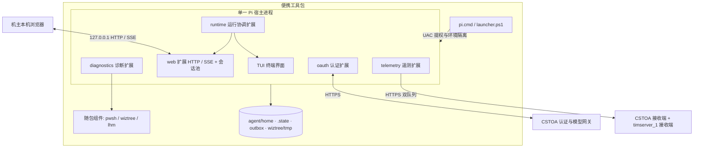

# 系统架构

CST Pilot 基于 Pi（`0.85.1`）扩展机制构建。现场运行保持单一 Pi 宿主进程，同时承载终端界面（TUI）、本机 Web 服务、诊断工具链、认证扩展与双端遥测。

## 系统组成

## 模块划分

| 模块 | 代码路径 | 核心职责 | 模块文档 |
|---|---|---|---|
| `runtime` | `pi.cmd`、`launcher.ps1`、`agent/home/extensions/runtime/`、`branding/` | UAC 提权启动、便携环境隔离、TUI/Web 接管、跨进程会话写权、共享配置重读 | [SPEC](runtime/SPEC.md) · [ARCHITECTURE](runtime/ARCHITECTURE.md) |
| `diagnostics` | `agent/home/extensions/diagnostics/`、`agent/home/skills/`、`pwsh/`、`wiztree/`、`lhm/` | 10 个注册工具、命令方案版本存储、共享目录大小缓存、PowerShell 安全调用、BitLocker 双端交互与跨进程卷锁 | [SPEC](diagnostics/SPEC.md) · [ARCHITECTURE](diagnostics/ARCHITECTURE.md) · [API](diagnostics/API.md) |
| `web` | `agent/home/extensions/web/`、`src/web/frontend/`、`src/web/design/` | 本机 HTTP/SSE 服务、多会话池、持久化输入收件箱、React 19 静态 SPA、流式渲染与工具卡片 | [SPEC](web/SPEC.md) · [ARCHITECTURE](web/ARCHITECTURE.md) · [API](web/API.md) |
| `auth` | `agent/home/extensions/oauth/`、`agent/home/extensions/web/server/api/` | `cstoa` 原生 Provider（设备码 OAuth 与 APIKEY）、动态模型目录、Pi 原生多服务登录与自定义服务 | [SPEC](auth/SPEC.md) · [ARCHITECTURE](auth/ARCHITECTURE.md) · [API](auth/API.md) |
| `telemetry` | `agent/home/extensions/telemetry/`、`cst-pilot-server` | 会话统计采集、恢复草稿、回答结束/心跳/关闭统一提交、双端独立队列与 Go 接收端 | [SPEC](telemetry/SPEC.md) · [ARCHITECTURE](telemetry/ARCHITECTURE.md) · [API](telemetry/API.md) · [OPERATIONS](telemetry/OPERATIONS.md) |
| `release` | `pack/`、`src/web/frontend/scripts/` | 官方二进制锁定、扩展 esbuild 预打包、WOFF2 字体子集构建、干净发行树校验与自动冒烟 | [SPEC](release/SPEC.md) · [ARCHITECTURE](release/ARCHITECTURE.md) |

## 全局运行边界

### 进程与宿主边界

1. 现场始终只运行一个 Pi 进程，不增设独立后端守护进程，不修改 Pi 源码或官方可执行文件。
2. 执行 `/web` 后，TUI 释放原会话并切入内存待机会话；Web 扩展在同一进程内通过 Pi SDK 创建并管理多个独立的 `AgentSession` 实例。
3. Pi 扩展由 jiti 在 `moduleCache: false` 下加载，TUI 切换会话会重跑扩展工厂函数；跨会话长驻资源（Web 服务器、会话池、写权登记、遥测调度器）统一挂载在进程级 `globalThis` 容器上。

### 存储与状态归属

| 路径 | 内容 | 读写规则 |
|---|---|---|
| `agent/home/APPEND_SYSTEM.md` | 项目级 Agent 提示词 | 随包只读分发，由 Pi 自动附加到系统提示词末尾 |
| `agent/home/settings.json` | 默认模型、启用范围、思考强度、TUI 主题 | TUI 与 Web 共用；按字段合并写入，操作前重读 |
| `agent/home/web-settings.json` | Web 主题与空模型范围标记 | Web 独占；默认 `light`，串行原子替换 |
| `agent/home/models.json` | 自定义模型服务、服务地址覆盖及可选 API key | TUI 与 Web 共用；原子替换后刷新 `ModelRuntime`，不得进入发行包 |
| `agent/home/models-store.json` | 离线与动态模型目录缓存 | 发行包预置上游目录与默认模型；CSTOA 登录后按凭据更新 |
| `agent/home/auth.json` | 各模型服务的 OAuth 令牌与 APIKEY | Pi `AuthStorage` 管理；严禁进入浏览器存储、日志或发行包 |
| `agent/home/device.json` | CSTOA 设备标识 | 首次登录生成，随 U 盘保留 |
| `agent/home/sessions/` | 会话历史 JSONL | TUI 与 Web 共用；按会话 ID 跨进程互斥持有写权 |
| `agent/home/web-inbox/` | Web 已接受输入队列、回执、创建时间与会话图片附件 | Web 后端按会话维护；先落盘确认再投递给模型 |
| `agent/home/web-access.log` | Web HTTP 与 API 访问诊断日志 | 追加请求方法、路径、响应状态与耗时；不记录查询参数或请求正文，当前无自动清理 |
| `agent/home/telemetry/` | 匿名安装身份、会话恢复草稿、双端待发队列与诊断状态 | 遥测扩展维护；通过跨进程目录锁保护 |
| `outbox/<YYYY-MM-DD>/` | 修复命令清单 TXT；版本化方案按 ID 分目录 | `runbook_deliver` 与 `runbook` 写入；同版本文件保持不变 |
| `outbox/.plans/<ID>/` | 每个方案版本的完整 JSON | `command_plan` 原子保存；共享目录锁核对修订版本 |
| `wiztree/tmp/` | WizTree 扫描导出的临时 CSV | 扫描期间写入，结束后清理 |
| `.state/` | 启动器与运行期临时目录 | 启动器初始化，重定向 `TEMP`/`TMP` 至工具包内 |

### 上下文与项目信任隔离

- 启动参数固定包含 `--no-context-files`，关闭工作目录及全局的 `AGENTS.md` 加载；开发仓库的 `AGENTS.md` 在打包时强制剔除。
- `settings.json` 固定设置 `defaultProjectTrust: "never"`，防止在机主电脑任意目录启动时加载陌生目录中的 `.pi/` 扩展或配置。

### 网络与代理边界

- 启动器设置 `PI_OFFLINE=1` 并配置 `enableInstallTelemetry: false`，关闭 Pi 内置的版本检查、包更新、模型目录拉取与官方遥测。
- `PI_OFFLINE=1` 不拦截扩展发起的请求：模型推理、联网检索工具、CSTOA 认证与动态目录、项目双端遥测按各自配置访问网络。
- 发行包生成最小 `agent/home/web-search.json`，仅配置 `ssrf.allowRanges: ["198.18.0.0/15"]` 与 `trustEnvProxy: false`，使 `pi-web-access` 在机主开启 TUN 假 IP 代理时可抓取公开网页，同时继续拦截回环地址、其他私网网段与私网重定向。
