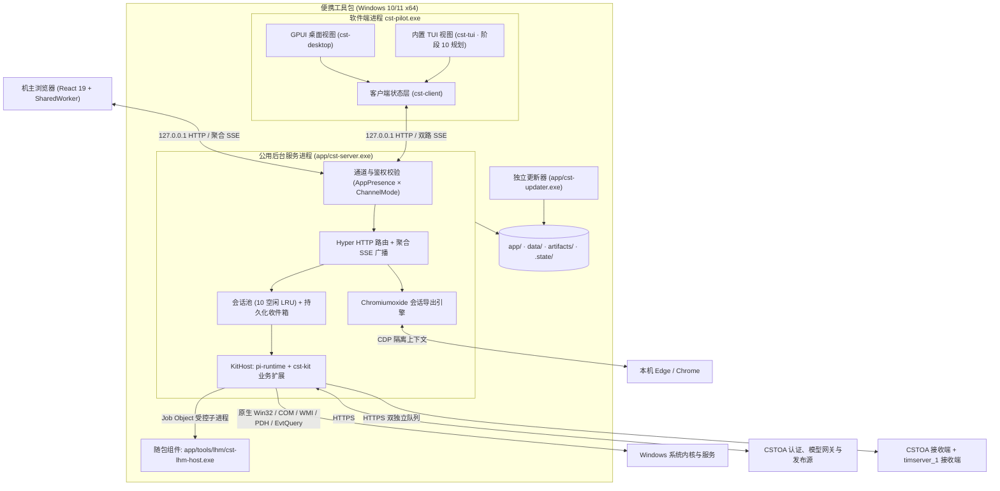

# 系统架构

CST Pilot 基于自研 Rust Pi 核心构建。运行期采用「软件端进程 + 本机公用后台服务进程」的双进程架构，承载原生诊断工具链、CSTOA 认证与遥测，同时支撑三端交互与软件内升级。

## 系统组成

## 模块划分

| 模块 | 代码与资源路径 | 核心职责 | 模块文档 |
|---|---|---|---|
| `pi-core` | `crates/pi-{ai,agent,session,runtime}` | 多协议模型流、三阶段参数校验与 Agent 循环、JSONL v3 会话树与压缩、静态扩展接口、MCP/Codemode 及公开 SDK | [SPEC](pi-core/SPEC.md) · [ARCHITECTURE](pi-core/ARCHITECTURE.md) · [API](pi-core/API.md) |
| `server` | `crates/cst-server`、`pi-web-rust.cmd` | 单实例服务发现、正交存活与通道状态机、本机 HTTP/SSE 路由、10 空闲会话 LRU 池、持久化收件箱与交互桥接 | [SPEC](server/SPEC.md) · [ARCHITECTURE](server/ARCHITECTURE.md) · [API](server/API.md) |
| `tools` | `crates/cst-kit/src/{kit,tools,diagnostics,runbook,bitlocker}`、`app/skills/`、`lhm/` | 14 个开放工具白名单、统一 `elapsedMs` 与凭据/SSRF 拦截、Windows 原生软硬件采集（Win32/NT/SCM/SetupAPI/IOCTL、无条目上限并行目录遍历与默认 `$MFT`）、Exa/DeepSeek 联网检索、单工具 `runbook` 及原生加密 WMI BitLocker | [SPEC](tools/SPEC.md) · [ARCHITECTURE](tools/ARCHITECTURE.md) · [API](tools/API.md) |
| `auth` | `crates/cst-kit/src/auth/`、`crates/cst-server/src/routes/{auth,models}.rs` | `cstoa` 设备码 OAuth 与 APIKEY 双路由、官方模型能力对齐、多服务异步授权流、自定义服务与 60 秒额度缓存 | [SPEC](auth/SPEC.md) · [ARCHITECTURE](auth/ARCHITECTURE.md) · [API](auth/API.md) |
| `telemetry` | `crates/cst-kit/src/telemetry/`、`cst-pilot-server` | 会话统计累加、CSTOA 请求扣点核对、命名管道草稿存活证明、双端独立发送队列与 Go + SQLite 接收端 | [SPEC](telemetry/SPEC.md) · [ARCHITECTURE](telemetry/ARCHITECTURE.md) · [API](telemetry/API.md) · [OPERATIONS](telemetry/OPERATIONS.md) |
| `web` | `src/web/frontend/`、`crates/cst-server/src/exports/`、`design/cst-pilot-web.pen` | React 19 单页应用、`SharedWorker` 32 会话分片聚合流、乐观发送状态机、工具卡片渲染及 PNG/离线 HTML 导出 | [SPEC](web/SPEC.md) · [ARCHITECTURE](web/ARCHITECTURE.md) · [API](web/API.md) |
| `desktop` | `design/cst-pilot-desktop.pen`、`crates/{cst-client,cst-desktop}`（阶段 10 规划 `crates/cst-tui`） | 原生 GPUI 桌面工作台、单窗口 D3D11 着色器背景与毛玻璃、清零密码框及预留窗口内置 TUI 视图 | [SPEC](desktop/SPEC.md) · [ARCHITECTURE](desktop/ARCHITECTURE.md) |
| `release` | `crates/cst-updater/`、`crates/cst-kit/src/update/`、`crates/xtask/`、`src/web/frontend/scripts/` | Ed25519 双重签名在线升级与独立更新器回滚、纯 Rust `xtask` 装配与干净发行树校验、共享可变字体分发及 LHM 自包含辅助程序发布 | [SPEC](release/SPEC.md) · [ARCHITECTURE](release/ARCHITECTURE.md) |

注：跨进程基础原语位于 `crates/cst-os`，独立更新器位于 `crates/cst-updater`，业务核心位于 `crates/cst-kit`，`crates/cst-desktop` 编译产出主程序 `cst-pilot.exe`。阶段 11 移除前，仓库冻结保留 `agent/home/extensions/` 与 `pack/`，供 `v0.6.2` 旧版对照。

## 全局运行边界

### 进程与通道边界

1. **单实例后台服务**：同一工具包数据目录仅运行一个 `cst-server` 进程，通过 Windows 命名管道锁互斥，并将监听端口与随机 `app_token` 原子写入 `.state/server.json`。
2. **存活与通道正交分离**：`AppPresence` 跟踪软件端长连接数量（首次连接等待 15 秒），断线满 6 秒宽限期后安全收尾退出。`ChannelMode` 独立控制 `AppActive` 与 `WebActive` 读写门禁，避免软件端断线重连意外覆盖 Web 操作权。独立调试模式通过 `--standalone-web` 直接进入 `WebActive`。
3. **会话单写权与空闲回收**：每场会话由操作系统命名管道与文件锁保证跨进程单写权。会话池对空闲会话按 LRU 最多保留 10 个内存实例。会话处于运行、排队、待答交互或挂载活跃 SSE 订阅期间固定常驻内存。

### 存储与状态归属

Rust 主线按 `app/`（只读程序区）、`data/`（用户持久数据区，支持 `CST_PILOT_DATA_DIR` 覆写）、`artifacts/`（现场交付产物区）与 `.state/`（运行态与锁目录）四区隔离：

| 路径 | 内容 | 读写规则 |
|---|---|---|
| `app/prompts/APPEND_SYSTEM.md` | 项目级诊断提示词 | 随包只读分发，自动附加到系统提示词末尾 |
| `app/skills/` | 10 份诊断、检索与交付技能说明 | 随包只读分发，供模型按需读取或通过 `/skill:<name>` 展开 |
| `app/defaults/` | `settings`、`models-store`、`telemetry`、`web-search` 默认模板 | 随包只读分发，用于首次初始化与升级缺失字段合并 |
| `app/fonts/`、`app/telemetry/`、`app/tools/lhm/` | 共享字体、遥测专用 CA / 币种表与 LHM 辅助程序 | 随包只读分发，在线升级随程序区验签替换 |
| `data/config/settings.json` | 默认模型、启用范围、思考强度 | 三端共用模型配置，按字段合并原子更新 |
| `data/config/web.json` | Web 主题、方向键选中样式与空模型范围标记 | Web 独占，默认 `light` 与 `brackets`，串行原子替换 |
| `data/config/desktop.json` | 桌面端主题、方向键选中样式、默认视图、侧栏状态与窗口几何 | 桌面端独占，按顶层 JSON 对象局部合并更新 |
| `data/config/tui.json` | 阶段 10 内置 TUI 独立外观配置 | 阶段 10 预留，与共享设置分开保存 |
| `data/config/models.json` | 自定义兼容模型服务与模型覆盖配置 | 三端共用，带 `revision` 防并发覆盖，严禁进入发行包 |
| `data/config/models-store.json` | 内置离线模型与动态目录缓存 | 首次按模板初始化。CSTOA 动态条目按凭据摘要隔离，损坏时备份重建 |
| `data/config/auth.json` | 各模型服务的 OAuth 令牌与 APIKEY | `FileAuthStorage` 加锁原子读写，严禁进入客户端存储、日志或发行包 |
| `data/config/device.json` | CSTOA 工具包设备标识 | 首次登录生成，跨机移动复用 |
| `data/sessions/` | 会话历史 JSONL v3（含工作目录分类子目录） | 三端共用，惰性创建，单写权互斥，末行半截 JSON 自动修复 |
| `data/inbox/` | 持久化输入队列、幂等回执（`receipts/`）、未写入磁盘的空会话快照（`unflushed/`）、已删除会话标记（`deleted/`）与图片附件（`attachments/`） | `cst-server` 管理。输入先写入磁盘再投递，重启后遗留 `delivering` 标为 `uncertain` |
| `data/exports/` | 会话导出任务登记与渲染临时目录（`work/`） | `SessionExportStore` 管理。重启时清理 `work/` 并将未完成任务标为中断失败 |
| `data/plans/<ID>/` | 多轮命令方案各版本 JSON | `command_plan` 持有命名管道目录锁校验 `baseVersion` 后原子保存 |
| `data/telemetry/` | 匿名安装密钥、会话恢复草稿（`drafts/`）、双端发送队列与状态摘要 | 遥测服务通过目录锁与命名管道存活证明维护 |
| `artifacts/<YYYY-MM-DD>/runbook/` | 手动修复命令清单 TXT（UTF-8 BOM + CRLF） | `runbook_deliver` 与 `runbook` 排他或按序号原子写入 |
| `artifacts/<YYYY-MM-DD>/sessions/` | 导出的会话长图 PNG 与离线 HTML | 导出引擎排他发布，读取时核验 SHA-256 |
| `.state/` | `server.json` 服务凭证、`ui-hints.json` 三端共享冷却提示、`locks/` 写锁、`update/` 升级事务与 `tmp/` 临时目录 | 软件端与后台服务维护，`PathGuard` 全面封锁模型工具访问 |

### 上下文、文件与网络隔离

- **项目上下文隔离**：`DefaultResourceLoader` 固定开启 `no_context_files = true`、`no_skills = true` 与 `no_prompt_templates = true`。会话创建固定传入 `project_trusted = Some(false)` 并在设置层锁定 `defaultProjectTrust = "never"`，忽略机主工作目录中的 `AGENTS.md`、`CLAUDE.md` 与 `.pi/` 配置。项目仓库自身的 `AGENTS.md` 严禁进入发行包。
- **本地敏感路径拦截**：`PathGuard` 在 `read`、`fffind` 与 `ffgrep` 入口解析真实路径并核对文件身份，阻断 `data/config/{auth,models,mcp-auth,web-search}.json`、`data/telemetry/identity.json` 与 `.state/` 目录，同时拦截目录外硬链接、Windows 设备路径与 NTFS 备用数据流。
- **默认离线与 SSRF 防护**：原生桌面启动器与测试环境通过 `CST_OFFLINE=1` 与显式配置关闭通用核心的默认版本检查与官方遥测。模型目录刷新与软件内签名升级由业务服务显式发起。联网检索与外部下载通过 `reqwest::ClientBuilder::no_proxy()` 关闭环境代理，每次请求与重定向前解析 DNS 并阻断回环与私网地址，仅按 `data/config/web-search.json` 放行 `198.18.0.0/15` TUN 假 IP 网段。
