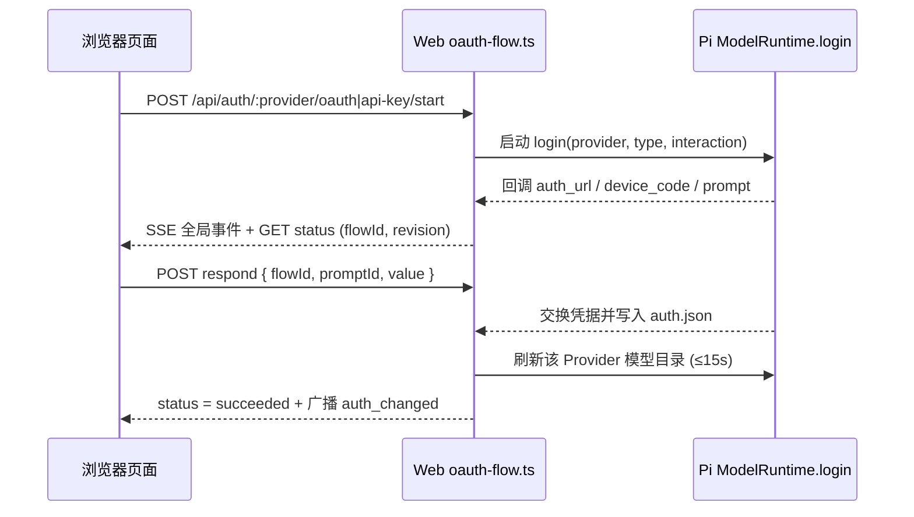

# 认证与模型服务架构

本页说明 `oauth` 扩展、Web 授权状态机、自定义服务持久化与账号额度缓存的实现结构。业务规则见 [SPEC.md](SPEC.md)，接口定义见 [API.md](API.md)。

## 模块组成

| 路径 | 职责 |
|---|---|
| `agent/home/extensions/oauth/index.ts`、`provider.ts` | 注册原生 `cstoa` Provider，按凭据类型路由至 OAuth 代理（`/api/agent/llm/v1`）或网关直连（`/v1`），复用 Pi Chat Completions 适配器 |
| `agent/home/extensions/oauth/oa.ts`、`device.ts`、`errors.ts` | RFC 8628 设备码申请、轮询、令牌交换／刷新、授权失效错误分类，以及 `agent/home/device.json` 持久化 |
| `agent/home/extensions/oauth/models.ts`、`catalog-factories.ts` | CSTOA 动态目录、凭据指纹隔离、5 分钟缓存／30 秒失败退避、独立 Provider 工厂登记与 `context.publish()` 发布 |
| `agent/home/extensions/oauth/request-observer.ts` | 遥测启用时按 `sessionId` 观察 CSTOA 推理 HTTP 尝试并提取 `x-oneapi-request-id`，不读取请求或响应正文 |
| `agent/home/extensions/web/server/api/oauth-flow.ts` | 将 Pi `ModelRuntime.login` 的交互回调转换为带 `flowId` 与递增 `revision` 的 Web 异步状态机 |
| `agent/home/extensions/web/server/api/custom-provider.ts` | 校验并原子读写 `models.json`，带配置版本（`revision`）防并发覆盖，更新后刷新 `ModelRuntime` |
| `agent/home/extensions/web/server/api/account.ts` | CSTOA 资料与多服务额度查询、60 秒内存缓存与凭据二次复核 |
| `src/web/frontend/app/auth/`、`settings/`、`account/` | 登录面板、无 `opener` 授权弹窗管理、设置资源缓存与账号展示组件 |

CSTOA 根据 `session_start` 的通道类型选择登录通知：TUI 使用 `info` 与链接展示授权说明，Web 保留 `device_code` 事件供二维码和倒计时使用。两端复用完整授权链接、设备授权轮询与凭据保存。

## CSTOA 动态目录与离线共存

启动器保留 `PI_OFFLINE=1`。项目目录协调器显式允许目录联网，普通内置供应商复用 Pi 的目录协议；`oauth` 提供独立 CSTOA Provider 工厂供后台运行时使用。CSTOA 按以下规则同步：

1. 将当前凭据摘要与服务地址作为缓存隔离键写入 `models-store.json`（不含明文令牌）。
2. 模型能力按原始 ID 或网关别名从 Pi 内置官方目录读取，包含上下文窗口、输出上限、图片输入、思考能力与图片限制。命中其他协议时仅复用能力字段，请求继续使用 Completions 参数。未知模型采用保守默认值，忽略上游返回的非标 URL 或请求头。
3. 推理阶段将 SDK 本地价目表设为 `0` 占位，实际积分由网关扣除，遥测通过 `request-observer.ts` 与只读账单接口独立采集真实扣点。

## Rust 认证与会话装配

Rust 业务包通过公开 `ModelRuntime`、`Provider` 与扩展生命周期接口接入认证。`Kit::create_session` 使用工具包配置创建 `AuthRuntime`；可信宿主可通过 `create_session_with_auth` 共享凭据服务并注入本机模拟 OA。后台任务归 `KitSession` 管理，关闭会话或丢弃该对象时取消。

| Rust 模块 | 职责 |
|---|---|
| `auth/mod.rs` | 认证运行时、登录退出、目录刷新与账号缓存失效入口 |
| `auth/storage.rs` | 兼容 `auth.json`、`models.json` 与缓存格式，保留未知字段；配置目录锁、句柄校验与原子保存 |
| `auth/oa.rs`、`device.rs` | 可信 OA 根地址、设备标识复用、设备码轮询、有效期与失效分类；拒绝重定向并限制响应大小 |
| `auth/provider.rs` | 按凭据类型选择 `/api/agent/llm/v1` 或 `/v1`，复用 Pi Completions 协议 |
| `auth/models.rs` | 官方能力映射、凭据摘要缓存、5 分钟有效期与 30 秒失败退避，发布前复核当前身份 |
| `auth/custom_provider.rs` | 四协议配置校验、修订号检查与密钥掩码，保存后刷新运行时，失败时仅回退自身未被后续修改的条目 |
| `auth/account.rs` | CSTOA 账号与三服务额度查询，60 秒内存缓存、并发请求合并、失效序号及响应后身份复核 |

1. 每个会话使用独立模型目录视图，凭据与磁盘缓存共用。扩展通过可重复工厂注册 Provider，重载或关闭一个会话不撤销其他会话的服务。
2. 启动后异步检查 CSTOA 目录，每 30 秒检查缓存状态，开始一轮调用时唤醒检查。成功与失败的联网频率由目录有效期控制；查询模型界面的宿主可显式调用 `AuthRuntime::refresh`。
3. 缓存损坏时先保留原文件，使用内置目录并尝试后台拉取。后续刷新或退出服务需写缓存时，在目录锁内将损坏字节备份为 `models-store.corrupt-<UUID>.json`，备份成功后原子重建缓存；备份失败则停止写入。凭据或模型配置损坏时拒绝修改；硬链接与目录重解析点直接拒绝。凭据只读检查不执行命令，读取时复用 Pi 配置值解析。
4. 账号查询只缓存完整成功结果。切换凭据、退出、强制刷新与 `agent_end` 使缓存失效；最后一个等待方取消后释放网络请求。额度仅发送到固定 OA 或已核验的 DeepSeek / OpenCode 官方端点，不跟随服务端重定向。

专项测试见 [TESTING.md](../TESTING.md#rust-测试环境)。模拟时钟验证轮询和缓存，本机 HTTP 服务验证两种凭据的推理路径；不访问生产账号。

## Web 授权流程状态机

- **单飞与版本保护**：每个 Provider 同时只维护一条进行中流程；切换认证方式、退出登录或关闭页面时通过 `AbortController` 取消旧流程。所有步骤响应校验 `flowId` 与 `promptId`，过期提交返回 `409`。
- **授权窗口隔离**：前端 `oauth-window.ts` 在用户点击同步上下文中打开空白窗口并立即断开 `opener`，再跳转至供应商授权 URL；本机回环回调与手动粘贴输入并行等待，先完成者生效并取消另一路。

## 凭据续期与失效分类

1. Pi 在到期前 5 分钟进入刷新窗口。CSTOA 无刷新令牌时保留尚未过期的访问令牌；临时刷新故障同样允许使用到实际到期时间，取消请求时立即终止。
2. 实际到期且无刷新令牌、或令牌端点返回 `401`、`403`、`invalid_grant` 时，扩展抛出 `cstoa_login_required` 错误。服务端设备撤销与密码变更校验继续生效。
3. Web 沿 Pi 包装错误的 `cause` 链识别该错误码。临时读取或刷新故障返回可重试说明，不标记登录失效、不缓存失败，也不向浏览器返回原始错误。账号接口明确拒绝授权时仍要求重新登录。

## 账号资料与额度缓存

`web/server/api/account.ts` 维护 60 秒内存缓存并合并并发请求：

1. **防串号复核**：发起 OA 请求前读取当前凭据摘要，请求返回后再次调用 Pi `getAuth` 复核凭据未发生变化；若期间用户已退出或切换账号，立即丢弃迟到响应。
2. **主动失效**：收到 `refresh=1`、登录成功、退出登录或 CSTOA `agent_end` 事件时递增失效序号并清除缓存。OA 请求固定 8 秒超时，拒绝任何 HTTP 重定向及包含用户名、密码、查询串或片段的异常服务地址。
