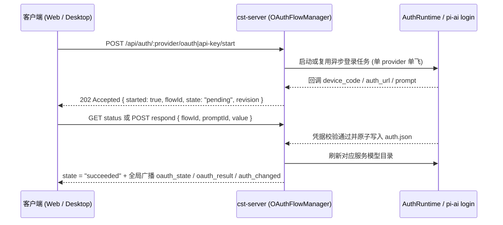

# 认证与模型服务架构

本页说明 `crates/cst-pilot/src/auth/` 与 `crates/cst-server` 认证路由的模块划分与缓存机制，涵盖动态目录隔离、异步授权流及防串号额度缓存。业务规则见 [SPEC.md](SPEC.md)，接口定义见 [API.md](API.md)。

## 模块组成

| 模块路径 | 职责 |
|---|---|
| `cst-pilot/src/auth/mod.rs`、`provider.rs` | 封装共享 `AuthRuntime`，注册原生 `cstoa` 服务商，按凭据类型路由至 OAuth 代理（`/api/agent/llm/v1`）或网关直连（`/v1`），复用 `pi-ai` Chat Completions 协议 |
| `cst-pilot/src/auth/oa.rs`、`device.rs` | 处理 RFC 8628 设备码申请、轮询与令牌刷新，输出失效错误分类（`cstoa_login_required`），管理 `agent/home/device.json` 持久化复用 |
| `cst-pilot/src/auth/models.rs` | 按凭据摘要隔离 CSTOA 动态模型目录，映射 `pi-ai` 内置官方模型规格，执行 5 分钟有效期与 30 秒失败退避 |
| `cst-pilot/src/auth/custom_provider.rs`、`storage.rs` | 持有配置目录锁原子读写 `auth.json`、`models.json` 与 `models-store.json`，执行 `revision` 冲突校验、密钥掩码与损坏缓存备份重建 |
| `cst-pilot/src/auth/account.rs` | 查询 `cstoa`、`deepseek` 与 `opencode-go` 账号资料及额度，维护 60 秒内存缓存、并发请求合并与响应后凭据摘要二次复核 |
| `cst-server/src/oauth.rs`、`routes/{auth,models}.rs` | 按 `provider_id` 管理多步异步登录状态机 `OAuthFlowManager`，校验运行中会话占用，通过全局 SSE 广播 `oauth_state`、`oauth_result`、`auth_changed` 与 `models_changed`（`cstoa` 回合结束后的 `quota_changed` 由 `session/slot.rs` 广播） |

## 动态目录隔离与宿主共享

1. **单一后台维护协程**：`KitHost` 在服务启动时创建唯一一条 30 秒 CSTOA 目录检查任务，与所有会话共享 `AuthRuntime` 及底层 `Arc<Models>`。任意会话启动对话（`agent_start`）或手动刷新时统一唤醒，每个会话通过独立目录视图隔离可用模型列表。
2. **凭据摘要缓存键**：动态目录以 `SHA-256(baseUrl + "\0" + credentialType + "\0" + token)` 作为 `etag` 写入 `models-store.json`（不含明文令牌）。每次读取与发布前核对当前有效凭据摘要，防止旧账号目录残留。
3. **官方能力复用**：已知模型及网关别名（`deepseek-v4.1-flash` 与 `deepseek-v4-flash` 映射至 `deepseek-flash`）直接从 `pi-ai` 内置数据表读取 `contextWindow`、`maxTokens`、`input`、`reasoning` 与图片限制。官方模型同样使用 `openai-completions` 协议时，一并复用 `thinkingLevelMap`、`compat`、`samplingParams` 与 `samplingParamsByThinkingLevel`，忽略上游响应中非标的 `baseUrl` 或 `headers`。

## 异步授权状态机（`OAuthFlowManager`）

- **单飞复用与版本校验**：每个服务商同时仅运行一条授权流。同一登录方式处于 `pending` 时直接复用现有流程。切换登录方式、直接提交密钥、退出登录或调用 `cancel` 时取消旧任务的 `CancellationToken`。提交步骤回答时校验 `flowId` 与 `promptId`，过期提交返回 `409`。

## 账号资料与额度防串号缓存

`account.rs` 对账号与额度查询维护 60 秒内存缓存并合并同服务并发请求：

1. **前后双重身份核对**：发起网络请求前记录当前凭据摘要，响应返回后再次读取 `CredentialStore`（`KitCredentials`）比对摘要。期间若发生退出登录或切换账号，立即丢弃迟到响应。
2. **主动失效与重定向拦截**：收到 CSTOA 强制刷新（`/api/account?refresh=1` 或 `/api/quota?provider=cstoa&refresh=1`）、凭据变更或 `agent_end` 事件时递增失效序号清空缓存。所有资料与额度请求固定 8 秒超时，仅发往可信 OA 或核验后的 DeepSeek / OpenCode 官方端点，拒绝任何 HTTP 重定向。
