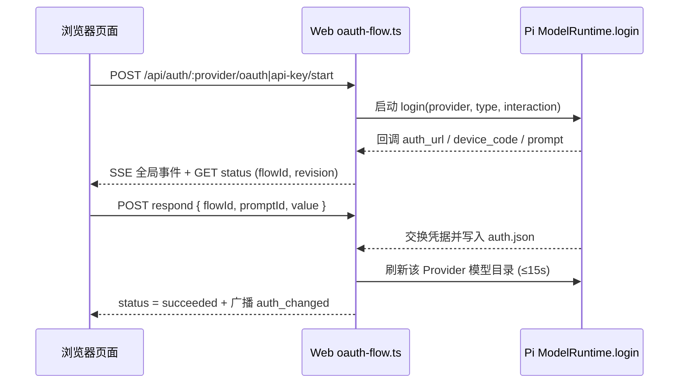

# 认证与模型服务架构

本页说明 `oauth` 扩展、Web 授权状态机、自定义服务持久化与账号额度缓存的实现结构。业务规则见 [SPEC.md](SPEC.md)，接口定义见 [API.md](API.md)。

## 模块组成

| 路径 | 职责 |
|---|---|
| `agent/home/extensions/oauth/index.ts`、`provider.ts` | 注册原生 `cstoa` Provider，按凭据类型路由至 OAuth 代理（`/api/agent/llm/v1`）或网关直连（`/v1`），复用 Pi Chat Completions 适配器 |
| `agent/home/extensions/oauth/oa.ts`、`device.ts` | RFC 8628 设备码申请、轮询、令牌交换／刷新，以及 `agent/home/device.json` 持久化 |
| `agent/home/extensions/oauth/models.ts`、`catalog-factories.ts` | CSTOA 动态目录、凭据指纹隔离、5 分钟缓存／30 秒失败退避、独立 Provider 工厂登记与 `context.publish()` 发布 |
| `agent/home/extensions/oauth/request-observer.ts` | 遥测启用时按 `sessionId` 观察 CSTOA 推理 HTTP 尝试并提取 `x-oneapi-request-id`，不读取请求或响应正文 |
| `agent/home/extensions/web/server/api/oauth-flow.ts` | 将 Pi `ModelRuntime.login` 的交互回调转换为带 `flowId` 与递增 `revision` 的 Web 异步状态机 |
| `agent/home/extensions/web/server/api/custom-provider.ts` | 校验并原子读写 `models.json`，带配置版本（`revision`）防并发覆盖，更新后刷新 `ModelRuntime` |
| `agent/home/extensions/web/server/api/account.ts` | CSTOA 资料与多服务额度查询、60 秒内存缓存与凭据二次复核 |
| `src/web/frontend/app/auth/`、`settings/`、`account/` | 登录面板、无 `opener` 授权弹窗管理、设置资源缓存与账号展示组件 |

## CSTOA 动态目录与离线共存

启动器保留 `PI_OFFLINE=1`。项目目录协调器显式允许目录联网，普通内置供应商复用 Pi 的目录协议；`oauth` 提供独立 CSTOA Provider 工厂供后台运行时使用。CSTOA 按以下规则同步：

1. 将当前凭据摘要与服务地址作为缓存隔离键写入 `models-store.json`（不含明文令牌）。
2. 模型能力（是否支持思考、图片输入、上下文窗口）优先匹配 Pi 内置已知模型元数据；网关新增的未知模型采用安全保守默认值，忽略上游返回的非标 URL 或请求头。
3. 推理阶段将 SDK 本地价目表设为 `0` 占位，实际积分由网关扣除，遥测通过 `request-observer.ts` 与只读账单接口独立采集真实扣点。

## Web 授权流程状态机

- **单飞与版本保护**：每个 Provider 同时只维护一条进行中流程；切换认证方式、退出登录或关闭页面时通过 `AbortController` 取消旧流程。所有步骤响应校验 `flowId` 与 `promptId`，过期提交返回 `409`。
- **授权窗口隔离**：前端 `oauth-window.ts` 在用户点击同步上下文中打开空白窗口并立即断开 `opener`，再跳转至供应商授权 URL；本机回环回调与手动粘贴输入并行等待，先完成者生效并取消另一路。

## 账号资料与额度缓存

`web/server/api/account.ts` 维护 60 秒内存缓存并合并并发请求：

1. **防串号复核**：发起 OA 请求前读取当前凭据摘要，请求返回后再次调用 Pi `getAuth` 复核凭据未发生变化；若期间用户已退出或切换账号，立即丢弃迟到响应。
2. **主动失效**：收到 `refresh=1`、登录成功、退出登录或 CSTOA `agent_end` 事件时递增失效序号并清除缓存。OA 请求固定 8 秒超时，拒绝任何 HTTP 重定向及包含用户名、密码、查询串或片段的异常服务地址。
