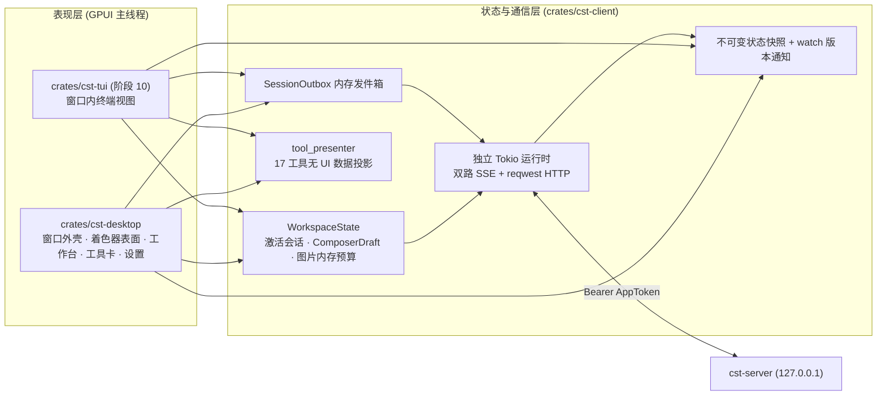

# 桌面端与客户端架构

本页说明本机客户端库 `crates/cst-client`（已实现）与 GPUI 桌面应用 `crates/cst-desktop`（阶段 9 实施）的模块分层、跨线程状态同步及 GPU 表面管线。详细模块目录与接口设计见 [9.desktop.md](../rust/plan/9.desktop.md)。

## 双包分层结构

客户端通信状态与 GPUI 渲染层拆分为两个独立 Cargo 包，便于阶段 10 内置 TUI 直接复用同一套状态与连接：

## 客户端状态与通信（`cst-client`）

1. **启动与双向身份核验（`bootstrap.rs`）**：获取桌面命名管道单实例锁，读取 `.state/server.json` 中的 PID、端口与令牌，经 Win32 核验目标进程映像路径、登录会话与管理员令牌，并与 `/api/health` 交叉比对。后台服务未运行时按需拉起 `cst-server.exe` 子进程。
2. **保活流与业务流隔离（`sse.rs`、`runtime.rs`）**：在独立 Tokio 线程内分开维护 `/api/app/events` 存活长连接与 `/api/events/stream` 多会话聚合业务流。GPUI 主线程即使短暂繁忙也不会反压存活流导致后台误触发断线退出。
3. **无锁快照订阅（`state.rs`、`session_store.rs`）**：后台线程归并 HTTP 快照与 SSE 增量事件后生成不可变共享快照句柄，通过 `watch` 版本号通知界面重绘，消除跨线程锁竞争。
4. **内存发件箱与无 UI 工具投影（`outbox.rs`、`tool_presenter.rs`）**：`SessionOutbox` 负责新建会话与首条消息两阶段提交及断线只读回执核对。`tool_presenter` 将 17 个开放工具的原始 `details` 转换为统一的字段组、排行表与风险命令结构，供 GUI 与 TUI 共用。

## 桌面窗口与渲染管线（`cst-desktop`）

1. **能力内聚模块**：基于 `gpui-kit`（`0.10.0`）按业务域划分九个子模块（基础层的 `theme`、`background`、`shell`，对话层的 `workbench`、`tools`、`sessions`，配置层的 `palette`、`settings`、`auth`），每个模块内聚自身状态实体与无状态展示组件。
2. **同设备 D3D11 着色器与毛玻璃（`background/`）**：`build.rs` 在编译期通过 `naga` 与 `D3DCompile` 按固定白名单编译三款背景着色器（`blue-sky.glsl`、`night-sky.glsl`、`blue-hour.glsl`）与浮层毛玻璃着色器（`frosted-glass.glsl`）为 DXBC 字节码。运行期复用 GPUI 窗口同一个 D3D11 设备直出 `1:1` 物理像素动态背景，并在绘制档 2 / 档 3 毛玻璃浮层前截取局部底图执行高斯模糊与圆角 SDF 合成，保持正文 ClearType 亚像素抗锯齿清晰。
3. **流式稳定渲染与安全输入**：消息列表与流式 Markdown 绑定稳定条目 ID 与 `TextViewState`，增量追加期间保留用户文本划选与滚动位置。`SecretInput` 使用预分配 `Zeroizing` 缓冲区与 `InputHandler` 组合态隔离，保障恢复密码与密钥输入安全。
