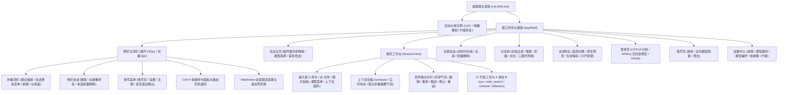

# Rust 桌面端全功能遍历端到端测试设计

本文定义 `cst-pilot.exe`（`crates/cst-desktop` 与 `crates/cst-client`）配合隔离 `cst-server.exe` 的全功能广度与深度遍历端到端测试方案，对标网页端的 [bsk-e2e.md](../../web/test/bsk-e2e.md) 与 [bsk-deep-e2e.md](../../web/test/bsk-deep-e2e.md)。

[ux-e2e.md](ux-e2e.md) 负责帧率、延迟与像素级视觉校核，[desktop-ui-audit.md](../../test/desktop-ui-audit.md) 负责静态画布节点核对。本文聚焦桌面端全部业务功能可用性、跨进程状态同步以及长生命周期状态机正确性。窗口与客户端规格见 [desktop/SPEC.md](../SPEC.md) 和 [desktop/ARCHITECTURE.md](../ARCHITECTURE.md)，CLI 操作方式见 [winapp-cli.md](winapp-cli.md)。

## 1. 功能路由与核心状态机拓扑

广度遍历按窗口外壳、工作台、会话管理、登录账号、设置中心与进程生命周期六大域展开，覆盖全部可达视图与页内交互分支：

深度遍历在真实模型与故障注入条件下验证以下 8 类桌面端核心状态机：

| 类别 | 状态机名称 | 核心实现模块 | 关键转移与故障边界 | 对应套件 |
|---|---|---|---|---|
| 显式 | 双进程引导与通道门禁 | `crates/cst-client/src/bootstrap.rs`、`crates/cst-server/src/mode.rs` | 单实例唤醒、UAC 提权拉起、`AppPresence` 6 秒宽限退出、`AppActive <-> WebActive` 切换与写锁 | F7、DF6 |
| 显式 | 双路 SSE 与会话缓存 | `crates/cst-client/src/sse.rs`、`runtime.rs`、`session_store.rs` | 保活流与业务流隔离、向量游标 256 帧重放、溢出定向 `reset`、重载失败保留旧快照与恢复 | F3、DF6 |
| 显式 | 客户端发件箱与后端收件箱 | `crates/cst-client/src/outbox.rs`、`crates/cst-server/src/session/inbox.rs` | 两阶段提交、`202` 响应丢失按原 ID 对账、队列 `version` 乐观锁（`409`）、`steer` 插话与 `paused` 恢复 | F3、DF3 |
| 显式 | 双层 Agent 循环与上下文压缩 | `crates/pi-agent/src/agent_loop.rs`、`crates/pi-session/src/compaction.rs` | 轮末真实 `usage` 压缩、轮前投影压缩、`Split-Turn` 双摘要、`Overflow` 单次恢复、`Length` 截断配对 | DF1、DF2 |
| 显式 | 挂起交互桥与清零密码输入 | `crates/cst-server/src/session/interactions.rs`、`crates/cst-desktop/src/tools/bitlocker_card.rs` | `Pending`（180s）-> `400` 保持挂起 -> `200` 单次消费 -> `409` 冲突；55 字节内存清零与 IME 禁用 | F4、DF4 |
| 隐式 | 会话切换绑定与流式快路径 | `crates/cst-desktop/src/shell/mod.rs`、`crates/cst-client/src/runtime.rs` | 活跃会话 ID 纳入可观察快照；热缓存与冷加载切换后输入框和流式快路径严格绑定新会话 | F1、F3 |
| 隐式 | 分支树全树加载与布局折叠 | `crates/cst-desktop/src/sessions/branch_tree.rs`、`crates/cst-server/src/routes/sessions.rs` | 超过 60 层长会话无递归深度截断、解析失败不覆写有效树、在途刷新版本追踪与跨压缩点切分支 | F5、DF5 |
| 隐式 | 路由历史、子页重建与草稿保护 | `crates/cst-desktop/src/shell/mod.rs`、`settings/preferences_tab.rs` | 切至设置再返回分支树或导出页完整重建状态；模型偏好保存失败不清除草稿显式选择 | F1、F2、F6 |

## 2. 分层驱动机制与测试环境

桌面端采用「真窗 CLI 遍历 + 真实模型深度代理 + 无头 GPUI 竞态回归」三层协同验证，避免单一层次漏检跨进程或微秒级竞态问题：

| 执行层 | 驱动工具与目标进程 | 覆盖重点 | 不可替代性 |
|---|---|---|---|
| 真窗功能遍历层 | `winapp ui` + `desktop-secret.ps1` + 隔离 `cst-pilot.exe` / `cst-server.exe` + 真实 `deepseek/deepseek-flash`（Mock OA 仅用于离线扫码） | 全路由可达性、UIA 控件触发、真实模型流式对话与压缩、无回显填密、文件打开、窗口退出与 `WebActive` 切换 | 验证真实 D3D11/GPUI 窗口、UIA 节点树、真实模型响应与双进程 IPC |
| 真实模型深度层 | 隔离 `cst-pilot.exe` / `cst-server.exe` + 透明转发代理 + 真实 `deepseek/deepseek-flash`（`contextWindow` 500K 覆写） | 多轮真实工具链、参数强转、两类阈值压缩、`Split-Turn`、真实 `401` 与进程强杀重启对账 | 暴露真实模型流式节奏、长上下文切点与真实网关异常 |
| 无头确定性回归层 | `cargo test -p cst-desktop --features test-support` + `cst-client` / `cst-server` 集成测试 | 热/冷切会话竞态、`/compact` 跨页切回、SSE 重载失败、百层长树解析、队列并发 `409`、IME 组合态 | 毫秒级稳定复现人工难以按中的时序窗口 |

### 2.1 隔离环境搭建规则

1. **目录与进程隔离**：全部夹具、发行树、日志与截图写入 `E:\tmp\<YYYY-MM-DD>\desktop-feature-e2e\`，严禁修改工作区或本机真实配置。通过 `cargo run -p xtask -- dist` 生成阶段 9.2 干净发行树（根目录 `cst-pilot.exe` + `VERSION`，`app/` 含 `cst-server.exe`、`cst-updater.exe`、字体、提示词、8 份技能、默认配置模板与内嵌 Web 前端）。
2. **凭据隔离**：使用短期、限额测试密钥。运行目录与证据分开；退出后清除运行目录中的凭据。归档只收录明确列出的脱敏截图、UIA 节点、测试结果和代理元数据。
3. **主辅双宿主与透明转发代理**：主宿主（`kit-main`）以 `--port 0`、`CST_PILOT_ROOT`、`CST_ALLOW_UNELEVATED=1`、`CST_OFFLINE=1` 启动，承载真实模型对话、工具链、压缩、分支树、导出与强杀恢复；必要故障注入与暂停点（如 `429/503`、`length` 截断、排队挂起）通过绑定 `(sessionId, requestKind, attempt)` 的本地透明转发代理透传至真实 DeepSeek 接口完成。辅助宿主（`kit-aux`）挂载模拟 `BitLockerSource`、受控延迟 `ImageStore` 与 `ServerUiBridge` 触发端点，覆盖无需真实加密卷的挂起桥接与 10 空闲会话淘汰。
4. **500K 校准与请求预算**：深度套件复用 [bsk-deep-e2e.md](../../web/test/bsk-deep-e2e.md#22-500k-上下文校准与请求预算) 的口径：隔离 `data/config/models.json` 通过 `modelOverrides` 将 `deepseek/deepseek-flash` 原生 `1,000,000` 窗口覆写为 `500000`（阈值 `483,616`），探针校准基线落在 `[445,000, 465,000]`，单用例 `chat_turn` 上限 `8` 次（`DF1-1` 上限 `16` 次），整套深度测试总真实请求熔断上限 `80` 次。
5. **CPU 亲和性与四态判定**：所有 Cargo 编译和测试命令先按 `AGENTS.md` 预留 2 个逻辑核心。每项用例独立新建会话或夹具，结果记为 `通过`、`失败`、`场景未触发` 或 `环境阻塞`；失败项必须保留会话 JSONL、代理请求日志与真窗截图。

## 3. 广度功能遍历套件（F1–F7）

本节对标 [bsk-e2e.md](../../web/test/bsk-e2e.md) 的 S1–S7，补充桌面端特有入口（折叠侧栏顶栏菜单、`Ctrl+K` 面板、路由历史、双进程唤醒与升级交接），共 38 组用例。

### 套件 F1：全局外壳、侧栏形态与会话列表

| 编号 | 功能路径与分支 | 操作序列 | 预期结果与状态核验 |
|---|---|---|---|
| F1-1 | 主页首次缺凭据自动弹窗 | 清空 `auth.json` 与 `models.json` 启动桌面端，关闭自动弹窗后重启桌面端，随后在输入框输入内容并点击发送 | 首次进入弹出 `missing-key-dialog` 并在 `.state/ui-hints.json` 记录冷却时间；24 小时内重启不重复弹出；点击发送仍拦截并保留草稿 |
| F1-2 | 侧栏折叠展开与顶栏会话更多菜单 | 进入有效会话，点击 `sidebar-collapse-btn` 折叠侧栏，点击 `topbar-session-more-btn` 展开菜单并依次核验「分支树」「导出会话」「分享（禁用）」，最后点击 `topbar-expand-sidebar-btn` 恢复 | 折叠后顶栏展示会话更多入口，菜单与最近会话抽屉、账号弹窗互斥，`Esc` 单帧关闭并归焦；进入分支树与导出页功能正常 |
| F1-3 | 最近会话抽屉与热/冷切换会话隔离 | 预置会话 A（已缓存）与会话 B（冷加载），折叠侧栏后通过 `topbar-recent-drawer-btn` 切换至 B 并立即发送消息；再次切回 A 后快速切至 B 立即输入发送 | 活跃会话 ID 与 `Workbench` 绑定实时一致，无论热缓存命中还是冷加载，消息严格投递至目标会话 B，不误发至旧会话 A |
| F1-4 | 侧栏搜索、右键重命名与多选模式 | 预置 25 个会话，在 `sidebar-search-box` 输入关键词筛选并按两段式 `Esc` 清空；右键会话重命名并按 `Enter`；进入多选模式勾选 2 条会话批量删除 | 搜索实时过滤且组合输入态不误清；`PATCH /api/sessions/:id` 同步更新 JSONL 与全部视图标题；批量删除后自动退出多选态 |
| F1-5 | 全部会话四时间分组与 `409` 删除回滚 | 点击 `sidebar-all-sessions-btn` 核对今天/昨天/近 7 天/更早分组；进入批量模式全选删除，其中 1 条会话保持流式运行 | 空闲会话立即移除，删除当前会话自动回到主页；运行中会话收到 `409` 后恢复原行位置并弹出顶部报错条 |
| F1-6 | `Ctrl+K` 面板与跨页路由历史返回 | 按 `Ctrl+K` 依次搜索并执行切换会话、新建会话、`/tree` 与 `/export`；在分支树或导出页切至设置页，再点击返回 | `Ctrl+K` 即时响应且焦点归还准确；从设置页返回分支树或导出页时执行完整子页初始化并重新加载数据，不出现空白预览 |

### 套件 F2：登录、账号与设置中心

| 编号 | 功能路径与分支 | 操作序列 | 预期结果与状态核验 |
|---|---|---|---|
| F2-1 | 常规设置外观与窗口记忆 | 进入 `settings-tab-general`，依次切换深色、浅色、跟随系统；缩放并移动窗口后重启桌面端 | `PATCH /api/desktop/settings` 局部合并写入 `desktop.json`，不覆盖 `settings.json` 与 `web-settings.json`；重启后窗口位置与折叠态准确恢复 |
| F2-2 | 快捷键设置页 | 切换至 `settings-tab-shortcuts` 核对全部条目 | 展示全部桌面与聊天快捷键分组，胶囊键位文本与实际按键行为一致 |
| F2-3 | 模型服务目录刷新与搜索 | 进入 `settings-tab-providers`，点击刷新目录按钮，在搜索框过滤服务商并验证连点防重入 | `POST /api/models/refresh` 合并并发请求，刷新期间禁用重复提交，完成后更新目录并展示顶部通知 |
| F2-4 | 自定义服务 4 协议增删改与无回显填密 | 新建自定义服务遍历 4 种协议，用 `desktop-secret.ps1` 向 `providers-apikey-input` 填密并添加 2 个模型保存；再次编辑修改名称与模型后删除 | UIA 不返回密钥明文；`POST /api/auth/custom` 校验 `revision`，`DELETE /api/auth/custom/:id` 原子更新 `models.json` 且不回显明文密钥 |
| F2-5 | 标准服务商 APIKey 登录与登出广播 | 在 `login-tab-apikey` 选择 DeepSeek 并无回显填入密钥保存，核对服务列表变为「已连接」，再进入移除凭据 | `PUT /api/auth/deepseek/api-key` 与 `logout` 原子更新 `auth.json`，经 SSE 广播 `auth_changed` 与 `models_changed`，首页模型选择器即时更新 |
| F2-6 | CSTOA 扫码登录 | 切至 `login-tab-cstoa`，核对 `cstoa-qr-image-box` 离线光栅二维码与倒计时，由 Mock OA 批准授权 | 页面不暴露明文设备授权码；授权成功后写入 `device.json` 与 `auth.json`，拉取动态模型目录并自动跳转账号页 |
| F2-7 | 账号资料、额度刷新与退出登录 | 在 `account-view` 核对姓名学号，点击 `account-quota-refresh-btn` 刷新额度，点击 `account-logout-btn` 在确认弹窗中确认退出 | 确认弹窗具备焦点陷阱与 `Esc` 取消；确认登出后清除 CSTOA 凭据与关联动态模型缓存 |
| F2-8 | 模型偏好默认模型、范围排序与失败保护 | 在 `settings-tab-preferences` 切换默认模型、勾选/取消启用模型、测试清空与全选；在草稿选定自定义模型后模拟偏好保存返回 `500` | `POST /api/models/scoped` 正确区分 `enabled: []` 与 `enabled: null`；保存失败时界面回滚且不清除当前草稿已选定的显式模型与思考强度 |

### 套件 F3：聊天工作台、草稿、压缩与输入队列

| 编号 | 功能路径与分支 | 操作序列 | 预期结果与状态核验 |
|---|---|---|---|
| F3-1 | 首页模型双级选择与乐观发送 | 在主页通过 `composer-model-picker-btn` 切换模型与思考强度，输入问题按 `Enter` 发送 | 主页选择仅随本次新建会话提交，不改写全局默认配置；立即切换会话页展示乐观气泡，SSE 承接正文且无闪烁 |
| F3-2 | `/` 命令、`/skill:` 与 `@` 文件补全 | 输入 `/` 选入 `/skill:disk`，输入 `@` 过滤并选中工作区文件，输入中文 IME 组合词按 `Enter` 上屏 | 后端投递前展开技能正文，`@` 过滤隐藏项与构建目录；IME 组合态按 `Enter` 仅上屏选词，不误触发发送 |
| F3-3 | `/compact` 默认折叠气泡与后台压缩隔离 | 在长会话输入 `/compact 仅保留排障结论`，观察实时压缩提示；另起一次 `/compact` 后立即切至会话 B 或设置页等待完成 | 压缩中展示 `session-compacting-status`；完成后保留压缩前历史并在原位展示默认折叠的 `compactionSummary` 气泡，点击头部展开 Markdown 摘要与复制栏；后台压缩完成或失败均不强行切回会话 A |
| F3-4 | 图片粘贴、草稿隔离与原比例灯箱 | 粘贴 PNG 图片至会话 A 输入框，切去会话 B 再切回 A；发送后点击图片打开灯箱，按 `Esc` 关闭 | 草稿图片按会话独立缓存且受内存预算约束；发送后通过 `/attachments/:aid` 渲染；灯箱关闭后焦点归还原触发节点 |
| F3-5 | 运行中队列编辑、重排、插话与停止 | 通过透明转发代理暂停点挂起真实 DeepSeek 流期间连续提交 3 条消息，在队列栏重排顺序、编辑其中 1 条回填输入框、将另 1 条点击「立即」转为插话，最后点击停止 | 队列操作携带 `version` 校验；插话在下一边界优先投递；停止后取消当前流并置队列为暂停态 |
| F3-6 | 发送失败重试与 `uncertain` 恢复 | 模拟 `500` 触发失败气泡并测试原位「重试」与「编辑」；预置强杀遗留 `delivering` 收件箱记录并重启服务打开会话 | 失败气泡保留原 ID 重试不重复建消息；遗留 `delivering` 转为 `uncertain` 提示待核对，不自动重放模型请求 |
| F3-7 | 上下文圆环与按需额度面板 | 点击 `composer-context-ring-btn` 展开上下文面板，关闭后在 60 秒内再次展开 | 展示当前上下文占用与服务商额度；60 秒缓存期内二次展开复用缓存不重复请求远端 |

### 套件 F4：17 个开放工具卡片与 4 类特殊组件

| 编号 | 功能路径与分支 | 操作序列 | 预期结果与状态核验 |
|---|---|---|---|
| F4-1 | 普通工具折叠组、三类模板与 `ls` 预算截断 | 触发 6 项只读诊断工具、`fffind`、`ffgrep`、`read` 及超大目录 `ls`（低预算超时），展开折叠头、单卡「原始数据」与复制按钮 | 连续普通工具合并显示次数与耗时；概览/排行/原文三模板数据完整且可复制；`ls` 在目录项之间检查预算，触顶后标明截断与大小下界；单次同步文件系统调用仍可能阻塞 |
| F4-2 | 常驻 `sys(overview)` 卡片 | 触发 `sys(overview)`，展开次级硬件详情与降级字段 | 卡片位于过程折叠外，前后不出现「0 次工具调用」；缺失传感器字段按降级提示清晰呈现 |
| F4-3 | 常驻 `web_search` 卡片 | 触发 `web_search`（含正常检索与部分降级结果），展开搜索词列表并点击外部链接 | 折叠查询列表展开准确；降级或失败状态仅图标着色；外部链接按预期调用系统浏览器 |
| F4-4 | 常驻 `command_plan` 与 `runbook_deliver` | 触发两轮 `command_plan` 修订与 `runbook_deliver` 交付，点击卡片复制按钮与「打开」文件名链接 | 卡片准确展示方案版本号与三档风险分层；落盘 TXT 为 UTF-8 BOM + CRLF；点击「打开」调用 `/runbook/open` 拉起记事本 |
| F4-5 | `bitlocker(unlock / decrypt)` 隐藏输入与清零 | 触发 `bitlocker(unlock)`，通过 `desktop-secret.ps1` 输入 48 位恢复密码提交；触发 `bitlocker(decrypt)` 确认目标卷清单 | 聚焦密码框期间禁用 IME，失焦恢复；提交或关闭后缓冲区逐字节清零；恢复密码原文不落盘 JSONL、收件箱或日志 |
| F4-6 | `bitlocker` 强杀复查 `unknown` 卡片 | 预置未闭合 `bitlocker` 调用与 `status: "unknown"` 且 `volumes: []` 的复查记录，打开会话 | 卡片明确展示「结果未确认」与中断原因，空卷列表不误判为解锁或解密成功 |

### 套件 F5：派生会话与分支树

| 编号 | 功能路径与分支 | 操作序列 | 预期结果与状态核验 |
|---|---|---|---|
| F5-1 | 消息菜单与 `/fork` 派生回填 | 点击助手回复末尾派生按钮或输入 `/fork`，在弹窗中选择历史用户消息确认 | 调用 `POST /api/sessions/:id/fork` 创建新会话并切入，该用户消息原文回填至新会话输入框，原会话叶节点不变 |
| F5-2 | 分支树 5 档过滤、搜索与折叠展开 | 进入分支树，分别通过过滤下拉菜单与 `Ctrl+O` 切换 5 档过滤，输入关键词搜索，点击单节点折叠徽章及工具栏「全部折叠 / 全部展开」 | 树连线、当前位置标记与计数准确；下拉展开时按 `Esc` 仅关下拉，再按 `Esc` 返回聊天页；方向键与 `Enter` 导航正常 |
| F5-3 | 分支导航三选项与总结中途取消 | 点击非叶节点打开 `branch-summary-mode-card`，依次验证「不总结」「总结」「用自定义提示词总结」，并在总结流挂起时点击取消 | 三模式与 `/tree/navigate` 状态一致；不总结预填对应用户消息；取消总结调用 `/tree/abort` 后保持原叶节点且无半成品条目 |
| F5-4 | 超深长会话分支树加载与在途刷新 | 预置含 120 轮连续消息与压缩节点的长会话并打开分支树；在树请求尚未返回期间向该会话追加新消息并推送 `session_tree` | 长会话树完整渲染全部节点，不因 `serde_json` 递归深度限制被静默清空；请求解析异常绝不覆盖本地兜底；在途版本变更完成后自动补拉至最新叶节点 |

### 套件 F6：会话导出与桌面原生预览

| 编号 | 功能路径与分支 | 操作序列 | 预期结果与状态核验 |
|---|---|---|---|
| F6-1 | 导出选项切换与原生预览更新 | 打开导出页，切换 PNG / HTML 格式、浅色 / 深色预览主题、勾选/取消「包含思考过程」与「包含工具调用结果」 | `POST /exports/preview` 返回脱敏快照；预览区独立响应导出主题而不改动桌面主窗口主题；连续切换选项无旧结果倒挂 |
| F6-2 | 导出生成、打开目录与篡改 `409` | 分别生成 PNG 与离线 HTML，等待完成后点击打开目录；人工改写磁盘导出文件后通过接口读取校验 | 产物写入 `artifacts/<日期>/sessions/` 且字节合法；打开目录定位正确；被篡改文件读取返回 `409` |
| F6-3 | 离页取消轮询与路由返回重建 | 发起导出后立即切离至设置页，等待旧任务结束后核对未误弹资源管理器；再按返回键回到导出页 | 离页后停止后台轮询不误开目录；从设置返回导出页时自动重新初始化预览，不遗留空白画布 |

### 套件 F7：双进程生命周期、通道互斥与软件内升级

| 编号 | 功能路径与分支 | 操作序列 | 预期结果与状态核验 |
|---|---|---|---|
| F7-1 | 单实例重复启动唤醒 | 保持隔离桌面端最小化或置于后台，再次启动同一 `--kit-root` 的 `cst-pilot.exe` | 新进程通过命名管道通知已有实例置前恢复窗口并立即退出，不重复拉起第二窗口或第二服务端 |
| F7-2 | `WebActive` 接管锁定与退出恢复 | 点击 `topbar-open-web-btn` 切入 Web 模式，核对桌面覆盖 `web-active-lock-overlay` 且写操作被禁用；在 Web 端修改模型配置后在桌面端点击「退出网页端」 | 锁定期间桌面端持续收到配置变更同步但禁止发送消息；退出网页端后解锁遮罩消失，会话读写恢复正常 |
| F7-3 | 安全退出确认框与双进程无残留退出 | 分别在空闲态与存在运行中会话/非空草稿时点击窗口关闭按钮或账号菜单退出，验证「继续使用」与「停止任务并退出」 | 存在未完成状态时弹出 `exit-confirm-dialog`（默认焦点「继续使用」）；确认退出后暂停队列、完成遥测定稿，双进程在宽限期内干净退出无孤儿进程 |
| F7-4 | 软件内升级检查、门禁与事务恢复 | 在设置页触发检查更新，模拟可升级签名清单验证确认弹窗与取消；在运行中任务期间发起升级验证 `ActivityGate` 拦截；预置未闭合 `.state/update/transaction.json` 启动桌面端 | 空闲门禁拒绝在活跃任务期间交接；检测到未闭合事务时先调用 `cst-updater.exe --recover` 逆序回滚，不在半替换状态下加载主窗口 |

## 4. 深度状态机遍历套件（DF1–DF6）

本节对标 [bsk-deep-e2e.md](../../web/test/bsk-deep-e2e.md) 的 D1–D6，在隔离桌面端（主宿主 + 辅助宿主 + 透明转发代理 + 真实 `deepseek/deepseek-flash`）下验证 29 组深度边界场景。

### 套件 DF1：真实多轮工具链、参数强转与流式无闪交接

| 编号 | 状态机路径与边界 | 操作序列与同步控制 | 通过断言与后端核验 |
|---|---|---|---|
| DF1-1 | 多轮连续工具链与同轮并发调用 | 在桌面端发送跨文件核查提示词，引导真实模型执行 `>= 6` 轮工具调用（含同轮并发），定稿后切会话再切回并展开过程折叠头 | 全部 `toolResult` 按序配对回填；折叠头统计真实工具次数；历史折叠段展开无丢块无错位 |
| DF1-2 | 参数三阶段强转与校验自修正 | 场景 A 由代理将真实 `read` 数字参数改写为字符串 `"5"`；场景 B 注入空字段 `command_plan` 触发校验拦截并放行下一轮真实模型自修正 | 场景 A 强转成功执行；场景 B 拦截后落盘结构化报错，下一轮真实模型补齐参数成功创建方案并在桌面端渲染方案卡 |
| DF1-3 | 普通工具与常驻特殊组件交替分段 | 引导真实模型单回合依次调用普通检索工具、`sys(overview)`、二次检索、`command_plan` 与 `runbook_deliver` | `turn_segments` 准确拆分为折叠过程段与常驻卡片交替流，各折叠段独立计数，全程无「0 次工具调用」 |
| DF1-4 | `StopReason::Length` 截断配对与恢复上限 | 场景 A 满额 `length` 截断末尾 `toolCall` 参数并放行下一轮；场景 B 注入提前 `length` 截断 | 场景 A 残缺工具未执行，写入配对错误结果后由模型补发收敛；场景 B 最多自动压缩重试 1 次后停止 |
| DF1-5 | 流式增量推进与防抖快照交接 | 请求含思考、工具与多段代码块的回复，持续采样桌面正文容器长度与文本划选状态至定稿后 `500ms` | 流式阶段正文单调追加不倒退；`message_end` 与快照替换期间无闪空，定稿正文与 JSONL 一致 |

### 套件 DF2：500K 超长上下文、压缩气泡与溢出恢复

| 编号 | 状态机路径与边界 | 操作序列与同步控制 | 通过断言与后端核验 |
|---|---|---|---|
| DF2-1 | 近 500K 两类阈值自动压缩 | 探针校准基线至 `[445K, 465K]`；路径 A 无工具末轮跨过 `483,616` 触发轮末压缩；路径 B 分块读 `48 KiB` 日志触发轮前投影压缩，随后发送续答 | 两条路径均调用真实模型生成 `CompactionEntry`；压缩后上下文面板显示「用量未知」，续答后回落至压缩基线且代理请求携带摘要 |
| DF2-2 | 超长单轮 `Split-Turn` 双总结切点保护 | 预置早期多轮历史叠加单轮多份 `48 KiB` 读取结果，执行 `/compact` 并核验代理记录与 JSONL | `firstKeptEntryId` 落在 `assistant` 或 `user` 边界，绝不切在 `toolResult`；代理捕获历史与拆分轮 2 次真实总结，摘要含 `Turn Context (split turn)` |
| DF2-3 | 超过 500K 溢出单次恢复与静默超限 | 场景 A1 首次注入 `context_length_exceeded` 放行恢复；场景 A2 连续两次注入溢出；场景 B 注入 `Stop` 且 `prompt_tokens = 505,000` | 场景 A1 写入 `ContextEditEntry` 后经压缩重发成功；场景 A2 仅尝试 1 次后报错停止且会话可继续发言；场景 B 仅后台压缩不重发提问 |
| DF2-4 | `/compact` 冲突边界与桌面压缩气泡双视图 | 在短会话和刚压缩完无新增消息的会话分别执行 `/compact`；随后核对聊天区与分支树「全部」视图 | 分别返回 `409 nothing_to_compact` 与 `409 already_compacted` 并弹出明确报错条；聊天区保留压缩前历史并展示默认折叠的压缩摘要气泡，点击可展开复制；分支树同步显示 `压缩 · Xk tokens` |
| DF2-5 | 130 条长会话滚动锚点与回到底部 | 打开预置 130 条历史消息的会话，滚离底部超过阈值观察悬浮按钮，点击「回到底部」 | 首屏加载流畅不掉帧；离底后显示 `scroll-to-bottom-btn`，点击后准确滚回底端并恢复新消息自动跟随 |
| DF2-6 | 超长会话导出分页与 `413` 后恢复 | 在导出页分别对正常长会话、超 `100,000px` 会话与超 `32 MiB` 会话发起导出，拦截后切回正常会话再次导出 | 正常长会话输出多页 PNG 与离线 HTML；超限会话分别返回 `export_too_tall` 与 `413 export_too_large` 并展示错误提示，后续导出队列不受阻塞 |

### 套件 DF3：收发件箱并发、插话边界、响应丢失对账与停止恢复

| 编号 | 状态机路径与边界 | 操作序列与同步控制 | 通过断言与后端核验 |
|---|---|---|---|
| DF3-1 | 运行中入队与 `version` 乐观锁冲突 | 代理暂停点挂起真实流，连续提交 3 条队列项，用过期 `version` 调重排，再通过桌面队列栏编辑并重排，释放暂停点 | 过期 `version` 返回 `409 conflict`；桌面栏编辑重排携带最新 `version` 同步至后端，释放后按新顺序消费 |
| DF3-2 | 工具批次完成后的 `steer` 优先投递 | 单轮返回 2 个工具调用且队列含普通项 A，工具执行期间将项 B 转为 `steer` | 2 个工具完整执行后，下一内层模型请求优先注入项 B，普通项 A 留待外层循环 |
| DF3-3 | 内层结束后的 `follow-up` 外层续答 | 真实最终总结流挂起期间投入 2 条普通排队项，释放暂停点 | 内层结束后外层按序消费 2 条普通项完成连续两轮独立真实回复 |
| DF3-4 | 流式与 `429` 退避期取消恢复 | 分别在流式输出期（队列含 2 项）与 `429` 退避等待期点击停止，随后发送新消息 | 立即中断上游流或取消退避定时器；队列置 `paused = true` 并展示暂停提示；发新消息后恢复消费 |
| DF3-5 | `202` 丢失对账与附图 `prompting` 窗口锁 | 场景 A 网关在后端落盘后掐断 `202` 响应，在桌面端验证对账与重试；场景 B 辅助宿主慢速读图窗口内并发提交 `steer` | 场景 A 按原 `clientMessageId` 对账成功，真实模型仅调用 1 次且正常读图；场景 B `prompting` 锁阻止空轮次抢跑 |

### 套件 DF4：挂起交互桥、退避鉴权与真实强杀重启对账

| 编号 | 状态机路径与边界 | 操作序列与同步控制 | 通过断言与后端核验 |
|---|---|---|---|
| DF4-1 | BitLocker 校验保持挂起、并发消费与零泄露 | 在辅助宿主触发 `bitlocker(unlock)`，依次测非法密码、`desktop-secret.ps1` 合法提交并发竞争及超时，结束后全链路扫描合成密码标记 | 非法输入返回 `400` 保持挂起；并发提交仅 1 次 `200`、其余 `409`；JSONL、收件箱、代理日志、SSE 与导出产物零明文泄露 |
| DF4-2 | 通用 `ui_requests` 四类问答与新幂等键 `409` | 通过辅助宿主依次触发 `confirm`、`select`、`input`、`editor`，在桌面交互面板逐一作答；用新 `Idempotency-Key` 重放已消费 `requestId`；测挂起期点击停止 | 面板准确渲染四类控件并唤醒后端；新幂等键重放返回 `409 conflict`；挂起期停止立即取消等待者 |
| DF4-3 | `429 / 503` 自动退避与双视图隔离 | 代理对前 2 次 `chat_turn` 返回 `429` 与 `503`，第 3 次放行至真实模型 | `AgentSession` 写入 `ContextEditEntry`，第 3 次上游 `messages` 不含两次失败半轮，分支树保留完整事件历史 |
| DF4-4 | 真实上游 `401` 失效广播与凭据恢复 | 配置无效测试密钥触发 DeepSeek 真实接口 `401`，验证二次发送被预检拦截，再填回隔离目录有效 `deepseek` 密钥重发 | 首次 `401` 广播 `auth_changed` 并标记 `invalid_auth`；未修复前直接预检拦截；填回有效密钥后自动恢复 |
| DF4-5 | 静态夹具与真实 `taskkill /F` 双轨对账 | 轨道 A 预置遗留 `delivering`、`rendering` 与未闭合 `bitlocker` 启动；轨道 B 代理暂停点确认 `delivering` 落盘后强杀 `cst-server.exe` 并重启连接 | 两轨下遗留条目均转为 `uncertain` 且零自动重放，未完成导出标为 `export_interrupted`，未闭合 `bitlocker` 追加 `unknown` 复查卡 |

### 套件 DF5：分支树游走、总结中断、派生核验与空闲池淘汰

| 编号 | 状态机路径与边界 | 操作序列与同步控制 | 通过断言与后端核验 |
|---|---|---|---|
| DF5-1 | 跨压缩点切分支与真实分支总结 | 在含压缩节点的会话进入分支树，切至压缩点前节点发新提问，再切回原分支验证自动总结与自定义提示词总结 | 早期节点新分支脱离原压缩摘要独立计算上下文；总结切换生成 `BranchSummaryEntry`，后续请求不含旁支非祖先消息 |
| DF5-2 | 分支总结中途 `abort` 回滚 | 代理暂停点挂起 `branch_summary` 流，确认桌面端展示总结中状态后点击取消 | `/tree/abort` 中止上游流，会话 `leafId` 保持原位，JSONL 无残缺总结条目，可再次发起切换 |
| DF5-3 | 深层分支 `/fork` 下游上下文核验 | 在含工具调用与分支总结的会话派生第 2 轮用户消息，提交回填草稿后检查代理捕获的 `messages` | 新会话仅携带第 1 轮配对完整历史与本次提问，不含旧分支第 2 轮及之后内容，原会话叶节点不变 |
| DF5-4 | `max_idle_sessions = 10` 淘汰与 5 类保护 | 在辅助宿主建立 5 类 `pinned` 活跃会话，连续加载释放 12 个无订阅空闲会话，随后解除 1 个活跃会话订阅再加载新会话 | 5 类活跃会话全程常驻内存；12 个空闲会话按 LRU 淘汰最早 2 个；被淘汰会话重开后历史完整恢复 |

### 套件 DF6：双路 SSE 游标重放、重载失败恢复与运行中通道切换

| 编号 | 状态机路径与边界 | 操作序列与同步控制 | 通过断言与后端核验 |
|---|---|---|---|
| DF6-1 | 聚合流向量游标窗口内无损重放 | 触发真实流式回复期间断开 `/api/events/stream`（保留保活流），流推进 30 帧后携带原 `Last-Event-ID` 重连 | 服务端从 256 帧环形缓冲精确补发缺失帧，不发 `event: reset`，桌面端正文连续无缺口 |
| DF6-2 | 超过 256 帧定向 `reset` 与重载失败恢复 | 场景 A 订阅 A/B 两会话断线后令 A 产生 265 帧、B 产生 10 帧后重连；场景 B 在 `compaction_end` 或 `session_tree` 触发快照重载时注入 GET 超时或 `500` | 场景 A 仅 A 触发定向快照刷新，B 增量补齐；场景 B 重载失败后保留旧快照并提供恢复/重试机制，聊天区不永久卡在「加载中」 |
| DF6-3 | `8 MiB` 慢连接回收与桌面零阻塞 | 挂起 1 个不读数据的慢速 SSE 客户端并推送高频大体积事件流，同时操作桌面端收发消息 | 慢客户端超 `8 MiB` 被服务端立即回收，桌面端保活流、业务流与 `/api/health` 均零阻塞 |
| DF6-4 | 真实工具流运行中切入与退出 `WebActive` | 输入草稿并启动真实 `sys(overview)` 工具流，暂停点处从桌面切入 `WebActive`，释放暂停点待后台落盘后再点击「退出网页端」 | 锁定期间保留桌面草稿并阻断写操作；退出网页端后立即恢复当前会话视图，完整展示后台生成的卡片与回复 |

## 5. 功能问题分级与回归跟踪台账

### 5.1 缺陷分级标准

| 级别 | 判定条件 | 处置要求 |
|---|---|---|
| `P0` | 进程崩溃、数据丢失或损坏、凭据明文泄露、消息发错会话或跨会话串写 | 阻断发布，必须当日修复并补自动化回归 |
| `P1` | 核心交互路径不可用、页面永久卡在加载态、长会话数据静默丢失、后台任务抢切用户当前视图 | 阻断当前里程碑验收，修复后全量复测对应套件 |
| `P2` | 边界性能退化、子页返回状态未刷新、非核心失败回滚不完整 | 纳入本轮修复队列并在收口前清零 |

### 5.2 功能缺陷回归跟踪台账

下表汇总同行审查（`SOL-P1/P2`）与本轮实机遍历新发现缺陷（`E2E-P1/P2`）的修复与复测结论：

| 追踪号 | 级别 | 缺陷摘要 | 对应遍历用例 | 核验状态 |
|---|---|---|---|---|
| `SOL-P1-1` | `P1` | 切换会话后热缓存或冷加载竞态可能导致输入框仍向旧会话发送 | `F1-3` | 冷切后真窗回复可见。发送前有等待，立即发送与热切仍需补测 |
| `SOL-P1-2` | `P1` | `/compact` 完成或失败时强制激活原会话，打断用户当前浏览会话或设置页 | `F3-3` | API 发起真实压缩，真窗观察设置页和摘要。前台命令与失败路径待补测 |
| `SOL-P1-3` | `P1` | `compaction_end` / `session_tree` 触发的快照重载失败后聊天区永久卡在「加载中」 | `DF6-2` | 已修复（单测 + `cst-client` 集成回归通过） |
| `SOL-P1-4` | `P1` | 超 60 轮长会话分支树嵌套触发 `serde_json` 深度限制，被 HTTP 200 静默清空 | `F5-4` | 已修复（实机 120 轮 245 节点真窗复测通过） |
| `SOL-P2-1` | `P2` | 分支树请求在途期间新版本被提前标记已读，导致漏掉最后一次刷新 | `F5-4` | 已修复（单测 + 实机长树加载复测通过） |
| `SOL-P2-2` | `P2` | 线性长树布局重复执行平方级深拷贝，影响搜索、按键与渲染响应 | `F5-4` | 已修复（实机 120 轮搜索筛选复测通过） |
| `SOL-P2-3` | `P2` | 从设置页返回分支树或导出页跳过子页初始化，导出预览为空 | `F1-6`、`F6-3` | 已修复（实机导出页切设置再返回复测通过） |
| `SOL-P2-4` | `P2` | `ls` 直接子项枚举绕过时间预算，慢卷或大目录可能超期阻塞 | `F4-1` | 已修复（`cst-kit` 预算单测 + 实机工具链通过） |
| `SOL-P2-5` | `P2` | 模型偏好保存失败后仍清空草稿显式模型与思考强度选择 | `F2-8` | 已修复（无头回归 + 实机偏好页复测通过） |
| `E2E-P1-1` | `P1` | 历史 `401` 将换密后的凭据误标失效 | `DF4-4` | 按本次执行的助手结束事件判定。旧证据确认上游 `401`，恢复后的下一轮需补测 |
| `E2E-P2-1` | `P2` | 批量删除失败使用成功提示 | `F1-5` | 真窗确认红色提示与运行中会话保留。多条不同失败原因合并显示 |

## 6. 执行结果与证据边界

2026-11-23 的 Windows 11 记录来自锁屏会话。UIA 可操作真实窗口。按键注入、密码填入和焦点行为需另在前台验证。各批次的同版本号二进制哈希不一致，不能合并记为同一发行构建通过。

| 判定 | 已验证的子场景 | 待补边界 |
|---|---|---|
| 真窗实测通过 | 缺凭据首弹与发送拦截；折叠菜单；冷切后真模型回复；命令面板按钮入口；深浅主题；摘要、工具卡、长树和导出预览可见；批量删除红色 `409` 提示；切回桌面后整机卡和草稿保留 | 热切和立即发送；前台快捷键、焦点归还、树请求在途补拉 |
| API 或无头替代 | 重命名、四协议 CRUD、密钥循环、模型范围、压缩发起、附图、队列、派生与导航、导出生成和篡改检查多走 API。扫码授权用 Mock OA；账号、BitLocker 清零、更新事务及部分 SSE 场景依赖无头或集成测试 | 真窗填密与清零、剪贴板及灯箱、队列编辑回填、打开导出目录、签名升级交接 |
| 部分证据，待补测 | 代理日志确认真实上游 `401`。样本中的 `505000` 为代理覆写。代理限额按进程统计，未证明跨批次总限额 | 换密后连续两轮回复、强杀后按消息 ID 对账、500K 真阈值、流式定稿连续采样、超限导出后恢复 |
| 待前台／真机验收 | 当前档案不覆盖发布验收 | 中文 IME、实际置前、UAC 同意与取消、异构 DPI、远程桌面、真实加密卷、可移动介质和生产签名回滚 |

证据在 `E:\tmp\2026-11-23\desktop-feature-e2e\` 的各批次 `*-evidence/` 下。目录中的 kit 是运行产物，仍含原测试凭据，不得随证据归档或对外分发。凭据轮换与副本清理由维护人处理。复测按用例单独记录二进制哈希、驱动方式、前置、断言和结果。
