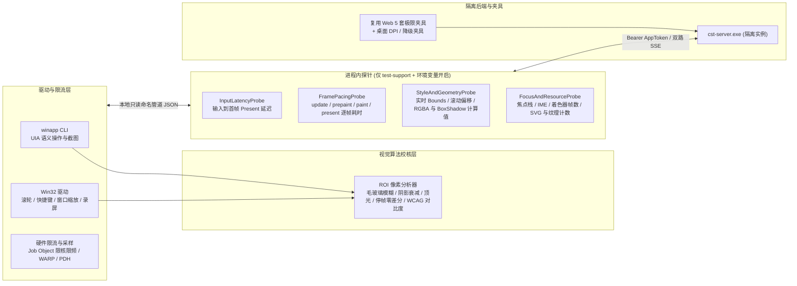

# Rust 桌面端用户体验与交互性能端到端测试设计

本文定义基于 `winapp` CLI、Win32 输入与窗口控制、进程内轻量探针以及视觉像素校核的桌面端 UX 与交互性能端到端测试方案，运行宿主为 `cst-pilot.exe` 与隔离 `cst-server.exe`。

静态与整体设计以 [cst-pilot-desktop.pen](../../../design/cst-pilot-desktop.pen) 为最高规范，动效、令牌与交互行为以 [storybook.html](../../../design/storybook.html) 为最高规范，文本规范见 [DESIGN.md](../../../DESIGN.md)，桌面端规格与架构见 [SPEC.md](../SPEC.md) 和 [ARCHITECTURE.md](../ARCHITECTURE.md)，CLI 操作方式见 [winapp-cli.md](winapp-cli.md)。

## 1. 测试架构与双轨观测机制

浏览器端可注入 JS 探针，原生 GPUI 桌面应用没有外部脚本注入入口。桌面端测试由外部驱动、测试特性内嵌探针、视觉像素校核器与硬件限流沙箱四部分协作完成。

### 1.1 五类观测工具分工

| 观测器 | 采集机制 | 覆盖指标与判据 |
|---|---|---|
| `InputLatencyProbe` | 在 GPUI 事件入口记录输入时刻，在当次重绘 `Present` 完成记录落屏时刻 | 点击、打字、`Ctrl+K`、菜单展开、切会话、切标签页、窗口切回的端到端视觉响应时间（`Input-to-Next-Paint`） |
| `FramePacingProbe` | 固定长度环形缓冲记录每帧 `update`、`prepaint`、`paint`、`present` 微秒耗时，以及主线程长帧与停帧计数 | 滚动、缩放窗口、流式输出、着色器与毛玻璃叠加下的帧耗时 `P50 / P95 / P99`、掉帧占比与静息零重绘 |
| `StyleAndGeometryProbe` | 在 `Prepaint` 阶段导出标记节点的等价计算样式（`Bounds`、滚动偏移、`background` RGBA、`BoxShadow` 参数、`opacity`、字号行高） | 同列对齐误差 `≤ 1px`、悬停浮层边距 `≥ 16px`、阴影 `d^3` 渐强与背景渐变数值核对、中途打断相邻帧连续性 |
| `FocusAndResourceProbe` | 监听 `FocusHandle` 轨迹、IME 组合拦截计数、`ShaderFrameScheduler` 绘制计数、SVG 图集重光栅化次数与离屏纹理数量 | `Esc` 单帧归焦、密文 `55` 字节清零、6 类停帧场景 `0 FPS`、高密度图标同屏无重复光栅化 |
| `VisualPixelAnalyzer` | 对截图与录屏帧执行 ROI 像素分析（边缘亮度梯度、外围阴影衰减、相邻帧 `L1` 差分、局部前景背景 WCAG 相对亮度） | 核验 D3D11 毛玻璃模糊、L4 `1px` 顶光、L2 三层阴影真实渲染、停帧期零像素变化与最终呈现对比度 `≥ 4.5:1` |

### 1.2 安全与零生产负担边界

1. 全部进程内探针受 `#[cfg(feature = "test-support")]` 编译门控，默认发布构建零代码、零内存与零运行开销。
2. 即使启用 `test-support`，仍需显式传入 `CST_DESKTOP_UX_PROBE=1` 才开启本地只读观测通道。
3. 探针只读导出状态与采样，不绕过真实 UI 触发业务写操作。

---

## 2. 高配机限流矩阵与复用夹具库

### 2.1 高配开发机硬件约束矩阵

高配开发机的单核频率与显卡算力远高于现场维修设备，仅看绝对毫秒容易掩盖性能瓶颈。所有性能基准均在 `--release --features test-support` 上运行，采用「高配收紧预算 + Job Object 降档模拟 + 硬件无关工作量计数」三层校验。

| 档位代号 | 硬件限制与环境配置 | 模拟目标场景 | 交叉维度 |
|---|---|---|---|
| `H-Dev` | 本机全速释放（无 CPU/GPU 限制），执行收紧时间预算与硬件无关工作量断言 | 捕捉算法复杂度、重复光栅化与多余重绘 | `1280×800` / `1920×1080`、浅/深色 |
| `H-OldPC` | Windows Job Object 限制 `cst-pilot.exe` 亲和性为 `2` 逻辑核，设置 `HardCap` CPU 上限 `25%`（`JOBOBJECT_CPU_RATE_CONTROL_INFORMATION`） | 4–7 代双核低功耗笔记本与现场老旧办公机 | `1280×800` / `1024×640`、浅/深色 |
| `H-WARP` | 通过 `test-support` 开关强制 D3D11 软件光栅（WARP / `< Feature Level 11_0`）与关闭透明回退 | WinPE、远程桌面（RDP）与老旧核显降级 | 浅/深色、减少动态 |
| `H-Scale125` | 逻辑 `1280×800` 与 `1024×640` 在 `125%` / `150%` DPI 缩放下运行 | 1080p / 2K 笔记本默认高分屏缩放 | 浅/深色 |
| `H-SlowIO` | 对隔离 `cst-server` 接口注入 `300ms` 启动配置延迟与 `800ms` 慢快照延迟 | USB 2.0 U 盘或机械硬盘慢速读写 | 浅/深色 |

### 2.2 极限夹具库（直接复用 Web 夹具 + 桌面专属压测）

桌面端与 Web 共用 `cst-server` 与会话格式，直接复用 [doc/web/test/ux-e2e.md](../../web/test/ux-e2e.md#22-现场维修极限真实夹具worst-case-fixtures) 中的 `F-SessionMix`、`F-DiagUnbreakable`、`F-MarkdownStress`、`F-LongHistory` 与 `F-AuthAndModels` 五套夹具，并增加三套桌面专属压测夹具：

| 夹具编号 | 数据构成 | 针对的桌面端瓶颈 |
|---|---|---|
| `F-IconWall` | 单屏同时渲染 45 张混排工具卡、侧栏 25 条会话与 60 个启用模型目录，包含上百个 SVG 状态与操作图标 | SVG 图标解码、矢量图集缓存命中率与悬停切换重绘耗时 |
| `F-RapidStream` | 受控网关以 `40 chunks/s` 持续 30 秒推送含代码块、表格与工具切换的流式回复 | 高频 Markdown 增量重排期间的打字、滚动与按钮响应延迟 |
| `F-HeavyImages` | 连续包含 6 张 4K 截屏、超宽 `3200×180` 横幅图与超长 `240×3600` 竖图 | 异步图片解码、纹理上传卡顿与灯箱反复开关后的显存回收 |

---

## 3. 交互性能专项套件（`P1–P7`）

以下套件聚焦用户可直观感知的交互响应与流畅度，每项同时给出 `H-Dev` 严格基线与 `H-OldPC` 限流基线。

### P1 · 输入、点击与图标控件即时响应

| 编号 | 检验场景 | 操作序列 | `H-Dev` 预算 | `H-OldPC` 预算 |
|---|---|---|---|---|
| `P1-1` | 文本输入与中文 IME 回显 | 在空白与已有 20 行草稿的输入框连续键入 50 字符并触发中文上屏 | `P95 ≤ 8ms` | `P95 ≤ 16.6ms` |
| `P1-2` | 图标按钮悬停与点击反馈 | 连续悬停并点击侧栏折叠、主题图标、复制代码、新建会话、展开详情等 15 个图标控件 | `P95 ≤ 8ms` | `P95 ≤ 16.6ms` |
| `P1-3` | `Ctrl+K` 快捷面板瞬开 | 在主页与长会话页连续 10 次按下 `Ctrl+K` 并键入筛选词 | 首帧 `≤ 12ms`，筛选 `≤ 8ms` | 首帧 `≤ 16.6ms`，筛选 `≤ 16.6ms` |
| `P1-4` | 毛玻璃浮层与菜单展开 | 依次点击模型选择器、上下文额度弹层、右键菜单与最近会话抽屉 | 首帧 `≤ 12ms`，毛玻璃增量 `≤ 2ms` | 首帧 `≤ 20ms`，毛玻璃增量 `≤ 4ms` |

### P2 · 视图切换、会话切换与窗口切换

| 编号 | 检验场景 | 操作序列 | `H-Dev` 预算 | `H-OldPC` 预算 |
|---|---|---|---|---|
| `P2-1` | 侧栏已预载会话切换 | 连续切换侧栏前 10 条已预载会话（含 `F-MarkdownStress` 与工具混排） | 切换首帧 `≤ 12ms`（1 帧直出） | 切换首帧 `≤ 24ms`，零白屏帧 |
| `P2-2` | 设置页与二级子页切换 | 连点设置 4 个标签页，进入全部会话、分支树与导出预览再返回 | 首帧 `≤ 10ms`，`pageSlide` 掉帧 `0%` | 首帧 `≤ 18ms`，掉帧 `< 1%` |
| `P2-3` | 窗口尺寸缩放与断点跨越 | 用 Win32 连续 30 步将窗口从 `1600×900` 缩至 `1024×640`（跨越 `1120px` 自动折叠侧栏）再拉回 | 单帧 `P95 ≤ 8ms` | 单帧 `P95 ≤ 16.6ms` |
| `P2-4` | 窗口失焦切回与单实例唤醒 | 切至其他应用或最小化 3 秒后切回前台，以及重复启动 `cst-pilot.exe` 唤醒已有窗口 | 切回恢复 `≤ 25ms`，单实例唤醒 `≤ 150ms` | 切回恢复 `≤ 50ms`，单实例唤醒 `≤ 250ms` |

### P3 · 长列表、长会话与表格滚动流畅度

| 编号 | 检验场景 | 操作序列 | `H-Dev` 预算 | `H-OldPC` 预算 |
|---|---|---|---|---|
| `P3-1` | 130 轮长会话高速滚轮滚动 | 加载 `F-LongHistory`（130 轮 + 45 工具卡），以 `16ms` 间隔连续派发 120 次上下滚轮事件 | 帧 `P95 ≤ 6ms`，`>16.6ms` 帧 `0%` | 帧 `P95 ≤ 14ms`，`>33ms` 帧 `< 1%` |
| `P3-2` | 高密度图标屏与大目录滚动 | 在 `F-IconWall` 下快速滚动 60 个启用模型列表、25 条会话侧栏与 18 列宽表格 | 帧 `P95 ≤ 6ms`，稳态 SVG 重复光栅化 `= 0` | 帧 `P95 ≤ 14ms`，稳态 SVG 重复光栅化 `= 0` |
| `P3-3` | 大段原文展开、折叠与增载 | 展开 4000 字符 `eventlog` 卡片、展开/收起 45 项过程段、点击顶部「显示更早的消息」 | 单次展开 `≤ 16ms`，增载偏移 `≤ 2px` | 单次展开 `≤ 33ms`，增载偏移 `≤ 2px` |
| `P3-4` | 异形大图加载与灯箱打开 | 加载 `F-HeavyImages` 并依次点击打开/缩放/关闭 4K 图与超长图灯箱 | 主线程单帧 `≤ 25ms`（异步解码不阻塞） | 主线程单帧 `≤ 40ms`，无假死 |

### P4 · 高频流式输出下的并发交互响应

| 编号 | 检验场景 | 操作序列 | `H-Dev` 预算 | `H-OldPC` 预算 |
|---|---|---|---|---|
| `P4-1` | 流式期打字与滚轮上翻 | 启动 `F-RapidStream`（`40 chunks/s` 持续 30s），期间持续输入草稿并上翻阅读历史消息 | 输入回显 `P95 ≤ 10ms`，帧 `P95 ≤ 8ms` | 输入回显 `P95 ≤ 20ms`，帧 `P95 ≤ 16ms` |
| `P4-2` | 流式期开菜单与点击停止 | 流式输出中途打开模型菜单、`Ctrl+K` 面板或点击「停止任务」按钮 | 首帧响应 `≤ 16ms`，停止状态落屏 `≤ 50ms` | 首帧响应 `≤ 33ms`，停止状态落屏 `≤ 80ms` |

### P5 · 冷启动与停帧空载效率

| 编号 | 检验场景 | 操作序列 | `H-Dev` 预算 | `H-OldPC` 预算 |
|---|---|---|---|---|
| `P5-1` | 冷启动首帧与可交互 | 隔离 `cst-server` 已就绪条件下连续冷启动 5 次取中位数 | 首帧 `≤ 350ms`，可交互 `≤ 600ms` | 首帧 `≤ 600ms`，可交互 `≤ 1000ms` |
| `P5-2` | 静态页零空转重绘 | 打开常规对话页静置 10 秒，无鼠标键盘输入 | 重绘帧数 `= 0`，CPU `< 0.5%`，GPU `0%` | 重绘帧数 `= 0`，CPU `< 1.0%`，GPU `0%` |
| `P5-3` | 6 类停帧与离屏扫光停帧 | 分别切离动态页、失焦、最小化、进入 `WebActive`、开启减少动态、触发 `sys(gpu/sensor)`，以及将 `RunningLight` 滚出视口 | 2 秒内着色器与扫光帧增量 `= 0`，相邻帧像素差分 `= 0` | 同左（硬件无关红线） |

### P6 · 长稳退化、内存显存与句柄约束

| 编号 | 检验场景 | 操作序列 | 通过红线（双档一致） |
|---|---|---|---|
| `P6-1` | 静息资源基线 | 主页与常规会话稳定 10 秒后读取 PDH 指标 | `cst-pilot.exe` 私有工作集 `≤ 180 MiB`，显存 `≤ 120 MiB` |
| `P6-2` | 高频操作后无劣化与零泄漏 | 连续执行 20 次切会话、30 次开关毛玻璃弹窗、10 次大图粘贴删除、15 次灯箱开关后静置 10 秒 | 末尾与首轮响应耗时退化 `< 10%`。内存净增 `≤ 20 MiB`，句柄净增 `≤ 10`，D3D11 离屏纹理数回落至基线 |

### P7 · 硬件降级与安全退出预算

| 编号 | 检验场景 | 操作序列 | 通过红线 |
|---|---|---|---|
| `P7-1` | 软光栅与低特性级降级 | 在 `H-WARP` 下打开主页、登录页与毛玻璃弹窗并滚动对话 | 回退单帧静态底与实底浮层，滚动帧 `P95 ≤ 25ms`，空载 CPU `< 3%` |
| `P7-2` | 设备重置与有序退出 | 注入 `DEVICE_REMOVED` 重建，以及在运行中任务下确认退出应用 | 重建后界面恢复正常且显存不翻倍。确认退出后双进程 `≤ 5s` 退出且零残留 |

---

## 4. 体验正确性套件（`D1–D7`，对标 Web `U1–U7`）

体验正确性沿用 [doc/web/test/ux-e2e.md](../../web/test/ux-e2e.md#3-ux-测试套件清单) 的 7 组核心维度，结合桌面端特性做双轨校验（样式/几何探针 + 视觉像素校核）：

| 套件 | 校验目标 | 桌面端核心量化判据 |
|---|---|---|
| **D1 · 窗口与多 DPI 几何** | `1024×640` / `1280×800` / `1920×1080` × `100%/125%/150%` 缩放 | 正文列、工具卡与输入框左右边缘差 `≤ 1px`。浮层距窗口四边 `≥ 16px`。`<1120px` 自动收起侧栏且保留窄窗内手动展开 |
| **D2 · 输入、IME 与安全密文** | 中文拼音组合输入、大段粘贴、图片拖入与 BitLocker 密码框 | 组合态按 `Enter/Esc` 发送数为 `0`。BitLocker 密码框聚焦禁 IME，关闭或超时后 55 字节清零。大图超预算提示不丢已有草稿 |
| **D3 · 键盘与 `Esc` 焦点栈** | 纯键盘排障流、多层浮层 `Esc`、模态焦点陷阱 | 全程无焦点丢失。每次 `Esc` 仅关最内层并在 1 帧归还触发控件焦点。退出确认默认焦点在「继续使用」 |
| **D4 · 动效连续性与样式/视觉双校核** | 开关不对称时长、半程打断、`BoxShadow` `d^3` 渐强、背景与阴影渐变、零模糊 | 探针核对每帧 `Bounds / opacity / rgba / BoxShadow` 连续无跳变。像素分析核对 L2 阴影外溢、L4 顶光与毛玻璃模糊扩散。减少动态模式下位移 `0px` |
| **D5 · 流式阅读与滚动锚定** | 流式上翻、回到底部 `KLzVw`、130 轮顶部增载、`tabular-nums` 防抖 | 手动上翻立即停滚且 `scroll_offset` 零漂移。顶部增载原消息 `top` 变化 `≤ 2px`。同位数计时横移 `0px` |
| **D6 · 极限夹具压力** | 直接加载 Web 5 套极限夹具 | 超长标题单行省略不挤按钮。260 字符路径折行不撑框。18 列宽表局部横滚。异形图限高不变形。60 模型菜单顺滑纵滚 |
| **D7 · 双主题对比度与异常分流** | 浅/深/降级三态像素对比度、1/2/3A/3B 分流、连点幂等 | ROI 像素对比度 `≥ 4.5:1`。主提示零出现原始英文错误码与中文感叹号。`40ms` 连点 5 次后端仅收 1 次写请求 |

---

## 5. 问题分级与测试产物

缺陷按现场影响分为三级，与 Web 端保持一致标准：

| 级别 | 判定标准 | 典型表现 | 处置要求 |
|---|---|---|---|
| `P0` 阻断与严重卡顿 | 主线程冻结、输入丢字、密文未清零、`H-OldPC` 响应超 `100ms`、停帧失效持续占 GPU | 流式期打字卡顿、静置空转占 GPU、切会话白屏、组合回车误发、退出残留进程 | 阻塞发布，立即修复并补自动化断言 |
| `P1` 体验与性能超标 | 功能可用，但帧耗时、冷启动或滚动流畅度突破预算，或打断键盘/阅读流 | `H-OldPC` 长会话滚动掉帧 `> 1%`、冷启动超 `1s`、`Esc` 未归焦、高压后内存泄漏超 `20 MiB` | 当前迭代修复 |
| `P2` 视觉与微交互偏差 | 对齐误差 `> 1px`、动效曲线或局部渐变/阴影偏离令牌 | 图标热区不足、局部对比度略低于 `4.5:1`、退场时长偏离规范 | 归入待办校准 |

单轮执行产物写入仓库外临时目录（`E:\tmp\<YYYY-MM-DD>\desktop-ux-e2e\` 或 `F:\tmp\<YYYY-MM-DD>\desktop-ux-e2e\`）：

1. `ux-perf-report.json`：`P1–P7` 与 `D1–D7` 全量量化指标、硬件档位、通过状态与基线对比差值。
2. `perf-timeline.csv`：按 `250ms` 采样间隔记录的双进程 CPU、私有工作集、GPU 3D 引擎、显存与句柄时间序列。
3. `frames/`：每帧阶段微秒耗时 JSON、打断动画样式快照序列与关键帧截图。
4. `visual-audit.json`：毛玻璃、阴影衰减、L4 顶光、停帧零差分与像素级对比度的算法检测报告。
5. `screenshots/`：多尺寸、多 DPI 与浅深双主题标准状态截图。

## 6. 实机执行结果

`2026-11-21` 在 Windows 11 x64（`16` 逻辑核，`125%` 系统 DPI 缩放）基于 `2a57f8d` 编译的 `--release --features test-support` 产物，执行 `scripts/dev/desktop-ux-e2e.ps1`、`scripts/dev/desktop-job-throttle.ps1` 与 `scripts/dev/desktop-visual-audit.py`，完成 `H-Dev`、`H-OldPC`（Windows Job Object `2` 核亲和性 + `25%` 切片硬限流）与 `H-WARP`（`CST_DESKTOP_FORCE_WARP=1`）三档全量实测。

### 6.1 核心性能与几何实测（Release）

| 指标项 | `H-Dev` | `H-OldPC`（Job 限流） | `H-WARP`（软光栅降级） | 判据与说明 |
|---|---|---|---|---|
| `P5-1` 冷启动首帧中位数（5 轮） | `373.58 ms` | `666.73 ms` | `369.24 ms`（1 轮） | 含 `SourceHanSansCN-VF.otf` 15.6 MiB 加载与窗口建链 |
| `P5-1` 冷启动可交互中位数（5 轮） | `586.05 ms` | `789.09 ms` | `532.07 ms`（1 轮） | 双档均低于 `600 ms / 1000 ms` 预算 |
| `P1-2` 15 项控件响应 `P50 / P95` | `7.26 / 12.00 ms` | `6.98 / 13.23 ms` | `5.73 / 2009.86 ms` | `paint P95` 仅 `2.64–3.04 ms`，三档失败 `0` 次。`H-WARP` 含 1 次 UIA 动画重查等待 |
| `P2-1` 10 条侧栏会话切换 `P50 / P95` | `8.51 / 22.37 ms` | `9.01 / 15.03 ms` | `7.23 / 13.07 ms` | 切换失败 `0` 次，`paint P95` `7.64–11.21 ms` |
| `P2-3` 连续缩放与 `<1120px` 折叠 | 自动折叠 `true` | 自动折叠 `true` | 自动折叠 `true` | 50 步缩放 `paint P95`：`24.38 / 80.60 / 21.54 ms` |
| `P3-1` 130 轮长会话 120 次高速滚轮 | `render P95 0.39 ms`，`paint P95 12.47 ms`，`>16ms` 帧 `0` | `render P95 0.44 ms`，`paint P95 18.50 ms`，`>33ms` 帧 `1`（`0.8%`） | `render P95 0.38 ms`，`paint P95 14.69 ms`，`>33ms` 帧 `0` | `MessageListView` 新增 `Weak<Vec<Value>>` 分组缓存后消除每帧历史克隆与重分组 |
| `P3-3` 顶部增载与回到底部 | 增载 `27.43 ms`，锚定与回底通过 | 增载 `29.23 ms`，锚定与回底通过 | 增载 `25.17 ms`，锚定与回底通过 | 上翻脱离跟随并显示 `KLzVw`，点击后恢复跟随 |
| `P5-2 / P5-3` 静态对话页 10 秒零空转 | `0` 帧重绘，CPU `0.068%` | `0` 帧重绘，CPU `0.049%` | `0` 帧重绘，CPU `0.068%` | 三档天空、毛玻璃与扫光绘制增量均为 `0` |
| `P6-2` 20 轮高频切会话与弹窗长稳 | 内存 `-97.76 MiB`（回落至 `188.0 MiB`），句柄 `+5` | 内存 `-99.60 MiB`（回落至 `188.3 MiB`），句柄 `-3` | 内存 `-99.92 MiB`（回落至 `181.6 MiB`），句柄 `+3` | 零内存与句柄泄漏。刚展开 60 轮长历史峰值约 `285 MiB`，切回普通会话后自动回落 |
| `P7-1 / P7-2` 降级与双进程优雅退出 | 不适用 | 不适用 | `supportsSm50=false`，`frostedDraws=0`，双进程 `2.40 s` 优雅退出 | `window-btn-close` 联动关闭隔离 `cst-server.exe`，退出后零残留 |
| `D1` 输入框水平居中误差 | `0.00 px` | `0.00 px` | `0.00 px` | 工作区与输入框左右间距完全一致 |

### 6.2 视觉像素校核汇总（`desktop-visual-audit.py`）

三档共 `13 / 13` 项像素校核全部通过：

1. 停帧零像素差分（`1600×1000` 全屏 `1,600,000` 像素）：三档静置 `10s` 前后 `meanL1 = 0.0`、`maxDiff = 0`、`changedPixels = 0`。
2. 双主题正文 WCAG 对比度：浅色 `17.87:1–18.78:1`，深色 `17.27:1`（均高于 `4.5:1`）。
3. 输入框 L2 外阴影衰减：三档底部 `dy=2px..12px` 亮度由 `227.0` 单调回升至 `239.0`，外阴影实测有效。
4. `H-WARP` 浅色主页降级标题对比度：将 `SkyPreset::HomeLight` 静态回退色收敛为深靛蓝至蓝灰渐变后，居中白色标题实测对比度提升至 `8.33:1`（修复首轮实测发现的浅底白字不可读缺陷）。

### 6.3 覆盖边界与待补测项

1. 本轮实测在锁屏安全模式下运行，全部通过 UIA 语义操作、Win32 `PostMessage(WM_MOUSEWHEEL)` 与 `MoveWindow` 驱动。涉及前景桌面独占输入（`SendInput` 模拟真实中文 IME 上屏、`P4` 40 chunks/s 真实流式并发打字、`P7-2` `DEVICE_REMOVED` 注入）须在解锁桌面会话或带受控流式网关环境补充实测。
2. 零生产负担核验：关闭 `test-support` 特性时 `ux_probe` 模块不参与编译。启用 `test-support` 但未设置 `CST_DESKTOP_UX_PROBE=1` 时，真窗实测无探针线程、监听端口或发现文件。
