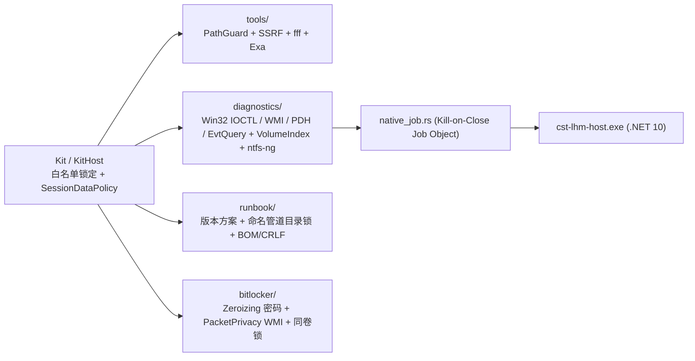

# 诊断与受控工具架构

本页说明 `crates/cst-kit` 中安全守卫与 Windows 原生采集模块的实现结构，涵盖共享卷缓存、命令清单存储与 BitLocker 原生执行机制。行为约束见 [SPEC.md](SPEC.md)，接口定义见 [API.md](API.md)，完整目录映射见 [6.cst-pilot.md](../rust/plan/6.cst-pilot.md)。

## 模块组成与挂载管线

`CstPilotExtension` 通过 `pi-runtime` 公开静态扩展接口挂载全部业务工具、技能与数据策略：

| 子目录 | 核心文件与职责 |
|---|---|
| `src/kit.rs`、`src/tools/` | 锁定 17 工具白名单，加载 `APPEND_SYSTEM.md` 与 8 份技能。`path_guard.rs` 规范化路径并按文件身份拦截凭据及硬链接。`fff.rs` 基于 `ignore` 与 `regex` 实现检索。`ssrf.rs` 与 `web_access.rs` 实现 DNS 私网拦截与会话有界检索缓存 |
| `src/diagnostics/` | `win_native.rs`（含 `win_native/windows/storage.rs` IOCTL 层）与 `storage_tools.rs` 在阻塞线程池内初始化多线程 COM 并绑定分工具时间预算（常规查询 30 秒，`ls` 与 `disk usage` 215 秒，最多 4 个并发阻塞槽位）。`walk.rs` 实现有界并行 `FileIdBothDirectoryInfo` 遍历与 `CancelSynchronousIo` 取消，`mft.rs` 与 `volume_index.rs` 管理纯 Rust `ntfs-ng` `$MFT` 扫描与卷级缓存，`hardware/pdh.rs` 本地化计数器双采样，`result.rs` 执行 50 KiB 模型文本结构化裁剪 |
| `src/runbook/` | `plan_store.rs` 管理 `data/plans/<ID>/v*.json` 版本锁与导出。`sequence_store.rs` 管理当天递增序号与改名替换。`storage.rs` 持有各级目录句柄拒绝重解析点与硬链接 |
| `src/bitlocker/` | `credentials.rs` 实现 `SessionDataPolicy` 与瞬态 `Zeroizing<String>` 凭据表（释放本机 `BSTR` 前逐单元清零）。`wmi_encryptable.rs` 建立 `PacketPrivacy` 加密 DCOM 连接调用 `UnlockWithNumericalPassword` 与 `Decrypt`。`lock.rs` 维护跨进程卷锁，`core.rs` 执行状态复查 |

## Windows 原生采集与隔离边界

1. **有界阻塞与无泄漏槽位**：COM/WMI、Win32 与 Event Log 调用运行在隔离阻塞线程中，逐批检查取消令牌与时间预算。超时返回后未退出的底层系统调用继续持有工作槽位直至自然返回，防止后台线程无限堆积。SMART 单次最多查询 256 块物理盘。事件日志单通道扫描上限为 100,000 条，超限标记 `scanTruncated`。
2. **Job Object 受控子进程（`native_job.rs`）**：调用 `app/tools/lhm/host/cst-lhm-host.exe`（上限 20 秒）时，统一以无 Shell 挂起方式创建进程，绑定 `JOB_OBJECT_LIMIT_KILL_ON_JOB_CLOSE` 后恢复运行。取消、超时或主进程崩溃时由内核立即终止整个子进程树。
3. **自包含 LHM 隔离采集**：`crates/cst-kit/lhm-host/` 编译为携带 .NET 10 运行时的独立辅助程序，仅接受 `gpu` 或 `sensor` 模式并从上级目录加载 `LibreHardwareMonitorLib.dll`，将硬件探针异常与主服务内存隔离。

## 共享目录大小缓存（`VolumeIndex`）

`volume_index.rs` 与 `mft.rs` 提供进程内按盘符缓存纯 Rust `ntfs-ng` 紧凑索引的能力（当前默认关闭，须通过阶段 `1C` 实盘门禁或设置实验开关 `CST_ENABLE_MFT=1` 开启，`CST_DISABLE_MFT=1` 始终强制关闭并阻断缓存读取）：

| 内部字段 | 存储内容 |
|---|---|
| `identities` | `盘符 -> (单调探针序号, Win32 卷序列号 + 文件系统 + 根目录创建时间 + 卷 GUID)`（探测在互斥锁外执行，拒绝乱序旧探测覆盖新代际） |
| `snapshots` | `盘符 -> Arc<ScanSnapshot>`，直接复用 `ntfs_ng::index::DirectoryIndex`、按 `DirId` 索引的合计数组与重解析剪枝位图，附采集时间（120 秒有效期，上限 4 卷且总驻留 ≤ 128 MiB）及预聚合排行 |
| `failed` / `pending` | 30 秒短冷却失败记录 / 按 `(盘符, 卷身份)` 键控的订阅引用计数单飞句柄（全员取消时才中止物理扫描） |

缓存不变量：

1. **换盘、过期与字节驱逐**：每次读写前在锁外核对卷身份，并统一清理全部盘符的过期快照与失败项。换盘时立即不可命中并移除对应快照；内存驻留由卷数（4 卷）与字节预算（128 MiB）共同驱逐释放。
2. **完整性与口径一致**：`$MFT` 扫描遇不可读、未映射、损坏记录或超内存上限时拒绝发布缓存。`ls` 仅在全部直接子目录均通过 `FileReference` 与 `PathPolicy::LIVE` 路径核验时返回 `native-index`；任一项未命中则整次统一走 `walk`，不混用整卷与局部归属口径，且不缓存目录遍历结果。

## BitLocker 隐私策略与中断复查

1. **三处脱敏拦截点**：`SessionDataPolicy` 在写入 `ExecutionStateStore` 前、`message_end` 写入 `SessionStore` 前及向同步／异步订阅者分发事件前统一脱敏恢复密码。流式增量置空未完成的数字尾部，界面直接读取脱敏后的完整 `partial` 快照。AI 填参原文仅在当前轮次请求上下文与 3 分钟过期的 `Zeroizing` 瞬态表中一次性绑定 `tool_call_id` 领取。
2. **跨进程锁与实时复查**：同卷命名管道锁 `\\.\pipe\cst-pilot-bitlocker-<sha256>` 全程覆盖本地确认、WMI 调用与最终复查。调用超时、取消或启动检测到 `requires_state_verification` 时，独立查询 `Win32_EncryptableVolume` 当前锁定与转换状态，写入 `cst.bitlocker-state-verification` 条目并保持 `operation.status = "unknown"`。
