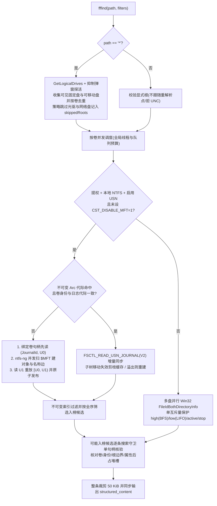

# `fffind` 与 `ffgrep` 参数、契约与引擎设计

本文定义面向 Windows 客户机故障诊断的 `fffind` 与 `ffgrep` 独立工具接口、全电脑高速扫描架构、大模型侧完整 JSON 契约与实现验收标准。安全基线见 [ADR-018](../ADR.md#adr-018文件检索采用单次基线单句柄核验与无状态并行多编码引擎)，工具总览见 [tools/SPEC.md](../tools/SPEC.md) 与 [tools/API.md](../tools/API.md)。

## 一、工具定位与设计目标

`fffind` 定位为全电脑级路径与文件属性检索引擎，强制显式传入扫描范围（`path: "*"` 扫描全电脑，或传入盘符与目录子树），提权 NTFS 卷支持紧凑内存索引加 USN Journal 增量同步，其余场景走多盘并行 Win32 目录枚举。`ffgrep` 定位为指定路径下的多编码正文检索引擎，强制显式传入 `pattern` 与 `path`，支持文件包含过滤、时间过滤与单文件大日志流式扫描。

| 维度 | `fffind`（路径与属性检索） | `ffgrep`（文件内容检索） |
|---|---|---|
| 必填参数 | `path`（`"*"` 扫描本机全部就绪固定盘与可移动盘，或指定盘符/目录/文件） | `pattern`、`path`（目录或单个文件路径） |
| 可选筛选项 | `pattern`、`kind`、`ext`、`exclude`、`maxDepth`、`modifiedWithinHours`、`minSizeMiB`、`maxSizeMiB`、`sortBy`、`caseSensitive`、`limit`、`timeoutSec` | `include`、`exclude`、`modifiedWithinHours`、`literal`、`caseSensitive`、`context`、`limit`、`timeoutSec` |
| 执行引擎 | 阶段 1 落地受控多盘并行 Win32 `FileIdBothDirectoryInfo` 双梯队遍历；阶段 2 按独立安全与一致性门禁启用提权 NTFS 并发 `$MFT` 索引 + USN 增量同步（受 `CST_DISABLE_MFT=1` 统一熔断） | 目录模式并行遍历（单文件上限 `10 MiB`）；单文件模式解除 `10 MiB` 跳过限制，改为 `256 KiB` 持久化解码器分块流式扫描 |
| 忽略与网络策略 | 关闭宿主 `.gitignore`/`.ignore`；固定跳过 `.git`、重解析目录与云占位目录；首版在触发 I/O 前拒绝 UNC 与网络映射盘 | 与 `fffind` 一致，额外跳过云占位文件与解码后含 NUL 的二进制文件 |
| 截断与降级策略 | 取消 50 万条目上限；每卷在开始扫描时独立起算 `timeoutSec`（默认 30 秒，范围 1 至 180 秒），超时与超限保留已核验高分结果，按固定优先级输出 `truncatedReason`；仅覆盖或质量受损时置 `degraded: true` | 保留 `256 MiB` 读取预算与可配置 `timeoutSec`（默认 30 秒，范围 1 至 180 秒）；触及预算或超时保留已提交命中行并标 `truncatedReason` 与 `degraded: true` |

## 二、`fffind` 全电脑扫描架构与健壮性设计

`fffind` 采用纯 Rust 内存扁平索引与原生 Win32 目录枚举双模架构，不引入外部二进制，不向磁盘写入索引文件。为保证线上稳定性，新契约与受控 Win32 并行遍历先行交付，`$MFT + USN` 内存索引按独立一致性与授权门禁启用。



### 2.1 对象与名称边分离的紧凑内存索引 `VolumeFileIndex`

NTFS 文件引用包含 48 位记录号与 16 位序列号，且硬链接文件同时挂载在多个父目录中。每卷索引采用不可变 `Arc<VolumeFileIndex>` 代际，并将对象元数据与目录名称边分离存储，消除槽位复用错配与硬链接漏检。

| 结构成员 | 布局与设计要点 | 100 万对象估算 | 200 万对象估算 | 职责 |
|---|---|---:|---:|---|
| `objects: Vec<ObjectNode>` | `file_ref: u64`（含 48 位记录号与 16 位序列号）、`size_bytes: u64`、`mtime_secs: i64`、`flags: u16`、`edge_count: u16`、`first_edge: u32`（32 B） | `30.5 MiB` | `61.0 MiB` | 按完整 64 位引用存放对象逻辑字节、修改时间与属性位（目录、重解析、云占位、元数据待补查、墓碑） |
| `edges: Vec<NameEdge>` | `parent_ref: u64`、`obj_idx: u32`、`name_offset: u32`、`name_len: u16`、`namespace: u8`、`flags: u8`（20 B，对齐 24 B） | `22.9 MiB` | `45.8 MiB` | 保留全部真实硬链接，单独去除明确 DOS 8.3 短名别名，记录原生 UTF-16/WTF-8 名称以便精确复核 |
| `name_arena: Vec<u8>` | 连续字节池（均值按 `16 B` 计） | `15.3 MiB` | `30.5 MiB` | 集中存放原始名称字节，零零散堆分配 |
| `ref_to_obj` 稀疏映射 | 键为完整 64 位 `FileReference`、值为经校验内部槽位 `u32` | `12.0 MiB` | `24.0 MiB` | 供 USN 按完整引用 `O(1)` 定位，避免稀疏高槽号数组膨胀与槽位复用误命中 |
| **合计估算** | 含对象、名称边、名称池与稀疏映射 | **`80–85 MiB`** | **`160–170 MiB`** | 纯进程堆内存，零磁盘写入 |

内存预算、并发单飞与生命周期规则如下：

1. **进程级统一内存账本与按需淘汰**：进程级磁盘与搜索缓存合计上限 `384 MiB`（既有存储 `VolumeIndex` 快照上限 `128 MiB`，搜索索引池上限 `256 MiB`，单卷记录上限 `4,000,000` 条）。预算计入实际分配容量、构建临时内存与仍被在途读者持有的旧代际。冷建或增量同步预留内存遇到剩余额度不足时，优先按访问时间 LRU 淘汰未被活跃读者持有的空闲缓存卷，保障多盘顺序冷建顺利通过 `$MFT` 路径，同时保持在途读者的不可变快照不受影响。
2. **服务级空闲回收**：按实际查询访问时间维护 `180 s` 空闲 TTL，由服务级定时清理任务统一卸载超时卷的 `Arc` 引用；验收以缓存持有字节量归零为准，不强求操作系统立即收回进程 RSS。
3. **单飞构建、有界槽位排队与锁外启动**：冷建与 USN 刷新按 `(drive, VolumeIdentity)` 合并订阅（复用 `VolumeIndex` 引用计数单飞模式，最后一位调用方取消时才中止底层构建）。在状态锁内登记 `Flight`，在锁外调用可失败的 `std::thread::Builder::spawn` 启动构建线程并核验卷身份，防止启动失败、慢盘阻塞或 panic 锁死状态机；通过 RAII 终态守卫保证启动失败或 panic 立即发布终态并唤醒全部订阅者。并发冷建槽位上限为 2，超额卷在槽位条件变量队列中等待并响应取消信号；排队等待独立受 `min(2 × timeoutSec, 180)` 秒上限保护（避免慢盘卡死后续卷），且不扣减单卷扫描预算；同一卷的 USN 刷新、冷建与目录回退累计共享该卷剩余的 `timeoutSec` 预算。
4. **不可变代际发布**：冷建与同步在锁外构造新不可变 `Arc<VolumeFileIndex>`，锁内短交换并核对卷身份、日志代际与已消费游标，禁止旧任务覆盖新代际，读者全程无锁读取。

### 2.2 提权 NTFS 卷：USN 屏障冷建与增量同步

1. **防漏事件冷建屏障**：冷建前先绑定只读卷句柄（`\\?\Volume{...}`，实测管理员 `GENERIC_READ` 访问掩码），先调用 `FSCTL_QUERY_USN_JOURNAL` 读取 `(JournalId, U0)`，再经 `ntfs-ng` 扫描 `$MFT`（同时提取目录与文件的 `mtime`，不复用缺少目录时间的窄化存储投影），扫完后读取高水位 `U1`，重放 `[U0, U1)` 并按完整 64 位引用回查受影响对象，最后以 `(VolumeIdentity, JournalId, applied_cursor)` 原子发布。任一步骤失败（日志未启用、游标失效、日志重建、读不到高水位或补查超预算）则丢弃未发布代际并回退 Win32 遍历。
2. **USN V2 增量同步与元数据补查**：仅处理 NTFS USN V2 记录，遇不支持版本（如 V3 128 位标识）直接回退遍历，禁止截断标识。读取返回的续读游标不得越过尚未应用的记录。由于 USN 记录不含 `sizeBytes` 与实际 `LastWriteTime`，数据修改、基本属性变更、关闭与硬链接事件仅标记对象元数据待补查，在查询命中或批量同步时按完整引用补查；未关闭写句柄不承诺最终大小与时间。硬链接变更或重命名缺半边时重读该对象完整名称集合。
3. **树代际剪枝与防过期**：可达性、深度与剪枝状态绑定树代际 `tree_gen`。目录改名进出 `.git`、卷内移入 `.state/` 或变更为重解析/云占位目录时，失效受影响子树的路径、深度与剪枝缓存并在新代际重算（或查询时沿同代际父链判定）；孤儿、环或父序列不符的分支拒绝发布。
4. **未启用 USN 卷策略**：全程不调用 `FSCTL_CREATE_USN_JOURNAL` 修改系统日志。未启用 USN 的卷首版直接走 Win32 并行遍历，不保留 60 秒静态旧快照，避免新建或删除文件被静默漏检。

### 2.3 普通权限、非 NTFS 卷与并发终止模型

1. **原生批量目录访问器**：在 `diagnostics/walk.rs` 之上提取面向检索的有界批次访问器，调用 `GetFileInformationByHandleEx(FileIdBothDirectoryInfo)` 按 `64 KiB` 批读，直接传递原生 `OsString`、原始属性、默认流逻辑字节大小与 `LastWriteTime`（云重解析标签不单靠各文件系统 `EaSize`，必要时从已核验句柄复查）。`FindFirstFileExW` 回退须满足同等范围与身份核验，无法验证时明确降级并禁止不安全回退。
2. **双梯队队列与原子终止**：跨请求设置全局线程上限 8（预留 2 逻辑核）与队列字节上限。单次扫描由同一把互斥锁保护 `{ high, low, active, stop }`：第一梯队 `high`（广度优先 `VecDeque`）扫描数据盘常规目录与 `C:\Users` 可见用户目录，第二梯队 `low`（深度优先 `Vec`）延后扫描 `Windows`、`WinSxS`、`ProgramData`、`$Recycle.Bin`、`AppData`、`node_modules`、`.cargo`、`.rustup`、`.cache`。子任务入队与当前任务 `active -= 1` 在同一状态锁转换内完成，仅当 `high.is_empty() && low.is_empty() && active == 0` 时正常结束，消除队列暂空误退。
3. **panic 与按卷独立超时预算**：工作线程与看门狗均使用可失败线程启动与 RAII 析构守卫；任一线程 panic 立即广播 `stop` 并发送 `CancelSynchronousIo`，未领取卷记入 `skippedRoots` 并置 `degraded: true`。全电脑卷枚举使用流式有界探测窗口（上限 `min(timeoutSec, 10)` 秒），超时时保留已就绪卷继续扫描并将未完成卷记入 `skippedRoots`。每卷在真正取得工作许可并开始构建或目录遍历后起算 `timeoutSec` 预算（默认 30 秒，范围 1 至 180 秒）；单卷超时只中止该卷并记入 `partialRoots`，不中断其余未超时卷，仅在明确未提权且超时卷满足 `$MFT` 条件时提示可改用管理员权限重试。若底层驱动导致 I/O 线程滞留，该线程继续持有全局并发许可直至真正退出。

### 2.4 搜索专用守卫、授权边界与路径契约

1. **统一授权与搜索专用守卫**：索引与遍历遵循同一调用令牌授权边界。搜索守卫固定根目录身份，沿已核验父目录打开子项且始终携带 `FILE_FLAG_OPEN_REPARSE_POINT` 不跟随链接；在同一句柄上核对卷序列号、完整对象身份、文件类型、真实根边界与云召回属性，输出 `path`、`sizeBytes`、`modified` 均取自该已核验对象。敏感文件或祖先身份无法确认时拒绝该候选，不使用仅按路径字符串标记安全的缓存。`.state` 按工具包实际目录与身份封锁，`.git` 按路径组件封锁，显式指定为根路径同样拒绝。
2. **入榜复核与不泄露敏感计数**：廉价属性过滤与安全剪枝先行，仅对**可能进入 Top-K 堆**的候选实时执行守卫复核，通过后才占用堆槽，消除“先截 K 条再剔除导致补位不足”的缺陷。报告 `truncatedReason: "limit"` 前须确认还存在至少 1 条获准候选；敏感拦截项不计入 `skipped`、截断判定或卷状态。
3. **全电脑 `"*"` 与显式路径契约**：
   - `"*"` 仅在 Windows `fffind` 生效，定义为当前服务令牌可见且可访问的本地固定盘与可移动盘；探测就绪状态带截止时间并设置 `SetThreadErrorMode(SEM_FAILCRITICALERRORS)` 抑制系统介质弹窗；按底层卷标识去重多盘符别名，`SUBST` 子目录不得扩大为整卷。零可扫描卷返回整次错误（`isError: true`）；部分卷失败保留成功卷结果并置 `degraded: true`；策略性跳过光驱与网络盘记入 `skippedRoots` 但不单独触发 `degraded`。
   - 仅恰好为裸盘符的 `"C:"` 规范为 `"C:\\"`；拒绝 `"C:foo"`、`"\foo"`、设备路径（`\\.\`）与备用数据流（ADS）。普通相对路径仅按会话 `cwd` 解析，不回退进程工作目录。
   - 首版默认在触发 I/O 前拒绝模型传入的 UNC（`\\server\share`）、网络映射盘与经链接导向的网络路径；`path` 不再支持内嵌通配符（查名称用 `pattern`，查内容过滤用 `include`），保留 Windows 目录名中合法字面 `[`、`{` 的直接打开能力。
   - 顶层 `root` 与每条 `matches[].path` 统一输出正斜杠规范绝对路径（全电脑模式 `root` 为 `"*"`），可直接传给 `read` 工具，无需拼接工作目录。

### 2.5 字段组合与排序边界规则

| 字段与组合 | 明确规则 |
|---|---|
| `fffind.pattern` | 省略、整串 `"*"` 或 `"**"` 表示不按名称筛选；显式传 `""` 或纯空白报错。先执行完整名称精确匹配（覆盖含空格文件名如 `"My Report.pdf"`），再按空白分词。含 `/` 或 `\` 的词项归一化 `/` 后匹配搜索根相对路径，其余匹配名称。非法通配符语法直接报错（提供字面转义规则），不静默降级为模糊搜索 |
| `fffind.kind`、`ext`、`minSizeMiB`、`maxSizeMiB` | `kind: "dir"` 不可与 `ext`、`minSizeMiB`、`maxSizeMiB` 或 `sortBy: "size"` 同传（参数报错）；`kind: "any"` 搭配 `ext` 或大小过滤时仅保留符合条件的文件，目录不参与。`ext` 取最后一段扩展名，去单个前导 `.`、忽略大小写并去重，`""`、`"tar.gz"`、`"*.log"` 报错（复合后缀用 `pattern: "*.tar.gz"`）。大小区间闭区间换算为整字节：`[ceil(minSizeMiB * 1048576), floor(maxSizeMiB * 1048576)]`，`min=0` 不排除非空文件，`max=0` 仅匹配 0 字节文件，交叉或超界报错 |
| `fffind.maxDepth` | 可选整数 `1..=1024`，根深度为 0，`1` 仅看直接子项；全电脑 `"*"` 按各卷根计深度；单文件根传入 `maxDepth` 报错；用户显式深度限制不算 `truncated` |
| `modifiedWithinHours` | `0 < hours <= 87600`。每次调用固定一次 UTC 墙钟，比较闭区间 `[now - hours, now]`，未来时间与未知时间不命中；超时仍用单调时钟。`ffgrep` 在打开句柄上复核 `mtime` |
| `fffind.sortBy` | 自动推断顺序：有效名称条件 -> `"relevance"`；否则有时间条件 -> `"modified"`；否则有大小条件 -> `"size"`；其余按路径升序。`kind: "any"` 无大小过滤且按 `"size"` 排序时，目录排在已知大小文件之后。各线程、各卷与最终合并采用同一确定性全序（主键相同按 `path` 升序） |
| `caseSensitive` | `fffind` 在 Windows 默认 `false`（仅影响查询匹配，不影响安全规则）；`ffgrep` 字面模式默认智能大小写，**正则模式省略时固定 `false`**（避免 `\S`、`\p{Lu}` 意外触发区分大小写，显式 `caseSensitive: true` 或正则内联标志可覆盖） |
| `limit`、`context` | `limit` 范围 `1..=1000`（默认 30），`context` 范围 `0..=20`（默认 0），越界参数报错不再静默夹值。`ffgrep` 触及 `limit` 时优先保留命中行，剩余额度分配给去重上下文行，禁止 `context >= limit` 仅输出上下文 |
| `exclude`、`ffgrep.include` | 无分隔符匹配任意层级名称，含分隔符按统一 `/` 匹配搜索根相对路径；`exclude` 尾 `/` 剪枝目录且优先于 `include`；`include` 仅筛文件不剪枝目录；单项限长并拒绝空白与非法 glob；单文件根传 `ffgrep` 时若同时传 `include` 或 `exclude` 返回参数错误 |

## 三、`ffgrep` 持久化流式扫描边界

`ffgrep` 保持 `pattern` 与 `path` 双必填，并将单文件大于 `10 MiB` 的流式扫描明确为可验证的提交状态机：

1. **跨块解码与双候选提交**：跨短读收齐头部 BOM；每个编码候选持久化一个 `encoding_rs::Decoder`，中间块传 `last = false`，仅真实 EOF 时执行 flush。无 BOM 时对预算内前缀同时维护严格 UTF-8 与 GB18030 的有界候选结果，最终优先有效 UTF-8；预算截断遇半字符直接丢弃残片，不视为非法序列或真实 EOF。首版明确不支持无 BOM UTF-16。
2. **延迟 NUL 二进制撤销**：按**解码后**是否含 NUL 字节判定二进制（避免拒绝正常 UTF-16 零字节）。每文件匹配行先暂存，若后续块发现 NUL 则整文件撤销；目录模式按策略跳过，显式单文件模式返回可行动错误。预算仅覆盖文件前缀时，二进制判定同样仅覆盖已读前缀。
3. **长行、跨块 CRLF 与预算上界**：单行上限 `8 KiB` 按解码后 UTF-8 正文字节计（不含换行符），超限后丢弃整行直至下一个换行，物理行号仅增 1，上下文不跨已丢弃行，并记录截断原因 `"line_limit"`。仅真实 EOF 提交无换行末行，预算截断的半行不参与匹配以防 `$` 假命中。每块先原子预留可读额度并在短读时退还差额（探测字节计入 `256 MiB`）；单文件读取上界取打开时核验长度与剩余预算较小值，防止持续追加日志拖长调用，并在未达文件尾时于 `notice` 说明结果仅覆盖文件头前缀。

## 四、大模型视角：完整 Tool Definition JSON 与返回 JSON 示例

运行时经 `ToolDefinition::from_typed` 注册两个独立 DTO，并通过 `schemars` 快照测试校验生成 Schema 与下方定义一致（`pattern` 的 4096 UTF-8 字节约束与跨字段组合在类型化入口二次校验）。面向大模型的文本输出与 `structured_content` 共用同一份经整条裁剪的有界对象（`method` 与每卷 `indexStatus` 存放于本地 `details` 供双端卡片与诊断使用，不占用模型上下文）。

### 4.1 `fffind` Tool Definition JSON

```json
{
  "name": "fffind",
  "description": "全电脑或指定目录高速查找文件与目录，返回规范绝对路径、类型、逻辑字节大小与本机修改时间。path 传 \"*\" 扫描本机全部就绪固定盘与可移动盘，也可传盘符、目录或单个文件路径。不读取 .gitignore，自动跳过 .git、重解析目录、网络路径与工具包凭据。",
  "parameters": {
    "type": "object",
    "required": [
      "path"
    ],
    "additionalProperties": false,
    "properties": {
      "path": {
        "type": "string",
        "minLength": 1,
        "description": "必填。扫描范围：传 \"*\" 扫描本机全部可见固定盘与可移动盘（跳过光驱与网络盘）；传裸盘符或盘根（如 \"C:\"、\"C:\\\\\"）扫描整盘；传目录或单个文件路径扫描指定范围。拒绝 UNC 与网络映射盘。"
      },
      "pattern": {
        "type": "string",
        "minLength": 1,
        "maxLength": 4096,
        "description": "可选。名称或路径匹配表达式，支持完整精确名、通配符（*、?、[]、{}）与空格多词模糊匹配；省略或传 \"*\"/\"**\" 表示不按名称过滤；不可传空串或纯空白，非法通配符直接报错（UTF-8 上限 4096 字节）。"
      },
      "kind": {
        "type": "string",
        "enum": [
          "file",
          "dir",
          "any"
        ],
        "default": "file",
        "description": "可选。条目类型过滤：\"file\" 仅文件（默认），\"dir\" 仅目录（如查找 WeChat Files、Minidump），\"any\" 同时返回文件与目录。"
      },
      "ext": {
        "type": "array",
        "maxItems": 32,
        "items": {
          "type": "string",
          "minLength": 1,
          "maxLength": 32
        },
        "description": "可选。最后一段扩展名白名单，不区分大小写，单个前导点号可选（如 [\"dmp\", \"log\", \"mp4\"]），不支持复合后缀与通配符。不可与 kind=\"dir\" 同传。"
      },
      "exclude": {
        "type": "array",
        "maxItems": 64,
        "items": {
          "type": "string",
          "minLength": 1,
          "maxLength": 256
        },
        "description": "可选。排除通配符列表（如 [\"*.tmp\", \"node_modules/\"]）。无分隔符匹配任意层级名称，尾 \"/\" 剪枝匹配目录。"
      },
      "maxDepth": {
        "type": "integer",
        "minimum": 1,
        "maximum": 1024,
        "description": "可选。最大遍历深度，根目录深度为 0，1 仅扫描直接子项。path=\"*\" 时按各卷根计深度，单文件根不可传此字段。"
      },
      "modifiedWithinHours": {
        "type": "number",
        "exclusiveMinimum": 0,
        "maximum": 87600,
        "description": "可选。仅保留最近 N 小时内修改的条目，按调用时刻 UTC 闭区间 [now-N, now] 过滤，未来与未知时间不命中。"
      },
      "minSizeMiB": {
        "type": "number",
        "minimum": 0,
        "description": "可选。最小文件逻辑体积，单位二进制 MiB（1 MiB = 1048576 字节），含端点向上取整字节。不可与 kind=\"dir\" 同传。"
      },
      "maxSizeMiB": {
        "type": "number",
        "minimum": 0,
        "description": "可选。最大文件逻辑体积，单位二进制 MiB，含端点向下取整字节，须大于等于 minSizeMiB；0 仅匹配空文件。不可与 kind=\"dir\" 同传。"
      },
      "sortBy": {
        "type": "string",
        "enum": [
          "relevance",
          "modified",
          "size"
        ],
        "description": "可选。排序方式：\"relevance\" 相关性降序，\"modified\" 修改时间降序，\"size\" 文件字节数降序。省略时按名称、时间、大小条件自动选择。\"size\" 不可与 kind=\"dir\" 同传。"
      },
      "caseSensitive": {
        "type": "boolean",
        "description": "可选。是否区分大小写，仅影响查询匹配。Windows 默认 false。"
      },
      "limit": {
        "type": "integer",
        "minimum": 1,
        "maximum": 1000,
        "default": 30,
        "description": "可选。最多返回的命中条目数，范围 1 至 1000，默认 30。"
      },
      "timeoutSec": {
        "type": "integer",
        "minimum": 1,
        "maximum": 180,
        "default": 30,
        "description": "可选。单卷或目标目录检索的超时预算，单位秒，范围 1 至 180，默认 30。全电脑 path=\"*\" 模式下各卷在开始扫描时独立起算该预算。"
      }
    }
  }
}
```

### 4.2 `fffind` 返回给大模型的完整 JSON 示例

#### 示例 1：全电脑扫描（`path: "*"`）精确查找单个文件

调用参数：`{"path": "*", "pattern": "X-op7418-2125331795998851072.mp4"}`

```json
{
  "root": "*",
  "scannedRoots": [
    "C:/",
    "D:/",
    "E:/",
    "F:/"
  ],
  "skippedRoots": [
    {
      "root": "Z:/",
      "reason": "network_drive_skipped"
    }
  ],
  "matches": [
    {
      "path": "C:/Users/Tim2354/Downloads/X-op7418-2125331795998851072.mp4",
      "kind": "file",
      "sizeBytes": 14892032,
      "modified": "2026-11-26T09:12:44+08:00"
    }
  ],
  "truncated": false,
  "skipped": 0,
  "elapsedMs": 14
}
```

#### 示例 2：全电脑扫描近期蓝屏转储与事件日志（省略 `pattern`，按 `modified` 严格降序）

调用参数：`{"path": "*", "ext": ["dmp", "evtx"], "modifiedWithinHours": 24, "sortBy": "modified", "limit": 20}`

```json
{
  "root": "*",
  "scannedRoots": [
    "C:/",
    "D:/",
    "E:/",
    "F:/"
  ],
  "matches": [
    {
      "path": "C:/Windows/System32/winevt/Logs/System.evtx",
      "kind": "file",
      "sizeBytes": 21041152,
      "modified": "2026-11-26T15:40:02+08:00"
    },
    {
      "path": "C:/Windows/Minidump/112626-14218-01.dmp",
      "kind": "file",
      "sizeBytes": 2486192,
      "modified": "2026-11-26T14:36:18+08:00"
    },
    {
      "path": "C:/Windows/MEMORY.DMP",
      "kind": "file",
      "sizeBytes": 1482915840,
      "modified": "2026-11-26T14:36:15+08:00"
    }
  ],
  "truncated": false,
  "skipped": 0,
  "elapsedMs": 18
}
```

#### 示例 3：普通权限全电脑通配查找部分卷触及单卷 30 秒预算（降级保留高分命中并标明部分完成卷）

调用参数：`{"path": "*", "pattern": "*X-op7418*"}`

```json
{
  "root": "*",
  "scannedRoots": [
    "D:/",
    "E:/",
    "F:/"
  ],
  "partialRoots": [
    "C:/"
  ],
  "skippedRoots": [
    {
      "root": "G:/",
      "reason": "not_ready"
    }
  ],
  "matches": [
    {
      "path": "C:/Users/Tim2354/Downloads/X-op7418-2125331795998851072.mp4",
      "kind": "file",
      "sizeBytes": 14892032,
      "modified": "2026-11-26T09:12:44+08:00"
    }
  ],
  "truncated": true,
  "truncatedReason": "timeout",
  "degraded": true,
  "skipped": 41,
  "notice": "全电脑检索中部分卷达到单卷 30 秒预算，已保留已扫范围内的高分命中，C:/ 未扫完；可缩小 path、调高 timeoutSec（最高 180 秒）或以管理员权限重试。",
  "elapsedMs": 30004
}
```

### 4.3 `ffgrep` Tool Definition JSON

```json
{
  "name": "ffgrep",
  "description": "在指定目录或单个文件内检索文本内容，支持单行正则与字面匹配、UTF-16 LE/BE（含 BOM）与 GB18030 流式解码、文件包含过滤与时间过滤。目录模式跳过大于 10 MiB 的单文件，传入单个文件路径时启用 256 KiB 持久化流式扫描。不读取 .gitignore，自动跳过二进制文件、网络路径与工具包凭据。",
  "parameters": {
    "type": "object",
    "required": [
      "pattern",
      "path"
    ],
    "additionalProperties": false,
    "properties": {
      "pattern": {
        "type": "string",
        "minLength": 1,
        "maxLength": 4096,
        "description": "必填。单行正则表达式或字面检索文本，不可为空，UTF-8 上限 4096 字节（空白字符作为正文保留）。"
      },
      "path": {
        "type": "string",
        "minLength": 1,
        "description": "必填。目标目录路径或单个文件路径（如 \"C:\\\\Windows\\\\Logs\\\\CBS\" 或 \"C:\\\\Windows\\\\Logs\\\\CBS\\\\CBS.log\"）。拒绝 UNC、网络映射盘与内嵌通配符。"
      },
      "include": {
        "type": "array",
        "maxItems": 64,
        "items": {
          "type": "string",
          "minLength": 1,
          "maxLength": 256
        },
        "description": "可选。文件包含通配符列表（如 [\"*.log\", \"*.ini\", \"*.xml\"]），无分隔符匹配任意层级文件名。仅目录模式允许传入，单文件根传入报错。"
      },
      "exclude": {
        "type": "array",
        "maxItems": 64,
        "items": {
          "type": "string",
          "minLength": 1,
          "maxLength": 256
        },
        "description": "可选。排除通配符列表（如 [\"*.bak\", \"archive/\"]），尾 \"/\" 剪枝目录且优先于 include。仅目录模式允许传入，单文件根传入报错。"
      },
      "modifiedWithinHours": {
        "type": "number",
        "exclusiveMinimum": 0,
        "maximum": 87600,
        "description": "可选。仅检索最近 N 小时内修改的文件，按调用时刻 UTC 闭区间 [now-N, now] 过滤并在打开句柄上复核。"
      },
      "literal": {
        "type": "boolean",
        "default": false,
        "description": "可选。置 true 时按字面子串匹配，不解析正则元字符；默认 false。"
      },
      "caseSensitive": {
        "type": "boolean",
        "description": "可选。是否区分大小写。literal=true 省略时采用智能大小写；正则模式省略时固定 false，显式值或正则标志可覆盖。"
      },
      "context": {
        "type": "integer",
        "minimum": 0,
        "maximum": 20,
        "default": 0,
        "description": "可选。每条命中行前后各附带的上下文行数，范围 0 至 20，默认 0。触及 limit 时优先保留命中行。"
      },
      "limit": {
        "type": "integer",
        "minimum": 1,
        "maximum": 1000,
        "default": 30,
        "description": "可选。返回总行数上限（含上下文行），范围 1 至 1000，默认 30。"
      },
      "timeoutSec": {
        "type": "integer",
        "minimum": 1,
        "maximum": 180,
        "default": 30,
        "description": "可选。内容检索的超时预算，单位秒，范围 1 至 180，默认 30。"
      }
    }
  }
}
```

### 4.4 `ffgrep` 返回给大模型的完整 JSON 示例

#### 示例 1：目录模式配 `include`、`modifiedWithinHours` 与 `context` 命中

调用参数：`{"pattern": "Error\\s+CSI", "path": "C:\\Windows\\Logs\\CBS", "include": ["*.log"], "modifiedWithinHours": 24, "context": 1, "limit": 20}`

```json
{
  "root": "C:/Windows/Logs/CBS",
  "matches": [
    {
      "path": "C:/Windows/Logs/CBS/CBS.log",
      "line": 48209,
      "text": "2026-11-26 10:02:11, Info                  CSI    00000129 Verifying 100 components",
      "matched": false
    },
    {
      "path": "C:/Windows/Logs/CBS/CBS.log",
      "line": 48210,
      "text": "2026-11-26 10:02:11, Error                 CSI    0000012a (F) STATUS_OBJECT_NAME_NOT_FOUND #12345",
      "matched": true
    },
    {
      "path": "C:/Windows/Logs/CBS/CBS.log",
      "line": 48211,
      "text": "2026-11-26 10:02:11, Info                  CSI    0000012b Repair transaction failed",
      "matched": false
    }
  ],
  "truncated": false,
  "skipped": 0,
  "elapsedMs": 64
}
```

#### 示例 2：目录模式跳过大文件并触及 `256 MiB` 读取预算上限

调用参数：`{"pattern": "FATAL", "path": "C:\\ProgramData\\VendorApp\\logs", "include": ["*.log"], "literal": true}`

```json
{
  "root": "C:/ProgramData/VendorApp/logs",
  "matches": [
    {
      "path": "C:/ProgramData/VendorApp/logs/app-2026-11-26.log",
      "line": 1204,
      "text": "2026-11-26 13:18:04 [FATAL] Direct3D device lost (DXGI_ERROR_DEVICE_REMOVED)",
      "matched": true
    }
  ],
  "truncated": true,
  "truncatedReason": "read_budget",
  "degraded": true,
  "skipped": 1,
  "skippedLargeFiles": 2,
  "notice": "内容检索达到 256 MiB 读取预算，已保留此前命中的结果；请缩小 path 或补充 include 与 modifiedWithinHours。另有 2 个大于 10 MiB 的文件被跳过，可直接将单个文件路径传入 ffgrep 流式扫描或用 read 分段查看。",
  "elapsedMs": 1420
}
```

## 五、输出裁剪、Codemode 适配与验收标准

### 5.1 输出投影、计数口径与消费方联动

| 规则项 | 契约约定 |
|---|---|
| `truncatedReason` 优先级 | 多因共存时优先报告覆盖损失：`timeout` > `read_budget` > `visited_limit` > `output_bytes` > `limit` > `line_limit`。`truncated: false` 时省略；恰好命中 `limit` 条且无更多获准候选时不置 `truncated` |
| `degraded` 与取消语义 | `degraded: true` 仅在覆盖或质量受损时输出（超时、读取预算耗尽、部分卷失败、目录模式跳过大文件）；单纯 `limit` 或 `output_bytes` 裁剪不置 `degraded`。外部取消走整次错误（`isError: true`） |
| `skipped` 与 `skippedLargeFiles` | `skipped` 仅计业务范围内非策略性 I/O 或访问失败（按对象计一次）；敏感路径拦截不计入，超长行归入 `line_limit`，大于 `10 MiB` 跳过文件独立计入 `skippedLargeFiles` 且不重复计入 `skipped` |
| 本地 `details` 与遥测 | `method`（`"mft-index"`、`"native-walk"`、`"mixed"`、`"walk"`）与按卷 `indexStatus`（`"cold-built"`、`"usn-synced"`）写入本地 `details` 供双端卡片展示；遥测仅采集聚合状态枚举，不携带盘符、路径或正文 |
| `50 KiB` 原子裁剪与 Codemode | 两工具在注入顶层 `elapsedMs` 后按整条 `matches` 原子裁剪（包含 JSON 转义字节），保证 `root`、`scannedRoots`、`partialRoots`、`skippedRoots` 与状态字段不被 `result.rs` 通用裁剪删减，不再出现 `truncated: false` 与 `outputTruncated: true` 并存。两工具同时注册 `output_schema` 并填充同一有界对象到 `structured_content`，供 `codemode` 直接消费强类型对象 |
| 双端卡片与文档同步 | `crates/cst-client/src/tool_presenter.rs` 与 `src/web/frontend/app/cards/` 补充 `scannedRoots`（扫描卷）、`partialRoots`（部分完成卷）、`skippedRoots`（跳过卷）、`truncatedReason`（截断原因）与 `fffind` 行内类型、字节与修改时间展示；实现完成后同步更新 `doc/tools/`、`app/skills/` 与 `doc/ADR.md` |

### 5.2 分阶段实施与必过验收矩阵

既有阶段 2A 4,005 文件（`28.32 MiB`）多编码基线保持不退化，新实现按两阶段验收推进：

| 阶段 | 编号 | 验收场景 | 通过标准 |
|---|---|---|---|
| 阶段 1（契约、受控遍历与流式扫描） | `V1` | 注册 Schema 与 Codemode 互验 | `schemars` 快照测试匹配文档定义；覆盖 `null`、缺省、0、负数、超 4096 UTF-8 字节中文、未知键与 `structured_content` 对象返回 |
| 阶段 1 | `V2` | 路径、权限与网络边界 | 校验裸盘符 `"C:"`、拒绝 `"C:foo"` / UNC / 网络映射盘 / 显式链接根 / 内嵌通配符；验证 `SUBST` 去重与零可扫卷报错 |
| 阶段 1 | `V3` | 多盘普通权限遍历与超时保留 | 验证 `path: "*"`、`path: "C:\\"`、`maxDepth`、`kind`、`ext`、`minSizeMiB`/`maxSizeMiB`、`modifiedWithinHours` 与全序排序；注入线程启动失败、worker panic 与阻塞 I/O，确认无死锁且超时保留高分结果 |
| 阶段 1 | `V4` | `ffgrep` 逐字节分块流式扫描 | 对 UTF-8、UTF-16 LE/BE（含 BOM）与 GB18030 执行逐字节切块测试，覆盖超 `8 KiB` 长行、跨块 CRLF、后段 NUL 撤销、短读、预算截半行与 `50 KiB` 临界裁剪 |
| 阶段 1 | `V5` | 搜索守卫与不泄露计数回归 | `.state/`、5 处凭据文件、目录外硬链接、NTFS 联接、云占位文件零泄露；敏感项不挤占 `limit` 堆槽，不计入 `skipped` 与 `truncated` |
| 阶段 2（`$MFT + USN` 索引） | `V6` | 冷建屏障与 USN 一致性 | 覆盖冷建窗口写入（`[U0, U1)` 重放）、MFT 槽位复用（序列号变更）、稀疏高槽号、双硬链接同步、目录移入/移出 `.git` 与 `.state/`、日志回卷与拔盘换卷 |
| 阶段 2 | `V7` | 单飞取消隔离与内存账本 | 验证会话 A 取消不中断会话 B 等待冷建、旧代际读者持有期间并发淘汰、180 s 服务级定时清理缓存持有量归零与零磁盘文件写入 |
| 阶段 2 | `V8` | 实机分级性能与熔断验证 | 按卷规模分别记录精确名称、路径模糊、子树查询与 USN 积压的 P95 耗时；验证 `CST_DISABLE_MFT=1` 同时禁用索引读取、冷建与 USN 同步 |
