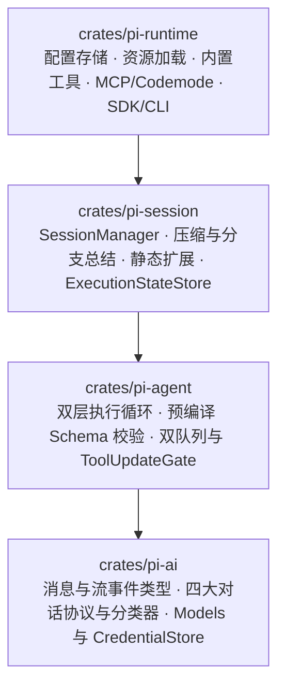
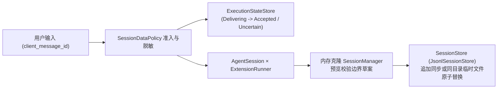

# Pi 通用核心架构

本页说明 `pi-ai`、`pi-agent`、`pi-session` 与 `pi-runtime` 四层核心包的依赖结构、内部数据流与可靠性机制。各包文件清单与实现细节分别见 [1.model-core.md](../rust/plan/1.model-core.md)、[2.agent-core.md](../rust/plan/2.agent-core.md)、[3.session-and-extensions.md](../rust/plan/3.session-and-extensions.md) 与 [4.runtime-and-sdk.md](../rust/plan/4.runtime-and-sdk.md)。

## 四层依赖拓扑

四个核心包单向分层构建，下层不反向依赖上层：

## 分层核心机制

### 1. 协议与服务商解耦（`pi-ai`）

1. **两层分离**：`api/` 模块只负责将归一化转录本组装为 HTTP 请求并将增量 SSE 解析为 `AssistantMessageEvent` 流。`providers/` 模块通过 `create_provider` 声明端点、认证方式与静态模型表。
2. **摊还线性流式 JSON 解析**：`StreamingJsonParser` 统计开放容器内全部已闭合子树，核算其克隆权重，按输入字节累加拷贝信用额度。信用不足时直接返回缓存快照借用引用，使大体积流式工具参数的快照刷新维持摊还线性开销。

### 2. 无死锁状态机与门控（`pi-agent`）

1. **锁与异步调用隔离**：`Agent` 将状态快照、待发队列、活跃运行守卫与监听器列表分开加锁，所有互斥锁均在跨越 `.await` 调用模型流、工具函数或事件监听器前释放，支持在钩子内安全重入 `steer`、`follow_up` 或 `abort`。
2. **迟到进度门控（`ToolUpdateGate`）**：工具执行结束瞬间在互斥锁内关闭 `accepting` 开关并排空已入队的 `on_update` 进度，锁外逐条发完 `ToolExecutionUpdate` 后再进入 `after_tool_call` 与 `ToolExecutionEnd`，消除后台线程抢占导致的事件乱序。
3. **结算屏障**：`AgentEnd` 发出后等待全部异步订阅监听器处理完毕，再清除流式标记并唤醒 `wait_for_idle()`。

### 3. 存储抽象与边界草案提交（`pi-session`）

1. **系统提示词差量补丁**：`system_prompt.rs` 按命名段落比对前后变化，仅将新增或变更段落写入 `SystemMessage.sections`，未改动对话时完整保留前缀缓存。
2. **边界草案原子预览**：`turn_end` 与 `agent_before_settle` 钩子返回的草案先在内存克隆实例上试应用并校验上下文合法性，全部通过后调用 `rewrite_all` 经同目录临时文件同步并原子替换，避免半截状态落盘。
3. **世代失效保护**：会话切换、派生或重载时立即调用旧 `ExtensionRunner::invalidate()`，阻断后台悬挂任务篡改新会话。

### 4. 服务共享与沙箱隔离（`pi-runtime`）

1. **跨会话服务复用**：`ModelRuntime` 与 `ExtensionCatalog` 共享底层 `Arc<Models>`，多会话按独立目录视图隔离可用模型。`AgentSessionRuntime` 通过 `transition_lock` 串行化跨文件切换，在目标会话加锁与核对成功前保留原会话运行。
2. **同路径写入串行化**：`file_mutation_queue` 在受控内部任务中按规范化路径串行执行 `write` 与 `edit`，调用方取消等待不会提前释放文件写锁。
3. **受控子进程与虚拟机**：Windows 下的 `bash`、`powershell` 与 MCP `StdioTransport` 统一挂起创建并绑定 kill-on-close Job Object。`codemode` 在独立工作线程运行 `rquickjs`，通过微任务轮询与中断处理器执行超时和取消。
