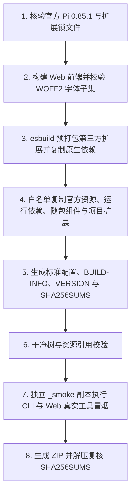

# 便携发行与构建架构

本页说明 `pack/pack.mjs` 的装配管线、Web 字体子集构建流程及随包外部运行时的维护方式。发行要求见 [SPEC.md](SPEC.md)。

## 发行装配管线

### 关键装配机制

1. **官方包与锁文件核验**：根据 `pack/official-windows-x64.json` 校验官方归档及全部 43 个运行文件的 SHA-256；核对 `agent/home/npm/package-lock.json` 与 `pack/extensions.package-lock.json` 完全一致，确保 `pi-fff`、`pi-web-access`、`pi-open-tui` 版本精确匹配。
2. **第三方扩展预打包**：使用固定版本 `esbuild@0.25.10` 将 `pi-web-access` 和 `pi-fff` 打包为 ESM，将 `@earendil-works/*` 与 `@sinclair/typebox` 设为 external，使扩展共享官方二进制内置的 Pi SDK 实例并大幅减少小文件数量。`pi-fff` 所需的 5 个 Windows x64 原生包（`ffi-rs` 等）原样复制到 `packages/pi-fff/node_modules/`。
3. **Web 导出运行依赖**：`pack/runtime-dependencies.mjs` 按 `agent/package-lock.json` 复制 `puppeteer-core` 及其依赖树至 `agent/node_modules/`，保留嵌套版本和各包许可证，排除上游测试目录，不复制 Pi SDK 或浏览器。依赖缺失、版本与锁文件不符、存在链接时拒绝装配；`BUILD-INFO.json` 登记运行依赖锁文件哈希、版本与完整性值，主许可证固定随 `licenses/` 分发。
4. **离线模型目录补全**：`pack/model-catalog.mjs` 的 `supplementDeepSeekFlash` 在复制 `agent/home/models-store.json` 时检查 `deepseek` 目录，若缺少官方默认模型 `deepseek-flash` 则补入完整元数据，已有上游条目时保持原时间戳与属性不变。
5. **隔离冒烟验证**：`pack/smoke.mjs` 与 `pack/web-smoke.mjs` 将装配好的目录复制到 `_smoke`，禁用遥测并启动本地模拟模型服务，通过真实 `pi.cmd` 验证冷／热启动、工具注册清单，以及在 RPC 宿主中挂载 Web 服务、发起会话消息、执行真实 `read` 工具并调用 `/api/lifecycle/exit` 安全退出。

## 字体构建与分发

Web 界面分发三档 WOFF2 子集字体（派生名 `CST UI Sans`），设计画布继续使用原 OTF。字体构建仅在开发机与 CI 执行（`src/web/frontend/scripts/prepare-fonts.mjs`），现场无需 Python。

| 项目 | 规则 |
|---|---|
| 上游来源 | Adobe Source Han Sans 固定提交 `a4f7cf94edfb9d7ffbdfc4841de276358bd7e0f2` 的 `SourceHanSansCN-Regular/Medium/Bold.otf` 及许可证，逐文件校验 SHA-256 |
| 字符集范围 | GB2312 全部 6,763 个常用汉字 + 前端与诊断扩展源码实际出现的字符 + Latin、常用标点、中文标点与全角字符 |
| 子集化与重命名 | 使用 Python 3.11 + `fonttools==4.62.1` + `brotli==1.0.9` 裁剪字形，将内部 `name` 表与 CFF 字体名重命名为 `CST UI Sans`（遵循 SIL OFL 1.1 保留名规则） |
| 缓存与产物 | 输出 `public/fonts/CSTUISans-{Regular,Medium,Bold}.woff2`、`LICENSE.txt`、`NOTICE.txt` 与 `subset.json`；输入配方与字符集未变时直接复用缓存，并将约 24.2 MiB 原字体压缩至约 4.1 MiB |
| 缺字回退 | 生僻字、繁体字与 Emoji 在浏览器中回退至系统 `Microsoft YaHei` 与 `sans-serif` |

## 随包外部组件维护

| 组件目录 | 用途 | 维护约束 |
|---|---|---|
| `pwsh/` | PowerShell 7.6 便携运行时，供所有 Windows 诊断采集与启动器使用 | 发行排除 `Schemas/`、`preview/` 及远程管理安装脚本；保留 `LICENSE.txt` |
| `wiztree/` | NTFS MFT 快速空间扫描与 CSV 导出 | 仅个人免费使用；发行排除运行期生成的 `WizTree3.ini`、`WizTree3.ini.bad` 与 `tmp/`；保留 `license.txt` |
| `lhm/` | `LibreHardwareMonitorLib.dll`（0.9.6，`net10.0` / `win-x64`）及 NuGet 依赖 DLL，供 `sys sensor` 与 `sys gpu` 读取传感器 | 零安装约束下不附带也不安装 PawnIO 内核驱动；保留未启用的 `DiskInfoToolkit.dll` 等依赖以便后续扩展硬件类别 |
