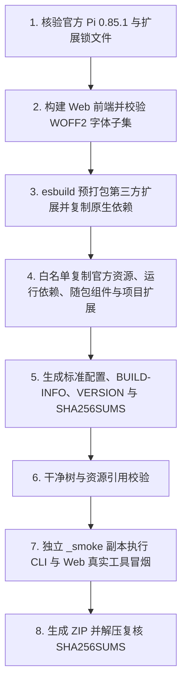

# 便携发行与构建架构

本页说明 `pack/pack.mjs` 的装配管线、Web 字体子集构建流程及随包外部运行时的维护方式。发行要求见 [SPEC.md](SPEC.md)。

## 发行装配管线

### 关键装配机制

1. **官方包与锁文件核验**：根据 `pack/official-windows-x64.json` 校验官方归档及全部 43 个运行文件的 SHA-256；核对 `agent/home/npm/package-lock.json` 与 `pack/extensions.package-lock.json` 完全一致，确保 `pi-fff`、`pi-web-access`、`pi-open-tui` 版本精确匹配。
2. **第三方扩展预打包**：使用固定版本 `esbuild@0.25.10` 将 `pi-web-access` 和 `pi-fff` 打包为 ESM，将 `@earendil-works/*` 与 `@sinclair/typebox` 设为 external，使扩展共享官方二进制内置的 Pi SDK 实例并大幅减少小文件数量。`pi-fff` 所需的 5 个 Windows x64 原生包（`ffi-rs` 等）原样复制到 `packages/pi-fff/node_modules/`。
3. **Web 导出运行依赖**：`pack/runtime-dependencies.mjs` 按 `agent/package-lock.json` 复制 `puppeteer-core` 及其依赖树至 `agent/node_modules/`，保留嵌套版本和各包许可证，排除上游测试目录，不复制 Pi SDK 或浏览器。依赖缺失、版本与锁文件不符、存在链接时拒绝装配；`BUILD-INFO.json` 登记运行依赖锁文件哈希、版本与完整性值，主许可证固定随 `licenses/` 分发。
4. **离线模型目录补全**：`pack/model-catalog.mjs` 的 `supplementDeepSeekFlash` 在复制 `agent/home/models-store.json` 时检查 `deepseek` 目录，若缺少官方默认模型 `deepseek-flash` 则补入完整元数据，已有上游条目时保持原时间戳与属性不变。
5. **隔离冒烟验证**：`pack/smoke.mjs` 与 `pack/web-smoke.mjs` 将装配好的目录复制到 `_smoke`，禁用遥测并启动本地模拟模型服务，通过真实 `pi.cmd` 验证冷／热启动、工具注册清单，以及在 RPC 宿主中挂载 Web 服务、发起会话消息、执行真实 `read` 工具并调用 `/api/lifecycle/exit` 安全退出。

## 字体构建与分发

Web 界面分发三档 WOFF2 子集字体（派生名 `CST UI Sans`），设计画布继续使用原 OTF。字体构建仅在开发机与 CI 执行（`src/web/frontend/scripts/prepare-fonts.mjs`），现场无需 Python。

| 项目 | 规则 |
|---|---|
| 上游来源 | Adobe Source Han Sans 固定提交 `a4f7cf94edfb9d7ffbdfc4841de276358bd7e0f2` 的 `SourceHanSansCN-Regular/Medium/Bold.otf` 及许可证，逐文件校验 SHA-256 |
| 字符集范围 | GB2312 全部 6,763 个常用汉字 + 前端与诊断扩展源码实际出现的字符 + Latin、常用标点、中文标点与全角字符 |
| 子集化与重命名 | 使用 Python 3.11 + `fonttools==4.62.1` + `brotli==1.0.9` 裁剪字形，将内部 `name` 表与 CFF 字体名重命名为 `CST UI Sans`（遵循 SIL OFL 1.1 保留名规则） |
| 缓存与产物 | 输出 `public/fonts/CSTUISans-{Regular,Medium,Bold}.woff2`、`LICENSE.txt`、`NOTICE.txt` 与 `subset.json`；输入配方与字符集未变时直接复用缓存，并将约 24.2 MiB 原字体压缩至约 4.1 MiB |
| 缺字回退 | 生僻字、繁体字与 Emoji 在浏览器中回退至系统 `Microsoft YaHei` 与 `sans-serif` |

## Rust LHM 辅助程序发布

`crates/cst-pilot/lhm-host/publish.ps1` 将 C# 源码发布为 `win-x64` 自包含 .NET 10.0.14 程序，输出程序、运行时与许可到指定的 `lhm/host/`。中间产物和 NuGet 缓存写入显式传入的仓库外 `WorkDirectory`，构建时关闭 CLI 遥测、开发证书生成和全局路径修改。

辅助程序通过独立加载上下文解析上级 LHM DLL 及其依赖，Rust 侧以固定路径启动，并绑定已有的 Job Object 控制。发布时保留整个 `host/` 目录；`test.ps1` 使用独立模拟 DLL 验证反射接口、错误与输出格式，不读取真实硬件。

## Rust 升级包准备

`crates/cst-pilot/src/update/` 已提供 `UpdateClient::check`、`prepare` 和 `VerifiedPackage::revalidate`。准备阶段仅写 `.state/update/staging/<version>-<UUID>/`，保留归档、签名清单和解压后的 `program/`；取消、校验失败或未消费的包释放时，仅清理本次暂存目录。消费后的包交给独立更新器，执行层按事务记录替换与恢复。

| 模块 | 职责 |
|---|---|
| `manifest.rs` | 可信公钥、双重签名、语义版本与最低升级基线 |
| `network.rs` | 复用 SSRF 的 URL 与 DNS 校验，固定 DNS 地址，禁用代理与自动跳转；只允许同源 HTTPS 重定向，清单和归档各有完整的 10 秒请求预算 |
| `verify.rs` | 流式下载、归档摘要、解压前 ZIP 目录上限、逐项路径与类型校验、全树哈希及凭据扫描；重新核验文件身份并拒绝硬链接 |
| `layout.rs` | 程序白名单、四份可合并配置、版本与必需资源核验、Win32 剩余空间检查 |
| `json.rs` | 有界解析，拒绝重复字段，防止凭据字段被后续同名字段覆盖 |
| `applier.rs` / `io.rs` | 保存预写事务、逐文件备份与安装、哈希复核、最多 50 次占用退避、失败逆序回滚和已提交事务清理 |
| `lock.rs` / `process.rs` | 工具包级命名管道锁、PID 与创建时间核验、等待旧进程退出、15 秒 Job Object 自检和原界面重启 |
| `handoff.rs` / `bin/cst-updater.rs` | 复制已验签更新器、保存固定交接请求、独立执行与只读健康检查 |
| `service.rs` / `activity.rs` | 同 home 共享后台检查与状态、升级门禁、写入许可、TUI 命令和遥测关闭协调 |

### 更新交接与恢复

`Handoff::prepare` 复核签名和父进程身份，复制独立更新器并保存请求；未启动时释放对象会清理本次请求、更新器与暂存包。`launch` 成功后由可信宿主退出原进程，库不调用宿主退出。更新器仅使用编译期公钥，命令行不接受公钥或任意执行程序。

替换前将全部文件的原哈希、新哈希和签名清单写入 `.state/update/transaction.json`。旧文件移入 `backup/<事务UUID>/files/`，合并配置的候选内容放在同一事务的 `prepared/`；`VERSION` 最后安装。Windows 同卷移动逐文件完成，任意一步中断都可根据哈希判断现场状态。

新版 `--health-check` 在独立 Job Object 中执行，15 秒预算覆盖退出和后代回收。通过后先写入提交标记，再清理备份和暂存并重启原界面；失败使用独立取消令牌恢复旧版。启动恢复遇到已提交事务只清理，未提交事务逆序回滚，哈希冲突保留现场与备份。`.state/update/result.json` 仅记录版本与固定结果类别。

公开 `handoff::health_check` 只读核验版本、资源、配置与扩展装配，允许在当前升级事务仍存在时执行。它复用资源装配校验，不创建业务会话；普通 `Kit` 会话入口继续执行 `startup_check`。

Rust 业务主程序须在 `--health-check` 分支调用它，启动器须在普通服务启动前安排独立恢复。当前 `pack.mjs` 装配 TypeScript 发行包；Rust 主程序、三端页面和发行装配由后续阶段接入。

### 宿主更新服务

`KitSession::updates` 提供 `status`、`check`、`prepare` 和 `launch`。同一 home 共享服务，首次后台检查不阻塞会话创建，手动检查先发生时不再补发启动检查。状态只通过 `set_status` 提示新版，启动检查不弹窗；`/update [check|install]` 支持手动检查与本地确认，Web 和桌面端可调用相同宿主接口。

`ActivityGate` 在输入持久化及模型投递前取得许可，覆盖输入钩子与实际运行之间的间隙。工具调用、清单工作线程和认证／设置事务共享门禁；许可随真实写入线程释放，BitLocker 未退出的原生操作另由卷锁计数保护。交接先关闭门禁，再核对全部已注册会话空闲及输入队列；失败释放门禁，后续可重试。可信宿主直接发起其他后台工作时也须持有 `gate.enter()` 的许可。

独立更新器启动后先等待父进程。宿主服务随后停止目录维护，调用同 home 的遥测 `close_process`，共用首个 5 秒定稿预算，不等待上传排空；启动失败不会提前封存遥测。成功状态保存 `LaunchReceipt`，门禁保持关闭，即使调用方停止等待也不重复启动。宿主根据回执退出全部列出的进程，库只请求有序会话关闭，不调用进程退出。

高层会话启动前调用 `startup_check`；检测到事务时保留全部现场并拒绝加载业务资源，交由独立更新器恢复。缺少编译期公钥时，默认服务显示不可用，不发更新请求，也不影响普通会话。可信测试宿主可用 `create_session_with_update` 注入 `UpdateOptions`；同 home 首个服务的配置持续生效。联网沿用固定发布源，仅从安全读取的 `web-search.json` 中接受 `198.18.0.0/15` TUN 豁免。

### 更新发现与发布源

默认清单地址为 `<oaHost>/api/agent/releases/latest`，官方 OA 地址为 `https://www.cstoa.top`。客户端读取工具包根目录 `VERSION` 中的 `cst-pilot <版本>` 行，与已验签清单比较。

| 项目 | 当前规则 |
|---|---|
| 自动检查 | 同一 home 的首个更新服务在后台检查一次，不阻塞启动；手动检查已先执行时跳过该次后台检查 |
| 手动检查 | TUI 使用 `/update check`；可信宿主调用 `KitSession::updates.check` |
| 更新判定 | 清单签名有效、平台为 `windows-x86_64`、远端版本高于本机，且本机不低于 `minUpgradableVersion` |
| 安装触发 | 发现新版只显示状态；`/update install` 经本地确认后下载、验签并交接 |
| 发行配置缺失 | 缺少编译期公钥时显示更新不可用，不发请求；普通会话仍可使用 |
| 网络或清单失败 | 显示检查失败，保持当前程序和用户数据；用户可手动重试 |
| 自定义发布源 | 由可信宿主装配 `UpdateClient` 时显式提供 HTTPS 地址，不接受模型或下载清单替换信任根 |

正式发行需提供三项内容：

1. 发布端在上述地址返回符合下节协议的签名清单，并提供对应升级 ZIP 下载。
2. 发布流程使用私钥签署清单和全树校验表，仅将公钥通过 `CST_UPDATE_PUBLIC_KEY` 编译进业务主程序与独立更新器。
3. Rust 发行装配提供完整升级包，主程序接入健康检查与启动恢复。

当前仓库提供更新客户端与独立更新器。发布端部署、生产签名流程和 Rust 主程序发行装配由发行环境接入。

### 签名清单协议

响应为 JSON 对象 `{payload, signature}`。`payload` 保存完整原始 JSON 字符串；`signature` 为标准 Base64 编码的 64 字节 Ed25519 签名。签名原文为 UTF-8 的 `cst-pilot-release-manifest-v1\n` 加 `payload` 原始字节。

| `payload` 字段 | 约束 |
|---|---|
| `schemaVersion` / `platform` | 固定为 `1` / `windows-x86_64` |
| `version` / `minUpgradableVersion` | 语义版本，可带前缀 `v`；准备前重新读取本机 `VERSION` 核验 |
| `builtAt` / `releaseNotes` | RFC 3339 构建时间；更新说明不超过 16 KiB |
| `archive` | `{url, size, unpackedSize, sha256}`；HTTPS 地址、归档精确字节数、含 `SHA256SUMS` 的解压字节数和小写十六进制 SHA-256 |
| `sha256Sums` | 沿用每行 `64位小写哈希 + 两个空格 + 相对路径`，不包含自身；包内文件必须逐字节一致 |
| `sha256Signature` | 对 UTF-8 `cst-pilot-release-sums-v1\n` 加 `sha256Sums` 原始字节签名，标准 Base64 编码 |

清单不超过 8 MiB，归档不超过 2 GiB，解压总体积不超过 8 GiB，文件不超过 10 万，ZIP 中央目录不超过 64 MiB。剩余空间须满足两倍解压体积再加归档体积。归档各项使用 UTF-8 名称，程序路径只创建普通目录和文件，不恢复归档中的链接或其他文件属性。

配置合并保留已有标量、数组和未知字段。本机设置合并及健康检查中的 `settings.json`、`models.json` 复用 `strip_json_comments` 后校验对象及重复字段；其余配置与发行包内容使用严格 JSON。`models-store.json` 按服务商与模型 ID 补入缺少的离线条目，保留动态目录的时间戳与凭据摘要。正式发布需为服务端实现上述签名协议，并提供官方公钥；自动测试使用独立密钥与模拟传输。

## 随包外部组件维护

| 组件目录 | 用途 | 维护约束 |
|---|---|---|
| `pwsh/` | PowerShell 7.6 便携运行时，供所有 Windows 诊断采集与启动器使用 | 发行排除 `Schemas/`、`preview/` 及远程管理安装脚本；保留 `LICENSE.txt` |
| `wiztree/` | NTFS MFT 快速空间扫描与 CSV 导出 | 仅个人免费使用；发行排除运行期生成的 `WizTree3.ini`、`WizTree3.ini.bad` 与 `tmp/`；保留 `license.txt` |
| `lhm/` | `LibreHardwareMonitorLib.dll`（0.9.6，`net10.0` / `win-x64`）及 NuGet 依赖 DLL，供 `sys sensor` 与 `sys gpu` 读取传感器 | 零安装约束下不附带也不安装 PawnIO 内核驱动；保留未启用的 `DiskInfoToolkit.dll` 等依赖以便后续扩展硬件类别 |
