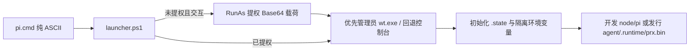

# 运行时与协调架构

本页说明启动器链路、Pi 0.85.1 进程内扩展适配、跨进程会话写权锁与 Web 会话池装配机制。行为要求见 [SPEC.md](SPEC.md)。

## 启动与环境隔离链路

1. **权限与载荷传递**：未提权时 `launcher.ps1` 不创建 `.state` 目录，直接将原工作目录与参数 JSON 编码为 UTF-8 Base64，通过 `Start-Process -Verb RunAs` 重新调用随包 `pwsh/pwsh.exe`。
2. **环境清洗**：`Initialize-PilotEnvironment` 将 `PI_CODING_AGENT_DIR` 固定为工具包 `agent/home`，设置 `PI_OFFLINE=1`，并将 `TEMP` / `TMP` 重定向至 `.state/tmp`，同时清除宿主环境变量中的开发端点覆盖与外部 API 密钥，防止宿主残留配置污染工具包。
3. **运行时入口**：发行包将官方 `pi.exe` 置于 `agent/.runtime/prx.bin`，强制所有启动经过 `pi.cmd` 与 `launcher.ps1` 的提权及环境隔离流程。

## Pi 进程内协调适配

Pi `0.85.1` 扩展 API 未直接暴露获取当前 `AgentSession` 实例或拦截全部 TUI 菜单重读的钩子。`agent/home/extensions/runtime/` 在进程内对公开原型方法做集中适配，不修改 Pi 源码或访问私有属性：

| 子模块 | 实现机制 |
|---|---|
| `adapter.ts` | 包装 `AgentSession.prototype.bindExtensions`，在实例绑定扩展时登记该会话，并包装其 `prompt`、`cycleModel` 与 `dispose` 方法；扩展重载时复用 `globalThis` 上的进程级登记 |
| `model-catalog.ts` | 按工具包目录共享后台 `ModelRuntime`，与界面实例共用目录缓存和凭据；统一目录联网、任务合并、取消与变化订阅 |
| `owner.ts` | 管理基于 Windows 命名管道（非 Windows 回退本机回环监听端口）的跨进程会话独占锁 |
| `configuration.ts` | 在 TUI 打开模型菜单、范围菜单、触发模型循环快捷键（读取 `KeybindingsManager` 实时键位）及每次 `prompt` 前重读 `settings.json`、`models.json`、`models-store.json` 与 `auth.json` |

TUI 进入 Web 待机后，扩展通过终端原始输入拦截器消费全部按键，此时运行协调不再触发配置刷新或分发模型菜单。

## 模型目录刷新

1. `model-catalog.ts` 包装界面实例的公开 `refresh`、`login` 和 `logout`。原生 TUI 的默认刷新转交后台运行时并显式开启联网；`allowNetwork: false` 保持本地重读。
2. 后台运行时独立执行联网，界面缓存重读不会取消后台请求。相同请求合并，其他刷新串行执行，联网任务总预算为 15 秒；单个菜单取消只结束自己的等待。
3. 缓存由 Pi `FileModelsStore` 锁定写入。成功后重读各界面实例，再通过订阅通知 Web；会话在空闲时更新当前模型元数据。
4. 登录、退出与服务配置变更使旧任务失效。最后一个使用者释放后清理定时器与在途任务；Provider 工厂通过进程级登记共享，OAuth 扩展可独立加载。

## 跨进程会话写权锁

会话写权锁按规范化 `agent/home` 路径与 `sessionId` 计算 SHA-256，映射为本机内核资源（Windows 命名管道 `\\.\pipe\cst-pilot-session-<hash>`）：

- **获取时机**：TUI 在 `bindExtensions` 时获取锁；Web 在构造 SDK 会话前获取锁，获取失败时不修改磁盘 JSONL 并返回 `409 session_owned`。
- **自动释放**：锁生命周期绑定底层句柄。会话 `dispose` 或进程崩溃退出时由操作系统内核立即释放，无需维护锁文件或心跳抢占。

## Web 会话池与上下文装配

Web 扩展在进程级容器（`web/server/container.ts`）中维护单一 `WebSessionPool`：

1. **共享与隔离**：全池共用一份 `settingsManager` 与 `modelRuntime`；每个会话实例拥有独立的 `DefaultResourceLoader`、UI 交互桥、工具执行计时表与输入收件箱（`SessionInbox`）。
2. **资源加载边界**：`DefaultResourceLoader` 显式启用 `noContextFiles: true`（禁用一切 `AGENTS.md`），仅加载工具包 `agent/home/skills/` 与允许的扩展，排除 `web` 扩展自身以防递归启动服务；开放工具由后端白名单固定。
3. **延迟落盘与分支**：遵循 Pi SDK 在产生首条助手回复前不写 JSONL 的规则。新建空会话先由内存与 `created-times.json` 记录创建时间；`fork` 在独立 `SessionManager` 上从目标条目派生，保持源会话写权与历史不变。
4. **手动压缩隔离**：Web 执行 `/compact` 时，若 Pi 配置的近期保留 token 数覆盖了全部有效消息，`session/compaction.ts` 从当前有效消息估算量的一半开始逐步缩小保留值，并通过 `AsyncLocalStorage` 仅覆盖本次 `session.compact()` 内部的单次设置读取，不改写全局 `settings.json` 或影响其他并发会话。

## 状态文件原子写入

`web-settings.json`、`created-times.json` 与 `web-inbox/` 下的队列文件均采用“写入同目录临时文件 + 原子重命名替换”策略。遇到 Windows 文件系统短暂 `EPERM` / `EACCES` / `EBUSY` 时最多重试 5 次（累计等待至多 375ms）；永久失败时保留原文件并返回结构化错误。
