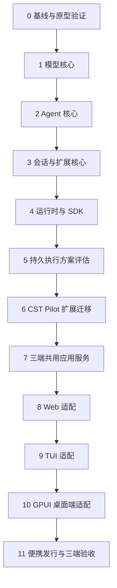

# Rust 重写开发计划

以 Rust 重写可独立使用的 Pi 核心，再将 CST Pilot 迁移为核心上的应用与扩展，最后完成 Web、TUI 和 GPUI 桌面端适配。核心优先保证扩展能力、执行行为和数据一致性。

本文规定阶段顺序、交付内容与完成条件。技术选型见 [prototype.md](prototype.md)；产品行为与安全边界以[项目规格](../SPEC.md)及模块文档为准。

## 开发边界

核心提供通用能力，CST Pilot 通过公开接口接入业务。核心包的拆分在实施时确定，下表按职责划分。

| 层次 | 职责 |
|---|---|
| 模型核心 | 消息与流事件、协议适配、Provider（模型服务提供方）、模型目录、认证接口与用量 |
| Agent 核心 | 模型与工具执行循环、参数校验、并发、插话、排队、取消与事件通知 |
| 会话与扩展核心 | 历史、分支、上下文、存储、扩展注册、工具与命令、事件钩子和界面交互请求 |
| 运行时与 SDK | 配置、资源加载、生命周期及面向应用的公开编程接口 |
| 可选持久执行层 | 任务检查点、重启恢复与重放策略；评估时参考 `pi-durable` |
| CST Pilot | Windows 诊断、命令交付、CSTOA、遥测、受控执行与便携运行 |
| 三端 | 输入、展示与本地交互；通过同一应用服务访问会话和后台任务 |

核心独立于 CSTOA、Windows 诊断和具体界面。应用所需能力通过公开扩展接口接入，通用接口不足时在核心中补齐。

## 阶段顺序

阶段完成后再扩大功能范围。各阶段持续使用最小命令行入口验证执行行为，完整 TUI 在阶段 9 实现。

### 0. 基线与原型验证

1. 以启动开发时的 Pi 最新稳定版为参考，固定版本与提交，建立核心行为和扩展能力清单。
2. 建立 Rust 工程、依赖边界、格式检查、静态检查和测试入口。
3. 验证 Rig 的协议能力、SQLite 的移动介质行为，以及 GPUI 的 Windows 支持。
4. 从项目规格和测试中整理诊断、认证、遥测、交互与便携发行的验收清单。

**完成条件**：参考版本、首批能力和验收清单明确；关键依赖完成原型验证；后续阶段有可执行的测试入口。

### 1. 模型核心

参考 `pi-ai`，先建立独立模型库，再逐项接入协议。

1. 定义消息、文本、图片、思考、工具调用、流事件和错误的统一表示。
2. 实现 Provider 注册、模型能力与目录、凭据存储接口、登录与续期接口。
3. 按 Chat Completions、OpenAI Responses、Anthropic Messages、Gemini 的顺序实现协议适配，先验证 DeepSeek 的实际调用。
4. 保留工具调用 ID、思考签名、用量、请求标识及响应观察接口，支持超时、取消和断流处理。

Rig 作为协议实现候选，放在核心公开接口之后。采用范围由协议测试确定。

**完成条件**：独立程序可调用模型、注册自定义 Provider；四协议通过工具续答、图片、思考信息、用量和取消测试。

### 2. Agent 核心

参考 `pi-agent-core`，实现通用的模型与工具执行循环。

1. 实现工具参数校验、执行结果、错误处理、串行与并行策略。
2. 实现插话、后续输入、停止和轮次结束规则。
3. 提供上下文转换、请求准备、工具执行前后及轮次结束接口。
4. 明确事件顺序、异步订阅的等待规则和取消信号的传递范围。

**完成条件**：模拟模型与工具可验证完整执行过程；并行结果顺序、工具失败、插话与取消行为稳定；执行循环可脱离存储和界面使用。

### 3. 会话与扩展核心

从 `pi-coding-agent` 提取通用会话能力，同时落实扩展接口。

| 开发顺序 | 内容 |
|---|---|
| 1 | 会话创建与恢复、消息和工具结果存储、模型与思考强度保存 |
| 2 | 扩展注册、工具与命令、自定义历史条目、事件钩子、交互请求和资源释放 |
| 3 | 会话分支、派生、导航，以及面向模型和界面的历史读取 |
| 4 | 上下文构建、手动与自动压缩、溢出处理 |
| 5 | 输入与执行状态关联、异常中断记录和恢复后的状态核对 |

扩展接口使用独立示例验证，覆盖自定义 Provider、工具、命令、上下文调整和交互请求。存储接口与执行循环分离，支持应用选择实现。

**完成条件**：扩展仅依赖公开接口；会话恢复、分支和压缩行为可重复验证；界面交互采用与具体客户端无关的请求表示。

### 4. 运行时与 SDK

将核心能力装配为可嵌入应用的 Rust Pi，并提供最小命令行程序。

1. 实现配置、凭据服务，以及技能、提示词和扩展资源加载。
2. 实现扩展初始化、会话绑定、释放与重载；明确重载对运行中任务的影响。
3. 提供创建会话、提交输入、订阅事件和响应交互的公开 SDK。
4. 编写独立示例，验证核心可用于维修业务以外的 Agent。

**完成条件**：仅使用 SDK 即可构建带自定义扩展、历史存储和交互的 Agent；核心测试无需启动 CST Pilot 或完整界面。

### 5. 持久执行方案评估

`pi-durable` 是可选参考。采用与否在 CST Pilot 迁移前确定，普通会话存储和持久执行分别验证。

| 评估项 | 要验证的问题 |
|---|---|
| 持久接收 | 输入确认前是否完成存储；重复请求是否返回同一接收结果 |
| 任务恢复 | 哪些步骤保存检查点；强杀后从何处继续 |
| 重放策略 | 哪些工具可重放；外部操作结果未知时如何核对 |
| 扩展兼容 | 普通执行与持久执行能否共用模型、工具和扩展定义 |
| 维护范围 | 项目需要的恢复能力能否通过有限的通用接口实现 |

**完成条件**：形成采用范围和恢复规则；所选方案满足 CST Pilot 的输入去重、状态恢复和未知操作核对要求。

### 6. CST Pilot 扩展迁移

将业务能力逐项接入 Rust Pi，通用能力继续由核心提供。

| 开发顺序 | 迁移内容 | 完成条件 |
|---|---|---|
| 1 | 工具白名单、提示词、技能、文件读取与查找、联网检索与抓取 | 信息采集可用，凭据读取与网络访问边界可验证 |
| 2 | 整机概况、进程、卷空间、设备驱动、自启和事件日志 | 结构化结果、单位、错误与部分降级符合工具契约 |
| 3 | 命令方案、版本修订与 TXT 交付 | 版本冲突、重复交付、编码和文件写入边界正确 |
| 4 | WizTree 扫描、目录大小缓存、GPU、I/O 与传感器 | 采样口径、扫描预算、取消和换盘缓存清理正确 |
| 5 | CSTOA 登录、模型目录、自定义服务与账号额度 | 凭据可随工具包移动，切换账号不混用目录和资料 |
| 6 | 遥测采集、请求扣点、双端队列与中断恢复 | 字段遵循遥测契约，两端独立发送和确认 |
| 7 | BitLocker 状态、隐藏输入、解锁与解密确认 | 同卷互斥，敏感值不进入持久记录，未知结果先核对 |

诊断采集可先由 Rust 调用受控采集程序，再逐项替换为系统接口。每次替换单独核对数据口径与硬超时行为。

**完成条件**：业务通过公开扩展接口运行；诊断、认证和遥测按模块验收；受控执行具备与界面无关的安全规则。

### 7. 三端共用应用服务

由 CST Pilot 装配单个本机核心服务，统一拥有会话和后台任务。核心服务与 GPUI 客户端分进程运行。

1. 实现多会话运行、同一会话单执行者、输入去重、队列、附件和后台任务管理。
2. 提供 HTTP 命令、会话快照和 SSE 事件流，处理重连、过期响应与并发修改。
3. 将登录、本地确认和隐藏输入映射为客户端可响应的交互请求；敏感值使用独立通道。
4. 实现服务访问检查、启动发现、同一数据目录的实例互斥和显式退出流程。

**完成条件**：多个测试客户端共享状态；刷新、断连或关闭客户端不取消后台执行；重启后可核对输入和任务状态；凭据不进入普通响应与事件。

### 8. Web 适配

复用 React 前端与设计系统，按新服务契约调整数据访问。

1. 接入生成的接口类型、快照和事件，完成发送、流式响应、停止与断线恢复。
2. 接入历史、分支、压缩、模型设置、认证、工具卡片与受控交互。
3. 接入会话导出及产物管理，复用只读文档渲染。

**完成条件**：Web 功能通过模块契约和浏览器测试；多标签并发、刷新、未知提交结果与服务重启恢复可验证。

### 9. TUI 适配

使用终端组件库实现完整客户端，接入与 Web 相同的应用服务。

1. 完成输入编辑、流式消息、工具结果、会话与模型选择。
2. 完成命令、分支、压缩、认证、隐藏输入和受控确认。
3. 验证中文输入、键盘操作、终端尺寸变化及连接恢复。

**完成条件**：TUI 覆盖项目开放能力；与 Web 同时连接时状态一致，主题独立；退出客户端与退出核心服务的行为明确。

### 10. GPUI 桌面端适配

使用经原型验证的 GPUI 组件实现桌面客户端，复用业务接口与设计令牌。

1. 完成会话、输入、流式 Markdown、工具卡片、设置和认证。
2. 完成分支、导出、本地敏感输入及受控确认。
3. 验证中文输入法、选区、长会话滚动、多 DPI、远程桌面和图形加载失败。

**完成条件**：桌面端覆盖项目开放能力；关闭或崩溃不影响核心服务；图形不可用时 TUI 和 Web 仍可连接。

### 11. 便携发行与三端验收

发行装配与实机测试随阶段推进，本阶段完成发布前核查。

1. 完成管理员授权、便携目录隔离、子进程回收、依赖装配与许可检查。
2. 验证发行包不含凭据、会话、开发配置和构建缓存，现场无需安装运行环境。
3. 在 Windows 10/11、不同文件系统的实际 U 盘和目标浏览器上验证启动、诊断与导出。
4. 验证强杀、写满、断网、只读介质、跨机移动与三端并发；BitLocker 在获准的隔离加密卷上单独验收。
5. 按确定的数据迁移范围完成导入、完整性检查和失败处理。

**完成条件**：三端能力与共享状态通过验收；干净发行副本完成实机流程；已知限制与支持范围明确。

## 持续验收

测试随各阶段建立，完整验收范围沿用 [TESTING.md](../TESTING.md)。

| 范围 | 方法 |
|---|---|
| Pi 核心行为 | 固定参考版本，以相同输入对照消息、事件顺序、工具执行和会话结果 |
| 扩展能力 | 通过独立扩展示例验证注册、调用、生命周期与交互，不依赖核心内部实现 |
| 模型协议 | 本地模拟服务验证边界，隔离凭据完成真实协议验证 |
| 数据恢复 | 注入强杀、写入失败与响应丢失，核对持久状态、重复输入和未知操作 |
| 三端共享 | 相同业务用例分别执行，交叉验证会话、配置、认证与任务状态 |
| 实机能力 | 真实 UAC、BitLocker、移动介质及生产服务单独记录，区分模拟测试与实测结论 |

测试使用隔离配置、模拟服务和仓库外当天临时目录。自动测试不读取个人凭据，不访问生产遥测端点。

## 待确定事项

按下表集中确定实施选择，结论落实到对应阶段和技术选型文档。

| 主题 | 决策问题 | 确定时间 |
|---|---|---|
| 核心范围 | 固定哪个 Pi 版本；首版保留哪些公开能力与行为 | 阶段 0 |
| 扩展加载 | 首版支持哪些加载方式；是否需要直接运行 TypeScript 扩展；扩展重载与版本兼容范围是什么 | 阶段 0，阶段 3 前验证 |
| 协议实现 | Rig 能覆盖哪些协议与字段；缺失能力由适配层还是独立实现承担 | 阶段 1 |
| 会话存储 | 默认存储、格式版本、升级和备份方式；SQLite 的移动介质配置 | 阶段 3 |
| 持久执行 | 是否参考 `pi-durable` 实现独立执行层；首版承担哪些恢复能力 | 阶段 5 |
| 数据迁移 | 是否导入已有会话、分支、设置和凭据；导入校验与失败处理范围 | 阶段 6 前 |
| 客户端分发 | 三端是否独立发行；启动哪个客户端；核心服务何时随客户端启动或退出 | 阶段 7 前 |
