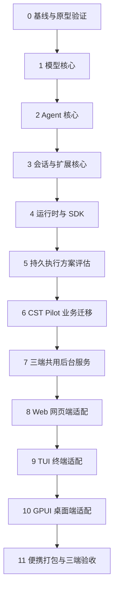

# Rust 重写开发计划

重写工作围绕**安全性、简洁性、高效性**三项原则推进：

1. **安全性**：利用 Rust 的强类型、所有权与编译期检查，锁死消息结构、流事件状态、并发写权与敏感凭据边界，消除动态类型下的未定义状态与资源泄漏。
2. **简洁性**：以当前上游 `earendil-works/pi` 最新版（`1.5.0`）为蓝本，直接砍掉旧版兼容层（`compat`）、非中国大陆常用的海外专有云厂商、运行时动态脚本加载等历史包袱。
3. **高效性**：编译为无脚本运行时的原生单机程序，网络请求与流解析采用直接、零多余拷贝的异步管线，降低内存占用与启动耗时。

整体分三步走：先用 Rust 实现可独立复用的通用 Pi 核心，再把 CST Pilot 的诊断、认证等业务迁移到该核心上，最后依次接入 Web、TUI 和 GPUI 桌面端。本文说明各阶段的推进顺序与完成标准；推荐技术栈见 [prototype.md](../prototype.md)，第一阶段具体设计见 [1.model-core.md](1.model-core.md)，产品功能与安全要求以[产品规格](../../SPEC.md)为准。

## 模块分层与边界

通用能力全部沉淀在 Rust Pi 核心中，CST Pilot 只负责现场维修相关的业务逻辑。具体拆成多少个 Rust 子包（crate）在编码时决定，按职责分为以下七层：

| 层次 | 主要职责 |
|---|---|
| 模型核心（`pi-ai`） | 统一消息与流式事件格式，对接主流大模型协议、中国大陆常用模型目录、登录凭据与 Token 用量统计 |
| Agent 核心（`pi-agent`） | 驱动“调用模型 → 执行工具 → 继续生成”的循环，处理参数校验、并发调用、中途插话、输入排队与取消 |
| 会话与扩展核心 | 管理聊天历史、分支树、上下文压缩与数据存储；提供工具、斜杠命令、事件钩子和通用界面弹窗的静态扩展接口 |
| 运行时与 SDK | 负责配置文件读写、技能与提示词加载、扩展生命周期管理，以及供上层应用调用的公开编程接口（SDK） |
| 持久执行层（可选） | 记录任务检查点，支持进程强杀后恢复执行与安全重放；设计时参考现有的 `pi-durable` |
| CST Pilot 业务层 | 实现 Windows 软硬件诊断、修复命令清单（runbook）、CSTOA 登录、双端遥测、BitLocker 操作与 U 盘便携启动 |
| 三端界面 | Web、TUI 终端和 GPUI 桌面端，只负责界面展示与操作输入，通过同一个本机后台服务读写会话和任务 |

Rust Pi 核心与 CSTOA、Windows 诊断及具体界面解耦。CST Pilot 所需的能力统一通过核心公开的扩展接口接入；遇到扩展接口不够用的情况，先在通用核心中补齐接口。

## 阶段顺序

阶段 1–3 的行为直接对齐上游 Pi `1.5.0`，不做多余的防御性包装或过度扩展设计。每个阶段通过测试后再进入下一阶段；前几个阶段使用极简命令行程序验证后台逻辑，完整的 TUI 终端界面放在阶段 9 实现。

### 0. 基线与原型验证

正式编写业务代码前，先对齐上游版本，配好工程环境，并把关键第三方库试跑通。

1. 固定上游 `earendil-works/pi` `1.5.0` 作为参考基线，明确首版保留的核心行为与裁剪清单。
2. 初始化 Rust Cargo Workspace 工程结构，配置好代码格式化（`rustfmt`）、静态检查（`clippy`）、依赖规则和自动化测试入口。
3. 通过桌面原型验证 `GPUI Kit` 在 Windows 下的界面渲染、`Tokio` 跨线程流式通信与便携配置读写；补充验证 `SQLite` 在 U 盘上的事务恢复表现。
4. 对照现有项目规格与测试，整理出诊断工具、登录认证、遥测、界面交互和便携打包的验收清单。

**完成条件**：上游参考版本、裁剪范围和验收清单明确；关键第三方库通过原型验证；工程静态检查与测试命令可直接运行。

### 1. 模型核心

对标上游 `packages/ai`（`1.5.0`），实现简洁、强类型的独立模型调用库 `crates/pi-ai`。详细迁移设计见 **[1.model-core.md](1.model-core.md)**。

1. 定义统一的消息、文本、图片、思考、工具调用、流事件和错误数据结构。
2. 采用“协议（API）与服务商（Provider）两层分离”结构，实现模型目录、凭据存储接口、OAuth 登录与续期接口。
3. 基于 `reqwest` 与轻量 SSE 解析，按 OpenAI Responses、OpenAI Chat Completions、Anthropic Messages、Google Gemini 的顺序实现四类对话协议及 `typesafe-system-one` 分类器协议，优先用官方 Responses 协议跑通 DeepSeek 真实调用。
4. 保留中国大陆常用国产厂商、国际主流基座及 OpenCode / TypeSafe / Vercel / Hugging Face 等常用平台，剔除 AWS / GCP / Azure 等海外专有云与二线算力商；完整保留工具调用 ID、思考签名、Token 用量与请求取消能力。

**完成条件**：独立程序可调用模型、注册自定义服务商；四类协议全部通过工具调用续答、图片输入、思考签名保留、用量统计和中途取消测试。

### 2. Agent 核心

对标上游 `packages/agent`（`pi-agent-core`），实现通用的“大模型生成与工具调用”自动执行循环。

1. 实现工具参数的 JSON Schema 校验、执行结果收集、报错封装，以及多工具串行或并行调用的控制逻辑。
2. 实现执行中途用户插话（steer）、追加后续输入（follow-up）、主动停止和单轮对话结束的判断规则。
3. 预留扩展切入点，支持在整理上下文、发送模型请求前、工具执行前后以及单轮对话结束时插入自定义逻辑。
4. 固定流式事件的发出顺序与异步事件监听器的等待规则，确保取消信号能准确传递到正在运行的模型请求和工具任务。

**完成条件**：用模拟模型（Mock LLM）和模拟工具即可跑通完整的多轮工具调用流程；并发工具的结果顺序、报错恢复、中途插话与取消行为稳定；该模块可脱离数据库和界面单独使用。

### 3. 会话与扩展核心

对标上游 `packages/coding-agent` 的会话与扩展机制，实现会话历史管理、上下文压缩和编译期静态注册的扩展体系。

| 顺序 | 开发内容 |
|---|---|
| 1 | 会话新建与恢复、消息与工具结果落盘、当前模型与思考强度保存 |
| 2 | 静态扩展注册接口，支持注册自定义工具、斜杠命令、自定义历史记录、生命周期事件钩子、界面交互请求与退出清理 |
| 3 | 会话分支树管理、从指定节点派生新会话（fork）、分支跳转，以及分别面向大模型和前端界面的历史记录读取 |
| 4 | 请求前的上下文拼装、手动与自动上下文压缩（compact），以及超出模型最大上下文长度时的降级处理 |
| 5 | 用户输入与执行状态的关联记录、进程异常中断标记，以及重启后的状态核对 |

编写独立的扩展示例验证这套接口，覆盖自定义模型服务商、工具、命令、上下文改写和弹窗交互。数据存储通过 Trait 接口与执行循环解耦，方便上层应用切换存储方式（内存、JSONL 或 SQLite）。

**完成条件**：所有扩展示例仅调用公开接口即可工作；会话恢复、分支切换与上下文压缩结果可稳定复现；核心需要用户确认或输入时，发出与具体界面无关的通用交互请求。

### 4. 运行时与 SDK

把前三个阶段的核心模块组装成可直接嵌入各类应用的 Rust Pi 运行时，并提供一个最小命令行程序。

1. 实现全局设置与凭据管理服务，支持加载技能说明（Skills）、系统提示词和扩展资源。
2. 实现扩展的初始化、绑定会话与资源释放流程。
3. 提供简洁的公开 SDK，供上层应用创建会话、发送用户输入、订阅流式事件和回填交互结果。
4. 编写一个与电脑维修无关的独立示例程序，验证这套核心可以作为通用 Agent 框架被其他项目直接引用。

**完成条件**：外部程序仅调用公开 SDK，就能搭出带自定义扩展、历史记录和用户交互的完整 Agent；跑全量核心测试无需启动 CST Pilot 或任何图形界面。

### 5. 持久执行方案评估

在迁移 CST Pilot 业务前，评估是否引入类似 `pi-durable` 的持久执行层，用来解决进程被强杀或断电后的任务恢复问题。普通会话存储与持久执行分开验证。

| 评估维度 | 要回答的具体问题 |
|---|---|
| 输入持久接收 | 给前端返回“已收到输入”之前，数据是否已安全写入磁盘；前端网络重试发来重复请求时，能否直接返回同一个接收结果 |
| 中断后恢复 | 对话与工具执行到哪一步需要保存检查点（checkpoint）；进程被强杀重启后，从哪个位置继续往下跑 |
| 工具重放策略 | 哪些只读工具可以安全自动重跑；像 BitLocker 这类修改系统的操作如果中途断掉、结果未知，重启后如何先核对系统真实状态 |
| 扩展兼容性 | 开启持久执行后，能否直接复用前面写好的模型接口、工具定义和扩展插件，避免维护两套代码 |
| 维护复杂度 | CST Pilot 实际需要的断线与强杀恢复能力，用轻量级的收件箱加状态表就够用，还是值得引入完整的持久执行层 |

**完成条件**：明确是否引入独立持久执行层及具体的恢复规则；所选方案能满足 CST Pilot 的输入去重、强杀恢复和未知操作核对要求。

### 6. CST Pilot 业务迁移

基于前面建好的公开扩展接口，把 CST Pilot 的现场诊断、认证和遥测功能逐项迁移到 Rust Pi 上。

| 顺序 | 迁移内容 | 完成标准 |
|---|---|---|
| 1 | 开放工具白名单、诊断系统提示词、技能文档、文件读取与查找、联网检索与网页抓取 | 基础工具可正常调用，禁止读取本地凭据文件与内网地址的安全限制通过测试 |
| 2 | 整机概况、进程排行、卷空间、设备与驱动、开机自启和 Windows 事件日志 | 返回的 JSON 字段、数值单位、报错格式与降级提示符合现有诊断工具契约 |
| 3 | 修复命令方案（`command_plan`）多版本保存与 `.txt` 清单导出（`runbook`） | 版本冲突检测、同序号覆盖、UTF-8 BOM + CRLF 编码以及只写 `artifacts/` 目录的限制全部正确 |
| 4 | WizTree 磁盘扫描、共享目录大小缓存、GPU 负载、磁盘 I/O 与硬件传感器 | 采样计算口径、扫描超时预算、中途取消和拔插换盘后清理缓存的行为准确 |
| 5 | CSTOA 扫码与 API Key 登录、动态模型目录、自定义模型服务与账号额度查询 | 登录凭据可随 U 盘跨机使用，切换账号时模型目录与个人资料互不串用 |
| 6 | 会话遥测统计、请求级扣点核对、双端独立上报队列与异常中断草稿恢复 | 上报字段符合遥测契约，CSTOA 与 `timserver_1` 双队列独立发送、重试和确认 |
| 7 | BitLocker 卷状态查询、恢复密码隐藏输入、解锁与全盘解密本地确认 | 同一磁盘卷跨进程互斥执行，恢复密码原文不写入磁盘，执行中断后先查询卷真实状态 |

迁移诊断工具时，可以先由 Rust 调用现有的受控采集脚本或程序跑通流程，再逐个替换为 Rust 原生系统调用。每次替换都单独核对返回数据口径与超时强杀行为。

**完成条件**：所有业务功能均通过核心的公开扩展接口挂载运行；诊断、认证、遥测三大模块各自通过契约测试；BitLocker 等受控操作的安全校验在后端核心层生效，不依赖前端界面拦截。

### 7. 三端共用后台服务

将装配好业务的 Rust Pi 封装为本机后台服务，统一托管所有会话和后台任务。该服务与 GPUI 桌面端作为两个独立进程运行，供 Web、TUI 和桌面端同时连接。

1. 管理多会话并发运行，保证同一个会话同一时间只有一个执行实例，处理输入去重、消息排队、图片附件和后台任务。
2. 提供本机 HTTP 操作接口、会话完整快照和 SSE 实时事件流，处理断线重连、过期响应拦截与多端并发修改设置。
3. 将扫码登录、高危操作确认和恢复密码隐藏输入统一转为客户端可处理的交互请求；密码等敏感输入走专用提交通道，不混入普通聊天记录。
4. 实现本机接口鉴权、服务端口发现、同一数据目录单实例互斥锁，以及空闲或运行中的安全退出流程。

**完成条件**：多个测试客户端同时连接时状态实时同步；刷新网页、断开连接或关闭客户端窗口不会中断后台正在运行的任务；服务重启后能准确核对未完成的输入与任务状态；密钥和凭据不出现在普通接口响应或事件流中。

### 8. Web 网页端适配

保留现有的 React 前端页面与视觉设计，将前端的数据请求和事件监听切换到新的 Rust 后台服务。

1. 接入由 Rust 自动生成的 TypeScript 接口类型、会话快照和 SSE 事件流，跑通消息发送、流式输出展示、中途停止与断线恢复。
2. 对接会话历史列表、分支树、上下文压缩、模型偏好设置、登录认证、专用诊断工具卡片以及 BitLocker 本地确认弹窗。
3. 对接由 `Chromiumoxide` 驱动的会话长图（PNG）与离线网页（HTML）导出接口，直接复用前端现有的只读导出页面排版。

**完成条件**：Web 端功能通过接口契约与浏览器端到端（E2E）测试；多标签页同时打开、页面刷新、提交结果未知时的状态核对，以及后台服务重启后的恢复流程验证通过。

### 9. TUI 终端适配

使用 `Ratatui` 等终端界面库实现完整的命令行交互界面，作为客户端连接到阶段 7 的同一个本机后台服务。

1. 实现多行输入框、流式消息渲染、诊断工具结果展示，以及历史会话切换与模型选择菜单。
2. 实现斜杠命令、分支树浏览、上下文压缩、服务登录、恢复密码隐藏输入和受控操作确认弹窗。
3. 重点验证 Windows 终端下的中文输入法、快捷键操作、窗口大小拖拽缩放以及后台服务重连。

**完成条件**：TUI 完整支持项目开放的全部诊断与会话功能；与 Web 端同时打开时，会话、模型和凭据状态实时同步，各自的界面主题互不覆盖；关闭 TUI 界面与退出后台服务的操作区分清晰。

### 10. GPUI 桌面端适配

使用通过原型验证的 `GPUI` 与 `GPUI Kit` 组件库构建原生桌面客户端，复用后台服务接口与现有的视觉设计令牌（颜色、字号、圆角、间距与动效参数）。

1. 实现主页、会话列表、多行输入框、流式 Markdown 渲染、专用诊断工具卡片、设置页和账号登录页。
2. 实现分支树视图、会话导出预览、BitLocker 恢复密码隐藏输入及高危操作确认弹窗。
3. 在 Windows 实机上验证中文输入法候选框跟随、文本划选复制、长会话流畅滚动、多显示器不同缩放比例（DPI）、远程桌面连接，以及显卡驱动异常时的报错提示。

**完成条件**：GPUI 桌面端完整支持项目开放能力；关闭桌面窗口或桌面进程意外崩溃时，后台核心服务继续正常运行；在缺少图形支持的精简系统或 PE 环境下，队员仍能正常使用 TUI 和 Web 端。

### 11. 便携打包与三端验收

打包脚本与实机测试在前面各阶段同步推进，本阶段完成最终发行包组装与全套实机验收。

1. 完成启动时的 Windows 管理员提权（UAC）、便携目录隔离（临时文件与配置均收拢在工具包内）、子进程自动回收（避免主进程退出后残留采集进程）、随包工具组装与第三方开源许可证核查。
2. 检查生成的干净发行包，确保不包含任何个人密钥、历史会话、开发配置或编译缓存，在机主电脑上无需安装任何运行时即可双击启动。
3. 在 Windows 10/11 实机、不同文件系统（FAT32 / exFAT / NTFS）的真实 U 盘以及目标版本浏览器上，验证启动、诊断、修复清单生成和会话导出全流程。
4. 实测进程强杀、U 盘写满、断网、只读写保护介质、跨电脑拔插移动与三端同时连接操作；在获准的隔离测试加密卷上完成 BitLocker 解锁与解密实机验收。
5. 按照敲定的旧版数据迁移范围，验证旧版会话、设置与凭据的导入、完整性校验和损坏兜底提示。

**完成条件**：TUI、Web 和 GPUI 桌面端的功能与跨端状态同步通过验收；干净发行包在真实 U 盘和实机环境跑通全流程；支持范围与已知环境限制在文档中写明。

## 持续测试与验收

自动化测试随每个阶段同步编写，完整的工具核查项与跨端验收矩阵沿用 [TESTING.md](../../TESTING.md)。

| 验收范围 | 验证方法 |
|---|---|
| Pi 核心行为 | 以上游 Pi `1.5.0` 为基准，输入相同的对话和工具调用，对比消息结构、事件触发顺序和最终会话记录是否一致 |
| 扩展插件接口 | 通过独立的扩展示例测试工具、命令、事件钩子和交互弹窗的注册与调用，确保不依赖核心内部私有实现 |
| 大模型协议 | 日常回归使用本机模拟服务（Mock LLM）测试断流、超时和异常边界；发布前使用隔离的测试凭据验证各家真实模型接口 |
| 故障与数据恢复 | 在测试中模拟进程强杀、磁盘写入失败和网络响应丢失，核对重启后的数据库状态、重复提交去重与未知结果操作提示 |
| 三端状态同步 | 用同一套业务用例分别驱动 Web、TUI 和桌面端，交叉检查会话历史、模型设置、登录状态与后台任务进度是否一致 |
| 实机与生产环境 | 真实 UAC 弹窗、BitLocker 加密卷、U 盘读写及 CSTOA 生产服务联调单独在实机执行并记录，区分模拟测试通过与实机验证通过 |

所有自动化测试均使用独立的临时目录（`E:/tmp/<当天日期>/` 或 `F:/tmp/<当天日期>/`）、隔离配置和本机模拟服务。测试过程不读取开发者的真实 `auth.json` 凭据，也不向生产遥测服务器发送数据。

## 待确定事项

以下技术与产品决策在对应阶段开始前敲定，结论同步更新到本文、[prototype.md](../prototype.md) 及本目录下的阶段文档：

| 议题 | 需要拍板的具体问题 | 计划确定时间 |
|---|---|---|
| 会话存储方案 | 核心默认使用原版 JSONL 文件还是 SQLite；数据库表结构如何升级与备份；SQLite 在 U 盘（尤其是 FAT32/exFAT）上采用什么日志与同步模式 | 阶段 3 |
| 持久执行取舍 | 是否参考 `pi-durable` 引入独立的持久执行层；首版只需做好输入收件箱与任务状态核对，还是要支持多步工具调用断点续跑 | 阶段 5 |
| 旧版数据迁移 | 升级到 Rust 版时，是否支持直接导入旧版 TypeScript 工具包里的历史会话、设置和登录凭据；文件损坏或格式不兼容时如何提示 | 阶段 6 前 |
| 客户端启动与分发 | TUI、Web 和 GPUI 桌面端是打包在同一个发行包还是分开提供；双击启动默认打开哪个界面；后台核心服务何时自动拉起、何时退出 | 阶段 7 前 |
