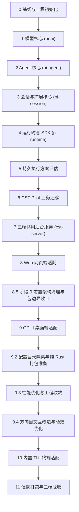

# Rust 重写开发计划

全栈重写遵循安全性、简洁性、高效性三项核心原则。

1. **安全性**：利用 Rust 的强类型、所有权与编译期检查，锁定消息结构、流事件状态、并发写权与敏感凭据边界，消除未定义状态与资源泄漏。
2. **简洁性**：以上游 `earendil-works/pi`（`1.5.0`）为基准，剔除旧版兼容层、非中国大陆常用的海外专有云厂商与运行时动态脚本加载。
3. **高效性**：编译为无脚本运行时的原生单机程序，网络请求、流解析与系统诊断采用原生异步与有界阻塞管线，降低内存占用与启动耗时。

工程按三个梯度推进：先构建可独立复用的通用 Rust Pi 核心，再挂载 CST Pilot 的诊断、认证、遥测与在线升级业务，最后接入公用后台服务与三端界面。技术栈选型见 [prototype.md](../prototype.md)，产品需求以 [产品规格](../../SPEC.md) 为准，各阶段子包设计见下方对应章节链接。

## 模块分层与边界

通用能力收归 Rust Pi 核心，CST Pilot 仅承载现场维修相关的业务逻辑与界面：

| 层次 | 主要职责 |
|---|---|
| 模型核心（`pi-ai`） | 统一消息与流式事件格式，对接四大对话协议与分类器协议，内置 26 个常用服务商目录，管理登录凭据与 Token 计费 |
| Agent 核心（`pi-agent`） | 驱动「调用模型 → 校验与执行工具 → 轮询队列续答」双层循环，处理并发调用、中途插话、排队与取消 |
| 会话与扩展核心（`pi-session`） | 管理 JSONL v3 会话树、上下文压缩、执行状态日志与数据策略，提供静态扩展注册与通用 UI 交互接口 |
| 运行时与 SDK（`pi-runtime`） | 负责配置与凭据服务、技能与模板加载、内置工具、MCP/Codemode 扩展、图片归一化与公开 SDK |
| 跨进程底包与独立更新器（`cst-os`、`cst-updater`） | `cst-os` 提供工具包目录解析、`server.json` 发现记录、`ProcessIdentity`、安全路径与跨进程内核锁；`cst-updater` 提供 Ed25519 验签验树、事务替换回滚与 `cst-updater.exe` |
| CST Pilot 业务层（`cst-kit`） | 实现 17 个白名单工具、Windows 原生软硬件诊断、修复命令清单、CSTOA 登录、双端遥测、BitLocker 与联网升级编排 |
| 后台服务与三端界面 | `cst-server` 统一托管会话与通道门禁。GPUI 桌面端、窗口内置 TUI 与 React Web 端通过本机 HTTP/SSE 读写状态 |

## 阶段顺序

### 0. 基线与工程初始化

**状态：已完成。**

固定上游 `earendil-works/pi` `1.5.0` 为参考基线，建立 Cargo Workspace 工程结构与 `rustfmt`、`clippy`、隔离测试及 CI 检查入口。

### 1. 模型核心

**状态：已完成。** 详细设计见 **[1.model-core.md](1.model-core.md)**。

实现强类型的独立模型调用库 `crates/pi-ai`：定义统一消息与流事件结构，按协议与服务商两层分离实现 OpenAI Responses、OpenAI Chat Completions、Anthropic Messages、Google Gemini 及 `typesafe-system-one` 协议，默认用官方 Responses 协议驱动 DeepSeek，并保留 26 个常用内置服务商。

### 2. Agent 核心

**状态：已完成。** 详细设计见 **[2.agent-core.md](2.agent-core.md)**。

实现自动执行循环包 `crates/pi-agent`：内置三阶段宽松参数转换与预编译 JSON Schema 校验器，支持串并行工具调度、`ToolUpdateGate` 进度门控、`StopReason::Length` 截断拒执行保护、中途插话与后续排队调度。

### 3. 会话与扩展核心

**状态：已完成。** 详细设计见 **[3.session-and-extensions.md](3.session-and-extensions.md)**。

实现 `crates/pi-session`：提供 `SessionStore` 与默认 JSONL v3 存储（含惰性创建、尾部修复与边界草案原子提交），支持面向模型与界面的双视图投影和五档过滤分支树。同步实现自适应上下文压缩、静态 `Extension` 注册器、`SessionDataPolicy` 脱敏策略及 `ExecutionStateStore` 崩溃核对机制。

### 4. 运行时与 SDK

**状态：已完成（含 4.1 扩展能力）。** 详细设计见 **[4.runtime-and-sdk.md](4.runtime-and-sdk.md)**。

实现 `crates/pi-runtime`：组装 `FileAuthStorage / RuntimeCredentials`、`SettingsManager`、`ModelRuntime` 与 `DefaultResourceLoader`，提供 8 个内置编码工具（含 Windows 五级探测 `powershell`）。同步集成 BM25 `tool_search`、MCP 客户端扩展、QuickJS `codemode` 编排沙箱、图片自适应缩放及公开 SDK 与无头入口。

### 5. 持久执行方案评估

**状态：已完成（不引入独立 `pi-durable` 层）。**

现场维修以秒级只读诊断与人工确认操作为主。输入去重、进程强杀恢复与受控操作核对直接由 `pi-session::execution_log`、阶段 6 原生 WMI 实时状态复查与阶段 7 持久化输入收件箱协同完成，零双轨维护开销。

### 6. CST Pilot 业务迁移

**状态：已完成。** 详细设计见 **[6.cst-pilot.md](6.cst-pilot.md)**。

在 `crates/cst-kit`（原 `crates/cst-pilot`）中实现全部现场业务：锁定 17 个开放工具白名单与 `PathGuard` / SSRF 防护，基于 `windows` 与 `wmi` 实现原生诊断及 `.NET 10` 隔离 LHM 采集。同步完成多版本命令方案与 BOM+CRLF 清单导出、CSTOA 双路由认证、双端遥测发送、加密 WMI BitLocker 受控执行及 Ed25519 双重验签软件内升级引擎。

### 7. 三端共用后台服务

**状态：已完成。** 详细设计见 **[7.server.md](7.server.md)**。

实现独立后台服务 `crates/cst-server`：管理命名管道单实例锁与 `.state/server.json` 发现、正交 `AppPresence × ChannelMode` 门禁、10 空闲会话 LRU 池与 `unflushed` 快照。同步实现持久化收件箱、`Bytes` 256 帧环形缓冲、`8 MiB` 慢连接主动切断、32 会话向量游标聚合流及 `BitLockerSessionBridge` 唤醒通道。

### 8. Web 网页端适配

**状态：已完成。** 详细设计见 **[8.web.md](8.web.md)**。

将 React 19 前端接入 `cst-server`：实现同源 `SharedWorker` 32 会话分片聚合流客户端、`app_active` 通道待机界面与 BitLocker 强杀复查展示，并在后端通过 `Chromiumoxide` 实现会话 PNG 分图与离线 HTML 导出引擎。

### 8.5. 阶段 9 前置架构清理与包边界收口

**状态：已完成。** 详细设计见 **[8.5.pre-desktop-cleanup.md](8.5.pre-desktop-cleanup.md)**，决策依据见 **[ADR.md](../../ADR.md)**。

1. 按 `cst-kit -> cst-updater -> cst-os` 抽离跨进程基础库与独立更新器，将 `crates/cst-pilot` 更名为 `crates/cst-kit`，收口同一工具包目录的唯一 `ActivityGate`（升级写入锁）并新增 `doc/rust/CRATES.md`。
2. 保留 `pi-core` 上游 `1.5.0` 完整能力，通过 Cargo Feature 切断 `cst-kit` 与 `cst-server` 对 `rquickjs` 的编译依赖并清理跨包符号冲突。
3. 统一 `cst-server` 写接口加锁顺序与必要错误映射、收回业务特判，切换双端共享原版可变字体 `assets/fonts/SourceHanSansCN-VF.otf`（删除 Python 子集管线与离线 HTML 中文字体内嵌）并统一双轨文档口径。

### 9. GPUI 桌面端适配

**状态：代码、无头测试与主要双主题真窗核查已完成，待多环境实机验收。** 详细设计见 **[9.desktop.md](9.desktop.md)**，外部 CLI 自动化（阶段 9.1，已完成）见 **[9.1.desktop-automation.md](9.1.desktop-automation.md)**。

1. 基于阶段 8.5 产出的 `crates/cst-os`、`crates/cst-updater` 与 `crates/cst-kit`，新增纯 Rust 客户端状态库 `crates/cst-client` 与基于 `gpui-kit`（`0.10.0`）的桌面应用 `crates/cst-desktop`（产出 `cst-pilot.exe`），并补齐外部 `winapp ui` 无障碍元数据、无回显填密与录屏脚本。
2. 已实现单窗口同设备 D3D11 着色器背景与两档浮层毛玻璃、完整聊天工作台、17 个开放工具卡片、清零密码框、分支树、导出预览、`Ctrl+P` / `Ctrl+O` 双快捷面板、四分类设置、CSTOA 离线二维码登录与双进程在线升级交接，桌面配置存放于 `data/config/desktop.json`。
3. 待在多台 Windows 实机补齐前台中文输入法、真实 UAC、多显示器异构 DPI、远程桌面及 [desktop-ui-audit.md](../../test/desktop-ui-audit.md) 剩余真窗截图复核。

### 9.2. 配置目录隔离与纯 Rust 打包准备

**状态：代码实现与本地发行包基础测试已完成，待发布前真机与签名验收。** 详细设计见 **[9.2.config-isolation-and-packaging.md](9.2.config-isolation-and-packaging.md)**，决策依据见 **[ADR.md](../../ADR.md#adr-010阶段-92-提前隔离目录结构并脱离-agenthome-与-pi_)**。

1. 已实现 `app/`（只读程序区）、`data/`（用户持久数据区）、`artifacts/`（交付产物区）与 `.state/`（运行态与锁目录）四区隔离，通过 `CST_PILOT_ROOT` 脱离 `agent/home`、`PI_CODING_AGENT_DIR` 与 `~/.pi/agent`。
2. Web 静态产物通过可选 Cargo Feature `embed-web` 编译期内嵌进 `cst-server.exe`（保留 `--static-dir` 开发覆写），新增 `[profile.dist]`、Windows 静态链接 MSVC CRT 与复用 `cst-updater::layout` 的 `crates/xtask` 打包校验工具。
3. 早期 `agent/home` 旧版数据直接舍弃，不做自动迁移，在线升级通过 `minUpgradableVersion` 设定新起点版本。旧版 Node 入口（`pi.cmd`、`pi-web.cmd`、`agent/home/`、`pack/`）保持冻结隔离，待阶段 11 统一删除。

### 9.3. 性能优化与工程收敛

**状态：阶段 1（`1A–1D`）代码、单元测试与本机实测已完成，待补多环境实盘验收。阶段 2–3 尚未开始。** 详细设计与各子阶段通过条件见 **[9.3.optimization.md](9.3.optimization.md)**，决策依据见 **[ADR.md](../../ADR.md#adr-014移除-wiztree存储诊断改用纯-rust-mft-与-win32-ioctl)**，执行勾选清单见 **[TASKS.md](../../TASKS.md#阶段-93-分阶段执行清单)**。

1. **阶段 1（存储诊断重构与全仓移除 `WizTree`）**：`1A–1D` 代码、单元测试、全仓清理、本机 NVMe 实测与干净 `xtask dist` 验证已完成。管理员权限下本地 NTFS 根目录默认启用纯 Rust `ntfs-ng` `$MFT` 引擎（可用 `CST_DISABLE_MFT=1` 关闭），其余场景走无条目上限的原生并行目录遍历。待补测多控制器、断连 UNC、4Kn、BitLocker 两态与热拔插等 `1E` 实盘测试项。
2. **阶段 2（其余工具优化，尚未开始）**：阶段 1 验收完成后，按 `2A–2C` 逐项验证并优化 `fffind`/`ffgrep`、`sys(io/gpu)`、联网检索与 `runbook` 规范。
3. **阶段 3（运行时与界面优化，尚未开始）**：按 `3A–3B` 量化立项，独立推进核心与前端结构整理、桌面渲染指标及发行体积复测。

### 9.4. 方向键交互改造与动效优化

**状态：全部 P0 已在桌面端与 Web 端实现，P1–P2 待开发。** 详细方案与进度见 **[9.4.keyboard-navigation.md](9.4.keyboard-navigation.md)**，决策依据见 **[ADR.md](../../ADR.md#adr-016双端方向键选中态采用无底色滑移指示器支持四角与游标切换)**。

统一桌面端与本机 Web 端的方向键选中态规范（不改控件内部底色，默认采用四角取景并在「设置 · 常规」提供「四角 / 游标」切换，搭配 `180ms ease-out` 平滑滑移过渡）。全部 P0（常规设置项、全部会话、分支树、导出会话）已在桌面端与 Web 端实现，后续按 P1 → P2 顺序继续开发。

### 10. 内置 TUI 终端适配

**状态：待实施。**

在 `cst-pilot.exe` 同一窗口内集成基于 `Ratatui` 的内置终端视图 `crates/cst-tui`，与图形视图共享同一个 `cst-client` 连接、激活会话与未发送草稿，验证窗口内零重连切换与各自独立主题保存。

### 11. 便携打包与三端验收

**状态：待实施。** 决策依据见 **[ADR.md](../../ADR.md#adr-006阶段-11-采用单文件便携引导器与直观子目录分发)**。

1. 构建纯 Rust 单文件便携引导器（`portable.exe`）与直观自有目录树：释放后根部仅保留主程序与清晰子目录，去除 `agent/home/` 等 Pi 遗留路径、过渡期 TypeScript 扩展及旧版 `pack/` 装配逻辑，保留文档定义的全部功能与设计系统一致性。
2. 生成签名发布清单并注入正式升级公钥 `CST_UPDATE_PUBLIC_KEY`，保持单目录无宿主残留与就地增量推送更新流程，核验干净发行树不含个人凭据、运行态或开发文件。
3. 按 [TESTING.md](../../test/TESTING.md) 在真实 U 盘（FAT32 / exFAT / NTFS）、Windows 10/11 实机、WinPE 与隔离加密卷上完成协同运行、在线推送升级回滚与异常中断恢复验收。

## 已确定的关键架构决策

| 议题 | 拍板结论 |
|---|---|
| 会话存储方案 | 通过 `SessionStore` 与 `ExecutionStateStore` Trait 解耦。默认采用与上游及存量完全兼容的 JSONL v3（`JsonlSessionStore`），配合同目录临时文件原子替换状态表处理输入回执与中断恢复，见 [3.session-and-extensions.md](3.session-and-extensions.md#会话存储方案) |
| 持久执行取舍 | 不引入 `pi-durable`。由 `ExecutionStateStore`、原生 WMI 实时状态查询、遥测命名管道草稿与 `SessionInbox` 协同完成去重与强杀核对 |
| 存量数据兼容 | Rust 运行时使用 `data/` 与 `artifacts/`，不自动迁移冻结的 Node 目录。配置或会话损坏时保留原文件并返回中文修复提示，不暴露明文凭据，见 [6.cst-pilot.md](6.cst-pilot.md#存量数据兼容与平滑升级规则) |
| 进程拓扑与启动 | 阶段 9–10 实现软件端（`cst-pilot.exe`，含 GPUI 与内置 TUI）与后台服务（`app/cst-server.exe`）双进程运行，默认拉起桌面端。开启 Web 锁定软件端写操作，关闭桌面窗口联动后台收尾退出，见 [7.server.md](7.server.md#进程拓扑与通道状态机) |
| 桌面配置保护 | `data/config/desktop.json` 按顶层 JSON 对象局部合并；首次缺密钥 24 小时冷却写入 `.state/ui-hints.json` 与 Web 共用，见 [9.desktop.md](9.desktop.md#4-桌面配置文件设计与保护规则desktopjson) |
| 动态背景与毛玻璃 | 阶段 9 构建期经 `naga` 与 `D3DCompile` 将四款白名单 `.glsl` 预编译为 DXBC 字节码，通过同窗口同设备 D3D11 自定义表面直出动态背景与两档毛玻璃浮层，失焦、硬件诊断采样或低特性级下自动停帧或静态回退，见 [9.desktop.md](9.desktop.md#2-动态背景-shader-渲染与运行期优化background) |
