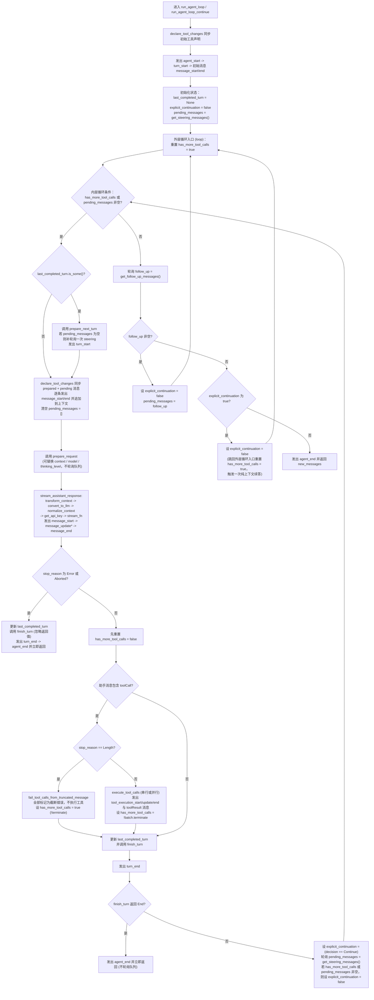

# 阶段 2：Agent 核心（pi-agent）迁移设计

本文是 [Rust 重写开发计划](0.PLAN.md) 第二阶段「2. Agent 核心」的具体设计，前置依赖见 [1.model-core.md](1.model-core.md)，技术栈选型依据见 [prototype.md](../prototype.md)。

本阶段对标上游 `@earendil-works/pi-agent-core`（`1.5.0`）与 `@earendil-works/pi-schema`（`1.5.0`），实现独立的 Rust Agent 自动执行循环与状态管理包 `crates/pi-agent`。该包位于 `crates/pi-ai` 之上、会话与业务层之下，负责驱动「组装上下文 → 请求模型流 → 校验与执行工具 → 轮询插话与追加队列」的完整闭环，可脱离数据库、图形界面和 CST Pilot 业务单独编译与测试。

## 验收结论

**阶段 2 已完成（2026-11-03）。** 工程规范与功能设计审查均已通过，无待处理的阻塞问题，可进入阶段 3。

| 验收范围 | 结果 |
|---|---|
| 工程检查 | `cargo fmt --all --check`、`cargo check --workspace --locked`、`cargo clippy --workspace --all-targets --locked -- -D warnings` 通过 |
| 工作区回归 | `cargo test --workspace --locked`：90 项通过，1 项真实模型测试因缺少密钥按约定忽略；其中 `pi-agent` 44 项通过 |
| 上游行为对照 | 141 个正则样例与 69 个日期、时间、邮箱样例通过；预期结果固定在仓库测试夹具中 |
| 异常与并发 | 覆盖运行准入与清理互斥、队列保护、取消、Future 丢弃、钩子及进度回调 panic、监听器结算、参数与 Schema 缓存隔离 |
| 代理流复杂度与性能 | 确定性复制预算断言通过；`cargo test --release --locked -p pi-agent --test proxy` 3 项通过，520 KB / 32 字节分片重建实测约 173 ms，低于 1 秒门槛 |

性能冒烟与同文件的 HTTP 测试通过测试专用锁隔离，避免并行测试的内存分配和 I/O 干扰。解析器复杂度以复制预算和输入规模增长比例为主要判据。

## 对照基准（已拉取本地）

上游 `1.5.0` 的仓库源码与 npm 发布包已统一归档在 `E:/Learning/Programming/pi-1.5.0-reference/` 下，开发阶段 2 时直接对照编写：

| 本地路径 | 内容说明 |
|---|---|
| `E:/Learning/Programming/pi-1.5.0-reference/repo/packages/agent/` | 上游 `earendil-works/pi`（提交 `3e0eec29`）`pi-agent-core` 完整 TypeScript 源码与 5 套测试文件 |
| `E:/Learning/Programming/pi-1.5.0-reference/repo/packages/schema/` | 上游 `@earendil-works/pi-schema@1.5.0` 完整源码（JSON Schema 编译校验器、错误解释器与三阶段宽松类型转换） |
| `E:/Learning/Programming/pi-1.5.0-reference/repo/packages/ai/src/utils/validation.ts` | 上游工具参数校验入口（`validateToolCall` / `validateToolArguments`） |
| `E:/Learning/Programming/pi-1.5.0-reference/npm/pi-agent-core/package/` | npm 官方发布的 `@earendil-works/pi-agent-core@1.5.0` 完整包（含 `dist/` 与 `.d.ts`） |
| `E:/Learning/Programming/pi-1.5.0-reference/npm/pi-schema/package/` | npm 官方发布的 `@earendil-works/pi-schema@1.5.0` 完整包 |

## 设计原则与取舍

| 原则 | 在 `pi-agent` 中的具体落地方式 |
|---|---|
| **安全性** | 1. 使用强类型枚举 `AgentMessage` 与 `AgentEvent` 锁定消息流转与事件序列，消除未定义角色或残缺状态。<br>2. 工具执行前强制经过参数深拷贝、三阶段类型转换与 JSON Schema 校验；模型因达到输出上限（`StopReason::Length`）截断响应时，直接拒绝执行当轮全部工具调用。<br>3. `Agent` 运行期采用细粒度锁与单实例运行守卫（`active_run`），禁止并发重入 `prompt`、`continue_run` 或 `reset`，并通过 `CancellationToken` 将取消信号贯通到模型流、工具任务、生命周期钩子与事件监听器。 |
| **简洁性** | 1. 吸收 `pi-schema` 的核心设计理念，将运行期 JSON Schema 编译校验器与三阶段类型转换直接内聚在 `pi-agent::validation` 模块中，编译期工具定义则交给 Rust 原生结构体与 `serde` / `schemars`。<br>2. 剔除 TypeScript 动态模块声明合并（`declare module CustomAgentMessages`）与旧版无上下文钩子重载（`prepareNextTurn(signal)`），统一使用 `AgentMessage::Custom` 与单一强类型钩子签名。<br>3. 显式注入 `StreamFn` 并提供 `models_stream_fn(Arc<Models>)` 桥接器，避免依赖进程级可变全局函数。 |
| **高效性** | 1. 每个工具的 JSON Schema 在注册或首次调用时预编译为轻量检查树（`CompiledValidator`），高频校验路径零多余内存分配，仅在校验失败时运行错误解释器（`Explainer`）。<br>2. 并行工具批次采用「顺序预检 + `tokio` 并发执行 + 保序归档」，兼顾最大 I/O 并发度与确定的会话历史顺序。<br>3. 远端代理流（`stream_proxy`）直接复用 `pi-ai` 的增量 `SseParser` 与 `ToolCallArgumentsStream`，避免在大体积工具参数流式传输时重复解析整段文本。 |

## `pi-schema` 设计理念解析与 Rust 迁移取舍

上游在 `1.5.0` 中自研 `@earendil-works/pi-schema` 替代原本的 TypeBox / Ajv，主要是为了解决 TypeBox 在 Agent 场景下的五项局限：

1. **非纯净对象污染**：TypeBox 构造的 Schema 带有 `~kind`、`[Kind]` 等私有标记，且混入 `BigInt`、`Undefined`、`Function` 等非标准 JavaScript 类型；向大模型发送工具声明或对比工具变更时，必须反复通过 `JSON.parse(JSON.stringify(schema))` 清洗。
2. **动态代码生成受限**：TypeBox 与 Ajv 的高速校验依赖运行时 `new Function` / `eval` 生成代码，在严格安全策略（CSP）或受限沙箱下无法编译，回退到解释器后性能骤降数十倍。
3. **缺少针对大模型输出的三阶段宽松转换（Coercion）**：大模型输出工具参数时常出现「可选字段传 `null`」、「数字传成字符串 `"42"`」、「布尔传成 `"true"`」、「单元素数组直接传标量值」。TypeBox 的 `Value.Convert` 强绑定其私有 `[Kind]` 标记，对外部传入的纯 JSON Schema（如 MCP 工具或 JSON 配置文件）失效，且不会自动剔除可选字段上的 `null`。
4. **缺少面向模型自修复的精准错误报告**：大模型需要根据字段路径修正参数并重试。`pi-schema` 将「布尔快路径 `check`」与「慢路径错误解释 `Explainer`」拆开，平时检查零分配，失败时才遍历生成带 JSON Pointer、对于标签联合体（Tagged Union）只报告对应分支错误的清晰提示。
5. **外部悬空引用（`$ref`）容错**：外部工具 Schema 常带有未定义的 `$ref`，TypeBox/Ajv 会在注册阶段直接抛错导致整个工具不可用；`pi-schema` 提供 `unresolvedRefs: "reject"`，把悬空引用编译为局部 `false` 节点，仅在实际传值触碰到该字段时报错。

结合 Rust 语言特性，阶段 2 对 `pi-schema` 各组成部分做如下迁移与取舍：

| `pi-schema` 模块 | 上游设计目的 | Rust 迁移方案与取舍 |
|---|---|---|
| **类型体操与构建器**<br>（`Static<T>`、`TypeBoxStatic`、`obj/str/num/opt`） | 在 TypeScript 中从 Schema 字面量反向推导静态类型，同时兼容 TypeBox 1.x 类型结构 | **由 Rust 原生类型系统替代**。内置工具直接定义 Rust `struct` / `enum`，通过 `#[derive(Deserialize, JsonSchema)]` 自动获得编译期强类型与纯净的 JSON Schema；同时提供轻量 JSON Schema 构造辅助函数供测试或动态工具拼装使用 |
| **预编译校验器与快慢路径分离**<br>（`Compiler`、`Validator::check`、`Explainer::errors`） | 将 JSON Schema 一次性编译为闭包树；快路径只返回 `bool`，失败时才延迟构建 `Explainer` 收集错误 | **完整保留设计理念**。在 `pi-agent::validation` 中将工具的 `parameters: JsonValue` 预编译为 `CompiledValidator`（缓存在 `AgentTool` 内部），快路径 `check(&Value) -> bool` 直接运行预编译闭包树；失败时运行 `errors(&Value) -> Vec<ValidationError>`，保留标签联合体（Tagged Union）精准归因与点分路径格式 |
| **三阶段宽松类型转换**<br>（`Coercer`：阶段 1 剔除可选 `null`、阶段 2 按 Schema 转换、阶段 3 标量兜底） | 在不依赖私有标记的前提下，把大模型松散的工具参数修复为符合 Schema 的值，且写时复制（Copy-on-Write）不污染原对象 | **完整保留并原样迁移**。即使内置工具使用 `serde` 反序列化，也必须在调用 `serde_json::from_value` **之前**先对 `Value` 执行这三阶段转换与校验。否则 `serde` 会直接拒绝 `"42"`（期望 `u32`）、单值转 `Vec` 或拒绝不可空的非必填 `null`，且 `serde` 的原始报错无法按点分路径列出全部违规字段供模型重试 |
| **引用解析与悬空 `$ref` 容错**<br>（`Resolver`、`unresolvedRefs: "reject"`、递归防环） | 支持 `#/$defs/...` 与 `#/definitions/...` 引用、递归 Schema 栈重入保护，以及未解析 `$ref` 局部拒绝 | **完整保留核心能力**。支持 Draft 2020-12 与 Draft 7 的内部引用解析、递归 `$ref` 转换防死循环，以及 `UnresolvedRefs::Reject` 策略 |
| **JS 专属扩展与冷门特性**<br>（`type: "bytes"` / `Uint8Array`、`$dynamicRef` 动态作用域、全量 IDNA Punycode 格式库） | 服务 JS 内存传递与 JSON Schema 极限测试集 | **裁剪**。大模型工具调用参数固定为标准 JSON，无需 `Uint8Array` 与 `$dynamicRef`；`format` 校验内置常用格式（`date-time`、`date`、`time`、`email`、`uri`、`url`、`uuid`、`ipv4`、`ipv6`、`regex`）并支持自定义注册，未注册的 `format` 按 Draft 2020-12 规范作为注释忽略 |

## 目录与文件命名

在 Cargo Workspace 中新增 `crates/pi-agent`，源码按职责组织：

```text
crates/pi-agent/
|-- Cargo.toml
|-- src/
|   |-- lib.rs              # 对外导出公开类型、执行循环函数、Agent 结构体与代理流入口（对照 src/index.ts）
|   |-- types.rs            # AgentMessage、AgentTool、AgentEvent、钩子上下文、队列模式与状态结构（对照 src/types.ts）
|   |-- event_stream.rs     # 通用异步事件流 EventStream<E, R> 与 AgentEventStream（对照 pi-ai event-stream.ts）
|   |-- validation.rs       # 预编译 JSON Schema 校验器、三阶段宽松类型转换与错误解释器（对照 pi-schema 与 validation.ts）
|   |-- formats.rs          # 内置字符串格式校验（日期、时间、邮箱等）
|   |-- agent_loop.rs       # 无状态双层执行循环、工具声明同步、串并行工具调度与 run_tool_call（对照 src/agent-loop.ts）
|   |-- agent.rs            # 有状态 Agent 封装、双队列（Steer / FollowUp）、订阅结算与异常兜底（对照 src/agent.ts）
|   `-- proxy.rs            # 剥离 partial 字段的远端代理事件流客户端重建（对照 src/proxy.ts）
`-- tests/
    |-- validation.rs       # JSON Schema 预编译校验、三阶段类型转换、标签联合体报错与悬空 $ref 测试
    |-- agent_loop.rs       # 无状态循环、工具串并行顺序、钩子拦截与覆写、Length 截断保护与 finish_turn 决策测试
    |-- agent_state.rs      # 有状态 Agent、双队列模式、continue 尾部回退、监听器异步结算与重入保护测试
    |-- faux_e2e.rs         # 对接 pi-ai FauxProvider 的多轮对话、工具续答、思考块保留与中途取消端到端测试
    |-- proxy.rs            # 远端代理流事件重建、无换行符尾部冲刷、异常断流报错与线性复杂度参数流测试
    |-- formats.rs          # 内置与自定义格式、快慢路径一致性
    |-- regex_execution.rs  # ECMAScript 语义、原生预算和灾难性回溯
    |-- review_regressions.rs # 生命周期、取消、参数隔离与解析预算回归
    |-- tool_failures.rs    # 参数预处理与进度回调异常隔离
    `-- fixtures/          # 上游行为对照的固定预期结果
```

## 与 `crates/pi-ai` 的边界及补齐项

`crates/pi-agent` 直接构建在 `crates/pi-ai` 之上。对照上游 `pi-agent-core` 对 `pi-ai` 的调用关系，现有 `crates/pi-ai` 的复用项与需在本阶段顺带补齐的接口如下：

| 类别 | 具体接口 | 状态与处理方案 |
|---|---|---|
| **消息与流类型** | `Message`、`SystemMessage`、`UserMessage`、`AssistantMessage`、`ToolResultMessage`、`Tool`、`ToolCall`、`AssistantMessageEvent`、`AssistantMessageEventStream` | `crates/pi-ai` 已完备，直接在 `pi-agent` 中引用并重导出 |
| **转录本工具同步** | `create_initial_system_message`、`normalize_context`、`get_current_tools`、`get_current_system_message`、`get_current_system_prompt`、`get_tool_state_changes`、`declarations_equal` | `crates/pi-ai::transform_messages` 已实现；在 `pi-agent` 中提供针对 `&[AgentMessage]` 的适配封装（仅提取其中的 `SystemMessage` 重放） |
| **流式解析组件** | `SseParser`、`StreamingJsonParser`、`ToolCallArgumentsStream` | `crates/pi-ai` 已实现基础功能；**需在 `crates/pi-ai` 补齐摊还快照节流与借用访问**：为 `StreamingJsonParser` 补齐 `dirty` 标记、计入栈上打开容器内所有已闭合子树字节/节点权重的 `snapshot_clone_cost` 与拷贝信用额度（`CREDIT_PER_APPEND` + `CREDIT_PER_BYTE`），提供返回借用引用的 `snapshot_ref(&mut self) -> (bool, Option<&Value>)`，并移除 `ToolCallArgumentsStream::partial` 的冗余二次克隆，确保解析扫描与受信用预算约束的快照生成保持摊还线性复杂度 |
| **客户端身份归属** | `ClientAttribution`、`PI_ATTRIBUTION`、`merge_client_identity` | **需在 `crates/pi-ai` 补齐**：在 `ClientIdentity` 中支持 `attribution: Option<Option<ClientAttribution>>`（区分未设置与显式传 `null` 关闭归属头），实现 `PI_ATTRIBUTION` 常量与按字段覆盖的 `merge_client_identity` |
| **请求级观测回调** | `StreamOptions` 上的 `on_payload`、`on_response`、`on_provider_stream_event` | **需在 `crates/pi-ai` 补齐**：在 `StreamOptions` 中增加三个可选回调字段，并在四大对话协议请求发送前、收到 HTTP 响应头后、解析到原始流事件时触发，供 `Agent` 透传给上层遥测与调试 |

## 核心模块设计

### 1. 消息扩展、工具与事件类型（`types.rs`）

#### 1.1 `AgentMessage` 与自定义消息扩展

上游通过 TypeScript 接口声明合并扩展 `AgentMessage`。Rust 采用显式枚举区分标准大模型消息与业务自定义消息（如阶段 3 的 `bashExecution`、`custom`、`branchSummary`、`compactionSummary`）：

| 变体 | 内部结构 | 说明 |
|---|---|---|
| `AgentMessage::System(SystemMessage)` | 复用 `pi_ai::SystemMessage` | 承载系统提示词、命名段落补丁（`sections`）与工具增删声明（`tools_added` / `tools_removed`） |
| `AgentMessage::User(UserMessage)` | 复用 `pi_ai::UserMessage` | 用户文本与图片输入 |
| `AgentMessage::Assistant(AssistantMessage)` | 复用 `pi_ai::AssistantMessage` | 模型输出的文本、思考块、工具调用、用量与停止原因 |
| `AgentMessage::ToolResult(ToolResultMessage)` | 复用 `pi_ai::ToolResultMessage` | 工具执行结果、详情、结构化输出、错误标记与执行耗时 |
| `AgentMessage::Custom(CustomAgentMessage)` | `{ role: String, data: JsonObject, timestamp: u64 }` | 上层应用注入的自定义历史消息；序列化时将 `role` 与 `data` 平铺为同级 JSON 对象，进入模型前由 `convert_to_llm` 过滤或转换为标准 `Message` |

`default_convert_to_llm` 默认保留 `System`、`User`、`Assistant`、`ToolResult` 四类标准消息，直接过滤掉 `Custom` 消息。

#### 1.2 工具定义（`AgentTool`）与执行结果（`AgentToolResult`）

| 类型 / 字段 | 结构说明 |
|---|---|
| `ToolExecutionMode` | `Sequential`（串行）或 `Parallel`（并行，默认值） |
| `QueueMode` | `OneAtATime`（每次仅抽取最早一条，默认值）或 `All`（一次性抽取队列中全部消息） |
| `ToolReplayPolicy` | `Never` 或 `Safe`（供阶段 5 持久执行层判断中断后是否允许自动重放） |
| `AgentTool` | 包含 `name`、`label`、`description`、私有 Schema 缓存（`parameters()` 只读访问，`set_parameters` / `try_set_parameters` 替换 Schema 并独立重建缓存）、惰性预编译校验器 `OnceLock<Arc<CompiledValidator>>`、`constrained_sampling`、`output_schema: Option<JsonValue>`、`replay: Option<ToolReplayPolicy>`、`execution_mode: Option<ToolExecutionMode>`、可选参数预处理钩子 `prepare_arguments` 以及异步执行闭包 `execute` |
| `AgentTool::from_typed<P, D, F>` | 强类型工具构造器：参数类型 `P` 实现 `DeserializeOwned + JsonSchema`，工具注册时自动生成 `parameters` JSON Schema；运行期先执行 `pi-schema` 三阶段宽松转换与 Schema 校验，通过后再由 `serde_json::from_value::<P>` 转为强类型参数传入闭包 |
| `AgentToolResult` | 包含 `content: Vec<UserContentBlock>`、`details: JsonValue`、`structured_content: Option<JsonValue>`、`usage: Option<Usage>`、`is_error: bool`、`terminate: Option<bool>`；标注 `#[serde(rename_all = "camelCase")]` 且可选字段省略 `None`（序列化为 `structuredContent`、`isError`） |
| `AgentToolCallOutcome` | 包含 `tool_call: ToolCall`、`result: AgentToolResult`、`is_error: bool`、`duration_ms: Option<u64>`；标注 `#[serde(rename_all = "camelCase")]`（序列化为 `toolCall`、`isError`、`durationMs`），`duration_ms` 为 `None` 时省略该键 |

`AgentTool::to_tool_declaration(&self) -> pi_ai::Tool` 仅提取 `name`、`description`、`parameters` 与 `constrained_sampling`，剥离 `label`、`validator`、`execute` 等运行期字段，用于写入系统消息与对比工具声明变化。工具钩子结构（`BeforeToolCallResult`、`AfterToolCallResult`）以及嵌套工具调用记录（复用 `pi_ai::ToolResultMessage`、`pi_ai::NestedToolCalls`、`pi_ai::NestedToolCallRecord`）统一采用 `#[serde(rename_all = "camelCase")]`，保证 `toolCallId`、`toolName`、`structuredContent`、`nestedCalls`、`argumentsBytes`、`durationMs`、`isError` 等 JSON 字段名与上游完全一致。

#### 1.3 流式生命周期事件（`AgentEvent`）

`AgentEvent` 按固定顺序向界面层汇报运行进度。为同时对齐上游的 `snake_case` 事件类型标签（如 `"tool_execution_start"`）与 `camelCase` 载荷字段名（如 `assistantMessageEvent`、`toolCallId`、`toolName`、`partialResult`、`isError`、`durationMs`、`toolResults`），枚举统一标注 `#[serde(tag = "type", rename_all = "snake_case", rename_all_fields = "camelCase")]`：

| 事件变体 | Rust 字段名（JSON 序列化字段名） | 触发时机 |
|---|---|---|
| `AgentStart` | 无 | 单次 `prompt` 或 `continue_run` 运行开始 |
| `TurnStart` | 无 | 单轮模型请求与工具调用开始 |
| `MessageStart` | `message: AgentMessage`（`message`） | 任意消息（`system` / `user` / `assistant` / `toolResult` / `custom`）开始写入上下文 |
| `MessageUpdate` | `message: AgentMessage`（`message`）, `assistant_message_event: AssistantMessageEvent`（`assistantMessageEvent`） | 仅限 `assistant` 消息在流式接收增量块时触发 |
| `MessageEnd` | `message: AgentMessage`（`message`） | 消息完成并正式落入上下文 |
| `ToolExecutionStart` | `tool_call_id: String`（`toolCallId`）, `tool_name: String`（`toolName`）, `args: JsonValue`（`args`） | 单个工具调用开始预检与执行 |
| `ToolExecutionUpdate` | `tool_call_id: String`（`toolCallId`）, `tool_name: String`（`toolName`）, `args: JsonValue`（`args`）, `partial_result: AgentToolResult`（`partialResult`） | 工具执行期间通过 `on_update` 推送增量进度 |
| `ToolExecutionEnd` | `tool_call_id: String`（`toolCallId`）, `tool_name: String`（`toolName`）, `result: AgentToolResult`（`result`）, `is_error: bool`（`isError`）, `duration_ms: Option<u64>`（`durationMs`，`None` 时省略） | 单个工具完成执行与 `after_tool_call` 钩子处理 |
| `TurnEnd` | `message: AgentMessage`（`message`）, `tool_results: Vec<ToolResultMessage>`（`toolResults`） | 本轮助手回复及全部工具结果落盘完毕（在 `finish_turn` 之后触发） |
| `AgentEnd` | `messages: Vec<AgentMessage>`（`messages`） | 本次运行全部轮次结束，返回本次运行新增的消息列表 |

### 2. 工具参数转换与 JSON Schema 校验（`validation.rs`）

`validation.rs` 对齐上游 `@earendil-works/pi-schema` 的 `compile(schema, { coerce: true, unresolvedRefs: "reject" })` 与 `pi-ai/utils/validation.ts`，提供预编译校验器 `CompiledValidator` 与统一校验入口 `validate_tool_arguments`。`CompileOptions::with_format` 注册本次编译专用的格式校验函数，可覆盖内置格式；未注册的未知格式作为注释忽略。

`pattern` 与 `patternProperties` 使用 `vendor/regress` 的原生执行器。解析时优先 Unicode 模式，失败后按 UTF-16 码元兼容模式解析；每次匹配共用 `regex_backtrack_limit` 预算，覆盖候选起点、指令、回溯、字符循环、嵌套断言与反向引用比较，耗尽后返回校验错误。编译、输入编码及结果分配不计入匹配预算，来源及本地修改见 [vendor/regress/LOCAL.md](../../../vendor/regress/LOCAL.md)。

#### 2.1 校验与转换流水线

`validate_tool_arguments(tool: &AgentTool, tool_call: &ToolCall) -> Result<JsonValue, String>` 按以下 5 步执行：

1. **流式解析错误短路**：若 `tool_call.arguments_error` 为 `Some(err)`，直接返回错误 `Invalid arguments for tool "{tool.name}": {err}`。
2. **深拷贝隔离**：将 `tool_call.arguments` 克隆为独立的 `JsonValue::Object`，确保后续类型转换或 `before_tool_call` 钩子原地修改参数时，不会污染已保存在转录本 `AssistantMessage` 中的原始 `tool_call.arguments`。
3. **三阶段宽松转换（`Coercer::coerce`）**：
   - **第一阶段（`drop_optional_nulls`）**：递归遍历对象与数组。当对象的某个属性不在 `required` 列表中、值恰好为 `null`、属性 Schema 非 `$ref` 引用且该属性 Schema 本身不接受 `null` 时，直接将该键从对象中删除（视为未传该可选参数）。`patternProperties` 与 `additionalProperties` 匹配到的值同样递归清理内部可选 `null`，但键本身不删除。
   - **第二阶段（`convert_by_schema`）**：按 Schema 关键字优先级转换（`$ref` → `const` → `enum` → `anyOf`/`oneOf` → `allOf` → `type`）：
     - `const` / `enum`：若原值不相等，尝试按目标字面量的类型转换（如 `"42"` 转 `42`），转换后相等则采纳。
     - `anyOf` / `oneOf`：若原值已通过任一分支校验则保留；否则按分支顺序依次尝试转换，取第一个使整个联合体 Schema 校验通过的转换结果（若节点同时声明了对象属性，在检查前一并转换）。
     - `string`：有限数字、布尔值转为对应文本，`null` 转为 `"null"`。
     - `number`：数字字符串（空串 `""` 转 `0`）、`"true"`/`"false"`、布尔值（`1`/`0`）、`null`（`0`）转为 `f64`。
     - `integer`：先按 `number` 转换，再向零取整（`trunc`，如 `"3.5"` 与 `3.5` 变为 `3`）。
     - `boolean`：`"true"`/`"false"`（忽略大小写）、`"1"`/`"0"`、`1`/`0`、`null`（`false`）转为 `bool`。
     - `null`：`"null"`、`"undefined"`、`""`、`"0"`、`0`、`false` 转为 `null`。
     - `array`：若为元组（声明了 `prefixItems` 或数组形式的 `items`），仅按位置转换已有数组元素，不包装单值；若为普通列表且输入不是数组，将单个值包装为单元素数组 `[value]` 后再按 `items` 转换。
     - `object`：按 `properties`、`patternProperties`、`additionalProperties` 递归转换各属性值。
     - **递归防环**：通过 `$ref` 或单值包装进入子节点时维护 `(schema_ptr, value)` 重入栈，遇到环路立即原样返回，避免递归 Schema 在非法输入上死循环。
   - **第三阶段（`coerce_primitives`）**：针对第二阶段未覆盖的复合 `type` 数组（如 `["integer", "null"]`）做标量兜底转换；若第二阶段与第三阶段规则冲突（如必填 `string` 收到 `null`），以第二阶段结果（`"null"`）为准。
4. **快路径检查与慢路径错误解释**：
   - 先运行预编译的 `CompiledValidator::check(&coerced)`。通过则直接返回 `Ok(coerced)`。
   - 未通过则运行 `Explainer::errors(&coerced)`，收集全部违规字段的 `{ path, keyword, message }`：
     - 缺失必填字段报告在字段子路径（如 `path: "/command", keyword: "required", message: "missing"`）。
     - 未知额外字段报告在字段子路径（如 `path: "/extra", keyword: "additionalProperties", message: "unknown field"`）。
     - 标签联合体（Tagged Union，即各分支均为含唯一必填 `const` 属性的对象）优先按输入对象的标签值选中对应分支报错；若标签值本身不在允许集合内，直接在标签字段路径报告 `expected one of [...]`；无标签的普通联合体则选择「声明了最多输入属性」或「报错路径最深」的分支报告错误。
     - 悬空 `$ref` 在被实际访问时报告 `unresolved reference {ref}`。
5. **错误格式化**：将每个错误的 JSON Pointer（如 `/edits/0/oldText`，空路径 `""` 映射为 `root`）反转义 `~1`（`/`）、`~0`（`~`）后拼成点分路径 `edits.0.oldText`，输出与上游完全一致的报错文本：
   ```text
   Validation failed for tool "{tool.name}":
     - {dotted_path}: {error.message}

   Received arguments:
   {pretty_json_of_original_arguments}
   ```

### 3. 无状态执行循环（`agent_loop.rs`）

#### 3.1 完整执行生命周期与双层循环状态机

公开无状态流入口 `agent_loop` 与 `agent_loop_continue` 隔离 `stream_fn` 的同步调用和异步执行 panic。失败转换为错误助手消息，再按正常定稿流程发出 `MessageEnd`、`TurnEnd`、`AgentEnd` 并完成最终结果；已取消时使用 `StopReason::Aborted`。



双层循环的状态变量流转遵循上游 `agent-loop.ts` 的精确规则：

1. **外层循环入口重置**：每次进入外层循环顶部的 `OuterLoop` 节点时，都将 `has_more_tool_calls` 置为 `true`。这样既保证首轮在 `pending_messages` 为空时能进入内层循环发起第一次请求，也保证当内层循环退出后因 `follow_up` 或 `explicit_continuation` 重新跳回外层循环顶部时，内层循环条件 `has_more_tool_calls || !pending_messages.is_empty()` 必然成立。
2. **每轮工具状态归零与更新**：在 `stream_assistant_response` 返回正常消息后，先将 `has_more_tool_calls` 置为 `false`；仅当该消息包含 `toolCall` 且工具批次未全部声明 `terminate: true` 时，`has_more_tool_calls` 才变为 `true`。
3. **`Continue` 决策的满足与消解**：当 `finish_turn` 返回 `Continue` 时，先记录 `explicit_continuation = true`。若本轮已有未终止的工具调用（`has_more_tool_calls == true`）、紧接着抽到了 `steering` 消息（`!pending_messages.is_empty()`），或内层退出后抽到了 `follow_up` 消息，该自然续答直接满足 `Continue` 承诺并将 `explicit_continuation` 清零，不叠加额外请求；仅当无工具续答且两个队列均为空时，才由 `CheckExplicit` 分支清零 `explicit_continuation` 并跳回 `OuterLoop`（重置 `has_more_tool_calls = true`），从而恰好发起一次不带新用户消息的纯上下文请求。

#### 3.2 工具挂载声明自动同步（`declare_tool_changes`）

转录本中的 `SystemMessage` 负责记录模型可见的工具声明，`context.tools` 则是当前运行期可执行工具集。每次将待发消息（`pending_messages`）并入上下文前，`declare_tool_changes` 计算重放后的已声明工具与 `context.tools` 的差集（`ToolStateChanges { tools_added, tools_removed }`）：

1. 若 `pending_messages` 中已包含 `SystemMessage`，定位最后一条 `SystemMessage`，将其原有的 `tools_added` / `tools_removed` 视为待定意图，替换为「当前转录本基准与 `context.tools` 之间的真实差量」。若差量为空且原消息无工具变更字段，保持原消息不变。
2. 若 `pending_messages` 中不含 `SystemMessage` 且工具差量非空，在第一条非 `system` 消息之前插入一条 `content: ""`、携带 `tools_added` / `tools_removed` 的合成 `SystemMessage`，并随其他待发消息一起触发 `message_start` 与 `message_end`。

#### 3.3 串行与并行工具调用控制（`execute_tool_calls`）

当助手消息正常结束且包含 `toolCall` 块时，按以下规则调度：

| 阶段 | 串行模式（`Sequential`） | 并行模式（`Parallel`，默认） |
|---|---|---|
| **触发条件** | `config.tool_execution == Sequential`，或本批次中任一被调用工具声明了 `execution_mode == Some(Sequential)` | 全局为 `Parallel` 且本批次所有目标工具均未声明 `Sequential` |
| **1. 启动与预检** | 按源码顺序逐个处理：发出 `tool_execution_start` → 查找工具 → `prepare_arguments` → Schema 校验 → 调用 `before_tool_call` | 按源码顺序逐个预检：依次发出 `tool_execution_start` 并执行 `prepare_tool_call`。预检阶段严格串行，保证每个 `before_tool_call` 顺序执行 |
| **2. 预检失败/拦截** | 立即生成错误结果，发出 `tool_execution_end(duration_ms: None)` 与 `ToolResultMessage`，继续下一个工具（若已取消则跳出循环） | 立即发出 `tool_execution_end(duration_ms: None)` 并记录该槽位的最终结果；若此时 `cancel_token` 已取消则停止后续预检 |
| **3. 工具执行与 `after_tool_call`** | 等待当前工具 `execute` 完成并记录 `duration_ms`，执行 `after_tool_call`，发出 `tool_execution_end` 与 `ToolResultMessage` 后再启动下一个工具 | 所有预检通过的工具通过异步并发任务同时运行；每个任务若启动时已取消则产出 `"Operation aborted"`，否则执行 `execute` → `after_tool_call`，并在各自完成瞬间立即发出 `tool_execution_end`（**按完成顺序**） |
| **4. 结果消息落盘** | 随每个工具完成即时发出 `message_start/end(toolResult)` | 等待全批次并发任务全部完成后，严格按助手消息中的 **`toolCall` 源码顺序**依次发出 `message_start/end(toolResult)` 并写入上下文 |
| **5. 批次提前终止** | 当且仅当 `finalized_calls` 非空且每一项的 `result.terminate == Some(true)` 时，本批次返回 `terminate: true`，跳过自动续答 | 与串行模式一致，要求本批次所有最终结果均设置 `terminate == Some(true)` 才停止自动续答；混合批次继续下一轮 |

#### 3.4 独立工具调用入口（`run_tool_call`）

公开 `run_tool_call(tool_call, options) -> AgentToolCallOutcome` 函数，供工具内部嵌套调用其他工具（如阶段 3 的 `NestedToolCallRunner`）直接复用。该函数完整执行「查找工具 → `prepare_arguments` → Schema 校验 → `before_tool_call` → `execute`（含单调时钟计时与 `on_update` 转发） → `after_tool_call`」，任何未知工具、参数错误、钩子拦截或执行异常均封装为 `is_error: true` 的 `AgentToolCallOutcome` 返回，不向外抛出异常，也不直接向主循环发射事件。

### 4. 有状态 Agent 封装与队列管理（`agent.rs`）

`Agent` 在无状态循环外层维护会话转录本、运行期状态、双输入队列与事件订阅者：

#### 4.1 初始状态与系统提示词重放

1. 构造 `Agent` 时，若 `initial_state` 提供了非空 `system_prompt` 或非空 `tools`，且 `initial_state.messages` 首条消息不是 `SystemMessage`，自动调用 `create_initial_system_message` 在消息列表头部插入初始 `SystemMessage(timestamp: 0)`。
2. `agent.state().system_prompt()` 为只读计算属性，通过重放当前 `messages` 中的全部 `SystemMessage`（调用 `get_current_system_prompt`）实时得出。
3. `agent.reset()` 要求当前无活跃运行（否则返回错误 `"Agent is already processing. Wait for completion before resetting."`）。重置时通过 `get_current_system_message` 提取当前重放后的基准系统消息（含当前已声明工具），将 `messages` 重置为仅含该基准消息（若无则为空），同时清空 `error_message`、`pending_tool_calls` 与两个输入队列。

#### 4.2 `continue_run()` 的尾部角色与队列回退规则

| 当前 `messages` 尾部状态 | `agent.continue_run()` 行为 |
|---|---|
| 消息为空，或全部为 `SystemMessage` | 立即返回错误 `"No messages to continue from"`，**不消费** `steering` 或 `follow_up` 队列中的任何消息 |
| 尾部为 `User`、`ToolResult` 或 `Custom` | 调用 `run_agent_loop_continue` 直接基于现有上下文发起续答；启动时正常轮询 `steering` 队列，而 `follow_up` 队列留待本轮自然停止后再抽取 |
| 尾部为 `Assistant` | 无法直接向模型发送以 `assistant` 结尾的上下文，按优先级回退：<br>1. 若 `steering_queue` 非空，按 `steering_mode` 抽取一批消息，调用 `run_prompt_messages(..., skip_initial_steering_poll: true)`。<br>2. 否则若 `follow_up_queue` 非空，按 `follow_up_mode` 抽取一批消息，调用 `run_prompt_messages(..., skip_initial_steering_poll: false)`。<br>3. 若两个队列均为空，返回错误 `"Cannot continue from message role: assistant"`。 |

#### 4.3 状态归约屏障与异步订阅者结算

每次循环发出 `AgentEvent` 时，`Agent::process_event` 先更新内部状态，再按注册顺序依次 `await` 所有订阅监听器：

1. **状态先行更新**：
   - `MessageStart` / `MessageUpdate`：更新 `state.streaming_message = Some(event.message)`。
   - `MessageEnd`：`state.streaming_message = None`，并将 `event.message` 推入 `state.messages`。由于 `run_agent_loop` 在助手 `MessageEnd` 处理完毕后才进入 `execute_tool_calls`，`before_tool_call` 钩子与监听器读取 `agent.state().messages` 时，发起本次工具调用的助手消息已经存在于上下文中。
   - `ToolExecutionStart` / `ToolExecutionEnd`：向 `state.pending_tool_calls` 集合插入或移除 `tool_call_id`。
   - `TurnEnd`：若 `event.message` 为带 `error_message` 的助手消息，同步写入 `state.error_message`。
   - `AgentEnd`：`state.streaming_message = None`。
2. **结算屏障（Settlement Barrier）**：`AgentEnd` 发出后，必须等待所有订阅监听器对 `AgentEnd` 的异步处理全部完成，才在 `finish_run` 中将 `state.is_streaming` 设为 `false`、清空 `pending_tool_calls`，随后释放本次运行写权并唤醒 `wait_for_idle()`。运行准入、队列消费与状态快照在同一准入锁内同步完成；`reset` 清理期间保留该锁，全部锁均在调用异步用户代码前释放。
3. **未捕获异常兜底**：若 `stream_fn` 或底层运行意外返回未捕获错误，`handle_run_failure` 自动构造一条 `stop_reason` 为 `Aborted`（若已取消）或 `Error` 的空白助手消息，依次发出 `MessageStart` → `MessageEnd` → `TurnEnd` → `AgentEnd`，确保订阅者始终收到闭合的生命周期事件。

### 5. 远端代理流重放（`proxy.rs`）

`stream_proxy` 用于通过中间服务端转发大模型请求的场景（服务端剥离增量事件中的 `partial` 消息快照以节省带宽，由客户端原地重建完整 `AssistantMessageEventStream`）：

1. 向 `{proxy_url}/api/stream` 发送带 `Authorization: Bearer {auth_token}` 的 POST 请求，请求体包含 `model`、`context` 与可序列化的流选项。
2. 使用 `pi-ai` 的 `SseParser` 逐块解析 `data: ...` 行（包含流结束时未以换行符结尾的残留缓冲区冲刷），反序列化为 `ProxyAssistantMessageEvent`。
3. 维护单个可变 `partial: AssistantMessage` 以及按 `content_index` 索引的 `BTreeMap<usize, ToolCallArgumentsStream>`：
   - 内容块下标仅允许覆盖已有位置或在末尾追加。跳跃下标返回协议错误，保留原消息与工具参数状态。
   - **流式参数复杂度边界、快照节流与事件分发成本**：在 TypeScript 中字符串与已闭合子树均为 GC 共享引用，而 Rust 的 `serde_json::Value` 与 `AssistantMessageEvent`（`crates/pi-ai/src/types.rs`）均采用独占堆缓冲区的按值所有权。本阶段明确区分「解析器扫描与受预算快照生成成本」和「逐 `delta` 拥有型事件分发成本」两层边界：
     1. **增量解析扫描（严格线性）**：`StreamingJsonParser::append(delta)` 仅单次扫描新增分片字符，不重扫历史前缀，扫描总成本严格正比于输入总字节数 `N`。
     2. **全子树字节感知的拷贝信用额度与借用读取（受预算快照生成摊还线性）**：在 Rust 中克隆打开容器（`stack` 上的 `Map`/`Vec`）不仅会复制当前打开的字符串，还会深拷贝挂在该开放容器下的**所有已闭合子树**（例如 `{"large":"已闭合的500KB字符串","tail":[0,1,...]}` 中，`large` 闭合后仍位于开放根 `Map` 内，每次克隆根 `Map` 都会深拷贝 `large`）。因此 `StreamingJsonParser` 必须维护 `snapshot_clone_cost: usize`，完整核算栈上所有开放容器内已挂载闭合子树的全部字节/节点权重之和加上当前打开字符串的字节长度（仅当根容器最终闭合出栈时才归零）。每次 `append(delta)` 累加信用 `CREDIT_PER_APPEND + CREDIT_PER_BYTE * delta.len()`（取 `256 + 8 * delta.len()`）；调用 `snapshot_ref(&mut self) -> (bool, Option<&Value>)` 时，若 `!dirty` 或 `snapshot_clone_cost > credit`，直接返回缓存快照的不可变借用 `(false, self.cached_snapshot.as_ref())`，绝不克隆缓存；仅当累积信用覆盖完整 `snapshot_clone_cost` 时才扣除信用、生成新快照并返回 `(true, self.cached_snapshot.as_ref())`。这使得解析器内部在整个流生命周期内实例化新快照的累计复制字节数严格受 `<= 8 * N + 256 * K` 线性上界约束（摊还线性）。同时移除 `ToolCallArgumentsStream` 中的二次 `obj.clone()`，仅在快照实际刷新（`refreshed == true`）时才更新 `partial.content[index].arguments`。
     3. **逐 `delta` 拥有型事件分发的总成本边界与权衡**：由于 `pi-ai` 的 `AssistantMessageEvent::ToolCallDelta` 与 `pi-agent` 的 `AgentEvent::MessageUpdate` 按公开契约对每个收到的 `delta` 均发出一个按值持有 `partial: AssistantMessage` 的事件（不丢弃中间 `delta` 事件，也不将公开消息结构改为侵入式的引用计数 AST），即使未刷新快照的 `delta` 跳过了 `StreamingJsonParser` 的快照重建，发出事件时的 `partial.clone()` 仍会复制当前 `AssistantMessage`（含上一次已刷新的 `arguments` 与历史内容块）。因此**完整代理/事件流分发的总成本为「输入字节数 `N`（含解析扫描与受信用预算约束的快照生成）+ 累计发出事件的 `partial` 快照复制体积 `∑ |partial_i|`」**。
   - 收到 `toolcall_end` 时，以服务端发来的完整 `ToolCall`（含 `thought_signature`、`namespace` 等元数据）覆盖对应块并释放参数流状态。
4. 若响应流在未收到 `done` 或 `error` 终止事件的情况下提前断开（EOF），主动合成 `stop_reason: Error`、错误信息为 `"Connection closed by proxy server before the response completed"` 的 `AssistantMessageEvent::Error` 事件，防止上层调用方无限挂起。

## Rust 迁移注意事项

从 TypeScript 迁移到 Rust 时，以下 8 项边界必须在编码中严格落实：

| 编号 | 风险点 | Rust 具体实现要求 |
|---|---|---|
| 1 | **监听器与钩子重入死锁** | 上游测试与真实扩展会在 `subscribe` 监听器（如监听 `message_end`）或 `before_tool_call` 钩子内部同步调用 `agent.steer()`、`agent.follow_up()`、`agent.abort()` 或读取 `agent.state()`。`Agent` 内部必须将状态（`RwLock<AgentStateSnapshot>`）、队列（`Mutex<PendingMessageQueue>`）、活跃运行句柄（`Mutex<Option<ActiveRun>>`）与监听器列表分开加锁，**严禁在持有任何 `Mutex`/`RwLock` 守卫跨越 `.await` 点调用监听器、钩子或 `stream_fn`**。 |
| 2 | **工具耗时统计口径** | `duration_ms` 使用 `std::time::Instant` 测量，仅包裹 `tool.execute(...)` 异步调用本身（四舍五入为 `u64` 毫秒），不计入 `prepare_arguments`、Schema 校验、`before_tool_call` 和 `after_tool_call` 的耗时。未进入 `execute` 的工具（未知工具、校验失败、被 `before_tool_call` 拦截、启动前已取消）其 `duration_ms` 必须为 `None`，且序列化为 JSON 时省略该字段。 |
| 3 | **迟到 `on_update` 进度隔离与并发门控** | 工具实现可能在 `execute` 返回瞬间或返回后仍有后台线程并发调用 `on_update`。若仅用独立的 `AtomicBool` 检查开关再向队列推事件，后台线程可能在读取 `true` 后被操作系统抢占，待主线程发完 `ToolExecutionEnd` 后才恢复入队，导致事件乱序。因此必须使用**共享同一把互斥锁的同步门控 `ToolUpdateGate`**（内部持有 `Mutex<UpdateGateState { accepting: bool, queue: VecDeque<AgentToolResult>, in_flight: usize }>` 与 `Notify`）：<br>1. `on_update` 必须在持有该 `Mutex` 锁的临界区内原子完成「检查 `accepting == true` + 将更新推入 `queue`（或递增 `in_flight`）」；若 `accepting == false` 则在锁内直接丢弃并释放锁。<br>2. 当 `tool.execute(...)` 结算（无论成功或报错）时，执行器先获取同一把 `Mutex` 锁，在锁内原子将 `accepting` 置为 `false`（彻底封死后续入队入口）并取出当前 `queue` 中的全部已接受更新，然后**立即释放 `Mutex` 锁**；接着**在锁外**逐条 `await` 发送取出的 `ToolExecutionUpdate` 事件并等待 `Notify` 直至 `in_flight == 0`（严禁持锁跨越 `.await`），最后才允许进入 `after_tool_call` 与发出 `ToolExecutionEnd`。 |
| 4 | **并行工具事件顺序与落盘顺序分离** | 并行模式下，`ToolExecutionEnd` 事件在每个工具任务完成 `after_tool_call` 后立即发出（先完成的工具先发事件，同时从 `state.pending_tool_calls` 中移除）；而 `ToolResultMessage` 的 `MessageStart` / `MessageEnd` 事件及 `TurnEnd.tool_results` 数组，必须等待 `join_all` 汇总全部任务后，严格按照助手消息中 `toolCall` 的源码顺序依次发出。 |
| 5 | **参数修改与转录本隔离** | `prepare_arguments`、Schema 宽松类型转换以及 `before_tool_call` 对 `args` 的修改，只能作用于深拷贝后的独立 `JsonValue` 副本，严禁污染已存入 `context.messages` 的 `AssistantMessage` 内的 `ToolCall.arguments`。同时，`before_tool_call` 可通过可变引用或返回值修改 `args`，修改后的值直接传给 `tool.execute` 与 `after_tool_call`，不再二次触发 Schema 校验。 |
| 6 | **`after_tool_call` 结构化内容一致性** | `after_tool_call` 采用字段级浅层替换（不深合并）。当 `AfterToolCallResult` 提供了新的 `content` 但未提供 `structured_content` 时，必须自动将原结果的 `structured_content` 置为 `None`，防止裁剪或脱敏后的文本内容与旧的结构化数据不一致。 |
| 7 | **`prepare_next_turn` 期间的插话补轮询** | `prepare_next_turn` 常用于执行耗时的自动上下文压缩（auto-compaction）。若上一轮结束时的常规 `steering` 轮询未取到消息（`pending_messages.is_empty()`），在 `prepare_next_turn` 执行完毕后必须再补轮询一次 `get_steering_messages`；若上一轮结束时已取到过消息，则禁止二次轮询，防止 `OneAtATime` 模式下单轮吞入两条插话。 |
| 8 | **错误与取消回合的队列保护** | 当模型返回 `StopReason::Error`、`StopReason::Aborted`，或 `finish_turn` 返回 `AgentTurnDecision::End` 时，循环在发出 `TurnEnd` 与 `AgentEnd` 前**不得**调用 `get_steering_messages` 或 `get_follow_up_messages` 抽取队列，保留队列中的待处理消息供调用方后续检查或通过 `continue_run()` 恢复。 |

## 开发步骤与验收条件

按以下 4 步推进，每步均对照 `E:/Learning/Programming/pi-1.5.0-reference/` 下的上游源码编写单元与集成测试：

1. **步骤 1：`pi-ai` 补齐与 `pi-agent` 基础类型（`types.rs`、`event_stream.rs`）**
   - 在 `crates/pi-ai` 中补齐：`ClientAttribution`、`PI_ATTRIBUTION`、`merge_client_identity`；`StreamOptions` 的 `on_payload` / `on_response` / `on_provider_stream_event` 回调；以及 `StreamingJsonParser` 的全子树字节感知拷贝信用额度（`snapshot_clone_cost` 含开放容器内已闭合子树权重）、借用读取接口 `snapshot_ref` 与 `ToolCallArgumentsStream` 去冗余克隆优化。
   - 在 Cargo Workspace 中创建 `crates/pi-agent`，实现 `AgentMessage`、`AgentTool`、`AgentEvent`（配齐 `rename_all = "snake_case", rename_all_fields = "camelCase"`）、`EventStream` 及转录本系统消息重放辅助函数，并编写双向 JSON 序列化契约测试。
2. **步骤 2：`pi-schema` 预编译校验器与三阶段类型转换（`validation.rs`）**
   - 实现 `CompiledValidator`（快路径 `check`）与 `Explainer`（慢路径 `errors`，含标签联合体精准归因与未解析 `$ref` 局部拒绝）。
   - 实现 `Coercer`（`drop_optional_nulls`、`convert_by_schema`、`coerce_primitives` 三阶段转换与递归防环）及 `validate_tool_arguments` / `validate_tool_call`。
3. **步骤 3：无状态执行循环与工具调度管线（`agent_loop.rs`）**
   - 实现 `declare_tool_changes`、`stream_assistant_response`、`fail_tool_calls_from_truncated_message`、带同步门控 `ToolUpdateGate` 的串并行 `execute_tool_calls`、`run_tool_call` 以及 `run_agent_loop` / `run_agent_loop_continue` / `agent_loop` / `agent_loop_continue`。
   - 覆盖 `prepare_request`、`before_tool_call`、`after_tool_call`、`finish_turn`、`prepare_next_turn` 五类扩展切入点与 `terminate` 批次提前终止规则。
4. **步骤 4：有状态 `Agent` 与远端代理流（`agent.rs`、`proxy.rs`）**
   - 实现 `Agent` 状态容器、`PendingMessageQueue` 双队列、`prompt` / `continue_run` / `abort` / `wait_for_idle` / `reset`、异步监听器结算屏障与异常兜底事件序列。
   - 实现 `stream_proxy` 远端代理流重建，对接 `pi-ai` 的 `FauxProvider` 跑通全套端到端测试。

**阶段 2 完成条件**：
- `cargo fmt --all --check`、`cargo check --workspace --locked`、`cargo clippy --workspace --all-targets --locked -- -D warnings` 与 `cargo test --workspace --locked` 零警告通过。
- `crates/pi-agent` 5 套测试套件全部通过：
  1. `validation`：覆盖 Draft 2020-12 / Draft 7 核心关键字、三阶段宽松类型转换、标签联合体分支报错、未解析 `$ref` 局部拒绝与格式化错误提示。
  2. `agent_loop`：覆盖 `AgentEvent` 与工具结果类型的双向 JSON 序列化契约（`snake_case` 事件标签 + `camelCase` 字段名与 `None` 省略）、工具挂载声明自动同步、`Length` 截断拒执行、串行与并行工具事件顺序/落盘顺序、`duration_ms` 纯执行计时、`ToolUpdateGate` 确定性多线程交错竞争（验证关闭前入队的更新必在 `after_tool_call` 与 `ToolExecutionEnd` 前发出、关闭后零迟到事件）、`before_tool_call` 拦截与参数修改、`after_tool_call` 覆写与 `structured_content` 清理、`terminate` 批次终止、`prepare_request` / `prepare_next_turn` 时序，以及 `finish_turn` 续跑验证（无工具且无排队消息时 `Continue` 恰好触发一次额外纯上下文请求，存在自然续答时直接满足 `Continue` 不叠加额外请求）。
  3. `agent_state`：覆盖 `OneAtATime` / `All` 双队列调度、`continue_run` 在非助手尾部与助手尾部的回退语义、监听器与钩子内重入调用 `steer`/`follow_up`/`abort` 无死锁、`wait_for_idle` 等待异步 `AgentEnd` 监听器结算、未捕获异常兜底事件闭合。
  4. `faux_e2e`：基于 `pi_ai::FauxProvider` 验证多轮工具调用、思考块保留、流式状态更新与中途取消。
  5. `proxy`：验证代理流工具调用元数据保留、无换行符尾部事件处理、无终止事件断流报错，以及 `#9265` 大体积流式参数与闭合子树场景验证：
     - **与机器速度无关的确定性复杂度判据**：在单一大字符串增量流（520 KB 按 32 字节分片）及「先闭合 500 KB 大字段 `large`、再流式追加数千个小数组元素 `tail`」两类场景下，断言 `StreamingJsonParser` 内部刷新快照的累计复制字节数严格不超过 `8 * N + 256 * K`（当输入规模 `N` 扩大 4 倍时，解析器快照累计复制字节数的增长率 `<= 4.5x`），且未刷新时返回借用引用零克隆、`ToolCall` 块上不残留原始 JSON 文本字段。
     - **端到端耗时冒烟判据**：在 Windows x64 标准构建配置（`Cargo.toml` 已声明 `[profile.dev] debug = 0` 与 `--release`）下，520 KB / 32 字节分片（逾 16,000 次 `toolcall_delta`）完整代理流消费总耗时低于上游 10 秒基准预算（`--release` 下 `< 1s`）。
