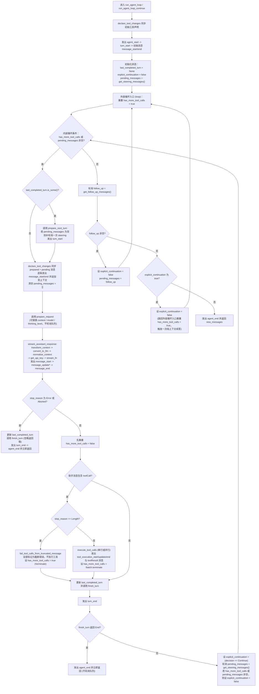

# 阶段 2：Agent 核心（pi-agent）设计

本文定义独立 Rust Agent 自动执行循环与状态管理包 `crates/pi-agent` 的设计。所属总体路线见 [0.PLAN.md](0.PLAN.md)，前置依赖见 [1.model-core.md](1.model-core.md)，技术栈选型见 [prototype.md](../prototype.md)。

`crates/pi-agent` 对齐上游 `@earendil-works/pi-agent-core` 与 `@earendil-works/pi-schema`（`1.5.0`）。该包位于 `crates/pi-ai` 之上、会话与业务层之下，驱动上下文组装、模型流请求、工具校验执行及双队列轮询闭环，可脱离存储与图形界面独立运行。

## 设计原则与取舍

| 原则 | 在 `pi-agent` 中的落地方式 |
|---|---|
| **安全性** | 1. 使用强类型枚举 `AgentMessage` 与 `AgentEvent` 锁定消息流转与事件序列，消除未定义角色或残缺状态。<br>2. 工具执行前强制经过参数深拷贝、三阶段类型转换与 JSON Schema 校验。模型因达到输出上限（`StopReason::Length`）截断响应后，直接拒绝执行当轮全部工具调用。<br>3. `Agent` 运行期采用细粒度锁与单实例运行守卫（`active_run`），禁止并发重入 `prompt`、`continue_run` 或 `reset`，并通过 `CancellationToken` 贯通取消信号。 |
| **简洁性** | 1. 运行期 JSON Schema 预编译校验器与三阶段类型转换直接内聚在 `pi-agent::validation` 模块中，编译期工具定义采用 Rust 原生结构体与 `serde` / `schemars`。<br>2. 统一使用 `AgentMessage::Custom` 承载自定义历史消息，生命周期钩子固定采用单一强类型上下文签名。<br>3. 显式注入 `StreamFn` 并提供 `models_stream_fn(Arc<Models>)` 桥接器，不依赖进程级可变全局函数。 |
| **高效性** | 1. 每个工具的 JSON Schema 惰性预编译为轻量检查树（`CompiledValidator`）。快路径检查零多余内存分配，失败后才运行错误解释器（`Explainer`）。<br>2. 并行工具批次采用顺序预检、`tokio` 并发执行与保序归档，兼顾 I/O 并发度与确定的会话历史顺序。<br>3. 远端代理流（`stream_proxy`）复用 `pi-ai` 的增量 `SseParser` 与 `ToolCallArgumentsStream`，避免在大体积工具参数流式传输期间重复解析整段文本。 |

## JSON Schema 校验与宽松转换选型

大模型输出工具参数经常带有松散类型（可选字段传 `null`、数字传 `"42"`、布尔传 `"true"`、单元素数组传标量），外部 MCP 工具 Schema 也可能包含悬空 `$ref`。直接使用 `serde_json::from_value` 反序列化会直接失败，且无法一次性输出全部违规字段的点分路径供模型自修复。`pi-agent::validation` 在 `serde` 反序列化之前引入原生预编译校验与转换层：

| 能力维度 | Rust 实现方案 |
|---|---|
| **编译期强类型定义** | 内置工具直接定义 Rust `struct` / `enum`，通过 `#[derive(Deserialize, JsonSchema)]` 生成编译期强类型与标准 JSON Schema，同时提供轻量 JSON Schema 构造辅助函数供测试或动态工具使用 |
| **预编译快慢路径分离** | `ToolSchemaCache` 将工具 `parameters: JsonValue` 惰性编译为 `CompiledValidator`。快路径 `check(&Value) -> bool` 直接遍历预编译检查树。未通过校验后运行 `Explainer::errors(&Value)`，保留标签联合体精准归因与点分路径格式 |
| **三阶段宽松类型转换** | 调用 `serde_json::from_value` 前先对参数副本执行 `Coercer`：阶段 1 剔除可选字段上的 `null`，阶段 2 按 Schema 关键字转换，阶段 3 执行标量转换 |
| **引用解析与悬空 `$ref` 隔离** | 支持 Draft 2020-12 与 Draft 7 的内部 `#/$defs/...` 与 `#/definitions/...` 引用解析及递归防环。采用 `UnresolvedRefs::Reject` 将未定义 `$ref` 编译为局部拒绝节点，仅在实际传值触碰该字段时报错 |
| **字符串格式校验** | 内置 `date-time`、`date`、`time`、`email`、`uri`、`url`、`uuid`、`ipv4`、`ipv6`、`regex` 常用 `format` 校验并支持自定义注册，未注册格式按 Draft 2020-12 规范忽略 |

## 目录结构

```text
crates/pi-agent/
|-- Cargo.toml
|-- src/
|   |-- lib.rs                      # 对外导出公开类型、执行循环函数、Agent 结构体与代理流入口
|   |-- types.rs                    # AgentMessage、AgentTool、AgentEvent、钩子上下文、队列模式与状态结构
|   |-- event_stream.rs             # 通用异步事件流 EventStream<E, R> 与 AgentEventStream
|   |-- validation.rs               # 预编译 JSON Schema 校验器、三阶段宽松类型转换与错误解释器
|   |-- formats.rs                  # 内置字符串格式校验（日期、时间、邮箱、URI、IP、正则等）
|   |-- agent_loop.rs               # 无状态双层执行循环、工具声明同步、串并行工具调度与 run_tool_call
|   |-- agent.rs                    # 有状态 Agent 封装、双队列（Steer / FollowUp）与订阅结算屏障
|   |-- agent/
|   |   `-- tests.rs                # Agent 内部状态与锁边界单元测试
|   `-- proxy.rs                    # 剥离 partial 字段的远端代理事件流客户端重建
`-- tests/
    |-- adversarial_regressions.rs  # 边界输入与对抗性回归测试
    |-- agent_loop.rs               # 无状态循环、工具串并行顺序、钩子拦截与 Length 截断保护测试
    |-- agent_state.rs              # 有状态 Agent、双队列模式、continue 尾部回退与重入保护测试
    |-- faux_e2e.rs                 # 对接 pi-ai FauxProvider 的多轮对话、工具续答与中途取消测试
    |-- formats.rs                  # 内置与自定义格式、快慢路径一致性测试
    |-- proxy.rs                    # 远端代理流事件重建、尾部冲刷、异常断流报错与线性复杂度测试
    |-- regex_execution.rs          # ECMAScript 正则语义、原生回溯预算与超限保护测试
    |-- review_regressions.rs       # 生命周期、取消、参数隔离与解析预算回归测试
    |-- review3_regressions.rs      # 结算屏障、队列保护与钩子异常隔离回归测试
    |-- tool_failures.rs            # 参数预处理与进度回调异常隔离测试
    |-- validation.rs               # JSON Schema 预编译校验、三阶段类型转换与悬空 $ref 测试
    `-- fixtures/                   # 格式与 ECMAScript 正则测试向量
```

## 与 `crates/pi-ai` 的接口衔接

`crates/pi-agent` 直接构建在 `crates/pi-ai` 之上，各层职责与衔接接口如下：

| 类别 | 具体接口 | 职责划分 |
|---|---|---|
| **消息与流类型** | `Message`、`SystemMessage`、`UserMessage`、`AssistantMessage`、`ToolResultMessage`、`Tool`、`ToolCall`、`AssistantMessageEvent`、`AssistantMessageEventStream` | 由 `crates/pi-ai` 定义并在 `pi-agent` 中重导出 |
| **转录本工具同步** | `create_initial_system_message`、`normalize_context`、`get_current_tools`、`get_current_system_message`、`get_current_system_prompt`、`get_tool_state_changes`、`declarations_equal` | `crates/pi-ai::transform_messages` 提供底层重放，`pi-agent` 提供针对 `&[AgentMessage]` 的适配封装 |
| **流式解析与快照预算** | `SseParser`、`StreamingJsonParser`、`ToolCallArgumentsStream` | `StreamingJsonParser` 维护 `dirty` 标记、`snapshot_clone_cost` 与拷贝信用额度（`CREDIT_PER_APPEND + CREDIT_PER_BYTE`），通过 `snapshot_ref(&mut self) -> (bool, Option<&Value>)` 返回借用引用，保持受预算快照生成摊还线性 |
| **客户端身份归属** | `ClientAttribution`、`pi_attribution()`（`PI_ATTRIBUTION_NAME` / `PI_ATTRIBUTION_URL` / `PI_ATTRIBUTION_CATEGORY`）、`merge_client_identity` | `ClientIdentity` 支持 `attribution: Option<Option<ClientAttribution>>`（区分未设置与显式传 `null` 关闭归属头），按字段合并客户端身份 |
| **请求级观测回调** | `StreamOptions` 上的 `on_payload`、`on_headers`、`on_response`、`on_provider_stream_event` | 四大对话协议在组装请求体、组装请求头、收到响应头与解析原始流事件四个节点触发回调，由 `Agent` 透传至上层扩展与遥测 |

## 核心模块设计

### 1. 消息扩展、工具与事件类型（`types.rs`）

#### 1.1 `AgentMessage` 与自定义消息扩展

`AgentMessage` 采用显式枚举区分标准大模型消息与上层业务自定义消息：

| 变体 | 内部结构 | 说明 |
|---|---|---|
| `AgentMessage::System(SystemMessage)` | 复用 `pi_ai::SystemMessage` | 承载系统提示词、命名段落补丁（`sections`）与工具增删声明（`tools_added` / `tools_removed`） |
| `AgentMessage::User(UserMessage)` | 复用 `pi_ai::UserMessage` | 用户文本与图片输入 |
| `AgentMessage::Assistant(AssistantMessage)` | 复用 `pi_ai::AssistantMessage` | 模型输出的文本、思考块、工具调用、用量与停止原因 |
| `AgentMessage::ToolResult(ToolResultMessage)` | 复用 `pi_ai::ToolResultMessage` | 工具执行结果、详情、结构化输出、错误标记与执行耗时 |
| `AgentMessage::Custom(CustomAgentMessage)` | `{ role: String, data: JsonObject, timestamp: u64 }` | 上层注入的自定义历史消息。序列化时将 `role` 与 `data` 平铺为同级 JSON 对象，进入模型前由 `convert_to_llm` 过滤或转换为标准 `Message` |

`default_convert_to_llm` 默认保留 `System`、`User`、`Assistant`、`ToolResult` 四类标准消息，直接过滤 `Custom` 消息。

#### 1.2 工具定义（`AgentTool`）与执行结果（`AgentToolResult`）

| 类型 / 字段 | 结构说明 |
|---|---|
| `ToolExecutionMode` | `Sequential`（串行）或 `Parallel`（并行，默认值） |
| `QueueMode` | `OneAtATime`（每次仅抽取最早一条，默认值）或 `All`（一次性抽取队列中全部消息） |
| `ToolReplayPolicy` | `Never` 或 `Safe`（供 `pi-session::execution_log` 的 `reconcile_on_startup` 判断异常中断后是否要求状态复查） |
| `AgentTool` | 包含 `name`、`label`、`description`、`schema_cache: ToolSchemaCache`（封装 `parameters` JSON Schema 与惰性预编译校验器 `Arc<OnceLock<Arc<CompiledValidator>>>`，提供 `parameters()`、`set_parameters`、`try_set_parameters`）、`constrained_sampling`、`output_schema: Option<JsonValue>`、`replay: Option<ToolReplayPolicy>`、`execution_mode: Option<ToolExecutionMode>`、可选 `prepare_arguments` 以及异步执行闭包 `execute` |
| `AgentTool::from_typed<P, F, Fut>` | 强类型工具构造器。参数类型 `P` 实现 `DeserializeOwned + JsonSchema`，注册时自动生成 `parameters` JSON Schema。运行期先执行三阶段宽松转换与 Schema 校验，通过后再由 `serde_json::from_value::<P>` 转为强类型参数传入闭包 |
| `AgentToolResult` | 包含 `content: Vec<UserContentBlock>`、`details: JsonValue`、`structured_content: Option<JsonValue>`、`usage: Option<Usage>`、`is_error: bool`、`terminate: Option<bool>`。标注 `#[serde(rename_all = "camelCase")]` 且省略为 `None` 的可选字段 |
| `AgentToolCallOutcome` | 包含 `tool_call: ToolCall`、`result: AgentToolResult`、`is_error: bool`、`duration_ms: Option<u64>`。标注 `#[serde(rename_all = "camelCase")]`，`duration_ms` 为 `None` 时省略该键 |

`AgentTool::to_tool_declaration(&self) -> pi_ai::Tool` 仅提取 `name`、`description`、`parameters` 与 `constrained_sampling`，剥离运行期闭包字段，用于写入系统消息与对比工具声明变化。工具钩子结构（`BeforeToolCallResult`、`AfterToolCallResult`）以及嵌套工具调用记录（复用 `pi_ai::ToolResultMessage`、`pi_ai::NestedToolCalls`、`pi_ai::NestedToolCallRecord`）统一采用 `#[serde(rename_all = "camelCase")]`。

#### 1.3 流式生命周期事件（`AgentEvent`）

`AgentEvent` 按固定顺序向界面层汇报运行进度。枚举统一标注 `#[serde(tag = "type", rename_all = "snake_case", rename_all_fields = "camelCase")]`，同时保持 `snake_case` 事件类型标签与 `camelCase` 载荷字段名：

| 事件变体 | Rust 字段名（JSON 字段名） | 触发时机 |
|---|---|---|
| `AgentStart` | 无 | 单次 `prompt` 或 `continue_run` 运行开始 |
| `TurnStart` | 无 | 单轮模型请求与工具调用开始 |
| `MessageStart` | `message: AgentMessage`（`message`） | 任意消息开始写入上下文 |
| `MessageUpdate` | `message: AgentMessage`（`message`）、`assistant_message_event: AssistantMessageEvent`（`assistantMessageEvent`） | `assistant` 消息流式接收增量块期间触发 |
| `MessageEnd` | `message: AgentMessage`（`message`） | 消息完成定稿并落入上下文 |
| `ToolExecutionStart` | `tool_call_id: String`（`toolCallId`）、`tool_name: String`（`toolName`）、`args: JsonValue`（`args`）、`parent_tool_call_id: Option<String>`（`parentToolCallId`，`None` 省略） | 单个工具调用开始预检与执行 |
| `ToolExecutionUpdate` | `tool_call_id: String`（`toolCallId`）、`tool_name: String`（`toolName`）、`args: JsonValue`（`args`）、`partial_result: AgentToolResult`（`partialResult`）、`parent_tool_call_id: Option<String>`（`parentToolCallId`，`None` 省略） | 工具执行期间通过 `on_update` 推送增量进度 |
| `ToolExecutionEnd` | `tool_call_id: String`（`toolCallId`）、`tool_name: String`（`toolName`）、`result: AgentToolResult`（`result`）、`is_error: bool`（`isError`）、`duration_ms: Option<u64>`（`durationMs`，`None` 省略）、`parent_tool_call_id: Option<String>`（`parentToolCallId`，`None` 省略） | 单个工具完成执行与 `after_tool_call` 钩子处理 |
| `TurnEnd` | `message: AgentMessage`（`message`）、`tool_results: Vec<ToolResultMessage>`（`toolResults`） | 本轮助手回复及全部工具结果落盘完毕（在 `finish_turn` 之后触发） |
| `AgentEnd` | `messages: Vec<AgentMessage>`（`messages`） | 本次运行全部轮次结束，返回本次运行新增的消息列表 |

### 2. 工具参数转换与 JSON Schema 校验（`validation.rs`）

`validation.rs` 提供预编译校验器 `CompiledValidator` 与统一校验入口 `validate_tool_arguments`。`CompileOptions::with_format` 支持注册单次编译专用的格式校验函数并覆盖内置格式，未注册格式作为注释忽略。

`pattern` 与 `patternProperties` 使用 `vendor/regress` 原生执行器。解析优先尝试 Unicode 模式，失败后回退 UTF-16 码元兼容模式。每次匹配共用 `regex_backtrack_limit` 预算（覆盖候选起点、指令、回溯、字符循环、嵌套断言与反向引用比较），预算耗尽返回校验错误。来源及本地修改见 [vendor/regress/LOCAL.md](../../../vendor/regress/LOCAL.md)。

#### 2.1 校验与转换流水线

`validate_tool_arguments(tool: &AgentTool, tool_call: &ToolCall) -> Result<JsonValue, String>` 按以下 5 步执行：

1. **流式解析错误短路**：若 `tool_call.arguments_error` 为 `Some(err)`，直接返回错误 `Invalid arguments for tool "{tool.name}": {err}`。
2. **深拷贝隔离**：将 `tool_call.arguments` 克隆为独立的 `JsonValue::Object`。后续类型转换或 `before_tool_call` 钩子修改参数不会污染已保存在转录本 `AssistantMessage` 中的原始 `tool_call.arguments`。
3. **三阶段宽松转换（`Coercer::coerce`）**：
   - **第一阶段（`drop_optional_nulls`）**：递归遍历对象与数组。对象属性不在 `required` 列表中、值为 `null`、属性 Schema 非 `$ref` 引用且本身不接受 `null`，则直接将该键从对象中删除。`patternProperties` 与 `additionalProperties` 匹配到的值递归清理内部可选 `null`，保留外层键。
   - **第二阶段（`convert_only`）**：按 `$ref` → `const` → `enum` → `anyOf`/`oneOf` → `allOf` → `type` 优先级转换：
     - `const` / `enum`：原值不相等时尝试按目标字面量类型转换（如 `"42"` 转 `42`），相等则采纳。
     - `anyOf` / `oneOf`：原值已通过任一分支校验则保留，否则按分支顺序尝试转换并采纳首个通过校验的结果。节点同时声明对象属性时在检查前一并转换。
     - `string`：有限数字与布尔值转为对应文本，`null` 转为 `"null"`。
     - `number`：数字字符串（空串 `""` 转 `0`）、`"true"`/`"false"`、布尔值（`1`/`0`）、`null`（`0`）转为 `f64`。
     - `integer`：先按 `number` 转换，再向零取整（`trunc`）。
     - `boolean`：`"true"`/`"false"`（忽略大小写）、`"1"`/`"0"`、`1`/`0`、`null`（`false`）转为 `bool`。
     - `null`：`"null"`、`"undefined"`、`""`、`"0"`、`0`、`false` 转为 `null`。
     - `array`：元组（声明 `prefixItems` 或数组形式 `items`）仅按位置转换已有元素，不包装单值。普通列表遇到非数组输入时先包装为 `[value]`，再按 `items` 转换。
     - `object`：按 `properties`、`patternProperties`、`additionalProperties` 递归转换各属性值。
     - **递归防环**：通过 `$ref` 或单值包装进入子节点时维护 `(schema_ptr, value)` 重入栈，遇到环路立即原样返回。
   - **第三阶段（`coerce_types` / `coerce_primitive`）**：处理复合 `type` 数组（如 `["integer", "null"]`）以及第二阶段未访问的单 `type` 节点。两阶段规则冲突时（如必填 `string` 收到 `null`），保留第二阶段结果（`"null"`）。
4. **快路径检查与慢路径错误解释**：
   - 先运行预编译的 `CompiledValidator::check(&coerced)`，通过则直接返回 `Ok(coerced)`。
   - 未通过则运行 `Explainer::errors(&coerced)` 收集全部违规字段的 `{ path, keyword, message }`：
     - 缺失必填字段报告在字段子路径（如 `path: "/command", keyword: "required", message: "missing"`）。
     - 未知额外字段报告在字段子路径（如 `path: "/extra", keyword: "additionalProperties", message: "unknown field"`）。
     - 标签联合体（各分支均为对象且共享同一属性，各分支在该属性上声明互不相同的标量 `const` 字面量）优先按输入对象的标签值选中对应分支报错。标签值不在允许集合内时直接在标签字段路径报告 `expected one of [...]`。普通联合体选择声明最多输入属性或报错路径最深的分支。
     - 悬空 `$ref` 在实际访问时报告 `unresolved reference {ref}`。
5. **错误格式化**：将每个错误的 JSON Pointer（如 `/edits/0/oldText`，空路径 `""` 映射为 `root`）反转义 `~1`（`/`）与 `~0`（`~`）后拼成点分路径 `edits.0.oldText`，输出标准报错文本：
   ```text
   Validation failed for tool "{tool.name}":
     - {dotted_path}: {error.message}

   Received arguments:
   {pretty_json_of_original_arguments}
   ```

### 3. 无状态执行循环（`agent_loop.rs`）

#### 3.1 完整执行生命周期与双层循环状态机

公开无状态流入口 `agent_loop` 与 `agent_loop_continue` 隔离 `stream_fn` 的同步调用和异步执行 panic。失败转换为错误助手消息，再按定稿流程发出 `MessageEnd`、`TurnEnd`、`AgentEnd` 并完成最终结果。已取消运行使用 `StopReason::Aborted`。



双层循环的状态变量流转规则如下：

1. **外层循环入口重置**：每次进入外层循环顶部的 `OuterLoop` 节点均将 `has_more_tool_calls` 置为 `true`。首轮 `pending_messages` 为空或内层退出后因 `follow_up` / `explicit_continuation` 跳回外层循环时，内层条件 `has_more_tool_calls || !pending_messages.is_empty()` 均成立。
2. **每轮工具状态归零与更新**：`stream_assistant_response` 返回正常消息后先将 `has_more_tool_calls` 置为 `false`。仅在该消息包含 `toolCall` 且工具批次未全部声明 `terminate: true` 时，`has_more_tool_calls` 才置为 `true`。
3. **`Continue` 决策的满足与消解**：`finish_turn` 返回 `Continue` 后先记录 `explicit_continuation = true`。本轮存在未终止工具调用、抽到 `steering` 消息或外层抽到 `follow_up` 消息均直接满足 `Continue` 承诺并清零 `explicit_continuation`。仅在无工具续答且双队列均为空时，才由 `CheckExplicit` 分支清零标记并跳回 `OuterLoop`，发起一次纯上下文续答。

#### 3.2 工具挂载声明自动同步（`declare_tool_changes`）

转录本中的 `SystemMessage` 记录模型可见的工具声明，`context.tools` 保存当前运行期可执行工具集。每次将 `pending_messages` 并入上下文前，`declare_tool_changes` 计算重放后的已声明工具与 `context.tools` 的差集（`ToolStateChanges { tools_added, tools_removed }`）：

1. 若 `pending_messages` 已包含 `SystemMessage`，定位最后一条 `SystemMessage`，将其原有的 `tools_added` / `tools_removed` 替换为当前转录本基准与 `context.tools` 的真实差量。差量为空且原消息无工具变更字段时保持原消息不变。
2. 若 `pending_messages` 无 `SystemMessage` 且工具差量非空，在第一条非 `system` 消息之前插入 `content: ""` 且携带 `tools_added` / `tools_removed` 的合成 `SystemMessage`，随其他待发消息一起触发 `message_start` 与 `message_end`。

#### 3.3 串行与并行工具调用控制（`execute_tool_calls`）

助手消息正常结束且包含 `toolCall` 块后，按以下规则调度：

| 阶段 | 串行模式（`Sequential`） | 并行模式（`Parallel`，默认） |
|---|---|---|
| **触发条件** | `config.tool_execution == Sequential`，或本批次任一被调用工具声明了 `execution_mode == Some(Sequential)` | 全局为 `Parallel` 且本批次所有目标工具均未声明 `Sequential` |
| **1. 启动与预检** | 按源码顺序逐个处理：发出 `tool_execution_start` → 查找工具 → `prepare_arguments` → Schema 校验 → 调用 `before_tool_call` | 按源码顺序逐个串行预检：依次发出 `tool_execution_start` 并执行 `prepare_tool_call`，保证 `before_tool_call` 顺序执行 |
| **2. 预检失败或拦截** | 立即生成错误结果，发出 `tool_execution_end(duration_ms: None)` 与 `ToolResultMessage`，继续下一个工具（已取消则跳出循环） | 立即发出 `tool_execution_end(duration_ms: None)` 并记录该槽位最终结果。若 `cancel_token` 已取消则停止后续预检 |
| **3. 工具执行与 `after_tool_call`** | 等待当前工具 `execute` 完成并记录 `duration_ms`，执行 `after_tool_call`，发出 `tool_execution_end` 与 `ToolResultMessage` 后再启动下一个工具 | 所有预检通过的工具并发运行。启动时已取消则产出 `"Operation aborted"`，否则执行 `execute` → `after_tool_call`，并在各自完成时立即按完成顺序发出 `tool_execution_end` |
| **4. 结果消息落盘** | 随每个工具完成即时发出 `message_start/end(toolResult)` | 等待全批次并发任务完成后，严格按助手消息中的 `toolCall` 源码顺序依次发出 `message_start/end(toolResult)` 并写入上下文 |
| **5. 批次提前终止** | `finalized_calls` 非空且每一项 `result.terminate == Some(true)` 时返回 `terminate: true`，跳过自动续答 | 与串行模式一致，本批次所有最终结果均设置 `terminate == Some(true)` 才停止自动续答 |

#### 3.4 独立工具调用入口（`run_tool_call`）

公开 `run_tool_call(tool_call, options) -> AgentToolCallOutcome` 函数，供工具内部嵌套调用其他工具（如 `pi-session::NestedToolCallRunner`）复用。该函数依次执行查找工具、`prepare_arguments`、Schema 校验、`before_tool_call`、`execute`（含单调时钟计时与 `on_update` 转发）及 `after_tool_call`。未知工具、参数错误、钩子拦截或执行异常均封装为 `is_error: true` 的 `AgentToolCallOutcome` 返回，不直接向主循环发射事件。

### 4. 有状态 Agent 封装与队列管理（`agent.rs`）

`Agent` 在无状态循环外层维护会话转录本、运行期状态、双输入队列与事件订阅者：

#### 4.1 初始状态与系统提示词重放

1. 构造 `Agent` 时，若 `initial_state` 提供了非空 `system_prompt` 或非空 `tools`，且首条消息非 `SystemMessage`，自动调用 `create_initial_system_message` 在消息列表头部插入初始 `SystemMessage(timestamp: 0)`。
2. `agent.state().system_prompt` 为快照上的只读计算字段（`AgentStateSnapshot.system_prompt: String`），通过重放当前 `messages` 中的全部 `SystemMessage`（调用 `get_current_system_prompt`）得出。
3. `agent.reset()` 要求当前无活跃运行（否则返回错误 `"Agent is already processing. Wait for completion before resetting."`）。重置时通过 `get_current_system_message` 提取当前重放后的基准系统消息，将 `messages` 重置为仅含该基准消息（若无则为空），同时清空 `error_message`、`pending_tool_calls` 与两个输入队列。

#### 4.2 `continue_run()` 的尾部角色与队列回退规则

| 当前 `messages` 尾部状态 | `agent.continue_run()` 行为 |
|---|---|
| 消息为空，或全部为 `SystemMessage` | 立即返回错误 `"No messages to continue from"`，不消费 `steering` 或 `follow_up` 队列中的消息 |
| 尾部为 `User`、`ToolResult` 或 `Custom` | 调用 `run_agent_loop_continue` 基于现有上下文发起续答。启动时正常轮询 `steering` 队列，`follow_up` 队列留待本轮自然停止后再抽取 |
| 尾部为 `Assistant` | 按优先级从队列抽取新消息回退：<br>1. 若 `steering_queue` 非空，按 `steering_mode` 抽取一批消息，调用 `run_prompt_messages(..., skip_initial_steering_poll: true)`。<br>2. 否则若 `follow_up_queue` 非空，按 `follow_up_mode` 抽取一批消息，调用 `run_prompt_messages(..., skip_initial_steering_poll: false)`。<br>3. 若双队列均为空，返回错误 `"Cannot continue from message role: assistant"`。 |

#### 4.3 状态归约屏障与异步订阅者结算

每次循环发出 `AgentEvent` 后，`Agent::process_event` 先更新内部状态，再按注册顺序依次 `await` 所有订阅监听器：

1. **状态先行更新**：
   - `MessageStart` / `MessageUpdate`：更新 `state.streaming_message = Some(event.message)`。
   - `MessageEnd`：`state.streaming_message = None`，并将 `event.message` 推入 `state.messages`。`run_agent_loop` 在助手 `MessageEnd` 结算后才进入 `execute_tool_calls`，`before_tool_call` 钩子与监听器读取 `agent.state().messages` 时已包含发起调用的助手消息。
   - `ToolExecutionStart` / `ToolExecutionEnd`：向 `state.pending_tool_calls` 集合插入或移除 `tool_call_id`。
   - `TurnEnd`：若 `event.message` 为带 `error_message` 的助手消息，同步写入 `state.error_message`。
   - `AgentEnd`：`state.streaming_message = None`。
2. **结算屏障**：`AgentEnd` 发出后，等待所有订阅监听器完成异步处理，才在 `finish_run` 中将 `state.is_streaming` 设为 `false`、清空 `pending_tool_calls`，随后释放运行写权并唤醒 `wait_for_idle()`。运行准入、队列消费与状态快照在同一准入锁内同步完成，全部锁均在调用异步用户代码前释放。
3. **未捕获异常处理**：`stream_fn` 或底层运行返回未捕获错误后，`handle_run_failure` 构造 `stop_reason` 为 `Aborted`（已取消）或 `Error` 的空白助手消息，依次发出 `MessageStart` → `MessageEnd` → `TurnEnd` → `AgentEnd`。

### 5. 远端代理流重放（`proxy.rs`）

`stream_proxy` 用于通过中间服务端转发大模型请求的场景（服务端剥离增量事件中的 `partial` 消息快照，客户端原地重建完整 `AssistantMessageEventStream`）：

1. 向 `{proxy_url}/api/stream` 发送带 `Authorization: Bearer {auth_token}` 的 POST 请求，请求体包含 `model`、`context` 与可序列化的流选项。
2. 使用 `pi-ai` 的 `SseParser` 逐块解析 `data: ...` 行（含流结束时未以换行符结尾的残留缓冲区冲刷），反序列化为 `ProxyAssistantMessageEvent`。
3. 维护单个可变 `partial: AssistantMessage` 以及按 `content_index` 索引的 `BTreeMap<usize, ToolCallArgumentsStream>`：
   - 内容块下标仅允许覆盖已有位置或在末尾追加。跳跃下标返回协议错误，保留原消息与工具参数状态。
   - **增量解析扫描（严格线性）**：`StreamingJsonParser::append(delta)` 仅单次扫描新增分片字符，扫描总成本正比于输入总字节数 `N`。
   - **全子树字节感知的拷贝信用额度（摊还线性）**：克隆开放容器会同时深拷贝挂在该容器下的全部已闭合子树。`StreamingJsonParser` 维护 `snapshot_clone_cost: usize` 统计开放容器内已挂载子树权重与当前打开字符串长度，每次 `append(delta)` 累加信用 `256 + 8 * delta.len()`。`snapshot_ref` 在 `!dirty` 或信用不足时直接返回缓存快照的不可变借用，仅在信用覆盖完整成本时生成新快照并更新 `partial.content[index].arguments`，使流生命周期内新快照累计复制字节数满足 `<= 8 * N + 256 * K`。
   - **逐 `delta` 拥有型事件分发边界**：`AssistantMessageEvent::ToolCallDelta` 与 `AgentEvent::MessageUpdate` 对每个收到的 `delta` 均按值携带 `partial: AssistantMessage`。完整事件流分发总成本为输入字节数 `N` 加上累计发出事件的 `partial` 快照复制体积 `∑ |partial_i|`。
   - 收到 `toolcall_end` 后，以服务端发来的完整 `ToolCall`（含 `thought_signature`、`namespace` 等元数据）覆盖对应块并释放参数流状态。
4. 响应流在未收到 `done` 或 `error` 终止事件的情况下提前断开（EOF）时，主动合成 `stop_reason: Error`、错误信息为 `"Connection closed by proxy server before the response completed"` 的 `AssistantMessageEvent::Error` 事件。

## 并发与执行边界约束

以下 8 项边界约束运行期的锁顺序、计时口径与队列保护：

| 编号 | 风险点 | 具体实现要求 |
|---|---|---|
| 1 | **监听器与钩子重入死锁** | 扩展会在 `subscribe` 监听器或 `before_tool_call` 钩子内同步调用 `agent.steer()`、`agent.follow_up()`、`agent.abort()` 或读取 `agent.state()`。`Agent` 内部将可变状态（`RwLock<MutableAgentState>`）、配置字段（`RwLock<AgentConfigFields>`）、双队列（`Mutex<DualQueues>`）、活跃运行句柄（`Mutex<Option<ActiveRun>>`）与监听器列表分开加锁，严禁持有任何锁守卫跨越 `.await` 点 |
| 2 | **工具耗时统计口径** | `duration_ms` 使用 `std::time::Instant` 测量，仅包裹 `tool.execute(...)` 异步调用本身（四舍五入为 `u64` 毫秒），不计入 `prepare_arguments`、Schema 校验、`before_tool_call` 和 `after_tool_call`。未进入 `execute` 的工具 `duration_ms` 为 `None` 且序列化省略该键 |
| 3 | **迟到 `on_update` 进度隔离与并发门控** | 使用共享互斥锁的同步门控 `ToolUpdateGate`（持有 `Mutex<UpdateGateState { accepting: bool, queue: VecDeque<AgentToolResult>, in_flight: usize }>` 与 `Notify`）。`on_update` 在锁内检查 `accepting == true` 后推入 `queue`，关闭后直接丢弃。`tool.execute` 结算时先在锁内关闭 `accepting` 并取出全部更新，释放锁后再逐条 `await` 发出 `ToolExecutionUpdate` 并等待 `in_flight == 0` |
| 4 | **并行工具事件顺序与落盘顺序分离** | 并行模式下，`ToolExecutionEnd` 在每个工具完成 `after_tool_call` 后立即发出。`ToolResultMessage` 的 `MessageStart` / `MessageEnd` 事件及 `TurnEnd.tool_results` 数组等待全批次任务结束后，严格按助手消息中 `toolCall` 的源码顺序依次发出 |
| 5 | **参数修改与转录本隔离** | `prepare_arguments`、Schema 宽松类型转换及 `before_tool_call` 对 `args` 的修改仅作用于深拷贝副本，不修改已存入 `context.messages` 的原始 `ToolCall.arguments` |
| 6 | **`after_tool_call` 结构化内容一致性** | `after_tool_call` 采用字段级浅层替换。`AfterToolCallResult` 提供了新的 `content` 但未提供 `structured_content` 时，自动将原结果的 `structured_content` 置为 `None` |
| 7 | **`prepare_next_turn` 期间的插话补轮询** | 上一轮结束时的常规 `steering` 轮询未取到消息时，在 `prepare_next_turn` 执行完毕后补轮询一次 `get_steering_messages`。已取到过消息时禁止二次轮询，防止 `OneAtATime` 模式下单轮吞入两条插话 |
| 8 | **错误与取消回合的队列保护** | 模型返回 `StopReason::Error`、`StopReason::Aborted`，或 `finish_turn` 返回 `AgentTurnDecision::End` 时，循环不抽取 `steering` 或 `follow_up` 队列，保留待处理消息供后续检查或恢复 |
