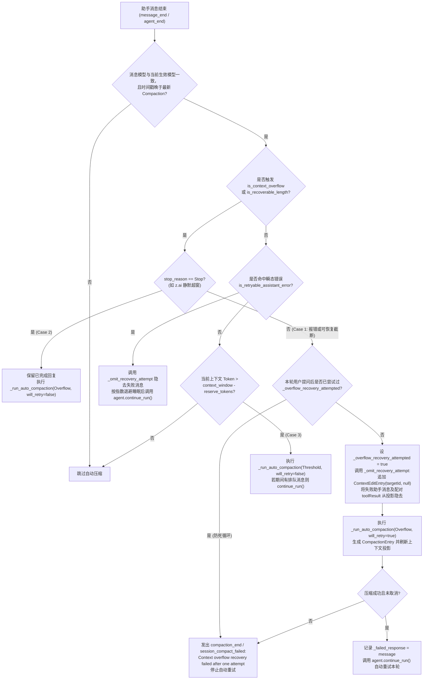

# 阶段 3：会话与扩展核心（pi-session）迁移设计

本文是 [Rust 重写开发计划](0.PLAN.md) 第三阶段「3. 会话与扩展核心」的具体设计，前置依赖见 [1.model-core.md](1.model-core.md) 与 [2.agent-core.md](2.agent-core.md)，技术栈选型依据见 [prototype.md](../prototype.md)。

本阶段对标上游 `@earendil-works/pi-coding-agent`（`1.5.0`）的会话管理、上下文压缩与扩展机制，实现独立的 Rust 会话与扩展核心包 `crates/pi-session`。该包位于 `crates/pi-ai` 和 `crates/pi-agent` 之上、运行时组装（阶段 4）与 CST Pilot 业务层（阶段 6）之下，负责管理会话追加树、面向大模型与面向前端界面的双视图投影、结构化系统提示词、手动与自动上下文压缩、上下文溢出降级恢复、编译期静态扩展体系，以及用户输入与执行状态的持久化关联和异常中断恢复核对。

## 对照基准（已拉取本地）

上游 `1.5.0` 的仓库源码与 npm 发布包已统一归档在 `E:/Learning/Programming/pi-1.5.0-reference/` 下，开发阶段 3 时直接对照编写：

| 本地路径 | 内容说明 |
|---|---|
| `E:/Learning/Programming/pi-1.5.0-reference/repo/packages/coding-agent/src/core/session-manager.ts` | 上游会话追加树（v3）、v1/v2/v3 迁移、双层投影（`buildSessionProjection` / `buildSessionContext`）、分支派生（`branch` / `branchWithSummary` / `createBranchedSession` / `forkFrom`）与头部有界扫描 |
| `E:/Learning/Programming/pi-1.5.0-reference/repo/packages/coding-agent/src/core/messages.ts` | `BashExecutionMessage`、`CustomMessage`、`BranchSummaryMessage`、`CompactionSummaryMessage` 四类扩展消息及 `convertToLlm` 转换函数 |
| `E:/Learning/Programming/pi-1.5.0-reference/repo/packages/coding-agent/src/core/compaction/` | `compaction.ts`、`branch-summarization.ts`、`utils.ts`：Token 估算、切点查找、分裂轮次（Split Turn）处理、文件操作追踪与分支总结 |
| `E:/Learning/Programming/pi-1.5.0-reference/repo/packages/coding-agent/src/core/extensions/` | `types.ts`、`runner.ts`、`wrapper.ts`：扩展 API、工具暴露分级（`ToolExposure`）、生命周期事件分发、边界草案预览与 UI 交互上下文 |
| `E:/Learning/Programming/pi-1.5.0-reference/repo/packages/coding-agent/src/core/agent-session.ts` | 会话控制器：整合 `Agent`、`SessionManager`、`ExtensionRunner`、自动压缩、溢出恢复、自动重试、嵌套工具调用与树导航 |
| `E:/Learning/Programming/pi-1.5.0-reference/repo/packages/coding-agent/src/core/{nested-tool-calls,virtual-models,system-prompt,usage-totals,session-export,slash-commands,event-bus}.ts` | 嵌套工具调用记录器、虚拟模型路由、结构化系统提示词、用量统计汇总、JSONL 导出、斜杠命令与事件总线 |
| `E:/Learning/Programming/pi-1.5.0-reference/repo/packages/ai/src/utils/{overflow,retry}.ts` | 跨服务商上下文溢出识别（`isContextOverflow` / `isRecoverableLength`）与瞬态错误指数退避重试（`retryAssistantCall` / `isRetryableAssistantError`） |
| `E:/Learning/Programming/pi-1.5.0-reference/npm/pi-coding-agent/package/` | npm 官方发布的 `@earendil-works/pi-coding-agent@1.5.0` 完整包（含 `dist/`、`.d.ts`、内置文档与扩展示例） |

## 设计原则与取舍

| 原则 | 在 `pi-session` 中的具体落地方式 |
|---|---|
| **安全性** | 1. 会话条目（`SessionEntry`）与扩展事件（`ExtensionEvent`）全部采用强类型枚举，杜绝非法的 `parentId` 悬挂引用、角色错位或未校验的边界草案入库。<br>2. 存储写入成功并完成同步后才发布内存树更新；部分写入失败时恢复磁盘尾部，无法确认恢复结果时将存储标记为 `poisoned` 并停止写入。边界草案通过完整快照原子替换批量提交。<br>3. 扩展上下文（`ExtensionContext`）内置世代有效性校验（`assert_active`），在会话切换、派生或重载后立即作废旧句柄，防止悬挂闭包篡改新会话状态。<br>4. 用户输入投递与运行状态通过持久化状态日志关联，进程被强杀或断电重启后自动将未闭合任务标记为异常中断（`crash` / `uncertain`），绝不自动重放结果未知的受控工具调用。 |
| **简洁性** | 1. 移除上游依赖 `jiti` 与虚拟模块的运行时 TypeScript/JavaScript 动态加载器，改为编译期静态注册接口（`Extension` Trait 与函数式 `ExtensionFactory`）。<br>2. 通过 `SessionStore` 与 `ExecutionStateStore` 两个 Trait 将存储介质与会话/执行逻辑解耦，核心逻辑不感知底层是内存、JSONL 文件还是 SQLite。<br>3. 核心与界面交互统一收敛为无 UI 框架依赖的异步 `ExtensionUiContext` Trait，TUI、Web 与 GPUI 只需各自实现该接口即可承接选择器、确认框、输入框与状态通知。 |
| **高效性** | 1. 会话列表加载采用 1 MiB 有界头部扫描（`read_session_header`）与受控并发池（`MAX_CONCURRENT_SESSION_INFO_LOADS = 10`），无需反序列化整份长会话即可完成发现与过滤。<br>2. 系统提示词采用命名段落差量补丁（`diff_system_prompt_sections`），`context` 钩子未改动对话时不重写前置 `SystemMessage`，最大化保留大模型服务端的前缀缓存（Prompt Cache）。<br>3. 新建会话采用惰性落盘策略，在产生首条 `user` 或 `assistant` 消息前不创建磁盘文件，避免打开即退出留下空文件。 |

## 数据持久化与订阅投影

`AgentSessionOptions::data_policy` 接收可选的 `SessionDataPolicy`。未配置时保持原始行为；同一策略跨会话重载与切换保留，核心不包含业务脱敏规则。

| 方法 | 生效位置 | 边界 |
|---|---|---|
| `admit_input` | 输入状态日志与命令／模型投递前 | 可临时拒绝输入；返回的许可对象保持至运行或队列接收完成，释放后不再占用许可；同时提供命令展开开关 |
| `persisted_input` | 输入投递预检写入 `ExecutionStateStore` 前 | 只替换持久收件箱副本，模型输入仍经过消息定稿和请求上下文处理 |
| `persisted_message` | 扩展 `message_end` 处理后、追加会话条目前 | 返回值保持消息角色；失败时拒绝追加并终止本次运行 |
| `project_event` | 同步与异步订阅器收到事件前 | 每次发布仅投影一次，双方获得同一份结果；内部 Agent 事件与模型上下文保持独立 |

投影方法返回错误或发生 panic 时，拒绝对应写入或事件分发，返回固定错误并停止后续模型与工具工作。`admit_input` 拒绝或发生 panic 时只拒绝本次输入，不持久化原文，也不将会话标为故障；后续输入可重试。策略实现不得重入会话。直接访问 Agent、SessionManager 或底层存储仍属于可信宿主接口，外部传输应使用已投影事件和业务层的快照处理。

`tests/data_policy.rs` 覆盖输入许可与释放、临时拒绝后的重试、命令展开开关、持久化前投影、同步与异步一致性、输入确认、默认行为、角色约束及错误／panic 拒绝路径。

## 会话存储方案拍板（敲定阶段 3 待确定事项）

针对 [0.PLAN.md](0.PLAN.md#待确定事项) 中「会话存储方案」的三个问题，本阶段作出如下正式决策：

| 决策项 | 拍板结论与工程依据 |
|---|---|
| **1. 核心默认存储格式** | **采用「Trait 抽象 + 默认原版 JSONL v3（`JsonlSessionStore`）+ 独立执行状态日志（`ExecutionStateStore`）」方案**，同时内置 `InMemorySessionStore` 并预留 `SqliteSessionStore` 实现：<br>1. **上游与存量兼容**：JSONL v3 与上游 Pi `1.5.0` 会话文件、`/export`、`/import` 及 CST Pilot 现有 `agent/home/sessions/*.jsonl` 完全兼容，无需转换即可直接读写。<br>2. **U 盘移动介质处理**：JSONL 的普通条目采用追加写（`O_APPEND`），首次创建采用排他创建（`wx`）；迁移与边界草案批量提交采用同目录临时文件原子替换。追加失败恢复、尾部修复与同步要求见 2.2 节；原子替换和同步的可靠性受文件系统与设备支持限制，介质报错后停止写入。SQLite 的日志模式按下表配置。<br>3. **事务状态互补**：需要原地更新状态的「用户输入回执去重、投递队列与运行中断标记」由 `ExecutionStateStore` 独立存储，与纯追加的 JSONL 会话历史分离。 |
| **2. 版本升级与原子写入/备份** | 1. **会话 JSONL 迁移**：加载时自动检测 `SessionHeader.version`，对低于 `CURRENT_SESSION_VERSION (3)` 的文件在内存完成 `v1 → v2 → v3` 原位升级，并通过「写入同目录唯一 `.tmp` 临时文件 + `sync_all()` + 原子替换」重写原文件；在平台支持时同步父目录，临时文件与目标必须位于同一文件系统。<br>2. **状态文件原子更新**：`ExecutionStateStore` 的状态文件采用「写入同目录临时文件 + `sync_all()` + 原子重命名替换」；在 Windows 下遇到防病毒或索引器触发的短暂 `EPERM` / `EACCES` / `EBUSY`（错误码 5 / 32）时，按 `15ms → 30ms → 60ms → 120ms → 150ms` 退避重试最多 5 次（累计 `<= 375ms`），永久失败时保留原文件并清理临时文件。 |
| **3. SQLite 适配规范（含 U 盘日志与同步模式）** | 当上层服务选用 `SqliteSessionStore` 或 SQLite 版 `ExecutionStateStore` 时：<br>1. **表结构升级**：使用 `PRAGMA user_version` 管理递增迁移脚本；每次跨版本迁移前先在同一目录生成 `.bak` 快照并在单个 `BEGIN IMMEDIATE` 事务内执行 DDL 与数据迁移。<br>2. **U 盘（FAT32 / exFAT）与本地固定盘自适应模式**：打开数据库时探测目标路径所在卷的文件系统与驱动器类型（Windows `GetDriveTypeW` / `GetVolumeInformationW`）。若位于可移动介质（`DRIVE_REMOVABLE`）或 `FAT32` / `exFAT` 文件系统，强制设置 `PRAGMA journal_mode = TRUNCATE`（或 `PERSIST`，禁用 `WAL`）与 `PRAGMA synchronous = FULL`、`PRAGMA locking_mode = EXCLUSIVE`；若位于本机固定 `NTFS` 磁盘，才启用 `PRAGMA journal_mode = WAL` 与 `PRAGMA synchronous = NORMAL`。 |

## 目录与文件命名

在 Cargo Workspace 中新增 `crates/pi-session`，源码按职责组织：

```text
crates/pi-session/
|-- Cargo.toml
|-- src/
|   |-- lib.rs                  # 对外导出全部公开类型、Trait、SessionManager、ExtensionRunner 与 AgentSession
|   |-- messages.rs             # BashExecution / Custom / BranchSummary / CompactionSummary 消息与 convert_to_llm
|   |-- session_store.rs        # SessionStore / SessionCatalogStore Trait、InMemorySessionStore 与 JsonlSessionStore
|   |-- session_manager.rs      # SessionHeader、11 种 SessionEntry、v1->v3 迁移、分支操作与双层上下文投影
|   |-- tree.rs                 # SessionTreeNode、五档过滤树（Default/NoTools/UserOnly/LabeledOnly/All）与几何列计算
|   |-- session_export.rs       # 当前分支 JSONL 序列化导出与附加尾部条目支持（对照 session-export.ts）
|   |-- usage_totals.rs         # UsageTotals、combine_usage 与按模型/工具分组的费用统计（对照 usage-totals.ts）
|   |-- system_prompt.rs        # 结构化系统提示词组装、命名段落包裹与 diff_system_prompt_sections 差量补丁
|   |-- virtual_models.rs       # VirtualModelDefinition、pi-virtual 路由请求与分支状态恢复（对照 virtual-models.ts）
|   |-- compaction.rs           # Token 估算、切点查找、分裂轮次处理、文件操作追踪与手动/自动压缩生成
|   |-- branch_summary.rs       # 公共祖先查找、分支条目收集、预算裁剪与分支总结生成（对照 branch-summarization.ts）
|   |-- ui.rs                   # 与界面无关的 ExtensionUiContext Trait、NoOpUiContext 与异步弹窗交互通道
|   |-- event_bus.rs            # 跨扩展通信的强类型/通道事件总线 EventBus（对照 event-bus.ts）
|   |-- slash_commands.rs       # 内置斜杠命令清单、命令来源分类与同名扩展命令冲突消解（对照 slash-commands.ts）
|   |-- nested_calls.rs         # NestedToolCallRunner 與 NestedCallRecorder 嵌套工具调用管线（对照 nested-tool-calls.ts）
|   |-- extensions.rs           # 静态扩展注册器 ExtensionRegistrar、ToolDefinition、ToolExposure 与 ExtensionRunner
|   |-- execution_log.rs        # 用户输入关联记录、运行与工具状态机、异常中断标记（crash/uncertain）与启动核对
|   `-- agent_session.rs        # AgentSession 控制器：串联 Agent、SessionManager、ExtensionRunner、压缩、重试与恢复
|-- examples/
|   |-- custom_provider_and_virtual_model.rs  # 示例 1：静态注册自定义模型服务商与按轮次路由的虚拟模型
|   |-- custom_tools_and_nested_calls.rs      # 示例 2：注册带 prepare_loadout 的工具与 codemode 风格嵌套工具调用
|   |-- slash_commands_and_tree_fork.rs       # 示例 3：注册斜杠命令、书签标签、分支总结跳转与会话 fork
|   |-- context_rewrite_and_compaction.rs     # 示例 4：context 钩子改写、turn_end 边界草案注入与自定义压缩拦截
|   `-- interactive_ui_and_permission_hook.rs # 示例 5：通过通用 UI 交互通道实现高危工具确认弹窗与恢复密码输入
`-- tests/
    |-- session_manager.rs      # JSONL v3 读写、惰性落盘、写入失败回滚、v1/v2/v3 迁移、头部扫描与并发列表测试
    |-- projection_and_tree.rs  # Compaction / ContextEdit 投影、标签重连 fork、五档过滤树与几何连接符对齐测试
    |-- compaction_and_retry.rs # 切点查找、分裂轮次总结、文件操作聚合、三类自动压缩、单次溢出恢复与退避重试测试
    |-- extensions_runner.rs    # 静态扩展注册、工具暴露分级、钩子链式传递、系统消息自动恢复与句柄失效保护测试
    |-- nested_tool_calls.rs    # 嵌套工具调用 ID 分配、字节与数量上限截断、串行重入防死锁与用量归并测试
    |-- execution_recovery.rs   # 输入 ID 幂等关联、进程强杀 crash 标记、delivering 未决项 uncertain 核对与受控工具恢复测试
    `-- agent_session_e2e.rs    # 对接 FauxProvider 的完整会话生命周期、扩展交互、分支切换与压缩恢复端到端测试
```

## 与 `crates/pi-ai`、`crates/pi-agent` 的边界及前置补齐项

`crates/pi-session` 直接构建在 `crates/pi-ai` 与 `crates/pi-agent` 之上。对照上游依赖关系，需在 `crates/pi-ai` 与 `crates/pi-agent` 中顺带补齐以下通用基础能力：

| 所属包 | 补齐模块 / 接口 | 具体说明（对齐上游 `1.5.0`） |
|---|---|---|
| `crates/pi-ai` | `overflow.rs`（`is_context_overflow`、`is_recoverable_length`） | 对照 `packages/ai/src/utils/overflow.ts`：<br>1. `is_context_overflow(message, context_window)` 覆盖三类溢出：错误消息匹配 25 条溢出正则且不命中限流排除正则（含 Cerebras 无正文 `400/413` 特判）；静默溢出（`stop_reason == Stop` 且 `usage.input + usage.cache_read > context_window`）；长度截断溢出（小米 MiMo 风格：`stop_reason == Length`、`usage.output == 0` 且 `input + cache_read >= context_window * 0.99`）。<br>2. `is_recoverable_length(message, desired_max_output)`：当 `stop_reason == Length` 且 `0 < usage.output < desired_max_output` 时判定为可尝试一次压缩恢复的截断。 |
| `crates/pi-ai` | `retry.rs`（`RetryPolicy`、`RetryCallbacks`、`retry_delay_ms`、`is_retryable_assistant_error`、`retry_assistant_call`） | 对照 `packages/ai/src/utils/retry.ts`：<br>1. `is_retryable_assistant_error` 先排除配额/账单耗尽错误（`GoUsageLimitError`、`FreeUsageLimitError`、`Monthly usage limit reached`、`available balance`、`insufficient_quota`、`out of budget`、`quota exceeded`、`billing`、`subscription_sharing_*`、智谱 `"code": 1308`），再匹配限流、过载、HTTP `429/500/502/503/504/520/524`（带前后非字母数字边界检查）、连接重置与流提前断开。<br>2. `retry_assistant_call` 按 `base_delay_ms * 2^(attempt - 1)`（上限 `max_agent_delay_ms`，默认 `60_000ms`）执行指数退避重试；若在退避睡眠期间收到取消信号，将原错误响应归一化为 `stop_reason: StopReason::Aborted` 并清除 `error_message` 返回。 |
| `crates/pi-ai` | `uuid_v7()` 辅助函数 | 在工作区 `uuid` 依赖启用 `v7` 特性，导出 `uuid_v7() -> String`，供会话 ID、压缩总结临时路由 ID 使用。 |
| `crates/pi-agent` | `Agent` 运行期钩子与配置 Setter | 在 `crates/pi-agent/src/agent.rs` 中为 `Agent` 补齐 `set_convert_to_llm`、`set_transform_context`、`set_stream_fn`、`set_get_api_key`、`set_on_payload`、`set_on_response`、`set_on_provider_stream_event`、`stream_fn(&self) -> StreamFn` 与 `session_id(&self) -> Option<String>`、`set_session_id(&self, Option<String>)`，供 `AgentSession` 在构造和重载时挂载会话级投影与扩展拦截器。 |
| `crates/pi-agent` | `FinalizeMessageFn` 与 `set_finalize_message` | 新增可失败的消息定稿钩子：`Fn(AgentMessage, Option<CancellationToken>) -> BoxFuture<'static, Result<AgentMessage, String>>`。所有输入、助手回复与工具结果在进入正式上下文和发出 `message_end` 前均执行一次；工具结果在 `message_start` 前完成定稿。返回的最终消息统一用于循环局部上下文、`new_messages`、`AgentState`、工具调用提取与后续事件。钩子失败时终止运行，禁止继续调用模型或执行工具；落盘错误不得当成模型瞬态错误自动重试。普通订阅器保持只读通知语义。 |
| `crates/pi-agent` | 嵌套工具事件关联 | 在工具执行事件中增加可选的 `parent_tool_call_id`，顶层调用为 `None`；由 `NestedToolCallRunner` 发出嵌套事件，保持现有事件序列化格式兼容。 |

## 核心模块设计

### 1. 扩展消息类型与 LLM 转换管线（`messages.rs`）

上游通过 TypeScript 接口声明合并向 `AgentMessage` 注入四类会话专属消息。在 Rust 中，`messages.rs` 提供这四类消息的强类型结构体、与 `pi_agent::AgentMessage::Custom` 的无损互转辅助函数，以及统一的 `convert_to_llm` 转换器：

| 扩展消息类型 | `role` 标识 | 核心字段 | `convert_to_llm` 转换规则 |
|---|---|---|---|
| `BashExecutionMessage` | `"bashExecution"` | `command: String`, `output: String`, `exit_code: Option<i32>`, `cancelled: bool`, `truncated: bool`, `full_output_path: Option<String>`, `timestamp: u64`, `exclude_from_context: Option<bool>` | 若 `exclude_from_context == Some(true)`（对应 `!!` 命令），直接过滤掉（不进入模型上下文）；否则调用 `bash_execution_to_text` 格式化为代码块、退出码与截断路径提示，包装为 `Message::User` |
| `CustomMessage` | `"custom"` | `custom_type: String`, `content: CustomMessageContent`（支持纯文本或 `Vec<UserContentBlock>`）, `display: bool`, `details: Option<JsonValue>`, `timestamp: u64` | 将 `content` 归一化为 `Vec<UserContentBlock>`，包装为 `Message::User`（`display` 与 `details` 仅供界面与扩展读取，不发给大模型） |
| `BranchSummaryMessage` | `"branchSummary"` | `summary: String`, `from_id: Option<String>`, `timestamp: u64` | 拼接 `BRANCH_SUMMARY_PREFIX + summary + BRANCH_SUMMARY_SUFFIX`，包装为 `Message::User` |
| `CompactionSummaryMessage` | `"compactionSummary"` | `summary: String`, `tokens_before: u64`, `timestamp: u64` | 拼接 `COMPACTION_SUMMARY_PREFIX + summary + COMPACTION_SUMMARY_SUFFIX`，包装为 `Message::User` |

前缀与后缀常量与上游保持字节级一致：
- `COMPACTION_SUMMARY_PREFIX`：`"The conversation history before this point was compacted into the following summary:\n\n<summary>\n"`
- `COMPACTION_SUMMARY_SUFFIX`：`"\n</summary>"`
- `BRANCH_SUMMARY_PREFIX`：`"The following is a summary of a branch that this conversation came back from:\n\n<summary>\n"`
- `BRANCH_SUMMARY_SUFFIX`：`"</summary>"`

### 2. 会话追加树、存储抽象与双视图投影（`session_store.rs`、`session_manager.rs`、`tree.rs`）

#### 2.1 会话文件头与 11 种条目结构（v3 格式）

每个会话由单条 `SessionHeader` 与一棵以 `id` / `parent_id` 串联的只追加条目树（`SessionEntry`）组成，序列化格式完全对齐上游 `CURRENT_SESSION_VERSION = 3`：

| 条目类型（`type` 标签） | Rust 结构体 | 核心字段 | 是否参与模型上下文投影 |
|---|---|---|---|
| `"session"` | `SessionHeader` | `version: Option<u32>`（当前为 `Some(3)`）, `id: String`, `timestamp: String`（ISO 8601）, `cwd: String`, `parent_session: Option<String>` | 否（文件头元数据） |
| `"message"` | `SessionMessageEntry` | `id`, `parent_id`, `timestamp`, `message: AgentMessage` | **是**（若 `content` 在手工编辑或旧文件中为 `null`，自动修复为空串 `""` 或空数组 `[]`） |
| `"thinking_level_change"` | `ThinkingLevelChangeEntry` | `id`, `parent_id`, `timestamp`, `thinking_level: String` | 否（更新分支的 `thinking_level` 设置） |
| `"model_change"` | `ModelChangeEntry` | `id`, `parent_id`, `timestamp`, `provider: String`, `model_id: String` | 否（更新分支的 `model` 选择） |
| `"usage"` | `UsageEntry` | `id`, `parent_id`, `timestamp`, `kind: String`, `provider: String`, `model: String`, `usage: Usage`, `note: Option<String>` | 否（记录缓存预热等非对话模型调用用量，计入会话总账单） |
| `"compaction"` | `CompactionEntry` | `id`, `parent_id`, `timestamp`, `summary: String`, `first_kept_entry_id: String`, `tokens_before: u64`, `details: Option<JsonValue>`, `usage: Option<Usage>`, `from_hook: Option<bool>`, `system_message: Option<SystemMessage>` | **是**（仅分支路径上最新的一条生效，展开为可选 `system_message` + `CompactionSummaryMessage`） |
| `"branch_summary"` | `BranchSummaryEntry` | `id`, `parent_id`, `timestamp`, `from_id: String`, `summary: String`, `details: Option<JsonValue>`, `usage: Option<Usage>`, `from_hook: Option<bool>` | **是**（当 `summary` 非空时展开为 `BranchSummaryMessage`） |
| `"custom"` | `CustomEntry` | `id`, `parent_id`, `timestamp`, `custom_type: String`, `data: Option<JsonValue>` | 否（持久化扩展私有状态、虚拟模型路由状态、轮次耗时与输入关联记录） |
| `"custom_message"` | `CustomMessageEntry` | `id`, `parent_id`, `timestamp`, `custom_type: String`, `content: CustomMessageContent`, `details: Option<JsonValue>`, `display: bool` | **是**（展开为 `CustomMessage`） |
| `"context_edit"` | `ContextEditEntry` | `id`, `parent_id`, `timestamp`, `target_id: String`, `replacement: Option<ContextEditReplacement>` | 否（分支局部修饰符：`None` 从模型投影中隐去目标条目，`Some` 仅替换目标条目的消息内容） |
| `"label"` | `LabelEntry` | `id`, `parent_id`, `timestamp`, `target_id: String`, `label: Option<String>` | 否（设置或清除目标条目的书签标签） |
| `"session_info"` | `SessionInfoEntry` | `id`, `parent_id`, `timestamp`, `name: Option<String>` | 否（设置或清空会话显示名称，换行符自动替换为空格并 `trim`） |

条目 ID 生成遵循上游 `generateId` 规则：优先取 UUID v4 的前 8 位十六进制字符并在当前会话 `by_id` 哈希表中做碰撞检查（最多尝试 100 次，极端碰撞时回退完整 UUID）；会话 ID 校验遵循 `assert_valid_session_id`（仅允许字母数字及 `.`、`_`、`-`，且首尾必须为字母或数字）。

#### 2.2 存储抽象（`SessionStore`）与惰性落盘规则

```rust
pub trait SessionStore: Send + Sync {
    /// 返回底层存储路径标识（内存模式返回 None）。
    fn location(&self) -> Option<&Path>;
    /// 是否支持持久化。
    fn is_persisted(&self) -> bool;
    /// 读取全部原始文件条目（含 SessionHeader）。
    fn load_entries(&self) -> Result<Vec<FileEntry>, SessionStoreError>;
    /// 首次创建、迁移或批量提交完整快照；成功返回前完成同步。
    /// exclusive_create=false 时原子替换：重新打开仅可见旧快照或完整新快照。
    /// exclusive_create=true 时禁止覆盖已有文件。
    fn rewrite_all(&mut self, entries: &[FileEntry], exclusive_create: bool) -> Result<(), SessionStoreError>;
    /// 追加单条并同步；失败时恢复原尾部，恢复失败后禁止继续写入。
    fn append_entry(&mut self, entry: &SessionEntry) -> Result<(), SessionStoreError>;
}
```

`SessionManager` 的持久化与回滚契约：
1. **惰性创建文件（`_has_conversation`）**：新建会话后，仅追加 `model_change`、`thinking_level_change`、`system` 消息或 `custom` 条目时，`flushed` 保持为 `false`，磁盘上不创建 `.jsonl` 文件。一旦 `file_entries` 中出现首条 `role == "user"` 或 `role == "assistant"` 的 `SessionMessageEntry`，立即以排他模式（`OpenOptions::new().write(true).create_new(true)`，对应上游 `"wx"`）一次性写入 `SessionHeader` 及当前全部积压条目，并将 `flushed` 置为 `true`；后续条目直接单行追加。
2. **追加失败恢复**：写入前记录文件长度并序列化完整 JSON 行；完成 `write_all` 与 `sync_all()` 后才发布新的 `file_entries`、`by_id`、`leaf_id`。部分写入或同步失败时，截断到原长度并再次同步；首次创建失败时仅清理本次排他创建的文件，保留原有积压条目与 `flushed = false`。若截断、删除或同步失败，返回 `StorageUncertain` 并将实例标记为 `poisoned`；后续追加、批量提交和模型/工具执行全部拒绝，须重新打开并核对磁盘状态。
3. **非空非法会话文件保护**：显式打开指定路径的会话文件时，若文件大小为 0，自动初始化合法 `SessionHeader` 并写回；若文件大小大于 0 但首条有效记录不是合法 `SessionHeader`，立即报错返回 `InvalidSessionFile`，严禁覆盖或清空用户文件。
4. **尾部修复**：加载时先校验头部。末行是可识别的完整条目但缺少 `\n` 时，补写换行并同步；仅当最后物理行的 JSON 解析报 EOF（输入在结构闭合前结束）时，截断到最近一个完整行边界并同步，报告恢复信息。最后非空行包含未知条目类型、字段不匹配或其他语法错误时，保留原文件并返回 `InvalidSessionFile`。中间损坏行不得与后续有效行拼接；头部非法时禁止自动修复。修复失败时停止打开会话。
5. **边界草案批量提交**：`SessionManager::commit_boundary_drafts` 在克隆状态上完成全部验证、ID 分配与投影计算，已落盘会话调用 `rewrite_all(&candidate_entries, false)` 一次提交完整快照；未落盘且尚无 `user`/`assistant` 的会话只交换内存候选状态，保留惰性落盘语义。`JsonlSessionStore` 写入同目录唯一临时文件、同步后原子替换；`InMemorySessionStore` 一次交换完整集合，SQLite 使用单个事务。存储成功后才交换真实内存树并通知扩展；不得循环调用 `append_entry` 模拟批量原子提交。替换前失败保留旧文件；替换成功后若同步结果无法确认，则进入 `StorageUncertain`，禁止用旧内存继续执行。
6. **单写权与回执顺序**：首次创建、追加、修复、迁移、快照替换和启动核对均须持有同一会话的单写权；实现可用独立锁文件，避免替换 JSONL 后丢失锁。第二个写入实例须拒绝打开。`Accepted` 回执、工具启动与边界通知均晚于相应持久化成功；内存模式明确不提供重启恢复保证。

#### 2.3 面向大模型与面向前端界面的双视图读取

`SessionManager` 同时服务大模型请求组装与前端界面展示，两套视图职责严格分离：

| 视图维度 | 面向大模型的上下文投影（`build_session_projection` / `build_session_context`） | 面向前端界面的历史与分支树（`get_entries` / `get_branch` / `get_tree` / `build_filtered_tree`） |
|---|---|---|
| **路径范围** | 仅沿当前 `leaf_id` 回溯至根节点的单条活跃分支路径（若 `leaf_id == None` 则返回空列表） | 支持读取全量条目、任意节点到根的分支路径，或包含所有历史分叉的完整树结构 |
| **压缩裁剪（Compaction）** | 若路径上存在 `CompactionEntry`，以**最新一条** `CompactionEntry` 为界：<br>1. 将该 `CompactionEntry` 置于投影首位（展开为其保存的 `system_message` 快照 + `CompactionSummaryMessage`）。<br>2. 从其 `first_kept_entry_id` 开始保留后续条目，但**过滤掉压缩点之前的 `SystemMessage`**（因其状态已凝结在 `CompactionEntry.system_message` 中），并将位于保留区间内的更早 `CompactionEntry` 投影为空 `[]`。<br>3. `first_kept_entry_id` 之前的历史对话全部省略。 | **不裁剪压缩前的历史**。前端仍可向上滚动查看被压缩前的原始对话、工具结果与历次压缩卡片 |
| **上下文编辑（`ContextEditEntry`）** | 按目标条目 ID 取分支上**最新一条** `ContextEditEntry`：<br>1. `replacement == None` 时，将该条目的模型可见消息投影为空 `[]`（用于自动重试和溢出恢复时隐去失败的助手消息及配对工具结果）。<br>2. `replacement == Some(content)` 时，仅替换 `user` / `assistant` / `toolResult` / `custom` 消息的 `content`（若目标为 `assistant` 或 `toolResult` 且替换值为纯字符串，自动包装为单元素文本块数组）。 | 原始条目保留在树中，界面可选择按原始条目渲染或读取编辑标记 |
| **状态条目处理** | `CustomEntry`、`LabelEntry`、`SessionInfoEntry`、`UsageEntry`、`ModelChangeEntry`、`ThinkingLevelChangeEntry` 均投影为空 `[]`（其中后两者与助手消息一起用于推导当前分支的 `thinking_level` 与 `model`） | 全部保留：用于渲染书签标签、会话标题、轮次工作时长（`cst-web-work-duration`）、客户端消息 ID 绑定（`cst-web-input-message`）与账单统计 |

#### 2.4 分支派生（`branch` / `create_branched_session` / `fork_from`）与五档过滤几何树（`tree.rs`）

1. **同文件分支跳转**：
   - `branch(branch_from_id)`：校验 `branch_from_id` 存在于 `by_id` 后，仅将 `leaf_id` 指向该节点；下次 `append_*` 自动以该节点为 `parent_id` 分叉出新子树。
   - `reset_leaf()`：将 `leaf_id` 置为 `None`；下次 `append_*` 创建 `parent_id == None` 的新根节点（用于重新编辑首条用户消息）。
   - `branch_with_summary(branch_from_id, summary, details, from_hook, usage)`：记录当前 `from_id = leaf_id.unwrap_or("root")`，将 `leaf_id` 移至 `branch_from_id`（可为 `None` 表示根节点），追加一条 `BranchSummaryEntry` 并推进 `leaf_id`。
2. **提取单路径派生新会话（`create_branched_session(leaf_id)`）**：
   - 提取从根到 `leaf_id` 的路径，剥离路径中夹杂的 `LabelEntry` 节点。
   - **父子链与压缩锚点重连**：由于后续条目可能是某个 `LabelEntry` 的直接子节点，剥离 `LabelEntry` 时必须将挂起的标签 ID 映射到紧随其后的第一个非标签条目 ID，重写保留条目的 `parent_id`，并同步修正路径上 `CompactionEntry.first_kept_entry_id`（若原指向被剥离的 `LabelEntry`，自动重定向到替代条目 ID）。
   - 在路径末尾重新追加当前生效的 `LabelEntry` 集合，生成新的 `session_id` 与 `SessionHeader { parent_session: previous_session_file, .. }`。
3. **跨目录完整克隆派生（`SessionManager::fork_from`）**：
   - 读取源会话文件全部条目，在目标 `cwd` 下创建新 `.jsonl` 文件，写入带 `parent_session: Some(resolved_source_path)` 和新 `cwd` 的 `SessionHeader`，并在单次文件句柄打开期间批量写入全部非头部条目。
4. **面向 TUI 与 Web 共用的五档过滤几何树（`tree.rs`）**：
   - 支持五档过滤模式 `TreeFilterMode`：
     - `Default`：隐藏 `label`、`custom`、`model_change`、`thinking_level_change`、`session_info`、`usage`、`context_edit` 设置类条目。
     - `NoTools`：在 `Default` 基础上额外隐藏 `role == "toolResult"` 的消息条目。
     - `UserOnly`：仅显示用户消息条目。
     - `LabeledOnly`：仅显示带有非空 `label` 的条目。
     - `All`：显示全部条目。
   - **几何列计算规则（对齐 `branch-tree.ts` 与 TUI `TreeList`）**：
     1. 先在完整树上按「当前 `leaf_id` 所在活跃路径优先，其余兄弟按时间戳升序」执行深度优先遍历，固定每个节点的 `active_path: bool` 与 `traversal_order: usize`。
     2. 应用过滤模式，将被隐藏节点的可见后代重挂至最近的可见祖先，保持 `traversal_order` 顺序不变。
     3. 计算每行的缩进与连接线：根节点 `indent = 0`；真实分叉点（父节点有多个可见子节点）的子节点 `indent + 1` 且 `show_connector = true`、`connector_column = indent - 1`；段首第一代后代 `indent + 1`；非末位兄弟的子树在对应列持续输出竖线 `gutters: Vec<usize>`。

### 3. 编译期静态扩展体系与通用界面交互协议（`extensions.rs`、`ui.rs`、`nested_calls.rs`）

#### 3.1 静态扩展注册接口（`Extension` Trait 与 `ExtensionRegistrar`）

Rust 核心不引入 JS 运行时，扩展在编译期通过实现 `Extension` Trait 或传入闭包工厂静态注册：

```rust
pub trait Extension: Send + Sync + 'static {
    /// 扩展唯一标识路径（如 "builtin:codemode"、"<inline:diagnostics>"）。
    fn path(&self) -> &str;
    /// 来源元数据（builtin / inline / project / global）。
    fn source_info(&self) -> SourceInfo;
    /// 是否在启动扩展列表中隐藏。
    fn hidden(&self) -> bool { false }
    /// 当其他扩展注册了同名工具、命令或标志时，是否自动退让整套扩展而不报错。
    fn replaceable(&self) -> bool { false }
    /// 向注册器声明工具、斜杠命令、标志、快捷键、服务商、虚拟模型与事件处理器。
    fn register(&self, api: &mut ExtensionRegistrar) -> Result<(), ExtensionInitError>;
}
```

`ExtensionRegistrar`（对应上游 `ExtensionAPI`）提供的完整注册与操作能力：

| 类别 | 方法签名 / 能力 | 行为与冲突处理规则 |
|---|---|---|
| **自定义工具** | `register_tool(ToolDefinition)` | 支持 `ToolExposure`、`ToolNamespace`、`ToolAnnotations`、`prompt_snippet`、`prompt_guidelines`、`default_active`、`prepare_loadout`、`execution_mode`；同名工具按扩展加载顺序「先注册者胜出」（若前序扩展声明了 `replaceable: true`，则前序扩展整包退让） |
| **斜杠命令** | `register_command(RegisteredCommand)` | 支持 `name`、`description`、`argument_hint` 与异步 `handler(args, ExtensionCommandContext)`；若多个扩展注册同名命令 `foo`，自动按顺序分配调用名 `foo:1`、`foo:2`（避开已被占用的显式名称） |
| **CLI 标志与快捷键** | `register_flag(ExtensionFlag)`、`register_shortcut(ExtensionShortcut)` | 快捷键统一归一化为小写 `KeyId`；若与 18 个保留全局快捷键（如 `app.interrupt`、`app.exit`、`tui.input.submit`）冲突则跳过并记录告警诊断，非保留冲突由后注册者覆盖并记录诊断 |
| **模型服务商与虚拟模型** | `register_provider(Provider)`、`register_provider_config(name, ProviderConfig)`、`unregister_provider(name)`、`register_virtual_model(ExtensionVirtualModel)`、`unregister_virtual_model(provider, id)` | 在 `ExtensionRunner::bind_core` 前入队缓存；`bind_core` 时统一刷入 `ModelRegistry` / `Models`，绑定后再次调用则立即生效 |
| **生命周期与拦截钩子** | `on_<event>(handler)` | 按事件类别提供强类型注册方法（见 3.3 节）；每次分发前对处理器列表拍快照（`snapshot_event_handlers`），单个处理器抛错通过 `emit_error` 报告（`tool_call` 与 `user_bash` 除外，其错误按规范向上阻断） |
| **会话操作动作** | `send_message`、`send_user_message`、`append_entry`、`set_session_name`、`get_session_name`、`set_label`、`get_active_tools`、`set_active_tools`、`get_all_tools`、`refresh_tools`、`get_commands`、`set_model`、`get_thinking_level`、`set_thinking_level`、`events(&self) -> &EventBus` | 共享保存在 `ExtensionRuntime` 中，支持在事件钩子、命令处理器与工具执行期间安全调用；会话重载或替换后调用 `invalidate()` 立即拦截过期实例访问 |

#### 3.2 工具暴露分级（`ToolExposure`）、`prepare_loadout` 与嵌套工具调用（`nested_calls.rs`）

1. **五级工具暴露模型（`ToolExposure`）**：
   - `Direct`（默认）：注册时默认激活，激活时向大模型声明（写入 `SystemMessage` 与请求 `tools`），且允许其他工具通过 `ctx.execute_tool()` 嵌套调用。
   - `ModelOnly`：注册时默认激活，向大模型声明，但**禁止**通过 `ctx.execute_tool()` 嵌套调用（用于编排类或交互式工具）。
   - `Codemode`：注册时不自动激活（除非显式点名），但只要已注册即可通过 `ctx.execute_tool()` 调用；供 `codemode` 在自身描述中列出。
   - `Deferred`：与 `Codemode` 相同可被 `ctx.execute_tool()` 调用，但不在 `codemode` 描述中列出，仅由 `tool_search` 按需检索激活。
   - `Hidden`：已注册但不可激活、不可嵌套调用。
2. **`prepare_loadout` 与隐藏声明投影（`hidden_declarations`）**：
   - 每次活跃工具集变化时，依次调用当前活跃工具上的 `prepare_loadout(&ToolLoadout) -> Option<ToolLoadoutChanges>`。
   - 允许工具动态覆写任意已声明工具的 `description`，或将部分工具加入 `hidden_declarations`。
   - 被加入 `hidden_declarations` 的工具在会话转录本 `SystemMessage` 中仍保持已声明状态（保证 `/tree` 跳转和恢复时不丢失激活集），但在向供应商发送请求以及生成系统提示词 `<tools>` / `<rules>` 段落时被过滤隐去。
3. **保序工具激活（`#11495`）**：
   - 调用 `set_active_tools_by_name(names)` 时，原本已处于激活状态且仍在 `names` 中的工具**严格保持原有顺序**，新激活的工具追加在末尾，防止仅因传入同名集合顺序不同而触发无意义的 `SystemMessage` 工具重排补丁。
4. **嵌套工具调用（`NestedToolCallRunner` + `NestedCallRecorder`）**：
   - 当工具在 `execute` 内部调用 `ctx.execute_tool(name, args, options)` 时，为其分配嵌套 ID `<caller_id>/<n>`（`n` 从 1 递增）。
   - 嵌套调用同样经过 `pi_agent::run_tool_call`（含参数转换、Schema 校验、`before_tool_call` / `after_tool_call` 钩子），并发出携带 `parent_tool_call_id: Some(caller_id)` 的 `tool_execution_start` / `update` / `end` 事件。
   - 若当前会话配置为 `ToolExecutionMode::Sequential`，通过单链异步互斥队列串行化嵌套调用，并在已持有队列的父调用内部标记 `holds_queue = true`，允许其自身派生的子调用直接重入而不死锁。
   - `NestedCallRecorder` 按 `NESTED_CALL_LIMITS`（`max_calls: 256`、`max_argument_bytes_per_call: 8192`、`max_argument_bytes_total: 32768`、`max_error_chars: 500`）记录子调用轨迹与累计 `Usage`；超限时省略参数并标记 `complete: false`。在父工具结果进入 `FinalizeMessageFn`、发出 `message_start` 前，调用 `take_record(tool_call_id)` 将 `nested_calls` 与汇总 `usage` 合入规范消息，再统一用于持久化、Agent 状态、后续模型上下文和事件；不得通过修改订阅器收到的消息副本完成挂载。

#### 3.3 生命周期事件钩子与精确语义

`ExtensionRunner` 统一调度以下核心事件，严格保持上游的合并、短路与恢复规则：

| 事件名称 | 触发时机 | 处理器返回值与合并语义 |
|---|---|---|
| `input` | 用户输入提交后、技能与模板展开前 | 返回 `Continue`、`Transform { text, images }`（链式传递给下一个处理器）或 `Handled`（立即短路，不再发起模型调用） |
| `before_agent_start` | 空闲状态下由用户提问或 `trigger_turn: true` 自定义消息启动运行前 | 通过 `event.system_prompt_options.update(|options| { ... })` 更新配置，通过 `snapshot()` 读取快照。更新方法返回后，当前处理器的 `event.system_prompt()`、`ctx.get_system_prompt()` 与后续处理器均可见新值。更新闭包在锁外执行，已完成的更新在处理器返回错误后保留。返回 `{ message, system_prompt }` 可注入消息并覆盖提示词 |
| `context` → `context_with_system` | 每轮向大模型发起请求前的 `transform_context` 阶段 | **两阶段转换**：<br>1. `context` 处理器仅看到剔除 `SystemMessage` 后的对话消息；若处理器修改了消息列表，Pi 自动调用 `restore_system_messages` 将当前重放合并后的基准 `SystemMessage` 重新挂回下标 0（若处理器未改动消息，则原样保留转录本中的所有 `SystemMessage` 以维持缓存前缀）。<br>2. `context_with_system` 处理器看到包含 `SystemMessage` 的完整列表，其返回结果直接发往模型（若误删了下标 0 的 `SystemMessage`，发出 `ExtensionError` 告警） |
| `before_provider_request` / `before_provider_headers` / `after_provider_response` / `provider_stream_event` | 协议层组装完 JSON 载荷、组装请求头、收到响应头、收到原始流帧时 | `before_provider_request` 可返回新 JSON 载荷替换原请求体；`before_provider_headers` 原地增删请求头（設为 `None` 删除该头）；后两者只读观测 |
| `tool_call` / `tool_result` | 每个工具调用执行前（`before_tool_call`）与执行后（`after_tool_call`） | `tool_call` 返回 `block: true` 时立即拦截执行并返回 `reason`；`tool_result` 支持链式修改 `content`、`details`、`structured_content`、`is_error`、`usage`（当替换了 `content` 但未显式传入 `structured_content` 时，自动清除原 `structured_content`） |
| `message_end` | `FinalizeMessageFn` 内、消息持久化前 | 处理器链式返回同 `role` 的新 `AgentMessage`；返回不同 `role` 时报告 `ExtensionError` 并保留上一结果。`AgentSession` 持久化最终消息后将其返回执行循环；助手工具调用从最终消息提取，工具结果保持 `tool_call_id` 关联不变。普通 `AgentEvent::MessageEnd` 在定稿完成后仅通知，禁止依赖共享对象原位修改。 |
| `turn_end` / `agent_before_settle` | 单轮（助手消息 + 全部工具结果落盘后）结束时 / 整次运行即将最终结算前 | **边界草案机制（Boundary Drafts）**：处理器可返回 `{ entries: Vec<SessionBoundaryDraft>, continue: Option<bool> }`（支持追加 `custom`、`custom_message`、`context_edit`、`compaction` 草案）。每次处理器返回后，先在内存克隆的预览 `SessionManager` 上试应用草案并重新计算 `BoundaryContextPreview`（校验目标 ID 是否存在、最终上下文是否满足 `can_continue`：即包含非系统消息且末尾角色不为 `assistant`，或存在待发队列）；全部处理器通过后才调用 `commit_boundary_drafts`，按 2.2 节的完整快照协议原子提交到真实 `SessionManager`；失败时停止当前运行，不通知提交成功 |
| `session_before_switch` / `session_before_fork` / `session_before_compact` / `session_before_tree` | 会话切换、派生、压缩、树跳转执行前 | 任一处理器返回 `cancel: true` 即刻中止操作；`session_before_compact` 与 `session_before_tree` 还可直接返回扩展生成的自定义 `compaction` / `summary` 结果，跳过内置大模型总结请求 |
| `session_start` / `session_compact` / `session_compact_failed` / `session_tree` / `session_info_changed` / `session_shutdown` / `agent_settled` | 对应会话生命周期节点完成时 | 按扩展加载顺序依次异步通知，错误隔离记录到 `ExtensionErrorListener` |

`before_agent_start` 的共享配置更新示例：

```rust
api.on_before_agent_start(Arc::new(|event, ctx| Box::pin(async move {
    event.system_prompt_options.update(|options| {
        options.force_system_prompt = Some("自定义系统提示词".to_owned());
    });
    assert_eq!(event.system_prompt(), ctx.get_system_prompt());
    Ok(None)
})));
```

会话关闭采用显式异步 `shutdown` 与最终所有者释放时的同步清理。`AgentSessionInner::drop` 负责取消后台操作、使扩展失效并释放持久化锁。同步和异步订阅的取消句柄只持有 `Weak` 引用，不延长会话生命周期。

#### 3.4 与具体界面无关的通用 UI 交互协议（`ui.rs`）

为保证核心在无头测试、TUI、Web 与 GPUI 下共用同一套扩展代码，`ui.rs` 定义异步 `ExtensionUiContext` Trait 以及基于消息通道的通用交互实现 `ChannelUiContext`：

```rust
#[derive(Debug, Clone, PartialEq, Eq, Serialize, Deserialize)]
#[serde(rename_all = "snake_case")]
pub enum UiPromptKind {
    Select,
    Confirm,
    Input,
    Editor,
    Custom,
}

#[derive(Debug, Clone, Default, Serialize, Deserialize)]
#[serde(rename_all = "camelCase")]
pub struct UiDialogOptions {
    pub description: Option<String>,
    pub default_value: Option<String>,
    /// 敏感输入标记（如 BitLocker 恢复密码），开启后前端隐藏回显且后端绝不写入持久化日志。
    pub secret: bool,
    pub timeout_ms: Option<u64>,
}

pub trait ExtensionUiContext: Send + Sync {
    fn has_ui(&self) -> bool;
    fn select<'a>(
        &'a self,
        title: &'a str,
        options: &'a [String],
        opts: Option<UiDialogOptions>,
        cancel: CancellationToken,
    ) -> BoxFuture<'a, Option<String>>;
    fn confirm<'a>(
        &'a self,
        title: &'a str,
        message: &'a str,
        opts: Option<UiDialogOptions>,
        cancel: CancellationToken,
    ) -> BoxFuture<'a, bool>;
    fn input<'a>(
        &'a self,
        title: &'a str,
        placeholder: Option<&'a str>,
        opts: Option<UiDialogOptions>,
        cancel: CancellationToken,
    ) -> BoxFuture<'a, Option<String>>;
    fn editor<'a>(
        &'a self,
        title: &'a str,
        prefill: Option<&'a str>,
        cancel: CancellationToken,
    ) -> BoxFuture<'a, Option<String>>;
    fn notify(&self, message: &str, level: UiNotifyLevel);
    fn set_status(&self, key: &str, text: Option<&str>);
    fn set_working_message(&self, message: Option<&str>);
    fn set_working_visible(&self, visible: bool);
    fn set_working_indicator(&self, options: Option<WorkingIndicatorOptions>);
    fn set_hidden_thinking_label(&self, label: Option<&str>);
    fn set_title(&self, title: &str);
    fn paste_to_editor(&self, text: &str);
    fn set_editor_text(&self, text: &str);
    fn get_editor_text(&self) -> String;
}
```

`ExtensionRunner::with_ui_prompt` 在调用 `select`、`confirm`、`input`、`editor` 时自动维护重入深度 `ui_prompt_depth`：当最外层阻塞弹窗开始时异步发出 `ui_prompt_start { reason: "ui_prompt", kind, title }`，当最外层弹窗结束或取消时发出 `ui_prompt_end`。未绑定界面时默认使用 `NoOpUiContext`（`has_ui() == false`，`select/input/editor` 返回 `None`，`confirm` 返回 `false`）。

### 4. 上下文组装、手动/自动压缩与超出上下文长度降级处理（`system_prompt.rs`、`compaction.rs`、`branch_summary.rs`）

#### 4.1 结构化系统提示词与命名段落差量同步（`system_prompt.rs`）

1. **命名段落结构（`build_system_prompt_sections`）**：
   - 合法段落名匹配 `^[a-z][a-z0-9_-]*$`（不含 `"preamble"`）。
   - 默认按顺序构建：`preamble`（无 XML 标签包裹）、`<tools>`（仅列出当前激活、未隐藏且提供 `prompt_snippet` 的工具）、`<rules>`（根据激活工具集自动推导 bash/PowerShell/grep/find/ls 规则，并去重合并各激活工具的 `tool_guidelines` 与全局 `prompt_guidelines`）、`<docs>`、`<addendum>`（`append_system_prompt`）、`<project_context>`（`context_files`）、`<skills>`（当 `read` 或 `bash` 可达时注入技能列表）、`<cwd>`（反斜杠统一转为 `/`）以及扩展自定义的 `sections`。
   - 若 `before_agent_start` 设置了 `force_system_prompt`，则退化为不带 `sections` 的纯文本 `content: force_system_prompt`。
2. **差量补丁生成（`diff_system_prompt_sections`）**：
   - 将当前轮次期望的 `SystemPromptSections` 与转录本重放得出的上一状态对比：仅将新增或内容变化的段落写入 `SystemMessage.sections` 的 `Some(new_text)`，将移除的段落写入 `None`（序列化为 JSON `null`）。若无任何段落变化且工具集未变，则不追加多余的 `SystemMessage`。

#### 4.2 Token 估算与切点查找算法（`compaction.rs`）

1. **保守 Token 估算（`estimate_tokens`）**：
   - 采用 `ceil(chars / 4)` 启发式估算；单张图片固定折算 `ESTIMATED_IMAGE_CHARS = 4800` 字符（1200 tokens）；`SystemMessage` 累加 `content`、所有非空 `sections` 以及 `tools_added` 的 JSON 长度；`AssistantMessage` 累加 `text`、`thinking` 以及 `toolCall` 的 `name + JSON(arguments)` 长度（序列化對話給总结模型时故意省略 `thinking`，防止长思考块撑爆总结请求）。
2. **投影感知上下文用量估算（`estimate_projected_context_tokens`）**：
   - 优先查找最后一条非 `error`、非 `aborted` 且 `total_tokens > 0` 的 `AssistantMessage.usage`，将其 `calculate_context_tokens(usage)` 加上其后新增消息的 `estimate_tokens` 之和作为当前上下文 Token 数。
   - **压缩与编辑失效保护**：若分支在最后一条带 `usage` 的助手消息**之后**追加过 `compaction` 或 `context_edit` 条目，该历史 `usage` 反映的是裁剪前的旧上下文体积，必须立即判为失效，改用投影后当前 `SystemMessage` 与非系统消息的纯 `estimate_tokens` 累加值，防止刚压缩完又被旧 `usage` 误触发二次压缩。
3. **投影切点查找（`find_projected_cut_point`）**：
   - 合法切点（`is_cut_point_message`）只能是 `user`、`assistant`、`bashExecution`、`custom`、`branchSummary` 或 `compactionSummary`，**严禁切在 `toolResult` 上**（保证保留的 `assistant` 工具调用与其紧随的 `toolResult` 不被拆散）。
   - 从最新条目向旧条目倒序累加消息估算 Token，一旦 `accumulated_tokens >= keep_recent_tokens`，取大于等于当前下标 `i` 的最近合法切点作为 `cut_index`（若尾部巨型 `toolResult` 自身已超预算，则保留其前置的 `assistant` 工具调用，不退回首条消息）。
   - 若 `cut_index` 之后的后缀仅由被 `context_edit(null)` 隐去的失败恢复尝试组成（`is_recovery_omission_suffix`），将 `cut_index` 前推越过该隐藏后缀；随后向前回扫并纳入紧邻的无上下文贡献元数据条目。
   - **分裂轮次判定（Split Turn）**：若切点条目本身不是轮次起点（`user` / `bashExecution` / `custom` / `branchSummary` / `compactionSummary`），即切在了某轮中间的 `assistant` 消息上，则向前查找该轮的起点下标 `turn_start_index`，标记 `is_split_turn = true`：
     - `[boundary_start .. turn_start_index)` 归入历史待总结消息 `messages_to_summarize`；
     - `[turn_start_index .. first_kept_entry_index)` 归入分裂轮次前缀 `turn_prefix_messages`；
     - 编译总结时并行/依次生成「历史总结（或基于上一版 `previous_summary` 的增量更新总结）」与「分裂轮次前缀总结（`TURN_PREFIX_SUMMARIZATION_PROMPT`）」，以 `"\n\n---\n\n**Turn Context (split turn):**\n\n"` 合并，并在末尾附加累积的 `<read-files>` 与 `<modified-files>` 列表。
4. **总结完整性保护（`get_summarization_failure`）**：
   - 总结调用统一通过 `complete_summarization`（强制设置 `cache_retention: CacheRetention::None` 并包裹 `retry_assistant_call`）执行。
   - 若总结响应的 `stop_reason` 为 `Error`、为 `Length`（截断的半截总结绝不能写为会话检查点），或响应内容包含 `toolCall` 块，立即判定压缩失败并报错，不写入 `CompactionEntry`。
5. **手动压缩自适应预算（对齐 CST Pilot 现有行为）**：
   - 当用户显式执行手动压缩（`/compact`）而会话总 Token 小于默认 `keep_recent_tokens (20000)` 导致 `prepare_compaction` 返回 `None` 时，在不修改全局设置的前提下，从当前有效消息估算 Token 的一半开始逐步折半缩减本次调用的临时 `keep_recent_tokens`（直至找到可压缩切点或消息少于 2 条无法切分），确保短会话也能正常响应手动 `/compact`。

#### 4.3 超出模型最大上下文长度的降级与恢复闭环



关键边界保证：
1. **成对隐去失败尝试（`_omit_recovery_attempt`，对齐上游 `#11227`）**：无论是上下文溢出恢复还是瞬态错误自动重试，隐去失败的 `AssistantMessage` 时，必须同时扫描其后紧随的、属于该消息 `tool_call_id` 集合的全部 `ToolResultMessage`，为它们逐一追加 `ContextEditEntry { target_id, replacement: None }`。这样既在原始 JSONL 历史中保留了故障现场，又防止残留孤立的 `toolResult` 导致下一次模型请求报协议错误。
2. **跨模型切换不误判溢出**：若用户刚从小窗口模型切换到大窗口模型，旧模型遗留的溢出错误消息因 `same_model == false` 不会在新模型上误触发压缩。
3. **单次溢出恢复上限**：每次收到新的 `user` 消息进入 `message_start`（或正常生成非 `error`、非 `length` 的助手回复）时将 `_overflow_recovery_attempted` 重置为 `false`；同一轮内若经历一次「压缩 + 重试」后依然溢出，立即停止重试并向用户报告明确错误，绝不无限循环消耗 Token。

### 5. 用户输入与执行状态关联、进程异常中断标记及重启核对（`execution_log.rs`）

为满足阶段 3 第 5 项要求及 CST Pilot 的可靠性规格（见 [runtime/SPEC.md](../../runtime/SPEC.md) 与 [web/ARCHITECTURE.md](../../web/ARCHITECTURE.md)），`execution_log.rs` 在核心层提供与传输层无关的「输入回执关联 + 运行状态机 + 崩溃恢复核对」机制：

#### 5.1 数据结构与持久化状态机

```rust
/// 客户端提交输入的生命周期状态。
#[derive(Debug, Clone, PartialEq, Eq, Serialize, Deserialize)]
#[serde(rename_all = "snake_case")]
pub enum InputDeliveryStatus {
    /// 已通过预检并写入持久收件箱，等待调度投递。
    Queued,
    /// 已开始向 AgentSession 投递（正在展开模板/运行 input 钩子/等待首条消息落盘），若此时进程崩溃则结果未知。
    Delivering,
    /// 已确认为会话中的正式条目（或已被扩展 input 钩子 Handled 消化），投递完成。
    Accepted {
        disposition: PromptDisposition,
        user_entry_id: Option<String>,
    },
    /// 投递前明确失败（如缺少凭据、模型未就绪或钩子报错），可安全原样重试或编辑。
    Failed { error: String },
    /// 上次进程在 Delivering 阶段异常中断，投递结果待人工核对，禁止自动重发。
    Uncertain { reason: String },
}

/// 单次运行（Run）与轮次（Turn）的执行状态记录。
#[derive(Debug, Clone, PartialEq, Eq, Serialize, Deserialize)]
#[serde(rename_all = "snake_case")]
pub enum RunExecutionState {
    Running {
        run_id: u64,
        process_id: u32,
        started_at_ms: u64,
        last_activity_at_ms: u64,
        in_flight_tools: Vec<InFlightToolRecord>,
    },
    Completed { ended_at_ms: u64 },
    Aborted { ended_at_ms: u64 },
    Error { ended_at_ms: u64, message: String },
    /// 进程强杀、断电或拔盘导致的异常中断。
    InterruptedByCrash {
        detected_at_ms: u64,
        last_activity_at_ms: u64,
        interrupted_tools: Vec<InFlightToolRecord>,
    },
}

#[derive(Debug, Clone, PartialEq, Eq, Serialize, Deserialize)]
#[serde(rename_all = "camelCase")]
pub struct InFlightToolRecord {
    pub tool_call_id: String,
    pub tool_name: String,
    pub replay_policy: ToolReplayPolicy,
    pub started_at_ms: u64,
}
```

#### 5.2 关联记录与异常中断恢复流程

1. **输入 ID 与会话条目双向关联**：
   - 调用方提交输入时可传入幂等 `client_message_id`。
   - 当输入通过预检进入投递时，先在 `ExecutionStateStore` 中将状态原子写为 `Delivering`；当用户消息正式写入 `SessionManager` 获得 `user_entry_id` 时，一方面在会话分支追加一条 `CustomEntry { custom_type: "pi.input-correlation", data: { clientMessageId, userEntryId, queueItemId } }`（兼容 CST Pilot 的 `cst-web-input-message`），另一方面将 `ExecutionStateStore` 中的状态原子更新为 `Accepted { disposition: Started, user_entry_id: Some(id) }`。
   - 若客户端因网络超时重发相同 `client_message_id`，直接返回已记录的回执状态，绝不重复触发第二轮模型生成。
2. **工具执行与轮次耗时记录**：
   - `ToolDefinition` 声明 `ToolReplayPolicy::{Safe, Never}`，默认 `Never`。顶层与嵌套工具均在可失败的执行前钩子中持久化 `InFlightToolRecord` 并刷新 `last_activity_at_ms`；登记失败时返回错误，禁止进入工具 `execute`。`ToolExecutionStart` 仅作观察通知，不承担允许执行的决策。状态日志写入失败须设置会话级终止标记并取消当前运行；每个模型请求及顶层/嵌套工具执行入口均检查该标记，不能仅将登记错误转成普通工具报错后继续执行。已进入执行的并发工具等待收敛，保留其未决记录。
   - `ToolExecutionEnd` 仅表示执行函数返回，保留未决记录；仅当最终 `ToolResultMessage` 已经写入并同步后，才移除对应记录。清理状态日志失败时保留未决项并停止后续执行；重启时若结果已可靠落盘，可按 `tool_call_id` 幂等清理残留记录。
   - 嵌套调用结果与父工具结果一同持久化。父结果提交前保留全部子调用的未决记录；仅清理父结果中具有完整终态记录的子调用；缺失或被截断的子调用仍保留未决项。重启核对同时读取父结果的 `nested_calls`，结果不完整时按未知处理。
   - 每轮完成时自动记录精确起止耗时（兼容 `cst-web-work-duration` 自定义条目），供界面过程头展示“已工作 N 秒”。
3. **进程异常中断标记与重启状态核对（`reconcile_on_startup`）**：
   - 会话打开或服务重启时，先取得单写权并完成 JSONL 尾部核对，再调用 `reconcile_on_startup(&mut session_manager, &mut state_store)` 执行三步核对；未取得写权时不得将其他实例的运行标为崩溃：
     1. **核对未决输入（`Delivering`）**：检查所有处于 `Delivering` 状态的收件箱条目。若会话 JSONL 全量条目中已存在匹配的 `pi.input-correlation`（或 `cst-web-input-message`）条目，自动修正为 `Accepted`；若不存在，则将其状态原子更新为 `InputDeliveryStatus::Uncertain`（附 `uncertain: true`），保留原始文本与附件，**禁止自动重新投递**。
     2. **核对未闭合运行（`Running`）**：将遗留的 `RunExecutionState::Running` 标记为 `InterruptedByCrash`（结束时间取 `last_activity_at_ms`，结束原因标为 `"crash"`），并向会话追加一条 `CustomEntry { custom_type: "pi.run-interrupted", data: ... }` 供遥测草稿恢复与界面提示读取。
     3. **核对未闭合工具调用**：扫描当前会话分支尾部的 `AssistantMessage`。若存在尚未写入配对 `ToolResultMessage` 的 `toolCall` 块，结合保留的 `interrupted_tools` 及嵌套调用记录生成 `StartupReconciliationReport`：对 `ToolReplayPolicy::Never` 的受控工具（如后续阶段 6 的 BitLocker 解锁/解密）标记 `requires_state_verification = true`，提示上层先查询系统真实状态再决定后续操作。策略缺失、未决子调用结果不完整时同样要求核对；禁止将结果未知解释为未执行，也禁止自动重放。

## 独立扩展示例设计（验证公开接口）

本阶段在 `crates/pi-session/examples/` 下编写 5 个互不依赖的独立示例程序，每个示例均通过集成测试编译并运行验证，确保仅靠公开接口即可覆盖全部扩展能力：

| 示例文件 | 验证的公开扩展能力 |
|---|---|
| `custom_provider_and_virtual_model.rs` | 使用 `register_provider` 注入自定义模型服务，使用 `register_virtual_model` 注册 `pi-virtual` 智能路由模型（根据首轮 `user`、工具续答 `continuation`、错误重试 `retry` 动态切换到不同物理模型并将会话路由状态保存在分支 `CustomEntry` 中） |
| `custom_tools_and_nested_calls.rs` | 使用 `register_tool` 注册 `Direct`、`Codemode` 与 `Deferred` 三类暴露级别的工具，通过 `prepare_loadout` 动态生成工具列表描述并隐藏底层工具声明，在编排工具内调用 `ctx.execute_tool()` 触发嵌套调用并验证 `nested_calls` 与 `usage` 自动归并 |
| `slash_commands_and_tree_fork.rs` | 使用 `register_command` 注册自定义斜杠命令，在命令内调用 `ctx.set_label` 打书签、调用 `ctx.navigate_tree` 带自定义提示词生成分支总结跳转，以及调用 `ctx.fork` 派生新会话文件 |
| `context_rewrite_and_compaction.rs` | 注册 `on_input` 改写用户输入、注册 `on_context` 裁剪历史消息（验证 `SystemMessage` 自动恢复）、注册 `on_turn_end` 提交 `ContextEdit` 边界草案，以及注册 `on_session_before_compact` 注入结构化自定义压缩总结 |
| `interactive_ui_and_permission_hook.rs` | 实现自定义 `ExtensionUiContext` 模拟端，在 `on_tool_call` 钩子中调用 `ctx.ui().confirm(...)` 拦截高危参数、调用 `ctx.ui().input(..., secret: true)` 获取敏感口令，验证 `ui_prompt_start` / `ui_prompt_end` 事件对与超时取消 |

## Rust 迁移注意事项

从 TypeScript 迁移到 Rust 时，以下 8 项边界必须在编码中严格落实：

| 编号 | 风险点 | Rust 具体实现要求 |
|---|---|---|
| 1 | **`context` 钩子丢失 `SystemMessage` 导致提示词与工具清空** | `ExtensionRunner::emit_context` 必须严格分两阶段执行：第一阶段向 `context` 处理器传入过滤掉 `SystemMessage` 后的消息切片；若处理器返回或原地修改了切片，必须调用 `restore_system_messages` 将当前转录本重放得出的完整 `SystemMessage` 重新插回下标 0；若处理器未修改切片，则保留原消息列表中的全部 `SystemMessage` 位置不变。 |
| 2 | **过期 `ExtensionContext` 跨会话污染** | 用户或扩展执行 `new_session`、`fork`、`switch_session` 或 `reload` 后，原先被异步任务捕获的 `ExtensionContext` 必须立即失效。`ExtensionRuntime` 内部维护 `AtomicBool`（或 `RwLock<Option<String>>` 的 `stale_message`），所有 `ctx.*` 与 `pi.*` 方法入口统一调用 `assert_active()`，失效后立即返回错误或 panic 拦截，引导调用方使用 `with_session` 回调中的新上下文。 |
| 3 | **`agent_settled` 期间重入调用 `prompt()`** | 监听器在处理 `agent_settled` 事件期间可能同步发起下一次 `session.prompt(...)`。`AgentSession` 必须维护 `is_emitting_agent_settled` 标记与 `deferred_settled_actions` 队列：在广播 `agent_settled` 期间收到的 `prompt` 请求先推入延迟队列，待全部 `agent_settled` 监听器执行完毕后再依次消费，最后才唤醒 `wait_for_idle()`。 |
| 4 | **`turn_end` 边界草案预览与真实历史隔离** | `turn_end` 与 `agent_before_settle` 允许多个扩展处理器依次修改 `entries: Vec<SessionBoundaryDraft>`。在所有处理器运行完成前，**严禁直接向真实 `SessionManager` 写入草案**；每次处理器返回后，必须基于当前分支构建 `SessionManager::in_memory` 预览实例试应用草案，若任一草案非法（如 `context_edit` 指向不存在或非活跃分支的条目），立即报告 `ExtensionError` 并丢弃全部草案。验证通过后仅调用 `commit_boundary_drafts` 提交完整快照，覆盖提交中断与重新打开后的全有或全无检查。 |
| 5 | **流式期间的 `bash` 与自定义消息延迟落盘** | 当 `AgentSession::is_streaming()` 为 `true` 时，通过 `execute_bash` 产生的 `BashExecutionMessage` 或扩展通过 `send_message` 发送的非触发轮次自定义消息，**严禁立即调用 `session_manager.append_message` 插入正在执行的 `toolCall` 与 `toolResult` 之间**；必须暂存在 `_pending_bash_messages` / `_pending_custom_messages` 中，待当前 `turn_end`（全部 `toolResult` 落盘后）或 `agent_end` 时再统一刷入会话历史。 |
| 6 | **溢出恢复与自动重试的配对省略（`#11227`）** | `_omit_recovery_attempt` 在隐去失败的 `AssistantMessage` 时，必须按 `tool_call_id` 集合一并查找并隐去紧随其后的配对 `ToolResultMessage`；若投影中存在无法找到源 `SessionEntry.id` 的目标消息，必须立即报错中止，防止向大模型发送悬挂的 `toolResult`。 |
| 7 | **压缩后的上下文用量显示保护** | 刚完成 `compaction` 且尚未产生新 `AssistantMessage` 回复前，`get_context_usage()` 不能信任压缩前保留下来的旧 `AssistantMessage.usage`（那反映的是压缩前的体积），此时应返回 `ContextUsage { tokens: None, context_window, percent: None }`，直至压缩后的首轮模型回复返回真实 `usage`。 |
| 8 | **JSONL 头部扫描内存上界** | `read_session_header` 用于遍历会话目录，必须以 4 KiB 块流式读取并限制最大扫描字节数 `MAX_SESSION_HEADER_SCAN_BYTES = 1024 * 1024`（1 MiB），跳过前导空行或损坏行；超出 1 MiB 仍未遇到换行符时返回 `SessionHeaderScanLimitError`（发现列表将其忽略，显式 `open` 则回退全量加载），防止目录中混入超大单行文件撑爆内存。 |

## 开发步骤与验收条件

按以下 5 步推进，每步均对照 `E:/Learning/Programming/pi-1.5.0-reference/` 下的上游源码编写单元与集成测试：

1. **步骤 1：`pi-ai` / `pi-agent` 前置补齐与扩展消息模型（`messages.rs`、`usage_totals.rs`、`system_prompt.rs`）**
   - 在 `crates/pi-ai` 中补齐 `overflow.rs`（`is_context_overflow`、`is_recoverable_length`）、`retry.rs`（`RetryPolicy`、`is_retryable_assistant_error`、`retry_assistant_call`）与 `uuid_v7()`；在 `crates/pi-agent` 中补齐 `Agent` 运行期钩子 Setter、可失败的 `FinalizeMessageFn` 及嵌套事件 `parent_tool_call_id`，验证定稿结果回写执行循环与 Agent 状态。
   - 创建 `crates/pi-session`，实现四类扩展消息、`convert_to_llm`、`UsageTotals` 与结构化系统提示词（含 `diff_system_prompt_sections`）。
2. **步骤 2：会话存储抽象、v3 条目树与五档过滤几何树（`session_store.rs`、`session_manager.rs`、`tree.rs`、`session_export.rs`）**
   - 实现 `SessionStore` Trait、`InMemorySessionStore` 与 `JsonlSessionStore`（含单写权、惰性创建 `wx`、部分写入恢复与 `poisoned` 状态、`commit_boundary_drafts` 原子快照、尾部修复及 1 MiB 有界头部扫描）。
   - 实现 `SessionManager` 全部 11 种条目追加、`v1 → v2 → v3` 迁移、`build_session_projection` / `build_session_context`、`branch` / `branch_with_summary` / `create_branched_session`（含标签剥离重连）/ `fork_from`，以及 `tree.rs` 的五档过滤与几何连接线计算。
3. **步骤 3：上下文压缩与分支总结引擎（`compaction.rs`、`branch_summary.rs`、`virtual_models.rs`）**
   - 实现 `estimate_tokens`、`estimate_projected_context_tokens`、`find_projected_cut_point`（含分裂轮次识别与恢复省略后缀跳过）、累积文件操作提取（`<read-files>` / `<modified-files>`）、`prepare_compaction`、`compact`（含分裂轮次双总结、截断总结拦截与短会话自适应折半预算）及 `generate_branch_summary`。
   - 实现 `virtual_models.rs` 的虚拟模型目录合成、请求路由与分支状态恢复。
4. **步骤 4：编译期静态扩展体系、嵌套工具调用与通用 UI 协议（`extensions.rs`、`ui.rs`、`nested_calls.rs`、`slash_commands.rs`、`event_bus.rs`）**
   - 实现 `Extension` Trait、`ExtensionRegistrar`、`ToolExposure` 五级暴露与 `prepare_loadout`、`NestedToolCallRunner` + `NestedCallRecorder`、`ExtensionUiContext` 异步交互协议（含 `ui_prompt_start/end` 深度计数）以及 `ExtensionRunner` 全量事件分发器。
5. **步骤 5：输入执行状态关联、异常中断恢复与 `AgentSession` 闭环（`execution_log.rs`、`agent_session.rs` 及 5 个独立扩展示例）**
   - 实现 `ExecutionStateStore`、输入 `client_message_id` 幂等关联、`RunExecutionState` 状态机与 `reconcile_on_startup`（`crash` 标记、`Delivering → Uncertain` 转换与受控工具状态核对报告）。
   - 实现 `AgentSession` 控制器，串联自动压缩（三分支）、单次溢出恢复重试、瞬态错误指数退避重试、树导航与延迟队列，并完成 `examples/` 下 5 个独立扩展示例。

**阶段 3 完成条件**：
- `cargo fmt --all --check`、`cargo check --workspace --locked`、`cargo clippy --workspace --all-targets --locked -- -D warnings` 与 `cargo test --workspace --locked` 零警告通过。
- `crates/pi-session` 全部 5 个独立扩展示例仅调用公开接口即可编译并运行通过。
- `crates/pi-session` 7 套集成测试套件全部通过：
  1. `session_manager`：覆盖 v3 JSONL 读写、惰性落盘（无 `user`/`assistant` 消息不建文件）、写入部分字节后失败的磁盘尾部恢复、首次创建失败清理与可重试、恢复失败后禁止写入、批量快照替换前后强杀重开时全有或全无、双实例单写权互斥、`v1 → v2 → v3` 自动迁移、非空非法文件保护、1 MiB 有界头部扫描与并发会话列表排序。
  2. `projection_and_tree`：覆盖 `CompactionEntry` 裁剪投影、保留区间内旧 `CompactionEntry` 忽略、`ContextEditEntry` 隐藏与内容替换、`create_branched_session` 剥离 `LabelEntry` 后的父子链与 `first_kept_entry_id` 重连，以及五档过滤几何树与上游 `TreeList` 的逐行对齐。
  3. `compaction_and_retry`：覆盖 Token 估算（含压缩/编辑后旧 `usage` 失效判定）、切点搜索（绝不切在 `toolResult`）、分裂轮次双总结拼接、`<read-files>` / `<modified-files>` 累积提取、总结 `Length` 截断拦截、手动压缩自适应预算，以及「阈值压缩 / 静默溢出压缩 / 报错溢出单次压缩并重试 / 瞬态错误指数退避重试」完整状态机。
  4. `extensions_runner`：覆盖静态扩展注册、`replaceable` 退让、同名命令编号、五级 `ToolExposure` 与 `prepare_loadout` 隐藏声明、`input` 链式改写与短路、`context` 钩子自动恢复 `SystemMessage`、消息替换后循环/状态/磁盘/事件一致（含助手工具参数改写）、定稿落盘失败后停止执行、`turn_end` / `agent_before_settle` 边界草案预览与磁盘原子提交，以及会话切换后旧 `ExtensionContext` 立即失效保护。
  5. `nested_tool_calls`：覆盖 `<caller_id>/<n>` 嵌套 ID 分配、256 次调用与 8 KiB / 32 KiB 参数字节上限截断、串行模式下父子重入无死锁，以及子调用 `nested_calls` 与 `usage` 归并到父 `ToolResultMessage`。
  6. `execution_recovery`：覆盖 `client_message_id` 幂等关联、模拟进程强杀后 `Running → InterruptedByCrash` 标记、遗留 `Delivering` 输入转为 `Uncertain`（保留内容且不自动重发），执行前登记失败时工具零执行、`ToolExecutionEnd` 后结果落盘前强杀仍保留未决项、结果落盘后状态清理前强杀可幂等核对，以及顶层/嵌套 `ToolReplayPolicy::Never` 工具调用的恢复报告。
  7. `agent_session_e2e`：基于 `pi_ai::FauxProvider` 端到端跑通新建/恢复会话、多轮工具调用、中途插话、手动与自动压缩、`/tree` 带总结分支跳转、`/fork` 派生以及通用 UI 弹窗确认全流程。

## 验收结论

**阶段 3 已完成实现、直接代码审查与回归验证（2026-11-04，Windows/MSVC）。**

- **前置能力补齐（`crates/pi-ai` & `crates/pi-agent`）**：
  - `crates/pi-ai`：新增 `overflow.rs`（`is_context_overflow`、`is_recoverable_length`、`get_overflow_patterns`）、`retry.rs`（`RetryPolicy`、`retry_delay_ms`、`is_retryable_assistant_error`、`retry_assistant_call`）与 `uuid_v7()`。
  - `crates/pi-agent`：新增可失败的消息定稿钩子 `FinalizeMessageFn` / `set_finalize_message`（统一回写循环上下文、`new_messages`、`AgentState`、工具参数提取与后续事件；工具结果在发出 `MessageStart` 前完成定稿；定稿或持久化失败时立即终止运行）、运行期钩子 Setter 以及工具执行事件的可选 `parent_tool_call_id` 关联。
- **核心模块实现（`crates/pi-session`）**：
  - 实现 `messages.rs`、`session_store.rs`、`session_manager.rs`、`tree.rs`、`session_export.rs`、`usage_totals.rs`、`system_prompt.rs`、`virtual_models.rs`、`compaction.rs`、`branch_summary.rs`、`ui.rs`、`event_bus.rs`、`slash_commands.rs`、`nested_calls.rs`、`extensions.rs`、`extension_catalog.rs`、`bash.rs`、`execution_log.rs` 与 `agent_session.rs`。
  - `before_provider_headers` 接入四种聊天协议的最终请求头，支持鉴权头改写与大小写无关的删除。模型注册与注销支持初始化排队和运行期即时生效，重载会清理注册项并使旧上下文失效。
  - `execute_bash` 通过宿主注入的执行器或 `user_bash` 扩展处理命令。会话层负责权限钩子和结果落盘顺序，进程执行器负责执行、取消与输出回调。
  - 持久化会话默认启用执行日志。用户消息与 `clientMessageId`、`userEntryId`、`queueItemId` 原子关联；落盘或状态日志失败后停止模型与工具调用。跨进程写锁独立于 JSONL 快照替换。
  - `SessionManager::from_store` 支持注入存储后端；`execution_log_factory` 为初始会话及切换后的目标会话创建独立执行日志。虚拟模型目录保留原服务商的分类器、筛选器与动态刷新状态。
- **验证结果（日志归档于 `E:/tmp/2026-11-04/argon-phase3-development/`）**：
  - `cargo fmt --all --check`：通过。
  - `cargo check --workspace --locked`：通过。
  - `cargo clippy --workspace --all-targets --locked -- -D warnings`：零警告通过。
  - `cargo test --workspace --locked`：全工作区单元与集成测试通过。`pi-session` 共 10 套集成测试、49 项测试，其中直接审查补充 27 项；`pi-ai` 另补充四种协议的本地 HTTP 请求头回归测试。覆盖跨进程写锁、损坏 UTF-8、输入原子关联、日志持久化、嵌套结果核对、请求头链路、动态模型、重载、Bash 权限及延迟落盘、结构化提示词顺序、树过滤和非法边界草案。
  - 最终完整验证日志：`review-final-validation.log`、`review-final-examples.log`。未使用真实凭据或在线模型；现有 DeepSeek 在线测试按其 `#[ignore]` 配置跳过 1 项。未执行 Linux 实机和物理断电验证。
  - 5 个独立扩展示例（`custom_provider_and_virtual_model`、`custom_tools_and_nested_calls`、`slash_commands_and_tree_fork`、`context_rewrite_and_compaction`、`interactive_ui_and_permission_hook`）全部运行通过。
