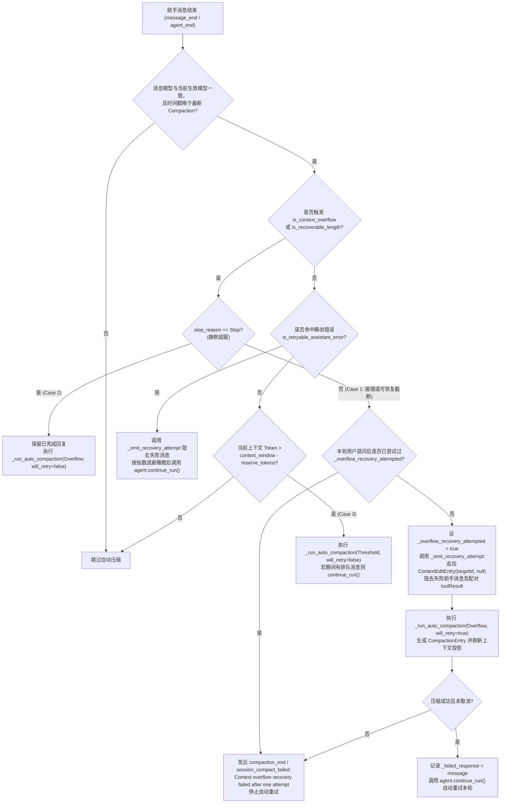

# 阶段 3：会话与扩展核心（pi-session）设计

本文定义独立 Rust 会话与扩展核心包 `crates/pi-session` 的设计。所属总体路线见 [0.PLAN.md](0.PLAN.md)，前置依赖见 [1.model-core.md](1.model-core.md) 与 [2.agent-core.md](2.agent-core.md)，技术栈选型见 [prototype.md](../prototype.md)。

`crates/pi-session` 对齐上游 `@earendil-works/pi-coding-agent`（`1.5.0`）的会话管理、上下文压缩与扩展机制。该包负责管理 JSONL v3 会话追加树、大模型与前端界面的双视图投影、结构化系统提示词、上下文压缩与溢出恢复、编译期静态扩展体系，以及输入与执行状态的持久化核对。

## 设计原则与取舍

| 原则 | 在 `pi-session` 中的落地方式 |
|---|---|
| **安全性** | 1. 会话条目（`SessionEntry`）、会话生命周期事件（`SessionLifecycleEvent`）与各钩子事件结构体全部采用强类型定义，消除非法 `parentId` 悬挂引用、角色错位与未校验边界草案。<br>2. 存储写入成功并完成磁盘同步后才发布内存树更新。部分写入失败时截断恢复磁盘尾部，无法确认恢复结果时标记为 `poisoned` 并拒绝后续写入。边界草案通过完整快照原子替换批量提交。<br>3. 扩展上下文（`ExtensionContext`）内置世代有效性校验（`assert_active`），会话切换、派生或重载后立即作废旧句柄。<br>4. 用户输入投递与运行状态通过持久化状态日志关联，异常中断重启后将未闭合任务标记为 `InterruptedByCrash` 与 `Uncertain`，禁止自动重放结果未知的受控工具调用。 |
| **简洁性** | 1. 采用编译期静态注册接口（`Extension` Trait 与函数式 `ExtensionFactory`）挂载扩展，不引入动态脚本加载器。<br>2. 通过 `SessionStore` 与 `ExecutionStateStore` 两个 Trait 解耦存储介质与会话逻辑。<br>3. 界面交互统一收敛为无 UI 框架依赖的异步 `ExtensionUiContext` Trait，供 CLI、TUI、Web 与 GPUI 各自实现。 |
| **高效性** | 1. 会话列表加载采用 1 MiB 有界头部扫描（`read_session_header`）与受控并发池（`MAX_CONCURRENT_SESSION_INFO_LOADS = 10`），无需反序列化整份长会话即可完成发现。<br>2. 系统提示词采用命名段落差量补丁（`diff_system_prompt_sections`），`context` 钩子未改动对话时不重写前置 `SystemMessage`，保留服务端前缀缓存。<br>3. 新建会话采用惰性落盘策略，产生首条 `user` 或 `assistant` 消息前不创建磁盘文件。 |

## 数据持久化与订阅投影

`AgentSessionOptions::data_policy` 接收可选的 `SessionDataPolicy`。未配置时保持原始行为，同一策略跨会话重载与切换保留，核心不包含业务脱敏规则。

| 方法 | 生效位置 | 边界 |
|---|---|---|
| `admit_input` | 输入状态日志与命令／模型投递前 | 可临时拒绝输入，返回的许可对象保持至运行或队列接收完成，同时提供命令展开开关 |
| `persisted_input` | 输入投递预检写入 `ExecutionStateStore` 前 | 仅替换持久收件箱副本，模型输入仍经过消息定稿和请求上下文处理 |
| `persisted_message` | 扩展 `message_end` 处理后、追加会话条目前 | 返回值保持消息角色，失败时拒绝追加并终止本次运行 |
| `project_event` | 同步与异步订阅器收到事件前 | 每次发布仅投影一次，双方获得同一份结果，内部 Agent 事件与模型上下文保持独立 |

投影方法返回错误或发生 panic 时，拒绝对应写入或事件分发并停止后续模型与工具工作。`admit_input` 拒绝或发生 panic 时仅拒绝本次输入，不持久化原文，也不将会话标为故障，后续输入可继续重试。策略实现禁止重入会话，外部传输统一使用已投影事件和业务层快照处理。

`tests/data_policy.rs` 覆盖输入许可与释放、临时拒绝重试、命令展开开关、持久化前投影、同步与异步一致性、角色约束及错误／panic 拒绝路径。

## 会话存储方案

会话与执行状态采用 Trait 抽象解耦：

| 决策项 | 设计结论与工程依据 |
|---|---|
| **1. 核心默认存储格式** | **采用 `SessionStore` Trait + 默认 JSONL v3（`JsonlSessionStore`）+ 独立执行状态表（`ExecutionStateStore`）方案**，内置 `InMemorySessionStore` 供无头测试与临时会话使用：<br>1. **存量直接兼容**：JSONL v3 与上游 Pi `1.5.0` 会话文件及 `agent/home/sessions/*.jsonl` 直接兼容读写。<br>2. **移动介质同步**：普通条目追加写并同步磁盘，首次创建采用排他模式（`create_new(true)`）。迁移与边界草案批量提交采用同目录临时文件原子替换。<br>3. **职责分离**：输入回执去重、投递队列与运行中断标记独立存于 `ExecutionStateStore`，与只追加的 JSONL 历史树分离。 |
| **2. 版本升级与原子写入** | 1. **会话 JSONL 迁移**：加载时检测 `SessionHeader.version`，对低于 `3` 的旧文件在内存完成 `v1 → v2 → v3` 升级，经同目录临时文件同步后原子替换。<br>2. **状态文件原子更新**：`ExecutionStateStore` 状态文件采用同目录临时文件同步后原子重命名替换。Windows 下遇到防病毒或索引器触发的短暂 `EPERM / EACCES / EBUSY`（错误码 5 / 32）时按 `15ms → 30ms → 60ms → 120ms → 150ms` 退避重试最多 5 次，永久失败时保留原文件并清理临时文件。 |

## 目录结构

```text
crates/pi-session/
|-- Cargo.toml
|-- src/
|   |-- lib.rs                      # 对外导出公开类型、Trait、SessionManager、ExtensionRunner 与 AgentSession
|   |-- messages.rs                 # BashExecution / Custom / BranchSummary / CompactionSummary 消息与 convert_to_llm
|   |-- session_store.rs            # SessionStore Trait、InMemorySessionStore 与 JsonlSessionStore
|   |-- session_manager.rs          # SessionHeader、11 种 SessionEntry、v1->v3 迁移、分支操作与双层投影
|   |-- tree.rs                     # SessionTreeNode、五档过滤树与几何连接符计算
|   |-- session_export.rs           # 当前分支 JSONL 序列化导出与附加尾部条目支持
|   |-- usage_totals.rs             # UsageTotals、combine_usage 与按模型/工具分组的费用统计
|   |-- system_prompt.rs            # 结构化系统提示词组装、命名段落包裹与差量补丁
|   |-- virtual_models.rs           # VirtualModelDefinition、pi-virtual 路由请求与分支状态恢复
|   |-- compaction.rs               # Token 估算、切点查找、分裂轮次处理、文件操作追踪与压缩生成
|   |-- branch_summary.rs           # 公共祖先查找、分支条目收集、预算裁剪与分支总结生成
|   |-- bash.rs                     # SessionBashExecutor Trait 与会话级 ! / !! 命令执行结果封装
|   |-- data_policy.rs              # SessionDataPolicy Trait、输入准入许可与持久化/订阅投影边界
|   |-- ui.rs                       # ExtensionUiContext Trait、NoOpUiContext 与 ChannelUiContext
|   |-- event_bus.rs                # 跨扩展通信事件总线 EventBus
|   |-- slash_commands.rs           # 内置斜杠命令清单、命令来源分类与同名扩展命令冲突消解
|   |-- nested_calls.rs             # NestedToolCallRunner 与 NestedCallRecorder 嵌套工具调用管线
|   |-- extension_catalog.rs        # ExtensionCatalog：扩展注册服务商与虚拟模型的共享目录桥接
|   |-- mcp_servers.rs              # 扩展声明式 MCP 服务器注册定义（McpServerRegistration）
|   |-- extensions.rs               # ExtensionRegistrar、ToolDefinition、ToolExposure 与 ExtensionRunner
|   |-- execution_log.rs            # 输入关联记录、运行与工具状态机、异常中断标记与启动核对
|   `-- agent_session.rs            # AgentSession 控制器：串联 Agent、SessionManager、扩展、压缩与恢复
|-- examples/
|   |-- custom_provider_and_virtual_model.rs  # 静态注册自定义模型服务商与按轮次路由的虚拟模型
|   |-- custom_tools_and_nested_calls.rs      # 注册带 prepare_loadout 的工具与嵌套工具调用
|   |-- slash_commands_and_tree_fork.rs       # 注册斜杠命令、书签标签、分支总结跳转与会话 fork
|   |-- context_rewrite_and_compaction.rs     # context 钩子改写、边界草案注入与自定义压缩拦截
|   `-- interactive_ui_and_permission_hook.rs # 通用 UI 交互通道确认弹窗与敏感口令输入
`-- tests/
    |-- adversarial_regressions.rs  # 边界输入与对抗性回归测试
    |-- agent_session_e2e.rs        # 对接 FauxProvider 的会话生命周期、分支切换与压缩恢复测试
    |-- compaction_and_retry.rs     # 切点查找、分裂轮次总结、自动压缩、溢出恢复与退避重试测试
    |-- data_policy.rs              # 输入准入许可、持久化前投影与订阅投影测试
    |-- execution_recovery.rs       # 输入 ID 幂等关联、crash 标记、uncertain 核对与受控工具恢复测试
    |-- extension_api_regressions.rs # 扩展注册器冲突消解与 API 行为回归测试
    |-- extensions_runner.rs        # 静态扩展注册、工具暴露分级、钩子链式传递与句柄失效保护测试
    |-- nested_tool_calls.rs        # 嵌套工具调用 ID 分配、字节与数量上限截断及串行重入测试
    |-- projection_and_tree.rs      # Compaction / ContextEdit 投影、标签重连 fork 与五档过滤树测试
    |-- review_regressions.rs       # 生命周期、存储回滚与并发边界回归测试
    |-- review3_regressions.rs      # 定稿钩子、延迟队列与边界草案回归测试
    |-- session_manager.rs          # JSONL v3 读写、惰性落盘、迁移、头部扫描与并发列表测试
    |-- structural_regressions.rs   # 会话树结构不变量与父子链完整性回归测试
    `-- tail_repair_regressions.rs  # JSONL 尾部修复、中间损坏行隔离与头部校验回归测试
```

## 与底层核心包的接口衔接

`crates/pi-session` 构建在 `crates/pi-ai` 与 `crates/pi-agent` 之上，衔接的基础能力如下：

| 所属包 | 模块 / 接口 | 契约说明 |
|---|---|---|
| `crates/pi-ai` | `overflow.rs`（`is_context_overflow`、`is_recoverable_length`） | 1. `is_context_overflow(message, context_window)` 覆盖三类溢出：错误消息匹配 27 条溢出正则且不命中限流排除正则（含 Cerebras 无正文 `400/413` 特判），静默溢出（`stop_reason == Stop` 且 `usage.input + usage.cache_read > context_window`），以及长度截断溢出（`stop_reason == Length`、`usage.output == 0` 且 `input + cache_read >= context_window * 0.99`）。<br>2. `is_recoverable_length(message, desired_max_output)` 在 `stop_reason == Length` 且 `desired_max_output > 0 && usage.output < desired_max_output` 时判定为可尝试单次压缩恢复的截断。 |
| `crates/pi-ai` | `retry.rs`（`RetryPolicy`、`RetryCallbacks`、`retry_delay_ms`、`is_retryable_assistant_error`、`retry_assistant_call`） | 1. `is_retryable_assistant_error` 先排除配额与账单耗尽错误（如 `GoUsageLimitError`、`FreeUsageLimitError`、`insufficient_quota`、`quota exceeded`、`billing`、智谱 `"code": 1308` 等），再匹配限流、过载、HTTP `429/500/502/503/504/520/524`、连接重置与流提前断开。<br>2. `retry_assistant_call` 按 `base_delay_ms * 2^(attempt - 1)`（上限 `max_agent_delay_ms`，默认 `60_000ms`）执行指数退避重试。退避睡眠期间收到取消信号则归一化为 `StopReason::Aborted` 并清除 `error_message` 返回。 |
| `crates/pi-ai` | `uuid_v7()` | 基于 `uuid` 的 `v7` 特性导出 `uuid_v7() -> String`，供会话 ID 与压缩总结临时路由 ID 使用。 |
| `crates/pi-agent` | `Agent` 运行期钩子与配置 Setter | 提供 `set_convert_to_llm`、`set_transform_context`、`set_stream_fn`、`set_get_api_key`、`set_on_payload`、`set_on_headers`、`set_on_response`、`set_on_provider_stream_event`、`stream_fn`、`session_id` 与 `set_session_id`，供 `AgentSession` 在构造和重载时挂载会话级投影与扩展拦截器。 |
| `crates/pi-agent` | `FinalizeMessageFn` 与 `set_finalize_message` | 可失败的消息定稿钩子：`Fn(AgentMessage, Option<CancellationToken>) -> BoxFuture<'static, Result<AgentMessage, String>>`。所有输入、助手回复与工具结果在进入正式上下文和发出 `message_end` 前执行一次（工具结果在 `message_start` 前完成定稿）。钩子失败时立即终止运行，禁止将落盘错误当成模型瞬态错误重试。 |
| `crates/pi-agent` | 嵌套工具事件关联 | `ToolExecutionStart`、`ToolExecutionUpdate` 与 `ToolExecutionEnd` 携带可选 `parent_tool_call_id`（顶层调用为 `None`），由 `NestedToolCallRunner` 发出嵌套事件。 |

## 核心模块设计

### 1. 扩展消息类型与 LLM 转换管线（`messages.rs`）

`messages.rs` 定义四类会话专属消息的强类型结构体、与 `pi_agent::AgentMessage::Custom` 的无损互转辅助函数，以及统一的 `convert_to_llm` 转换器：

| 扩展消息类型 | `role` 标识 | 核心字段 | `convert_to_llm` 转换规则 |
|---|---|---|---|
| `BashExecutionMessage` | `"bashExecution"` | `command: String`, `output: String`, `exit_code: Option<i32>`, `cancelled: bool`, `truncated: bool`, `full_output_path: Option<String>`, `timestamp: u64`, `exclude_from_context: Option<bool>` | `exclude_from_context == Some(true)`（对应 `!!` 命令）直接过滤，不进入模型上下文。其余调用 `bash_execution_to_text` 格式化为代码块、退出码与截断路径提示，包装为 `Message::User` |
| `CustomMessage` | `"custom"` | `custom_type: String`, `content: CustomMessageContent`（支持纯文本或 `Vec<UserContentBlock>`）, `display: bool`, `details: Option<JsonValue>`, `timestamp: u64` | 将 `content` 归一化为 `Vec<UserContentBlock>` 并包装为 `Message::User`（`display` 与 `details` 仅供界面与扩展读取） |
| `BranchSummaryMessage` | `"branchSummary"` | `summary: String`, `from_id: Option<String>`, `timestamp: u64` | 拼接 `BRANCH_SUMMARY_PREFIX + summary + BRANCH_SUMMARY_SUFFIX`，包装为 `Message::User` |
| `CompactionSummaryMessage` | `"compactionSummary"` | `summary: String`, `tokens_before: u64`, `timestamp: u64` | 拼接 `COMPACTION_SUMMARY_PREFIX + summary + COMPACTION_SUMMARY_SUFFIX`，包装为 `Message::User` |

前缀与后缀常量与上游字节级一致：
- `COMPACTION_SUMMARY_PREFIX`：`"The conversation history before this point was compacted into the following summary:\n\n<summary>\n"`
- `COMPACTION_SUMMARY_SUFFIX`：`"\n</summary>"`
- `BRANCH_SUMMARY_PREFIX`：`"The following is a summary of a branch that this conversation came back from:\n\n<summary>\n"`
- `BRANCH_SUMMARY_SUFFIX`：`"</summary>"`

### 2. 会话追加树、存储抽象与双视图投影（`session_store.rs`、`session_manager.rs`、`tree.rs`）

#### 2.1 会话文件头与 11 种条目结构（v3 格式）

每个会话由单条 `SessionHeader` 与一棵以 `id` / `parent_id` 串联的只追加条目树（`SessionEntry`）组成，序列化格式对齐 `CURRENT_SESSION_VERSION = 3`：

| 条目类型（`type` 标签） | Rust 结构体 | 核心字段 | 是否参与模型上下文投影 |
|---|---|---|---|
| `"session"` | `SessionHeader` | `version: Option<u32>`（当前为 `Some(3)`）, `id: String`, `timestamp: String`（ISO 8601）, `cwd: String`, `parent_session: Option<String>` | 否（文件头元数据） |
| `"message"` | `SessionMessageEntry` | `id`, `parent_id`, `timestamp`, `message: AgentMessage` | **是**（手工编辑或旧文件中 `content` 为 `null` 时自动修复为空串 `""` 或空数组 `[]`） |
| `"thinking_level_change"` | `ThinkingLevelChangeEntry` | `id`, `parent_id`, `timestamp`, `thinking_level: String` | 否（更新分支的 `thinking_level` 设置） |
| `"model_change"` | `ModelChangeEntry` | `id`, `parent_id`, `timestamp`, `provider: String`, `model_id: String` | 否（更新分支的 `model` 选择） |
| `"usage"` | `UsageEntry` | `id`, `parent_id`, `timestamp`, `kind: String`, `provider: String`, `model: String`, `usage: Usage`, `note: Option<String>` | 否（记录缓存预热等非对话模型调用用量，计入会话总账单） |
| `"compaction"` | `CompactionEntry` | `id`, `parent_id`, `timestamp`, `summary: String`, `first_kept_entry_id: String`, `tokens_before: u64`, `details: Option<JsonValue>`, `usage: Option<Usage>`, `from_hook: Option<bool>`, `system_message: Option<SystemMessage>` | **是**（仅分支路径上最新一条生效，展开为可选 `system_message` + `CompactionSummaryMessage`） |
| `"branch_summary"` | `BranchSummaryEntry` | `id`, `parent_id`, `timestamp`, `from_id: String`, `summary: String`, `details: Option<JsonValue>`, `usage: Option<Usage>`, `from_hook: Option<bool>` | **是**（`summary` 非空时展开为 `BranchSummaryMessage`） |
| `"custom"` | `CustomEntry` | `id`, `parent_id`, `timestamp`, `custom_type: String`, `data: Option<JsonValue>` | 否（持久化扩展私有状态、虚拟模型路由状态、轮次耗时与输入关联记录） |
| `"custom_message"` | `CustomMessageEntry` | `id`, `parent_id`, `timestamp`, `custom_type: String`, `content: CustomMessageContent`, `details: Option<JsonValue>`, `display: bool` | **是**（展开为 `CustomMessage`） |
| `"context_edit"` | `ContextEditEntry` | `id`, `parent_id`, `timestamp`, `target_id: String`, `replacement: Option<ContextEditReplacement>` | 否（分支局部修饰符：`None` 从模型投影隐去目标条目，`Some` 替换目标条目的消息内容） |
| `"label"` | `LabelEntry` | `id`, `parent_id`, `timestamp`, `target_id: String`, `label: Option<String>` | 否（设置或清除目标条目的书签标签） |
| `"session_info"` | `SessionInfoEntry` | `id`, `parent_id`, `timestamp`, `name: Option<String>` | 否（设置或清空会话显示名称，换行符自动替换为空格并 `trim`） |

条目 ID 生成优先取 UUID v4 前 8 位十六进制字符并在当前会话 `by_id` 表内做碰撞检查（最多尝试 100 次，碰撞时回退完整 UUID）。会话 ID 校验仅允许字母数字及 `.`、`_`、`-`，首尾必须为字母或数字。

#### 2.2 存储抽象（`SessionStore`）与惰性落盘规则

```rust
pub trait SessionStore: Send + Sync {
    /// 返回底层存储路径标识（内存模式返回 None）。
    fn location(&self) -> Option<&Path>;
    /// 是否支持持久化。
    fn is_persisted(&self) -> bool;
    /// 存储实例是否已因写入恢复失败进入不可信锁定态。
    fn is_poisoned(&self) -> bool { false }
    /// 返回最近一次加载时的尾部修复摘要。
    fn last_tail_repair(&self) -> Option<&TailRepairOutcome> { None }
    /// 读取全部原始文件条目（含 SessionHeader）。
    fn load_entries(&mut self) -> Result<Vec<FileEntry>, SessionStoreError>;
    /// 首次创建、迁移或批量提交完整快照，成功返回前完成同步。
    fn rewrite_all(&mut self, entries: &[FileEntry], exclusive_create: bool) -> Result<(), SessionStoreError>;
    /// 追加单条并同步，失败时恢复原尾部，恢复失败后标记 poisoned 并禁止继续写入。
    fn append_entry(&mut self, entry: &SessionEntry) -> Result<(), SessionStoreError>;
}
```

`SessionManager` 的持久化与回滚契约如下：

1. **惰性创建文件**：新建会话仅追加 `model_change`、`thinking_level_change`、`system` 消息或 `custom` 条目时，`flushed` 保持 `false` 且不创建 `.jsonl` 文件。首次出现 `role == "user"` 或 `role == "assistant"` 的消息条目后，以排他模式（`create_new(true)`）一次性写入 `SessionHeader` 及积压条目并将 `flushed` 置为 `true`，后续条目单行追加。
2. **追加失败恢复与中毒熔断**：写入前记录原文件长度，完成 `write_all` 与 `sync_all()` 后才发布新的内存树状态。部分写入或同步失败时截断回原长度（首次创建失败则清理本次新建文件）。若截断、删除或同步失败，返回 `StorageUncertain` 并将实例标记为 `poisoned`，拒绝后续一切写入与模型／工具执行。
3. **非空非法会话文件保护**：打开指定路径文件时，空文件（0 字节）自动初始化合法 `SessionHeader` 并写回。非空文件首条有效记录不是合法 `SessionHeader` 时立即返回 `InvalidSessionFile`，严禁覆盖或清空原文件。
4. **尾部修复与中间损坏隔离**：加载时先校验头部。末行完整但缺少 `\n` 时补写换行并同步，末行 JSON 解析报未闭合 EOF 时截断到最近完整行边界并记录 `TailRepairOutcome`。末行包含未知条目类型、字段不匹配或其他语法错误时保留原文件并返回 `InvalidSessionFile`。中间损坏行隔离跳过并计入 `skipped_intermediate_corrupt_lines`，绝不跨行拼接。
5. **边界草案批量原子提交**：`commit_boundary_drafts` 先在克隆状态完成验证与 ID 分配，已落盘会话调用 `rewrite_all(&candidate_entries, false)` 经同目录临时文件同步后原子替换（未落盘空会话仅交换内存状态）。存储成功后才更新真实内存树并通知扩展。替换后若同步状态无法确认则进入 `StorageUncertain`。
6. **单写权与回执顺序**：首次创建、追加、修复、迁移、快照替换和启动核对均持有独立 `.lock` 单写权，第二个写入实例拒绝打开。`Accepted` 回执、工具启动与边界通知均晚于持久化成功。

#### 2.3 面向大模型与面向前端界面的双视图读取

`SessionManager` 同时服务大模型请求组装与前端界面展示，两套视图职责分离：

| 视图维度 | 面向大模型的上下文投影（`build_session_projection` / `build_session_context`） | 面向前端界面的历史与分支树（`get_entries` / `get_branch` / `get_tree` / `build_filtered_tree`） |
|---|---|---|
| **路径范围** | 仅沿当前 `leaf_id` 回溯至根节点的单条活跃分支路径（`leaf_id == None` 返回空列表） | 支持读取全量条目、任意节点到根的分支路径，或包含所有历史分叉的完整树结构 |
| **压缩裁剪（Compaction）** | 若路径上存在 `CompactionEntry`，以最新一条为界：<br>1. 将该 `CompactionEntry` 置于投影首位（展开为保存的 `system_message` 快照 + `CompactionSummaryMessage`）。<br>2. 从 `first_kept_entry_id` 开始保留后续条目，过滤压缩点之前的 `SystemMessage`，并将保留区间内更早的 `CompactionEntry` 投影为空 `[]`。<br>3. `first_kept_entry_id` 之前的历史对话全部省略。 | 不裁剪压缩前的历史，前端可向上滚动查看压缩前的原始对话、工具结果与历次压缩卡片 |
| **上下文编辑（`ContextEditEntry`）** | 按目标条目 ID 取分支上最新一条 `ContextEditEntry`：<br>1. `replacement == None` 时将目标消息投影为空 `[]`（用于自动重试和溢出恢复隐去失败消息及配对工具结果）。<br>2. `replacement == Some(content)` 时替换 `user` / `assistant` / `toolResult` / `custom` 消息的 `content`。 | 原始条目保留在树中，界面可按原始条目渲染或读取编辑标记 |
| **状态条目处理** | `CustomEntry`、`LabelEntry`、`SessionInfoEntry`、`UsageEntry`、`ModelChangeEntry`、`ThinkingLevelChangeEntry` 均投影为空 `[]`（后两者与助手消息一起推导当前分支的 `thinking_level` 与 `model`） | 全部保留，用于渲染书签标签、会话标题、轮次工作时长（`cst-web-work-duration`）、客户端消息 ID（`cst-web-input-message`）与账单统计 |

#### 2.4 分支派生与五档过滤几何树（`tree.rs`）

1. **同文件分支跳转**：
   - `branch(branch_from_id)`：校验 `branch_from_id` 存在于 `by_id` 后，将 `leaf_id` 指向该节点，下次追加自动以该节点为 `parent_id` 分叉出新子树。
   - `reset_leaf()`：将 `leaf_id` 置为 `None`，下次追加创建 `parent_id == None` 的新根节点。
   - `branch_with_summary(branch_from_id, summary, details, from_hook, usage)`：记录当前 `from_id = leaf_id.unwrap_or("root")`，将 `leaf_id` 移至 `branch_from_id`，追加 `BranchSummaryEntry` 并推进 `leaf_id`。
2. **提取单路径派生新会话（`create_branched_session(leaf_id)`）**：
   - 提取从根到 `leaf_id` 的路径并剥离路径中夹杂的 `LabelEntry` 节点。
   - 将被剥离的 `LabelEntry` ID 映射到紧随其后的首个非标签条目 ID，重写保留条目的 `parent_id`，并同步修正路径上 `CompactionEntry.first_kept_entry_id`。
   - 在路径末尾重新追加当前生效的 `LabelEntry` 集合，生成新 `session_id` 与 `SessionHeader { parent_session: previous_session_file, .. }`。
3. **跨目录完整克隆派生（`SessionManager::fork_from`）**：
   - 读取源会话全部条目，在目标 `cwd` 下创建新 `.jsonl` 文件，写入带 `parent_session: Some(resolved_source_path)` 和新 `cwd` 的 `SessionHeader`，单次打开批量写入全部非头部条目。
4. **五档过滤几何树（`tree.rs`）**：
   - 支持五档过滤模式 `TreeFilterMode`：`Default`（隐藏 `label`、`custom`、`model_change`、`thinking_level_change`、`session_info`、`usage`、`context_edit`）、`NoTools`（额外隐藏 `toolResult`）、`UserOnly`（仅用户消息）、`LabeledOnly`（仅带非空 `label` 条目）、`All`（全部条目）。
   - **几何列计算规则**：
     1. 在完整树上按「当前 `leaf_id` 所在活跃路径优先，其余兄弟按时间戳升序」执行深度优先遍历，固定每个节点的 `active_path: bool` 与 `traversal_order: usize`。
     2. 应用过滤模式，将被隐藏节点的可见后代重挂至最近的可见祖先，保持 `traversal_order` 顺序不变。
     3. 计算每行缩进与连接线：根节点 `indent = 0`，真实分叉点（父节点有多个可见子节点）的子节点缩进加 1 且设置 `show_connector = true`、`connector_column = Some(display_indent - 1)`，段首第一代后代缩进加 1，非末位兄弟的子树在对应列持续输出竖线 `gutters: Vec<GutterInfo>`（含 `column` 与 `active`）。

### 3. 编译期静态扩展体系与通用界面交互协议（`extensions.rs`、`ui.rs`、`nested_calls.rs`）

#### 3.1 静态扩展注册接口（`Extension` Trait 与 `ExtensionRegistrar`）

扩展在编译期通过实现 `Extension` Trait 或传入闭包工厂静态注册：

```rust
pub trait Extension: Send + Sync + 'static {
    /// 扩展唯一标识路径（如 "builtin:codemode"、"<inline:diagnostics>"）。
    fn path(&self) -> &str;
    /// 来源元数据（builtin / inline / project / global）。
    fn source_info(&self) -> SourceInfo;
    /// 是否在启动扩展列表中隐藏。
    fn hidden(&self) -> bool { false }
    /// 其他扩展注册同名工具、命令或标志时，是否自动退让整套扩展。
    fn replaceable(&self) -> bool { false }
    /// 向注册器声明工具、斜杠命令、标志、快捷键、服务商、虚拟模型与事件处理器。
    fn register(&self, api: &mut ExtensionRegistrar) -> Result<(), ExtensionInitError>;
}
```

`ExtensionRegistrar` 提供的注册与操作能力如下：

| 类别 | 方法签名 / 能力 | 行为与冲突处理规则 |
|---|---|---|
| **自定义工具** | `register_tool(ToolDefinition)` | 支持 `ToolExposure`、`ToolNamespace`、`ToolAnnotations`、`prompt_snippet`、`prompt_guidelines`、`default_active`、`prepare_loadout`、`execution_mode`。同名工具按扩展加载顺序先注册者胜出（前序扩展声明 `replaceable: true` 则整包退让） |
| **斜杠命令** | `register_command(RegisteredCommand)` | 支持 `name`、`description`、`argument_hint` 与异步 `handler(args, ExtensionCommandContext)`。多个扩展注册同名命令 `foo` 时自动分配 `foo:1`、`foo:2` |
| **CLI 标志与快捷键** | `register_flag(ExtensionFlag)`、`register_shortcut(ExtensionShortcut)` | 快捷键归一化为小写 `KeyId`。与 18 个保留全局快捷键冲突则跳过并记录告警诊断，非保留冲突由后注册者覆盖 |
| **模型服务商与虚拟模型** | `register_provider`、`register_provider_config`、`unregister_provider`、`register_virtual_model`、`unregister_virtual_model` | 在 `ExtensionRunner::bind_core` 前入队缓存，`bind_core` 时统一刷入共享 `ExtensionCatalog` / `Models`，绑定后再次调用立即生效 |
| **声明式 MCP 服务器** | `register_mcp_server(McpServerRegistration)` | 向运行时声明内置或业务扩展默认的 MCP 服务器配置，磁盘 `mcp.json` 可按同名键覆盖默认值 |
| **生命周期与拦截钩子** | `on_<event>(handler)` | 按事件类别提供强类型注册方法（见 3.3 节）。每次分发前对处理器列表拍快照，单个处理器抛错通过 `emit_error` 报告（`tool_call` 与 `user_bash` 错误按契约向上阻断） |
| **会话操作动作** | 消息与条目写入（`send_message`、`send_user_message`、`append_entry`）、元数据管理（`set_session_name`、`get_session_name`、`set_label`）、工具与命令管理（`get_active_tools`、`set_active_tools`、`get_all_tools`、`refresh_tools`、`get_commands`）、模型与思考控制（`set_model`、`get_thinking_level`、`set_thinking_level`）及事件总线 `events()` | 共享保存在 `ExtensionRuntime` 中，支持在事件钩子、命令处理器与工具执行期间调用。会话重载或替换后调用 `invalidate()` 立即拦截过期实例访问 |

#### 3.2 工具暴露分级（`ToolExposure`）、`prepare_loadout` 与嵌套工具调用（`nested_calls.rs`）

1. **五级工具暴露模型（`ToolExposure`）**：
   - `Direct`（默认）：注册时默认激活，激活时向大模型声明，允许通过 `ctx.execute_tool()` 嵌套调用。
   - `ModelOnly`：注册时默认激活，向大模型声明，禁止通过 `ctx.execute_tool()` 嵌套调用。
   - `Codemode`：注册时不自动激活（除非显式指定），已注册即可通过 `ctx.execute_tool()` 调用，并在 `codemode` 描述中列出。
   - `Deferred`：可被 `ctx.execute_tool()` 调用，不在 `codemode` 描述中列出，由 `tool_search` 按需检索激活。
   - `Hidden`：已注册但不可激活、不可嵌套调用。
2. **`prepare_loadout` 与隐藏声明投影（`hidden_declarations`）**：
   - 每次活跃工具集变化时，依次调用当前活跃工具上的 `prepare_loadout(&ToolLoadout) -> Option<ToolLoadoutChanges>`，支持动态覆写工具 `description` 或将部分工具加入 `hidden_declarations`。
   - `hidden_declarations` 中的工具在会话转录本 `SystemMessage` 中保持已声明状态，但在向供应商发送请求及生成系统提示词 `<tools>` / `<rules>` 段落时过滤隐去。
3. **保序工具激活**：
   - 调用 `set_active_tools_by_name(names)` 时，原本已处于激活状态且仍在 `names` 中的工具保持原有顺序，新激活工具追加在末尾，避免无意义的 `SystemMessage` 重排补丁。
4. **嵌套工具调用（`NestedToolCallRunner` + `NestedCallRecorder`）**：
   - 工具在 `execute` 内部调用 `ctx.execute_tool(name, args, options)` 后，分配嵌套 ID `<caller_id>/<n>`（`n` 从 1 递增）。
   - 嵌套调用同样经过 `pi_agent::run_tool_call`，并发出携带 `parent_tool_call_id: Some(caller_id)` 的 `tool_execution_start` / `update` / `end` 事件。
   - 会话配置为 `ToolExecutionMode::Sequential` 时通过单链异步互斥队列串行化嵌套调用，并在已持有队列的父调用内部标记 `holds_queue = true`，允许自身派生的子调用重入。
   - `NestedCallRecorder` 按限额常量（`NESTED_MAX_CALLS = 256`、`NESTED_MAX_ARGUMENT_BYTES_PER_CALL = 8192`、`NESTED_MAX_ARGUMENT_BYTES_TOTAL = 32768`、`NESTED_MAX_ERROR_CHARS = 500`）记录子调用轨迹与累计 `Usage`，超限时省略参数并标记 `complete: false`。父工具结果进入 `FinalizeMessageFn` 前调用 `take_record(tool_call_id)` 将 `nested_calls` 与汇总 `usage` 合入规范消息。

#### 3.3 生命周期事件钩子与精确语义

`ExtensionRunner` 统一调度以下核心事件：

| 事件名称 | 触发时机 | 处理器返回值与合并语义 |
|---|---|---|
| `resources_discover` | `ResourceLoader::reload` 初始化扩展目录期间 | 返回额外技能、提示词模板与上下文文件路径列表并合入资源集 |
| `input` | 用户输入提交后、技能与模板展开前 | 返回 `Continue`、`Transform { text, images }`（链式传递）或 `Handled`（立即短路，不发起模型调用） |
| `user_bash` | 用户执行 `!` 或 `!!` 命令前 | 可返回自定义 `BashResult` 接管命令执行或返回错误直接拦截 |
| `before_agent_start` | 空闲状态下由用户提问或 `trigger_turn: true` 自定义消息启动运行前 | 通过 `event.system_prompt_options.update(...)` 在锁外更新提示词配置，已完成的更新在处理器报错后保留。可返回 `{ message, system_prompt }` 注入消息并覆盖提示词 |
| `context` → `context_with_system` | 每轮向大模型发起请求前的 `transform_context` 阶段 | 1. `context` 仅传入剔除 `SystemMessage` 后的对话消息，修改后自动调用 `restore_system_messages` 将基准 `SystemMessage` 挂回下标 0（未修改则保留原列表维持缓存前缀）。<br>2. `context_with_system` 传入完整列表，返回结果直接发往模型（删去下标 0 的 `SystemMessage` 时发出 `ExtensionError` 告警） |
| `before_provider_request` / `before_provider_headers` / `after_provider_response` / `provider_stream_event` | 协议层组装 JSON 载荷、组装请求头、收到响应头、收到原始流帧时 | `before_provider_request` 可返回新 JSON 载荷替换请求体，`before_provider_headers` 原地增删请求头（设为 `None` 删除该头），后两者只读观测 |
| `cache_warming_decision` | 物理模型请求完成后评估 Prompt 缓存保活前 | 可覆写是否允许对该会话请求调度 `CacheWarmer` 保活 |
| `tool_call` / `tool_result` | 每个工具调用执行前（`before_tool_call`）与执行后（`after_tool_call`） | `tool_call` 返回 `block: true` 立即拦截执行并返回 `reason`。`tool_result` 链式修改 `content`、`details`、`structured_content`、`is_error`、`usage`（替换 `content` 且未传 `structured_content` 时自动清空原 `structured_content`） |
| `message_end` | `FinalizeMessageFn` 内、消息持久化前 | 处理器链式返回同 `role` 的新 `AgentMessage`（不同 `role` 报 `ExtensionError` 并保留上一结果），持久化后返回执行循环 |
| `turn_end` / `agent_before_settle` | 单轮结束时 / 整次运行结算前 | 处理器可返回 `BoundaryResult { entries: Option<Vec<SessionBoundaryDraft>>, continue_turn: Option<bool> }`。每次返回后先在 `clone_in_memory_preview` 预览实例上校验草案与 `can_continue`，全部通过后调用 `commit_boundary_drafts` 原子提交完整快照 |
| `session_before_switch` / `session_before_fork` / `session_before_compact` / `session_before_tree` | 会话切换、派生、压缩、树跳转执行前 | 返回 `cancel: true` 即刻中止操作。后两者还可返回自定义 `compaction` / `summary` 结果跳过内置总结请求 |
| `session_start` / `session_compact` / `session_compact_failed` / `session_tree` / `session_info_changed` / `session_shutdown` / `agent_settled` | 对应会话生命周期节点完成时 | 按扩展加载顺序依次异步通知，错误隔离记录到 `ExtensionErrorListener` |

会话关闭采用显式异步 `shutdown` 与最终所有者释放时的同步清理。`AgentSessionInner::drop` 取消后台操作、使扩展失效并释放持久化锁，订阅取消句柄仅持有 `Weak` 引用。

#### 3.4 通用 UI 交互协议（`ui.rs`）

`ui.rs` 定义无界面框架依赖的异步 `ExtensionUiContext` Trait 以及基于消息通道的交互实现 `ChannelUiContext`：

```rust
#[derive(Debug, Clone, PartialEq, Eq, Serialize, Deserialize)]
#[serde(rename_all = "snake_case")]
pub enum UiPromptKind {
    Select,
    Confirm,
    Input,
    Editor,
    Custom,
}

#[derive(Debug, Clone, Default, Serialize, Deserialize)]
#[serde(rename_all = "camelCase")]
pub struct UiDialogOptions {
    pub description: Option<String>,
    pub default_value: Option<String>,
    /// 敏感输入标记（如 BitLocker 恢复密码），前端隐藏回显且后端禁止写入持久化日志。
    pub secret: bool,
    pub timeout_ms: Option<u64>,
}
```

`ExtensionUiContext` 定义 `select`、`confirm`、`input`、`editor`、`custom` 五类阻塞交互方法，以及 `notify`、`set_status`、`set_working_message`、`set_working_visible`、`set_working_indicator`、`set_hidden_thinking_label`、`set_title` 与编辑器文本读写方法。`ExtensionRunner::ui_context()` 包装五类阻塞方法并维护重入深度 `ui_prompt_depth`：最外层阻塞弹窗开始时发出 `AgentSessionEvent::UiPromptStart { kind, title }`，结束或取消时发出 `UiPromptEnd`。未绑定界面时默认使用 `NoOpUiContext`（`has_ui() == false`）。

### 4. 上下文组装、压缩与超窗降级恢复（`system_prompt.rs`、`compaction.rs`、`branch_summary.rs`）

#### 4.1 结构化系统提示词与命名段落差量同步（`system_prompt.rs`）

1. **命名段落结构（`build_system_prompt_sections`）**：
   - 合法段落名匹配 `^[a-z][a-z0-9_-]*$`（不含 `"preamble"`）。
   - 默认按顺序构建：`preamble`（无 XML 标签包裹）、`<tools>`（当前激活、未隐藏且提供 `prompt_snippet` 的工具）、`<rules>`（按激活工具集推导规则并合并去重 `tool_guidelines` 与 `prompt_guidelines`）、`<docs>`、`<addendum>`（`append_system_prompt`）、`<project_context>`（`context_files`）、`<skills>`（`read` 或 `bash` 可达时注入技能列表）、`<cwd>`（反斜杠转为 `/`）及扩展自定义 `sections`。
   - `before_agent_start` 设置 `force_system_prompt` 时退化为不带 `sections` 的纯文本 `content`。
2. **差量补丁生成（`diff_system_prompt_sections`）**：
   - 将当前期望的 `SystemPromptSections` 与转录本重放得出的上一状态对比，新增或变化段落写入 `Some(new_text)`，移除段落写入 `None`（序列化为 JSON `null`）。段落与工具集均未变化时不追加 `SystemMessage`。

#### 4.2 Token 估算与切点查找算法（`compaction.rs`）

1. **保守 Token 估算（`estimate_tokens`）**：
   - 采用 `ceil(chars / 4)` 估算，单张图片固定折算 `ESTIMATED_IMAGE_CHARS = 4800` 字符（1200 tokens）。`SystemMessage` 累加 `content`、非空 `sections` 与 `tools_added` JSON 长度。`AssistantMessage` 累加 `text`、`thinking` 与 `toolCall` 的 `name + JSON(arguments)` 长度（序列化对话给总结模型时省略 `thinking`）。
2. **投影感知上下文用量估算（`estimate_projected_context_tokens`）**：
   - 优先查找最后一条非 `error`、非 `aborted` 且 `calculate_context_tokens(usage) > 0` 的 `AssistantMessage.usage`，累加其后新增消息的 `estimate_tokens` 作为当前上下文 Token 数。
   - **压缩与编辑失效保护**：分支在最后一条带 `usage` 的助手消息之后追加过 `compaction` 或 `context_edit` 条目时，判该历史 `usage` 失效，改用投影后当前 `SystemMessage` 与非系统消息的纯 `estimate_tokens` 累加值。
3. **投影切点查找（`find_projected_cut_point`）**：
   - 合法切点只能是 `user`、`assistant`、`bashExecution`、`custom`、`branchSummary` 或 `compactionSummary`，严禁切在 `toolResult` 上。
   - 从最新条目倒序累加消息估算 Token，达到 `keep_recent_tokens` 后取大于等于当前下标的最近合法切点作为 `cut_index`（尾部巨型 `toolResult` 超预算时保留其前置 `assistant` 工具调用）。
   - `cut_index` 之后的后缀若仅由 `context_edit(null)` 隐去的失败恢复尝试组成，将 `cut_index` 前推越过该隐藏后缀并纳入紧邻的无上下文贡献元数据条目。
   - **分裂轮次判定**：切点落在某轮中间的 `assistant` 消息上时，向前查找轮次起点 `turn_start_index` 并标记 `is_split_turn = true`，分别生成历史总结与分裂轮次前缀总结后以 `"\n\n---\n\n**Turn Context (split turn):**\n\n"` 合并，末尾附加 `<read-files>` 与 `<modified-files>` 列表。
4. **总结完整性保护（`get_summarization_failure`）**：
   - 总结请求统一通过 `complete_summarization`（设置 `cache_retention: CacheRetention::None` 并包裹 `retry_assistant_call`）执行。响应 `stop_reason` 为 `Error` 或 `Length`，或包含 `toolCall` 块时判定压缩失败，禁止写入 `CompactionEntry`。
5. **手动压缩自适应预算（`prepare_compaction_with_adaptive_budget`）**：
   - 用户手动执行 `/compact` 且会话总 Token 小于默认 `keep_recent_tokens (20000)` 时，从当前有效消息估算 Token 的一半开始逐步折半缩减临时 `keep_recent_tokens`，确保短会话也能正常找到切点完成压缩。

#### 4.3 超出模型最大上下文长度的降级与恢复闭环



关键边界保证：
1. **成对隐去失败尝试（`_omit_recovery_attempt`）**：隐去失败的 `AssistantMessage` 时，同步扫描其后紧随且属于该消息 `tool_call_id` 集合的全部 `ToolResultMessage`，逐一追加 `ContextEditEntry { target_id, replacement: None }`，防止残留孤立 `toolResult` 触发协议报错。
2. **跨模型切换不误判溢出**：从小窗口模型切换到大窗口模型后，旧模型遗留的溢出错误消息因 `same_model == false` 不会在新模型上误触发压缩。
3. **单次溢出恢复上限**：收到新 `user` 消息或正常生成非 `error`、非 `length` 回复时重置 `_overflow_recovery_attempted = false`。同一轮经历一次压缩重试后仍溢出则立即停止重试并报告错误。

### 5. 输入与执行状态关联及重启核对（`execution_log.rs`）

`execution_log.rs` 在核心层提供与传输层无关的输入回执关联、运行状态机与崩溃恢复核对机制（上层服务用法见 [server/SPEC.md](../../server/SPEC.md)）：

#### 5.1 数据结构与持久化状态机

```rust
/// 客户端提交输入的生命周期状态。
#[derive(Debug, Clone, PartialEq, Eq, Serialize, Deserialize)]
#[serde(tag = "state", rename_all = "snake_case")]
pub enum InputDeliveryStatus {
    Queued,
    Delivering,
    Accepted {
        disposition: PromptDisposition,
        user_entry_id: Option<String>,
    },
    Failed { error: String },
    Uncertain { reason: String },
}

/// 单次运行（Run）的执行状态记录。
#[derive(Debug, Clone, PartialEq, Eq, Serialize, Deserialize)]
#[serde(tag = "state", rename_all = "snake_case")]
pub enum RunExecutionState {
    Running {
        run_id: u64,
        process_id: u32,
        started_at_ms: u64,
        last_activity_at_ms: u64,
        in_flight_tools: Vec<InFlightToolRecord>,
    },
    Completed { ended_at_ms: u64 },
    Aborted { ended_at_ms: u64 },
    Error { ended_at_ms: u64, message: String },
    InterruptedByCrash {
        detected_at_ms: u64,
        last_activity_at_ms: u64,
        interrupted_tools: Vec<InFlightToolRecord>,
    },
}

#[derive(Debug, Clone, PartialEq, Eq, Serialize, Deserialize)]
#[serde(rename_all = "camelCase")]
pub struct InFlightToolRecord {
    pub tool_call_id: String,
    pub parent_tool_call_id: Option<String>,
    pub tool_name: String,
    pub replay_policy: ToolReplayPolicy,
    pub started_at_ms: u64,
}
```

#### 5.2 关联记录与异常中断恢复流程

1. **输入 ID 与会话条目双向关联**：
   - 输入通过预检进入投递后，先在 `ExecutionStateStore` 中原子写为 `Delivering`。用户消息写入 `SessionManager` 获得 `user_entry_id` 后，追加 `CustomEntry { custom_type: "pi.input-correlation", data: { clientMessageId, userEntryId, queueItemId } }`（兼容 `cst-web-input-message`），并将状态更新为 `Accepted`。
   - 客户端重发相同 `client_message_id` 时直接返回已记录的回执状态。
2. **工具执行登记与熔断保护**：
   - `ToolDefinition` 声明 `ToolReplayPolicy::{Safe, Never}`（默认 `Never`）。顶层与嵌套工具均在可失败的执行前钩子中持久化 `InFlightToolRecord` 并刷新 `last_activity_at_ms`，登记失败时禁止进入工具 `execute`。
   - 状态日志写入失败会设置会话级终止标记并取消当前运行，后续模型请求与工具入口均拦截退出。仅在最终 `ToolResultMessage` 落盘同步后才移除对应未决记录（父工具提交前保留全部子调用记录，缺失或截断的子调用继续保留未决项）。
   - 每轮完成时记录精确起止耗时（兼容 `cst-web-work-duration` 自定义条目）。
3. **进程异常中断标记与重启状态核对（`reconcile_on_startup`）**：
   - 会话打开或服务重启取得单写权并完成 JSONL 尾部核对后，调用 `reconcile_on_startup(&mut session_manager, &mut execution_log, &known_tool_policies)` 执行三步核对：
     1. **核对未决输入（`Delivering`）**：会话 JSONL 全量条目中已存在匹配的 `pi.input-correlation` 或 `cst-web-input-message` 条目时自动修正为 `Accepted`，否则更新为 `InputDeliveryStatus::Uncertain`，禁止自动重新投递。
     2. **核对未闭合运行（`Running`）**：将遗留的 `Running` 状态更新为 `InterruptedByCrash { detected_at_ms, last_activity_at_ms, interrupted_tools }`，并向会话追加 `CustomEntry { custom_type: "pi.run-interrupted", data: { endReason: "crash", ... } }`。
     3. **核对未闭合工具调用**：扫描当前分支尾部的 `AssistantMessage`，结合保留的 `interrupted_tools`、`known_tool_policies` 与嵌套调用记录生成 `StartupReconciliationReport`。对 `ToolReplayPolicy::Never` 工具、策略缺失工具或未决子调用标记 `requires_state_verification = true`，要求上层先查询系统真实状态，禁止自动重放。

## 独立扩展示例

`crates/pi-session/examples/` 提供 5 个独立示例验证公开扩展接口：

| 示例文件 | 验证的公开扩展能力 |
|---|---|
| `custom_provider_and_virtual_model.rs` | 使用 `register_provider` 注入自定义模型服务，使用 `register_virtual_model` 注册 `pi-virtual` 路由模型并将路由状态保存在分支 `CustomEntry` 中 |
| `custom_tools_and_nested_calls.rs` | 注册 `Direct`、`Codemode` 与 `Deferred` 三类暴露级别工具，通过 `prepare_loadout` 隐藏底层声明，验证 `ctx.execute_tool()` 嵌套调用与 `usage` 自动归并 |
| `slash_commands_and_tree_fork.rs` | 注册自定义斜杠命令，验证 `ctx.set_label` 书签、`ctx.navigate_tree` 分支总结跳转及 `ctx.fork` 派生新会话文件 |
| `context_rewrite_and_compaction.rs` | 验证 `on_input` 输入改写、`on_context` 裁剪与 `SystemMessage` 自动恢复、`on_turn_end` 提交 `ContextEdit` 边界草案及 `on_session_before_compact` 自定义压缩总结 |
| `interactive_ui_and_permission_hook.rs` | 实现自定义 `ExtensionUiContext`，在 `on_tool_call` 中调用 `confirm` 与 `input(secret: true)`，验证 `UiPromptStart` / `UiPromptEnd` 事件对与超时取消 |

## 状态隔离与恢复边界约束

| 编号 | 风险点 | 具体实现要求 |
|---|---|---|
| 1 | **`context` 钩子丢失 `SystemMessage`** | `ExtensionRunner::emit_context` 先向 `context` 处理器传入剔除 `SystemMessage` 后的切片，修改后调用 `restore_system_messages` 将基准 `SystemMessage` 插回下标 0，未修改则保留原位置不变 |
| 2 | **过期 `ExtensionContext` 跨会话污染** | 执行 `new_session`、`fork`、`switch_session` 或 `reload` 后，旧 `ExtensionRuntime` 立即标记失效，所有 `ctx.*` 与 `pi.*` 入口调用 `assert_active()` 拦截过期访问 |
| 3 | **`agent_settled` 期间重入调用 `prompt()`** | `AgentSession` 维护 `is_emitting_agent_settled` 标记与 `deferred_settled_actions` 队列，广播期间收到的 `prompt` 推入延迟队列，待全部监听器执行完毕后依次消费 |
| 4 | **`turn_end` 边界草案预览与真实历史隔离** | 每个处理器返回后基于 `SessionManager::clone_in_memory_preview()` 试应用草案，任一草案非法时报告 `ExtensionError` 并丢弃全部草案，验证通过后调用 `commit_boundary_drafts` 原子提交 |
| 5 | **流式期间的 `bash` 与自定义消息延迟落盘** | `AgentSession::is_streaming()` 为 `true` 时，非触发轮次的自定义消息与 `BashExecutionMessage` 暂存在内存队列中，待 `turn_end` 或 `agent_end` 再刷入会话历史，禁止插入 `toolCall` 与 `toolResult` 之间 |
| 6 | **溢出恢复与自动重试的配对省略** | `_omit_recovery_attempt` 隐去失败的 `AssistantMessage` 时，按 `tool_call_id` 集合一并隐去紧随其后的配对 `ToolResultMessage` |
| 7 | **压缩后的上下文用量显示保护** | 完成 `compaction` 且尚未产生新 `AssistantMessage` 回复前，`get_context_usage()` 返回 `ContextUsage { tokens: None, context_window, percent: None }` |
| 8 | **JSONL 头部扫描内存上界** | `read_session_header` 以 4 KiB 块流式读取并限制最大扫描字节数为 `1 MiB`，超限未遇换行符时返回 `SessionStoreError::HeaderScanLimitExceeded` |
