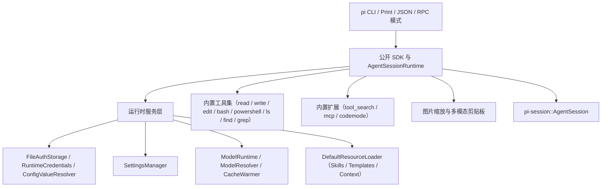
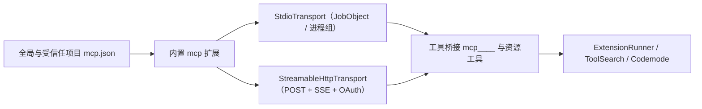
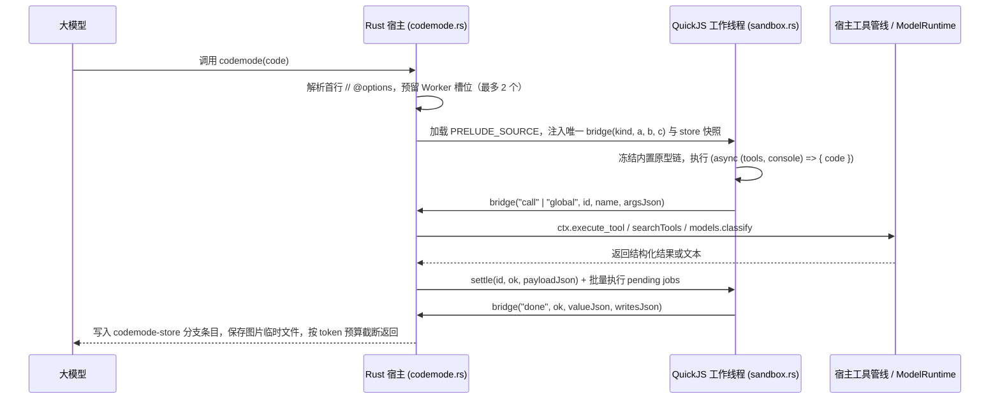

# 阶段 4：运行时与 SDK（pi-runtime）设计

`crates/pi-runtime` 将 `pi-ai`、`pi-agent` 与 `pi-session` 组装为可嵌入任意应用的完整 Agent 运行时，提供配置与凭据管理、资源加载、内置编码工具、MCP 与 Codemode 扩展、多模态图片处理、公开 SDK 及命令行程序。

所属总体路线见 [0.PLAN.md](0.PLAN.md)，前置依赖见 [1.model-core.md](1.model-core.md)、[2.agent-core.md](2.agent-core.md) 与 [3.session-and-extensions.md](3.session-and-extensions.md)，技术栈选型见 [prototype.md](../prototype.md)。

---

## 整体架构

`pi-runtime` 位于会话核心之上，负责加载本机配置与资源、挂载内置工具与内置扩展、管理多会话切换，并向外提供 SDK 与无头运行模式（Print / JSON / RPC）。



---

## 目录结构

```text
crates/pi-runtime/
|-- Cargo.toml
|-- src/
|   |-- lib.rs                      # 公开导出 SDK、服务、工具工厂与运行模式
|   |-- config_value.rs             # $ENV_VAR 模板插值与受控 !command 执行缓存
|   |-- auth_storage.rs             # FileAuthStorage、ReadOnlyAuthStorage、InMemoryAuthStorage、RuntimeCredentials
|   |-- model_config.rs             # models.json 解析校验、自定义服务商与 modelOverrides 合成
|   |-- models_store.rs             # models-store.json 动态模型缓存持久化与原子写入
|   |-- model_runtime.rs            # ModelRuntime：共享 Arc<Models>、凭据同步与快照刷新
|   |-- model_resolver.rs           # 模型引用解析、作用域解析与初始模型选择策略
|   |-- settings_manager.rs         # 全局与项目双层设置、工具修饰器、独立文件锁与损坏保护
|   |-- skills.rs                   # SKILL.md 递归扫描、忽略规则、规范校验与 XML 格式化
|   |-- prompt_templates.rs         # 提示词模板加载、参数切片与单遍占位符替换
|   |-- context_files.rs            # AGENTS.md / CLAUDE.md 层级发现与 Git Worktree 遮蔽消除
|   |-- resource_loader.rs          # ResourceLoader 接口、可重复扩展工厂与单次初始化管线
|   |-- cache_warmer.rs             # 可注入时钟的 Prompt 缓存 TTL 计算、成本评估与静默重放
|   |-- image_process.rs            # EXIF 方向修正、非标格式转 PNG、自适应缩放与工具结果图片归一化
|   |-- clipboard.rs                # 跨平台多模态剪贴板读取入口（图片、文件路径与文本）
|   |-- clipboard_native.rs         # Windows Win32 剪贴板原生位图与文件列表读取
|   |-- clipboard/
|   |   `-- copy.rs                 # 剪贴板文本写入与远程终端 OSC 52 转义序列输出
|   |-- tools/
|   |   |-- mod.rs                  # 8 个内置工具工厂导出与集合构造
|   |   |-- truncate.rs             # 首字节有界流式累积器 OutputAccumulator 与行列截断
|   |   |-- file_mutation_queue.rs  # 按规范化路径串行化同文件写入的异步队列
|   |   |-- edit_diff.rs            # BOM 剥离、换行符保留、NFKC 匹配与 unified diff 生成
|   |   |-- process_io.rs           # 子进程挂起启动、Job Object / 进程组回收与输出管道限时排空
|   |   |-- search_process.rs       # 外部 fd / rg 子进程执行与有界流式行读取
|   |   |-- read.rs                 # 有界流式按行读取与图片读取处理
|   |   |-- write.rs                # 自动创建父目录与串行化文件写入
|   |   |-- edit.rs                 # 唯一性非重叠匹配校验与保行替换
|   |   |-- bash.rs                 # Bash 工具与共享 Shell 进程执行器
|   |   |-- powershell.rs           # PowerShell 独立工具与 Windows 五级可执行文件探测
|   |   |-- ls.rs                   # 字典序目录列举与条数/字节截断
|   |   |-- find.rs                 # fd 外部调用与原生 ignore+glob 有界回退
|   |   `-- grep.rs                 # rg 外部调用与原生 ignore+regex 有界回退
|   |-- extensions/
|   |   |-- mod.rs                  # 内置扩展注册表（tool_search / mcp / codemode）
|   |   |-- tool_search.rs          # 中英文分词、BM25 工具排序器与 tool_search 动态激活工具
|   |   |-- mcp.rs                  # 内置 MCP 扩展注册、工具命名空间桥接、资源工具与 /mcp 命令
|   |   |-- mcp_runtime.rs          # MCP 服务器生命周期管理、动态重连与清单变化刷新
|   |   |-- codemode.rs             # 内置 Codemode 扩展、嵌套工具调用与分支状态存储
|   |   `-- codemode_models.rs      # Codemode 沙箱内 models.* 查询与受限并发 classify 桥接
|   |-- mcp/
|   |   |-- mod.rs                  # MCP 客户端公开导出
|   |   |-- protocol.rs             # JSON-RPC 2.0 消息、MCP 工具与资源协议类型
|   |   |-- transport.rs            # Stdio 子进程传输与 HTTP 传输抽象
|   |   |-- http.rs                 # StreamableHttpTransport（POST + SSE + Mcp-Session-Id 管理）
|   |   |-- sse.rs                  # MCP HTTP SSE 事件流解析器
|   |   |-- sse_tests.rs            # MCP SSE 分片与重连边界单元测试
|   |   |-- client.rs               # McpClient 握手、工具调用、资源读取与进度超时重置
|   |   |-- config.rs               # mcp.json 解析、暴露级别计算与通配符匹配
|   |   |-- config_store.rs         # mcp.json 独立锁与原子增删改持久化
|   |   |-- oauth.rs                # mcp-auth.json 凭据存储与跨进程锁刷新
|   |   `-- oauth/
|   |       |-- discovery.rs        # RFC 9728 受保护资源与授权服务器元数据发现
|   |       |-- callback.rs         # 本机回环端口授权回调监听
|   |       `-- flow.rs             # PKCE、动态客户端注册与令牌交换流程
|   |-- codemode/
|   |   |-- mod.rs                  # Codemode 沙箱公开导出
|   |   |-- source.rs               # 首行 // @options 解析与脚本包装
|   |   |-- declarations.rs         # JSON Schema 转 TypeScript 类型声明
|   |   |-- prelude.rs              # 内嵌 PRELUDE_SOURCE 引导脚本与常量限额
|   |   `-- sandbox.rs              # 基于 rquickjs 的隔离虚拟机、单函数桥接与步数中断控制
|   |-- sdk.rs                      # create_agent_session_services 与 create_agent_session
|   |-- runtime.rs                  # AgentSessionRuntime：会话切换、新建、派生、导入与销毁
|   |-- modes/
|   |   |-- mod.rs                  # 运行模式入口
|   |   |-- json_event.rs           # 剥离增量 partial 快照的线协议转换
|   |   |-- print_mode.rs           # Text 与 JSON 单次打印模式
|   |   `-- rpc_mode.rs             # 解耦输入泵、有界输出通道与世代安全 UI 桥的 RPC 模式
|   `-- bin/
|       `-- pi.rs                   # 命令行入口程序
|-- examples/
|   |-- code_review_and_adr_agent.rs        # 代码审查与架构决策记录生成示例
|   `-- release_notes_and_workflow_agent.rs # 版本发布说明生成与交互审批工作流示例
`-- tests/
    |-- adversarial_regressions.rs  # 边界输入与安全回归测试
    |-- builtin_tools.rs            # 8 个内置工具与会话执行器集成测试
    |-- clipboard.rs                # 多模态剪贴板读写与 OSC 52 测试
    |-- codemode_lifecycle.rs       # QuickJS 沙箱预算、并发槽位与分支存储测试
    |-- credential_sync_regressions.rs # 凭据变更与模型可用性世代同步测试
    |-- image_formats.rs            # EXIF 旋转、非标格式转 PNG 与四步自适应缩放测试
    |-- mcp_http.rs                 # Streamable HTTP 传输、会话头与 404 重连测试
    |-- mcp_management.rs           # mcp.json 配置读写、暴露分级与 /mcp 命令测试
    |-- mcp_oauth.rs                # MCP OAuth 元数据发现、PKCE 与令牌刷新测试
    |-- model_runtime_and_resolver.rs # 模型解析、作用域过滤与初始模型策略测试
    |-- modes_and_cli_e2e.rs        # Print / JSON / RPC 模式与 CLI 端到端测试
    |-- phase41_extensions.rs       # PowerShell、tool_search、MCP 与 Codemode 联合测试
    |-- phase41_regressions.rs      # 扩展工具并发、超时与取消回归测试
    |-- resource_loader.rs          # Skills / Templates / Context 加载与忽略规则测试
    |-- review3_regressions.rs      # 运行时切换、文件锁与关闭状态机回归测试
    |-- sdk_and_runtime.rs          # SDK 装配、CacheWarmer、图片过滤与跨会话切换测试
    |-- settings_and_auth.rs        # 双层设置合并、损坏保护、!command 超时与凭据存储测试
    `-- tool_search_state.rs        # BM25 排序与分支激活状态恢复测试
```

---

## 与 `pi-session` 的接口衔接

`pi-runtime` 依托 `pi-session` 的六项生命周期与扩展挂接接口运行：

| 编号 | 接口能力 | 契约说明 |
|---|---|---|
| 1 | 异步关闭与释放写锁（`AgentSession::shutdown`、`release_persistent_store`） | `shutdown` 采用 `Open → Closing → Closed` 状态机，拒绝新操作并取消在途流、重试、压缩、Bash 与预热。等待已启动工具完成定稿落盘后发出 `session_shutdown`，并将底层存储替换为只读内存实例释放 `.lock` 文件锁。已关闭会话的写操作统一返回 `"AgentSession is closed"` |
| 2 | 无可用模型启动状态（`Option<Model>`） | `AgentSessionOptions::model` 支持 `None`，使用内部不可路由占位模型初始化且不写入 `model_change` 条目。状态查询、树操作、斜杠命令与 `execute_bash` 保持可用，`prompt`、`continue_run` 或 `compact` 直接返回引导错误 |
| 3 | 可重复扩展工厂与单次初始化（`ExtensionFactory`、`on_resources_discover`、`on_cache_warming_decision`） | `ResourceLoader::reload` 调用 `ExtensionFactory` 构造 `ExtensionRunner` 并执行 `resources_discover`，就绪后移交 `AgentSession`。调用 `session.reload()` 时重新构造替换，构造失败则保留原 Runner 与模型目录不变 |
| 4 | 权威模型目录共享（`ExtensionCatalog` 回调） | `ModelRuntime` 与 `ExtensionCatalog` 共享同一个 `Arc<Models>`，扩展增删服务商或虚拟模型时通过回调触发 `ModelRuntime` 刷新可用性快照。多会话复用服务时按会话视图隔离 |
| 5 | 消息过滤与物理请求观测（`block_images`、`on_resolved_session_request`、`default_bash_executor`） | 动态 `block_images` 过滤器统一作用于普通对话、压缩、分支总结与缓存预热。虚拟模型路由完成后触发 `on_resolved_session_request` 供 `CacheWarmer` 评估保活，`session.execute_bash` 默认复用 SDK 注入的受控 Shell 执行器 |
| 6 | 技能命令与模板展开 | `AgentSession::prompt` 支持将 `/skill:<name> [args]` 展开为 `<skill>` XML 块，并按单遍替换规则展开 `/<template_name> [args]` 提示词模板 |

---

`CreateAgentSessionOptions` 与 `CreateAgentSessionFromServicesOptions` 的可选 `data_policy` 直接传入会话核心。持久化与订阅投影边界见 [会话数据策略](3.session-and-extensions.md#数据持久化与订阅投影)，CLI 与通用示例默认不配置该策略。

## 基础运行时模块设计

### 1. 配置解析、凭据存储与模型运行时

| 模块 | 核心机制与边界 |
|---|---|
| `config_value.rs` | 1. `!command` 命令配置仅在受信任项目（`project_trusted == true`）中允许执行，固定 10 秒超时并通过 Job Object / 进程组回收子进程树。<br>2. 命令失败或超时仅返回脱敏状态描述，隐藏命令原文与标准输出。每个解析器绑定固定 `agent_dir` 与 `cwd`，执行结果按 `(env_fingerprint, command)` 缓存在实例内。<br>3. `$ENV_VAR` 与 `${ENV_VAR}` 支持 `$$` 和 `$!` 转义，只读检查函数仅做语法与环境变量存在性判断，不启动子进程。 |
| `auth_storage.rs` | 1. `FileAuthStorage` 使用同目录独立的 `auth.json.lock`。`modify` 在锁内重读最新文件、执行异步更新、写入临时文件、`sync_all()` 并原子重命名替换。<br>2. 磁盘 `auth.json` 损坏时直接报错中止修改，保留原文件不被覆盖。<br>3. `ReadOnlyAuthStorage` 跳过命令求值、OAuth 刷新与网络请求，`RuntimeCredentials` 维护内存临时密钥覆盖层。 |
| `model_config.rs`<br>`models_store.rs`<br>`model_runtime.rs` | 1. 剥离 `models.json` 的 UTF-8 BOM 与注释，校验 API、URL 及正数 Token 限制，合成自定义模型与 `model_overrides`。<br>2. 凭据变更按 `provider_id` 串行排队，异步可用性刷新携带世代号防止旧快照覆盖新目录。 |
| `model_resolver.rs` | 1. `resolve_model_reference` 按具名服务商前缀、完整 ID 匹配、子串模糊匹配、剥离右侧 `:<thinking>` 后缀的顺序解析。<br>2. `InitialModelPolicy` 支持通用 SDK 默认策略（`GenericSdk`）与保留未认证模型身份的业务策略（`FixedIdentity`）。 |

### 2. 双层设置管理与资源加载器

1. **`SettingsManager`（`settings_manager.rs`）**：
   - 管理全局 `<agent_dir>/settings.json` 与项目 `<cwd>/.pi/settings.json`。每次修改在 `.lock` 锁内重读磁盘最新 JSON 并合并增量补丁，保留未知字段与并发进程写入的其他字段。
   - 某作用域配置文件损坏时标记 `load_failed = true` 并回退内存默认值，`reload()` 修复前禁止写回该文件。
   - 未受信任项目按 `TRUST_REQUIRED_KEYS` 自动剥离项目级 `shellPath`、`shellCommandPrefix`、`packages`、`extensions`、`skills`、`prompts` 与 `themes` 配置项。
2. **资源加载器（`skills.rs`、`prompt_templates.rs`、`context_files.rs`、`resource_loader.rs`）**：
   - 技能扫描按层合并 `.gitignore`、`.ignore`、`.fdignore`，遇到 `SKILL.md` 停止向下递归，拦截符号链接环并校验名称与描述长度。
   - 提示词模板支持单双引号解析与 `$1..$N`、`$@`、`$ARGUMENTS`、`${@:N:L}` 单遍替换。
   - 上下文文件按全局目录与根目录至 `cwd` 的祖先链加载 `AGENTS.md` / `CLAUDE.md`，消除嵌套 Git Worktree 的同名文件遮蔽。

### 3. 内置基础工具、缓存预热、跨会话宿主与无头模式

| 模块 | 核心机制与边界 |
|---|---|
| 文件与搜索工具<br>（`read` / `write` / `edit` / `ls` / `find` / `grep`） | 1. `with_file_mutation_queue` 将文件写操作派发到内部受控任务持有路径锁直至落盘完成，调用方 Future 中途丢弃不会提前释放锁。<br>2. `edit` 剥离 BOM、保留原换行符、支持 NFKC 匹配并校验修改区间互不重叠。<br>3. `read`、`ls`、`find`、`grep` 全程有界读取，`find` 与 `grep` 支持调用外部 `fd` / `rg` 及纯 Rust `ignore` 原生回退。 |
| `bash` 工具与共享执行器 | 首字节有界流式累积（2000 行 / 50 KiB），超限转存临时文件。Windows 绑定挂起启动与 Job Object，Unix 绑定独立进程组，主进程退出后限时排空并断开被孙进程继承的输出管道。 |
| `CacheWarmer`<br>（`cache_warmer.rs`） | 挂接在物理模型请求出口，基于可注入时钟计算 `delay_ms = floor(min(ttl_ms * 0.9, ttl_ms - 10_000))`。预期节省达到 0.05 美元时发送 `max_tokens: 1` 保活请求，在持有操作准入锁时复核上下文前缀一致后再写入 `UsageEntry`。 |
| `AgentSessionRuntime`<br>（`runtime.rs`） | 使用异步 `transition_lock` 串行化 `switch_session`、`new_session`、`fork`、`import_from_jsonl` 与 `dispose`。跨文件切换在关闭旧会话前完成目标文件打开、加锁与执行日志预检，前置失败保持旧会话继续运行。 |
| 无头模式与 CLI<br>（`modes/`、`bin/pi.rs`） | 1. `to_json_event` 剥离流式 `partial` 大快照。<br>2. RPC 模式将 `stdin` 读取泵、即时控制通道、长时命令通道与单一有界 `stdout` 写入器解耦，等待 UI 弹窗期间仍能响应 `extension_ui_response` 与 `abort`。 |

---

## 扩展工具、MCP、Codemode 与多模态设计

### 1. 独立 `powershell` 工具

`src/tools/powershell.rs` 独立实现 Windows 五级路径探测规则、进程级 `Bypass` 参数、UTF-8 输出前缀与 SDK 配置同步：

| 规划项 | 具体实现要求 |
|---|---|
| **1. 公开接口与参数契约** | 导出 `POWERSHELL_ARGS`、`get_powershell_config`、`PowerShellOperations`、`PowerShellToolOptions`、`create_local_powershell_operations`、`create_powershell_tool_definition`、`create_powershell_tool` 与系统提示词贡献函数。<br>启动参数固定为 `["-NoProfile", "-NonInteractive", "-ExecutionPolicy", "Bypass", "-Command"]`，命令执行前预置 `try { [Console]::OutputEncoding=[System.Text.Encoding]::UTF8 } catch {}\n` |
| **2. Windows 五级路径探测** | 支持注入环境变量与路径可访问性检查函数（兼容 Windows Store 执行别名），按顺序查找：<br>1. `PATH` 中的 `pwsh.exe`（通过 `where.exe` 定位并校验可访问）。<br>2. `%ProgramFiles%\PowerShell\7\pwsh.exe`。<br>3. `PATH` 中的 `powershell.exe`。<br>4. `%SystemRoot%\System32\WindowsPowerShell\v1.0\powershell.exe`。<br>5. 均未找到时报错 `"No PowerShell executable found. Install PowerShell or add powershell.exe/pwsh.exe to PATH."`（非 Windows 平台返回 `"The powershell tool is only available on Windows."`） |
| **3. 执行管控与 SDK 贯通** | 复用 `OutputAccumulator` 流式截断、`pi-powershell-<uuid>.log` 转存、Windows Job Object 进程树回收与管道限时排空。<br>在 `sdk.rs` 中将 `SettingsManager` 的 `expose_session_environment` 与 `shell_command_prefix` 注入 `tools_options.powershell`，向子进程提供 `PI_SESSION_ID`、`PI_SESSION_FILE`、`PI_PROVIDER`、`PI_MODEL` 与 `PI_REASONING_LEVEL` |

### 2. 内置工具检索（`tool_search`）

`src/extensions/tool_search.rs` 实现中英文分词与 Okapi BM25 排序器，按需检索并激活 `deferred` 与 `codemode` 工具：

1. **检索文档构建（`create_tool_search_document`）**：
   - 提取工具 `name`、`description`、递归提取参数 JSON Schema 中的属性名与描述，以及所属 `ToolNamespace` 的 `name`、`description`、`instructions`。
2. **分词与词干提取（`tokenize`）**：
   - 使用 `icu_normalizer` 执行 NFC 归一化，按驼峰边界拆分标识符，转为小写并剥离标点。
   - 纯 ASCII 文本按空格切分、过滤英文停用词（`STOP_WORDS`）并执行单复数词干还原，含中文等非 ASCII 文本使用 `unicode-segmentation` 按词边界切分。
3. **BM25 多字段加权排序（`Bm25Ranker`）**：
   - 参数默认 `k1 = 1.2`、`b = 0.75`，名称词权重 `NAME_WEIGHT = 3.0`，命名空间词权重 `NAMESPACE_WEIGHT = 0.5`。
   - 排序优先级依次为：完整工具名或 `__` 后缀精确匹配 → 命中查询词数量 → BM25 得分 → 原始文档顺序。
4. **动态激活与分支恢复**：
   - 注册为 `replaceable: true, builtin: true` 扩展，工具名 `tool_search`，暴露级别 `ModelOnly`，默认非激活。
   - 检索命中未激活的 `deferred` / `codemode` 工具后调用 `set_active_tools` 加入活跃工具集，并将选择状态保存到当前分支，跨 `/tree`、会话恢复、`fork` 与异步 MCP 清单刷新保留。

### 3. MCP 工具与资源支持（Model Context Protocol）

`src/mcp/`、`src/extensions/mcp.rs` 与 `src/extensions/mcp_runtime.rs` 实现 MCP 客户端与内置扩展：



| 子模块 | 具体实现要求 |
|---|---|
| `src/mcp/protocol.rs`<br>`src/mcp/client.rs` | 实现 JSON-RPC 2.0 解析、版本协商、`initialize`、工具列表与调用（`tools/list`、`tools/call`）、资源枚举与读取（`resources/list`、`resources/templates/list`、`resources/read`）以及取消与进度通知（`notifications/cancelled`、`notifications/progress`）。`McpClientOptions` 单请求超时默认 30 秒（由 `mcp.json` 构建客户端时 `McpServerConfig::timeout_ms()` 默认注入 60 秒），收到进度通知重置计时器并在锁外隔离回调 panic |
| `src/mcp/transport.rs`<br>`src/mcp/http.rs`<br>`src/mcp/sse.rs` | 1. **`StdioTransport`**：解析 `${ENV}` 与受信任 `!cmd` 环境变量，在受控进程组 / Job Object 中启动本地命令，`stderr` 写入 `<agent_dir>/mcp.log`。<br>2. **`StreamableHttpTransport`**：基于 `reqwest` 发送 POST 并消费 SSE 响应流，管理 `Mcp-Session-Id` 头，处理 401 鉴权挑战与 404 会话过期重连 |
| `src/mcp/oauth.rs`<br>`src/mcp/oauth/*` | 使用 `<agent_dir>/mcp-auth.json`（配独立 `.lock` 锁）存储令牌，支持鉴权挑战元数据发现、PKCE、预配置客户端、动态客户端注册、回环回调与跨进程锁令牌刷新 |
| `src/mcp/config.rs`<br>`src/mcp/config_store.rs`<br>`src/extensions/mcp*.rs` | 1. 合并扩展 `register_mcp_server` 默认配置、全局 `<agent_dir>/mcp.json` 与受信任项目 `<cwd>/.pi/mcp.json`。<br>2. 支持 `codemode`（默认，兼容 `codemode-deferred`）、`deferred`、`direct`、`hidden` 四级暴露及 `tool_exposure` 通配符覆盖，挂载 `mcp__<server>__<tool>` 与三项资源工具。<br>3. 首轮 `prompt` 对 `direct` 服务器最多等待 `startup_wait_ms`（默认 10 秒）。提供 `/mcp` 管理命令，通过独立锁原子更新配置并在清单变化时刷新工具集 |

### 4. `codemode` 代码编排工具

`src/codemode/` 与 `src/extensions/codemode*.rs` 基于 `rquickjs`（`quickjs-ng`）复用 `PRELUDE_SOURCE` 引导脚本与单函数 `bridge` 协议，提供隔离的异步 JS 工具编排沙箱。

#### 4.1 沙箱依赖选型

| 依赖项 | 用途 | 选型依据 |
|---|---|---|
| `rquickjs` | QuickJS 虚拟机绑定 | 基于原生 QuickJS-NG，支持 Windows MSVC 编译、内存上限（`256 MiB`）、调用栈上限与步数中断回调（`set_interrupt_handler`），通过兼容测试锁定 `PRELUDE_SOURCE` 行为 |
| `unicode-segmentation` | 非 ASCII 文本分词 | 与 `tool_search` 共用，支撑沙箱内 `searchTools()` 的中英文 BM25 检索 |

工作线程、异步通道、并发信号量、JSON Schema 渲染、Base64 图片落盘与会话分支存储直接复用工作区基础依赖。

#### 4.2 沙箱与宿主交互流程



#### 4.3 模块职责与边界

1. **指令解析与类型声明渲染（`src/codemode/source.rs`、`declarations.rs`）**：
   - 解析首行可选 `// @options: {"max_output_tokens": 10000, "timeout_ms": 60000}`，非首行出现 `@options` 或字段非法时直接报错。
   - 实现 `schema_to_type`、`render_tool_signature`、`render_tool_sample` 与 `create_codemode_description`，将 JSON Schema 转为紧凑 TypeScript 类型声明，在 `inline_budget`（默认 `3000` tokens）内按命名空间轮询选取展示。
2. **QuickJS 沙箱与死循环中断（`src/codemode/prelude.rs`、`sandbox.rs`）**：
   - 内嵌 `PRELUDE_SOURCE` 启动时冻结所有内置原型对象。内置提供 `tools` 代理（含拼写相近工具提示）与 `ALL_TOOLS`、多模态输出函数（`text()`、`image()`，校验 PNG/JPEG/GIF/WebP Base64 签名）、日志与状态接口（`console.*`、`store()` / `load()`，单值上限 `262,144` 字符、总量上限 `1,048,576` 字符），以及流程终止与挂起检测（`exit()`、无未决调用时的 `stalled()` 检测）。
   - 限制单次输出上限 `MAX_OUTPUT_CHARS = 16,777,216`（16M 字符）、`MAX_OUTPUT_ITEMS = 100_000`、VM 内存上限 `256 MiB`。
   - 绑定中断回调与每 `50` 个 Promise 微任务轮询检查，支持 `DEFAULT_INTERRUPT_BUDGET = 100_000`、总超时 `timeout_ms` 与外部 `CancellationToken` 协作中断，Worker 槽位在实际工作线程退出后释放。
   - 支持确定性执行模式（`deterministic: { started_at, seed }`）：接管虚拟时钟与 `mulberry32` 随机数，专用 VM 线程固定为 UTC 并按序号 `seq` 投递结果。
3. **内置 `codemode` 扩展（`src/extensions/codemode.rs`、`codemode_models.rs`）**：
   - 注册为 `replaceable: true, builtin: true` 扩展，默认非激活，进程内限制并发 Worker 数（默认 `DEFAULT_MAX_CODEMODE_WORKERS = 2`，可通过 `PI_CODEMODE_MAX_WORKERS` 覆盖，排队等待上限 `60s`）。
   - 实现 `prepare_loadout`：`codemode.mode == "on"` 时为已声明工具附加脚本调用说明，`"only"` 模式下隐藏普通 `direct` 工具声明并收敛到 `codemode` 描述中。
   - 注入发现全局函数（`searchTools`、`describeTool`、`describeNamespace`）与 `models` 命名空间（`getModelsOfType`、`getAvailableOfType`、`getModelOfType`、`classify`，限制单脚本最多 4 路并发 `classify` 并累计 `Usage`）。
   - 嵌套工具调用通过 `ctx.execute_tool` 执行，声明了 `output_schema` 的工具返回 `structured_content`，其余返回文本。脚本成功后追加 `codemode-store` 自定义条目，输出图片写入 `pi-codemode-<uuid>.<ext>` 临时文件。

### 5. 多模态剪贴板与图片缩放归一化

`src/image_process.rs` 与 `src/clipboard*.rs` 在后台线程实现 EXIF 方向修正、非标格式转 PNG、四步自适应缩放与跨平台剪贴板读写。

#### 5.1 图片处理与缩放管线（`src/image_process.rs`）

| 处理环节 | 具体规则与参数 |
|---|---|
| **1. EXIF 方向修正** | 解析 JPEG（APP1 `Exif\0\0`）与 WebP（RIFF `EXIF` 块）中的 TIFF Orientation 标签（`0x0112`，值 `1..=8`），解码后执行对应的旋转与翻转 |
| **2. 格式归一化** | 原生保留 `image/png`、`image/jpeg`、`image/gif`、`image/webp`。遇到 `image/bmp`、`image/tiff` 等其他图片格式时自动转码为 `image/png`，附加提示 `[Image converted from <from> to image/png.]` |
| **3. 四步自适应缩放** | 受 `settings.images.auto_resize`（默认 `true`）控制，默认上限 `max_width = 2000`、`max_height = 2000`、`max_bytes = 4.5 MiB`（Base64 字节数）、`jpeg_quality = 80`：<br>1. 宽高、Base64 体积均未超限且 EXIF 方向为 `1` 时原样返回。<br>2. 使用 Lanczos3 滤波器按比例缩放到 `2000×2000` 内，同时尝试 PNG 与 JPEG（质量 `jpeg_quality`）编码并取较小者。<br>3. 仍超 `max_bytes` 时按去重后的 `[jpeg_quality, 85, 70, 55, 40]` 依次尝试 JPEG 编码。<br>4. 仍超限时按 `0.75` 倍递减宽高直至达标，并生成尺寸缩放说明 `format_dimension_note` |
| **4. 全入口接入** | `read` 工具、CLI `@<file>` 附件，以及所有工具返回的 `AgentToolResult`（通过 `normalize_tool_result_images` 在写入会话历史前统一归一化）均调用该管线 |

#### 5.2 多模态剪贴板读写（`src/clipboard.rs`、`clipboard_native.rs`、`clipboard/copy.rs`）

1. **剪贴板读图（`read_clipboard_image`）**：
   - Windows：通过原生 Win32 剪贴板读取位图与 PNG（支持 `Win+Shift+S` 截图），提供 PowerShell 5 秒限时回退。
   - Linux：Wayland 会话（`WAYLAND_DISPLAY` 或 `XDG_SESSION_TYPE=wayland`）调用 `wl-paste`（空剪贴板返回 `None`），X11 会话调用 `xclip`。
   - 按 `["image/png", "image/jpeg", "image/webp", "image/gif"]` 优先级选取格式，其他 `image/*` 转码为 PNG。
2. **文件路径与文本剪贴板（`read_clipboard_file_paths`、`read_clipboard_text`、`copy_to_clipboard`）**：
   - 支持读取资源管理器复制的文件路径列表与纯文本。
   - 写入剪贴板时检测到远程终端会话（`SSH_CONNECTION`、`SSH_CLIENT`、`MOSH_CONNECTION` 或 `PI_CLIPBOARD_OSC52=1`）则同步向终端输出 `OSC 52` Base64 转义序列（上限 `100_000` 字节）。
