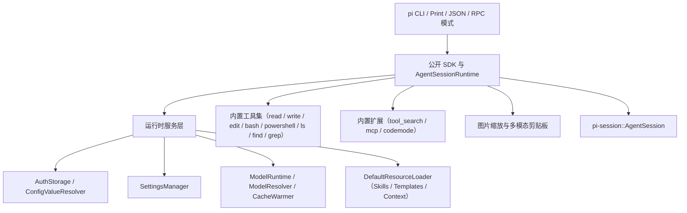
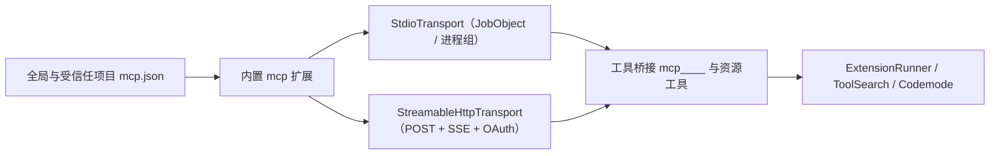
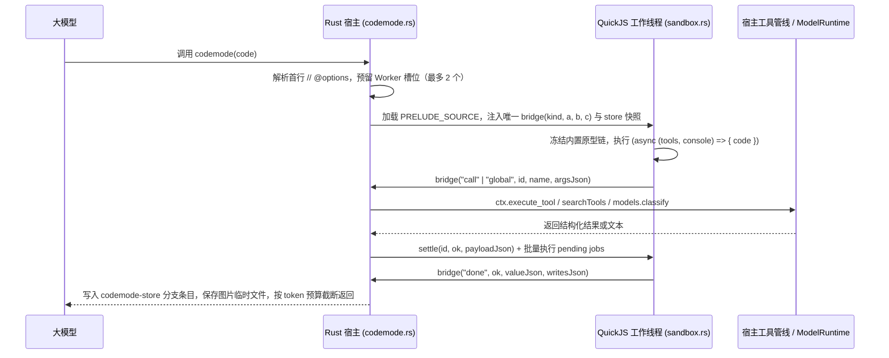

# 阶段 4：运行时与 SDK（pi-runtime）迁移设计

**结论：`crates/pi-runtime` 将 `pi-ai`、`pi-agent`、`pi-session` 组装为可嵌入任意应用的完整 Agent 运行时，提供配置与凭据管理、资源加载、内置编码工具、MCP 与 Codemode 扩展、多模态图片处理、公开 SDK 以及命令行程序。**

**状态：阶段 4 与 4.1 已完成。** Windows / MSVC 自动化验收结果见文末。

本文是 [Rust 重写开发计划](0.PLAN.md) 第四阶段的设计文档。前置依赖见 [1.model-core.md](1.model-core.md)、[2.agent-core.md](2.agent-core.md)、[3.session-and-extensions.md](3.session-and-extensions.md)，技术选型见 [prototype.md](../prototype.md)。

---

## 整体架构

`pi-runtime` 位于会话核心之上，负责加载本机配置与资源、挂载内置工具与内置扩展、管理多会话切换，并向外提供 SDK 与无头运行模式（Print / JSON / RPC）。



---

## 上游对照基准

开发直接对照本地归档的 `@earendil-works/pi-coding-agent@1.5.0`、`@earendil-works/pi-mcp@1.5.0` 与 `@earendil-works/pi-codemode@1.5.0` 源码（位于 `E:/Learning/Programming/pi-1.5.0-reference/repo/packages/`）：

| 模块领域 | 上游对照路径 |
|---|---|
| SDK 与跨会话宿主 | `coding-agent/src/core/{sdk,agent-session-services,agent-session-runtime}.ts` |
| 设置与凭据管理 | `coding-agent/src/core/{settings-manager,settings-defaults,auth-storage,runtime-credentials,resolve-config-value}.ts` |
| 模型运行时与缓存预热 | `coding-agent/src/core/{model-config,provider-composer,model-runtime,model-resolver,cache-warmer}.ts` |
| 资源加载器 | `coding-agent/src/core/{resource-loader,skills,prompt-templates}.ts` |
| 内置文件与 Shell 工具 | `coding-agent/src/core/tools/{read,write,edit,bash,powershell,grep,find,ls,truncate,file-mutation-queue}.ts`、`utils/shell.ts` |
| 内置工具检索 | `coding-agent/src/extensions/tool-search/{index,tool}.ts` |
| MCP 协议与扩展 | `mcp/src/`、`coding-agent/src/core/mcp-servers.ts`、`coding-agent/src/extensions/mcp/` |
| Codemode 沙箱与扩展 | `codemode/src/`、`coding-agent/src/extensions/codemode/` |
| 图片缩放与剪贴板 | `coding-agent/src/utils/{image-resize-core,image-process,image-convert,exif-orientation,tool-result-images,clipboard,clipboard-image}.ts` |
| 无头模式与 CLI | `coding-agent/src/modes/{print-mode,json-event,rpc/}.ts`、`src/cli.ts` |

---

## 目录结构

```text
crates/pi-runtime/
|-- Cargo.toml
|-- src/
|   |-- lib.rs                  # 公开导出 SDK、服务、工具工厂与运行模式
|   |-- config_value.rs         # $ENV_VAR 模板插值与受控 !command 执行缓存
|   |-- auth_storage.rs         # FileAuthStorage、ReadOnlyAuthStorage、InMemoryAuthStorage、RuntimeCredentials
|   |-- model_config.rs         # models.json 解析校验、自定义服务商与 modelOverrides 合成
|   |-- model_runtime.rs        # ModelRuntime：共享 Arc<Models>、凭据同步与快照刷新
|   |-- model_resolver.rs       # 模型引用解析、作用域解析与初始模型选择策略
|   |-- settings_manager.rs     # 全局与项目双层设置、工具修饰器、独立文件锁与损坏保护
|   |-- skills.rs               # SKILL.md 递归扫描、忽略规则、规范校验与 XML 格式化
|   |-- prompt_templates.rs     # 提示词模板加载、参数切片与单遍占位符替换
|   |-- context_files.rs        # AGENTS.md / CLAUDE.md 层级发现与 Git Worktree 遮蔽消除
|   |-- resource_loader.rs      # ResourceLoader 接口、可重复扩展工厂与单次初始化管线
|   |-- cache_warmer.rs         # 可注入时钟的 Prompt 缓存 TTL 计算、成本评估与静默重放
|   |-- image_process.rs        # EXIF 方向修正、非标格式转 PNG、自适应缩放与工具结果图片归一化
|   |-- clipboard.rs            # 跨平台多模态剪贴板读写（图片、文件路径、文本、远程 OSC 52）
|   |-- tools/
|   |   |-- mod.rs              # 8 个内置工具工厂导出与集合构造
|   |   |-- truncate.rs         # 首字节有界流式累积器 OutputAccumulator 与行列截断
|   |   |-- file_mutation_queue.rs # 按规范化路径串行化同文件写入的异步队列
|   |   |-- edit_diff.rs        # BOM 剥离、换行符保留、NFKC 匹配与 unified diff 生成
|   |   |-- read.rs             # 有界流式按行读取与图片读取处理
|   |   |-- write.rs            # 自动创建父目录与串行化文件写入
|   |   |-- edit.rs             # 唯一性非重叠匹配校验与保行替换
|   |   |-- bash.rs             # Bash 工具与共享 Shell 进程执行器（JobObject / 进程组管控）
|   |   |-- powershell.rs       # PowerShell 独立工具与 Windows 五级可执行文件探测
|   |   |-- ls.rs               # 字典序目录列举与条数/字节截断
|   |   |-- find.rs             # fd 外部调用与原生 ignore+glob 有界回退
|   |   `-- grep.rs             # rg 外部调用与原生 ignore+regex 有界回退
|   |-- extensions/
|   |   |-- mod.rs              # 内置扩展注册表（tool_search / mcp / codemode）
|   |   |-- tool_search.rs      # 中英文分词、BM25 工具排序器与 tool_search 动态激活工具
|   |   |-- mcp.rs              # 内置 MCP 扩展：工具命名空间桥接、资源工具与 /mcp 命令
|   |   `-- codemode.rs         # 内置 Codemode 扩展：声明渲染、嵌套工具调用与分支状态存储
|   |-- mcp/
|   |   |-- mod.rs              # MCP 客户端公开导出
|   |   |-- protocol.rs         # JSON-RPC 2.0 消息、MCP 工具与资源协议类型
|   |   |-- transport.rs        # Stdio 子进程传输与 Streamable HTTP（POST + SSE）传输
|   |   |-- client.rs           # McpClient 握手、工具调用、资源读取与进度超时重置
|   |   |-- config.rs           # mcp.json 加载、暴露级别计算与通配符匹配
|   |   `-- oauth.rs            # mcp-auth.json 凭据存储与回环授权回调
|   |-- codemode/
|   |   |-- mod.rs              # Codemode 沙箱公开导出
|   |   |-- source.rs           # 首行 // @options 解析与脚本包装
|   |   |-- declarations.rs     # JSON Schema 转 TypeScript 类型声明
|   |   |-- prelude.rs          # 内嵌官方 PRELUDE_SOURCE 引导脚本与常量限额
|   |   `-- sandbox.rs          # 基于 rquickjs 的隔离虚拟机、单函数桥接与步数中断控制
|   |-- sdk.rs                  # create_agent_session_services 与 create_agent_session
|   |-- runtime.rs              # AgentSessionRuntime：会话切换、新建、派生、导入与销毁
|   |-- modes/
|   |   |-- mod.rs              # 运行模式入口
|   |   |-- json_event.rs       # 剥离增量 partial 快照的线协议转换
|   |   |-- print_mode.rs       # Text 与 JSON 单次打印模式
|   |   `-- rpc_mode.rs         # 解耦输入泵、有界输出通道与世代安全 UI 桥的 RPC 模式
|   `-- bin/
|       `-- pi.rs               # 命令行入口程序
|-- examples/
|   |-- code_review_and_adr_agent.rs        # 独立示例 1：代码审查与架构决策记录（ADR）生成
|   `-- release_notes_and_workflow_agent.rs # 独立示例 2：版本发布说明生成与交互审批工作流
`-- tests/
    |-- settings_and_auth.rs
    |-- model_runtime_and_resolver.rs
    |-- resource_loader.rs
    |-- builtin_tools.rs
    |-- sdk_and_runtime.rs
    `-- modes_and_cli_e2e.rs
```

---

## 前置包接口补齐（`pi-session`）

`pi-runtime` 依赖 `pi-session` 提供以下六项生命周期与扩展挂接接口：

| 编号 | 接口能力 | 契约说明 |
|---|---|---|
| 1 | 异步关闭与主动释放写锁（`AgentSession::shutdown`、`release_persistent_store`） | `shutdown` 采用 `Open → Closing → Closed` 状态机。进入 `Closing` 后拒绝新操作，取消在途模型流、重试、压缩、Bash 与预热，等待已启动工具完成定稿落盘，随后发出 `session_shutdown`，并将内部持久化存储替换为只读内存实例，立即释放 `.lock` 文件锁。旧 `AgentSession` 克隆在关闭后调用写操作均返回 `"AgentSession is closed"`。 |
| 2 | 无可用模型启动状态（`Option<Model>`） | `AgentSessionOptions::model` 支持 `None`。初始无可用模型时使用内部不可路由占位模型初始化，不写入 `model_change` 条目。状态查询、树操作、斜杠命令与 `execute_bash` 保持可用；调用需要大模型的 `prompt`、`continue_run` 或 `compact` 时直接返回引导错误。 |
| 3 | 可重复扩展工厂与单次初始化（`ExtensionFactory`、`on_resources_discover`、`on_cache_warming_decision`） | `ResourceLoader::reload` 调用 `ExtensionFactory` 构造 `ExtensionRunner` 并执行 `resources_discover`，再将已就绪的 `ExtensionRunner` 一次性移交给 `AgentSession`。调用 `session.reload()` 时重新构造 Runner 并替换，构造失败则保留原 Runner 与模型目录不变。 |
| 4 | 权威模型目录共享（`ExtensionCatalog` 回调） | `ModelRuntime` 与 `ExtensionCatalog` 共享同一个 `Arc<Models>`，扩展注册或注销服务商与虚拟模型时通过回调触发 `ModelRuntime` 刷新可用性快照。多会话复用服务时按会话视图隔离。 |
| 5 | 消息过滤与物理请求观测（`block_images`、`on_resolved_session_request`、`default_bash_executor`） | 动态 `block_images` 过滤器统一作用于普通对话、压缩、分支总结与缓存预热。虚拟模型路由完成后触发 `on_resolved_session_request` 供 `CacheWarmer` 启动保活。`session.execute_bash` 默认复用 SDK 注入的受控 Shell 执行器。 |
| 6 | 技能命令与模板展开 | `AgentSession::prompt` 支持将 `/skill:<name> [args]` 展开为 `<skill>` XML 块，并支持按单遍替换规则展开 `/<template_name> [args]` 提示词模板。 |

---

## 基础运行时模块设计（已完成并验收）

### 1. 配置解析、凭据存储与模型运行时

| 模块 | 核心机制与边界 |
|---|---|
| `config_value.rs` | 1. `!command` 命令配置仅在受信任项目（`project_trusted == true`）中允许执行，固定 10 秒超时并通过 Job Object / 进程组回收子进程树。<br>2. 命令失败或超时只返回脱敏状态描述，隐藏命令原文与标准输出。结果按 `(agent_dir, cwd, env_fingerprint)` 缓存在实例内。<br>3. `$ENV_VAR` 与 `${ENV_VAR}` 支持 `$$` 和 `$!` 转义；只读检查函数仅做语法与环境变量存在性判断，不启动子进程。 |
| `auth_storage.rs` | 1. `FileAuthStorage` 使用同目录独立的 `auth.json.lock`。`modify` 在锁内重读最新文件、执行异步更新、写入临时文件、`sync_all()` 并原子重命名替换。<br>2. 磁盘 `auth.json` 损坏时直接报错中止修改，保留原文件不被覆盖。<br>3. `ReadOnlyAuthStorage` 跳过命令求值、OAuth 刷新与网络请求；`RuntimeCredentials` 维护内存临时密钥覆盖层。 |
| `model_config.rs`<br>`model_runtime.rs` | 1. 剥离 `models.json` 的 UTF-8 BOM 与注释，校验 API、URL 及正数 Token 限制，合成自定义模型与 `model_overrides`。<br>2. 凭据变更按 `provider_id` 串行排队，异步可用性刷新携带世代号防止旧快照覆盖新目录。 |
| `model_resolver.rs` | 1. `resolve_model_reference` 按具名服务商前缀、完整 ID 匹配、子串模糊匹配、剥离右侧 `:<thinking>` 后缀的顺序解析。<br>2. `InitialModelPolicy` 支持通用 SDK 默认策略（`GenericSdk`）与保留未认证模型身份的业务策略（`FixedIdentity`）。 |

### 2. 双层设置管理与资源加载器

1. **`SettingsManager`（`settings_manager.rs`）**：
   - 管理全局 `<agent_dir>/settings.json` 与项目 `<cwd>/.pi/settings.json`。每次修改在 `.lock` 锁内重读磁盘最新 JSON 并合并增量补丁，保留未知字段与并发进程写入的其他字段。
   - 某作用域配置文件损坏时标记 `load_failed = true` 并回退内存默认值，在 `reload()` 修复前禁止写回该文件。
   - 未受信任项目自动屏蔽项目级 `shell_path`、`shell_command_prefix` 与扩展路径。
2. **资源加载器（`skills.rs`、`prompt_templates.rs`、`context_files.rs`、`resource_loader.rs`）**：
   - 技能扫描按层合并 `.gitignore`、`.ignore`、`.fdignore`，遇到 `SKILL.md` 停止向下递归，拦截符号链接环并校验名称与描述长度。
   - 提示词模板支持单双引号解析与 `$1..$N`、`$@`、`$ARGUMENTS`、`${@:N:L}` 单遍替换。
   - 上下文文件按全局目录与根目录至 `cwd` 的祖先链加载 `AGENTS.md` / `CLAUDE.md`，自动消除嵌套 Git Worktree 的同名文件遮蔽。

### 3. 内置基础工具、缓存预热、跨会话宿主与无头模式

| 模块 | 核心机制与边界 |
|---|---|
| 文件与搜索工具<br>（`read` / `write` / `edit` / `ls` / `find` / `grep`） | 1. `with_file_mutation_queue` 将文件写操作派发到内部受控任务持有路径锁直至落盘完成，调用方 Future 中途丢弃不会提前释放锁。<br>2. `edit` 剥离 BOM、保留原换行符、支持 NFKC 匹配并校验修改区间互不重叠。<br>3. `read`、`ls`、`find`、`grep` 全程有界读取；`find` 与 `grep` 支持调用外部 `fd` / `rg` 及纯 Rust `ignore` 原生回退。 |
| `bash` 工具与共享执行器 | 首字节有界流式累积（2000 行 / 50 KiB），超限转存临时文件；Windows 绑定挂起启动 + Job Object，Unix 绑定独立进程组；主进程退出后限时排空并断开被孙进程继承的输出管道。 |
| `CacheWarmer`<br>（`cache_warmer.rs`） | 挂接在物理模型请求出口，基于可注入时钟计算 `delay_ms = floor(min(ttl_ms * 0.9, ttl_ms - 10_000))`。预期节省达到 0.05 美元时发送 `max_tokens: 1` 保活请求，通过 `with_session_manager_mut_if` 在持有操作准入锁时复核上下文前缀一致后再写入 `UsageEntry`。 |
| `AgentSessionRuntime`<br>（`runtime.rs`） | 使用异步 `transition_lock` 串行化 `switch_session`、`new_session`、`fork`、`import_from_jsonl` 与 `dispose`。跨文件切换在关闭旧会话前完成目标文件打开、加锁与执行日志预检；前置失败保持旧会话继续运行。 |
| 无头模式与 CLI<br>（`modes/`、`bin/pi.rs`） | 1. `to_json_event` 剥离流式 `partial` 大快照。<br>2. RPC 模式将 `stdin` 读取泵、即时控制通道、长时命令通道与单一有界 `stdout` 写入器解耦，在等待 UI 弹窗期间仍能响应 `extension_ui_response` 与 `abort`。 |

---

## 阶段 4.1 后续目标与详细规划

**结论：阶段 4.1 在已验收的运行时底座上，按上游 1.5.0 标准补齐五项能力：独立的 `powershell` 工具、内置工具检索 `tool_search`、MCP 协议与工具桥接、基于 QuickJS 的 `codemode` 代码编排工具，以及多模态剪贴板与图片缩放归一化。**

### 1. 独立完善 `powershell` 工具（重点）

**结论：将 `powershell` 拆分为独立模块 `src/tools/powershell.rs`，完整实现上游 Windows 五级路径探测规则、进程级 `Bypass` 参数、UTF-8 输出前缀与 SDK 配置同步。**

| 规划项 | 具体实现要求 |
|---|---|
| **1. 公开接口与参数契约** | 独立导出 `POWERSHELL_ARGS`、`get_powershell_config`、`PowerShellOperations`、`PowerShellToolOptions`、`create_local_powershell_operations`、`create_powershell_tool_definition`、`create_powershell_tool` 与 `powershell_tool_system_prompt_contribution`。<br>启动参数固定为 `["-NoProfile", "-NonInteractive", "-ExecutionPolicy", "Bypass", "-Command"]`；命令执行前预置 `try { [Console]::OutputEncoding=[System.Text.Encoding]::UTF8 } catch {}\n`。 |
| **2. Windows 五级路径探测** | 支持注入环境变量与路径可访问性检查函数（兼容 Windows Store 执行别名），按顺序查找：<br>1. `PATH` 中的 `pwsh.exe`（通过 `where.exe` 定位并校验可访问）；<br>2. `%ProgramFiles%\PowerShell\7\pwsh.exe`（读取环境变量，兼容任意安装盘符）；<br>3. `PATH` 中的 `powershell.exe`；<br>4. `%SystemRoot%\System32\WindowsPowerShell\v1.0\powershell.exe`；<br>5. 均未找到时报错 `"No PowerShell executable found. Install PowerShell or add powershell.exe/pwsh.exe to PATH."`。<br>非 Windows 平台返回 `"The powershell tool is only available on Windows."`。 |
| **3. 执行管控与 SDK 贯通** | 复用 `OutputAccumulator` 流式截断、`pi-powershell-<uuid>.log` 转存、Windows Job Object 进程树回收与管道限时排空。<br>在 `sdk.rs` 中将 `SettingsManager` 的 `expose_session_environment` 与 `shell_command_prefix` 注入 `tools_options.powershell`，向子进程提供 `PI_SESSION_ID`、`PI_SESSION_FILE`、`PI_PROVIDER`、`PI_MODEL`、`PI_REASONING_LEVEL`。 |

### 2. 内置工具检索（`tool_search`）

**结论：在 `src/extensions/tool_search.rs` 中实现中英文分词与 Okapi BM25 排序器，提供内置 `tool_search` 扩展工具，按需检索并激活 `deferred` 与 `codemode` 工具。**

1. **检索文档构建（`create_tool_search_document`）**：
   - 提取工具 `name`、工具 `description`、递归提取参数 JSON Schema 中的属性名与 `description`，以及所属 `ToolNamespace` 的 `name`、`description`、`instructions`。
2. **分词与词干提取（`tokenize`）**：
   - 使用现有 `icu_normalizer` 执行 NFC 归一化，按驼峰边界拆分标识符，转为小写并剥离标点。
   - 纯 ASCII 文本按空格切分，过滤英文停用词（`STOP_WORDS`）并执行单复数词干还原（`ies -> y`、`ches/shes/sses/xes/zes` 去 `es`、末尾去 `s`）；含中文等非 ASCII 文本使用 `unicode-segmentation` 按词边界切分。
3. **BM25 多字段加权排序（`Bm25Ranker`）**：
   - 参数默认 `k1 = 1.2`、`b = 0.75`，名称词权重 `NAME_WEIGHT = 3.0`，命名空间词权重 `NAMESPACE_WEIGHT = 0.5`。
   - 排序优先级依次为：完整工具名或 `__` 后缀精确匹配 → 命中的查询词数量（覆盖度）→ BM25 得分（全局部名称命中享附加分）→ 原始文档顺序。
4. **动态激活与分支恢复**：
   - 注册为 `replaceable: true, builtin: true` 扩展，工具名 `tool_search`，暴露级别 `ModelOnly`，默认非激活（通过 `--tools tool_search`、`defaultTools` 或 `set_active_tools` 启用）。
   - 检索命中未激活的 `deferred` / `codemode` 工具后，调用 `set_active_tools` 将其加入活跃工具集。选择状态单独保存到当前分支，模型请求继续记录实际工具声明的增删；下一轮请求、`/tree`、恢复、`fork` 及异步 MCP 清单恢复均保留选择。

### 3. MCP 工具与资源支持（Model Context Protocol）

**结论：在 `src/mcp/` 与 `src/extensions/mcp.rs` 中实现完整的 MCP 客户端与内置扩展，支持 `stdio` 与 `Streamable HTTP` 传输、`mcp.json` 配置、四级暴露控制、资源工具与 OAuth。**



| 子模块 | 具体实现要求 |
|---|---|
| `src/mcp/protocol.rs`<br>`src/mcp/client.rs` | 实现 JSON-RPC 2.0 请求/响应/通知解析、版本协商、`initialize`、`tools/list`、`tools/call`、`resources/list`、`resources/templates/list`、`resources/read`、取消通知 `notifications/cancelled` 及进度通知 `notifications/progress`（收到进度时重置单请求超时计时器，默认 30 秒）。进度回调在锁外调用并隔离 panic，回调失败后继续接收响应与后续请求。 |
| `src/mcp/transport.rs` | 1. **`StdioTransport`**：解析 `${ENV}` 与受信任 `!cmd` 环境变量，在受控进程组 / Job Object 中启动本地命令，`stderr` 写入 `<agent_dir>/mcp.log`。<br>2. **`StreamableHttpTransport`**：基于 `reqwest` 发送 POST 并消费 SSE 响应流，管理 `Mcp-Session-Id` 头，处理 401 鉴权挑战与 404 会话过期重连。 |
| `src/mcp/oauth.rs` | 使用 `<agent_dir>/mcp-auth.json`（配独立 `.lock` 锁）存储令牌，支持鉴权挑战发现、PKCE、预配置客户端、动态客户端注册、回环回调与令牌刷新。凭据绑定服务器 URL，刷新与写入使用跨进程锁。 |
| `src/mcp/config.rs`<br>`src/extensions/mcp.rs` | 1. 读取扩展 `register_mcp_server` 默认配置、全局 `<agent_dir>/mcp.json` 与受信任项目 `<cwd>/.pi/mcp.json`；磁盘配置可覆盖扩展默认值。<br>2. 支持 `codemode`（默认，兼容 `codemode-deferred`）、`deferred`、`direct`、`hidden` 四级暴露及 `tool_exposure` 通配符覆盖。<br>3. 工具命名为 `mcp__<server>__<tool>` 并挂载 `ToolNamespace`；存在资源能力时注册 `list_mcp_resources`、`list_mcp_resource_templates`、`read_mcp_resource`。<br>4. 首轮 `prompt` 对 `direct` Server 最多等待 `startup_wait_ms`（默认 10 秒）；提供 `/mcp` 状态、授权、退出授权、重连和配置增删改命令；支持单独保存启用状态与暴露级别。配置写入使用独立锁与原子替换，动态注册与服务端清单变化触发工具刷新。 |

### 4. `codemode` 代码编排工具

**结论：引入 `rquickjs`（基于支持 Windows MSVC 的 `quickjs-ng`），复用并适配上游 `PRELUDE_SOURCE` 引导脚本与单函数 `bridge` 协议，实现隔离的异步 JS 工具编排沙箱。**

#### 4.1 所需新增技术栈

| 新增依赖 | 用途 | 选型依据 |
|---|---|---|
| `rquickjs` | QuickJS 虚拟机绑定 | 使用原生 QuickJS-NG，与上游 `quickjs-wasi` 的执行环境不同；通过固定版本兼容测试验证 `PRELUDE_SOURCE`。支持 Windows MSVC 编译、内存上限（`256 MiB`）、调用栈上限与中断回调（`set_interrupt_handler`） |
| `unicode-segmentation` | 非 ASCII 文本分词 | 与 `tool_search` 共用，支撑沙箱内 `searchTools()` 的中英文 BM25 检索 |

其余能力（工作线程、异步通道、并发信号量、JSON Schema 渲染、Base64 图片落盘、会话分支存储）全部复用工作区现有依赖。

#### 4.2 沙箱与宿主交互流程



#### 4.3 模块职责与边界

1. **指令解析与类型声明渲染（`src/codemode/source.rs`、`declarations.rs`）**：
   - 解析首行可选 `// @options: {"max_output_tokens": 10000, "timeout_ms": 60000}`；非首行出现 `@options` 或字段非法时直接报错。
   - 实现 `schema_to_type`、`render_tool_signature`、`render_tool_sample` 与 `create_codemode_description`：将 JSON Schema 转为紧凑 TypeScript 类型声明，按命名空间分组并在 `inline_budget`（默认 `3000` tokens）内轮询选取展示。
2. **QuickJS 沙箱与死循环中断（`src/codemode/prelude.rs`、`sandbox.rs`）**：
   - 内嵌官方 `PRELUDE_SOURCE`：启动时冻结所有内置原型对象，提供 `tools` 代理（含拼写相近工具提示）、`ALL_TOOLS`、`text()`、`image()`（校验 PNG/JPEG/GIF/WebP Base64 签名）、`console.*`、`store()` / `load()`（单值上限 `256 KiB`、总量上限 `1 MiB`）、`exit()` 及无未决调用时的 `stalled()` 检测。
   - 限制单次输出上限 `MAX_OUTPUT_CHARS = 16 MiB`、`MAX_OUTPUT_ITEMS = 100_000`、VM 内存上限 `256 MiB`。
   - 绑定中断回调与每 `50` 个 Promise 微任务轮询检查，支持 `DEFAULT_INTERRUPT_BUDGET = 100_000`、总超时 `timeout_ms` 与外部 `CancellationToken` 协作中断。原生内建操作的退出取决于引擎中断点；Worker 槽位在实际线程退出后释放。
   - 支持确定性执行模式（`deterministic: { started_at, seed }`）：接管虚拟时钟与 `mulberry32` 随机数，专用 VM 线程通过本地 QuickJS 补丁固定为 UTC，按序号 `seq` 投递结果。执行指纹包含引擎版本与引导脚本摘要；关闭沙箱或释放运行句柄时取消执行。
3. **内置 `codemode` 扩展（`src/extensions/codemode.rs`）**：
   - 注册为 `replaceable: true, builtin: true` 扩展，默认非激活；进程内限制并发 Worker 数（默认 `DEFAULT_MAX_CODEMODE_WORKERS = 2`，可通过 `PI_CODEMODE_MAX_WORKERS` 覆盖，排队等待上限 `60s`）。
   - 实现 `prepare_loadout`：在 `codemode.mode == "on"` 时为已声明工具附加脚本调用说明；在 `"only"` 模式下隐藏普通 `direct` 工具声明并统一收敛到 `codemode` 描述中。
   - 注入发现全局函数（`searchTools`、`describeTool`、`describeNamespace`）与 `models` 命名空间（`getModelsOfType`、`getAvailableOfType`、`getModelOfType`、`classify`；`classify` 限制单脚本最多 4 路并发并累计 `Usage`）。
   - 嵌套工具调用通过 `ctx.execute_tool` 执行：声明了 `output_schema` 的工具向脚本返回 `structured_content`，其余返回文本；脚本成功后将 `store` 写入作为 `codemode-store` 自定义条目追加到当前会话分支；输出图片自动写入 `pi-codemode-<uuid>.<ext>` 临时文件并在图片块前附上路径说明。

### 5. 多模态剪贴板与图片缩放归一化

**结论：使用原生 Rust 图像库在后台线程实现官方的 EXIF 方向修正、非标格式转 PNG、四步自适应缩放与跨平台剪贴板读写，统一接入 `read`、`@file` 与工具结果管线。**

#### 5.1 图片处理与缩放管线（`src/image_process.rs`）

| 处理环节 | 具体规则与参数 |
|---|---|
| **1. EXIF 方向修正** | 解析 JPEG（APP1 `Exif\0\0`）与 WebP（RIFF `EXIF` 块）中的 TIFF Orientation 标签（`0x0112`，值 `1..=8`），解码后自动执行对应的旋转与翻转。 |
| **2. 格式归一化** | 原生保留 `image/png`、`image/jpeg`、`image/gif`、`image/webp`。遇到 `image/bmp`、`image/tiff` 等其他图片格式时自动转码为 `image/png`，并附加提示 `[Image converted from <from> to image/png.]`。 |
| **3. 四步自适应缩放** | 受 `settings.images.auto_resize`（默认 `true`）控制，默认上限 `max_width = 2000`、`max_height = 2000`、`max_bytes = 4.5 MiB`（Base64 字节数）、`jpeg_quality = 80`：<br>1. 宽高与 Base64 体积均未超限时原样返回；<br>2. 使用 Lanczos3 滤波器按比例缩放到 `2000×2000` 内，同时尝试 PNG 与 JPEG（质量 80）编码并取较小者；<br>3. 若仍超 `max_bytes`，按 `[70, 55, 40]` 依次降低 JPEG 质量；<br>4. 若仍超限，按 `0.75` 倍递减宽高直至达标，并生成尺寸缩放说明 `format_dimension_note`。 |
| **4. 全入口接入** | `read` 工具、CLI `@<file>` 附件，以及所有工具返回的 `AgentToolResult`（通过 `normalize_tool_result_images` 在写入会话历史前统一归一化）均调用该管线。 |

#### 5.2 多模态剪贴板读写（`src/clipboard.rs`）

1. **剪贴板读图（`read_clipboard_image`）**：
   - Windows：通过原生 Win32 剪贴板读取位图/PNG（支持 `Win+Shift+S` 截图），提供 PowerShell 5 秒限时回退。
   - Linux：Wayland 会话（`WAYLAND_DISPLAY` 或 `XDG_SESSION_TYPE=wayland`）调用 `wl-paste`（空剪贴板直接返回 `None`）；X11 会话调用 `xclip`。
   - 按 `["image/png", "image/jpeg", "image/webp", "image/gif"]` 优先级选取格式，其他 `image/*` 自动转码为 PNG。
2. **文件路径与文本剪贴板（`read_clipboard_file_paths`、`read_clipboard_text`、`copy_to_clipboard`）**：
   - 支持读取资源管理器复制的文件路径列表与纯文本。
   - 写入剪贴板时，若检测到远程终端会话（`SSH_CONNECTION`、`SSH_CLIENT`、`MOSH_CONNECTION` 或 `PI_CLIPBOARD_OSC52=1`），同步向终端输出 `OSC 52` Base64 转义序列（上限 `100_000` 字节）。

---

## 阶段 4.1 实施顺序与完成条件

1. **步骤 1（重点）**：拆分 `src/tools/powershell.rs`，实现 Windows 五级路径探测、SDK 配置注入与 `powershell` 专项测试。
2. **步骤 2**：实现 `src/image_process.rs` 与 `src/clipboard.rs`，接入 `read`、CLI `@file` 与工具结果图片归一化 `normalize_tool_result_images`。
3. **步骤 3**：引入 `unicode-segmentation`，实现 `src/extensions/tool_search.rs`（分词、BM25 排序、`tool_search` 工具与会话分支激活持久化）。
4. **步骤 4**：引入 `rquickjs`，先完成 Windows MSVC 编译验证，再实现 `src/codemode/` 与 `src/extensions/codemode.rs`，打通 `PRELUDE_SOURCE`、`tools.*` 嵌套调用、`searchTools()`、`models.classify` 与 `codemode-store`。
5. **步骤 5**：实现 `src/mcp/` 与 `src/extensions/mcp.rs`，跑通本地 Stdio 与 HTTP MCP Server 的工具桥接、暴露分级、资源读取与超时取消。

**阶段 4.1 完成条件**：
- `cargo fmt --all --check`、`cargo check --workspace --all-targets --locked`、`cargo clippy --workspace --all-targets --locked -- -D warnings` 与 `cargo test --workspace --locked` 全部通过。
- PowerShell、图片与剪贴板、工具检索、Codemode、MCP 五类能力通过下表中的专项测试；分支恢复、动态工具清单、OAuth 与 HTTP 会话恢复均通过公开接口验证。

---

## 阶段 4 与 4.1 验收记录（2026-11-05）

**结论：阶段 4 与 4.1 已完成 Windows / MSVC 自动化验收。**

| 检查项 | 结果 |
|---|---|
| 格式 | `cargo fmt --all --check` 通过 |
| 全目标编译 | `cargo check --workspace --all-targets --locked` 通过 |
| 静态检查 | `cargo clippy --workspace --all-targets --locked -- -D warnings` 零警告通过 |
| 工作区测试 | `cargo test --workspace --locked`：318 项通过，1 项显式忽略；子进程内重复执行的测试不计入总数 |
| 运行时测试 | 15 套集成测试共 168 项通过，另有 5 项单元测试通过 |
| 独立示例 | `pi-session` 5 个、`pi-runtime` 2 个公开接口示例通过 |

| 能力 | 主要测试套件与覆盖范围 |
|---|---|
| PowerShell 与基础工具 | `builtin_tools`：五级路径探测、执行、SDK 配置注入与会话执行器 |
| 图片与剪贴板 | `sdk_and_runtime`、`image_formats`、`clipboard`：EXIF、四步缩放、BMP/TIFF 转 PNG、模型图片限制、文件 URI 与 OSC 52 输出 |
| 工具检索与恢复 | `phase41_extensions`、`tool_search_state`：BM25、多语言查询、实际模型声明、树跳转、派生、恢复及清单暂时缺失期间的状态保存 |
| Codemode | `phase41_extensions`、`phase41_regressions`、`codemode_lifecycle`：并发调用、用量统计、存储分支隔离、中断、UTC 日期构造与解析、关闭和释放清理 |
| MCP | `phase41_extensions`、`phase41_regressions`、`mcp_http`、`mcp_oauth`、`mcp_management`：Stdio 进程树回收、HTTP/SSE 恢复、OAuth 完整回环流程、资源与暴露控制、动态注册、配置事务及会话替换 |
| SDK 与无头运行 | `settings_and_auth`、`model_runtime_and_resolver`、`resource_loader`、`sdk_and_runtime`、`modes_and_cli_e2e`：配置、模型目录、资源加载、SDK 生命周期与 CLI 子进程 |

验证范围：HTTP 与 OAuth 使用本机模拟服务，覆盖真实 TCP、回环回调、状态校验和并发令牌刷新；日期测试在不同 `TZ` 环境变量的独立进程中执行。Windows 采用原生线程级 UTC 覆盖，`TZ` 环境变量不改变 Windows 系统时区。

环境验证项：Linux/macOS 原生剪贴板与进程组、Windows 系统剪贴板实际读写、真实外网模型与 MCP/OAuth 服务、物理 U 盘拔插需在对应环境执行。`unicode-segmentation` 采用 Unicode 词边界，中文分词粒度与上游 `Intl.Segmenter` 有差异；原生 QuickJS 中断发生在引擎中断点，Worker 槽位在线程退出后释放。
