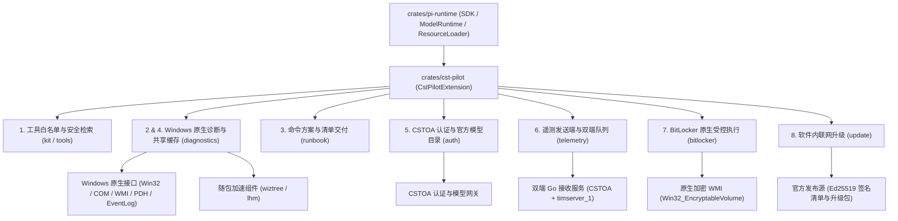
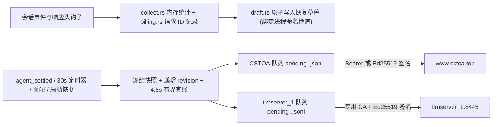
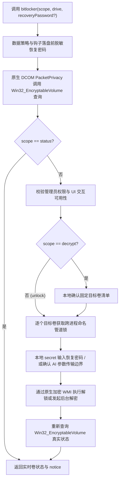
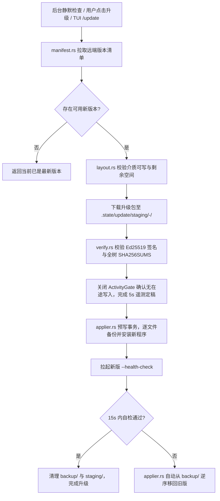

# 阶段 6：CST Pilot 业务包（cst-pilot / cst-kit）设计

`crates/cst-pilot`（阶段 9 更名为 `crates/cst-kit`）基于阶段 1 至阶段 4 的公开扩展接口，实现现场软硬件诊断、修复命令交付、CSTOA 认证、双端遥测发送、BitLocker 受控操作及软件内联网升级。各工具直接调用 Rust 原生系统接口采集数据。总体路线见 [0.PLAN.md](0.PLAN.md)，技术选型见 [prototype.md](../prototype.md)，产品需求见 [SPEC.md](../../SPEC.md) 与 [ARCHITECTURE.md](../../ARCHITECTURE.md)。

## 整体架构

业务包构建在 `pi-runtime` 之上，全部功能通过公开接口静态挂载。通用核心提供可选的输入许可与数据投影接口，业务规则集中在 `cst-pilot`：



各业务子模块的职责与规格对应关系如下：

| Rust 子模块 | 规格与架构文档 | 核心职责 |
|---|---|---|
| `src/kit.rs`<br>`src/tools/` | [`APPEND_SYSTEM.md`](../../../agent/home/APPEND_SYSTEM.md)、[`agent/home/skills/`](../../../agent/home/skills/)<br>[server/SPEC.md](../../server/SPEC.md)、[diagnostics/SPEC.md](../../diagnostics/SPEC.md) | 锁定 17 个开放工具白名单，加载诊断系统提示词与 8 份技能文档，拦截凭据文件读取与内网 SSRF 请求 |
| `src/diagnostics/` | [diagnostics/SPEC.md](../../diagnostics/SPEC.md)、[ARCHITECTURE.md](../../diagnostics/ARCHITECTURE.md)、[API.md](../../diagnostics/API.md) | 基于 Windows 原生接口实现 `ls / disk / sys / startup / eventlog / driver` 六个只读诊断工具，管理 `WzIndex` 卷级缓存与 50 KiB 输出裁剪 |
| `src/runbook/` | [SPEC.md#命令交付需求](../../SPEC.md#命令交付需求)、[runbook SKILL](../../../agent/home/skills/runbook/SKILL.md) | 实现 `command_plan`、`runbook_deliver` 与 `runbook`，管理版本冲突检测与 UTF-8 BOM + CRLF 文本导出 |
| `src/bitlocker/` | [diagnostics/SPEC.md#bitlocker状态解锁与解密](../../diagnostics/SPEC.md#bitlocker状态解锁与解密)、[bitlocker SKILL](../../../agent/home/skills/bitlocker/SKILL.md) | 通过原生加密 WMI 实现 `bitlocker` 状态查询、恢复密码清零保护与隐藏输入，提供跨进程同卷锁、本地确认及中断后实时复查 |
| `src/auth/` | [auth/SPEC.md](../../auth/SPEC.md)、[ARCHITECTURE.md](../../auth/ARCHITECTURE.md)、[API.md](../../auth/API.md) | 注册 `cstoa` 服务商，实现设备码 OAuth 与 APIKEY 登录，提供按官方规格对齐的动态模型目录、自定义服务管理与额度查询 |
| `src/telemetry/` | [contract.md](../../contract.md)、[telemetry/SPEC.md](../../telemetry/SPEC.md)、[ARCHITECTURE.md](../../telemetry/ARCHITECTURE.md)、[API.md](../../telemetry/API.md) | 对接双端 Go 接收服务，采集会话统计、核对 CSTOA 请求扣点并维护恢复草稿与双端持久化队列 |
| `src/update/` | [release/SPEC.md](../../release/SPEC.md)、[release/ARCHITECTURE.md](../../release/ARCHITECTURE.md) | 提供软件内联网版本检查与 Ed25519 双重验签，按程序区与用户数据区隔离替换文件，健康检查失败时自动回滚 |

## 异常中断与状态恢复

进程强杀、断电或拔盘后的状态恢复依托 [`pi-session::execution_log`](3.session-and-extensions.md) 记录执行状态，配合 Windows 原生状态实时复查、同卷原子替换与遥测草稿存活证明协同完成：

| 中断场景 | 恢复与保护机制 |
|---|---|
| 只读诊断中断 | 六个只读诊断工具均不修改系统状态。进程重启后，`reconcile_on_startup` 将未闭合运行标为 `InterruptedByCrash`，按需由用户重新发起查询 |
| 命令清单写入中断 | `command_plan`、`runbook_deliver` 与 `runbook` 均通过同目录临时文件同步后原子替换，中断不会在 `artifacts/` 或 `command-plans/` 下留下残缺文件 |
| BitLocker 执行中断 | `bitlocker` 注册为 `ToolReplayPolicy::Never`。解锁或解密中途发生崩溃或超时后，禁止自动重放命令，直接通过原生 WMI 重新查询 `Win32_EncryptableVolume` 实时卷状态并向用户报告 |
| 会话遥测中断 | 每轮对话结束与 CSTOA 请求尝试均原子写入 `agent/home/telemetry/drafts/<recordId>.json`，并绑定当前进程的内核命名管道。重启后扫描草稿，若原进程命名管道已释放，按 `endReason = "crash"` 补查账单并封存入队 |
| 软件内升级中断 | 升级包先在 `.state/update/staging/<ver>-<uuid>/` 完成验签与解压。替换阶段按预写事务备份文件，健康检查失败时逆序恢复。检测到未完成事务后，启动入口拒绝进入普通会话，交由独立更新器恢复 |

## 存量数据兼容与平滑升级规则

`crates/cst-pilot` 沿用工具包在 `agent/home/` 与 `artifacts/` 下的目录结构及文件格式。用户通过软件内联网升级或替换程序文件后，可直接继续使用历史会话、设置与登录凭据。

| 持久化路径 | 格式兼容规则 | 损坏或格式不兼容时的处理策略 |
|---|---|---|
| `agent/home/sessions/*.jsonl` | 复用 `JsonlSessionStore` 读写 JSONL v3（自动迁移 v1/v2），保留 `cst-web-input-message` 与 `cst-web-work-duration` 自定义条目 | 末行未闭合 JSON 自动截断修复。文件头非法或末行语法错误时保留原文件，返回中文提示 `会话文件无法读取，请检查或移除损坏的会话记录。` |
| `agent/home/settings.json`<br>`agent/home/web-settings.json` | 复用 `SettingsManager` 按字段合并读写，保留未知字段，维持 TUI 与 Web 主题独立存储 | 标记 `load_failed` 并回退内存默认值，拒绝写回覆盖原文件，返回 `设置文件无法读取，请检查 settings.json 后重试。` |
| `agent/home/auth.json`<br>`agent/home/models.json` | 直接读取 `cstoa`（`oauth` 与 `api_key`）及其他服务商凭据，兼容自定义服务地址与模型覆盖配置 | 停止修改并保留原文件，返回 `模型或凭据配置无法读取，请检查 models.json 和 auth.json 后重试。`，日志与响应严禁包含配置原文或密钥 |
| `agent/home/models-store.json` | 兼容预置离线模型目录与 `cstoa` 动态缓存条目，按 `etag` 凭据摘要校验归属 | 忽略损坏缓存，回退内置离线目录并在后台重新拉取。刷新或退出需写缓存时，先在目录锁内保存损坏副本，再原子重建 |
| `agent/home/device.json` | 直接读取已保存的 `device_id` 供 CSTOA 授权与刷新复用。文件缺失时首次登录生成新标识 | 拒绝覆盖非空损坏文件，提示检查或删除 `agent/home/device.json` 后重新登录 |
| `agent/home/command-plans/<ID>/v*.json`<br>`artifacts/<YYYY-MM-DD>/runbook/` | 保持方案 JSON 字段与 TXT 清单文件名格式不变，修订版本号与当天序号基于已有文件继续递增 | 单个方案 JSON 损坏时仅拒绝该方案修订。清单目录存在重复序号时报错提示检查目录 |
| `agent/home/telemetry/` | 兼容 `identity.json`、`drafts/*.json` 以及 `pending-*.jsonl` 和 `status.json`，启动时恢复残留草稿并投递发送队列 | `identity.json` 损坏时将安装身份置为 `null` 且不覆盖原文件。损坏的单条草稿或队列行隔离跳过 |

## 目录结构

```text
crates/cst-pilot/
|-- Cargo.toml
|-- src/
|   |-- lib.rs                      # 导出 CstPilotExtension、工具集合与服务装配入口
|   |-- bin/cst-updater.rs          # 独立更新器入口，仅信任编译期公钥
|   |-- kit.rs                      # 工具包路径定位、Kit / KitHost 与 17 个开放工具白名单装配
|   |-- tools/
|   |   |-- mod.rs                  # 基础检索与联网工具注册入口
|   |   |-- path_guard.rs           # 敏感凭据文件与运行态目录读取拦截器
|   |   |-- fff.rs                  # fffind 与 ffgrep 路径模糊查找及内容正则检索
|   |   |-- web_access.rs           # web_search / source_check / fetch_content / get_search_content
|   |   |-- ssrf.rs                 # URL 校验、DNS 解析后私网拦截与 198.18.0.0/15 TUN 放行策略
|   |   `-- ssrf_tests.rs           # IPv4 / IPv6 网段与重定向边界单元测试
|   |-- diagnostics/
|   |   |-- mod.rs                  # 6 个只读诊断工具注册与共享 WzIndex 注入
|   |   |-- result.rs               # 50 KiB 结构化 JSON 裁剪器与 notice / degraded 封装
|   |   |-- win_native.rs           # 原生采集抽象接口与取消超时预算
|   |   |-- win_native/
|   |   |   |-- windows.rs          # Windows COM/WMI 初始化与存储/设备采集实现
|   |   |   `-- windows/
|   |   |       |-- events.rs       # Windows Event Log 原生 EvtQuery / EvtRender 采集
|   |   |       |-- process.rs      # Win32 进程快照、双采样与工作集内存读取
|   |   |       `-- registry.rs     # Win32 注册表启动项、审批字节与 PawnIO 状态读取
|   |   |-- hardware.rs             # PDH、NVIDIA 与 LHM 的可替换采集接口
|   |   |-- hardware/pdh.rs         # 计数器路径本地化、双采样、实例与缓冲区校验
|   |   |-- native_job.rs           # 随包组件的挂起创建、Job Object 与输出预算
|   |   |-- volume.rs               # 盘符规范化与 Win32 卷身份读取
|   |   |-- scan.rs                 # WizTree CSV 流式扫描与最小堆聚合
|   |   |-- walk.rs                 # 有界纯 Rust 目录递归统计回退
|   |   |-- storage_tools.rs        # 存储扫描共享调度与降级拼装辅助
|   |   |-- wz_index.rs             # 进程内卷级目录与大文件大小缓存及卷身份核验
|   |   |-- ls.rs                   # 覆盖内置 ls 的目录大小倒序浏览工具
|   |   |-- disk.rs                 # disk (space / info / health / usage / all) 原生存储诊断
|   |   |-- sys.rs                  # sys 注册、scope 参数与 overview / proc 采集
|   |   |-- sys_load.rs             # GPU 聚合、I/O 双采样与传感器结果归一化
|   |   |-- startup.rs              # startup 注册表、启动文件夹与自启服务原生盘点
|   |   |-- eventlog.rs             # eventlog 基于 EvtQuery 的八种场景查询、聚合计数与单条详情
|   |   `-- driver.rs               # driver (problem / core / external / find) 原生设备与驱动查询
|   |-- runbook/
|   |   |-- mod.rs                  # command_plan / runbook_deliver / runbook 工具注册
|   |   |-- model.rs                # 风险分档、命令条目校验与 UTF-8 BOM + CRLF 文本拼装
|   |   |-- plan_store.rs           # 多版本命令方案存储、版本冲突校验与原子导出
|   |   |-- sequence_store.rs       # 单步 runbook 当天递增序号分配、同序号覆盖与命名管道目录锁
|   |   `-- storage.rs              # 逐级目录与文件身份校验、句柄保持、同步与原子保存
|   |-- bitlocker/
|   |   |-- mod.rs                  # bitlocker 工具注册、BitLockerHostChannel 与提示词规范
|   |   |-- core.rs                 # status / unlock / decrypt 状态机与未知结果实时复查
|   |   |-- credentials.rs          # 48 位恢复密码校验、Zeroizing 内存保护与落盘前脱敏
|   |   |-- model.rs                # 请求、卷状态、操作结果与目标规范化
|   |   |-- lock.rs                 # 按规范化 volumeId 建立的跨进程命名管道互斥锁
|   |   `-- wmi_encryptable.rs      # PacketPrivacy 加密级别 Win32_EncryptableVolume 原生调用器
|   |-- auth/
|   |   |-- mod.rs                  # cstoa Provider 注册与认证服务导出
|   |   |-- provider.rs             # OAuth 代理与 APIKEY 网关双路由 Provider 实现
|   |   |-- oa.rs                   # RFC 8628 设备码申请、轮询、令牌刷新与失效错误分类
|   |   |-- device.rs               # agent/home/device.json 持久化与复用
|   |   |-- models.rs               # CSTOA 动态模型目录、凭据摘要隔离与官方模型规格对齐
|   |   |-- custom_provider.rs      # agent/home/models.json 版本化读写与掩码导出
|   |   |-- account.rs              # CSTOA / DeepSeek / OpenCode Go 账号资料与额度 60 秒缓存查询
|   |   `-- storage.rs              # 凭据兼容读取、配置目录锁与安全原子读写
|   |-- telemetry/
|   |   |-- mod.rs                  # 遥测模块与服务入口导出
|   |   |-- sdk.rs                  # 公开 Pi 事件绑定、重载与会话切换
|   |   |-- service.rs              # 每 home 共享服务、30 秒调度、恢复与 5 秒关闭预算
|   |   |-- submission.rs           # 事件时冻结、串行草稿与队列提交、账单新版本与定稿重试
|   |   |-- config.rs               # 静默开关、端点与专用 CA 配置
|   |   |-- collect.rs              # 会话指标内存累加
|   |   |-- record.rs               # 版本化快照序列化与崩溃截止时间
|   |   |-- billing.rs              # x-oneapi-request-id 响应头观测与 /api/agent/llm/billing 查账
|   |   |-- draft.rs                # 恢复草稿原子写入、封存与崩溃恢复
|   |   |-- owner.rs                # 双命名管道监听与本机存活核验
|   |   |-- file_lock.rs            # 存量目录锁互操作、失活锁回收与取消
|   |   |-- storage.rs              # 遥测目录约束、文件读取与原子事务
|   |   |-- identity.rs             # identity.json 管理、MachineGuid HMAC 派生与 Ed25519 签名
|   |   |-- environment.rs          # 原生系统环境快照与匿名环境标识
|   |   |-- outbox.rs               # 双端独立 JSONL 队列、精确确认删除与损坏行隔离
|   |   |-- transport.rs            # 能力协商、独立 CA、签名上传与逐项确认
|   |   |-- delivery.rs             # 每端单飞、认证回退、超大队首隔离与独立重试
|   |   |-- diagnostics.rs          # 端点摘要与有界本地状态，不保存正文或凭据
|   |   `-- heartbeat.rs            # 进程级 runId 在线状态单飞发送
|   `-- update/
|       |-- mod.rs                  # 可信公钥、版本检查与升级包准备入口
|       |-- service.rs              # 同 home 更新服务、后台检查、命令与交接协调
|       |-- activity.rs             # 输入与业务写入许可、升级门禁和隐私策略组合
|       |-- manifest.rs             # 签名清单、兼容性判定与编译期公钥配置
|       |-- network.rs              # 固定 DNS、同源重定向、流式下载与 10 秒预算
|       |-- json.rs                 # 拒绝重复字段的 JSON 解析
|       |-- verify.rs               # ZIP 边界、凭据扫描、全树哈希与暂存清理
|       |-- layout.rs               # 只读程序区与持久用户数据区边界划分及配置合并
|       |-- applier.rs              # 逐文件备份、预写事务、恢复与失败回滚
|       |-- io.rs                   # 哈希复核、同卷移动与文件占用退避
|       |-- lock.rs                 # 工具包级升级互斥锁
|       |-- process.rs              # 进程创建身份、退出等待、15 秒自检与界面重启
|       `-- handoff.rs              # 已验签更新器复制、交接记录与本地健康检查
|-- lhm-host/                       # C# 隔离采集辅助程序、自包含发布与模拟 DLL 测试
`-- tests/
    |-- auth_and_catalog.rs         # CSTOA 登录、跨机凭据复用与官方模型规格对齐测试
    |-- auth_management.rs          # 自定义服务、额度缓存、迟到响应与后台任务取消测试
    |-- auth_routing.rs             # 本机推理路由、硬链接与 junction 保护测试
    |-- bitlocker_execution.rs      # 模拟原生方法、本地输入确认、跨进程卷锁与中断复查测试
    |-- bitlocker_privacy.rs        # 输入／消息／事件脱敏与瞬态凭据边界测试
    |-- diagnostics_contract.rs     # overview / proc / space / info / health / driver / startup / eventlog 契约测试
    |-- runbook_and_plan.rs         # 方案版本冲突、同序号替换、BOM+CRLF 编码与写入边界测试
    |-- runbook_session.rs          # 真实 SDK 连续两轮修订与交付测试
    |-- storage_scan.rs             # WizTree CSV、卷缓存、原生遍历与 Job Object 测试
    |-- sys_load.rs                 # GPU、I/O、传感器与隔离 LHM 辅助程序契约测试
    |-- telemetry_collect.rs        # 静默开关、身份签名、指标聚合、隐私排除与有界查账测试
    |-- telemetry_network.rs        # 上传确认、签名、双端重试、最新心跳合并与本机 HTTP/TLS 测试
    |-- telemetry_session.rs        # 真实 SDK 事件、定稿、共享调度与关闭预算测试
    |-- telemetry_storage.rs        # 管道与目录锁、版本化队列、损坏行隔离与草稿封存恢复测试
    |-- tools_and_security.rs       # 白名单、凭据路径拦截、SSRF 阻断与 198.18.0.0/15 放行测试
    |-- update_applier.rs           # 文件替换边界恢复、自检进程、启动交接与回滚测试
    |-- update_package.rs           # 清单验签、流式准备、安全解压、用户配置与链接保护测试
    |-- update_service.rs           # 共享检查、真实 SDK 触发、门禁与遥测关闭协调测试
    `-- fixtures/                   # update-host.rs 测试夹具与 telemetry-tls 自签证书对
```

## 核心模块详细设计

### 1. 工具白名单与安全检索

`kit.rs` 与 `tools/` 收拢工具包运行边界，限制模型仅调用白名单内的只读诊断与受控交付工具，并阻断对本地凭据文件和内网地址的访问。设计依据见 [server/SPEC.md](../../server/SPEC.md)、[diagnostics/SPEC.md](../../diagnostics/SPEC.md) 与 [ARCHITECTURE.md#上下文文件与网络隔离](../../ARCHITECTURE.md#上下文文件与网络隔离)。

#### 1.1 开放工具白名单与资源装配

1. **工具白名单锁定**：会话创建时固定激活 17 个工具，包含内置 `read`、10 个诊断与交付工具（`ls / disk / sys / startup / eventlog / driver / command_plan / runbook_deliver / runbook / bitlocker`）、2 个文件检索工具（`fffind / ffgrep`）及 4 个联网检索工具（`web_search / source_check / fetch_content / get_search_content`）。内置 `bash / powershell / write / edit / grep / find` 从可用工具集中移除。
2. **上下文与技能隔离**：`DefaultResourceLoaderOptions` 固定设置 `no_context_files = true`、`no_skills = true`、`no_prompt_templates = true`，同时 `CreateAgentSessionServicesOptions` 设置 `project_trusted = Some(false)` 且全局 `defaultProjectTrust = "never"`，忽略机主目录中的 `AGENTS.md`、`CLAUDE.md` 与 `.pi/` 配置。系统提示词固定附加 [`agent/home/APPEND_SYSTEM.md`](../../../agent/home/APPEND_SYSTEM.md)，技能目录仅显式注入 [`agent/home/skills/`](../../../agent/home/skills/) 下的 8 份维护技能文档。
3. **同名 `ls` 覆盖**：诊断模块的 `ls` 工具替换 `pi-runtime` 内置 `ls`，并在 `ToolDefinition` 中显式声明 `prompt_snippet`，确保出现在系统提示词 `<tools>` 列表中。

#### 1.2 本地凭据拦截与 SSRF 网络边界

| 保护对象 | 拦截位置与校验规则 |
|---|---|
| 本地敏感文件（`path_guard.rs`） | 对目标路径做规范化与符号链接解析（`canonicalize`），在 `read / fffind / ffgrep` 统一拦截 `agent/home/{auth,models,mcp-auth,web-search}.json`、`agent/home/telemetry/identity.json` 及 `.state/` 目录。按文件身份拦截凭据和 `.state/` 文件的目录外硬链接，普通硬链接仍可读取 |
| 文件模糊与内容检索（`fff.rs`） | 基于 `ignore`、`globset` 与 `regex` 原生实现 `fffind` 与 `ffgrep`，自动跳过受保护路径，限制单次返回条数与 50 KiB 文本上限，遵守 `.gitignore` |
| 联网检索配置（`web_access.rs`） | 启动时读取 `agent/home/web-search.json`（默认 `searchProvider: "exa"`、`workflow: "none"`），检索正文保存在进程内有界缓存中，供 `get_search_content` 按 `responseId` 分页或按 `findText` 查找 |
| SSRF 与代理隔离（`ssrf.rs`） | HTTP 客户端固定调用 `reqwest::Client::builder().no_proxy()` 忽略环境代理。每次请求与重定向前解析域名 IP：IPv4 拒绝 `127.0.0.0/8 / 10.0.0.0/8 / 172.16.0.0/12 / 192.168.0.0/16 / 169.254.0.0/16` 等私网保留网段并仅对 `198.18.0.0/15`（TUN 假 IP 网段）按开关放行，IPv6 仅放行全局公网单播 `2000::/3`（排除 `2001:0000::/23`、`2001:db8::/32`、`2002::/16`、`3fff::/20`） |

### 2. Windows 原生系统诊断

`diagnostics/` 模块直接调用 Windows 系统接口实现软硬件查询，保持 JSON 返回字段、数值单位与 `notice` 契约不变。行为规则见 [diagnostics/SPEC.md](../../diagnostics/SPEC.md)，架构见 [diagnostics/ARCHITECTURE.md](../../diagnostics/ARCHITECTURE.md)，接口字段见 [diagnostics/API.md](../../diagnostics/API.md)。

#### 2.1 原生采集架构与 50 KiB 结构化裁剪

1. **双通道结果封装（`diagnostics/result.rs`）**：工具返回 `AgentToolResult` 时，`details` 保存完整未裁剪的 JSON 对象供界面卡片渲染，`content` 保存序列化文本供模型消费。UTF-8 字节数超过 50 KiB（`51,200` 字节）时，按 `limit = 256, 128, 64, ...` 递归截断数组长度与长字符串（`limit * 8` 字符），并在顶层注入 `outputTruncated: true`、`originalBytes` 与 `outputNotice`。
2. **Rust 原生系统接口采集（`diagnostics/win_native.rs`）**：
   - 直接使用 `windows`（Win32 / EventLog / PDH / Registry / Storage 绑定）与 `wmi`（原生 COM/WMI 查询与类型反序列化）采集系统数据，免除外部脚本进程开销并消除命令行注入风险。
   - 阻塞式 COM/WMI 查询运行在 `tokio::task::spawn_blocking` 隔离线程池中（按 `COINIT_MULTITHREADED` 初始化 COM），外层绑定 `CancellationToken` 与超时预算。调用随包 `WizTree64.exe` 或 LHM 采集器时统一绑定 Windows Job Object（`JOB_OBJECT_LIMIT_KILL_ON_JOB_CLOSE`）。

#### 2.2 各诊断工具的原生实现与契约

| 工具与 `scope` | 关联技能与接口文档 | Rust 原生采集接口与计算口径 | 降级与报错边界 |
|---|---|---|---|
| `sys(overview)` | [sys SKILL](../../../agent/home/skills/sys/SKILL.md)<br>[diagnostics/API.md#sys](../../diagnostics/API.md#sys) | 通过原生 WMI 查询系统与内存类（`Win32_OperatingSystem / Win32_PageFileUsage / Win32_PerfFormattedData_PerfOS_Memory / Win32_PerfFormattedData_PerfOS_Processor`）及硬件类（`Win32_ComputerSystem / Win32_BIOS / Win32_Processor`），容量统一换算为二进制 GiB 或 MiB | 单个 WMI 类读取失败时保留其余字段，设置 `degraded: true` 并写入 `collectionErrors` |
| `sys(proc)` | [diagnostics/SPEC.md#sys-与-startup实时负载与启动配置](../../diagnostics/SPEC.md#sys-与-startup实时负载与启动配置) | 使用 Win32 进程接口（`CreateToolhelp32Snapshot / OpenProcess / GetProcessTimes / K32GetProcessMemoryInfo / QueryFullProcessImageNameW`）间隔 1.2 秒双采样，按实际间隔与逻辑核数计算 `cpuPct`，内存取工作集 `wsMB`，按 `top`（默认 10，最大 50）截取 `byCpu` 与 `byMem` | 整次采样失败时报错并标记 `isError: true`。单进程权限不足无法读取路径时 `path` 置 `null` |
| `disk(space / info / health / all)` | [disk SKILL](../../../agent/home/skills/disk/SKILL.md)<br>[diagnostics/API.md#disk](../../diagnostics/API.md#disk) | `space` 调用 Win32 `GetLogicalDrives` 与 `GetDiskFreeSpaceExW`，按 `字节 ÷ 2³⁰` 换算 `totalGB` 与 `freeGB`。`info` 查询 `Win32_LogicalDisk / Win32_LogicalDiskToPartition` 及 `MSFT_PhysicalDisk`。`health` 查询 `MSFT_StorageReliabilityCounter` 读取磨损度、温度、通电小时与读写错误计数 | 指定 `drive` 但盘符与物理盘关联失败时，`info` 返回全量物理盘并附 `infoNotice`，`health` 拒绝查询 SMART 并说明原因。仅在遭遇 `E_ACCESSDENIED` 时提示管理员权限 |
| `driver(problem / core / external / find)` | [driver SKILL](../../../agent/home/skills/driver/SKILL.md)<br>[diagnostics/API.md#driver](../../diagnostics/API.md#driver) | 查询 `Win32_PnPEntity / Win32_NetworkAdapter / Win32_PnPSignedDriver / Win32_VideoController / Win32_DiskDrive / Win32_Service`。`problem` 筛选 `Status = Error/Unknown`。`core` 汇总活跃网卡、蓝牙与音视频设备及关键服务（`bthserv / Audiosrv`）。`external` 枚举外设与可移动磁盘。`find` 对 `name / class / id` 执行 AND 过滤 | 未传任何 `find` 条件时直接返回参数错误。部分 WMI 类枚举失败时标记 `degraded: true` |
| `startup` | [startup SKILL](../../../agent/home/skills/startup/SKILL.md)<br>[diagnostics/API.md#startup](../../diagnostics/API.md#startup) | 使用 Win32 注册表 API 只读枚举 HKLM/HKCU 的 `Run`、`RunOnce` 与 `Wow6432Node\Run`，关联 `StartupApproved` 首字节奇偶判读 `disabled: true \| false \| null`。通过 `SHGetKnownFolderPath` 读取启动文件夹，通过 `Win32_Service` 枚举自动启动服务（`path` 超 140 字符截断） | `Run` 的禁用记录严禁套用到同名 `RunOnce` 项。PE 环境如实返回 PE 自身注册表与服务 |
| `eventlog`（8 个 `scope`） | [eventlog SKILL](../../../agent/home/skills/eventlog/SKILL.md)<br>[diagnostics/API.md#eventlog](../../diagnostics/API.md#eventlog) | 调用 Windows Event Log 原生 API（`EvtQuery / EvtNext / EvtRender / EvtFormatMessage`）下推结构化 XPath 查询 8 种 `scope`。`boot` 合并系统启停与 `WHEA-Logger` 去重，`crash` 保留 WER `1001` 与 Hang `1002`。列表消息截断 200 字符，`counts` 最多 100 组，`detail` 最多 20,000 字符 | `security` 先检查管理员权限，非管理员返回 `admin: false, degraded: true`。按 Win32 错误码区分通道缺失与单条消息格式化损坏（计入 `unreadable`） |

### 3. 修复命令方案与清单导出

`runbook/` 模块实现 `command_plan`、`runbook_deliver` 与 `runbook` 三个工具，将需由队员手动执行的修复命令保存为结构化方案或纯文本清单。设计依据见 [SPEC.md#命令交付需求](../../SPEC.md#命令交付需求)、[diagnostics/SPEC.md#命令方案与交付](../../diagnostics/SPEC.md#命令方案与交付)、[diagnostics/API.md#command_plan-与-runbook_deliver](../../diagnostics/API.md#command_plan-与-runbook_deliver) 与 [runbook SKILL](../../../agent/home/skills/runbook/SKILL.md)。

| 子模块 | 设计规则与安全限制 |
|---|---|
| 参数与内容校验（`model.rs`） | `title` 必填（过滤路径非法字符与控制字符后 1–48 字），`level` 限 `safe`（安全）、`low`（较安全）与 `confirm`（需确认），`items` 限 1–20 条。`summary`（≤300 字）与 `command`（≤2000 字）禁止为空或含换行符，`shell` 限 `cmd` 或 `powershell`，`admin` 归一化为布尔值 |
| 多版本方案管理（`plan_store.rs`） | `command_plan` 将方案写入 `agent/home/command-plans/<runbookId>/v<version>.json`（兼容只读旧路径 `outbox/.plans`）。新建生成 UUID 与 `version = 1`。修订须传入 `runbookId` 与 `baseVersion`，持有目录锁核对版本一致且归档日期未变后递增保存，冲突时拒绝覆盖 |
| 方案版本导出（`runbook_deliver`） | 仅接收 `runbookId` 与 `version`，校验为最新版本后生成 `artifacts/<YYYY-MM-DD>/runbook/<runbookId>/v<version>-<风险档中文>-<标题>.txt`。同版本重试且磁盘内容未变时直接返回原文件，已被现场修改则拒绝覆盖 |
| 单步清单写入（`sequence_store.rs`） | `runbook` 写入 `artifacts/<YYYY-MM-DD>/runbook/<序号>-<风险档中文>-<标题>.txt`。序号 `01`–`999` 在当天目录内唯一递增。传入已有 `sequence` 时原地替换该序号文件，标题改变则在新文件替换成功后删除旧文件名 |
| 文件编码与写入边界 | 仅允许在 `artifacts/<YYYY-MM-DD>/runbook/` 与 `agent/home/command-plans/` 下写入，禁止生成 `.bat`、`.cmd` 或 `.ps1`。TXT 采用 UTF-8 BOM（`EF BB BF`）+ CRLF 编码，跨进程通过命名管道锁 `\\.\pipe\cst-pilot-runbook-<sha256>` 互斥并原子替换 |

### 4. 空间扫描、共享缓存与硬件传感器

设计依据见 [diagnostics/ARCHITECTURE.md#共享目录大小缓存wzindex](../../diagnostics/ARCHITECTURE.md#共享目录大小缓存wzindex)、[diagnostics/SPEC.md](../../diagnostics/SPEC.md) 与 [ls SKILL](../../../agent/home/skills/ls/SKILL.md)。

#### 4.1 共享目录大小缓存（`WzIndex`）与存储扫描

1. **缓存结构与原生卷身份校验（`diagnostics/wz_index.rs`）**：
   - `WzIndex` 在进程内存中按盘符维护 `dirs`（大写规范化路径到聚合字节数）、`files`（≥1 MiB 文件大小）与 `identities`（通过 Win32 `GetVolumeInformationW` 与根目录 `GetFileInformationByHandle` 获取的卷序列号、文件系统及根目录创建时间），同时记录 `failed` 标记与同卷 `pending` 任务句柄。
   - 每次读写前核对目标盘符当前卷身份，拔插换盘导致身份变化时立即清空该盘符缓存与 `failed` 标记。
   - 同卷并发调用共享同一个 `pending` 扫描任务，完成后二次复核卷身份再原子发布。仅缓存 WizTree 完整导出结果，不缓存 `walk` 递归统计的下界数据。
2. **`ls` 与 `disk(usage)` 执行与降级（`diagnostics/ls.rs`、`disk.rs`、`scan.rs`、`walk.rs`）**：
   - `ls` 优先从 `WzIndex` 读取直接子项大小（`method: "wiztree-index"`），对 `stat` 返回 0 的系统独占大文件（如 `pagefile.sys`）从 `files` 缓存回退读取。未命中且非 UNC 路径时触发 WizTree 扫描。
   - WizTree 不可用或目标为 UNC 路径时，`ls` 回退纯 Rust 目录遍历（`method: "walk"`，共用 50 万条目与 30 秒预算，跳过符号链接与重解析点）。超限或遇权限拒绝时标注 `totalSize` 为下界并将子项 `pct` 置 `null`。
   - `disk(usage)` 调用绑定 Job Object 的 `wiztree/WizTree64.exe`（带 `/admin=0`）导出临时 CSV 至 `wiztree/tmp/`，流式维护最小堆一次算出 `topDirs / topFiles / extAgg / staleFiles`（≥50 MiB 且 ≥1 年未修改），扫描结束或取消时立即终止子进程并删除临时 CSV。WizTree 失败时回退原生遍历（标记 `method: "node-walk"` 保持字段兼容，仅返回 `topDirs`）。

#### 4.2 GPU 负载、磁盘 I/O 与硬件传感器

| 子功能 | Rust 原生采集机制与口径要求 |
|---|---|
| `sys(io)` | 独立执行约 1.2 秒双采样窗口：通过原生 WMI 查询 `Win32_Process` 计算每进程读写字节速率 `byIo`，同时查询 `Win32_PerfFormattedData_PerfDisk_PhysicalDisk`（排除 `_Total`）读取物理盘队列长度、繁忙百分比与读写吞吐，并在 `notice` 中注明两套指标口径不同不可直接相加 |
| `sys(gpu)` | 通过原生 PDH API 读取 `GPU Engine` 与 `GPU Process Memory`（查询失败自动重试一次），结合 WMI `Win32_VideoController` 补充适配器信息。每进程 `gpuPct` 取跨适配器最繁忙的单一引擎利用率，专用显存仅统计 >1 MiB 实例。并行调用 `nvidia-smi.exe`（8 秒超时），缺失或失败时由随包 LHM 补充 `lhmGpu` |
| `sys(sensor)` | 遵循零驱动安装约束，不安装 WinRing0 或 PawnIO 内核驱动。通过 PDH 读取 `Thermal Zone Information`（仅保留 -50～150°C）与处理器频率百分比，通过注册表检查 `PawnIO` 服务状态。主板、CPU 与 GPU 传感器通过绑定 Job Object 的 `lhm/host/cst-lhm-host.exe` 加载 `lhm/LibreHardwareMonitorLib.dll` 隔离读取（上限 200 项，构建与分发见 [LHM 维护说明](../../../lhm/README.md#rust-隔离采集)） |

### 5. CSTOA 认证、官方模型目录与账号额度

设计依据见 [auth/SPEC.md](../../auth/SPEC.md)、[auth/ARCHITECTURE.md](../../auth/ARCHITECTURE.md) 与 [auth/API.md](../../auth/API.md)。

#### 5.1 `cstoa` 服务商与双模式登录

1. **双路由协议复用（`auth/provider.rs`）**：复用 `pi-ai` 的 OpenAI Chat Completions 协议实现。OAuth 令牌发往 `<oaHost>/api/agent/llm/v1`，APIKEY 发往 `<oaHost>/v1`。
2. **设备码 OAuth 登录（`auth/oa.rs`、`device.rs`）**：
   - 首次登录生成 `device_id` 并持久化至 `agent/home/device.json`，U 盘跨机移动时直接复用。
   - 调用 `POST /api/oauth/device_authorization` 获取 `device_code` 与 `verification_uri_complete`。CLI/TUI 输出文本链接通知且不自动打开机主浏览器，Web 与桌面端推送 `device_code` 事件渲染二维码与倒计时。
   - 按 `interval` 轮询 `POST /api/oauth/token`，支持 24 小时默认访问令牌与可选的 7 天刷新令牌。
3. **APIKEY 登录与校验**：通过 `secret` 输入框获取密钥（去首尾空白后长度 1–8192），调用 `GET /api/agent/key-profile`（8 秒超时，禁止 HTTP 重定向）校验成员身份。仅在返回 `401/403` 或业务错误码 `19008` 时判定密钥无效。
4. **续期与失效分类**：令牌到期前 5 分钟进入刷新窗口。无刷新令牌或遇到临时网络故障时继续使用尚未过期的访问令牌。实际到期且无法续期、或服务端返回 `401/403/invalid_grant` 时，返回 `cstoa_login_required` 错误码。

#### 5.2 官方模型规格目录、自定义服务与额度缓存

| 子模块 | 核心机制与隔离规则 |
|---|---|
| 动态模型目录（`auth/models.rs`） | 1. 以 `SHA-256(baseUrl + "\0" + credentialType + "\0" + token)` 作为 `etag` 写入 `models-store.json`。切换账号、切换登录方式或退出登录时立即清空旧目录。<br>2. 成功缓存有效期 5 分钟，失败后退避 30 秒。保留网关返回的原始模型 `id`（展示 `name` 同步设为 `id`），忽略上游响应中非标的 `baseUrl` 或 `headers`。<br>3. 内置已知模型（含 `deepseek-v4.1-flash -> deepseek-flash` 等网关别名映射）直接读取 `pi-ai` 内置目录（[`providers/data/`](../../../crates/pi-ai/src/providers/data/)）的规格字段。未收录的新模型回退保守默认规格（`contextWindow: 32768`、`maxTokens: 4096`、`input: ["text"]`、`reasoning: false`），本地 `cost` 统一置 `0` |
| 自定义模型服务（`auth/custom_provider.rs`） | 原子读写 `agent/home/models.json`，支持四种标准对话协议。新建模型默认上下文窗口 `262,144`，最大输出取当前目录众数（空目录回退 `16,384`）。修改携带配置修订号防并发覆盖，对外查询对已保存的 API Key 仅返回掩码标记 |
| 账号资料与额度查询（`auth/account.rs`） | 支持查询 `cstoa`、`deepseek` 及 `opencode-go` 账号与额度，维护 60 秒内存缓存并合并并发请求。请求发出前与响应返回后二次核对当前凭据摘要，期间凭据变更或退出则丢弃迟到响应 |

### 6. 会话遥测发送端与双端队列恢复

两个远端接收服务（CSTOA 接收端与 `timserver_1` 接收端，运行独立仓库 `cst-pilot-server` 的 Go + SQLite 服务）保持既有部署。`crates/cst-pilot/src/telemetry/` 实现客户端遥测发送端，遵循 [信息收集契约](../../contract.md)、[遥测规格](../../telemetry/SPEC.md)、[遥测架构](../../telemetry/ARCHITECTURE.md) 与 [遥测协议接口](../../telemetry/API.md)。



1. **静默开关与匿名身份（`telemetry/identity.rs`）**：
   - 启动时读取 `agent/home/telemetry.json`。`enabled = false` 或端点为空时模块保持静默，不注册请求观察器或探测系统环境，也不写入任何遥测文件。
   - 启用时初始化或读取 `agent/home/telemetry/identity.json`（含 `installationId` 与 32 字节本地 `identityKey`）。读取注册表 `MachineGuid` 按 `HMAC-SHA256(identityKey, UTF-8(JSON(["environment", lower(MachineGuid)])))` 派生 `environmentId`，读取失败时标记 `environmentSource: "unavailable"`。会话开始时固定身份与环境快照。
2. **会话指标与请求级扣点核对（`telemetry/collect.rs`、`billing.rs`）**：
   - 按 [contract.md](../../contract.md) 聚合会话时长、模型 Token 用量、上下文峰值、工具调用明细与最多 10 组高频错误原文。
   - 利用 `after_provider_response` 钩子提取发往 `cstoa` 推理请求的响应头 `x-oneapi-request-id` 并实时写入恢复草稿，不读取请求或响应正文。
   - 在 `agent_settled`、30 秒定时检查、会话关闭或崩溃恢复时调用 `POST /api/agent/llm/billing`（每批最多 50 个 ID，单次超时 2 秒，总预算不超过 4.5 秒），汇总为 `cstoaBilling: { requests, settledRequests, quotaPoints }`。
3. **草稿存活证明与崩溃恢复（`telemetry/draft.rs`）**：
   - 每个活跃进程创建本机命名管道 `\\.\pipe\cst-pilot-telemetry-draft-<runId>`（同时监听存量兼容管道地址）。
   - 恢复扫描连接本机管道并核对返回 token：存活时跳过，超时或权限错误时保留草稿。确认原进程不存在后，在锁外补查账单并将未定稿草稿封存为 `endReason = "crash"`、`final = true`（截止时间取最后活动时间）。双端入队完成后删除草稿。
4. **双端独立队列、Ed25519 签名与退出预算（`telemetry/outbox.rs`、`heartbeat.rs`）**：
   - 按接收端 URL 哈希分别维护 `pending-<hash>.jsonl`（每端上限 200 条，单条上限 1 MiB，单批上限 50 条 / 900 KiB）。更高 `revision` 原地替换同 `recordId` 旧项，仅删除服务端 `202` 逐项确认且内容未变的队列项。
   - 多进程并发通过兼容 FAT32/exFAT 的目录锁互斥（短暂 `EPERM` 退避重试最多 100 次）。
   - 上传优先使用 CSTOA OAuth `Bearer` 令牌并附带 Ed25519 安装签名头，未登录或收到 `401/403` 时回退 `Installation <installationId>` 签名上传。`timserver_1` 端点加载随包 `agent/home/extensions/telemetry/timserver_1.crt` 校验服务端证书。
   - 进程正常退出时共享 5 秒总截止预算完成草稿定稿、有界查账、入队与一次 `closed` 心跳，不阻塞等待远端重传。

### 7. BitLocker 原生受控执行与安全边界

设计依据见 [SPEC.md#bitlocker-执行需求](../../SPEC.md#bitlocker-执行需求)、[diagnostics/SPEC.md#bitlocker状态解锁与解密](../../diagnostics/SPEC.md#bitlocker状态解锁与解密)、[diagnostics/API.md#bitlocker](../../diagnostics/API.md#bitlocker) 与 [bitlocker SKILL](../../../agent/home/skills/bitlocker/SKILL.md)。



1. **工具注册属性与原生加密 WMI 调用（`bitlocker/mod.rs`、`wmi_encryptable.rs`）**：
   - `bitlocker` 固定注册为 `ToolExecutionMode::Sequential` 与 `ToolReplayPolicy::Never`。
   - `wmi_encryptable.rs` 在受控阻塞线程连接 `Root\CIMV2\Security\MicrosoftVolumeEncryption`，调用 `CoSetProxyBlanket` 强制设置 `RPC_C_AUTHN_LEVEL_PKT_PRIVACY` 加密级别，直接调用 `Win32_EncryptableVolume` 的状态查询与变更方法。单次原生调用等待预算 60 秒，本地输入与确认预算 180 秒。超时后重新查询真实状态，未结束的 COM 调用继续持有工作槽位与卷锁直至工作线程收敛。
2. **双路径恢复密码脱敏与内存清零保证（`bitlocker/credentials.rs`）**：
   - **格式与清零保护**：严格校验 48 位数字恢复密码格式（8 组 6 位数字，以 `-` 连接）。执行栈与瞬态表使用 `Zeroizing<String>`，传参使用的本机 BSTR 在释放前逐 UTF-16 单元覆写清零。
   - **默认本地隐藏输入**：调用 `unlock` 未传 `recoveryPassword` 时，通过 `BitLockerHostChannel` 或 `ExtensionUiContext::input(secret: true, timeout_ms: 180_000)` 在本地界面获取密码。密码直传 COM 方法后立即清零，全程不进入模型上下文、会话 JSONL、事件流或遥测日志。
   - **AI 填参脱敏与本地确认**：`Kit` 装配 `SessionDataPolicy` 业务实现，在写入 `ExecutionStateStore` 与 `SessionStore` 前脱敏密码。`on_message_end` 将瞬态原文存入 `Zeroizing<String>` 暂存表（最长保留 3 分钟，按 `tool_call_id`、`drive` 与 `scope` 一次性领取），执行前须经本地确认，并在 `tool_result`、`agent_end`、`session_start` 与 `session_shutdown` 清理。
   - **订阅事件投影**：同步与异步订阅器统一接收脱敏副本，流式文本与思考的未完成数字尾部暂缓透出，完整回复保留普通数字与密码脱敏标记。
3. **跨进程同卷互斥锁与中断后状态复查（`bitlocker/lock.rs`、`core.rs`）**：
   - 按规范化大写 `volumeId` 的 SHA-256 建立命名管道锁 `\\.\pipe\cst-pilot-bitlocker-<hash>`，已被其他会话或进程持有时当前卷记为 `operation: { status: "rejected", reason: "目标卷已有操作进行中" }`。
   - `decrypt` 执行前必须通过本地确认固定目标卷清单。遇到卷锁定（`0x80310000`）或系统卷残留自动解锁密钥（`0x80310029`）时原样报错，禁止自动解锁或删除保护器。
   - 执行 `unlock` 或 `decrypt` 超时、报错或崩溃重启后，工具将 `operation.status` 标记为 `"unknown"` 并立即重查 `Win32_EncryptableVolume` 实时状态，严禁沿用旧快照或自动重放命令。

### 8. 软件内联网升级与回滚工程设计

发行包结构与干净树要求见 [release/SPEC.md](../../release/SPEC.md) 与 [release/ARCHITECTURE.md](../../release/ARCHITECTURE.md)。



#### 8.1 版本清单拉取与离线边界豁免（`update/manifest.rs`）

1. **显式联网通道**：工具包保持 `PI_OFFLINE=1` 关闭通用核心的默认上游检查，由 `update/manifest.rs` 通过 HTTPS 请求官方发布源（默认 `<oaHost>/api/agent/releases/latest`）拉取版本清单。请求复用 `ssrf.rs` 安全策略，固定 10 秒超时且仅允许同源重定向。
2. **清单结构与兼容性判定**：远端清单记录最新版本号 `version`、构建时间戳、最低可升级基线版本 `minUpgradableVersion`、更新说明 `releaseNotes`、归档地址与体积，以及 `SHA256SUMS` 全文与 Ed25519 独立签名。
3. **三端触发方式**：启动后后台非阻塞检查一次，发现新版时在状态栏或设置页显示非打扰提示。用户可在 Web 设置页、GPUI 桌面端设置页或 TUI `/update` 命令手动检查并确认升级。

#### 8.2 Ed25519 签名与全树哈希校验（`update/verify.rs`）

1. **双层签名校验**：构建时通过 `CST_UPDATE_PUBLIC_KEY` 将官方 Ed25519 公钥（Base64）编译进二进制。未注入公钥时自动关闭默认升级入口，下载清单无法替换信任根。下载前先校验清单与 `SHA256SUMS` 的独立签名，再核对归档摘要与全树文件哈希。
2. **逐文件完整性核验**：在 `.state/update/staging/<ver>-<uuid>/` 解压归档后，按 `SHA256SUMS` 逐文件计算比对 SHA-256，并按 [release/SPEC.md#干净发行树红线](../../release/SPEC.md#干净发行树红线) 拒绝符号链接、目录越界（`..`）与遗留凭据文件。

#### 8.3 程序区与持久用户数据区隔离（`update/layout.rs`）

| 区域划分 | 包含路径 | 升级替换策略 |
|---|---|---|
| 只读程序区 | 可执行文件（当前 `layout.rs` 白名单为 `cst-pilot.exe` / `cst-pilot-desktop.exe` / `cst-updater.exe`，阶段 9 将 `cst-pilot-desktop.exe` 替换为 `cst-server.exe`）与 Web 静态资源、`agent/home/{APPEND_SYSTEM.md,skills/}`、`agent/home/extensions/telemetry/timserver_1.crt`、`{wiztree,lhm}/` 及根目录 `{VERSION,BUILD-INFO.json,SHA256SUMS,licenses/}` | 按文件备份至 `.state/update/backup/<事务UUID>/files/`，随后移入暂存区新文件，全程受预写事务保护 |
| 预置可合并配置 | `agent/home/models-store.json`、`agent/home/telemetry.json`、`agent/home/web-search.json`、`agent/home/settings.json` | 保留用户已修改设置与动态模型缓存，仅按字段合入新版新增默认项与预置离线模型（如 `deepseek/deepseek-flash`） |
| 持久用户数据区 | `agent/home/{auth,models,mcp-auth,web-settings,desktop-settings,device}.json`（阶段 9 升级为 `desktop.json`）、`agent/home/{sessions,command-plans,telemetry,web-inbox,session-exports}/`、`artifacts/` | 严禁覆盖或删除，升级前后原样保留 |

#### 8.4 Windows 运行态替换与启动失败自动回滚（`update/applier.rs`）

1. **前置空间与门禁检查**：下载前调用 `GetDiskFreeSpaceExW` 核验工具包所在卷剩余空间不少于 `unpacked_size * 2 + archive.size`（解压体积 2 倍加归档包体积）且 `.state/update/` 可写。交接前关闭 `ActivityGate` 确认无进行中的 `bitlocker` 或业务写入，并在 5 秒预算内完成遥测定稿入队。
2. **独立更新器与逐文件替换**：
   - `Applier` 持有 `\\.\pipe\cst-pilot-update-<kit_hash>` 互斥锁。交接前将已验签更新器复制到 `.state/update/cst-updater-<UUID>.exe`，保存父进程 PID、创建时间与原界面类型。更新器按原生进程句柄等待父进程退出（拒绝 PID 复用，最长等待 60 秒）。
   - 替换前写入 `.state/update/transaction.json` 记录签名清单与新旧文件哈希。旧文件移入 `backup/<事务UUID>/files/`，新版逐文件移入根目录，`VERSION` 最后发布（短暂占用退避重试最多 50 次）。
3. **自检确认与自动回滚**：
   - 在独立 Job Object 中拉起新版 `cst-pilot.exe --health-check`（调用公开 `handoff::health_check` 只读核查版本、资源、配置与扩展装配，不启动认证或遥测），要求 15 秒内退出且返回码为 `0`。
   - 替换失败、取消或自检失败时按事务逆序恢复，崩溃重启后由 `Applier::recover` 比对现场与备份哈希恢复未提交事务，并将结果写入 `.state/update/result.json`。
4. **启动门禁接线**：`KitHost::new` 与 `Kit::session_options` 启动时调用 `startup_check`，检测到未完成升级事务时拒绝进入普通业务会话，交由独立更新器先行完成恢复。
