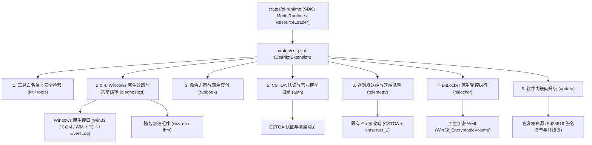
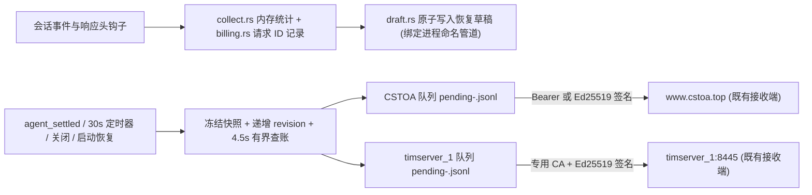
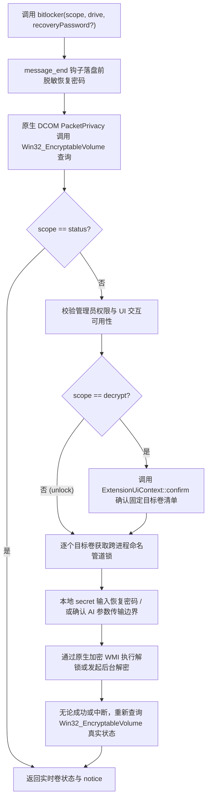
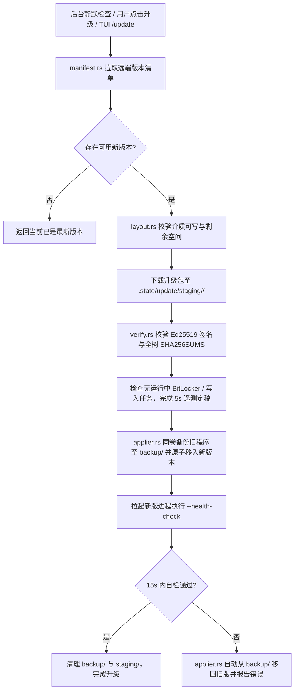

# 阶段 6：CST Pilot 业务迁移（cst-pilot）设计

`crates/cst-pilot` 基于阶段 1 至阶段 4 的公开扩展接口，实现现场软硬件诊断与修复命令交付，集成 CSTOA 认证与遥测发送，并提供 BitLocker 受控操作及软件内联网升级。各工具直接调用 Rust 原生系统接口采集数据，发挥编译期类型检查、内存安全与高并发低开销的优势。整体阶段安排见 [0.PLAN.md](0.PLAN.md)，技术选型见 [prototype.md](../prototype.md)，产品要求见 [SPEC.md](../../SPEC.md) 与 [ARCHITECTURE.md](../../ARCHITECTURE.md)。

## 整体架构

`crates/cst-pilot` 作为独立业务包构建在 `pi-runtime` 之上，全部功能通过 `Extension` 与 `Provider` 公开接口静态挂载，不修改通用核心包。



现有 TypeScript 代码、规格文档与 `crates/cst-pilot` 子模块的对应关系如下：

| 现有源码与规格文档 | Rust 目标模块 | 核心职责 |
|---|---|---|
| [`APPEND_SYSTEM.md`](../../../agent/home/APPEND_SYSTEM.md)、[`agent/home/skills/`](../../../agent/home/skills/)<br>[`extensions/runtime/`](../../../agent/home/extensions/runtime/)<br>[runtime/SPEC.md](../../runtime/SPEC.md)、[runtime/ARCHITECTURE.md](../../runtime/ARCHITECTURE.md) | `src/kit.rs`<br>`src/tools/` | 锁定 17 个开放工具白名单，加载诊断系统提示词与 8 份技能文档，拦截凭据文件读取与内网 SSRF 请求 |
| [`extensions/diagnostics/index.ts`](../../../agent/home/extensions/diagnostics/index.ts)、[`result.ts`](../../../agent/home/extensions/diagnostics/result.ts)、[`wz-index.ts`](../../../agent/home/extensions/diagnostics/wz-index.ts)<br>[`ls.ts`](../../../agent/home/extensions/diagnostics/ls.ts)、[`disk.ts`](../../../agent/home/extensions/diagnostics/disk.ts)、[`sys.ts`](../../../agent/home/extensions/diagnostics/sys.ts)、[`startup.ts`](../../../agent/home/extensions/diagnostics/startup.ts)、[`eventlog.ts`](../../../agent/home/extensions/diagnostics/eventlog.ts)、[`driver.ts`](../../../agent/home/extensions/diagnostics/driver.ts)<br>[diagnostics/SPEC.md](../../diagnostics/SPEC.md)、[ARCHITECTURE.md](../../diagnostics/ARCHITECTURE.md)、[API.md](../../diagnostics/API.md) | `src/diagnostics/` | 基于 Windows 原生接口实现 `ls / disk / sys / startup / eventlog / driver` 六个只读诊断工具，管理 `WzIndex` 卷级缓存与 50 KiB 输出裁剪 |
| [`command-plan.ts`](../../../agent/home/extensions/diagnostics/command-plan.ts)、[`command-plan-store.ts`](../../../agent/home/extensions/diagnostics/command-plan-store.ts)<br>[`runbook.ts`](../../../agent/home/extensions/diagnostics/runbook.ts)、[`runbook-files.ts`](../../../agent/home/extensions/diagnostics/runbook-files.ts)、[`artifact-paths.ts`](../../../agent/home/extensions/diagnostics/artifact-paths.ts)<br>[SPEC.md#命令交付需求](../../SPEC.md#命令交付需求)、[runbook SKILL](../../../agent/home/skills/runbook/SKILL.md) | `src/runbook/` | 实现 `command_plan`、`runbook_deliver` 与 `runbook`，管理版本冲突检测与 UTF-8 BOM + CRLF 文本导出 |
| [`bitlocker.ts`](../../../agent/home/extensions/diagnostics/bitlocker.ts)、[`bitlocker-core.ts`](../../../agent/home/extensions/diagnostics/bitlocker-core.ts)、[`bitlocker-commands.ts`](../../../agent/home/extensions/diagnostics/bitlocker-commands.ts)<br>[`bitlocker-credentials.ts`](../../../agent/home/extensions/diagnostics/bitlocker-credentials.ts)、[`bitlocker-lock.ts`](../../../agent/home/extensions/diagnostics/bitlocker-lock.ts)<br>[diagnostics/SPEC.md#bitlocker状态解锁与解密](../../diagnostics/SPEC.md#bitlocker状态解锁与解密)、[bitlocker SKILL](../../../agent/home/skills/bitlocker/SKILL.md) | `src/bitlocker/` | 通过原生加密 WMI 实现 `bitlocker` 状态查询、恢复密码清零保护与隐藏输入，提供跨进程同卷锁、本地确认及中断后实时复查 |
| [`extensions/oauth/`](../../../agent/home/extensions/oauth/)、[`web/server/api/custom-provider.ts`](../../../agent/home/extensions/web/server/api/custom-provider.ts)<br>[`web/server/api/account.ts`](../../../agent/home/extensions/web/server/api/account.ts)、[`quota.ts`](../../../agent/home/extensions/web/server/api/quota.ts)<br>[auth/SPEC.md](../../auth/SPEC.md)、[ARCHITECTURE.md](../../auth/ARCHITECTURE.md)、[API.md](../../auth/API.md) | `src/auth/` | 注册 `cstoa` 服务商，实现设备码 OAuth 与 APIKEY 登录，提供按官方规格对齐的动态模型目录、自定义服务管理与额度查询 |
| [`extensions/telemetry/`](../../../agent/home/extensions/telemetry/)、[`oauth/request-observer.ts`](../../../agent/home/extensions/oauth/request-observer.ts)<br>[contract.md](../../contract.md)、[telemetry/SPEC.md](../../telemetry/SPEC.md)、[ARCHITECTURE.md](../../telemetry/ARCHITECTURE.md)、[API.md](../../telemetry/API.md) | `src/telemetry/` | 保持双端 Go 接收端不变，以 Rust 重写遥测发送端，采集会话统计、核对 CSTOA 请求扣点并维护恢复草稿与双端持久化队列 |
| [`extensions/branding/version.ts`](../../../agent/home/extensions/branding/version.ts)、[`pack/pack.mjs`](../../../pack/pack.mjs)、[`pack/release-checks.mjs`](../../../pack/release-checks.mjs)<br>[release/SPEC.md](../../release/SPEC.md)、[release/ARCHITECTURE.md](../../release/ARCHITECTURE.md) | `src/update/` | 提供软件内联网版本检查与 Ed25519 签名校验，按程序区与用户数据区隔离替换文件，启动失败时自动回滚 |

## 异常中断与状态恢复

进程强杀、断电或拔盘后的状态恢复，依托 [`pi-session::execution_log`](3.session-and-extensions.md) 记录执行状态，并配合 Windows 原生状态实时复查、同卷原子替换与遥测草稿存活证明协同完成。

| 中断场景 | 恢复与保护机制 |
|---|---|
| 只读诊断中断 | 六个只读诊断工具均不修改系统状态。进程重启后，`reconcile_on_startup` 将未闭合运行标为 `InterruptedByCrash`，按需由用户重新发起查询 |
| 命令清单写入中断 | `command_plan`、`runbook_deliver` 与 `runbook` 均通过同目录临时文件同步后原子替换，中断不会在 `artifacts/` 或 `command-plans/` 下留下半成品文件 |
| BitLocker 执行中断 | `bitlocker` 注册为 `ToolReplayPolicy::Never`。解锁或解密中途发生崩溃或超时后，禁止自动重放命令，直接通过原生 WMI 重新查询 `Win32_EncryptableVolume` 实时卷状态并向用户报告 |
| 会话遥测中断 | 每轮对话结束与 CSTOA 请求尝试均原子写入 `agent/home/telemetry/drafts/<recordId>.json`，并绑定当前进程的内核命名管道。重启后扫描草稿，若原进程命名管道已释放，按 `endReason = "crash"` 补查账单并封存入队 |
| 软件内升级中断 | 升级包先在 `.state/update/staging/` 完成验签与解压。替换阶段将旧版程序移入 `.state/update/backup/`，新版启动健康检查失败或中途断电时，下次启动自动从 `backup/` 恢复旧版程序 |

## 存量数据兼容与平滑升级规则

Rust 版沿用现有工具包在 `agent/home/` 与 `artifacts/` 下的目录结构及文件格式。用户通过软件内联网升级或替换程序文件后，可直接继续使用历史会话、设置与登录凭据。

| 持久化路径 | 格式兼容规则 | 损坏或格式不兼容时的处理策略 |
|---|---|---|
| `agent/home/sessions/*.jsonl` | 复用 `JsonlSessionStore` 读写 JSONL v3（自动迁移 v1/v2），保留 `cst-web-input-message` 与 `cst-web-work-duration` 自定义条目 | 末行半截 JSON 自动截断修复。文件头非法或中间行损坏时保留原文件，返回中文提示 `会话文件无法读取，请检查或移除损坏的会话记录。` |
| `agent/home/settings.json`<br>`agent/home/web-settings.json` | 复用 `SettingsManager` 按字段合并读写，保留未知字段，维持 TUI 与 Web 主题独立存储 | 标记 `load_failed` 并回退内存默认值，拒绝写回覆盖原文件，返回 `设置文件无法读取，请检查 settings.json 后重试。` |
| `agent/home/auth.json`<br>`agent/home/models.json` | 直接读取现有 `cstoa`（`oauth` 与 `api_key`）及其他服务商凭据，兼容自定义服务地址与模型覆盖配置 | 停止修改并保留原文件，返回 `模型或凭据配置无法读取，请检查 models.json 和 auth.json 后重试。`，日志与响应严禁包含配置原文或密钥 |
| `agent/home/models-store.json` | 兼容预置离线模型目录与 `cstoa` 动态缓存条目，按 `etag` 凭据摘要校验归属 | 忽略损坏缓存，回退内置离线目录并在后台重新拉取 |
| `agent/home/device.json` | 直接读取已保存的 `deviceId` 供 CSTOA 授权与刷新复用。文件缺失时首次登录生成新标识 | 拒绝覆盖非空损坏文件，提示检查或删除 `agent/home/device.json` 后重新登录 |
| `agent/home/command-plans/<ID>/v*.json`<br>`artifacts/<YYYY-MM-DD>/runbook/` | 保持方案 JSON 字段与 TXT 清单文件名格式不变，修订版本号与当天序号基于现有文件继续递增 | 单个方案 JSON 损坏时仅拒绝该方案修订。清单目录存在重复序号时报错提示检查目录 |
| `agent/home/telemetry/` | 兼容 `identity.json`、`drafts/*.json` 以及 `pending-*.jsonl` 和 `status.json`，启动时继续恢复残留草稿并投递发送队列 | `identity.json` 损坏时将安装身份置为 `null` 且不覆盖原文件。损坏的单条草稿或队列行隔离跳过 |

## 目录结构

Cargo Workspace 新增 `crates/cst-pilot`，源码按八项业务能力组织：

```text
crates/cst-pilot/
|-- Cargo.toml
|-- src/
|   |-- lib.rs                      # 导出 CstPilotExtension、工具集合与服务装配入口
|   |-- kit.rs                      # 工具包路径定位、17 个开放工具白名单与资源加载配置
|   |-- tools/
|   |   |-- mod.rs                  # 基础检索与联网工具注册入口
|   |   |-- path_guard.rs           # 敏感凭据文件与运行态目录读取拦截器
|   |   |-- fff.rs                  # fffind 与 ffgrep 路径模糊查找及内容正则检索
|   |   |-- web_access.rs           # web_search / source_check / fetch_content / get_search_content
|   |   `-- ssrf.rs                 # URL 校验、DNS 解析后私网拦截与 198.18.0.0/15 TUN 放行策略
|   |-- diagnostics/
|   |   |-- mod.rs                  # 6 个只读诊断工具注册与共享 WzIndex 注入
|   |   |-- result.rs               # 50 KiB 结构化 JSON 裁剪器与 notice / degraded 封装
|   |   |-- win_native.rs           # COM 线程初始化、PDH 本地化计数器解析与随包组件 JobObject 托管
|   |   |-- wz_index.rs             # 进程内卷级目录与大文件大小缓存及 Win32 卷身份核验
|   |   |-- ls.rs                   # 覆盖内置 ls 的目录大小倒序浏览工具
|   |   |-- disk.rs                 # disk (space / info / health / usage / all) 原生存储诊断
|   |   |-- sys.rs                  # sys (overview / proc / gpu / io / sensor) 原生负载与传感器采集
|   |   |-- startup.rs              # startup 注册表、启动文件夹与自启服务原生盘点
|   |   |-- eventlog.rs             # eventlog 基于 EvtQuery 的八种场景查询、聚合计数与单条详情
|   |   `-- driver.rs               # driver (problem / core / external / find) 原生设备与驱动查询
|   |-- runbook/
|   |   |-- mod.rs                  # command_plan / runbook_deliver / runbook 工具注册
|   |   |-- model.rs                # 风险分档、命令条目校验与 UTF-8 BOM + CRLF 文本拼装
|   |   |-- plan_store.rs           # 多版本命令方案存储、版本冲突校验与原子导出
|   |   `-- sequence_store.rs       # 单步 runbook 当天递增序号分配、同序号覆盖与命名管道目录锁
|   |-- bitlocker/
|   |   |-- mod.rs                  # bitlocker 工具注册与提示词规范
|   |   |-- core.rs                 # status / unlock / decrypt 状态机与未知结果实时复查
|   |   |-- credentials.rs          # 48 位恢复密码校验、Zeroizing 内存保护与落盘前脱敏
|   |   |-- lock.rs                 # 按规范化 volumeId 建立的跨进程命名管道互斥锁
|   |   `-- wmi_encryptable.rs      # PacketPrivacy 加密级别 Win32_EncryptableVolume 原生调用器
|   |-- auth/
|   |   |-- mod.rs                  # cstoa Provider 注册与认证服务导出
|   |   |-- provider.rs             # OAuth 代理与 APIKEY 网关双路由 Provider 实现
|   |   |-- oa.rs                   # RFC 8628 设备码申请、轮询、令牌刷新与失效错误分类
|   |   |-- device.rs               # agent/home/device.json 持久化与复用
|   |   |-- models.rs               # CSTOA 动态模型目录、凭据摘要隔离与官方模型规格对齐
|   |   |-- custom_provider.rs      # agent/home/models.json 版本化读写与掩码导出
|   |   `-- account.rs              # CSTOA / DeepSeek / OpenCode Go 账号资料与额度 60 秒缓存查询
|   |-- telemetry/
|   |   |-- mod.rs                  # 遥测发送端入口、生命周期钩子绑定与显式定稿接口
|   |   |-- collect.rs              # 会话指标内存累加与 0.1 / 0.2 快照序列化
|   |   |-- billing.rs              # x-oneapi-request-id 响应头观测与 /api/agent/llm/billing 查账
|   |   |-- draft.rs                # 恢复草稿原子写入、命名管道存活证明与崩溃草稿恢复
|   |   |-- identity.rs             # identity.json 管理、MachineGuid HMAC 派生与 Ed25519 签名
|   |   |-- outbox.rs               # 双端独立 JSONL 队列、版本化 ack 删除与 FAT/exFAT 目录锁
|   |   `-- heartbeat.rs            # 进程级 runId 在线状态单飞发送
|   `-- update/
|       |-- mod.rs                  # 软件内升级服务入口、命令注册与进度事件广播
|       |-- manifest.rs             # 远端版本清单检查、兼容性判定与离线环境变量豁免
|       |-- verify.rs               # 内置 Ed25519 公钥验签与全树 SHA256SUMS 完整性校验
|       |-- layout.rs               # 只读程序区与持久用户数据区边界划分及配置合并
|       `-- applier.rs              # 同卷暂存解压、句柄释放、备份重命名替换与失败自动回滚
`-- tests/
    |-- tools_and_security.rs       # 白名单、凭据路径拦截、SSRF 内网阻断与 198.18.0.0/15 放行测试
    |-- diagnostics_contract.rs     # overview / proc / space / info / health / driver / startup / eventlog 契约测试
    |-- runbook_and_plan.rs         # 方案版本冲突、同序号替换、BOM+CRLF 编码与写入边界测试
    |-- storage_and_sensors.rs      # WizTree CSV 解析、WzIndex 换盘失效、walk 预算截断与 gpu/io/sensor 测试
    |-- auth_and_catalog.rs         # CSTOA 登录、跨机凭据复用、官方模型规格对齐与防串号额度测试
    |-- telemetry_pipeline.rs       # 统计口径、请求查账、双端独立队列重试与强杀草稿恢复测试
    |-- bitlocker_safety.rs         # 同卷跨进程锁、恢复密码零落盘脱敏、本地确认与中断后状态复查测试
    `-- update_lifecycle.rs         # 升级清单验签、用户数据保留、Windows 运行态替换与启动失败回滚测试
```

## 核心模块详细设计

### 1. 工具白名单与安全检索（迁移顺序 1）

`kit.rs` 与 `tools/` 收拢工具包运行边界，确保模型仅能调用白名单内的只读诊断与受控交付工具，并阻断对本地凭据文件和内网地址的访问。设计依据见 [runtime/SPEC.md](../../runtime/SPEC.md)、[runtime/ARCHITECTURE.md](../../runtime/ARCHITECTURE.md) 与 [ARCHITECTURE.md#全局运行边界](../../ARCHITECTURE.md#全局运行边界)。

#### 1.1 开放工具白名单与资源装配

1. **工具白名单锁定**：会话创建时固定激活 17 个工具，包含内置 `read`、10 个诊断与交付工具（`ls / disk / sys / startup / eventlog / driver / command_plan / runbook_deliver / runbook / bitlocker`）、2 个文件检索工具（`fffind / ffgrep`）以及 4 个联网检索工具（`web_search / source_check / fetch_content / get_search_content`）。内置的 `bash / powershell / write / edit / grep / find` 从可用工具集中移除。
2. **上下文与技能隔离**：`ResourceLoader` 强制设置 `no_context_files = true` 与 `default_project_trust = "never"`，忽略机主目录或父目录中的 `AGENTS.md`、`CLAUDE.md` 与 `.pi/` 配置。系统提示词固定附加 [`agent/home/APPEND_SYSTEM.md`](../../../agent/home/APPEND_SYSTEM.md)，技能目录仅加载 [`agent/home/skills/`](../../../agent/home/skills/) 下的 8 份维护技能文档。
3. **同名 `ls` 覆盖**：诊断模块的 `ls` 工具替换 `pi-runtime` 内置 `ls`，并在 `ToolDefinition` 中显式声明 `prompt_snippet`，确保工具出现在系统提示词的 `<tools>` 列表中。

#### 1.2 本地凭据拦截与 SSRF 网络边界

| 保护对象 | 拦截位置与校验规则 |
|---|---|
| 本地敏感文件（`path_guard.rs`） | 将目标路径做规范化与符号链接解析（`canonicalize`），对 `read / fffind / ffgrep` 统一拦截 `agent/home/{auth,models,mcp-auth}.json`、`agent/home/telemetry/identity.json` 及 `.state/` 目录的读取或枚举。命中时直接返回权限拒绝错误，不暴露文件内容 |
| 文件模糊与内容检索（`fff.rs`） | 基于 `ignore`、`globset` 与 `regex` 原生实现 `fffind` 与 `ffgrep`。自动跳过受保护的凭据路径，限制单次返回条数与 50 KiB 文本上限，遵守 `.gitignore` |
| 联网检索配置（`web_access.rs`） | 启动时读取 `agent/home/web-search.json`（默认 `searchProvider: "exa"`、`workflow: "none"`）。检索正文保存在进程内有界缓存中，供 `get_search_content` 按 `responseId` 分页或按 `findText` 查找 |
| SSRF 与代理隔离（`ssrf.rs`） | 固定 `trust_env_proxy = false`。每次发起 HTTP 请求及跟随重定向前解析目标域名 IP，拒绝访问 `127.0.0.0/8 / 10.0.0.0/8 / 172.16.0.0/12 / 192.168.0.0/16 / 169.254.0.0/16` 等 IPv4 私网，同时拦截 `::1 / fc00::/7 / fe80::/10` 等 IPv6 本地地址，仅放行配置允许的 `198.18.0.0/15`（TUN 假 IP 网段） |

### 2. Windows 原生系统诊断（迁移顺序 2）

`diagnostics/` 模块直接通过 Rust 原生调用 Windows 系统接口实现软硬件查询，保持 JSON 返回字段与数值单位不变，报错格式和 `notice` 说明对齐现有契约。行为规则见 [diagnostics/SPEC.md](../../diagnostics/SPEC.md)，架构见 [diagnostics/ARCHITECTURE.md](../../diagnostics/ARCHITECTURE.md)，接口字段见 [diagnostics/API.md](../../diagnostics/API.md)。

#### 2.1 原生采集架构与 50 KiB 结构化裁剪

1. **双通道结果封装（`diagnostics/result.rs`，对应 [`result.ts`](../../../agent/home/extensions/diagnostics/result.ts)）**：工具返回 `AgentToolResult` 时，`details` 保存完整未裁剪的 JSON 对象供界面卡片渲染，`content` 保存序列化文本供模型消费。若 UTF-8 字节数超过 50 KiB（`51,200` 字节），按 `limit = 256, 128, 64, ...` 递归截断数组长度与长字符串（`limit * 8` 字符），并在顶层注入 `outputTruncated: true`、`originalBytes` 与 `outputNotice`，保证输出始终为合法 JSON。
2. **Rust 原生系统接口采集（`diagnostics/win_native.rs`，替代 [`runtime.ts`](../../../agent/home/extensions/diagnostics/runtime.ts) 与 [`pwsh-data.ts`](../../../agent/home/extensions/diagnostics/pwsh-data.ts)）**：
   - 直接使用 `windows`（微软官方 Win32 / EventLog / PDH / Registry / Storage 绑定）、`wmi`（原生 COM/WMI 查询与类型反序列化）及 `sysinfo` 采集系统数据，免除每次工具调用拉起 `pwsh.exe` 的进程创建与文本解析开销。
   - 强类型结构体直连底层 API，从根源消除脚本拼接、引号转义与命令行注入风险。
   - 阻塞式 COM/WMI 查询运行在 `tokio::task::spawn_blocking` 隔离线程池中（线程内按 `COINIT_MULTITHREADED` 初始化 COM），外层绑定 `CancellationToken` 与工具超时预算。调用随包 `WizTree64.exe` 或 LHM 采集器时统一绑定 Windows Job Object（`JOB_OBJECT_LIMIT_KILL_ON_JOB_CLOSE`），超时或取消时立即回收子进程。

#### 2.2 各诊断工具的原生实现与契约

| 工具与 `scope` | 现有 TS 源码与文档 | Rust 原生采集接口与计算口径 | 降级与报错边界 |
|---|---|---|---|
| `sys(overview)` | [`sys.ts`](../../../agent/home/extensions/diagnostics/sys.ts)、[`sys-commands.ts`](../../../agent/home/extensions/diagnostics/sys-commands.ts)<br>[sys SKILL](../../../agent/home/skills/sys/SKILL.md)<br>[diagnostics/API.md#sys](../../diagnostics/API.md#sys) | 通过原生 WMI 查询系统与内存类（`Win32_OperatingSystem / Win32_PageFileUsage / Win32_PerfFormattedData_PerfOS_Memory / Win32_PerfFormattedData_PerfOS_Processor`）以及硬件类（`Win32_ComputerSystem / Win32_BIOS / Win32_Processor`）。容量统一换算为二进制 GiB 或 MiB | 单个 WMI 类读取失败时保留其余字段，设置 `degraded: true` 并写入 `collectionErrors` |
| `sys(proc)` | [`sys.ts`](../../../agent/home/extensions/diagnostics/sys.ts)、[`sys-commands.ts`](../../../agent/home/extensions/diagnostics/sys-commands.ts)<br>[diagnostics/SPEC.md#sys-与-startup实时负载与启动配置](../../diagnostics/SPEC.md#sys-与-startup实时负载与启动配置) | 使用 Win32 进程接口（`CreateToolhelp32Snapshot / OpenProcess / GetProcessTimes / K32GetProcessMemoryInfo / QueryFullProcessImageNameW`）在进程内间隔 1.2 秒双采样。按 `Instant` 实际间隔与逻辑核数计算每进程 `cpuPct`，内存取工作集 `wsMB`，支持按 `top`（默认 10，最大 50）截取 `byCpu` 与 `byMem` | 整次采样失败时抛错并标记 `isError: true`。单进程权限不足无法读取路径时 `path` 置 `null` |
| `disk(space / info / health / all)` | [`disk.ts`](../../../agent/home/extensions/diagnostics/disk.ts)、[`disk-core.ts`](../../../agent/home/extensions/diagnostics/disk-core.ts)<br>[disk SKILL](../../../agent/home/skills/disk/SKILL.md)<br>[diagnostics/API.md#disk](../../diagnostics/API.md#disk) | `space` 直接调用 Win32 `GetLogicalDrives` 与 `GetDiskFreeSpaceExW`，按 `字节 ÷ 2³⁰` 换算 `totalGB` 与 `freeGB`。`info` 通过原生 WMI 查询 `ROOT\CIMV2` 的 `Win32_LogicalDisk / Win32_LogicalDiskToPartition` 及 `ROOT\Microsoft\Windows\Storage` 的 `MSFT_PhysicalDisk`。`health` 查询 `MSFT_StorageReliabilityCounter` 读取磨损度与温度，并采集通电小时与读写错误计数 | 指定 `drive` 但盘符与物理盘关联失败时，`info` 返回全量物理盘并附 `infoNotice`，`health` 拒绝查询 SMART 并说明原因。仅在遭遇 `E_ACCESSDENIED` 时提示管理员权限 |
| `driver(problem / core / external / find)` | [`driver.ts`](../../../agent/home/extensions/diagnostics/driver.ts)、[`driver-core.ts`](../../../agent/home/extensions/diagnostics/driver-core.ts)、[`driver-data.ts`](../../../agent/home/extensions/diagnostics/driver-data.ts)<br>[driver SKILL](../../../agent/home/skills/driver/SKILL.md)<br>[diagnostics/API.md#driver](../../diagnostics/API.md#driver) | 通过原生 WMI 查询 `Win32_PnPEntity / Win32_NetworkAdapter / Win32_PnPSignedDriver / Win32_VideoController / Win32_DiskDrive / Win32_Service`。`problem` 筛选 `Status = Error/Unknown`。`core` 汇总 `NetConnectionID` 非空网卡、蓝牙与音频显示设备，附带关键服务（`bthserv / Audiosrv`）及四类签名驱动版本。`external` 枚举外设与可移动磁盘。`find` 在 Rust 侧对 `name / class / id`（匹配 `deviceId` 与 `hardwareIds`）做 AND 组合过滤 | 未传任何 `find` 条件时直接返回参数错误。部分 WMI 类枚举失败时标记 `degraded: true` |
| `startup` | [`startup.ts`](../../../agent/home/extensions/diagnostics/startup.ts)<br>[startup SKILL](../../../agent/home/skills/startup/SKILL.md)<br>[diagnostics/API.md#startup](../../diagnostics/API.md#startup) | 使用 Win32 注册表 API（`RegOpenKeyExW / RegEnumValueW`）只读枚举 HKLM/HKCU 的 `Run`、`RunOnce` 与 `Wow6432Node\Run`，关联 `StartupApproved\{Run,Run32,StartupFolder}` 首字节奇偶判读 `disabled: true \| false \| null`。通过 `SHGetKnownFolderPath` 读取个人与公共启动文件夹，通过原生 WMI `Win32_Service` 枚举 `StartMode = 'Auto'` 服务（`Running` 排前，`path` 超 140 字符截断） | `Run` 的禁用记录严禁套用到同名 `RunOnce` 项。PE 环境如实返回 PE 自身注册表与服务 |
| `eventlog`（8 个 `scope`） | [`eventlog.ts`](../../../agent/home/extensions/diagnostics/eventlog.ts)、[`eventlog-core.ts`](../../../agent/home/extensions/diagnostics/eventlog-core.ts)<br>[eventlog SKILL](../../../agent/home/skills/eventlog/SKILL.md)<br>[diagnostics/API.md#eventlog](../../diagnostics/API.md#eventlog) | 直接调用 Windows Event Log 原生 API（`EvtQuery / EvtNext / EvtRender / EvtFormatMessage`）按结构化 XPath 下推查询 `recent / boot / crash / service / disk / security / query / detail`。`boot` 合并系统启停与 `Microsoft-Windows-WHEA-Logger` 并按 `logName + recordId` 去重，`crash` 保留 WER `1001` 与 Hang `1002`。列表消息截断 200 字符，聚合 `counts` 最多 100 组，`detail` 保留换行且最多 20,000 字符 | `security` 执行前调用 `CheckTokenMembership` 检查管理员权限，非管理员直接返回 `admin: false, degraded: true`。按 Win32 错误码精确区分通道缺失（`ERROR_EVT_CHANNEL_NOT_FOUND`）与单条消息格式化损坏（计入 `unreadable`）。`query` 的 `provider` 正则使用带大小限制的 `regex` 匹配 |

### 3. 修复命令方案与清单导出（迁移顺序 3）

`runbook/` 模块实现 `command_plan`、`runbook_deliver` 与 `runbook` 三个工具，将需由队员手动执行的修复命令保存为结构化方案或纯文本清单。设计依据见 [SPEC.md#命令交付需求](../../SPEC.md#命令交付需求)、[diagnostics/SPEC.md#命令方案与交付](../../diagnostics/SPEC.md#命令方案与交付)、[diagnostics/API.md#command_plan-与-runbook_deliver](../../diagnostics/API.md#command_plan-与-runbook_deliver) 与 [runbook SKILL](../../../agent/home/skills/runbook/SKILL.md)，现有实现见 [`command-plan.ts`](../../../agent/home/extensions/diagnostics/command-plan.ts)、[`command-plan-store.ts`](../../../agent/home/extensions/diagnostics/command-plan-store.ts)、[`runbook.ts`](../../../agent/home/extensions/diagnostics/runbook.ts)、[`runbook-files.ts`](../../../agent/home/extensions/diagnostics/runbook-files.ts) 与 [`artifact-paths.ts`](../../../agent/home/extensions/diagnostics/artifact-paths.ts)。

| 子模块 | 设计规则与安全限制 |
|---|---|
| 参数与内容校验（`model.rs`） | `title` 必填（过滤路径非法字符与控制字符后 1–48 字），`level` 限 `safe`（安全）、`low`（较安全）与 `confirm`（需确认），`items` 限 1–20 条。`summary`（≤300 字）与 `command`（≤2000 字）禁止为空或包含换行符，`shell` 限 `cmd` 或 `powershell`，`admin` 归一化为布尔值 |
| 多版本方案管理（`plan_store.rs`） | `command_plan` 将方案写入 `agent/home/command-plans/<runbookId>/v<version>.json`（兼容读取旧路径 `outbox/.plans`）。新建时生成 UUID 与 `version = 1`。修订时必须同时传入 `runbookId` 与 `baseVersion`，持有目录锁核对 `baseVersion` 等于当前最新版本且归档日期未变后递增保存，版本冲突时立即报错拒绝覆盖 |
| 方案版本导出（`runbook_deliver`） | 仅接收 `runbookId` 与 `version`。校验请求的 `version` 为该方案当前最新版本后，生成 `artifacts/<YYYY-MM-DD>/runbook/<runbookId>/v<version>-<风险档中文>-<标题>.txt`。同版本重试且磁盘文件内容未变时直接返回原文件。若磁盘文件已被现场修改，报错拒绝覆盖并提示先修订方案 |
| 单步清单写入（`sequence_store.rs`） | `runbook` 写入 `artifacts/<YYYY-MM-DD>/runbook/<序号>-<风险档中文>-<标题>.txt`。序号 `01`–`999` 在当天目录内唯一递增。传入已有 `sequence` 时原地替换该序号文件，若标题改变则在新文件替换成功后删除旧文件名 |
| 文件编码与写入边界 | 仅允许在工具包 `artifacts/<YYYY-MM-DD>/runbook/` 与 `agent/home/command-plans/` 下写入，禁止生成 `.bat`、`.cmd` 或 `.ps1`。TXT 统一采用 UTF-8 BOM（`EF BB BF`）+ CRLF 编码，首行写标题、风险档与时间，每条命令固定四行。进程内通过异步互斥锁串行化，跨进程通过命名管道锁 `\\.\pipe\cst-pilot-runbook-<sha256>` 互斥，经同目录临时文件同步后原子重命名 |

### 4. 空间扫描、共享缓存与硬件传感器（迁移顺序 4）

本节实现耗时目录扫描、跨工具共享缓存与硬件性能计数器采集，管控超时预算、中途取消与换盘缓存清理。设计依据见 [diagnostics/ARCHITECTURE.md#共享目录大小缓存wz-index](../../diagnostics/ARCHITECTURE.md#共享目录大小缓存wz-index)、[diagnostics/SPEC.md](../../diagnostics/SPEC.md) 与 [ls SKILL](../../../agent/home/skills/ls/SKILL.md)，现有实现见 [`wz-index.ts`](../../../agent/home/extensions/diagnostics/wz-index.ts)、[`ls.ts`](../../../agent/home/extensions/diagnostics/ls.ts)、[`disk-core.ts`](../../../agent/home/extensions/diagnostics/disk-core.ts) 与 [`sys-commands.ts`](../../../agent/home/extensions/diagnostics/sys-commands.ts)。

#### 4.1 共享目录大小缓存（`WzIndex`）与存储扫描

1. **缓存结构与原生卷身份校验（`diagnostics/wz_index.rs`，对应 [`wz-index.ts`](../../../agent/home/extensions/diagnostics/wz-index.ts)）**：
   - `WzIndex` 在进程内存中按盘符维护 `dirs`（大写规范化路径到聚合字节数）、`files`（≥1 MiB 文件的大小）与 `identities`（通过 Win32 `GetVolumeInformationW` 与根目录 `GetFileInformationByHandle` 获取的卷序列号、文件系统及根目录创建时间），同时记录 `failed` 标记与正在运行的同卷 `pending` 任务句柄。
   - 每次读写前通过原生 Win32 接口微秒级核对目标盘符的当前卷身份。若队员在多台电脑间拔插换盘或更换移动硬盘导致卷身份变化，立即清空该盘符的缓存与 `failed` 标记。
   - 同卷并发调用共享同一个 `pending` 扫描任务。扫描在局部哈希表完成后二次复核卷身份，再原子发布到共享映射中。仅缓存 WizTree 完整导出结果，不缓存 `walk` 递归统计产生的下界数据。
2. **`ls` 与 `disk(usage)` 执行与降级（`diagnostics/ls.rs`、`disk.rs`）**：
   - `ls`（对应 [`ls.ts`](../../../agent/home/extensions/diagnostics/ls.ts)）优先从 `WzIndex` 读取直接子项大小（`method: "wiztree-index"`），对 `stat` 返回 0 的系统独占大文件（如 `pagefile.sys`）使用 `files` 缓存兜底。未命中且目标非 UNC 路径时触发 WizTree 扫描。WizTree 不可用或目标为 UNC 路径时回退 Rust 原生目录遍历（`method: "walk"`，共用 50 万条目与 30 秒预算，跳过符号链接与重解析点，超限或遇权限拒绝时停止并标注 `totalSize` 为下界，同时将全部子项 `pct` 置 `null`）。
   - `disk(usage)`（对应 [`disk-core.ts`](../../../agent/home/extensions/diagnostics/disk-core.ts)）调用随包 `wiztree/WizTree64.exe`（带 `/admin=0`，绑定 Job Object）将 CSV 导出至 `wiztree/tmp/`，使用 `csv` 库恒定内存流式维护 Top-N 最小堆，一次扫描算出 `topDirs / topFiles / extAgg / staleFiles`（≥50 MiB 且 ≥1 年未修改）。通过 Win32 `GetVolumeInformationW` 判断卷文件系统，NTFS 标 `wiztree-mft`，其他标 `wiztree-walk`。收到取消信号或扫描结束时立即终止子进程并删除临时 CSV。WizTree 失败时降级为原生遍历（标记 `method: "node-walk"` 保持字段兼容，仅返回 `topDirs`）。

#### 4.2 GPU 负载、磁盘 I/O 与硬件传感器

| 子功能 | 现有 TS 源码 | Rust 原生采集机制与口径要求 |
|---|---|---|
| `sys(io)` | [`sys.ts`](../../../agent/home/extensions/diagnostics/sys.ts)<br>[`sys-commands.ts`](../../../agent/home/extensions/diagnostics/sys-commands.ts) | 与 `sys(proc)` 共用约 1.2 秒原生双采样窗口。通过 Win32 `GetProcessIoCounters`（或原生 WMI `Win32_Process`）计算每进程读写字节速率 `byIo`，同时通过原生 WMI 查询 `Win32_PerfFormattedData_PerfDisk_PhysicalDisk`（排除 `_Total`）读取物理盘队列长度、繁忙百分比与读写吞吐，在 `notice` 中注明两套指标口径不同不可直接相加 |
| `sys(gpu)` | [`sys.ts`](../../../agent/home/extensions/diagnostics/sys.ts)<br>[`sys-commands.ts`](../../../agent/home/extensions/diagnostics/sys-commands.ts) | 通过 `windows` 原生 PDH API（`PdhLookupPerfNameByIndexW / PdhOpenQueryW / PdhExpandWildCardPathW / PdhCollectQueryData / PdhGetFormattedCounterArrayW`）读取 `GPU Engine` 与 `GPU Process Memory`（查询失败自动重试一次），并通过原生 WMI 读取 `Win32_VideoController`。每进程 `gpuPct` 取跨适配器最繁忙的单一引擎利用率，专用显存仅统计 >1 MiB 实例。并行直接调用 `nvidia-smi.exe`（8 秒超时），缺失或失败时由随包 LHM 补充 `lhmGpu` |
| `sys(sensor)` | [`sys.ts`](../../../agent/home/extensions/diagnostics/sys.ts)<br>[`sys-commands.ts`](../../../agent/home/extensions/diagnostics/sys-commands.ts) | 遵循零驱动安装约束，不安装 WinRing0 或 PawnIO 内核驱动。通过原生 PDH API 读取 `Thermal Zone Information`（开尔文转摄氏度，仅保留 -50～150°C）与 `Processor Information`（`% of Maximum Frequency`），通过原生注册表 API 检查 `HKLM\SYSTEM\CurrentControlSet\Services\PawnIO`。主板、CPU 与 GPU 传感器在绑定 Job Object 的受控子进程中加载 `lhm/LibreHardwareMonitorLib.dll` 读取（过滤非有限值，上限 200 项） |

### 5. CSTOA 认证、官方模型目录与账号额度（迁移顺序 5）

`auth/` 模块通过 `pi-session` 与 `pi-runtime` 的公开接口注册原生 `cstoa` 服务商，管理团队认证、动态模型目录和账号额度查询。设计依据见 [auth/SPEC.md](../../auth/SPEC.md)、[auth/ARCHITECTURE.md](../../auth/ARCHITECTURE.md) 与 [auth/API.md](../../auth/API.md)。

#### 5.1 `cstoa` 服务商与双模式登录

1. **双路由协议复用（`auth/provider.rs`，对应 [`oauth/provider.ts`](../../../agent/home/extensions/oauth/provider.ts)）**：复用 `pi-ai` 的 OpenAI Chat Completions 协议实现。凭据为 OAuth 令牌时，请求发往 `<oaHost>/api/agent/llm/v1`。凭据为 APIKEY 时，请求发往 `<oaHost>/v1`。
2. **设备码 OAuth 登录（`auth/oa.rs`、`device.rs`，对应 [`oauth/oa.ts`](../../../agent/home/extensions/oauth/oa.ts)、[`device.ts`](../../../agent/home/extensions/oauth/device.ts)）**：
   - 首次登录生成 `deviceId` 并持久化至 `agent/home/device.json`，U 盘跨机移动时直接复用。
   - 调用 `POST /api/oauth/device_authorization` 获取 `device_code` 与 `verification_uri_complete`。TUI 模式发出包含完整授权链接的文本通知，不自动打开机主浏览器。Web 与桌面端发出 `device_code` 事件供界面渲染二维码与倒计时。
   - 按 `interval` 轮询 `POST /api/oauth/token`，支持 24 小时默认访问令牌与可选的 7 天刷新令牌。
3. **APIKEY 登录与校验**：通过 `secret` 输入框获取密钥（去首尾空白后长度 1–8192），调用 `GET /api/agent/key-profile`（8 秒超时，禁止 HTTP 重定向）校验成员身份。网络异常时提示检查网络重试，仅在返回 `401/403` 或业务错误码 `19008` 时判定密钥无效。
4. **续期与失效分类（对应 [`oauth/errors.ts`](../../../agent/home/extensions/oauth/errors.ts)）**：令牌到期前 5 分钟进入刷新窗口。无刷新令牌或遇到临时网络故障时，继续使用尚未过期的访问令牌。实际到期且无法续期、或服务端返回 `401/403/invalid_grant` 时，返回 `cstoa_login_required` 错误码。

#### 5.2 官方模型规格目录、自定义服务与额度缓存

| 子模块 | 现有 TS 源码与数据 | 核心机制与隔离规则 |
|---|---|---|
| 动态模型目录（`auth/models.rs`） | [`oauth/models.ts`](../../../agent/home/extensions/oauth/models.ts)<br>[`oauth/catalog-factories.ts`](../../../agent/home/extensions/oauth/catalog-factories.ts)<br>[`crates/pi-ai/src/providers/data/`](../../../crates/pi-ai/src/providers/data/) | 1. 以 `SHA-256(baseUrl + "\0" + credentialType + "\0" + token)` 作为 `etag` 写入 `models-store.json`。`filter_models` 每次比对当前凭据摘要，切换账号、切换登录方式或退出登录时立即清空旧目录。<br>2. 成功缓存有效期 5 分钟，失败后退避 30 秒。保留网关返回的原始模型 `id` 与展示名，忽略上游响应中非标的 `baseUrl` 或 `headers`。<br>3. **全量采用官方规格参数**：CSTOA 提供的所有模型（如 `deepseek-flash / deepseek-v4-pro / MiniMax-M3.1-Flash`）均默认直接采用模型厂商官方公布并收录在 `pi-ai` 内置目录（[`providers/data/*.json`](../../../crates/pi-ai/src/providers/data/)）中的规格值（`contextWindow / maxTokens / input / reasoning / inputLimits`），不在业务层自定参数或维护局部硬编码覆盖表。网关模型别名（如 `deepseek-v4.1-flash -> deepseek-flash`）映射至内置官方条目读取能力字段，请求参数维持 `openai-completions` 口径，本地 `cost` 统一置 `0` |
| 自定义模型服务（`auth/custom_provider.rs`） | [`web/server/api/custom-provider.ts`](../../../agent/home/extensions/web/server/api/custom-provider.ts) | 原子读写 `agent/home/models.json`，支持 `openai-completions / openai-responses / anthropic-messages / google-generative-ai` 四种协议。新建模型默认上下文窗口 `262,144`，最大输出取当前目录众数（空目录回退 `16,384`）。修改携带配置修订号防并发覆盖，保存后刷新 `ModelRuntime`。对外查询对已保存的 API Key 仅返回掩码标记 |
| 账号资料与额度查询（`auth/account.rs`） | [`web/server/api/account.ts`](../../../agent/home/extensions/web/server/api/account.ts)<br>[`web/server/api/quota.ts`](../../../agent/home/extensions/web/server/api/quota.ts) | 支持查询 `cstoa`（学号姓名与可用额度点）、`deepseek`（余额与币种）及 `opencode-go`（5 小时、每周与每月三窗口百分比）。维护 60 秒内存缓存并合并并发请求。请求发出前与响应返回后二次核对 `AuthStorage` 中的当前凭据摘要，若期间凭据已变更或退出，立即丢弃迟到响应 |

### 6. 会话遥测发送端与双端队列恢复（迁移顺序 6）

两个远端接收服务（CSTOA 接收端与 `timserver_1` 接收端，运行独立仓库 `cst-pilot-server` 的 Go + SQLite 服务）保持现有代码与部署不变。`crates/cst-pilot/src/telemetry/` 仅将客户端遥测发送端改造为 Rust 实现，严格遵循 [信息收集契约](../../contract.md)、[遥测规格](../../telemetry/SPEC.md)、[遥测架构](../../telemetry/ARCHITECTURE.md) 与 [遥测协议接口](../../telemetry/API.md)。



1. **静默开关与匿名身份（`telemetry/identity.rs`，对应 [`config.ts`](../../../agent/home/extensions/telemetry/config.ts)、[`installation.ts`](../../../agent/home/extensions/telemetry/installation.ts)、[`environment.ts`](../../../agent/home/extensions/telemetry/environment.ts)）**：
   - 启动时读取 `agent/home/telemetry.json`。若 `enabled = false` 或端点为空，模块保持完全静默，不注册请求观察器或探测系统环境，也不写入身份文件、恢复草稿与发送队列。
   - 启用时初始化或读取 `agent/home/telemetry/identity.json`（含 `installationId` 与 32 字节本地 `identityKey`）。通过原生注册表读取 `MachineGuid`，按 `HMAC-SHA256(identityKey, UTF-8(JSON(["environment", lower(MachineGuid)])))` 派生 `environmentId`。PE 环境或读取失败时标记 `environmentSource: "unavailable"`。会话开始时固定身份与系统环境快照，后续跨机补发保持原值。
2. **会话指标与请求级扣点核对（`telemetry/collect.rs`、`billing.rs`，对应 [`collect.ts`](../../../agent/home/extensions/telemetry/collect.ts)、[`record.ts`](../../../agent/home/extensions/telemetry/record.ts)、[`billing.ts`](../../../agent/home/extensions/telemetry/billing.ts)、[`oauth/request-observer.ts`](../../../agent/home/extensions/oauth/request-observer.ts)）**：
   - 严格按 [contract.md](../../contract.md) 与 [`currency.json`](../../../agent/home/extensions/telemetry/currency.json) 聚合会话时长与模型 Token 用量，记录上下文峰值与工具调用明细（含 `name + scope`、耗时与降级裁剪次数以及 `runbook` 交付条目数），并保留最多 10 组高频错误原文。
   - 利用 `pi-session` 的 `after_provider_response` 钩子，按 `session_id` 观测发往 `cstoa` 的推理请求并提取响应头 `x-oneapi-request-id`，实时写入本地恢复草稿，不读取请求或响应正文。
   - 回答结束（`agent_settled`）或 30 秒定时检查触发时，以及会话关闭或崩溃草稿恢复阶段，携带当前有效 CSTOA 凭据调用 `POST /api/agent/llm/billing`（每批最多 50 个 ID，单次超时 2 秒，总查账预算不超过 4.5 秒），汇总为 `cstoaBilling: { requests, settledRequests, quotaPoints }`。
3. **草稿存活证明与崩溃恢复（`telemetry/draft.rs`，对应 [`draft.ts`](../../../agent/home/extensions/telemetry/draft.ts)、[`draft-owner.ts`](../../../agent/home/extensions/telemetry/draft-owner.ts)）**：
   - 每个活跃进程创建本机命名管道 `\\.\pipe\cst-pilot-telemetry-draft-<runId>`，并将管道地址写入该进程维护的 `agent/home/telemetry/drafts/<recordId>.json`。
   - 启动或定时恢复扫描 `drafts/` 时，尝试连接草稿记录的命名管道。连接成功说明原进程仍在本机运行，直接跳过。连接失败说明原进程已非正常终止，将草稿标记为 `endReason = "crash"`、`final = true`（截止时间取草稿最后活动时间），完成有界查账后移入双端发送队列并删除草稿文件。
4. **双端独立队列、Ed25519 签名与退出预算（`telemetry/outbox.rs`、`heartbeat.rs`，对应 [`outbox.ts`](../../../agent/home/extensions/telemetry/outbox.ts)、[`delivery.ts`](../../../agent/home/extensions/telemetry/delivery.ts)、[`transport.ts`](../../../agent/home/extensions/telemetry/transport.ts)、[`heartbeat.ts`](../../../agent/home/extensions/telemetry/heartbeat.ts)、[`close-budget.ts`](../../../agent/home/extensions/telemetry/close-budget.ts)、[`file-lock.ts`](../../../agent/home/extensions/telemetry/file-lock.ts)）**：
   - 按接收端 URL 哈希分别维护 `pending-<hash>.jsonl`（每端上限 200 条，单条上限 1 MiB，单批发送上限 50 条 / 900 KiB）。同一 `recordId` 产生更高 `revision` 时原地替换发送队列中的旧版本。收到既有接收端 HTTP `202` 响应后，按 [telemetry/API.md](../../telemetry/API.md) 处理 `acks[]` 状态与拒收码，仅在确认的 `revision` 大于等于当前记录 `revision` 时移除队列项。
   - 多进程并发访问 `agent/home/telemetry/` 时通过兼容 FAT32/exFAT 的目录锁互斥（遇到 Windows 短暂 `EPERM` 退避重试最多 100 次）。
   - 上传鉴权优先使用 CSTOA OAuth `Bearer` 令牌并附带 Ed25519 安装签名头（`X-Telemetry-Installation / X-Telemetry-Key / X-Telemetry-Time / X-Telemetry-Signature`，签名种子为 `HMAC-SHA256(identityKey, "upload-signing")`）。未登录或收到 `401/403` 时自动回退为 `Installation <installationId>` 签名上传。`timserver_1` 端点加载随包 [`timserver_1.crt`](../../../agent/home/extensions/telemetry/timserver_1.crt) 校验服务端证书。
   - 进程正常退出时共享 5 秒总截止预算完成所有活跃会话的草稿定稿、有界查账与入队，并触发一次 `closed` 状态心跳，不阻塞等待远端网络重传。

### 7. BitLocker 原生受控执行与安全边界（迁移顺序 7）

`bitlocker/` 模块在核心扩展层通过原生加密 WMI 实现 `status`、`unlock` 与 `decrypt` 三个子功能。所有安全限制、凭据清零保护与跨进程锁均在后端工具层强制生效。设计依据见 [SPEC.md#bitlocker-执行需求](../../SPEC.md#bitlocker-执行需求)、[diagnostics/SPEC.md#bitlocker状态解锁与解密](../../diagnostics/SPEC.md#bitlocker状态解锁与解密)、[diagnostics/API.md#bitlocker](../../diagnostics/API.md#bitlocker) 与 [bitlocker SKILL](../../../agent/home/skills/bitlocker/SKILL.md)，现有实现见 [`bitlocker.ts`](../../../agent/home/extensions/diagnostics/bitlocker.ts)、[`bitlocker-core.ts`](../../../agent/home/extensions/diagnostics/bitlocker-core.ts)、[`bitlocker-commands.ts`](../../../agent/home/extensions/diagnostics/bitlocker-commands.ts)、[`bitlocker-credentials.ts`](../../../agent/home/extensions/diagnostics/bitlocker-credentials.ts)、[`bitlocker-data.ts`](../../../agent/home/extensions/diagnostics/bitlocker-data.ts)、[`bitlocker-lock.ts`](../../../agent/home/extensions/diagnostics/bitlocker-lock.ts) 与 [`bitlocker-windows.ts`](../../../agent/home/extensions/diagnostics/bitlocker-windows.ts)。



1. **工具注册属性与原生加密 WMI 调用（`bitlocker/mod.rs`、`wmi_encryptable.rs`）**：
   - `bitlocker` 工具固定注册为 `ToolExecutionMode::Sequential` 与 `ToolReplayPolicy::Never`。
   - `wmi_encryptable.rs` 在受控阻塞线程中通过 `windows` COM 接口连接本机 `Root\CIMV2\Security\MicrosoftVolumeEncryption` 命名空间，显式调用 `CoSetProxyBlanket` 强制设置认证级别为 `RPC_C_AUTHN_LEVEL_PKT_PRIVACY`（对应 CIM `PacketPrivacy` 加密要求），直接调用 `Win32_EncryptableVolume` 的状态查询方法（`GetConversionStatus / GetEncryptionMethod / GetProtectionStatus / GetLockStatus / GetKeyProtectors / GetKeyProtectorType / IsAutoUnlockEnabled / IsAutoUnlockKeyStored`）与变更方法（`UnlockWithNumericalPassword / Decrypt`）。完全消除外部脚本子进程调用，单次操作超时控制在 60 秒内。
2. **双路径恢复密码脱敏与内存清零保证（`bitlocker/credentials.rs`，对应 [`bitlocker-credentials.ts`](../../../agent/home/extensions/diagnostics/bitlocker-credentials.ts)）**：
   - 格式校验：严格校验 48 位数字恢复密码格式（8 组 6 位数字，以 `-` 连接）。恢复密码在 Rust 内存中全程封装于 `Zeroizing<String>`，作用域结束或使用完毕后立即覆写清零。
   - **默认本地隐藏输入**：调用 `unlock` 未传 `recoveryPassword` 时，通过 `ExtensionUiContext::input`（设置 `secret: true`、`timeout_ms: 180_000`）请求用户在本地界面输入。恢复密码仅保存在当前执行栈的 `Zeroizing<String>` 变量中，直接传给 COM 方法后立即清零，全程不进入模型上下文与会话 JSONL，也不写入事件流或遥测日志。
   - **AI 填参脱敏与本地确认**：若用户在提问中提供了恢复密码且模型将其填入 `recoveryPassword` 参数，`on_message_end` 定稿钩子在消息写入 `SessionStore` 前，将 `AssistantMessage` 工具参数中的 `recoveryPassword` 字段以及任意消息文本中匹配的 48 位恢复密码正则统一替换为 `"[BitLocker 恢复密码已隐藏]"`。原始恢复密码以 `Zeroizing<String>` 暂存于进程内存瞬态表（按 `tool_call_id` 绑定目标 `drive` 与 `scope`），执行时先调用 `ExtensionUiContext::confirm` 经本地用户确认后再取出使用，并在 `tool_result`、`agent_end` 与 `session_shutdown` 时立即清空内存表。
3. **跨进程同卷互斥锁与中断后状态复查（`bitlocker/lock.rs`、`core.rs`，对应 [`bitlocker-lock.ts`](../../../agent/home/extensions/diagnostics/bitlocker-lock.ts)、[`bitlocker-core.ts`](../../../agent/home/extensions/diagnostics/bitlocker-core.ts)）**：
   - 对每个待操作的卷，按规范化大写 `volumeId` 的 SHA-256 建立 Windows 命名管道锁 `\\.\pipe\cst-pilot-bitlocker-<hash>`。若锁已被本机其他会话或进程持有，当前卷直接记为 `operation: { status: "rejected", reason: "目标卷已有操作进行中" }`。
   - `decrypt` 执行前必须通过本地确认弹窗固定目标卷清单。遇到卷处于锁定状态（`0x80310000`）或系统卷残留自动解锁密钥（`0x80310029`）时原样返回错误，禁止自动解锁或删除保护器。发起 `Decrypt()` 后立即返回，仅在 `GetConversionStatus()` 返回 `FullyDecrypted (0)` 时确认完全解密。
   - 若执行 `unlock` 或 `decrypt` 期间发生超时、COM 调用异常或进程崩溃重启（`reconcile_on_startup` 生成 `requires_state_verification` 报告），工具禁止沿用操作前的旧快照，也禁止自动重试命令。工具必须将 `operation.status` 标记为 `"unknown"`，并立即重新调用一次 `scope: "status"` 实时查询，返回目标卷当前的真实锁定与转换状态。

### 8. 软件内联网升级与回滚工程设计（迁移顺序 8）

作为正式发行的工具软件，`update/` 模块负责软件内联网检查与下载校验，执行原位平滑升级并在异常时自动回滚，支持队员在 U 盘或本地磁盘上直接完成升级。发行包结构与干净树要求见 [release/SPEC.md](../../release/SPEC.md) 与 [release/ARCHITECTURE.md](../../release/ARCHITECTURE.md)，版本定义与打包检查见 [`extensions/branding/version.ts`](../../../agent/home/extensions/branding/version.ts)、[`pack/pack.mjs`](../../../pack/pack.mjs) 与 [`pack/release-checks.mjs`](../../../pack/release-checks.mjs)。



#### 8.1 版本清单拉取与离线边界豁免（`update/manifest.rs`）

1. **显式联网通道**：工具包保持 `PI_OFFLINE=1` 以关闭通用核心的默认上游检查，由 `update/manifest.rs` 显式通过 HTTPS 请求官方发布源（默认 `<oaHost>/api/agent/releases/latest`）获取版本清单 JSON。网络请求复用 `ssrf.rs` 安全策略，固定 10 秒超时且禁止跨源重定向。
2. **清单结构与兼容性判定**：远端清单记录最新版本号 `version`、构建时间戳与最低可升级基线版本 `minUpgradableVersion`，附带更新说明 `releaseNotes` 与下载包地址体积，同时提供 `SHA256SUMS` 全文及清单的 Ed25519 签名。
3. **三端触发方式**：启动后在后台非阻塞检查一次，发现新版时仅在状态栏或设置页显示非打扰提示，不弹窗打断维修操作。用户可在 Web 设置页、GPUI 桌面端关于页或 TUI `/update` 命令中手动检查并确认升级。

#### 8.2 Ed25519 签名与全树哈希校验（`update/verify.rs`）

1. **双层防篡改校验**：编译期在二进制中内置官方发布公钥（Ed25519）。升级包下载至 `.state/update/staging/<version>/` 后，先使用内置公钥校验版本清单与 `SHA256SUMS` 的 Ed25519 签名，拒绝任何未签名或签名不匹配的载荷。
2. **逐文件完整性核验**：在暂存目录解压归档后，按 `SHA256SUMS` 逐文件计算并比对 SHA-256 摘要，同时复用 [release/SPEC.md#干净发行树红线](../../release/SPEC.md#干净发行树红线) 拒绝包含符号链接或路径越界（`..`）的归档条目。任一文件校验失败即终止升级并删除暂存目录。

#### 8.3 程序区与持久用户数据区隔离（`update/layout.rs`）

升级过程严格区分「只读程序区」与「持久用户数据区」，确保升级前后保留全部个人凭据、会话记录与交付清单：

| 区域划分 | 包含路径 | 升级替换策略 |
|---|---|---|
| 只读程序区 | 主程序与桌面端可执行文件（含 [`pi.cmd` / `pi-web.cmd` / `launcher.ps1`](../../runtime/SPEC.md) 与 Web 静态资源）、`agent/home/{APPEND_SYSTEM.md,skills/}` 及 [`timserver_1.crt`](../../../agent/home/extensions/telemetry/timserver_1.crt)、`{pwsh,wiztree,lhm}/` 与根目录 `{VERSION,BUILD-INFO.json,SHA256SUMS,licenses/}` | 整套备份至 `.state/update/backup/<old_ver>/` 后，由暂存区的新版文件完整替换 |
| 预置可合并配置 | `agent/home/models-store.json`、`agent/home/telemetry.json`、`agent/home/web-search.json`、`agent/home/settings.json` | 保留用户已修改的设置项与动态模型缓存，仅将新版新增的默认字段或预置离线模型（如 `deepseek/deepseek-flash`）按字段合入 |
| 持久用户数据区 | `agent/home/{auth,models,web-settings,device}.json`、`agent/home/{sessions,command-plans,telemetry,web-inbox,session-exports}/`、`artifacts/` | **严禁覆盖或删除**，升级前后原样保留，由新版本启动后按兼容规则直接加载 |

#### 8.4 Windows 运行态替换与启动失败自动回滚（`update/applier.rs`）

1. **前置环境与空闲检查**：下载前调用 Win32 `GetDiskFreeSpaceExW` 检查工具包所在卷剩余空间（要求不少于升级包解压体积的 2 倍）并验证 `.state/update/` 可写，遇到只读介质或空间不足时直接报错提示。开始替换前确认当前无进行中的 `bitlocker` 操作或会话流式输出，随后执行 5 秒遥测定稿入队并释放会话锁。
2. **规避 Windows 文件锁的两阶段替换**：
   - Windows 禁止直接覆盖正在运行的 `.exe` 与已加载的 `.dll`，但允许在同一卷内重命名移动运行中的可执行文件，或由独立更新进程在主进程退出后完成替换。
   - `applier.rs` 通过单实例命名管道锁 `\\.\pipe\cst-pilot-update-<kit_hash>` 互斥。执行升级时，先将暂存区中的轻量更新器复制到 `.state/update/cst-updater.exe` 并启动，当前主进程与桌面端进程随即安全退出以释放全部文件句柄。
   - `cst-updater.exe` 等待原进程句柄释放后，在同一文件系统内将旧版「只读程序区」原子移动至 `.state/update/backup/<old_ver>/`，再将 `.state/update/staging/<new_ver>/` 中的新版程序区文件移入工具包根目录（遇到 U 盘或杀毒软件短暂 `EPERM` / `ERROR_SHARING_VIOLATION` 时退避重试最多 50 次）。
3. **自检确认与自动回滚**：
   - 文件替换完成后，`cst-updater.exe` 以 `--health-check` 模式拉起新版主程序，验证配置加载、核心扩展装配与版本读取在 15 秒内正常返回退出码 `0`，随后重新启动用户原界面通道并清理 `backup/` 与 `staging/`。
   - 若新版进程无法启动、异常崩溃或 15 秒自检超时，以及升级中途遭遇拔盘断电后再次启动时检测到未完成的 `.state/update/backup/<old_ver>/` 事务标记，恢复逻辑自动将 `backup/<old_ver>/` 中的旧版文件移回原位，确保工具包始终处于可运行状态，并在界面顶部向用户提示升级回滚原因。

## 实施步骤与完成条件

按以下八个顺序依次推进，每步完成后运行对应契约测试：

1. **步骤 1**：实现 `kit.rs` 与 `tools/`，完成 17 个开放工具白名单、系统提示词与 8 份技能加载，并实现 `path_guard.rs` 凭据拦截、`fffind / ffgrep` 原生检索、联网检索及 `ssrf.rs` 内网拦截。
2. **步骤 2**：实现 `diagnostics/{result,win_native,sys,disk,driver,startup,eventlog}.rs`，使用 `windows`、`wmi` 与 `sysinfo` 原生接口完成常规诊断子功能与 50 KiB JSON 裁剪器。
3. **步骤 3**：实现 `runbook/`，包含 `command_plan` 多版本存储与冲突检测、`runbook_deliver` 导出校验、`runbook` 当天序号递增与覆盖，以及 UTF-8 BOM + CRLF 编码和命名管道目录锁。
4. **步骤 4**：实现 `diagnostics/wz_index.rs` 并补齐 `ls`、`disk(usage)` 与 `sys(gpu / io / sensor)`，打通 Win32 卷身份校验与 WizTree CSV 流式解析，完成原生目录遍历预算降级、PDH 性能计数器采集及 LHM 进程隔离读取。
5. **步骤 5**：实现 `auth/`，完成 `cstoa` 服务商注册与双模式登录，实现 `device.json` 复用、按 `pi-ai` 内置官方规格对齐的动态模型目录、自定义服务管理以及防串号额度缓存。
6. **步骤 6**：实现 `telemetry/` 发送端，完成会话事件采集、`x-oneapi-request-id` 响应头观测与有界查账，提供绑定命名管道存活证明的恢复草稿与对接既有双端 Go 接收端的持久化队列，支持 Ed25519 签名和 5 秒关闭预算。
7. **步骤 7**：实现 `bitlocker/`，通过原生 `PacketPrivacy` WMI 完成实时状态查询、解锁与解密，落实 `Zeroizing<String>` 恢复密码清零与落盘前脱敏，并提供跨进程同卷锁及未知状态实时复查。
8. **步骤 8**：实现 `update/`，完成远端版本清单检查、Ed25519 签名与 `SHA256SUMS` 校验、程序区与用户数据区隔离替换，以及 Windows 运行态更新交接与失败自动回滚。

**阶段 6 完成条件**：
- `cargo fmt --all --check`、`cargo check --workspace --all-targets --locked`、`cargo clippy --workspace --all-targets --locked -- -D warnings` 与 `cargo test --workspace --locked` 全部零警告通过。
- `crates/cst-pilot/tests/` 下的 8 套契约与安全测试全部通过，覆盖工具白名单、凭据路径阻断与 SSRF 拦截，核验 10 个原生诊断与交付工具 JSON 契约，验证存量 `agent/home/` 数据兼容读取与 CSTOA 官方模型规格对齐，并确认双端遥测发送恢复、BitLocker 安全边界与软件内升级回滚。
- 所有自动化测试在 `E:/tmp/<当天日期>/` 或 `F:/tmp/<当天日期>/` 下的独立临时目录中运行，使用本机模拟服务（Mock OA / Mock Telemetry / Mock Update Server / 模拟采集器），不读取真实 `auth.json`，不修改宿主磁盘加密状态，不连接生产服务器。
