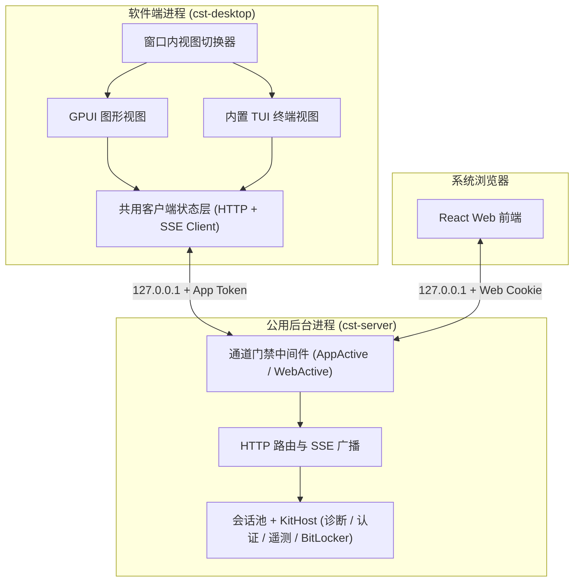
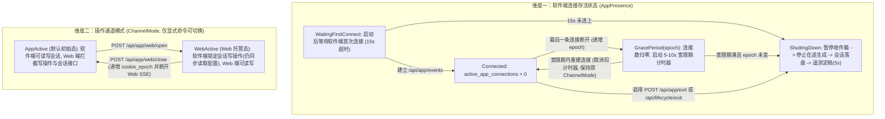
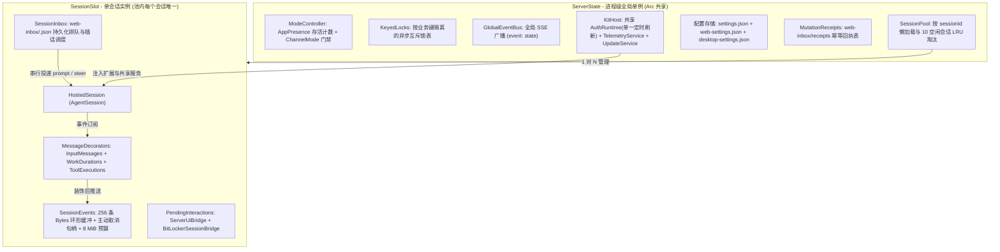
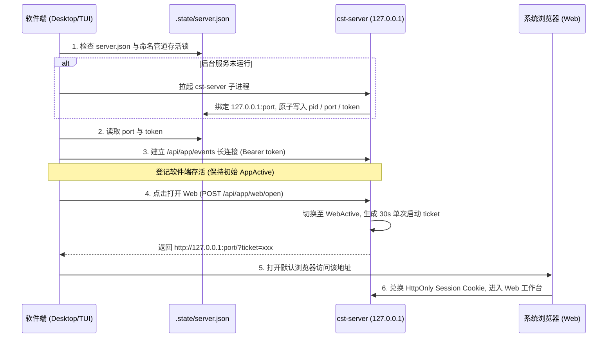

# 阶段 7：三端共用后台服务（cst-server）设计

`crates/cst-server` 将 `pi-runtime` 与 `cst-pilot` 组装为本机后台服务，统一托管多会话池、持久化输入收件箱与共享配置，向外提供本机 HTTP 接口和 SSE 实时事件流，供软件端（GPUI 桌面端与内置 TUI）及 Web 网页端连接。

本文是 [Rust 重写开发计划](0.PLAN.md) 第七阶段的设计文档。前置依赖见 [3.session-and-extensions.md](3.session-and-extensions.md)、[4.runtime-and-sdk.md](4.runtime-and-sdk.md) 与 [6.cst-pilot.md](6.cst-pilot.md)。技术选型见 [prototype.md](../prototype.md)，HTTP/SSE 协议见 [web/API.md](../../web/API.md)，运行时协调规则见 [runtime/SPEC.md](../../runtime/SPEC.md) 与 [runtime/ARCHITECTURE.md](../../runtime/ARCHITECTURE.md)。

---

## 整体架构与源码映射

`crates/cst-server` 构建在 `crates/cst-pilot` 与 `crates/pi-runtime` 之上，替代现有 TypeScript 版的 `agent/home/extensions/web/server/` 与 `agent/home/extensions/runtime/` 宿主协调层。

| 现有 TS 源码与规格文档 | Rust 目标模块 | 核心职责 |
|---|---|---|
| [`web/server/container.ts`](../../../agent/home/extensions/web/server/container.ts)、[`web/index.ts`](../../../agent/home/extensions/web/index.ts)<br>[`extensions/runtime/owner.ts`](../../../agent/home/extensions/runtime/owner.ts)<br>[runtime/SPEC.md](../../runtime/SPEC.md)、[runtime/ARCHITECTURE.md](../../runtime/ARCHITECTURE.md) | `src/lib.rs`<br>`src/bin/cst-server.rs`<br>`src/discovery.rs`<br>`src/mode.rs`<br>`src/state.rs`<br>`src/server.rs` | 管理工具包单实例命名管道锁与 `.state/server.json` 服务发现，正交维护软件端连接存活状态（`AppPresence`）与操作通道模式（`ChannelMode`），协调断线宽限期与安全退出流程 |
| [`web/server/http.ts`](../../../agent/home/extensions/web/server/http.ts)、[`web/server/api.ts`](../../../agent/home/extensions/web/server/api.ts)<br>[`web/server/api/http.ts`](../../../agent/home/extensions/web/server/api/http.ts)、[`web/server/api/errors.ts`](../../../agent/home/extensions/web/server/api/errors.ts)<br>[web/API.md#安全幂等与错误处理约定](../../web/API.md#安全幂等与错误处理约定) | `src/auth_guard.rs`<br>`src/routes/mod.rs`<br>`src/routes/static_files.rs` | 校验本机 `Host` 与同源 `Origin`，验证软件端 `Bearer` 令牌与 Web 会话 Cookie，在入口与互斥锁内双重校验通道模式，限制请求体体积，托管静态资源并注入首屏主题 |
| [`web/server/session/sessions.ts`](../../../agent/home/extensions/web/server/session/sessions.ts)<br>[`web/server/session/compaction.ts`](../../../agent/home/extensions/web/server/session/compaction.ts)<br>[web/ARCHITECTURE.md#流式渲染与-sse-状态同步](../../web/ARCHITECTURE.md#流式渲染与-sse-状态同步) | `src/session/mod.rs`<br>`src/session/slot.rs` | 管理多会话并发池与 10 个空闲会话 LRU 内存淘汰，维护未落盘空会话完整元数据快照（`unflushed/`）与删除墓碑（`deleted/`），复用 `fork_branch_to_new_manager` 与原生自适应压缩 |
| [`web/server/session/input-messages.ts`](../../../agent/home/extensions/web/server/session/input-messages.ts)<br>[`web/server/session/work-durations.ts`](../../../agent/home/extensions/web/server/session/work-durations.ts)<br>[`web/server/session/tool-executions.ts`](../../../agent/home/extensions/web/server/session/tool-executions.ts) | `src/session/decorators.rs` | 订阅会话事件并持久化三类展示自定义条目，向客户端消息快照注入 `clientMessageId`、`work` 耗时与单工具 `execution` 进度 |
| [`web/server/session/inbox.ts`](../../../agent/home/extensions/web/server/session/inbox.ts)<br>[`web/server/session/receipts.ts`](../../../agent/home/extensions/web/server/session/receipts.ts)<br>[`web/server/session/attachments.ts`](../../../agent/home/extensions/web/server/session/attachments.ts) | `src/session/inbox.rs`<br>`src/session/receipts.rs`<br>`src/session/attachments.rs` | 实现每会话独立的持久化收件箱调度（`direct / queue / steer`）、写操作 `Idempotency-Key` 持久化回执，以及 SHA-256 图片附件校验（`12 MiB` 上限）与存取 |
| [`web/server/session/events.ts`](../../../agent/home/extensions/web/server/session/events.ts)<br>[`web/server/session/browser-json.ts`](../../../agent/home/extensions/web/server/session/browser-json.ts) | `src/session/events.rs` | 基于 `Bytes` 维护 256 条环形事件缓冲，支持 `Last-Event-ID` 续传与越界 `reset` 信号，提供 20 秒心跳、单连接 `8 MiB` 主动取消断流保护与 JSON 脱敏 |
| [`web/server/session/web-settings.ts`](../../../agent/home/extensions/web/server/session/web-settings.ts)<br>[`extensions/runtime/configuration.ts`](../../../agent/home/extensions/runtime/configuration.ts)<br>[`web/server/api/models.ts`](../../../agent/home/extensions/web/server/api/models.ts)、[`web/server/api/auth.ts`](../../../agent/home/extensions/web/server/api/auth.ts) | `src/settings.rs`<br>`src/oauth.rs`<br>`src/routes/models.rs`<br>`src/routes/auth.rs` | 管理全局共享配置与各端独立外观设置，桥接 `cst_pilot::auth::AuthRuntime` 实现模型选择与范围配置，并提供登录认证、自定义服务与额度查询 |
| [`web/server/session/ui.ts`](../../../agent/home/extensions/web/server/session/ui.ts)<br>[`web/server/api/runbook.ts`](../../../agent/home/extensions/web/server/api/runbook.ts)<br>[`diagnostics/bitlocker-web.ts`](../../../agent/home/extensions/diagnostics/bitlocker-web.ts) | `src/session/interactions.rs`<br>`src/runbook.rs`<br>`src/exports.rs` | 桥接普通扩展 `ExtensionUiContext` 提问与结构化 `BitLockerHostChannel` 待答请求，校验并调用系统记事本打开已交付 `runbook`，预留会话导出接口供阶段 8 接入 `Chromiumoxide` |

---

## 前置包公开接口补齐（`crates/cst-pilot`）

为支撑多会话后台服务托管与结构化本地安全确认，`crates/cst-pilot` 需在阶段 7 补齐以下三项公开宿主接口：

| 编号 | 补齐接口 | 契约说明 |
|---|---|---|
| 1 | 多会话共享宿主（`cst_pilot::kit::KitHost` 与 `HostedSession`） | 现有 `Kit::create_session_with_update` 每次创建 `KitSession` 都会派生一条独立的 30 秒 CSTOA 目录轮询协程。新增 `KitHost::new(kit, auth, telemetry_options, update_options)` 在服务启动时一次性初始化共享的 `AuthRuntime`、`Option<Arc<TelemetryService>>` 与 `Arc<UpdateService>`，并派生**唯一一条**绑定宿主根 `CancellationToken` 的模型目录维护协程（共享 `wake: Arc<Notify>`，任意会话触发 `agent_start` 时统一唤醒）。`KitHost::open_session(&self, options)` 返回的 `HostedSession` 仅绑定单会话的 `AgentSession` 与 BitLocker 启动复查，同时挂载遥测事件订阅和更新登记，不再创建逐会话轮询任务。调用 `HostedSession::shutdown().await`（如空闲淘汰或删除会话）仅释放该会话自身资源，不影响全局目录维护与共享服务 |
| 2 | 升级门禁公开访问与许可边界（`Kit::activity_gate`） | 在 `Kit` 上新增公开方法 `pub fn activity_gate(&self) -> &Arc<ActivityGate>`。业务写操作（会话管理与压缩派生、收件箱写入、凭据与模型修改）持有 `ActivityLease` 至操作结算。通道准入读守卫在 `started` 回执落盘后释放，升级许可继续保护已接受操作。只读查询、SSE 长连接以及升级服务自身的检查、准备与交接请求**豁免持有普通 `ActivityLease`**，防止升级协调请求阻塞自身的 `ActivityGate::close()` |
| 3 | BitLocker 结构化宿主交互通道（`cst_pilot::bitlocker::BitLockerHostChannel`） | 现有 `bitlocker::core::Executor` 在命令行下等待 `ExtensionUiContext::input(secret: true)` 与 `confirm`，而 `Vault` 仅用于暂存 AI 参数中的脱敏凭据，无法唤醒等待本地输入的工具协程。在 `cst_pilot::bitlocker` 新增可选的 `BitLockerHostChannel` Trait（缺省时回退原有 `ExtensionUiContext` 保持 CLI 兼容），供 `HostedSession` 注入单会话 `BitLockerSessionBridge`。工具需要本地恢复密码（`Password`）、AI 参数确认（`Parameter`）或解密目标确认（`Decrypt`）时，直接携带 `tool_call_id`、`targets: Vec<Volume>` 与 180 秒截止时间在桥接器中挂起 `oneshot::Sender<BitLockerAnswer>`。HTTP 专用接口直接结算该 `oneshot::Sender` 唤醒工具执行 |

---

## 进程拓扑与通道状态机

后台服务与客户端界面分为独立进程运行。GPUI 桌面端与内置 TUI 合为同一个软件端进程（`cst-desktop`），在同一个窗口内直接切换图形视图与终端视图，底层共用同一套客户端状态与 HTTP/SSE 连接。Web 端通过软件端内按键或命令触发打开。



### 软件端存活状态与操作通道模式正交分离

为防止软件端在 Web 托管期间发生 SSE 重连时误夺回操作权，`ModeController` 将**软件端连接存活状态（`AppPresence`）**与**操作通道模式（`ChannelMode`）**拆分为两个互不覆盖的正交状态机：



| 状态机制 | 精确行为与并发边界规则 |
|---|---|
| 连接计数与宽限期世代（`epoch`） | `AppPresence` 维护活跃软件端 SSE 连接计数 `active_app_connections: usize` 与单调递增的世代号 `presence_epoch: u64`。建立 `/api/app/events` 连接时递增连接计数并递增 `presence_epoch`（使任何在途宽限期计时器自然失效），**保持当前的 `ChannelMode` 原样不变**。仅在最后一条软件端连接断开（计数归零）时记录当前 `epoch` 并启动 5–10 秒宽限期协程，并发存在多条连接时关闭其中一条不会触发退出 |
| 过渡期独立 Web 模式 | 在阶段 7 与阶段 8 期间，支持以 `--standalone-web` 启动 `cst-server`。此模式下初始 `ChannelMode` 固定为 `WebActive`，禁用 `AppPresence` 的首次连接超时与断线自动退出，仅响应显式的 `POST /api/lifecycle/exit` 退出 |
| 开启与退出 Web 模式的清理边界 | 软件端调用 `POST /api/app/web/open` 切入 `WebActive` 后进入待机锁定界面。关闭浏览器标签页不会改变 `WebActive`。软件端调用 `POST /api/app/web/close` 确认退出 Web 时：递增服务端 `web_cookie_epoch` 使旧浏览器 Cookie 立即作废，先通过全局流广播 `channel_mode_changed`，再主动触发所有通过 Web 身份建立的 SSE 连接（含全局流、单会话流与多会话聚合流）的独立连接终止句柄。**已在收件箱持久化接受或正在执行的会话任务继续在后台正常完成**，软件端恢复操作后直接承接最新状态 |
| 共享准入读写锁与 Cookie 世代复核 | `ModeController` 使用 `tokio::sync::RwLock<ModeState>`（含 `{ mode: ChannelMode, web_cookie_epoch: u64 }`）统一保护模式切换与业务写操作准入。所有业务写操作在取得 `KeyedLocks` 会话或配置锁后、执行**持久化接受动作**（写入收件箱 `Pending`、写入幂等回执 `started` 或落盘配置）期间，必须持有 `ModeController` 的 `RwLock::read().await` 共享读守卫，并在守卫内同时核对当前 `mode` 与 Web 请求携带的 `cookie_epoch == state.web_cookie_epoch`。`write_once` 在 `started` 回执落盘后、执行操作前释放该读守卫；重复请求在等待原操作前释放。后续耗时的模型、工具执行或远端刷新不持有通道读守卫。`POST /api/app/web/open` 与 `/close` 获取 `RwLock::write().await` 排他写守卫，等待已在持久化临界区内的短写操作落盘完毕，同时阻塞并使临界区外的所有旧世代在途写请求在写锁释放后因 `mode` 或 `cookie_epoch` 不匹配而被确定性拒绝 |
| SSE 注册与撤销串行化 | 全局、单会话与聚合 SSE 在同步注册前重新取得通道读守卫，复核当前模式与 Cookie 世代。单会话先完成加载，再进入注册临界区。读守卫在返回响应前释放，不随长连接存活；退出 Web 的写守卫与新连接注册互斥，已通过入口鉴权的旧请求也无法在撤销后注册 |

---

## 内部并发模型与 Rust 语言特性设计

`server.rs` 管理 TCP/Hyper 连接并调用路由。`state.rs` 装配业务状态，不依赖路由模块；OAuth 流、文件缓存、清单打开与导出任务分别位于 `oauth.rs`、`project_files.rs`、`runbook.rs` 与 `exports.rs`。`error.rs` 定义业务错误及保留操作原始错误类型的 `MutationError<E>`，HTTP 状态与响应格式由路由层转换。

`crates/cst-server` 划分为进程级全局单例（`ServerState`）与按会话懒加载的会话槽位（`SessionSlot`）两层。



| 设计维度 | Rust 实现机制与工程收益 |
|---|---|
| 细粒度按键异步锁（`KeyedLocks`） | 使用 `Mutex<HashMap<String, Weak<tokio::sync::Mutex<()>>>>` 实现按业务键隔离的串行化执行器（`serialize(key, fut)`）。锁键按职责划分为 `session:{id}`、`model-selection:{id}`、`model-default`、`auth:{provider}` 与 `auth-config:all`。通过 `Arc::lock_owned()` 获取 RAII 守卫，不同会话并发互不阻塞，异步任务取消或提前返回时自动释放锁并清理 `Weak` 空条目 |
| 零拷贝 SSE 环形广播（`Bytes`） | `SessionEvents` 将序列化并脱敏后的完整 SSE 帧转为不可变的 `bytes::Bytes`，保存在容量为 256 的 `VecDeque<(u64, Bytes)>` 中。向软件端与多个浏览器标签页同时广播或执行 `Last-Event-ID` 历史回放时，仅增加 `Bytes` 引用计数，免除重复序列化与内存拷贝 |
| 独立连接终止路径与 `8 MiB` 应用层队列预算 | 客户端停止读取 TCP 且内核与 HTTP 层写缓冲填满时，HTTP 引擎停止轮询响应体 `Stream`，仅在响应体流内执行 `select!` 无法及时回收连接。服务端使用 `tokio::net::TcpListener` 配合 Hyper `http1::Builder::new().serve_connection` 驱动每条底层连接，并为每条连接配对独立的 `conn_cancel: CancellationToken`，在外层连接驱动任务中通过 `tokio::select! { biased; _ = conn_cancel.cancelled() => (), _ = serve_connection => () }` 监听强制终止信号。每个 SSE 订阅者 `Arc<SseSubscriber>` 维护 `queue: Mutex<VecDeque<Bytes>>` 与原子计数器 `queued_bytes: AtomicUsize`（统计尚未移交 HTTP 层的**应用层队列字节**，覆盖回放帧、实时帧与心跳帧，HTTP 层单帧写缓冲另有固定上限）。每当响应体从 `queue` 弹出一帧移交 HTTP 层时扣减对应字节数。若新帧入队时 `queued_bytes + frame.len() > 8 MiB`，**在入队侧立即同步执行**：清空 `queue` 并将 `queued_bytes` 归零释放应用层积压内存，停止心跳定时器，并调用 **`conn_cancel.cancel()`**。回放期间持有源事件锁以保证顺序，移除订阅者的回调在源事件锁释放后执行。外层连接任务收到取消信号后丢弃 `serve_connection` 与底层 `TcpStream`，不依赖响应体被轮询即可在有界时间内强制关闭慢连接 |
| 多会话聚合 SSE 流与多标签页连接收敛 | 软件端（`cst-desktop`）使用原生 HTTP 客户端连接池，不受浏览器同源连接数限制。针对浏览器在 HTTP/1.1 下同源最多 6 条并发连接的限制（打开多个不同会话的标签页时，单会话 SSE 流会占满连接池），阶段 7 服务端除保留 `/api/events` 与 `/api/sessions/:id/events` 外，原生提供**多会话聚合事件流（`GET /api/events/stream` 与动态订阅更新 `PUT /api/events/stream/:clientId/subscriptions`）**，在单条 SSE 连接内携带 `sessionId` 复用传输全局状态与最多 32 个活跃会话的事件流及队列流。阶段 8 Web 前端通过同源 `SharedWorker`（回退 `BroadcastChannel`）接入该聚合流，将任意数量标签页与不同会话的实时流收敛为单一长连接 |
| 编译期与运行期双重防泄密 | 接收密钥或恢复密码的请求结构体禁止派生 `Debug` 与 `Serialize`，密码字段使用 `zeroize::Zeroizing<String>` 并在作用域结束时清零内存。除了 `pi-session` 持久层已挂载的 `PrivacyPolicy` 外，服务端所有发往客户端的快照与 SSE 事件统一经过 `browser_json` 处理：剥离 `assistantMessageEvent` 流式参数增量副本，将 `recoveryPassword` 字段及匹配 48 位恢复密码格式的子串替换为 `[BitLocker 恢复密码已隐藏]` |

---

## 核心子模块详细设计

### 1. 单实例发现、通道门禁与本机鉴权（`discovery.rs`、`auth_guard.rs`）

同一工具包目录（`agent/home`）仅允许运行一个 `cst-server` 进程。服务固定绑定 `127.0.0.1`（优先使用环境变量 `CST_WEB_PORT` 或默认端口 `52831`，被软件端按需拉起时支持 `127.0.0.1:0` 动态分配空闲端口）。



1. **命名管道单实例锁与凭证文件（`discovery.rs`）**：
   - 启动时对规范化工具包根目录计算小写路径 SHA-256，创建 Windows 命名管道 `\\.\pipe\cst-pilot-server-<hash>`（带 `FILE_FLAG_FIRST_PIPE_INSTANCE`）。管道句柄保存在服务主结构体中，进程退出或崩溃时由操作系统内核立即释放。
   - 生成 32 字节密码学随机十六进制字符串作为 `app_token`，将 `{ "pid": u32, "port": u16, "token": String, "startedAt": String }` 经同目录临时文件同步后原子替换为 `.state/server.json`。`.state/` 目录受 `PathGuard` 封锁，禁止任何 AI 工具读取或枚举。
2. **本机请求校验与双通道门禁（`auth_guard.rs`）**：
   - **Host 与跨站拦截**：所有请求必须满足 `Host == 127.0.0.1:<port>`，否则返回 `403 invalid_host`。若携带 `Origin` 头且不等于 `http://127.0.0.1:<port>`，返回 `403 invalid_origin`。Web 端所有非 `GET`/`HEAD` 的写请求必须同时携带同源 `Origin` 与 `X-CST-Web-Request: 1`，拒绝一切 CORS `OPTIONS` 预检请求。
   - **身份与模式权限表**：

| 客户端类型 | 凭证校验方式 | `AppActive` 模式下的权限 | `WebActive` 模式下的权限 |
|---|---|---|---|
| 软件端（`X-CST-Client: app`） | 常量时间校验 `Authorization: Bearer <app_token>` | 允许调用全部 `/api/*` 与 `/api/app/*` 接口 | 允许调用 `/api/app/*` 与 `/api/events`，同时开放 `/api/models`、`/api/auth` 及 `/api/settings` 的只读 `GET` 查询。调用会话写操作或发送消息返回 `409 web_mode_active` |
| 网页端（浏览器） | 访问 `/?ticket=<once>` 验证 30 秒单次票据并签发绑定当前 `web_cookie_epoch` 的 `HttpOnly` 且 `SameSite=Strict` 会话 Cookie，随后以 `303` 重定向至 `/`，移除地址中的单次票据（`--standalone-web` 自动签发） | 仅允许读取静态资源与 `/api/health`、`/api/state`（返回 `stage: "app_active"`）。访问会话详情、SSE 或任何写接口返回 `403 web_mode_inactive` | 允许调用全部 `/api/*` 业务接口 |

---

### 2. 会话池与未落盘快照及 10 会话 LRU 淘汰（`session/mod.rs`、`session/slot.rs`）

`SessionPool` 统一管理所有会话的跨目录发现与未落盘快照，同时处理安全分支派生与内存上限：

1. **全目录会话扫描与 `cwd` 继承**：
   - `list_all_project_sessions` 同时扫描 `agent/home/sessions/*.jsonl` 根目录及 `agent/home/sessions/--*--/*.jsonl` 全部工作目录分类子目录。侧栏与 `/sessions` 页面始终展示完整历史列表，不受 `cst-server` 启动时的工作目录影响。
   - 同一 ID 的并发加载按 ID 串行执行，并复用已加载槽位。`open_saved`、`create_with_key`、`fork` 与 `get_loaded` 返回 `SessionLease`，句柄及其克隆存活期间保持槽位常驻。思考强度修改异步等待会话池锁，并持有句柄完成元数据更新。打开已保存的历史会话时，保持会话文件留在原分类子目录，并沿用其 `SessionHeader.cwd` 作为该会话执行 `read` 工具与 `/api/files`（`@` 补全）的基准目录。
2. **未落盘空会话完整元数据快照（`unflushed/<sessionId>.json`）**：
   - `pi-session` 在产生首条 `user` 或 `assistant` 消息前仅在内存中维护条目，不写入 `.jsonl` 文件。但用户可能对空会话执行重命名、切换模型或修改思考档位，且空会话还携带创建时的 `cwd` 与 `parent_session`。仅保存 ID 和时间会导致空会话在 LRU 淘汰或跨目录重启后丢失状态。
   - 服务端在 `agent/home/web-inbox/` 下维护三类持久化记录：
     - `created.json`：记录创建请求去重键 `requestKey -> sessionId | null`（删除后置 `null`）。`MutationReceipts` 中的创建回执仅记录 `{ id: sessionId }`，不快照可变属性。
     - `unflushed/<sessionId>.json`：保存未落盘空会话的完整可恢复快照 `UnflushedSessionSnapshot`（兼容只读旧版 `created-times.json`），字段包含 `{ id, createdAt, cwd, sessionDir, parentSession, name, model: Option<{ provider, modelId }>, thinkingLevel }`。新建空会话或从首条消息前派生空会话时原子创建该文件。会话尚未落盘期间，每次执行重命名、模型切换或思考档位修改均同步原子更新该文件。一旦会话产生首条对话生成 `.jsonl` 文件，立即删除对应的 `unflushed/<id>.json`。
     - `deleted/<sessionId>`：删除空闲会话时，先以排他模式（`create_new(true)`）写入墓碑文件，再调用 `HostedSession::finalize_telemetry("delete").await` 并关闭会话槽位，最后清理 `.jsonl` 原文件、`unflushed/<id>.json`、`web-inbox/<id>.json` 及 `web-inbox/attachments/<id>/` 目录。
3. **10 个空闲会话 LRU 内存淘汰策略**：
   - 每个 `SessionSlot` 维护单调递增的最近访问序号 `last_touched: u64`。
   - **固定常驻（Pinned）条件**：满足以下任意一项的会话常驻内存，不参与淘汰：
     1. 模型、工具或压缩正在执行（`!session.is_idle()` 或 `session.is_streaming()` 或 `session.is_compacting()`）。
     2. `SessionInbox` 中存在 `status == Pending` 或 `status == Delivering` 的条目。
     3. `ServerUiBridge` 或 `BitLockerSessionBridge` 中存在未结算的待答交互请求。
     4. 该会话的 `SessionEvents` 当前连接着至少 1 个活跃的 SSE 客户端订阅者。
     5. 调用方、业务快照或订阅准备持有该会话的 `SessionLease`。
   - **空闲淘汰与无损重建**：打开、新建会话后执行清理；最后一个句柄释放时异步触发清理，即使随后没有新请求，也会恢复空闲上限。超出 **10 个** 时，选取 `last_touched` 最小的空闲槽位，在移除前复核访问序号与常驻状态。清理任务串行执行；槽位移除、`slot.close().await` 和所有权锁释放全程持有该会话的加载锁，冷加载在锁释放后继续。后续再次打开该会话时：已落盘会话从 `.jsonl` 加载，未落盘空会话从 `unflushed/<id>.json` 完整恢复会话身份与创建时间，同时还原原 `cwd`、`parentSession`、自定义标题以及已选模型与思考档位。
4. **保留源写锁且遵循 `before` 语义的安全派生（`POST /api/sessions/:id/fork`）**：
   - [web/API.md](../../web/API.md) 规定 `fork` 从选中的用户消息 `entryId` **之前**派生新会话（前端会将该条用户消息回填输入框供重新编辑发送）。同时 Rust 的 `SessionManager::open` 会尝试获取源文件单写锁，在源槽位已持锁时再次打开原文件会触发 `SessionStoreError::SingleWriterLocked`。此外，`pi-runtime` 在新建会话时会在首条用户消息前追加 `model_change` 与 `thinking_level_change` 元数据条目，因此首条用户消息的 `parent_id()` 通常也为 `Some(...)`，对其父节点调用 `fork_branch_to_new_manager` 派生出的会话仅含元数据条目而不含对话，同样不会在磁盘生成 `.jsonl` 文件。
   - 派生在源会话的 `KeyedLocks`（`session:{source_id}`）保护下执行；写入 `started` 回执后释放通道准入读守卫，再按以下步骤完成：
     1. 校验源会话空闲（`!is_streaming()` 且收件箱无 `Delivering` 条目）且已落盘（`source_file` 存在）。
     2. 在源会话内存树中校验 `entry_id` 存在且为 `role == "user"` 的消息条目，读取其 `parent_id()` 与源会话目录信息（`cwd` 和 `session_dir`），同时计算源分支在 `entry_id` 之前的生效模型、思考档位与会话标题。
     3. 构造新会话的 `SessionManager`（全程不重开源文件，保持源槽位 ID、叶节点与写锁不变）：若 `entry.parent_id()` 为 `Some(parent_id)`，调用源管理器的 **`sm.fork_branch_to_new_manager(parent_id)`** 提取 `parent_id` 及之前的分支路径。若 `entry.parent_id()` 为 `None`，以源会话的 `cwd`、`session_dir` 与 `parent_session: Some(source_file)` 调用 `SessionManager::create` 创建新管理器并回放源模型与思考档位。
     4. **统一按新管理器的实际落盘状态处理 `unflushed` 快照**：无论走 `Some(parent_id)` 还是 `None` 分支，检查新管理器是否已实际落盘写出 `.jsonl` 文件（即分支中是否已包含早于选中消息的 `user/assistant` 对话）。若尚未写出 `.jsonl` 文件（仅含元数据条目或为空），**统一将其会话身份、创建时间与目录信息（`cwd / sessionDir / parentSession`），以及自定义标题和截断点生效的模型与思考档位原子写入 `agent/home/web-inbox/unflushed/<new_id>.json`**，随后注册进会话池。
5. **手动上下文压缩（`POST /api/sessions/:id/compact`）**：
   - 直接调用 `pi_session::AgentSession::compact(instructions)`。核心已内置 `prepare_compaction_with_adaptive_budget` 短会话自适应折半缩减保留预算算法，并将 `"Already compacted"` 映射为 `409 already_compacted`，将 `"Nothing to compact (session too small)"` 映射为 `409 nothing_to_compact`。

---

### 3. 消息装饰器与 SSE 帧协议规范（`decorators.rs`、`events.rs`）

#### 3.1 消息装饰器（`decorators.rs`）

客户端界面所需的展示元数据通过订阅 `AgentSessionEvent` 写入会话 `CustomEntry`（不进入大模型上下文），并在输出 HTTP 快照与 SSE 事件时动态注入消息副本：

| 装饰器组件 | 自定义条目 `custom_type` | 事件监听与装饰规则 |
|---|---|---|
| `InputMessages` | `cst-web-input-message` | 投递收件箱消息前将 `messageId` 推入待关联队列。收到 `message_start`（`role == "user"`）时弹出队首 `messageId` 绑定 `message.timestamp -> messageId`，收到 `message_end`（`role == "user"`）时追加 `{"id": messageId, "timestamp": ts}` 落盘，输出用户消息时注入 `clientMessageId` |
| `WorkDurations` | `cst-web-work-duration` | 收到 `message_start`（`role == "user"`）时记录本轮起始时间 `startedAt`，收到 `message_end`（`role == "assistant"`）时写入 `{"messageTimestamp": msg.ts, "startedAt": ..., "endedAt": max(startedAt, now)}` 落盘，输出助手消息时注入 `work: { startedAt, endedAt }` |
| `ToolExecutions` | `cst-web-tool-execution` | 以 `"{assistantMsgTimestamp}:{toolCallId}"` 为键。`tool_execution_start` 记录 `startedAt` 并落盘，`tool_execution_update` 提取 `details.bitlocker.stage` 更新内存阶段，`tool_execution_end` 记录 `endedAt` 并暂存早期 `result`（待对应 `toolResult` 的 `message_end` 到达后清除暂存）。输出助手消息时在 `toolCall` 块上注入 `execution: { startedAt, endedAt, stage, result }` |

#### 3.2 SSE 帧协议与多会话聚合流规范（严格区分 `event:` 名称与 JSON `type`）

为与前端原生 `EventSource` 自动重连机制完全兼容，并支撑多标签页共享单一长连接，SSE 顶层 `event:` 字段与 `data:` 内层 JSON 载荷按以下契约发送（严禁将内层 `type` 值用作顶层 `event:` 名称）：

| 事件流端点 | 顶层 SSE `event:` | `id:` 格式 | `data:` JSON 载荷结构与复用规则 |
|---|---|---|---|
| `GET /api/events`<br>`GET /api/app/events`<br>`GET /api/events/stream` | `state` | `<epoch>:<seq>`（单流）<br>完整向量游标（聚合流） | 统一通过内层 `type` 区分全局状态变更：<br>`{"type": "sessions_changed", "sessionId"?: "..."}`<br>`{"type": "models_changed", "providerId"?: "...", "warning"?: "..."}`<br>`{"type": "auth_changed", "providerId"?: "..."}`<br>`{"type": "settings_changed"}`<br>`{"type": "usage_changed", "sessionId": "..."}`<br>`{"type": "quota_changed", "providerId": "cstoa"}`<br>`{"type": "channel_mode_changed", "mode": "app_active" \| "web_active"}`<br>`{"type": "stream_ready", "subscribedSessions": string[]}`（聚合流握手帧） |
| `GET /api/sessions/:id/events`<br>`GET /api/events/stream` | `session` | `<epoch>:<seq>`（单流）<br>完整向量游标（聚合流） | 单会话流直接发送事件对象，聚合流外包一层 `{"sessionId": "<id>", "event": <事件对象>}`。事件对象包含：<br>1. 经装饰与 `browser_json` 脱敏的 `AgentSessionEvent`（`message_start / message_update / message_end / tool_execution_start / tool_execution_update / tool_execution_end / agent_start / agent_end / session_tree` 等）。<br>2. 扩展提问：`{"type": "ui_requests", "questions": Question[]}`。<br>3. BitLocker 交互：`{"type": "bitlocker_requests_changed", "requests": BitLockerPendingRequest[], "revision": u64, "epoch": "..."}` |
| `GET /api/sessions/:id/events`<br>`GET /api/events/stream` | `queue` | `<epoch>:<seq>`（单流）<br>完整向量游标（聚合流） | 单会话流直接发送 `InboxSnapshot` JSON 对象，聚合流外包一层 `{"sessionId": "<id>", "queue": InboxSnapshot}` |
| 全部 SSE 端点 | `heartbeat` / `reset` | 无 `id` | `heartbeat` 每 20 秒发送 `data: {}`。单流重连 `Last-Event-ID` 越界时发送 `event: reset` 与 `data: {}`。聚合流在重连或动态新增订阅时，若某路来源在游标向量中缺失或越界，定向发送 `event: reset` 与 `data: {"scope": "global" \| "session", "sessionId"?: "<id>"}` |

**多会话聚合流完整向量游标与订阅恢复协议（`/api/events/stream`）**：
1. **每帧完整向量游标（兼容原生 `EventSource` 单值 `Last-Event-ID`）**：
   - 浏览器原生 `EventSource` 仅记录最后收到的单条 `id:` 字符串并在自动重连时原样回传，不会自动合并多路单帧 ID。
   - 服务端为每个聚合流维护当前已下发的各来源最新游标表 `emitted_cursors: BTreeMap<SourceKey, (Uuid, u64)>`（含 `global` 与当前已订阅的每个 `sessionId`）。每当聚合流下发任何一条业务帧（`state / session / queue`）时，先更新该帧所属来源的 `(epoch, seq)`，再将当前所有已订阅来源的最新游标按确定性字典序编码为**完整向量游标**写入该帧的 `id:` 行：`id: global:<e0>:<s0>,<sid1>:<e1>:<s1>,<sid2>:<e2>:<s2>`。
   - 任意两路（如会话 A 与会话 B）交错输出并在 B 的帧后断线时，浏览器保存的最后一帧 `id:` 依然完整保留了 `global`、A 与 B 各自的准确游标。自动重连携带该 `Last-Event-ID` 时，服务端逐项解析向量并对每一路独立执行 256 条环形缓冲增量回放。对于当前订阅集合中未出现在 `Last-Event-ID` 向量中的来源，以及 `epoch` 不匹配或 `seq` 超出 256 条窗口的来源，服务端立即定向下发 `event: reset`（标明 `scope` 与 `sessionId`），驱动客户端重拉对应快照，严禁静默跳过未知来源。
2. **单一订阅真值源与断线／重启恢复（消除原始 URL 覆盖冲突）**：
   - **URL 不携带静态会话列表**：聚合流连接地址固定为 `GET /api/events/stream?clientId=<uuid>`，不在查询参数中传递 `sessions`，从根源消除 `EventSource` 自动重连复用初始 URL 时将动态修改后的订阅集合覆盖回初始值的问题。
   - **服务端按 `(ClientIdentity, clientId)` 维护订阅槽位 `MultiplexClientSlot`**：`ClientIdentity` 绑定通道身份与当前 `web_cookie_epoch`。客户端通过 `PUT /api/events/stream/<clientId>/subscriptions`（携带 `Idempotency-Key`）提交 `{"sessions": ["id1", "id2"], "lastEventIds": {"id2": "<epoch>:<seq>"}}`（上限 32 个会话）全量设定当前订阅集合。服务端先加载全部目标会话并通过 `SessionLease` 阻止准备期间的 LRU 淘汰；任一来源加载失败时返回错误并保留原订阅集合。加载全部成功后，服务端原子比对新旧集合，对新增会话递增 `SessionSlot` 活跃订阅计数（纳入 LRU Pinned 保护）并按 `lastEventIds` 回放或定向 `reset`，对移除会话递减订阅计数。
   - **同名 `clientId` 重连替换与重启同步**：当 `EventSource` 自动重连再次请求 `GET /api/events/stream?clientId=<uuid>` 时，若该槽位仍挂有旧连接，立即调用旧连接的 `conn_cancel.cancel()` 替换旧连接，**直接继承槽位中保存的最新 `sessions` 订阅集合**（例如已从 `[a]` 改为 `[b]`，重连后仍为 `[b]`，LRU 订阅计数不发生漂移），再按 `Last-Event-ID` 向量执行回放或定向 `reset`。每次连接建立并完成回放检查后，服务端固定下发一帧 `event: state`，`data: {"type": "stream_ready", "subscribedSessions": [...]}`。若后台服务曾发生进程重启导致内存中无该 `clientId` 记录，该帧返回的 `subscribedSessions` 为 `[]`，客户端收到后比对本地期望集合不一致，立即自动重发一次 `PUT .../subscriptions` 恢复订阅。
   - **超时清理与通道撤销**：聚合流连接断开后，其 `MultiplexClientSlot` 订阅集合最多保留 60 秒供自动重连复用。超 60 秒未重连或执行 `POST /api/app/web/close` 退出 Web 模式时，立即销毁槽位、强制终止连接并扣减其持有的全部会话 LRU 订阅计数。

---

### 4. 持久化收件箱、图片附件与写操作幂等回执（`inbox.rs`、`attachments.rs`、`receipts.rs`）

1. **单会话输入收件箱（`SessionInbox`）**：
   - 对应 `agent/home/web-inbox/<sessionId>.json`，每次状态变更通过同目录临时文件 `sync_all()` 后原子替换（遇到 Windows 短暂文件占用错误最多指数退避重试 5 次，累计不超过 375ms）。每次保存成功后向单会话流发布 `event: queue`。
   - **入队去重与直接投递**：校验 `id`（`^[a-zA-Z0-9_-]{1,128}$`）、正文长度（`≤ 100,000` 字符，正文、图片与技能三者不可全空）及 8 个诊断技能白名单。已存在相同 `id` 且参数一致时幂等返回已有条目，参数不同返回 `409 conflict`。若 `delivery == Queue` 且队列未暂停，同时当前无在途投递（`!prompting && session.is_idle()`）且无其他待处理项，标记为 `direct` 立即投递。
   - **附件准备顺序锁（`prompting`）**：普通消息异步读取图片附件并调用 `session.prompt()` 期间置 `prompting = true`，在 `AgentSession` 正式进入忙碌态前阻塞后续 `steer` 插话投递，保证消息进入模型的顺序严格一致。
   - **报错分类与强杀恢复**：`InputMessages::has(id)` 为真说明用户消息已落盘进入会话，后续模型推理报错记为 `delivered`（若报错匹配 `401 / unauthorized / invalid api key` 则标记该服务凭据失效并广播 `auth_changed`）。未能进入会话的投递失败记为 `failed` 并暂停队列。服务重启首次加载收件箱时不自动唤醒调度，将遗留的 `delivering` 条目附加 `uncertain: true` 供客户端核对。
2. **会话图片附件存储（`ImageStore`）**：
   - 仅允许 `image/png / image/jpeg / image/gif / image/webp` 四种格式，校验 Base64 编码及解码后的文件头魔数签名，单次请求原始图片字节合计上限为 `12 MiB`。按图片原始字节 SHA-256 原子写入 `agent/home/web-inbox/attachments/<sessionId>/<sha256>`。
3. **写操作幂等回执（`MutationReceipts`）**：
   - 一般写操作须携带 `Idempotency-Key`（1–128 位字母数字、下划线或连字符），按 `SHA-256(JSON([method, pathname, body]))` 计算请求签名，回执存于 `agent/home/web-inbox/receipts/<sha256(key)>.json`。
   - 执行前落盘 `status: "started"`，完成后更新为 `status: "done"` 与响应结果。并发相同 `key` 共享执行结果。首个任务取消时唤醒等待者并返回 `409 conflict`，同一进程内保留结果不确定的去重键，防止尚在运行的文件写入与重试冲突。签名不一致或进程崩溃遗留 `status: "started"` 时同样返回 `409 conflict`，禁止自动重放。

---

### 5. 模型选择、OAuth 异步登录流与三端配置（`routes/models.rs`、`routes/auth.rs`、`settings.rs`）

1. **明确模型身份与凭据预检**：
   - 发行默认模型固定为 `deepseek/deepseek-flash`，缺少凭据时保留原模型身份，禁止自动改选其他服务。新建会话、提交消息与会话内切换模型前均执行凭据预检，缺失或已标记失效时返回 `409 credentials_required`。
   - 未落盘空会话切换模型或思考档位时，除更新内存 `AgentSession` 外，同步更新 `unflushed/<sessionId>.json` 快照。
2. **模型启用范围与三端配置隔离**：
   - `settings.json`（保存共享默认模型与启用范围）以及 `auth.json`、`models.json` 和 `models-store.json` 由全局共享，修改后通过全局流 `event: state` 广播。
   - `web-settings.json` 独立保存 Web 主题（`light / dark / system`，默认 `light`）与 `emptyModelScope` 标记。`desktop-settings.json` 独立保存软件端（GPUI 与内置 TUI）的外观主题、窗口尺寸位置与默认视图偏好，三端主题互不覆盖。
3. **OAuth 与多步登录异步状态机（`OAuthFlowManager`）**：
   - 按 `provider_id` 在内存中管理登录协程状态（`idle | pending | succeeded | failed | cancelled`）。收到 `on_device_code`、`on_auth_event` 或首个 `prompt` 时立即返回 `202 Accepted` 及初始状态，支持客户端轮询 `status`、提交 `respond` 或执行 `cancel`。修改服务 `baseUrl` 或删除自定义服务前，检查会话池是否存在正在使用该服务的运行中会话，若存在则返回 `409 conflict`。

---

### 6. 交互桥接、BitLocker 唤醒结算与清单打开（`interactions.rs`、`operations.rs`）

1. **通用扩展提问桥接（`ServerUiBridge`）与敏感隔离**：
   - 实现 `pi_session::ExtensionUiContext`，支持普通 `select / confirm / input / editor` 四类可移植对话框，生成 `requestId` 挂起 `oneshot::Sender` 并通过单会话流 `event: session`（`type: "ui_requests"`）推送。
   - **敏感请求硬隔离**：若 `ServerUiBridge::input` 收到 `opts.secret == true` 的调用，立即拒绝将其放入普通 `ui: Question[]` 快照，防止任何敏感凭据误入走持久化幂等回执的 `/api/sessions/:id/ui/:requestId/response` 通道。
2. **BitLocker 结构化桥接与工具唤醒（`BitLockerSessionBridge`）**：
   - 实现阶段 7 在 `cst-pilot` 补齐的 `BitLockerHostChannel` Trait，在会话创建时注入 `HostedSession`。
   - 工具执行 `unlock` 或 `decrypt` 请求本地交互时，桥接器从当前会话分支末尾定位包含该 `tool_call_id` 的助手条目 `entry_id`，生成唯一 `requestId` 与 180 秒 `expires_at`，构造 `BitLockerPendingRequest { request_id, tool_call_id, entry_id, kind, expires_at, targets }` 并将 `oneshot::Sender<BitLockerAnswer>` 存入会话内存待答表（`Mutex<BTreeMap<String, PendingBitLockerItem>>`），递增 `revision` 并通过单会话流与聚合流 `event: session`（`type: "bitlocker_requests_changed"`）广播。
   - 客户端调用 `POST /api/sessions/:id/bitlocker/:requestId`（请求体上限 `4 KiB`，绕过 `MutationReceipts` 不落盘）时，桥接器在待答表 `Mutex` 锁保护内**先校验后消费**：
     1. 先只读查找 `requestId`，不存在则返回 `409 expired_request`。
     2. 检查 `now >= item.request.expires_at`：若已超时，从表中移除该项并释放 `Sender`，递增 `revision` 广播更新，返回 `409 expired_request`。
     3. **在移除条目之前完成全部请求体与密码格式校验**：核对输入仅含单一动作字段且与 `item.request.kind` 匹配（`{ cancel: true }`，或 `Parameter / Decrypt` 下的 `{ confirm: bool }`，或 `Password` 下经 `cst_pilot::bitlocker::credentials::validate` 校验通过并装入 `Zeroizing<String>` 的 48 位恢复密码）。**若字段类型不匹配或密码格式无效，直接返回 `400 invalid_bitlocker_input`，保留待答表中的条目与 `Sender` 不变，允许用户修正后对同一 `requestId` 重新提交。**
     4. 校验全部通过后，在同一个 `Mutex` 锁作用域内原子调用 `remove(requestId)` 取出 `oneshot::Sender` 并递增 `revision`，锁外立即通过 `Sender::send` 唤醒等待中的 `bitlocker` 工具协程并广播 `bitlocker_requests_changed`（两个合法并发提交仅第一个成功，第二个因条目已移除收到 `409 expired_request`）。180 秒定时器到期、工具取消或会话关闭时，同样在锁内移除未决条目并释放 `Sender`，递增 `revision` 广播更新。
3. **已交付 Runbook 清单打开（`POST /api/sessions/:id/runbook/open`）**：
   - 仅接收 `{ entryId, toolCallId }`（上限 `4 KiB`），从当前分支匹配的 `runbook` / `runbook_deliver` 工具结果或 `ToolExecutions` 早期缓存中读取路径，经 `canonicalize()` 校验位于工具包 `artifacts/`（或兼容 `outbox/`）下且为存在的 `.txt` 文件后，直接调用 `C:\Windows\System32\notepad.exe` 打开。

---

## HTTP/SSE 路由与错误码契约总表

### 1. 软件端专属控制接口（`/api/app/*`）

仅允许携带 `Authorization: Bearer <app_token>` 的软件端进程调用：

| 方法 | 路径 | 用途与返回 |
|---|---|---|
| `GET` | `/api/app/events` | 软件端存活监测与全局状态 SSE 长连接（复用 `event: state` 格式）。连接建立仅登记 `AppPresence::Connected` 并取消断线计时器，**不改变当前 `ChannelMode`**。最后一条连接断开触发 5–10 秒退出宽限期 |
| `POST` | `/api/app/web/open` | 将 `ChannelMode` 切换至 `WebActive`（已处于 `WebActive` 时幂等复用），生成 30 秒有效期的单次 `ticket`，返回 `{ url: "http://127.0.0.1:<port>/?ticket=...", mode: "web_active" }` |
| `POST` | `/api/app/web/close` | 确认退出 Web 模式，切回 `AppActive`，递增 `web_cookie_epoch` 作废旧 Cookie，广播 `channel_mode_changed` 并主动断开所有 Web 身份的 SSE 连接 |
| `GET` / `PATCH` | `/api/app/settings` | 读取或原子更新 `agent/home/desktop-settings.json`（保存软件端主题、窗口尺寸及默认 GUI/TUI 视图偏好） |
| `POST` | `/api/app/exit` | 软件端点击 `X` 关闭窗口时调用，跳过断线宽限期，立即暂停所有收件箱并停止会话，完成 5 秒遥测定稿后退出后台进程 |

### 2. 共用业务接口与错误映射

所有 `/api/*` 业务接口（覆盖生命周期与事件流，以及会话管理、模型认证和会话导出路由）的路径、参数与响应格式严格对齐 [web/API.md](../../web/API.md)。所有异常统一返回 `{ "error": { "code": "...", "message": "..." } }`：

| 错误场景 | HTTP 状态码 | `error.code` | 错误消息策略 |
|---|---|---|---|
| 非本机 Host 或跨站 Origin / 缺少自定义头 | `403` | `invalid_host` / `invalid_origin` | 固定中文提示，拦截跨站请求 |
| 当前处于 `AppActive`，浏览器访问 Web 会话接口 | `403` | `web_mode_inactive` | `"Web 模式尚未开启，请在桌面端打开 Web 界面"` |
| 当前处于 `WebActive`，软件端发起会话写操作 | `409` | `web_mode_active` | `"当前正在使用 Web 端操作，请先在桌面端退出 Web 模式"` |
| 请求 JSON 语法错误或超出体积上限（`128 KiB` / `17 MiB`） | `400` / `413` | `invalid_json` / `invalid_request` | 提示请求格式或图片体积无效 |
| 参数校验失败（无效会话 ID 或空消息及未知字段） | `400` | `invalid_request` / `invalid_bitlocker_input` | 返回对应中文校验说明，不回显敏感输入原文 |
| 目标模型缺少有效凭据 | `409` | `credentials_required` | 提示先配置对应模型服务凭据 |
| 去重键冲突、队列 `version` 过期、配置 `revision` 冲突或会话忙碌 | `409` | `conflict` / `config_conflict` | 提示刷新状态后重试 |
| 手动压缩无内容可压或已压缩 | `409` | `nothing_to_compact` / `already_compacted` | 映射 `pi-session` 原生压缩提示 |
| BitLocker 待处理请求已消费或超 3 分钟过期 | `409` | `expired_request` | `"请求已处理或失效"` |
| 服务正在执行退出收尾（`stopping == true`） | `409` | `stopping` | `"程序正在退出，请勿继续提交操作"` |
| 工具包正在准备升级交接（`ActivityGate` 关闭） | `409` | `updating` | `"工具包正在准备升级，请等待交接完成或取消后重试。"` |
| 会话或资源不存在 | `404` | `not_found` / `runbook_missing` | `"会话不存在"` 或清单缺失提示 |
| 配置文件损坏（`settings.json` / `auth.json` / `models.json`） | `503` | `configuration_unavailable` | 按文件类别返回中文修复提示，保留原文件且绝不暴露配置原文 |
| 磁盘写满（`ENOSPC`）或只读写保护介质（`EACCES / EROFS`） | `507` / `500` | `storage_full` / `storage_unavailable` | 提示存储空间不足或介质不可写，输入未被接受 |

---

## 目录结构

Cargo Workspace 新增 `crates/cst-server`：

```text
crates/cst-server/
|-- Cargo.toml
|-- src/
|   |-- lib.rs                  # 公开导出 Server / ServerConfig / DTO 类型与测试辅助启动入口
|   |-- bin/
|   |   `-- cst-server.rs       # 独立后台进程入口：参数解析（含 --standalone-web）与信号处理
|   |-- discovery.rs            # Windows 命名管道单实例锁与 .state/server.json 原子读写
|   |-- auth_guard.rs           # Host/Origin 校验、App Token 与 Web Cookie 鉴权及双重通道门禁
|   |-- mode.rs                 # 正交的 AppPresence 存活计数状态机与 ChannelMode 通道控制器
|   |-- locks.rs                # KeyedLocks 细粒度按键异步互斥锁与原子文件替换重试辅助函数
|   |-- state.rs                # ServerState 全局容器、KitHost 共享服务装配与安全退出协调
|   |-- server.rs               # TCP/Hyper 监听、请求分发与连接级主动取消
|   |-- error.rs                # 业务错误分类与 MutationError<E>
|   |-- oauth.rs                # 多步授权状态、回答校验、取消与结果通知
|   |-- project_files.rs        # 项目文件扫描与短期缓存
|   |-- runbook.rs              # 已交付清单校验与记事本启动
|   |-- exports.rs              # 导出选项、脱敏快照与任务记录；渲染待阶段 8
|   |-- settings.rs             # settings.json / web-settings.json / desktop-settings.json 读写
|   |-- session/
|   |   |-- mod.rs              # SessionPool、跨子目录扫描、unflushed 快照与 10 会话 LRU 淘汰
|   |   |-- slot.rs             # SessionSlot 装配、fork_branch_to_new_manager 安全派生与手动压缩
|   |   |-- decorators.rs       # InputMessages / WorkDurations / ToolExecutions 事件订阅与装饰
|   |   |-- inbox.rs            # SessionInbox 持久化排队、插话调度、版本校验与 uncertain 恢复
|   |   |-- receipts.rs         # MutationReceipts (web-inbox/receipts) 写操作去重与签名冲突检测
|   |   |-- attachments.rs      # ImageStore 图片魔数校验、12 MiB 上限与 SHA-256 内容寻址存储
|   |   |-- events.rs           # Bytes 环形缓冲 SSE 广播、精确帧协议、主动取消句柄与 8 MiB 背压
|   |   `-- interactions.rs     # ServerUiBridge (敏感隔离) 与 BitLockerSessionBridge 唤醒结算
|   `-- routes/
|       |-- mod.rs              # HTTP 请求分发、业务错误到 HTTP 响应的映射
|       |-- app.rs              # /api/app/* 软件端专属控制接口（存活流、开关 Web、桌面设置、立即退出）
|       |-- lifecycle.rs        # /api/state / /api/health / /api/lifecycle / /api/events / /api/files
|       |-- sessions.rs         # /api/sessions/* 会话 CRUD、快照、消息、队列、分支树与压缩
|       |-- models.rs           # /api/models/* 模型列表、目录刷新、模型切换、默认模型与启用范围
|       |-- auth.rs             # /api/auth/* OAuth 异步流、APIKEY、自定义服务、/api/account 与 /api/quota
|       `-- static_files.rs     # 预构建 Web 静态资源托管、路径穿越防护与 index.html 主题注入
`-- tests/
    |-- lifecycle_and_mode.rs   # 单实例锁、WebActive 下软件端重连保持模式、多连接计数、宽限期与退出测试
    |-- session_pool_and_lru.rs # 源持锁下 before 位置安全 fork、空会话改名改模型后 LRU 淘汰与跨目录恢复测试
    |-- inbox_and_recovery.rs   # 收件箱 direct/queue/steer 调度、锁内二次模式复核、幂等回执与 uncertain 恢复测试
    |-- models_and_settings.rs  # KitHost 单一定时维护任务、三端主题隔离、升级门禁豁免与全局 SSE 同步测试
    |-- service_errors_and_oauth.rs # 业务错误到 HTTP 映射、多步授权校验与复用
    `-- api_contract.rs         # 路由契约、SSE 迟到注册与慢连接取消、准入释放及 BitLocker 唤醒结算
```

---

## 验证与测试方案

阶段 7 的验收分为以下三层。现有 React 浏览器 E2E 仍启动 TypeScript 服务；Rust 后台集成测试与 Rust 服务上的真实页面验收分别记录。

| 验证层级 | 执行方式 | 通过标准 |
|---|---|---|
| 1. Rust 后台集成测试 | 运行 `cargo test -p cst-server --locked`，在进程内拉起绑定 `127.0.0.1:0` 的真实服务并挂载 `KitHost` 与本机 Mock LLM / Mock OA | `WebActive` 期间软件端 SSE 重连保持 `WebActive` 不变。测试屏障挂起在途写请求后执行 `Web -> App -> Web` 切换，验证 `ModeController` 读写锁与 `web_cookie_epoch` 确定性拦截旧世代请求。先选模型与思考档位再发首条用户消息并从其 `before` 位置 `fork`（`parent_id != None` 但无对话未生成 `.jsonl`），验证 `unflushed` 快照在 LRU 淘汰与重启后无损恢复。BitLocker 提交错误动作或错误密码格式返回 `400` 且保留原 `requestId` 可继续纠正提交，并发双提交仅一次成功。真实 TCP 客户端完全停止读取使 HTTP 层进入写背压后触发超 `8 MiB` 限制，验证 `conn_cancel` 独立路径在规定时间内关闭底层连接并清空应用层队列与心跳。聚合流在会话 A、B 与全局流交错输出后断线重连，验证单条向量 `id:` 完整回放各路增量或定向 `reset`，且动态订阅 `[a] -> [b]` 后断线重连与服务重启重连均准确恢复为 `[b]` 且 LRU 计数一致 |
| 2. 现有 React 前端实机联调 | 以 `--standalone-web` 启动 `cst-server`，直接托管 `agent/home/extensions/web/static/` 预构建前端，在浏览器中操作完整业务流程 | 真实页面接收 `event: state`、`event: session` 与 `event: queue` 标准帧，跑通对话流式输出与 17 个 Rust 原生诊断工具调用，完成 CSTOA 扫码与 APIKEY 登录，并验证 `runbook` 清单生成与记事本打开、模型偏好设置及深浅主题切换 |
| 3. Web 契约与浏览器 E2E 回归 | 将现有 Web 后端契约测试与隔离 Chrome E2E 测试指向 `cst-server`（除阶段 8 专项多标签 `SharedWorker` 收敛与导出渲染外） | 接口返回格式与错误码符合契约，SSE 事件流顺序与 `Last-Event-ID` 续传正常，乐观发送回执核对以及跨标签页同步全部通过自动化断言 |

---

## 实施进度

| 步骤 | 模块与测试 | 状态 |
|---|---|---|
| 1 | `crates/cst-pilot` 宿主接口补齐（`KitHost`、`HostedSession`、`Kit::activity_gate`、`BitLockerHostChannel`、`AuthRuntime::with_provider_endpoint`）与 `crates/cst-server/src/locks.rs` | 已完成 |
| 2 | 单实例锁与会话跨进程写权锁（`discovery.rs`）、正交存活与通道状态机（`mode.rs`）、本机 Host/Origin 与双通道鉴权门禁（`auth_guard.rs`）及 `tests/lifecycle_and_mode.rs` | 已完成 |
| 3 | 256 条 `Bytes` 环形缓冲与多会话聚合流完整向量游标（`session/events.rs`）、三类消息装饰器（`session/decorators.rs`）、敏感隔离 UI 桥与 BitLocker 先校验后消费桥接（`session/interactions.rs`） | 已完成 |
| 4 | 写操作幂等回执（`session/receipts.rs`）、12 MiB 魔数校验图片存储（`session/attachments.rs`）、持久化收件箱（`session/inbox.rs`）、会话槽位与 10 空闲会话 LRU 池（`session/slot.rs`、`session/mod.rs`）及 `tests/session_pool_and_lru.rs`、`tests/inbox_and_recovery.rs` | 已完成 |
| 5 | 三端配置存储（`settings.rs`）、业务状态（`state.rs`）、Hyper 连接级主动取消（`server.rs`）、HTTP/SSE 路由（`routes/*`）、`src/bin/cst-server.rs` 及后台集成测试 | 已完成 |
| 6 | React 前端连接 Rust 服务的浏览器联调与 E2E 验收 | 待验证 |
