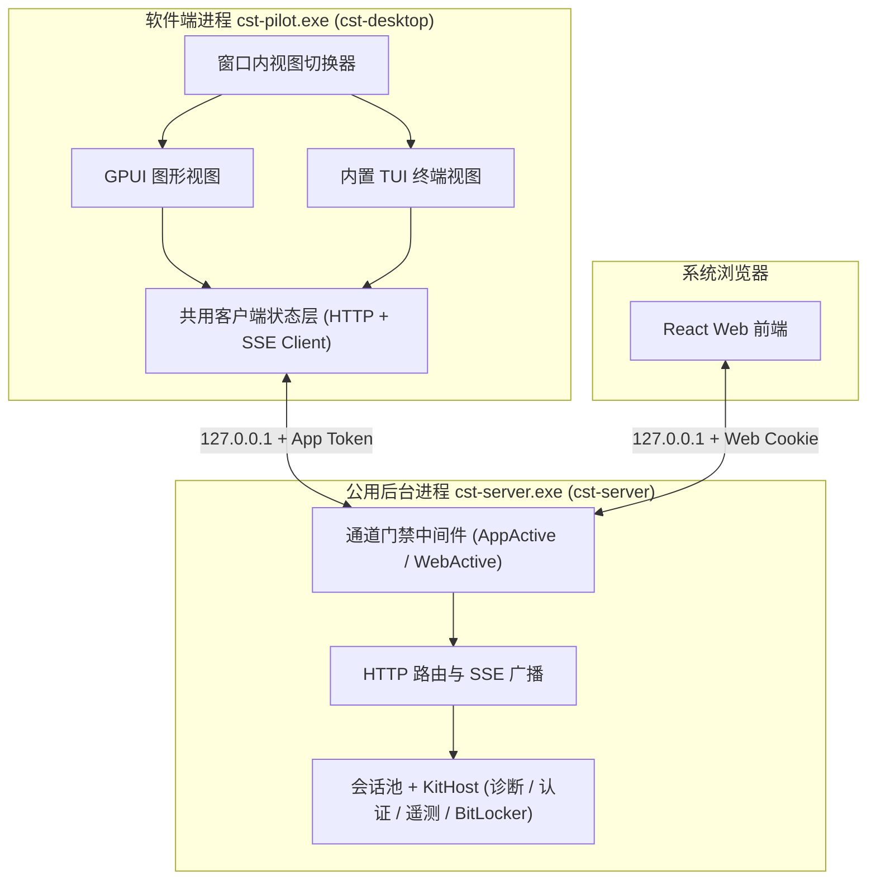
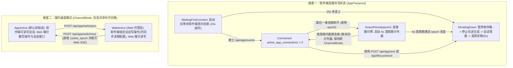
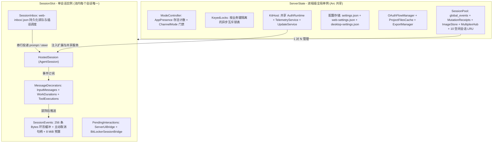
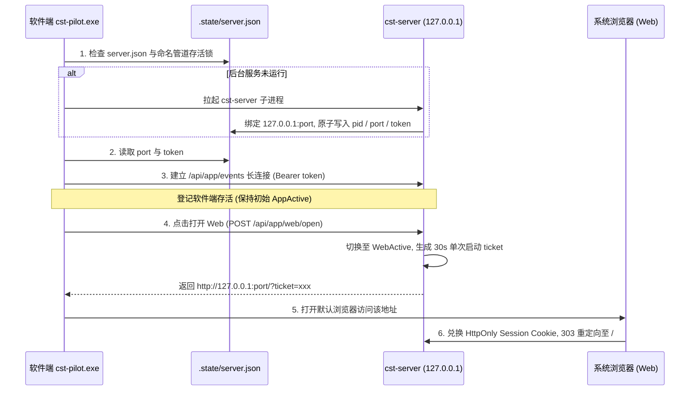

# 阶段 7：三端共用后台服务（cst-server）设计

`crates/cst-server` 将 `pi-runtime` 与 `cst-pilot`（阶段 9 更名 `cst-kit`）组装为本机后台服务，统一托管多会话池、持久化输入收件箱与共享配置，向外提供本机 HTTP 接口和 SSE 实时事件流，供软件端（GPUI 桌面端与内置 TUI）及 Web 网页端连接。

所属总体路线见 [0.PLAN.md](0.PLAN.md)，前置依赖见 [3.session-and-extensions.md](3.session-and-extensions.md)、[4.runtime-and-sdk.md](4.runtime-and-sdk.md) 与 [6.cst-pilot.md](6.cst-pilot.md)，技术选型见 [prototype.md](../prototype.md)，模块规格与接口总表见 [server/SPEC.md](../../server/SPEC.md)、[server/API.md](../../server/API.md) 与 [web/API.md](../../web/API.md)。

---

## 整体架构与子模块划分

`crates/cst-server` 按职责划分为以下八组核心模块：

| Rust 子模块 | 关联规格与契约 | 核心职责 |
|---|---|---|
| `src/lib.rs`、`src/bin/cst-server.rs`<br>`src/discovery.rs`、`src/mode.rs`<br>`src/state.rs`、`src/server.rs` | [server/SPEC.md](../../server/SPEC.md)<br>[server/ARCHITECTURE.md](../../server/ARCHITECTURE.md) | 管理工具包单实例命名管道锁与 `.state/server.json` 服务发现，正交维护软件端连接存活状态（`AppPresence`）与操作通道模式（`ChannelMode`），协调 6 秒断线宽限期与安全退出流程 |
| `src/auth_guard.rs`<br>`src/routes/mod.rs`<br>`src/routes/static_files.rs` | [server/API.md](../../server/API.md)<br>[web/API.md#安全幂等与错误处理约定](../../web/API.md#安全幂等与错误处理约定) | 校验本机 `Host` 与同源 `Origin`，验证软件端 `Bearer` 令牌与 Web 会话 Cookie，在入口与互斥锁内双重校验通道模式，限制请求体体积，托管静态资源并注入首屏主题 |
| `src/session/mod.rs`<br>`src/session/slot.rs` | [web/ARCHITECTURE.md#流式渲染与-sse-状态同步](../../web/ARCHITECTURE.md#流式渲染与-sse-状态同步) | 管理多会话并发池与 10 个空闲会话 LRU 内存淘汰，维护未落盘空会话元数据快照（`unflushed/`）与删除标记文件（`deleted/`），复用 `fork_branch_to_new_manager` 与原生自适应压缩 |
| `src/session/decorators.rs` | [server/ARCHITECTURE.md](../../server/ARCHITECTURE.md) | 订阅会话事件并持久化展示自定义条目，向客户端消息快照注入 `clientMessageId`、`work` 耗时、单工具 `execution` 进度及未闭合 BitLocker 复查结果 |
| `src/session/inbox.rs`<br>`src/session/receipts.rs`<br>`src/session/attachments.rs` | [server/SPEC.md](../../server/SPEC.md) | 实现每会话独立的持久化收件箱调度（`direct / queue / steer`）、写操作 `Idempotency-Key` 持久化回执，以及 SHA-256 图片附件校验（`12 MiB` 上限）与存取 |
| `src/session/events.rs` | [server/API.md](../../server/API.md) | 基于 `Bytes` 维护 256 条环形事件缓冲，支持 `Last-Event-ID` 续传、32 会话向量游标聚合流（`MultiplexHub`）、20 秒心跳、单连接 `8 MiB` 主动取消断流保护与 JSON 脱敏 |
| `src/settings.rs`、`src/oauth.rs`<br>`src/routes/models.rs`、`src/routes/auth.rs` | [auth/SPEC.md](../../auth/SPEC.md)<br>[web/API.md#模型认证与账号接口](../../web/API.md#模型认证与账号接口) | 管理全局共享配置与各端独立外观设置（当前读写 `desktop-settings.json`，阶段 9 升级为 `desktop.json`），桥接 `AuthRuntime` 提供模型选择、异步授权流与额度查询 |
| `src/session/interactions.rs`<br>`src/runbook.rs`、`src/exports/` | [web/ARCHITECTURE.md#特殊工具交互](../../web/ARCHITECTURE.md#特殊工具交互) | 桥接普通扩展 `ExtensionUiContext` 提问与结构化 `BitLockerHostChannel` 待答请求，调用系统记事本打开已交付 `runbook`，托管离线 HTML 与无头 Chromium PDF/PNG 导出管线 |

---

## 与 `crates/cst-pilot` 的宿主接口衔接

`crates/cst-server` 通过 `crates/cst-pilot` 暴露的三项公开宿主接口托管多会话生命周期与本地安全确认：

| 编号 | 宿主接口 | 契约说明 |
|---|---|---|
| 1 | 多会话共享宿主（`cst_pilot::kit::KitHost` 与 `HostedSession`） | `KitHost::new(kit, auth, telemetry_options, update_options)` 在服务启动时一次性初始化共享 `AuthRuntime`、`Option<Arc<TelemetryService>>` 与 `Arc<UpdateService>`，并派生唯一一条绑定根 `CancellationToken` 的模型目录维护协程（任意会话触发 `agent_start` 时统一唤醒）。`KitHost::open_session` 返回的 `HostedSession` 仅挂载单会话的 `AgentSession`、遥测订阅与 BitLocker 启动复查。调用 `HostedSession::shutdown().await` 仅释放当前会话资源，不影响全局共享服务 |
| 2 | 升级门禁与许可边界（`Kit::activity_gate`） | 业务写操作（会话管理、压缩派生、收件箱写入、凭据与模型修改）持有 `ActivityLease` 至操作结算。通道准入读守卫在 `started` 回执落盘后释放，升级许可继续保护已接受操作。只读查询、SSE 长连接及升级自身的检查与交接请求豁免持有普通 `ActivityLease` |
| 3 | BitLocker 结构化宿主交互通道（`cst_pilot::bitlocker::BitLockerHostChannel`） | `HostedSession` 支持注入单会话 `BitLockerSessionBridge`（未注入时回退 `ExtensionUiContext` 保持 CLI 兼容）。工具需要本地恢复密码（`Password`）、AI 参数确认（`Parameter`）或解密目标确认（`Decrypt`）时，携带 `tool_call_id`、`targets: Vec<Volume>` 与 180 秒截止时间挂起 `oneshot::Sender<BitLockerAnswer>`，由 HTTP 专用接口校验后直接唤醒 |

---

## 进程拓扑与通道状态机

后台服务与客户端界面分为独立进程运行。GPUI 桌面端与内置 TUI 合为同一个软件端进程 `cst-pilot.exe`（`cst-desktop` crate），在同一窗口内切换图形视图与终端视图，底层共用同一套客户端状态与 HTTP/SSE 连接。Web 端通过软件端内按钮或命令触发打开。



### 软件端存活状态与操作通道模式正交分离

为防止软件端在 Web 托管期间发生 SSE 重连时意外覆盖当前激活通道，`ModeController` 将软件端连接存活状态（`AppPresence`）与操作通道模式（`ChannelMode`）拆分为两个互不覆盖的正交状态机：



| 状态机制 | 精确行为与并发边界规则 |
|---|---|
| 连接计数与宽限期世代（`epoch`） | `AppPresence` 维护活跃软件端 SSE 连接计数 `active_app_connections: usize` 与单调递增世代号 `presence_epoch: u64`。建立 `/api/app/events` 连接时递增连接计数与 `presence_epoch`（使在途宽限期计时器自动失效），保持当前 `ChannelMode` 不变。仅在最后一条软件端连接断开（计数归零）时记录当前 `epoch` 并启动 6 秒宽限期协程 |
| 独立 Web 调试模式（`--standalone-web`） | 以 `--standalone-web` 启动 `cst-server` 时，初始 `ChannelMode` 固定为 `WebActive`，禁用 `AppPresence` 的首次连接超时与断线自动退出，通过 `POST /api/lifecycle/exit`（携带 `{"confirm": "stop"}`）、`POST /api/app/exit` 或进程终止信号（`Ctrl+C`）触发安全退出 |
| 开启与退出 Web 模式的清理边界 | 软件端调用 `POST /api/app/web/open` 切入 `WebActive` 后进入只读待机界面，关闭浏览器标签页不改变 `WebActive`。软件端调用 `POST /api/app/web/close` 退出 Web 时，服务端递增 `web_cookie_epoch` 作废旧 Cookie，先在全局流广播 `channel_mode_changed`，再主动取消所有通过 `CallerIdentity::Web` 建立的 SSE 连接。已在收件箱持久化接受或正在执行的会话任务继续在后台完成 |
| 共享准入读写锁与 Cookie 世代复核 | `ModeController` 使用 `tokio::sync::RwLock<ModeState>` 统一保护模式切换与写准入。业务写操作在持久化接受临界区（写入收件箱 `Pending`、写入幂等回执 `started` 或落盘配置）内持有 `RwLock::read()` 读守卫，核对当前 `mode` 与 Web `cookie_epoch`，落盘后立即释放读守卫。`POST /api/app/web/open` 与 `/close` 获取排他写守卫，等待临界区内短写落盘，并使临界区外的旧世代请求在锁释放后确定性失败 |
| SSE 注册与撤销串行化 | 全局、单会话与聚合 SSE 在同步注册订阅者前重新获取通道读守卫（单会话先完成冷加载再进入注册临界区），复核当前模式与 Cookie 世代后在返回响应前释放读守卫，确保退出 Web 操作之后不会残留迟到注册的旧连接 |

---

## 内部并发模型与状态分层

`server.rs` 管理 TCP/Hyper 连接并分发路由。`state.rs` 装配进程级全局单例 `ServerState`（不反向依赖路由层），`SessionPool` 按会话懒加载槽位 `SessionSlot` 并集中持有全局事件流、幂等回执表、图片存储与多会话聚合流中枢：



| 设计维度 | Rust 实现机制与边界约束 |
|---|---|
| 细粒度按键异步锁（`KeyedLocks`） | 使用 `Mutex<HashMap<String, Weak<tokio::sync::Mutex<()>>>>` 实现按键串行化（`session:{id}`、`model-selection:{id}`、`model-default`、`auth:{provider}`、`auth-config:all`）。通过 `Arc::lock_owned()` 获取 RAII 守卫，不同会话互不阻塞，异步任务取消或返回时自动释放锁并清理空 `Weak` 条目 |
| 零拷贝 SSE 环形广播（`Bytes`） | `SessionEvents` 将序列化并脱敏后的完整 SSE 帧转为不可变的 `bytes::Bytes`，保存在容量为 256 的 `VecDeque<(u64, Bytes)>` 中。向软件端与多个浏览器标签页广播或执行 `Last-Event-ID` 历史回放时仅增加引用计数 |
| 独立连接终止路径与 `8 MiB` 队列预算 | 每条底层 Hyper HTTP/1.1 连接绑定独立的 `conn_cancel: CancellationToken`，在外层连接任务通过 `tokio::select! { biased; ... }` 监听强制终止。每个 `SseSubscriber` 以 `AtomicUsize` 统计应用层待发队列字节（覆盖回放帧、实时帧与心跳帧）。新帧入队导致累计字节超过 `8 MiB` 时，在入队侧立即清空队列、停止心跳并调用 `conn_cancel.cancel()` 关闭底层 TCP 连接，不依赖慢客户端消费响应流 |
| 多会话聚合 SSE 流（`MultiplexHub`） | 针对浏览器 HTTP/1.1 同源最多 6 条并发连接的限制，服务端除 `/api/events` 与 `/api/sessions/:id/events` 外原生提供聚合事件流（`GET /api/events/stream` 与 `PUT /api/events/stream/:clientId/subscriptions`），在单条 SSE 连接内携带向量游标复用传输全局状态与最多 32 个活跃会话的事件流及队列流 |
| 编译期与运行期双重防泄密 | 接收密钥或恢复密码的请求结构体禁止派生 `Debug` 与 `Serialize`，密码字段使用 `zeroize::Zeroizing<String>` 清零内存。除 `pi-session` 持久层数据策略外，所有发往客户端的快照与 SSE 事件统一经过 `browser_json` 处理：剥离 `assistantMessageEvent` 流式参数增量副本，并将 `recoveryPassword` 字段及 48 位恢复密码子串替换为 `[BitLocker 恢复密码已隐藏]` |

---

## 核心子模块详细设计

### 1. 单实例发现、通道门禁与本机鉴权（`discovery.rs`、`auth_guard.rs`）

同一工具包目录（`agent/home`）仅允许运行一个 `cst-server` 进程。服务固定绑定 `127.0.0.1`，端口通过命令行 `--port <u16>` 或 `ServerConfig::port` 指定（默认 `52831`，被软件端按需拉起时支持传入 `0` 动态分配空闲端口）。



1. **命名管道单实例锁与凭证文件（`discovery.rs`）**：
   - 启动时对规范化工具包根目录计算小写路径 SHA-256，创建 Windows 命名管道 `\\.\pipe\cst-pilot-server-<hash>`（带 `FILE_FLAG_FIRST_PIPE_INSTANCE`）。进程退出或崩溃时由操作系统内核立即释放句柄。
   - 生成 32 字节密码学随机十六进制字符串作为 `app_token`，将 `{ "pid": u32, "port": u16, "token": String, "startedAt": String }` 经同目录临时文件同步后原子写入 `.state/server.json`。`.state/` 目录受 `PathGuard` 封锁，禁止任何 AI 工具访问。
2. **本机请求校验与双通道门禁（`auth_guard.rs`）**：
   - **Host 与跨站拦截**：所有请求必须满足 `Host == 127.0.0.1:<port>`，否则返回 `403 invalid_host`。携带 `Origin` 头且不等于 `http://127.0.0.1:<port>` 时返回 `403 invalid_origin`。Web 端所有非 `GET`/`HEAD` 的写请求必须同时携带同源 `Origin` 与 `X-CST-Web-Request: 1`，拒绝一切 CORS `OPTIONS` 预检请求。
   - **身份与模式权限表**：

| 客户端类型 | 凭证校验方式 | `AppActive` 模式下的权限 | `WebActive` 模式下的权限 |
|---|---|---|---|
| 软件端（`X-CST-Client: app`） | 常量时间校验 `Authorization: Bearer <app_token>` | 允许调用全部 `/api/*` 与 `/api/app/*` 接口 | 允许调用 `/api/app/*` 与 `/api/events`，以及 `/api/models`、`/api/auth`、`/api/auth/*/status`、`/api/auth/custom/*`、`/api/account`、`/api/quota`、`/api/settings`、`/api/health`、`/api/state`、`/api/lifecycle` 的只读 `GET`/`HEAD` 请求。调用会话写操作或发送消息返回 `409 web_mode_active` |
| 网页端（浏览器） | 访问 `/?ticket=<once>` 验证 30 秒单次票据并签发绑定当前 `web_cookie_epoch` 的 `HttpOnly`、`SameSite=Strict` 会话 Cookie，随后以 `303` 重定向至 `/`（`--standalone-web` 访问首页时自动签发） | 仅允许读取静态资源与 `/api/health`、`/api/state`（返回 `stage: "app_active"`）。访问会话详情、SSE 或任何写接口返回 `403 web_mode_inactive` | 允许调用全部 `/api/*` 业务接口 |

---

### 2. 会话池、未落盘快照与 10 会话 LRU 淘汰（`session/mod.rs`、`session/slot.rs`）

1. **全目录会话扫描与 `cwd` 继承**：
   - `list_all_project_sessions` 同时扫描 `agent/home/sessions/*.jsonl` 根目录及 `agent/home/sessions/--*--/*.jsonl` 全部工作目录分类子目录。
   - 同 ID 并发加载按 ID 串行执行并复用已加载槽位，`open_saved`、`create_with_key`、`fork` 与 `get_loaded` 返回 `SessionLease` 保持句柄存活期间常驻。打开历史会话时保持原分类子目录不变，并沿用 `SessionHeader.cwd` 作为该会话 `read` 工具与 `/api/files` 的基准目录。
2. **未落盘空会话快照与删除标记（`web-inbox/`）**：
   - `created.json`：记录创建请求去重键 `requestKey -> sessionId | null`（删除后置 `null`）。
   - `unflushed/<sessionId>.json`：保存未落盘空会话的可恢复快照 `UnflushedSessionSnapshot`（含 `id`、`createdAt`、`cwd`、`sessionDir`、`parentSession`、`name`、`model`、`thinkingLevel`，兼容只读旧版 `created-times.json`）。空会话重命名、切换模型或修改思考档位均同步原子更新该文件，产生首条对话生成 `.jsonl` 后立即删除。
   - `deleted/<sessionId>`：删除空闲会话时先以排他模式写入删除标记文件，再调用 `HostedSession::finalize_telemetry("delete").await` 并关闭会话槽位，最后清理 `.jsonl`、`unflushed/<id>.json`、`web-inbox/<id>.json` 及 `web-inbox/attachments/<id>/`。
3. **10 个空闲会话 LRU 内存淘汰**：
   - 每个 `SessionSlot` 维护单调递增的最近访问序号 `last_touched: u64`。
   - **常驻保护（Pinned）条件**：满足任一条件即不参与淘汰：模型／工具／压缩正在执行、收件箱存在 `Pending` 或 `Delivering` 条目、`ServerUiBridge` 或 `BitLockerSessionBridge` 存在未决交互、`SessionEvents` 连接着至少 1 个活跃 SSE 订阅者，或外部仍持有 `SessionLease`。
   - **空闲淘汰与重建**：打开或新建会话后以及最后一个 `SessionLease` 释放时触发串行清理。超出 **10 个** 空闲槽位时移除 `last_touched` 最小者，全程持有会话加载锁完成 `slot.close().await`。后续重开时从 `.jsonl` 或 `unflushed/<id>.json` 无损恢复。
4. **保持源写锁的安全派生（`POST /api/sessions/:id/fork`）**：
   - 源会话槽位已持有源文件单写锁，派生全程基于源内存树操作而不重开源文件，保持源槽位 ID、叶节点与写锁不变。
   - 校验源会话空闲且已落盘后，支持从会话树内任意存在的 `entry_id` 派生：目标为 `user` 消息条目时取其 `parent_id()`（遵循 [web/API.md](../../web/API.md) 的 `before` 语义从该条用户消息之前派生，供前端回填重编辑），目标为非 `user` 条目时以 `Some(entry_id)` 作为分支终点。
   - 截断点为 `Some(target_id)` 时调用 `sm.fork_branch_to_new_manager(target_id)` 提取分支路径，截断点为 `None` 时调用 `SessionManager::create` 新建并回放源模型与思考档位。派生出的新管理器若仅含元数据条目、无对话消息而尚未写出 `.jsonl` 文件，统一将其元数据原子写入 `unflushed/<new_id>.json` 后注册进会话池。
5. **手动上下文压缩（`POST /api/sessions/:id/compact`）**：
   - 直接调用 `pi_session::AgentSession::compact(instructions)`（内置短会话折半缩减保留预算算法），将 `"Already compacted"` 映射为 `409 already_compacted`，将 `"Nothing to compact (session too small)"` 映射为 `409 nothing_to_compact`。

---

### 3. 消息装饰器与 SSE 帧协议规范（`decorators.rs`、`events.rs`）

#### 3.1 消息装饰器（`decorators.rs`）

客户端展示元数据通过订阅 `AgentSessionEvent` 写入会话 `CustomEntry`（不进入大模型上下文），并在输出 HTTP 快照与 SSE 事件时动态注入消息副本：

| 装饰器组件 | 自定义条目 `custom_type` | 事件监听与装饰规则 |
|---|---|---|
| `InputMessages` | `cst-web-input-message` | 投递收件箱消息前将 `messageId` 推入待关联队列。`message_start(user)` 绑定 `message.timestamp -> messageId`，`message_end(user)` 追加 `{"id": messageId, "timestamp": ts}` 落盘，输出用户消息时注入 `clientMessageId` |
| `WorkDurations` | `cst-web-work-duration` | `message_start(user)` 记录本轮起始时间 `startedAt`，`message_end(assistant)` 写入 `{"messageTimestamp": msg.ts, "startedAt": ..., "endedAt": max(startedAt, now)}` 落盘，输出助手消息时注入 `work: { startedAt, endedAt }` |
| `ToolExecutions` | `cst-web-tool-execution` | 以 `"{assistantMsgTimestamp}:{toolCallId}"` 为键。`tool_execution_start` 记录 `startedAt` 落盘，`tool_execution_update` 提取 `details.bitlocker.stage` 更新内存阶段，`tool_execution_end` 记录 `endedAt` 并暂存早期 `result`（对应 `toolResult` 落盘后清除暂存），在助手消息 `toolCall` 块上注入 `execution` |

#### 3.2 SSE 帧协议与多会话聚合流规范

SSE 顶层 `event:` 字段固定枚举范围，内层业务事件类型置于 `data:` JSON 的 `type` 字段（禁止将内层 `type` 用作顶层 `event:` 名）：

| 事件流端点 | 顶层 SSE `event:` | `id:` 格式 | `data:` JSON 载荷结构与复用规则 |
|---|---|---|---|
| `GET /api/events`<br>`GET /api/app/events`<br>`GET /api/events/stream` | `state` | `<epoch>:<seq>`（单流）<br>完整向量游标（聚合流） | 通过内层 `type` 区分全局状态变更：<br>`sessions_changed`、`models_changed`、`auth_changed`、`settings_changed`、`usage_changed`、`quota_changed`、`channel_mode_changed`（`"app_active" \| "web_active"`）、`oauth_state`、`oauth_device_code`、`oauth_result`，以及聚合流初始同步帧 `{"type": "stream_ready", "subscribedSessions": string[]}` |
| `GET /api/sessions/:id/events`<br>`GET /api/events/stream` | `session` | `<epoch>:<seq>`（单流）<br>完整向量游标（聚合流） | 单会话流直接发送事件对象，聚合流外包 `{"sessionId": "<id>", "event": <事件对象>}`。事件对象包含经装饰与脱敏的 `AgentSessionEvent`、扩展提问 `ui_requests` 及 BitLocker 待答变更 `bitlocker_requests_changed` |
| `GET /api/sessions/:id/events`<br>`GET /api/events/stream` | `queue` | `<epoch>:<seq>`（单流）<br>完整向量游标（聚合流） | 单会话流直接发送 `InboxSnapshot` JSON 对象，聚合流外包 `{"sessionId": "<id>", "queue": InboxSnapshot}` |
| 全部 SSE 端点 | `heartbeat` / `reset` | 无 `id` | `heartbeat` 每 20 秒发送 `data: {}`。单流重连 `Last-Event-ID` 越界时发送 `event: reset` 与 `data: {}`。聚合流某路来源在游标向量中缺失或越界时定向发送 `{"scope": "global" \| "session", "sessionId"?: "<id>"}` |

**多会话聚合流向量游标与订阅恢复协议（`MultiplexHub`）**：
1. **每帧完整向量游标**：
   - 服务端为每条聚合流维护各来源最新游标表（含 `global` 与已订阅的每个 `sessionId`）。下发任意业务帧（`state / session / queue`）时，先更新所属来源的 `(epoch, seq)`，再将全部已订阅来源的最新游标按字典序编码写入 `id: global:<e0>:<s0>,<sid1>:<e1>:<s1>,...`。
   - 浏览器 `EventSource` 断线自动重连回传最后单条 `Last-Event-ID` 时，服务端逐项解析向量并对每路独立执行 256 条环形缓冲增量回放，缺失或越界来源立即定向下发 `event: reset`。
2. **单一订阅真值源与重连继承**：
   - 连接地址固定为 `GET /api/events/stream?clientId=<uuid>`，URL 不携带静态会话列表。
   - `MultiplexHub` 按 `SlotOwnerKey`（绑定 `CallerIdentity`、Web `cookie_epoch` 与 `clientId`）维护槽位 `MultiplexSlotState`。客户端调用 `PUT /api/events/stream/<clientId>/subscriptions` 提交最多 32 个会话 ID 与 `lastEventIds`，服务端通过 `SessionLease` 加载全部目标会话后原子切换订阅集合并更新 LRU 订阅计数。
   - 同名 `clientId` 自动重连时直接取消旧连接并继承 `MultiplexSlotState` 中保存的最新订阅集合，完成回放检查后固定下发 `stream_ready` 初始同步帧（服务端重启后返回空数组 `[]`，驱动客户端重发一次 `PUT .../subscriptions` 恢复订阅）。
   - 聚合流断开后槽位保留 60 秒供自动重连复用，超 60 秒未重连或退出 Web 模式时立即销毁槽位并释放全部会话订阅计数。

---

### 4. 持久化收件箱、图片附件与写操作幂等回执（`inbox.rs`、`attachments.rs`、`receipts.rs`）

1. **单会话输入收件箱（`SessionInbox`）**：
   - 对应 `agent/home/web-inbox/<sessionId>.json`，每次状态变更经同目录临时文件 `sync_all()` 后原子替换（短暂占用退避重试最多 5 次，累计不超过 375ms），保存成功后发布 `event: queue`。
   - 校验 `id`（`^[a-zA-Z0-9_-]{1,128}$`）、正文长度（`≤ 100,000` 字符，正文、图片与技能不可全空）及 `SKILL_NAMES` 定义的 10 个内置技能白名单。相同 `id` 且参数一致时幂等返回已有条目，参数不同返回 `409 conflict`。`delivery == Queue` 且队列未暂停、当前空闲无积压时标记为 `direct` 立即投递。
   - 异步读取图片附件并调用 `session.prompt()` 期间置 `prompting = true`，在 `AgentSession` 进入忙碌态前阻塞后续 `steer` 插话投递。
   - 用户消息已落盘（`InputMessages::has(id)` 为真）后的模型推理报错记为 `delivered`（命中 `401 / unauthorized / invalid api key` 时标记凭据失效并广播 `auth_changed`），未进入会话的投递失败记为 `failed` 并暂停队列。重启加载收件箱时不自动唤醒调度，遗留 `delivering` 条目附加 `uncertain: true`。
2. **会话图片附件存储（`ImageStore`）**：
   - 仅允许 `image/png / image/jpeg / image/gif / image/webp` 四种格式，校验 Base64 与文件头魔数签名，单次请求原始图片字节合计上限 `12 MiB`，按 SHA-256 原子写入 `agent/home/web-inbox/attachments/<sessionId>/<sha256>`。
3. **写操作幂等回执（`MutationReceipts`）**：
   - 一般写操作须携带 `Idempotency-Key`（1–128 位字母数字、下划线或连字符），按 `SHA-256(JSON([method, pathname, body]))` 计算签名并写入 `agent/home/web-inbox/receipts/<sha256(key)>.json`。
   - 执行前落盘 `status: "started"`，完成后更新为 `status: "done"`。并发同键请求共享结果，首个任务取消、请求签名不一致或崩溃遗留 `status: "started"` 时统一返回 `409 conflict`，禁止自动重放。

---

### 5. 模型选择、OAuth 异步登录流与三端配置（`routes/models.rs`、`routes/auth.rs`、`settings.rs`）

1. **明确模型身份与凭据预检**：
   - 发行默认模型固定为 `deepseek/deepseek-flash`，缺少凭据时保留原模型身份。新建会话、提交消息与切换模型前均执行凭据预检，缺失或失效返回 `409 credentials_required`。
   - 未落盘空会话切换模型或思考档位时同步更新 `unflushed/<sessionId>.json`。
2. **模型启用范围与三端配置隔离**：
   - `settings.json`（默认模型与启用范围）、`auth.json`、`models.json` 与 `models-store.json` 由全局共享，修改后通过 `event: state` 广播。
   - `web-settings.json` 独立保存 Web 主题（`light / dark / system`，默认 `light`）与 `emptyModelScope` 标记。`desktop-settings.json`（阶段 9 升级为 `desktop.json`）独立保存软件端外观与窗口偏好。
3. **OAuth 与多步登录异步状态机（`OAuthFlowManager`）**：
   - 按 `provider_id` 在内存中管理登录协程状态（`idle | pending | succeeded | failed | cancelled`），收到设备码或提示事件后返回 `202 Accepted` 并推送 `oauth_state` / `oauth_device_code` / `oauth_result` 全局事件，支持轮询 `status`、提交 `respond` 或执行 `cancel`。修改服务地址或删除自定义服务前核查无运行中会话占用该服务，否则返回 `409 conflict`。

---

### 6. 交互桥接、BitLocker 唤醒结算、清单打开与会话导出（`interactions.rs`、`runbook.rs`、`exports/`）

1. **通用扩展提问桥接（`ServerUiBridge`）与敏感隔离**：
   - 实现 `pi_session::ExtensionUiContext`，支持普通 `select / confirm / input / editor` 对话框并通过 `ui_requests` 推送。收到 `opts.secret == true` 的调用时直接拒绝放入普通 `ui: Question[]` 快照，防止敏感凭据进入带落盘回执的通用响应接口。
2. **BitLocker 结构化桥接与先校验后消费（`BitLockerSessionBridge`）**：
   - 实现 `BitLockerHostChannel` Trait，挂起 180 秒有效期的 `BitLockerPendingRequest` 并广播 `bitlocker_requests_changed`。
   - 客户端调用 `POST /api/sessions/:id/bitlocker/:requestId`（上限 `4 KiB`，绕过 `MutationReceipts` 不落盘）时，在待答表 `Mutex` 锁内先检查请求存在且未过期，再完成动作类型与 48 位恢复密码格式校验。校验失败直接返回 `400 invalid_bitlocker_input` 并保留原待答项供用户修正重试。校验通过后在同一锁作用域内原子移除条目、递增 `revision`，锁外唤醒 `oneshot::Sender` 并广播更新。
3. **已交付 Runbook 清单打开（`runbook.rs`）**：
   - `POST /api/sessions/:id/runbook/open` 接收 `{ entryId, toolCallId }`（上限 `4 KiB`），从当前分支工具结果或 `ToolExecutions` 缓存读取路径，经 `canonicalize()` 核验位于工具包 `artifacts/`（或兼容 `outbox/`）下且为 `.txt` 文件后调用 `C:\Windows\System32\notepad.exe` 打开。
4. **会话导出管线（`exports/`）**：
   - `exports/` 子模块生成脱敏快照与离线自包含单文件 HTML（无需浏览器外进程），并通过本机 Edge / Chrome 无头浏览器执行 PDF A4 测量分页与 PNG 4096px 切片导出，持久化保存在 `agent/home/session-exports/`，支持打开所在文件夹选中导出产物。

---

## HTTP/SSE 路由与错误码契约总表

### 1. 软件端专属控制接口（`/api/app/*`）

仅允许携带 `Authorization: Bearer <app_token>` 的软件端进程调用：

| 方法 | 路径 | 用途与返回 |
|---|---|---|
| `GET` | `/api/app/events` | 软件端存活监测与全局状态 SSE 长连接（复用 `event: state` 格式）。连接建立登记 `AppPresence::Connected` 并取消断线计时器，不改变当前 `ChannelMode`。最后一条连接断开触发 6 秒退出宽限期 |
| `POST` | `/api/app/web/open` | 将 `ChannelMode` 切换至 `WebActive`（已处于 `WebActive` 时幂等复用），生成 30 秒单次 `ticket`，返回 `{ "url": "http://127.0.0.1:<port>/?ticket=...", "mode": "web_active" }` |
| `POST` | `/api/app/web/close` | 确认退出 Web 模式，切回 `AppActive`，递增 `web_cookie_epoch` 作废旧 Cookie，广播 `channel_mode_changed` 并断开所有 Web SSE 连接，返回 `{ "mode": "app_active" }` |
| `GET` / `PATCH` | `/api/app/settings` | 读取或原子更新 `agent/home/desktop-settings.json`（阶段 9 升级为 `desktop.json`），返回完整桌面设置 JSON 对象 |
| `POST` | `/api/app/exit` | 软件端主动关闭退出入口，跳过 6 秒宽限期立即暂停收件箱、停止会话并完成 5 秒遥测定稿，返回 `{ "exited": true }` 后退出后台进程 |

### 2. 共用业务接口与错误映射

所有 `/api/*` 业务接口的路径、参数与响应格式对齐 [server/API.md](../../server/API.md) 与 [web/API.md](../../web/API.md)。异常统一返回 `{ "error": { "code": "...", "message": "..." } }`：

| 错误场景 | HTTP 状态码 | `error.code` | 错误消息策略 |
|---|---|---|---|
| 软件端缺少有效 Bearer 令牌或 Web 会话 Cookie 缺失／已失效 | `401` | `unauthorized` | 提示重新获取会话凭证 |
| 非本机 Host、跨站 Origin 或缺少 `X-CST-Web-Request: 1` | `403` | `invalid_host` / `invalid_origin` | 固定中文提示，拦截跨站请求 |
| 当前处于 `AppActive`，浏览器访问 Web 会话接口 | `403` | `web_mode_inactive` | `"Web 模式尚未开启，请在桌面端打开 Web 界面"` |
| HTTP 方法不被路由支持（含 CORS `OPTIONS` 预检） | `405` | `method_not_allowed` | 拒绝不支持的 HTTP 方法 |
| 当前处于 `WebActive`，软件端发起会话写操作 | `409` | `web_mode_active` | `"当前正在使用 Web 端操作，请先在桌面端退出 Web 模式"` |
| 请求 JSON 语法错误或超出体积上限（`128 KiB` / `17 MiB`） | `400` / `413` | `invalid_json` / `invalid_request` | 提示请求格式或图片体积无效 |
| 参数校验失败（无效会话 ID、空消息、未知字段或密码格式错误） | `400` | `invalid_request` / `invalid_bitlocker_input` | 返回中文校验说明，不回显敏感输入原文 |
| 目标模型缺少有效凭据 | `409` | `credentials_required` | 提示先配置对应模型服务凭据 |
| 去重键冲突、队列 `version` 过期、配置 `revision` 冲突或会话忙碌 | `409` | `conflict` / `config_conflict` | 提示刷新状态后重试 |
| 手动压缩无内容可压或已压缩 | `409` | `nothing_to_compact` / `already_compacted` | 映射 `pi-session` 原生压缩提示 |
| BitLocker 待处理请求已消费或超 3 分钟过期 | `409` | `expired_request` | `"请求已处理或失效"` |
| 服务正在退出收尾或工具包正在准备升级交接 | `409` | `stopping` / `updating` | 提示程序正在退出或正在准备升级 |
| 会话或已交付清单文件不存在 | `404` | `not_found` / `runbook_missing` | `"会话不存在"` 或清单缺失提示 |
| 导出并发排队已满或无头浏览器渲染超时 | `429` / `504` | `export_queue_full` / `export_timeout` | 提示稍后重试或改用无需浏览器的 HTML 导出 |
| 配置文件损坏或缺少可用 Chromium 浏览器 | `503` | `configuration_unavailable` / `browser_not_found` | 按类别返回中文修复提示，绝不暴露配置原文 |
| 磁盘写满（`ENOSPC`）或存储介质不可写 | `507` / `500` | `storage_full` / `storage_unavailable` | 提示存储空间不足或介质不可写 |

---

## 目录结构

```text
crates/cst-server/
|-- Cargo.toml
|-- src/
|   |-- lib.rs                      # 公开导出 Server / ServerConfig / DTO 类型与启动入口
|   |-- bin/
|   |   `-- cst-server.rs           # 独立后台进程入口：参数解析（--port / --standalone-web）与信号处理
|   |-- discovery.rs                # Windows 命名管道单实例锁与 .state/server.json 原子读写
|   |-- auth_guard.rs               # Host/Origin 校验、App Token 与 Web Cookie 鉴权及双重通道门禁
|   |-- mode.rs                     # 正交的 AppPresence 存活计数状态机（6s 宽限期）与 ChannelMode 控制器
|   |-- locks.rs                    # KeyedLocks 按键异步互斥锁与原子文件替换重试辅助函数
|   |-- state.rs                    # ServerState 全局容器、KitHost 共享服务装配与安全退出协调
|   |-- server.rs                   # TCP/Hyper 监听、请求分发与连接级主动取消
|   |-- error.rs                    # ServiceError / ServiceErrorKind 业务错误分类与 MutationError<E>
|   |-- oauth.rs                    # OAuthFlowManager 多步授权状态、回答校验、取消与全局事件通知
|   |-- project_files.rs            # 项目文件扫描与短期缓存（支撑 /api/files）
|   |-- runbook.rs                  # 已交付清单路径校验与系统记事本启动
|   |-- settings.rs                 # settings.json / web-settings.json / desktop-settings.json 读写
|   |-- exports/
|   |   |-- mod.rs                  # ExportManager 导出队列调度与公开接口
|   |   |-- snapshot.rs             # 会话分支提取与密码二次脱敏快照
|   |   |-- html.rs                 # 离线自包含单文件 HTML 模板渲染
|   |   |-- browser.rs              # 本机 Edge / Chrome 可执行文件探测与无头实例管理
|   |   |-- pagination.rs           # PDF A4 测量分页与表格表头重复计算
|   |   |-- render.rs               # PDF 与 PNG 4096px 切片无头渲染管线
|   |   |-- store.rs                # session-exports/ 持久化存储与索引管理
|   |   `-- open.rs                 # Windows 资源管理器定位并选中导出产物
|   |-- session/
|   |   |-- mod.rs                  # SessionPool、跨子目录扫描、unflushed 快照与 10 会话 LRU 淘汰
|   |   |-- slot.rs                 # SessionSlot 装配、保持源写锁的安全 fork 与手动压缩
|   |   |-- decorators.rs           # InputMessages / WorkDurations / ToolExecutions 事件订阅与装饰
|   |   |-- inbox.rs                # SessionInbox 持久化排队、插话调度、版本校验与 uncertain 恢复
|   |   |-- receipts.rs             # MutationReceipts (web-inbox/receipts) 写操作去重与签名冲突检测
|   |   |-- attachments.rs          # ImageStore 图片魔数校验、12 MiB 上限与 SHA-256 内容寻址存储
|   |   |-- events.rs               # Bytes 环形缓冲 SSE 广播、MultiplexHub 向量游标聚合流与 8 MiB 背压
|   |   `-- interactions.rs         # ServerUiBridge (敏感隔离) 与 BitLockerSessionBridge 先校验后消费
|   `-- routes/
|       |-- mod.rs                  # HTTP 请求分发与业务错误到 HTTP 状态码映射
|       |-- app.rs                  # /api/app/* 软件端专属控制接口（存活流、开关 Web、桌面设置、退出）
|       |-- lifecycle.rs            # /api/state / /api/health / /api/lifecycle / /api/events* / /api/files
|       |-- sessions.rs             # /api/sessions/* 会话 CRUD、快照、消息、队列、分支树、压缩与导出
|       |-- models.rs               # /api/models/* 模型列表、目录刷新、模型切换、默认模型与启用范围
|       |-- auth.rs                 # /api/auth/* OAuth 异步流、APIKEY、自定义服务、/api/account 与 /api/quota
|       `-- static_files.rs         # 预构建 Web 静态资源托管、路径穿越防护与 index.html 首屏主题注入
`-- tests/
    |-- api_contract.rs             # 路由契约、SSE 迟到注册与慢连接取消、准入释放及 BitLocker 唤醒结算测试
    |-- exports_contract.rs         # HTML 离线自包含导出、无头 PDF/PNG 渲染与目录定位契约测试
    |-- inbox_and_recovery.rs       # 收件箱 direct/queue/steer 调度、锁内二次模式复核与 uncertain 恢复测试
    |-- lifecycle_and_mode.rs       # 单实例锁、WebActive 下软件端重连保持模式、6s 宽限期与安全退出测试
    |-- models_and_settings.rs      # KitHost 单一定时维护任务、三端主题隔离、升级门禁豁免与全局 SSE 测试
    |-- service_errors_and_oauth.rs # 业务错误到 HTTP 映射、多步授权校验与复用测试
    `-- session_pool_and_lru.rs     # 源持锁安全 fork、空会话改名改模型后 LRU 淘汰与跨目录恢复测试
```
