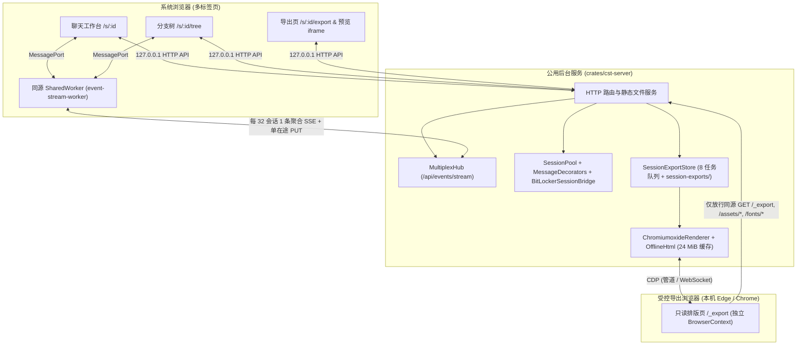
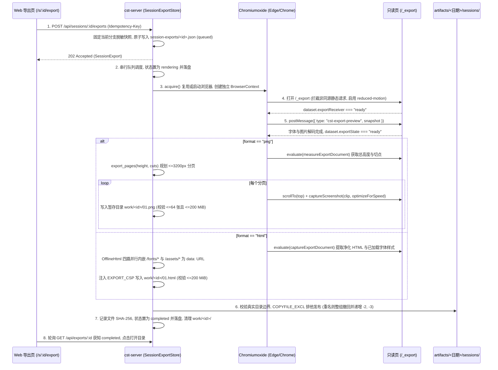
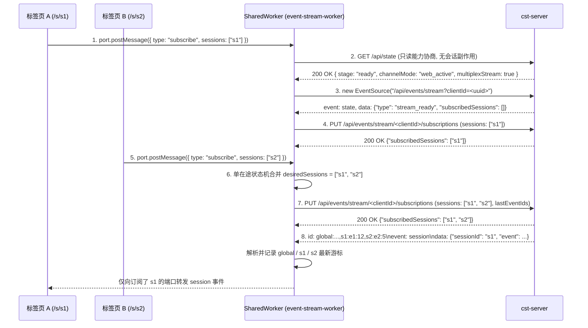

# 阶段 8：Web 网页端适配与会话导出设计

本文定义 React 19 前端接入 `crates/cst-server` 的多标签页聚合事件流客户端、通道待机处理，以及基于 `Chromiumoxide` 的会话长图（PNG）与离线网页（HTML）导出引擎设计。阶段 9 软件桌面端完成前，可通过 `cst-server --standalone-web --open-browser`（或 `pi-web-rust.cmd`）一键启动服务并打开默认浏览器。

所属总体路线见 [0.PLAN.md](0.PLAN.md)，前置依赖见 [6.cst-pilot.md](6.cst-pilot.md) 与 [7.server.md](7.server.md)，模块规格与接口契约见 [web/SPEC.md](../../web/SPEC.md)、[web/ARCHITECTURE.md](../../web/ARCHITECTURE.md) 与 [web/API.md](../../web/API.md)。

---

## 整体架构与模块映射

### 模块与职责映射

| 目标模块路径 | 职责说明 |
|---|---|
| `crates/cst-server/src/bin/cst-server.rs` | 新增 `--open-browser` 参数，在 `--standalone-web` 模式监听就绪后自动调用系统默认浏览器打开 `http://127.0.0.1:<port>/` |
| `crates/cst-server/src/exports/snapshot.rs` | 校验导出参数，按同一本机时刻固定 `capturedAt` 与 `options.date`。投影当前分支消息与未闭合 BitLocker 复查结果，执行 `browser_json` 脱敏与 `32 MiB` 上限检查 |
| `crates/cst-server/src/exports/store.rs` `crates/cst-server/src/exports/open.rs` | 管理 8 任务有界串行队列与 120 秒超时，负责 `agent/home/session-exports/<id>.json` 原子登记与重启中断标记。校验 `artifacts/<日期>/sessions/` 符号链接边界，执行分页排他复制与同名整组换号，提供文件 SHA-256 校验读取及 Explorer 目录打开 |
| `crates/cst-server/src/exports/browser.rs` | 基于 `Chromiumoxide` 探测本机 Edge / Chrome（支持 `CST_EXPORT_BROWSER`），校验 Chromium 主版本 `>= 111`。按需复用进程并为每任务创建独立 `BrowserContext`，负责 30 秒空闲回收、崩溃重建及退出 5 秒强杀清理 |
| `crates/cst-server/src/exports/render.rs` `crates/cst-server/src/exports/pagination.rs` `crates/cst-server/src/exports/html.rs` | 拦截非同源静态资源请求，向 `/_export` 注入脱敏快照并等待字体与图片解码。执行 DOM 几何测量与切点分页，按 `1240 × 3200` CSS 像素（2 倍缩放）逐段截图并支持 `optimizeForSpeed` 降级。四路并发拉取同源字体与样式资源组装离线 HTML |
| `src/web/frontend/app/data/types.ts` | 集中定义 `ContentPart`、`Message`、`ConversationEntry`、`ExportOptions`、`ExportSnapshot`、`SessionExport` 等前后端共用类型 |
| `src/web/frontend/app/data/event-stream.ts` `src/web/frontend/app/data/event-stream-worker.ts` `src/web/frontend/app/data/web-state.ts` | 通过 `SharedWorker` 按 32 会话分片复用 `/api/events/stream` 聚合连接，以单在途请求同步订阅并维护向量游标回放。处理 `stage: "app_active"` 与 `channel_mode_changed` 状态切换 |
| `src/web/frontend/app/cards/special-tool-data.ts` | 识别 BitLocker 顶层 `operation.status = "unknown"` 并展示失败原因，对空卷数组禁用成功状态推断 |

---

## 核心子模块详细设计

### 1. 会话导出引擎与持久化存储（`crates/cst-server/src/exports/`）

`crates/cst-server/src/exports/` 负责生成会话预览快照、调度后台导出队列并驱动本机浏览器完成渲染，行为对齐 [web/SPEC.md#会话导出](../../web/SPEC.md#会话导出) 与 [web/API.md#会话导出接口](../../web/API.md#会话导出接口)。

#### 1.1 快照时间统一与分支投影（`snapshot.rs`）

1. **单一采样时刻**：`build_export_preview_snapshot` 在入口调用一次 `chrono::Local::now()`，同时生成 UTC ISO 时间戳 `captured_at` 与本机自然日 `options.date`（`%Y-%m-%d`），消除跨零点采样导致文件名日期与归档目录不一致的问题。
2. **字段净化**：
   - 仅保留 `user`、`assistant`、`toolResult`（仅限 `include_tools == true`）和 `branchSummary` 四类条目。
   - 助手消息的 `toolCall` 块剥离运行期 `execution` 字段，`thinking` 块在 `!include_thinking` 或 `redacted == true` 时剔除。
   - 过滤后若助手消息正文为空、无 `errorMessage` 且 `stopReason != "aborted"` 则整条跳过，最终经 `browser_json_value` 脱敏并校验序列化体积不超过 `32 MiB`（`MAX_EXPORT_SNAPSHOT_BYTES`）。
3. **BitLocker 中断复查导出投影**：开启 `include_tools == true` 后，若助手消息中的 `bitlocker` 调用挂载了 `cst.bitlocker-state-verification` 复查数据且后续无持久化 `toolResult` 消息条目，快照投影在该助手条目后追加一条经 `browser_json_value` 脱敏的只读 `toolResult` 条目（`id: "{entry.id}:bitlocker-verification:{call_id}"`）。导出预览、PNG 与离线 HTML 无需依赖运行期 `execution` 字段即可保留与聊天页一致的未知状态、卷状态和中断说明。

#### 1.2 有界任务队列、原子登记与排他发布（`store.rs`）

`SessionExportStore` 负责导出任务的生命周期、磁盘持久化与并发控制：

| 机制 | 实现规则与错误码 |
|---|---|
| 队列容量与状态单向推进 | 内存中维护 `queue: VecDeque<Arc<WorkItem>>`、`active: Option<Arc<WorkItem>>` 与 `reservations: usize`。`queue.len() + reservations + usize::from(active.is_some()) >= 8` 成立即返回 `429 export_busy`（`"导出任务较多，请等待已有任务完成"`）。每个任务通过 `state: Mutex<(ExportRecord, ExportJobRecord)>` 同步维护落盘记录与对外可见快照，每次状态推进（`queued -> rendering -> completed / failed`）先完成 `agent/home/session-exports/<id>.json` 同目录临时文件原子替换，再更新内存快照，保证并发轮询不观测到倒退状态或未落盘的完成态 |
| 重启恢复与退出清理 | 首次导出读写前清理上次启动遗留的 `work/`，包含未完成任务与浏览器目录。活跃任务开始后，读取任务不再触发整目录清理。读取非活跃任务的磁盘登记时，校验 JSON 结构、`options` 与 `date` 合法性。若磁盘记录处于 `"queued"` 或 `"rendering"`，立即改写为 `status: "failed"`、`error: { code: "export_interrupted", message: "上次导出未完成，请重新导出" }` 并原子落盘。服务退出调用 `store.close().await` 时置 `closing = true`，拒绝新请求（`503 export_stopping`），触发当前任务取消令牌（`503 export_interrupted`），等待在途任务与渲染器关闭并清空 `work/` 暂存目录 |
| 产物限制与同名整组避让 | 单任务超时 `120 秒`（`504 export_timeout`）。渲染输出先写入 `agent/home/session-exports/work/<id>/`：HTML 限 1 个文件，PNG 限 1–64 个文件，单任务产物总字节上限 `200 MiB`（超出返回 `413 export_too_large`）。发布至 `artifacts/<date>/sessions/` 前，逐级通过 `canonicalize` 核验 `artifacts`、`<date>` 与 `sessions` 位于受控根目录内且无符号链接或 Windows Junction 越界。基础文件名为 `{artifact_name(title)}-{YYYYMMDD}-{HHmmss}`，从组号 `group = 1` 起使用 `OpenOptions::new().write(true).create_new(true)` 排他写入目标文件。任一分页触发 `AlreadyExists` 则仅删除本轮尝试已创建的分图文件，保留目录内原有文件，递增 `group`（追加 `-2`、`-3`）整组重试 |
| 完整性校验读取与目录打开 | `GET /api/exports/:id/files/:index` 核验任务已完成、`index` 合法且文件名不含路径分隔符，校验目标文件真实路径位于 `artifacts/<date>/sessions/` 内，读取字节后比对 SHA-256 与登记的 `stored[index].hash`。哈希不一致返回 `409 export_file_changed`（`"导出文件已被修改，请重新导出后分享"`），缺失或越界返回 `404 export_file_missing`。`POST /api/exports/:id/open` 仅接受空对象 `{}`，忽略磁盘 JSON 中的 `directory` 显示字段，由受控 `artifacts_root` 与 `options.date` 重新推导并校验真实目录（未完成 `409 export_not_completed`、缺失 `404 export_directory_missing`、越界 `403 export_directory_invalid`、无权限 `403 export_directory_denied`），校验通过后启动 `C:\Windows\explorer.exe <dir>`（启动失败返回 `503 export_launch_failed`） |

#### 1.3 `Chromiumoxide` 浏览器管理与页面渲染（`browser.rs` / `render.rs` / `pagination.rs` / `html.rs`）

通过 `ExportRenderer` Trait 解耦存储队列与浏览器渲染，默认生产实现为 `ChromiumoxideRenderer`，测试可注入模拟渲染器：

1. **浏览器探测与版本核验（`browser.rs`）**：按 `显式配置路径 > CST_EXPORT_BROWSER > CHROME_PATH > 系统 Chrome > 系统 Edge` 的优先级查找可执行文件，未找到返回 `503 export_browser_missing`。启动前在 `agent/home/session-exports/work/browsers/` 下创建独占临时目录 `browser-<uuid>`，通过 `BrowserConfig::builder()` 启用 `new_headless_mode()`、独立用户目录、窗口尺寸 `1280 × 900` 与 `--disable-component-update`（结合 `chromiumoxide` 内置默认隔离参数关闭扩展、同步与后台联网），页面视口设为 `1240 × 3200`、设备缩放比 `2.0`。启动后调用 `Browser.getVersion` 核验主版本号不低于 `111`，过旧则关闭进程并清理目录，返回 `503 export_browser_incompatible`（其他启动失败返回 `503 export_browser_launch_failed`）。
2. **进程复用、上下文隔离与空闲回收**：同一时刻最多启动一个导出浏览器实例，并发请求共享同一个启动任务，连接断开则回收重建。每次 `run(cancel, action)` 创建独立的 `BrowserContext` 隔离 Cookie 与 `localStorage`，任务结束或取消时立即销毁该上下文。活跃操作归零满 `30 秒` 后关闭浏览器进程（超时 5 秒未退出则强制终止）并清理临时目录。
3. **请求拦截、快照注入与 PNG 分页截图（`render.rs`、`pagination.rs`）**：
   - **同源拦截与快照注入**：新建页面后启用 `prefers-reduced-motion: reduce` 模拟，开启 CDP `Fetch.enable` 请求拦截，仅放行 `data:` 协议及同源 `http://127.0.0.1:<port>` 下方法为 `GET` 且路径为 `/_export`、`/assets/*` 或 `/fonts/*` 的请求，其余请求（含 `/api/*` 与外部地址）以 `BlockedByClient` 拒绝。导航至 `${origin}/_export` 等待 `dataset.exportReceiver === "ready"`，通过 `postMessage` 注入快照并等待 `dataset.exportState` 变为 `"ready"`（`"failed"` 返回 `500 export_document_failed`）。
   - **切点分页与截图降级**：执行 `measureExportDocument` 获取总高度与候选切点，`export_pages(height, cuts)` 校验 `0 < height <= 100_000`（超出返回 `413 export_too_tall`），按单页最大 `3200` CSS 像素高度且优先选取 `[top + 1600, top + 3200]` 内最大切点生成连续分页。逐页滚动调用 `Page.captureScreenshot`（`clip: { x: 0, y: part.top, width: 1240, height: part.height, scale: 1 }`），首次尝试携带 `optimizeForSpeed: true`，浏览器报错不支持参数则回退标准无损 PNG 编码。
4. **离线 HTML 组装（`html.rs`）**：在页面内执行 `captureExportDocument`，仅提取 `document.fonts` 中已加载字体的 `@font-face` 规则及样式表，克隆 `.export-document` 并移除 `script, button, input, select, textarea, .code-copy-feedback, .special-tool-delivery` 节点与 `on*` 事件属性。`OfflineHtml` 解析 CSS 中的 `url(...)`，拒绝非 `data:` 且非同源 `/fonts/*`、`/assets/*` 的引用（`400 export_asset_forbidden`），校验去重资源数 `<= 128`，以最多 4 个并发协程读取静态资源转为 `data:<mime>;base64,...`（单资源上限 `16 MiB`，跨任务 LRU 缓存上限 `24 MiB`，任一失败或取消时立即中断同批流），最终封装 `EXPORT_CSP` 输出独立 HTML。

---

### 2. 前端聚合事件流与多标签页合并（`src/web/frontend/app/data/`）

前端通过同源 `SharedWorker` 将多标签页的全局流与会话流合并至 `/api/events/stream`，规避浏览器在 HTTP/1.1 下同源最多 6 条并发连接的限制。

1. **只读能力协商与先建连后订阅时序（`event-stream.ts`、`events.rs`）**：
   - 原生 `EventSource` 错误事件不暴露 HTTP 状态码。Worker 启动时先请求一次只读 `GET /api/state`（不携带具体会话 ID，不产生槽位或订阅副作用）。
   - `stage === "app_active"` 时直接切入通道待机锁定态，不建立连接。响应不含 `multiplexStream: true`（对应纯前端 UI 测试内置的极简假服务）时选用单流回退模式（`/api/events` 与单会话 `/api/sessions/:id/events`），全程不调用聚合接口。`GET /api/state` 遇网络错误或 `5xx` 时按退避计时器重试协商，不误判为不支持聚合流。
   - 确认支持聚合流后，分片先建立 `EventSource("/api/events/stream?clientId=<uuid>")`，待收到 `stream_ready` 握手帧后再提交首次 `PUT /api/events/stream/<clientId>/subscriptions`。服务端 `MultiplexHub::update_subscriptions` 同步补齐防御闭环：若更新后槽位处于 `active_subscriber.is_none()`（如连接刚断开或客户端异常退出），立即启动 60 秒 `expiry_task` 超时回收，防止未连接槽位遗留常驻会话引用。
   - SSE 进入 `CLOSED` 状态后，以 `250ms` 至 `5s` 的指数退避重新检查 `/api/state` 并重建连接，保留分片 `clientId`。原生 `EventSource` 仍在重连时沿用现有连接。重建后向订阅端口派发 `open`，刷新页面快照，分片销毁时取消重建计时器。
2. **单请求在途（Single-flight）状态机与错误分支隔离（`event-stream-worker.ts`）**：
   - 每个已就绪分片维护期望集合 `desiredSessions: Set<string>`、已确认集合 `confirmedSessions: Set<string>`、失效剔除集合 `rejectedSessions: Set<string>`、在途标记 `inFlight: boolean` 与终止标记 `stopped: boolean`。端口订阅变更经 `40ms` 去抖合并至 `desiredSessions`，与 `stream_ready` 握手恢复共用同一同步入口，`inFlight == true` 期间不并发发出第二个 `PUT`。
   - 请求完成后按以下四类结果分支处理，禁止在失败时无间隔循环补发：

| 结果分支 | 触发状态与返回码 | 处理动作 |
|---|---|---|
| 成功 | `200 OK` | 更新 `confirmedSessions` 并清零退避计数。若等待期间 `desiredSessions` 已再次变化，生成新 `Idempotency-Key` 立即发起下一轮追赶请求 |
| 暂时性失败 | 断网与 `5xx`、`429` 或锁冲突 `409` | 保留 `confirmedSessions` 不变，启动带上限的指数退避定时器（`250ms` 起步，上限 `5s`）调度重试。SSE 重连收到新的 `stream_ready` 时取消退避定时器并立即恢复同步 |
| 目标会话不存在 | `404 session_not_found`（含失效 `sessionId`） | 服务端在订阅加载遇到 `SessionPoolError::NotFound(id)` 时返回失效 `sessionId`。Worker 将该 `id` 记入 `rejectedSessions` 并通知对应标签页端口，从 `desiredSessions` 剔除失效项后继续同步其余有效会话，不回退传输模式 |
| 终止态 | `403 web_mode_inactive` 或分片销毁 | 置 `stopped = true`，取消退避定时器与连接，不再发起后续请求 |
3. **按 32 会话自动分片与游标回放**：
   - 服务端单个 `clientId` 上限为 32 个会话。`SharedWorker` 按每 32 个活跃 `sessionId` 管理一个 `MultiplexShard`（常规 `<= 32` 个会话仅建立 1 条连接，打开第 33 个不同会话时自动分配第 2 个 `clientId` 分片连接，空闲分片在全部会话退订后关闭），确保任意数量打开标签页的消息、队列与 BitLocker 请求均不静默断流。
   - Worker 解析每帧 SSE 的 `lastEventId` 向量（`global:<e0>:<s0>,<sid1>:<e1>:<s1>,...`），记录各会话最新 `<epoch>:<seq>` 游标并在重新订阅时填入 `lastEventIds` 触发 256 条环形缓冲增量回放。收到定向 `event: reset`（`scope: "global" | "session"`）时，仅向对应标签页端口派发 `reset`。不支持 `SharedWorker` 的环境在当前标签页内运行同一套分片客户端，使同页内的 `useSessionDetail(id)` 与 `useSessionTree(id)` 共享同一连接。

---

### 3. 通道锁定、复查卡片与返回契约对齐

1. **`AppActive` 通道锁定状态处理（`web-state.ts`、`shell.tsx`、`error-presenter.ts`）**：
   - `cst-server` 处于 `AppActive` 模式（软件端活跃，或用户在软件端退出 Web 模式）期间，`GET /api/state` 返回 `stage: "app_active"`，全局流广播 `{"type": "channel_mode_changed", "mode": "app_active"}`，业务接口返回 `403 web_mode_inactive`。
   - 前端识别上述任一信号后，立即关闭活跃 SSE 连接，跳过会话详情预载与 `/api/auth`、`/api/settings` 请求，在工作台呈现通道待机提示，并保留当前标签页 `sessionStorage` 与 `IndexedDB` 中的未发送草稿和图片。
2. **BitLocker 重启未知状态装饰与空卷保护（`decorators.rs`、`special-tool-data.ts`）**：
   - 进程在 BitLocker 解锁或解密中途被强杀后，下次启动由 `KitHost::open_session` 实时查询 `Win32_EncryptableVolume` 并写入 `cst.bitlocker-state-verification` 自定义条目。`crates/cst-server/src/session/decorators.rs` 在加载会话时按记录顺序更新未闭合 `bitlocker` 调用的 `execution.result`，采用最新复查结果。收到持久化 `toolResult` 后结束复查关联。
   - 前端 `src/web/frontend/app/cards/special-tool-data.ts` 新增顶层 `source.operation.status === "unknown"` 优先分支，无论返回中是否包含 `volumes` 均判定为 `status = "unknown"` 与 `summary = "结果未确认"`，并将顶层 `operation.reason`（如 `"上次操作异常中断；实时查询失败，请重新查询。"`）写入展示字段。同时为 `volumes.every(...)` 增加 `volumes.length > 0` 前置条件，防止空卷列表误判为“已解锁”或“已完全解密”。
3. **错误文案与模型范围同步对齐（`slot.rs`、`models.rs`）**：
   - `crates/cst-server/src/session/slot.rs` 将手动压缩的 `AlreadyCompacted` 错误消息设为 `"会话已压缩，继续对话后可再次压缩"`，将 `NothingToCompact` 设为 `"当前没有可压缩的较早内容"`，匹配前端 `error-presenter.ts` 的分类规则。
   - `crates/cst-server/src/routes/models.rs` 在处理 `POST /api/models/scoped` 保存启用模型范围时，同步更新 `SessionPool` 中已加载会话的内存 `scoped_models` 列表。
4. **过渡期一键启动与日志边界（`bin/cst-server.rs`）**：
   - `crates/cst-server/src/bin/cst-server.rs` 支持 `--open-browser` 参数。`--standalone-web --open-browser` 启动并绑定 `127.0.0.1:<port>` 后，自动拉起系统默认浏览器访问 `http://127.0.0.1:<port>/`。
   - 运行诊断信息统一通过标准错误输出，不在 `agent/home/` 下写入访问日志文件，减少对便携介质的持续写入。
