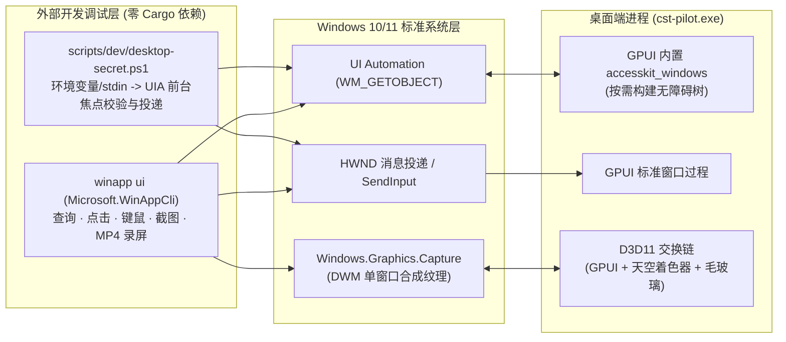

# 阶段 9.1：桌面端外部 CLI 自动化与录制详细设计

本文定义阶段 9 桌面端面向 Agent 批量调试与视觉核验的实施方案。方案采用微软官方工具 `microsoft/winappCli`（`winapp ui`）配合独立无回显凭据脚本 [desktop-secret.ps1](../../../scripts/dev/desktop-secret.ps1)，桌面端仅补充标准 GPUI 无障碍元数据，保持调试工具与桌面应用解耦。桌面主体设计见 [9.desktop.md](9.desktop.md)，窗口规格见 [desktop/SPEC.md](../../desktop/SPEC.md) 与 [desktop/ARCHITECTURE.md](../../desktop/ARCHITECTURE.md)，操作速查见 [winapp-cli.md](../../desktop/test/winapp-cli.md)。

---

## 架构与解耦边界

方案由外部 CLI 工具 `winapp ui`（`v0.8.0+`）、独立辅助脚本（凭据输入 [desktop-secret.ps1](../../../scripts/dev/desktop-secret.ps1) 与录屏回退 [desktop-record.ps1](../../../scripts/dev/desktop-record.ps1)）及 GPUI 内置 `accesskit_windows` 无障碍树组成。三者通过 Windows 标准系统接口通信。

### 三条解耦约束

1. **包与构建隔离**：`winapp` 在宿主机独立安装，`Cargo.toml` 与 `Cargo.lock` 不引入外部自动化包。外部 CLI 升级或脚本修改不触发 `cst-desktop` 重编。
2. **运行态零分叉**：`cst-pilot.exe` 不增加调试启动参数、后台监听端口或渲染器抓帧分支。GPUI 按需构建无障碍树。应用在渲染时仍会声明角色、标签和状态。
3. **产物与配置隔离**：调试期通过环境变量 `PI_CODING_AGENT_DIR`、`CST_ALLOW_UNELEVATED=1` 与 `--kit-root` 在 `E:/tmp/<YYYY-MM-DD>/kit/`（或 `F:/tmp/<YYYY-MM-DD>/kit/`）拉起独立测试实例。截图、视频与帧序列统一写入同日临时目录，禁止写入仓库目录。

---

## 桌面端无障碍声明细则

`gpui-pre-windows` 内置 `accesskit_windows` 响应系统 `WM_GETOBJECT` 请求。`cst-desktop` 使用 GPUI 与 `gpui-kit` 公开的无障碍方法补齐声明式元数据，向外部 UIA 工具暴露稳定的语义节点。

### 1. 四类控件映射规则

| 控件类别 | 代码现状 | 补齐方式（标准公开 API） | UIA 暴露行为 |
|---|---|---|---|
| `gpui-kit` 普通输入框（`Input` / `Textarea`） | 具备 `Role::TextInput`、`Focus` 与 `SetValue` 动作 | 在构造链调用 `.accessibility_id("<id>")` | `winapp ui` 按 `AutomationId` 定位并执行后台 `set-value` 与 `get-value` |
| 自定义可点击 `div`（按钮与菜单项） | 挂载 `.id("<id>").test_support()` 与 `.on_click(...)` | 挂载 `a11y_button` / `a11y_menuitem` / `a11y_link`，纯图标按钮补充中文说明 | 向 UIA 注册 `Invoke` 动作，调用 `winapp ui invoke` 时 GPUI 在内部合成点击 |
| 状态切换型自定义 `div`（标签与列表行） | 挂载 `.id("<id>").test_support()` | 挂载 `a11y_tab` / `a11y_checkbox` / `a11y_listitem` / `a11y_treeitem` / `a11y_toggle_button` | `winapp ui inspect` 与 `get-property` 直接读取选中态、勾选态与展开态 |
| API Key 输入框与 `SecretInput` | 默认显示掩码；`SecretInput` 使用固定容量的清零缓冲 | API Key 设置 `InputContentType::Password`；`SecretInput` 使用 `Role::PasswordInput` 且不设置 `aria_value` | UIA 标记 `IsPassword = true`，不提供明文读取。API Key 手动切换为可见时仍保持相同 UIA 语义 |

### 2. 统一辅助扩展

`crates/cst-desktop/src/accessibility.rs` 为自定义控件统一声明角色、标识符、名称和状态。视图负责处理点击、展开和收起等动作。

### 3. 核心模块 `AutomationId` 清单

下表列出外部 UIA `AutomationId`。集成测试的元素 ID 可能与其不同。

| 模块 | 关键 `AutomationId` 清单 |
|---|---|
| `shell` 外壳与顶栏 | `cst-app-shell`、`sidebar-l081m1`、`sidebar-collapse-btn`、`sidebar-new-session-btn`、`sidebar-search-box`、`sidebar-dashboard-btn`、`sidebar-all-sessions-btn`、`sidebar-session-row-<id>`、`sidebar-account-btn`、`sidebar-settings-btn`、`topbar-expand-sidebar-btn`、`topbar-recent-drawer-btn`、`topbar-view-gui-btn`、`topbar-view-tui-btn`、`topbar-open-web-btn`、`window-btn-minimize`、`window-btn-maximize`、`window-btn-close`、`workspace-container` |
| `workbench` 工作台与输入 | `workspace-home-view`、`workspace-session-view`、`session-header-hukqs`、`session-header-more-btn`、`composer-card-zwas1`、`composer-input`、`composer-attach-btn`、`composer-context-ring-btn`、`composer-model-picker-btn`、`composer-send-btn-b0mrik` |
| `tools` 诊断工具卡片 | `normal-tool-card-<call_id>`、`sys-overview-card-<call_id>`、`web-search-card-<call_id>`、`runbook-card-<call_id>`、`bitlocker-card-<call_id>`、`bitlocker-pwd-input-<call_id>`、`bitlocker-submit-btn-<call_id>` |
| `sessions` 会话、分支与导出 | `all-sessions-view`、`all-sessions-manage-btn`、`all-sessions-exit-batch-btn`、`all-sessions-select-all-btn`、`all-sessions-batch-delete-btn`、`all-sessions-row-<id>`、`branch-tree-view`、`branch-tree-search-input`、`tree-filter-default`、`branch-tree-expand-btn`、`branch-tree-collapse-btn`、`branch-tree-back-btn`、`export-view`、`export-format-png-btn`、`export-format-html-btn`、`export-save-btn` |
| `settings` 与 `auth` | `settings-view`、`settings-tab-general`、`settings-tab-providers`、`settings-tab-preferences`、`settings-tab-shortcuts`、`providers-apikey-input`、`preferences-search-input`、`login-view`、`login-tab-cstoa`、`login-tab-apikey`、`login-tab-oauth`、`login-apikey-input`、`login-baseurl-input`、`login-apikey-save-btn`、`cstoa-qr-image-box`、`account-view`、`account-logout-btn` |
| 全局弹窗与浮层 | `command-palette-modal`、`missing-key-dialog`、`update-dialog-card`、`web-active-lock-overlay`、`exit-confirm-dialog`、`account-popover-menu`、`recent-sessions-drawer` |

---

## 无回显凭据脚本设计（`scripts/dev/desktop-secret.ps1`）

命令行参数传入明文密钥时会留在终端历史与 Agent 调用记录中。独立脚本 [desktop-secret.ps1](../../../scripts/dev/desktop-secret.ps1) 从环境变量或标准输入流读取凭据，脱敏输出执行摘要。

### 1. 参数定义

| 参数 | 必填 | 说明 |
|---|---|---|
| `-TargetApp <string>` | 否 | 进程名或数字 PID，默认 `cst-pilot` |
| `-WindowHandle <int64>` | 否 | 目标顶层窗口 `HWND`（多实例并存调试时优先指定） |
| `-AutomationId <string>` | 是 | 目标密码框的 `AutomationId`（如 `login-apikey-input`、`providers-apikey-input`、`bitlocker-pwd-input-<call_id>`） |
| `-FromEnv <string>` | 二选一 | 从指定环境变量读取凭据内容 |
| `-FromStdin` | 二选一 | 从标准输入流读取单行凭据内容 |

脚本要求 PowerShell 7。它拒绝位置参数与未知参数，校验失败返回非零退出码。

### 2. 执行流程

1. 加载 .NET 内置程序集 `UIAutomationClient` 与 `UIAutomationTypes`，按 `-WindowHandle` 或 `-TargetApp` 定位唯一顶层窗口。
2. 按 `AutomationId` 查找唯一后代。要求控件属于目标进程，类型为 `Edit`，可见、可用，且 `IsPassword = true`。脚本拒绝提供 `ValuePattern` 或 `TextPattern` 的控件。
3. 调用者先清空输入框、手动将目标窗口置于前台。脚本调用 `SetFocus()`，逐字符投递 `WM_CHAR` 前复核窗口、控件和焦点。后台窗口的 UIA 焦点不可核实，脚本会拒绝投递。
4. 标准输出只报告投递结果与字符数，不读回字段。结束时清零脚本的字符数组。环境变量、管道及运行时字符串的内存不由脚本清零。

---

## 外部 CLI 通道分工与并发录制

### 1. 后台与前台通道选择

不同调试场景按是否依赖系统全局指针与修饰键选择对应子命令：

| 调试目标 | `winapp ui` 命令 | 抢占前台焦点与鼠标 |
|---|---|---|
| 查询交互节点与坐标 | `winapp ui inspect -w $hwnd --interactive --json` | 否（后台 UIA 查询） |
| 点击按钮、切页、勾选 | `winapp ui invoke <AutomationId> -w $hwnd --json` | 否（GPUI `handle_a11y_action` 内部合成点击） |
| 普通搜索框与输入框填值 | `winapp ui set-value <AutomationId> "磁盘" -w $hwnd --json` | 否（GPUI `Input` / `Textarea` `SetValue` 后台直写） |
| 单键投递（`Enter` / `Esc` / 方向键） | `winapp ui send-keys "esc" -w $hwnd --via post-message` | 否（直投 GPUI `HWND` 消息队列） |
| 抗遮挡截图与单控件裁剪 | `winapp ui screenshot [AutomationId] -w $hwnd -o E:/tmp/<日期>/shot.png --json` | 否（抓取单窗口合成表面或 `PrintWindow`） |
| 组合热键（如 `Ctrl+K`、`Ctrl+B`） | `winapp ui send-keys "ctrl+k" -w $hwnd --via send-input` | 是（GPUI 读取系统 `GetKeyState`，需短暂置前窗口或放入 `--on sandbox`） |
| 悬停态（`:hover`）与拖拽 | `winapp ui hover <AutomationId> -w $hwnd --dwell-time 300`、`winapp ui drag ...` | 是（移动指针触发悬停与拖拽反馈） |
| 录制视频与毫秒帧序列 | `pwsh -NoProfile -File scripts/dev/desktop-record.ps1 -WindowHandle $hwnd -OutputPath ... -Frames` | 否（交互桌面优先调 `winapp ui record`，`exebox-*` 沙盒桌面自动回退 `PrintWindow` + `ffmpeg` 合成 MP4） |

### 2. 协同录制机制

串联多条原生 CLI 命令时统一使用 PowerShell `;` 分隔。并发录屏与点击操作共享同一个 `WINAPP_UI_WORKFLOW_ID` 环境变量，可让 winapp 录屏及交互命令使用同一个桌面轮次。操作结束后调用 `winapp ui yield` 释放轮次。PrintWindow 回退和填密脚本不参与该机制。

---

## 验收条件

1. **零耦合验证**：`Cargo.toml`、`Cargo.lock` 与 `crates/cst-desktop/Cargo.toml` 无新增自动化依赖。不运行 `winapp` 时桌面端功能与现有测试保持通过。
2. **语义树完整度**：对主窗口、设置页、登录页与诊断工具卡执行 `winapp ui inspect --interactive`，交互控件返回预期语义 `AutomationId`、角色、中文名称与边界框。
3. **凭据隐私验证**：通过 `desktop-secret.ps1` 向密码框填入测试值后，界面显示掩码圆点，`winapp ui get-value` 与 `inspect` 返回结果不含明文字符。
4. **单窗口截图与录屏验证**：执行 `winapp ui screenshot` 和 `desktop-record.ps1 -Frames`，验证截图 PNG、录屏 MP4、JPEG 帧及时间索引。PrintWindow 回退会按视频时间轴标记变化帧，画面内容取决于目标窗口对 PrintWindow 的支持。
