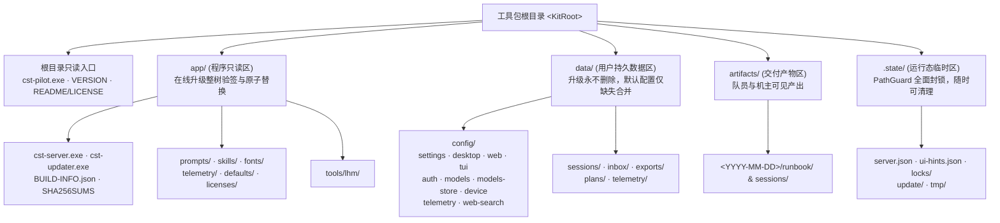

# 阶段 9.2：配置目录隔离、纯 Rust 打包策略与兼容性设计

本文定义阶段 9.2 的工程方案，将原阶段 11 的目录结构重构与打包前置改造提前至桌面端验收周期内执行。本阶段完成后，CST Pilot 与上游 `pi`（`~/.pi/agent`、`agent/home/`、`PI_CODING_AGENT_DIR`）实现存储与环境变量层面的彻底隔离，形成面向纯 Rust 便携分发的目录契约与升级基线。

总体路线见 [0.PLAN.md](0.PLAN.md)，系统架构见 [ARCHITECTURE.md](../../ARCHITECTURE.md)，发行与在线升级规格见 [release/SPEC.md](../../release/SPEC.md) 和 [release/ARCHITECTURE.md](../../release/ARCHITECTURE.md)，决策摘要见 [ADR.md](../../ADR.md)。

## 1. 背景与提前实施动因

Rust 运行时使用独立四区。以下列出隔离目标：

1. **配置与锁文件冲突**：Rust 桌面端、过渡期 Node 入口（`pi.cmd`、`pi-web.cmd`）与开发机本机 `pi` 共用 `agent/home/settings.json` 及 `.lock` 命名规则，已导致双端争抢锁文件与本地调试修改默认模型污染仓库文件。
2. **程序区与用户数据区混排**：只读资产（`APPEND_SYSTEM.md`、`skills/`、`extensions/web/static/`、`extensions/telemetry/`）与用户读写数据（`auth.json`、`sessions/`、`web-inbox/`、`desktop.json`）混杂在 `agent/home/` 下，增加 `cst-updater` 白名单与 `PathGuard` 维护复杂度。
3. **环境变量耦合**：`cst-os::resolve_kit_root` 与 `cst-client::apply_portable_sanitized_env` 依赖 `PI_CODING_AGENT_DIR`，`pi-runtime::sdk::get_default_agent_dir` 存在回退至 `~/.pi/agent` 的默认分支，与「单目录零宿主残留」原则存在隐式越界风险。
4. **打包链路割裂**：发行装配依赖 `pack/pack.mjs`（Node 脚本），与 `crates/cst-updater/src/layout.rs` 各自维护一套白名单与红线扫描逻辑，双份规则容易漂移。

阶段 9.2 通过启用全新四区目录结构与纯 Rust 装配流水线，一次性消除上述耦合，为阶段 10 内置 TUI 与阶段 11 正式便携分发扫清前置障碍。

## 2. 全新隔离目录架构

新目录树按读写生命周期严格划分为四个顶层区域：**程序只读区（`app/`）**、**用户持久数据区（`data/`）**、**现场交付产物区（`artifacts/`）** 与 **运行态临时区（`.state/`）**。根目录仅保留统一入口程序、版本文件与可读许可文档。

### 2.1 新旧路径完整映射与权责表

| 新路径 | 原路径 | 所属分区 | 升级处置 | `PathGuard` 策略 | 说明 |
|---|---|---|---|---|---|
| `cst-pilot.exe` | `cst-pilot.exe` | 根入口 | 替换 | 只读允许 | 统一主程序（GUI 与阶段 10 内置 TUI） |
| `VERSION` | `VERSION` | 根入口 | 最后提交替换 | 只读允许 | 工具包唯一版本标识（`cst-pilot X.Y.Z`） |
| `app/cst-server.exe` | `cst-server.exe` | 程序区 | 替换 | 只读允许 | 本机后台服务，从根目录收敛至 `app/` |
| `app/cst-updater.exe` | `cst-updater.exe` | 程序区 | 替换 | 只读允许 | 独立事务更新器，交接时复制至 `.state/update/` |
| `app/BUILD-INFO.json`、`app/SHA256SUMS` | 根目录同名文件 | 程序区 | 替换 | 只读允许 | 构建元数据与全树校验表 |
| `app/prompts/APPEND_SYSTEM.md` | `agent/home/APPEND_SYSTEM.md` | 程序区 | 替换 | 只读允许 | 系统诊断附加提示词 |
| `app/skills/<name>/SKILL.md` | `agent/home/skills/<name>/SKILL.md` | 程序区 | 替换 | 只读允许 | 8 份只读诊断与交付技能 |
| `app/fonts/` | `assets/fonts/` | 程序区 | 替换 | 只读允许 | 双端共享 `SourceHanSansCN-VF.otf` 与 `JetBrainsMono` |
| 内嵌进 `app/cst-server.exe`（`embed-web` 特性） | `agent/home/extensions/web/static/` | 程序区 | 随 `cst-server.exe` 替换 | — | React 19 预构建前端静态产物，开发期支持 `--static-dir` 覆写 |
| `app/telemetry/{timserver_1.crt,currency.json}` | `agent/home/extensions/telemetry/*` | 程序区 | 替换 | 只读允许 | 遥测专用 CA 证书与币种映射 |
| `app/defaults/{settings,models-store,telemetry,web-search}.json` | 混在 `agent/home/` | 程序区 | 替换并触发合并 | 只读允许 | 4 份只读标准配置模板，用于首次初始化与升级缺失字段合并 |
| `app/tools/lhm/` | `lhm/` | 程序区 | 替换 | 只读允许 | 随包外部硬件传感器采集组件，`app/` 保持纯只读 |
| `data/config/settings.json` | `agent/home/settings.json` | 数据区 | 按缺失字段合并 | 只读允许 | 三端共用默认模型、启用范围与思考强度 |
| `data/config/desktop.json` | `agent/home/desktop.json` | 数据区 | 原样保留 | 只读允许 | 桌面端外观、默认视图、侧栏与窗口位置 |
| `data/config/web.json` | `agent/home/web-settings.json` | 数据区 | 原样保留 | 只读允许 | Web 端主题与空模型范围标记 |
| `data/config/tui.json` | `settings.json` 内嵌主题 | 数据区 | 原样保留 | 只读允许 | 阶段 10 内置 TUI 独立外观配置，与通用配置解耦 |
| `data/config/{auth,models,mcp-auth,web-search}.json` | `agent/home/{auth,models,mcp-auth,web-search}.json` | 数据区 | `web-search` 合并，其余保留 | **严格拦截** | 敏感凭据、自定义服务密钥与联网配置 |
| `data/config/{models-store,device,telemetry}.json` | `agent/home/{models-store,device,telemetry}.json` | 数据区 | `models-store`/`telemetry` 合并 | 只读允许 | 模型缓存、设备标识与遥测开关 |
| `data/sessions/` | `agent/home/sessions/` | 数据区 | 原样保留 | 只读允许 | JSONL v3 会话历史 |
| `data/inbox/` | `agent/home/web-inbox/` | 数据区 | 原样保留 | 只读允许 | 持久化队列、幂等回执、未落盘快照与图片附件 |
| `data/exports/` | `agent/home/session-exports/` | 数据区 | 原样保留 | 只读允许 | 导出任务登记与渲染工作目录 |
| `data/plans/` | `agent/home/command-plans/` | 数据区 | 原样保留 | 只读允许 | 多轮修复命令方案版本库 |
| `data/telemetry/` | `agent/home/telemetry/` | 数据区 | 原样保留 | `identity.json` **严格拦截** | 匿名安装私钥、会话恢复草稿与双端队列 |
| `artifacts/<YYYY-MM-DD>/` | `artifacts/<YYYY-MM-DD>/` | 产物区 | 原样保留 | 只读允许 | 手动修复清单 TXT 与导出 PNG / HTML |
| `.state/` | `.state/` | 运行态区 | 不随包发布 | **全面封锁** | `server.json`、`ui-hints.json`、`locks/`、`update/`、`tmp/` |

### 2.2 锁文件与环境变量隔离契约

1. **锁文件集中收纳**：所有文件写锁统一落盘在 `.state/locks/<scope>-<hash>.lock`（配合 Windows 命名管道锁），`data/config/` 内不再出现 `settings.json.lock` 等并发锁残影，彻底杜绝与旧版 Node `pi` 的锁文件名冲突。
2. **专用环境变量替代 `PI_*`**：
   - `CST_PILOT_ROOT`：显式指定工具包根目录，替代通过 `PI_CODING_AGENT_DIR` 上溯两级目录的间接推断。
   - `CST_PILOT_DATA_DIR`：可选。`KitLayout` 读取当前进程环境。绝对路径直接使用；相对路径按工具包根目录解析。未设置或为空时使用 `<KitRoot>/data`。发布启动和隔离冒烟应清除此变量。
   - `CST_OFFLINE=1`：替代外部 `PI_OFFLINE=1`（`cst-kit` 内部在调用 `pi-runtime` 时通过显式参数关闭上游默认联网自检与官方遥测）。
3. **根目录解析优先级（`cst_os::resolve_kit_root`）**：
   1. 命令行 `--kit-root <path>`；
   2. 环境变量 `CST_PILOT_ROOT`；
   3. 当前可执行文件所在目录（命中 `app/prompts/APPEND_SYSTEM.md`，或自身位于 `app/` 下时取其父目录）；
   4. 当前工作目录（存在 `app/prompts/APPEND_SYSTEM.md` 时回退）。
   - 解析链严禁读取 `PI_CODING_AGENT_DIR`、`~/.pi/agent` 或机主工作目录下的 `.pi/`。
4. **开发仓库防污染**：开发仓库与发行版统一使用 `<KitRoot>/data/` 存放用户持久数据（包含 `data/config/`、`data/sessions/` 等），可通过 `CST_PILOT_DATA_DIR` 在测试时重定向至仓库外。`.gitignore` 忽略 `/data/`、`artifacts/` 与 `.state/`，仓库仅跟踪 `app/` 中的只读提示词、技能、证书、许可与默认模板，本地运行不修改受版本控制的配置文件。

## 3. 基于 Rust 与 Cargo 特征的打包策略

### 3.1 当前资产体积基线（Release 实测）

基于 `2026-11-22` 本机 Release 编译结果（`opt-level = 2`、`strip = "symbols"`），各组成部分实际体积如下：

| 资产 | 路径 | 当前体积 | 文件数 | 特性说明 |
|---|---|---|---|---|
| 桌面主程序 | `cst-pilot.exe` | `40.56 MB` | 1 | 含 GPUI、DirectWrite、D3D11 着色器 DXBC 与 `cst-client` |
| 后台服务 | `cst-server.exe` | `43.53 MB` | 1 | 含 `pi-{ai,agent,session,runtime}`、`cst-kit`、`chromiumoxide`、`wmi`、`hyper` |
| 独立更新器 | `cst-updater.exe` | `2.60 MB` | 1 | 仅依赖 `cst-os`、`ed25519-dalek`、`zip`、`sha2` |
| 共享字体 | `assets/fonts/` | `15.44 MB` | 5 | 原版思源黑体可变字体 + `JetBrainsMono`（ZIP 后约 `8.6 MB`） |
| Web 静态产物 | `web/static/` | `1.93 MB` | 93 | Vite 构建的 React 19 JS/CSS/Worker 零散文件 |
| 提示词与技能 | `APPEND_SYSTEM.md` + `skills/` | `0.03 MB` | 9 | 纯文本 Markdown |
| 外部诊断组件 | `lhm/` | `2.62 MB` | — | 自包含 .NET 10 硬件传感器采集器（存储诊断改用纯 Rust 实现） |
| **合计（未压缩）** | — | **约 `106.71 MB`** | — | 阶段 9.3 实测干净发行树（`xtask dist --profile release`）为 42 文件，解包 `105.76 MiB` / ZIP `43.14 MiB` |

### 3.2 Cargo 编译配置与二进制拆分原则

1. **引入专用发行 Profile（`[profile.dist]`）**：
   - 保持 `[profile.dev]`（`ADR-009`，`opt-level = 1` + 依赖 `opt-level = 2`）与 `[profile.release]` 的日常快速编译速度。
   - 在根 `Cargo.toml` 新增 `[profile.dist]`：继承 `release`，启用 `lto = "thin"`、`codegen-units = 1`、`strip = "symbols"`，对 `cst-updater` 单独设置 `opt-level = "s"`。该配置可在不牺牲运行性能的前提下将三支二进制体积缩减约 `15%–25%`，并保留稳定链接耗时。
2. **明确三支二进制的职责与合并权衡**：
   - `cst-updater.exe`（`2.60 MB`）必须在原程序退出后由 `.state/update/` 独立执行文件替换与回滚，且必须脱离 `pi-*`、`gpui`、`wmi` 依赖以降低故障面，**长期保持独立二进制**。
   - `cst-pilot.exe`（Medium IL，避免 Windows UIPI 阻断截图与拖放）与 `cst-server.exe`（Elevated High IL，承载 UAC 提权诊断）必须运行在两个不同完整性级别的 OS 进程中。
   - 关于「双二进制独立编译」与「单二进制多子命令入口（`cst-pilot.exe --server`）」的取舍：Rust 静态链接下，双二进制各自打入一份 `tokio`、`reqwest`、`rustls`、`serde`、`windows` 等公共库（共 `84.09 MB`）。单二进制多角色仍运行两个 OS 进程（双击启动窗口进程，再由自身带 `--server` 参数 UAC 提权拉起服务进程），仅在磁盘上共用同一支 `.exe`，预计可省 `20–28 MB`；但会导致 `cst-desktop` 强耦合后端依赖、拖慢日常链接速度，且同映像自提权需实机验证杀软误报。阶段 9.2 建议保持双二进制，阶段 11 前结合实机杀软表现再定夺。
3. **编译期安全与版本常量注入**：
   - 通过 `option_env!` 在编译期注入 `CST_BUILD_VERSION`、`CST_GIT_COMMIT`、`CST_UPDATE_MANIFEST_URL` 与 `CST_UPDATE_PUBLIC_KEY`。
   - 禁止在运行期从环境变量、命令行或本地配置覆写升级公钥与发布源地址；任何缺失均使在线升级退回 `Phase::Unavailable`。

### 3.3 静态资源内嵌 vs 外置决策矩阵

结合 U 盘 FAT32/exFAT 小文件读写慢、双进程共享内存与杀软拦截约束，对各类资产按以下原则分类处置：

| 资产类型 | 处置策略 | 依据 |
|---|---|---|
| D3D11 着色器（4 款 `.glsl` -> DXBC） | **编译期内嵌**（现状沿用） | `crates/cst-desktop/build.rs` 预编译为字节码，体积小、零运行期 I/O、免带 `d3dcompiler` 源码 |
| Web 静态产物（`1.93 MB` / 93 文件） | **编译期内嵌进 `cst-server.exe`**（通过可选 Cargo Feature `embed-web` 控制，保留 `--static-dir` 开发覆写） | 压缩后增量不足 `600 KB`，消除 93 个零散小文件在 FAT32 U 盘上的解压、校验与漏拷风险，且前后端随单支 `cst-server.exe` 原子同步；默认开发构建不强制内嵌，避免 `cargo check` 依赖先跑 `npm run build` |
| 共享字体（`15.44 MB` / 5 文件） | **外置 `app/fonts/`** | 桌面端与 `cst-server`（Web `/fonts/*`）双进程共用同一份文件；内嵌会导致两支 `.exe` 重复打包超 `30 MB` 并拖慢链接与 `rust-analyzer` |
| 提示词、技能、证书与默认配置模板 | **外置 `app/`** | 文件数量少（`< 20` 个）、体积可忽略，保留可读可审计特性，方便现场排错与快速核对许可 |
| `lhm/` | **外置 `app/tools/`** | .NET 10 依赖，遵循 [ADR-006](../../ADR.md#adr-006阶段-11-采用单文件便携引导器与直观子目录分发) 严禁运行期自释放，避免触发 Windows Defender 与主流杀软拦截 |

### 3.4 纯 Rust 打包工具（Cargo `xtask`）取代 `pack/pack.mjs`

在工作区新增 `crates/xtask`（不纳入 `workspace.default-members`，避免干扰常规 `cargo check --workspace`），通过 `cargo run -p xtask -- <subcommand>` 统一发行装配与校验：

1. **单一校验真相源**：`xtask` 直接依赖 `cst-updater::layout`，与线上更新器复用同一份安全路径检查、程序区白名单、红线黑名单与 SFNT 字体校验逻辑，彻底消除过去 JS 脚本与 Rust 代码维护两套规则的漂移风险。
2. **标准打包流水线（`cargo run -p xtask -- dist`）**：
   1. 用 `--locked` 固定 Cargo 依赖；
   2. 触发 Web 前端生产构建（`npm run build --prefix src/web/frontend`）并校验共享字体 SHA-256；
   3. 设置 CPU 亲和性执行 `cargo build --profile dist --locked -p cst-desktop -p cst-server -p cst-updater`；
   4. 按第 2 节目录契约组装 `app/`、`cst-pilot.exe`、`VERSION`、`app/BUILD-INFO.json` 与许可文件；
   5. 执行 6 条干净发行树红线扫描（零开发文件、零运行态、零链接越界、零凭据字段、默认配置精确匹配、静态资产与 SFNT 字体齐备）；
   6. 生成 `app/SHA256SUMS` 并写入发行 ZIP；
   7. 在外部临时目录解压最终 ZIP，比对清单与文件，再执行双程序 `--health-check` 和服务端首启默认配置核验。生产签名与单文件引导器见阶段 11。

## 4. 兼容性与彻底分叉策略

### 4.1 与上游 `pi` 的彻底分叉边界

| 维度 | 隔离与分叉规则 |
|---|---|
| `crates/pi-{ai,agent,session,runtime}` | 保留 Rust 核心实现并按 CST Pilot 需求演进，不再承担与上游 Node/Rust `pi` 配置目录、CLI 参数或插件生态双向兼容的义务 |
| 配置与会话路径 | `pi-runtime` 仅接受调用方（`cst-kit`）显式传入的 `config_dir` 与 `sessions_dir`，CST Pilot 路径下永久禁用 `get_default_agent_dir()` 对 `PI_CODING_AGENT_DIR` 与 `~/.pi/agent` 的隐式读取 |
| 上下文与技能加载 | 继续锁定 `no_context_files = true`、`no_skills = true`、`no_prompt_templates = true`、`defaultProjectTrust = "never"`，完全忽略机主工作目录中的 `AGENTS.md`、`CLAUDE.md` 与 `.pi/` |
| 过渡期 Node 入口 | **已拍板**：因桌面端仍在稳定化阶段，`pi.cmd`、`pi-web.cmd`、`agent/home/` 与 `pack/` 在阶段 9.2 保持原位冻结，保留至阶段 11 再统一清退；Rust 全栈读写彻底切入新四区（`app/`、`data/`、`artifacts/`、`.state/`），与旧 `agent/home/` 物理零交集，消除配置与锁文件冲突 |

### 4.2 早期旧版本舍弃与在线升级基线

**已拍板：不做旧版数据迁移。** 现有 `agent/home/` 对应早期过渡版本，本阶段直接舍弃历史数据兼容，不在代码中引入一次性迁移器或双路径读取逻辑。

1. **新基线断代**：阶段 9.2 起启用全新的 `app/` + `data/` 目录结构与新版本基线，远端发布清单将 `minUpgradableVersion` 设为该基线版本。
2. **更新器白名单收敛**：`crates/cst-updater/src/layout.rs` 移除全部 `agent/home/`、`assets/` 与 Node 运行时旧路径，仅保留根目录只读入口（`cst-pilot.exe`、`VERSION`、许可文档）、`app/**` 程序区，以及 4 份 `app/defaults/*.json -> data/config/*.json` 的缺失字段合并规则。
3. **全新初始化**：首次启动检测到 `data/config/` 缺失时，直接从 `app/defaults/` 复制初始化标准配置；若用户需保留旧凭据或会话，手动重新登录即可。

## 5. 分包实施清单

阶段 9.2 改造按以下依赖顺序自底向上推进，每一步均通过双特性 `clippy` 与隔离测试门禁：

| 顺序 | 涉及包 / 目录 | 核心改动 | 验证方式 |
|---|---|---|---|
| 1 | `crates/cst-os` | 重构 `KitLayout` 暴露 `app_dir()`、`data_dir()`、`config_dir()`、`sessions_dir()`、`locks_dir()`、`tmp_dir()`；`resolve_kit_root()` 切换至 `--kit-root` / `CST_PILOT_ROOT` / 可执行路径，移除 `PI_CODING_AGENT_DIR` 推断 | 单元测试覆盖全路径解析、相对路径防越界与 Windows 盘符前缀剥离 |
| 2 | `crates/cst-updater` | 更新 `layout.rs` 白名单至 `cst-pilot.exe`、`VERSION`、`app/**` 与 4 份 `app/defaults/*.json -> data/config/*.json` 合并映射；调整 `handoff.rs` 与 `process.rs` 指向 `app/cst-server.exe` 与 `app/cst-updater.exe` | 升级事务、中断恢复、逆序回滚与红线拒绝全量单测 |
| 3 | `crates/pi-runtime` | 确保全部入口支持显式传入 `config_dir` 与 `sessions_dir`，允许宿主禁用 `PI_CODING_AGENT_DIR` 与 `~/.pi/agent` 回退 | 隔离环境测试确认不读写宿主用户目录 |
| 4 | `crates/cst-kit` | 更新 `kit.rs`、`path_guard.rs`、`telemetry/config.rs`、`runbook/plan_store.rs`；首次启动按 `app/defaults/` 初始化缺失配置 | 诊断、遥测、`PathGuard` 与初始化单测 |
| 5 | `crates/cst-server` | 更新 `state.rs`、`settings.rs`（`web.json`、`desktop.json`）、`session/inbox.rs`（`data/inbox/`）、`exports/`（`data/exports/`）、`/fonts/*` 映射至 `app/fonts/`；通过可选 `embed-web` 特性内嵌 Web 静态产物并保留 `--static-dir` 覆写 | `api_contract`、`exports_contract`、`inbox_and_recovery` 契约测试 |
| 6 | `crates/cst-client`、`crates/cst-desktop` | 更新 `bootstrap.rs`（拉起 `app/cst-server.exe`、环境白名单切至 `CST_PILOT_ROOT` / `CST_OFFLINE=1`）、`lib.rs` 健康检查与字体加载路径 | 桌面无头集成测试与 `winapp` 真窗冒烟 |
| 7 | `crates/xtask`、根 `Cargo.toml`、启动脚本 | 新增 `[profile.dist]` 与 `crates/xtask` 打包校验命令；更新 `pi-desktop-rust.cmd`、`pi-web-rust.cmd`、`scripts/dev/*` 与 `.gitignore`（保留旧版 `pi.cmd` / `pi-web.cmd` / `pack/` 至阶段 11） | 执行 `cargo run -p xtask -- dist` 并在干净临时目录完成解压冒烟 |

## 6. 已拍板决策汇总

以下 5 项设计选型均已拍板，同步记入 [ADR.md](../../ADR.md#adr-010阶段-92-提前隔离目录结构并脱离-agenthome-与-pi_)：

| 编号 | 主题 | 已拍板方案 | 依据 |
|---|---|---|---|
| `D92-1` | 顶层目录命名 | `app/` + `data/` + `artifacts/` + `.state/` | 4 个顶层目录边界直观，升级程序区收敛在单一 `app/` 下，白名单与权限控制最简 |
| `D92-2` | Web 静态产物承载方式 | 通过可选 Cargo Feature `embed-web` 编译期内嵌进 `cst-server.exe`，保留 `--static-dir` 开发覆写 | 压缩后增量不到 `600 KB`，消除 FAT32 U 盘 93 个小文件解压/校验慢与漏拷风险，前后端随单支服务端原子升级；默认开发构建不强绑 `npm run build` |
| `D92-3` | 桌面端与服务端二进制形态 | 9.2 保持 `cst-pilot.exe` + `app/cst-server.exe` 双二进制，阶段 11 再评估单二进制合并 | 避免桌面改 UI 牵连链接 `pi-*`/`wmi`/`chromiumoxide`，规避同映像自提权触发杀软误报风险 |
| `D92-4` | 早期旧版本兼容策略 | 舍弃旧版历史数据，不做自动迁移器，在线升级以 `minUpgradableVersion` 干净断代 | 避免维护双路径白名单、迁移状态机与回滚矩阵，降低代码复杂度 |
| `D92-5` | 过渡期 Node 资产清退时机 | 冻结保留 `pi.cmd`、`pi-web.cmd`、`agent/home/` 与 `pack/` 至阶段 11 清退 | 桌面端仍在稳定化阶段，物理隔离前提下保留旧入口兜底，消除与 Rust 版的锁和配置冲突 |

## 7. 验收状态

**代码实现与本地发行包基础测试已完成，待发布前真机与签名验收。**

1. **隔离目录与只读资产**：已建立受管的 `app/` 只读资产目录，Rust 运行时通过 `KitLayout` 解析分区，默认数据区为 `<KitRoot>/data/`，仓库忽略 `/data/`，锁文件统一存放于 `.state/locks/`。
2. **纯 Rust 打包与内嵌前端**：`crates/xtask` 已实现 `dist` 与 `verify-tree` 子命令，Windows 发行构建默认静态链接 MSVC CRT，`cst-server` 支持可选 `embed-web` 特性。`2026-11-24` `xtask dist --profile release` 产出 42 文件完整发行树（解包 `105.76 MiB` / ZIP `43.14 MiB`），双二进制 `--health-check` 与首启自动初始化校验全部通过。
3. **回归测试**：变更后重跑格式、Clippy、桌面无头测试和打包回归。发布前补签名升级、回滚与可移动介质实机验收。
