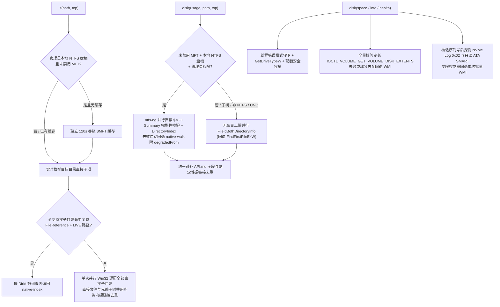
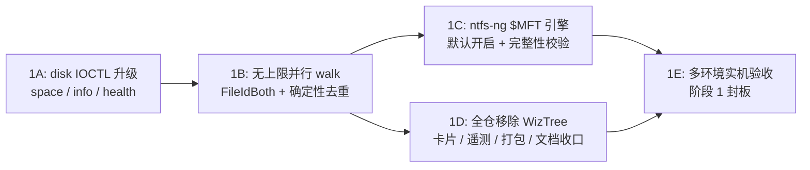

# 阶段 9.3：性能优化与工程收敛

本文记录阶段 9.3 的分阶段性能优化与工程收敛方案。阶段 1 聚焦存储诊断工具（`ls` 与 `disk`）重构及全仓移除 `WizTree`，阶段 2A 完成 `fffind` 与 `ffgrep` 并行检索、单句柄安全核验与多编码改造。

总体路线见 [0.PLAN.md](0.PLAN.md)，决策记录见 [ADR-014](../../ADR.md#adr-014移除-wiztree存储诊断改用纯-rust-mft-与-win32-ioctl) 与 [ADR-018](../../ADR.md#adr-018文件检索采用单次基线单句柄核验与无状态并行多编码引擎)，执行勾选清单见 [TASKS.md](../../TASKS.md#阶段-93-分阶段执行清单)，诊断规格与测试矩阵见 [diagnostics/SPEC.md](../../diagnostics/SPEC.md) 和 [tools-test-spec.md](../../diagnostics/test/tools-test-spec.md)。

## 1. 分阶段推进路线

阶段 9.3 划分为三个大阶段。阶段 1 为首要目标，阶段 2 与阶段 3 在量化收益后独立展开：

| 阶段 | 优先级 | 目标范围 | 当前状态 | 通过条件 |
|---|---|---|---|---|
| **阶段 1** | **P0 首要目标** | `ls` 与 `disk` 重构，全仓移除 `WizTree`，接入 Win32 IOCTL、纯 Rust `$MFT` 与无条目上限并行遍历 | `1A–1D` 代码、单元测试、全仓去 `WizTree`、本机 NVMe 实测与干净 `xtask dist` 验证已完成。管理员本地 NTFS 根目录默认启用 `$MFT`（`CST_DISABLE_MFT=1` 可关闭），目录遍历不设条目上限。待补测多控制器、断连 UNC、4Kn、BitLocker 两态与热拔插等 `1E` 实盘验收项 | 端到端性能指标、UNC 槽位与多环境实机验收达标 |
| **阶段 2** | P1 后续展开 | `fffind`/`ffgrep`（`2A`）、`sys(io/gpu)`（`2B`）及联网检索与 `runbook`（`2C`） | `2A` 代码、单元测试、安全回归与本机前后基准对比已完成；`2B` 与 `2C` 待基准验证 | 各子阶段测试全过、安全边界无回退且量化达标 |
| **阶段 3** | P2 长期收敛 | `pi-session` 与前端结构收敛，桌面渲染及发行体积复测 | 规划中 | 各子项独立量化立项，互不阻塞 |

## 2. 阶段 1（首要目标）：存储诊断重构（`ls` / `disk` / 移除 `WizTree`）

本阶段执行 [ADR-014](../../ADR.md#adr-014移除-wiztree存储诊断改用纯-rust-mft-与-win32-ioctl)，全仓移除 `WizTree` 代码、打包逻辑与许可依赖。管理员权限下的本地 NTFS 根目录默认使用纯 Rust `ntfs-ng` 直读 `$MFT`（`CST_DISABLE_MFT=1` 可强制关闭扫描与缓存读取）。子目录、普通权限、非 NTFS 卷、UNC 路径与 `$MFT` 失败回退均使用无条目上限的并行 Win32 目录遍历。

### 2.1 优化动因

1. **许可合规**：`WizTree` 随应用对外分发需持续订阅年付商业许可（US$1,200/年）。全仓移除后消除分发许可风险。
2. **便携与只读介质安全**：移除外部二进制约减少 `18.83 MiB` 体积，消除临时 CSV 写盘，适配 U 盘与只读介质。
3. **统计口径准确**：原生接口同时提供逻辑大小、分配量（`AllocationSize`）、重解析标签与卷内 `FileId`，消除 OneDrive 云占位文件与 `WinSxS` 硬链接造成的体积误判。
4. **采集延迟与权限覆盖**：Win32 存储 IOCTL 避免重度 WMI 开销，在支持驱动的 NVMe 主机上可于普通权限探测盘符映射与 NVMe SMART 日志。

### 2.2 目标架构

### 2.3 本机实测结论摘要

2026-11-24 在 16 核 Windows 11 主机（双 1 TB 512e NVMe SSD，5 个未加密 NTFS 分区）完成隔离原型与 Release 全链路实测，完整对照表与硬件明细归档于 [storage-ls-disk.md](../../optimize/storage-ls-disk.md#三实测数据与结论)：

- **目录遍历**：`C:\Program Files`（9.2 万项）热扫由 `9.44 s` 降至 `393.4 ms`（`24.0×`）；`C:\Windows\System32` 降至 `167.6 ms`；`C:\Windows\WinSxS`（24 万项）`12.37 s` 完整无截断；4 槽取消 `32.1 ms` 退出并在 `4.3 ms` 恢复。
- **纯 Rust `$MFT` 与热 `ls`**：`C:\`（212 万记录 / `214.80 GB`）冷扫 `4.61–5.91 s`、缓存估算 `58.26 MiB`、进程 Working Set `8.6 -> 97.5 MiB`（全周期峰值 `411.86 MiB`）；热 `ls` 命中 `native-index` 耗时 `2.2–22.5 ms`；`D:\` 取消 `31.3 ms` 且紧邻复扫 `1.33 s` 成功。
- **原生 IOCTL 与发行体积**：`disk(space)` P95 `0.6 ms`，盘符映射原型 `0.19 ms`（原 WMI `96.43 ms`），`disk(health)` 非提权 P95 `6.9 ms` / 提权 `10.2 ms`（原 WMI `186.54 ms` 且普通权限 0 行）。全仓移除 `18.83 MiB` `WizTree`，干净发行包 42 文件（解包 `105.76 MiB` / ZIP `43.14 MiB`），零临时文件落盘。

### 2.4 已拍板的关键契约决议

以下契约在 `1A`–`1E` 全流程生效：

1. **输出字段对齐 `doc/diagnostics/API.md`**：`disk(health)` 的 `smart[]` 固定输出 6 个键（`DeviceId`、`Wear`、`Temperature`、`PowerOnHours`、`ReadErrorsTotal`、`WriteErrorsTotal`），`disk(usage)` 的 `topFiles[]` 固定输出 `{ path, sizeGB, modified }`；方法枚举值为 `"native-index"`/`"walk"` 与 `"native-mft"`/`"native-walk"`。
2. **默认启用 `$MFT` 与环境熔断开关**：管理员权限下的本地 NTFS 根目录默认启用 `$MFT` 直读；设置 `CST_DISABLE_MFT=1` 强制关闭 `$MFT` 扫描与缓存读取，统一走 `native-walk`。
3. **目录遍历无条目上限**：生产路径 `ls` 与 `disk(usage)` 使用 `WalkLimits::unbounded()`，取消人为条目数与 30 秒内层截断，统一受外层 215 秒超时与取消信号控制。
4. **`USN Journal` 延后**：进程内只读快照附带采集时间、120 秒有效期与 `128 MiB` 驻留上限，支持显式刷新及卷身份变化失效，不创建也不修改系统 USN 日志。
5. **云占位与原生属性边界**：`disk(info)` 与 `disk(health)` 无法确认介质类型或健康状态时保持 `0` 或 `null`。完全驻留云文件计入逻辑大小；带召回属性的云占位文件在读取到 `AllocationSize` 时按 `min(EndOfFile, AllocationSize)` 计入，无分配量信息时保持未知；云占位目录与重解析目录均不下钻。
6. **确定性硬链接去重与敏感路径隐藏**：`walk.rs`、`ls.rs` 与 `mft.rs` 共用 `scan::hardlink_rank_key` 确定性比较器。`ls` 不混用整卷缓存与局部遍历，走 `walk` 时直接文件与全部兄弟子目录共用同一张查询范围去重表。工具包敏感路径名在明细、排行与拒绝列表中隐去，体积仍计入总量。
7. **依赖收敛范围**：全仓移除 `WizTree` 调用、打包与测试夹具；`crates/cst-kit/src/diagnostics/scan.rs` 承担公共统计数据结构与硬链接比较器；`crates/cst-kit/Cargo.toml` 保留 `csv = "=1.4.0"` 供 `hardware.rs` 解析 `nvidia-smi` 输出。

### 2.5 分阶段实施计划（`1A`–`1E`）

阶段 1 按自底向上拆分为五个子阶段。当前 `1A`–`1D` 代码与本机基础实测已完成，待补齐 `1E` 多环境实机验收：

#### 阶段 1A：`disk(space / info / health)` Win32 IOCTL 升级（代码与本机 NVMe 实测已完成）

1. **依赖补齐**：在 `crates/cst-kit/Cargo.toml` 启用 `Win32_System_Ioctl`、`Win32_System_Diagnostics_Debug` 与 `Win32_Devices_DeviceAndDriverInstallation`。
2. **`space` 与卷元数据合并探测**：RAII 守卫保存并恢复 `GetThreadErrorMode()`，叠加 `SEM_FAILCRITICALERRORS`。结合 `GetDriveTypeW` 跳过空光驱，配对调用者配额总量与可用剩余量。对 `DRIVE_REMOTE` 将容量与卷标/文件系统合并至同一 4 槽 / 2 秒探测单元，`disk(all)` 复用卷快照。
3. **`info` 改造**：盘符映射以 `dwDesiredAccess = 0` 调用变长 `IOCTL_VOLUME_GET_VOLUME_DISK_EXTENTS` 并校验完整返回长度，要求全部 extent 匹配已知物理盘，否则回退 WMI。Storage WMI 失败或 health-only 路径使用 SetupAPI `GUID_DEVINTERFACE_DISK`，保持 USB/虚拟盘 `MediaType = 0`、`HealthStatus = null`。
4. **`health` 改造**：以原始字节读取 `DEVICE_SEEK_PENALTY_DESCRIPTOR`、以 8 字节对齐缓冲读写 NVMe Log `0x02`（优先设备级后控制器级）与只读 ATA `SMART_RCV_DRIVE_DATA`。打开 `PhysicalDriveN` 前后核验序列号防止错盘，固定输出 6 项键；受限或身份不匹配时经序列号关联执行单次批量 WMI `MSFT_StorageReliabilityCounter`。

#### 阶段 1B：无条目上限并行 Win32 目录遍历引擎（代码与本机 NVMe 实测已完成）

1. **统计契约解耦**：`scan.rs` 承担 `TopN`、`Ranked`、`ScanSnapshot`、`SensitivePathFilter`、硬链接比较器与格式化。
2. **安全字节枚举与重解析分类**：两条 Win32 路径共用零 `unsafe` 字节解析器读取 `FILE_ID_BOTH_DIR_INFO` 固定 104 字节头与 8 字节对齐推进，损坏时在首批回退或标记下界。按重解析标签区分完全驻留云文件、在线/部分驻留占位与符号链接；子目录重开句柄后复核属性与卷序列号，不符时跳过且不回退路径式 `FindFirstFileExW`。
3. **`ls` 与 `disk(usage)` 无条目上限执行**：生产调用传入 `WalkLimits::unbounded()`，统一受外层 215 秒超时与取消信号控制。`ls` 直接文件与全部兄弟子目录共用查询范围硬链接去重表，目录自身不可打开输出 `bytes: null`。
4. **全局并发、持续取消与异常守卫**：全局最多 8 个工作线程（单次最多 6 个），watchdog 停止队列后持续周期发送 `CancelSynchronousIo` 直至全部工作线程退出，worker 通过 RAII 守卫防 panic 死锁，仅真实权限拒绝记入 `denied`。

#### 阶段 1C：纯 Rust `$MFT` 引擎与缓存复用（代码与本机 512e 实盘已完成）

1. **默认启用与原始卷探测**：引入 `ntfs-ng = "=0.1.2"`，管理员本地 NTFS 根目录默认启用，`CST_DISABLE_MFT=1` 强制关闭扫描与缓存读取。经 `GetDriveTypeW` 排除网络盘并经 `GetVolumeNameForVolumeMountPointW` 获取卷 GUID 打开只读逻辑卷，按设备报告扇区对齐。
2. **单次投影完整性与内存上限**：自定义 `ntfs_ng::scan::Projection` 采集 `Summary`，遇任何 `unreadable`/`unmapped`/`damaged`/`stopped`、属性异常或无 `$DATA` 普通文件即拒绝发布缓存；剪枝重解析目录及其全部后代，隐去工具包敏感路径，限制记录数（400 万）与扫描工作集（`512 MiB`）。
3. **缓存治理与单飞**：`VolumeIndex` 使用单调探针序号防乱序覆盖，按 `(drive, identity)` 键控订阅引用计数单飞（全员取消才停扫、失败广播带 30 秒短冷却，最多 2 个并发 MFT 扫描槽），每次读写全局清理过期项并按 4 卷 / `128 MiB` 上限驱逐。

#### 阶段 1D：全仓移除 `WizTree` 与消费方收口（已完成）

1. **全仓代码与打包清退**：移除 Rust 工作区、Web 前端单测、`launcher.ps1`、`pack/` 与 `agent/home/extensions/` 中全部 `WizTree` 调用、兼容路径与测试夹具；将 `ntfs-ng` MIT 许可证原文纳入 `app/licenses/ntfs-ng-LICENSE.txt` 并在 `xtask` 校验。
2. **双端卡片、遥测与文档同步**：`tool_presenter.rs`、`map-tool.ts`、`telemetry/collect.rs`、Skills（`app/skills/{disk,ls}/SKILL.md` 及过渡同名 Skill）与全仓文档已同步对齐当前纯 Rust 实现。

#### 阶段 1E：多环境实机验收与阶段 1 封板（待执行）

面向真实发布产物执行硬件与介质矩阵验收，逐项记入 [TASKS.md](../../TASKS.md#阶段-93-分阶段执行清单)：

1. **系统与权限矩阵**：Windows 10/11 与 WinPE，普通权限与管理员提权，BitLocker 已解锁与锁定两态。
2. **存储与文件系统矩阵**：NVMe、SATA/AHCI、USB-SAT、Intel RST/VMD，512e/4Kn 扇区盘，HDD/U 盘与热拔插，FAT32/exFAT/ReFS、本地或断连 UNC、OneDrive 在线占位/部分驻留/完全驻留。
3. **三类只读布局分别验证**：只读目标卷、只读 `app/` 目录及整包只读介质。

### 2.6 阶段 1 涉及文件总表

| 模块 / 文件 | 归属子阶段 | 变更内容 |
|---|---|---|
| `crates/cst-kit/Cargo.toml`、`Cargo.lock` | `1A` / `1C` | 补 IOCTL 与 SetupAPI 特性，引入 `ntfs-ng = "=0.1.2"`（保留 `hardware.rs` 所需 `csv`） |
| `crates/cst-kit/src/diagnostics/{disk.rs,win_native.rs,win_native/windows.rs,win_native/windows/storage.rs}` | `1A` | 线程错误模式守卫、远程卷合并探测与 `all` 复用、变长 extent 全量校验、SetupAPI、序列号核验 NVMe/ATA IOCTL 与单次批量 WMI 兜底 |
| `crates/cst-kit/src/diagnostics/{scan.rs,walk.rs,ls.rs}` | `1B` | 公共统计、敏感路径过滤与硬链接比较器、安全字节解析 `FileIdBothDirectoryInfo`、云标签分类、无条目上限并行遍历、持续取消与 panic 守卫 |
| `crates/cst-kit/src/diagnostics/{mft.rs,volume.rs,volume_index.rs,storage_tools.rs}` | `1C` | 默认启用的 `ntfs-ng` 自定义投影（带 `Summary` 完整性与剪枝）、单调身份/字节预算/订阅单飞缓存、裸盘符规范化 |
| `crates/cst-kit/src/telemetry/collect.rs`、`crates/cst-client/src/tool_presenter.rs`、`src/web/frontend/app/cards/map-tool.{ts,test.ts}` | `1D` | 迁移 `disk` 降级统计与双端卡片文案，清理全部旧 `WizTree` 兼容断言 |
| `crates/cst-os/src/layout.rs`、`crates/cst-updater/src/{layout,manifest,verify}.rs`、`crates/xtask/src/main.rs`、`app/licenses/ntfs-ng-LICENSE.txt`、`launcher.ps1`、`pack/*`、`agent/home/extensions/diagnostics/*` | `1D` | 全仓清理 `WizTree` 路径、脚本与扩展代码，纳入 `ntfs-ng` 许可证原文并校验 |
| `app/skills/{disk,ls}/SKILL.md`、`agent/home/skills/{disk,ls}/SKILL.md`、`doc/diagnostics/*`、`doc/rust/plan/*`、`THIRD-PARTY-NOTICES.md` | `1D` | 同步默认 `$MFT`、无条目上限遍历、字段契约与第三方许可 |

---

## 3. 阶段 2：其余诊断与检索工具优化

`2A` 已完成代码改造、测试与本机基准验证，`2B` 与 `2C` 待独立基准确认后推进：

| 子阶段 | 工具组 | 状态与优化方向 | 验证焦点 |
|---|---|---|---|
| **2A** | `fffind` / `ffgrep` | **已完成**（见 [3.1 阶段 2A 实施与实测](#31-阶段-2a-实施与实测)）：`PathGuardSession` 单次操作基线与单句柄核验、并行遍历、字节级检索、纯 Rust 相关性打分与 UTF-16 / GB18030 解码 | 保持不跨调用缓存、`follow_links(false)`、单句柄身份复核与既有硬上限；验证安全回归与本机前后耗时对比 |
| **2B** | `sys(io)` 与 `sys(gpu)` | 待研：`sys(io)` 评估改用 `GetProcessIoCounters`，`sys(gpu)` 双显卡保留核显传感器 | 验证退出进程与 PID 复用，核对权限边界及计数口径 |
| **2C** | 联网检索与 `runbook` 拆项 | 待研：联网查询批量并发与局部容错；`runbook` 独立收口 `commands[].shell` 大小写、合法 JSON 裁剪与提示词旧路径 | 保持请求上限、取消与既有网络访问策略；单独验收 20 条长命令下的 50 KiB 裁剪与未裁剪 `details` |

### 3.1 阶段 2A 实施与实测

2026-11-25 按 [ADR-018](../../ADR.md#adr-018文件检索采用单次基线单句柄核验与无状态并行多编码引擎) 完成 `fffind`、`ffgrep` 与 `PathGuard` 改造，并经 `gpt-6.2-sol`（`xhigh`）同行评审与二次复测收口。实现复用 `Cargo.lock` 既有依赖 `memchr = "=2.8.3"`、`encoding_rs = "=0.8.44"` 与 Unix 侧 `libc = "=0.2.191"`，无新增外部下载。

核心改动：

1. **单次操作安全基线与单句柄核验（`path_guard.rs`）**：每次调用创建瞬态 `PathGuardSession`，一次性解析 5 处凭据与 `.state/` 的规范键和文件标识，不持长期文件句柄，调用结束立即销毁。Windows 打开文件后在同一句柄上调用 `GetFileType`、`GetFileInformationByHandle` 与 `GetFinalPathNameByHandleW` 核对类型、路径、硬链接数、大小与身份，并对会话内已核验的非 `.state/` 规范祖先目录去重；多硬链接文件实时核对凭据身份与 `.state/` 成员。
2. **并行遍历与缓冲复用（`fff.rs`）**：改用 `ignore::WalkBuilder::build_parallel()`，线程数取 `(逻辑核数 - 2).clamp(1, 8)`，保持 `follow_links(false)` 并跳过符号链接、目录联接与 `.git`。各工作线程复用 64 KiB 读写缓冲（超 1 MiB 后自动收缩），按句柄核验长度扣减 256 MiB 读取预算并在短读时退还，遍历与逐行检索均检查 30 秒期限与取消信号。`ffgrep` 结果按路径与行号排序。
3. **字面预筛、逐行正则与编码支持（`fff.rs`）**：区分大小写字面查询走 `memchr::memmem`，忽略大小写字面查询按 Unicode 规则整块预筛，正则在去行尾后逐行执行 `regex::bytes::Regex`。`ffgrep` 单文件上限 `10 MiB`（超限计入 `skippedLargeFiles` 与 `notice`），依次支持 UTF-16 LE/BE BOM 转码与全文判 `0x00`、UTF-8 BOM、无 BOM 判二进制、UTF-8 零拷贝与 GB18030 回退解码。
4. **相关性打分与路径过滤修复（`fff.rs`）**：`fffind` 内置纯 Rust 相关性打分器（精确文件名 / 词干 > 前缀 > 文件名连续子串 > 路径连续子串 > 词边界子序列），支持空格多词交集、每线程有界 Top-K 与弱匹配 `notice` 提示。路径过滤同时匹配绝对路径、工作目录相对路径与搜索根相对路径，绝对路径通配符从通配符前的固定目录起步。

实测结论（4,005 文件 / `28.32 MiB` 语料，Release 3 轮中位数；完整对照表与评审回退分析见 [file-search-fff.md](../../optimize/file-search-fff.md#三实测数据与结论)）：`fffind` 由 `175.47 ms` 降至 `31.97 ms`（`5.5×`，精确文件名升至首位），`ffgrep` 字面全扫由 `12,699.18 ms` 降至 `176.54 ms`（`71.9×`），正则全扫由 `10,056.81 ms` 降至 `142.64 ms`（`70.5×`），UTF-16 LE 与 GB18030 日志由 `0` 命中升至 `30` 命中（`17.07–30.21 ms`），峰值内存 `8.09–9.78 MiB`。

涉及文件：`crates/cst-kit/Cargo.toml`、`Cargo.lock`、`crates/cst-kit/src/tools/path_guard.rs`、`crates/cst-kit/src/tools/fff.rs`、`crates/cst-kit/src/runbook/storage.rs`、`crates/cst-kit/tests/tools_and_security.rs`。

## 4. 阶段 3：运行时、服务端与桌面端优化（规划中）

各子项先量化现状再独立立项，互不阻塞：

1. **3A 核心与前端结构收敛**：`pi-session` 闭包袋与 `AgentSessionInner` 字段分组（门槛：上游对齐、会话重放与取消回归）。Web 前端全局事件订阅收归 `WorkspaceStore` 与大组件拆分（见 [TASKS.md](../../TASKS.md#功能迭代)）。
2. **3B 启动、渲染与发行体积复测**：桌面端复用 [ux-e2e.md](../../desktop/test/ux-e2e.md) 的首帧、可交互与长会话指标。包体积按同一 `[profile.dist]` 分开记录 ZIP 大小与解包字节数，评估 `lhm-host` 裁剪。

## 5. 阶段 1 待补实机核验项

| 编号 | 议题 | 验收要求 |
|---|---|---|
| `O93-3` | 多硬件与特殊卷实盘补测 | 在真实 4Kn 扇区盘、BitLocker 已解锁与锁定两态、SATA/USB-SAT/RST 控制器、断连 UNC 与热拔插换盘场景下，验证 `$MFT` 读取、自动回退 `native-walk` 与缓存即时失效行为 |
