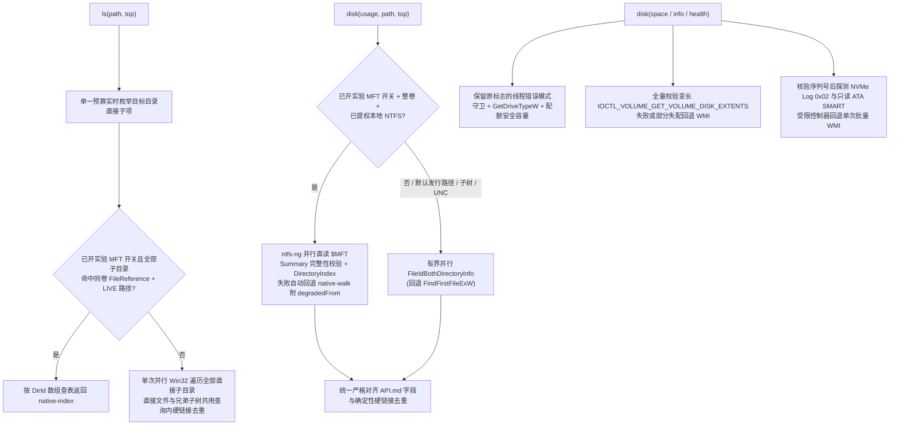
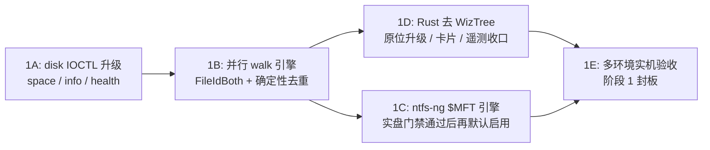

# 阶段 9.3：性能优化与工程收敛

本文记录阶段 9.3 的分阶段性能优化与工程收敛方案，按阶段推进工具采集升级、系统调用减负与核心结构收敛。当前首要目标为**阶段 1**，聚焦存储诊断工具（`ls` 与 `disk`）重构及 Rust 发行轨移除 `WizTree`。

总体路线见 [0.PLAN.md](0.PLAN.md)，决策记录见 [ADR.md](../../ADR.md#adr-014移除-wiztree存储诊断改用纯-rust-mft-与-win32-ioctl)，执行勾选清单见 [TASKS.md](../../TASKS.md#阶段-93-分阶段执行清单)，诊断规格与测试矩阵见 [diagnostics/SPEC.md](../../diagnostics/SPEC.md) 和 [tools-test-spec.md](../../diagnostics/test/tools-test-spec.md)。

## 1. 分阶段推进路线

阶段 9.3 划分为三个大阶段，阶段 1 为当前首要目标，阶段 2 与阶段 3 均在量化收益后独立展开：

| 阶段 | 优先级 | 目标范围 | 当前状态 | 出口门禁 |
|---|---|---|---|---|
| **阶段 1** | **P0 首要目标** | `ls` 与 `disk` 重构，Rust 发行移除 `WizTree`，接入 Win32 IOCTL 与纯 Rust `$MFT`（实验开关） | `1A`–`1D` 代码与回归测试已完成，待补齐发行包及多环境实机出口门禁 | 发行包零 `wiztree` 与旧包原位升级回滚通过，端到端性能红线、UNC 槽位与实机验收达标 |
| **阶段 2** | P1 后续展开 | `fffind`/`ffgrep`、`sys(io/gpu)` 及联网检索与 `runbook` | 待单项基准验证 | 阶段 1 封板后启动产品改造，基准采集可独立先行 |
| **阶段 3** | P2 长期收敛 | `pi-session` 与前端结构收敛，桌面渲染及发行体积复测 | 规划中 | 各子项独立量化立项，互不阻塞 |

## 2. 阶段 1（首要目标）：存储诊断重构（`ls` / `disk` / 去 `WizTree`）

本阶段执行 [ADR-014](../../ADR.md#adr-014移除-wiztree存储诊断改用纯-rust-mft-与-win32-ioctl)，将并行 Win32 目录遍历确立为所有环境下的默认可靠底座。纯 Rust `$MFT` 直读当前以实验开关（`CST_ENABLE_MFT=1`，默认关闭；`CST_DISABLE_MFT=1` 强制覆盖关闭）提供，待阶段 `1C` 实盘硬门禁通过后再切换为提权本地 NTFS 整卷默认路径。

### 2.1 优化动因

1. **许可合规**：`WizTree` 官方分发许可区分组织内使用与随应用对外分发，向组织外随包分发须持续订阅年付许可（US$1,200/年）。Rust 发行轨移除后消除该项分发许可风险。
2. **便携与只读介质安全**：本机 `wiztree/` 目录约 `18.83 MiB`，每次扫描向 `.state/tmp/wiztree/` 写入数十至数百 MB 临时 CSV，拖慢 U 盘读写并在只读卷或受限存储上失败。
3. **统计口径准确**：原生接口同时提供逻辑大小、分配量（`AllocationSize`）、重解析标签与卷内 `FileId`，消除 OneDrive 云占位文件与 `WinSxS` 硬链接造成的体积误判。
4. **采集延迟与权限覆盖**：Win32 存储 IOCTL 避免重度 WMI 开销，在支持驱动的 NVMe 主机上可于普通权限探测盘符映射与 NVMe SMART 日志。

### 2.2 目标架构

### 2.3 隔离原型实测记录（可行性对照）

2026-11-24 在 16 核 Windows 11 主机运行独立原型程序 `E:\tmp\2026-11-24\disk-ls-bench` 取得以下局部对照数据。环境配备双 1 TB NVMe SSD 与 5 个 NTFS 分区，全程运行于非管理员终端。下列数字仅代表本机非提权隔离对照与内存合成解析吞吐，实盘冷扫与生产全链路指标须在阶段 `1A`–`1C` 门禁中单独补测。

#### 目录遍历原型对照（8 线程原型 vs 现状单线程与 WizTree `/admin=0`）

| 测试目录（规模） | 原单线程 `walk.rs` | `FindFirstEx+LF` | `HandleFullDirInfo` | `HandleIdBoth` 原型 | 原 `WizTree64` (`/admin=0` + CSV) |
|---|---:|---:|---:|---:|---:|
| `crates/`（87 目录 / 506 文件） | 86.0 ms *(独立冷测)* | 10.7 ms | 6.9 ms | 8.7 ms | 3,246.9 ms |
| `C:\Windows\System32`（1,560 目录 / 23,996 文件） | 1,770.8 ms | 56.9 ms | 46.9 ms | 44.0 ms *(40.3×)* | 1,995.2 ms *(写 3.1 MB)* |
| `C:\Program Files`（8,302 目录 / 83,787 文件） | 9,443.1 ms | 316.7 ms | 255.2 ms | 316.2 ms *(29.9×)* | 4,913.8 ms *(写 11.9 MB)* |
| `C:\Windows\WinSxS`（107,223 目录 / 132,998 文件） | 30,036.9 ms | 5,644.5 ms | 4,529.5 ms | 4,534.5 ms *(6.6×)* | 21,283.5 ms *(写 40.8 MB)* |

#### 纯 Rust `$MFT` 内存合成解析吞吐（`ntfs-ng v0.1.2`，8 线程）

在非管理员终端使用内存合成 `$MFT` 语料测得纯解析与索引构建耗时（不含真实磁盘 I/O、完整四类排行及真实卷身份校验）：

| 规模 | 合成 MFT 体积 | 活跃目录 / 文件数 | 3 轮耗时 | 纯解析吞吐 |
|---|---:|---:|---:|---:|
| 50 万记录 | 488.3 MiB | 57,576 目录 / 293,710 文件 | 99.0 / 118.0 / 112.8 ms | 424–505 万记录/秒 |
| 100 万记录 | 976.6 MiB | 115,625 目录 / 586,900 文件 | 317.9 / 326.6 / 338.6 ms | 295–315 万记录/秒 |

#### `disk` 局部能力原型对照（本机普通权限，5 卷 / 2 块 NVMe）

| 局部能力项 | 现状实现 | 原型测量 | 说明 |
|---|---|---|---|
| `disk(space)`（Win32 对照） | 1.27 ms *(已有 Win32)* | 1.16 ms | 叠加 `GetDriveTypeW` 与线程错误模式守卫零额外开销 |
| 盘符 → 物理盘映射 | 96.43 ms *(WMI)* | 0.19 ms *(IOCTL)* | 499× 提速，生产需支持变长 extent 缓冲 |
| NVMe 健康日志采集 | 186.54 ms *(WMI SMART 0 行)* | 9.23 ms *(NVMe Log `0x02`)* | 普通权限取回 NVMe 指标，输出严格对齐 `API.md` 6 项键 |

### 2.4 已拍板的关键契约决议

以下边界已于方案评审与实施确认阶段拍板，作为 `1A`–`1E` 共同契约：

1. **输出字段严格沿用 `doc/diagnostics/API.md`**：不新增外部容量（如 `allocatedBytes`）或枚举标签（如 `*Label`）字段，底层优化直接映射到既有字段结构。`disk(health)` 的 `smart[]` 严格只输出既有 6 个键（`DeviceId`、`Wear`、`Temperature`、`PowerOnHours`、`ReadErrorsTotal`、`WriteErrorsTotal`），`disk(usage)` 的 `topFiles[]` 严格只输出 `{ path, sizeGB, modified }`；方法枚举值更新为 `"native-index"`/`"walk"` 与 `"native-mft"`/`"native-walk"`。
2. **`$MFT` 实盘门禁通过前默认关闭**：发行路径默认走 `native-walk`，仅通过 `CST_ENABLE_MFT=1` 开启实验直读，`CST_DISABLE_MFT=1` 始终具有最高优先级并同时阻断扫描与缓存读取。
3. **`USN Journal` 增量刷新延后**：`1C` 首版使用进程内只读快照，附带采集时间、120 秒有效期与 128 MiB 驻留上限，支持显式刷新及卷代际失效，不创建也不修改系统 USN 日志。
4. **云占位与原生属性诚实边界**：`disk(info)` 与 `disk(health)` 原生回退无法确认介质类型或健康状态时保持 `0` 或 `null`，不将查询成功等同 `Healthy`。完全驻留云文件正常计入逻辑大小；带召回属性的云占位文件在能读取 `AllocationSize` 时按 `min(EndOfFile, AllocationSize)` 计入，无分配量信息时保持未知；云占位目录与重解析目录均不下钻。
5. **确定性硬链接去重与一致口径**：`walk.rs` 与 `mft.rs` 共用同一比较器 `scan::hardlink_rank_key`（大写路径 + 大写文件名 + 原始路径/名平局规则）。`ls` 不混用整卷缓存与局部 walk，走 `walk` 时直接文件与全部兄弟子目录共用同一张查询范围去重表。`stats.filesScanned` 统计遍历访问条目数。
6. **依赖与文件收敛范围**：存储诊断移除全部 `WizTree` 调用与 CSV 解析逻辑，保留 `crates/cst-kit/src/diagnostics/scan.rs` 承担公共统计数据结构（`TopN`、`ScanSnapshot`、`Ranked`、格式化与硬链接比较器）；根 `crates/cst-kit/Cargo.toml` 保留 `csv = "=1.4.0"` 供 `hardware.rs` 解析 `nvidia-smi` 输出。

### 2.5 分阶段实施计划（`1A`–`1E`）

阶段 1 按自底向上拆分为五个子阶段。`1A` 与 `1B` 完成后，`1D`（Rust 去 `WizTree`、原位升级验证与文档收口）可独立落地，`1C` 的 `$MFT` 引擎经真实卷门禁放行后再切为默认路径。

#### 阶段 1A：`disk(space / info / health)` Win32 IOCTL 升级

1. **依赖补齐**：在 `crates/cst-kit/Cargo.toml` 为 `windows` 补充 `Win32_System_Ioctl`、`Win32_System_Diagnostics_Debug` 与 `Win32_Devices_DeviceAndDriverInstallation`。
2. **`space` 与卷元数据合并探测**：RAII 守卫读取 `GetThreadErrorMode()` 并叠加 `SEM_FAILCRITICALERRORS` 恢复。结合 `GetDriveTypeW` 跳过全卷扫描中的空光驱（覆盖 `ERROR_NOT_READY` / `ERROR_DEVICE_NOT_CONNECTED` / `ERROR_NO_MEDIA_IN_DRIVE`），配对调用者配额总量与可用剩余量。对 `DRIVE_REMOTE` 将容量与卷标/文件系统合并到同一个 4 槽 / 2 秒有界探测单元，`disk(all)` 复用该次卷快照不重复探测。
3. **`info` 改造**：盘符映射以 `dwDesiredAccess = 0` 调用变长 `IOCTL_VOLUME_GET_VOLUME_DISK_EXTENTS`（全量校验返回长度，禁止截断短响应），要求全部 extent 匹配已知物理盘，否则回退 WMI。物理盘枚举在 Storage WMI 失败或 health-only 路径使用 SetupAPI `GUID_DEVINTERFACE_DISK`（严格校验 NUL 与枚举完整性），并保持 USB/虚拟盘 `MediaType = 0`、`HealthStatus = null`。
4. **`health` 改造**：以原始字节读取 `DEVICE_SEEK_PENALTY_DESCRIPTOR`、以 8 字节对齐缓冲读写 NVMe Log `0x02`（优先设备级后控制器级，校验描述符版本、大小、协议头偏移与返回边界）与只读 ATA `SMART_RCV_DRIVE_DATA`（校验校验和并保留拒绝码）。打开 `PhysicalDriveN` 前后核验序列号防止 Storage Spaces 错盘，严格输出 `API.md` 6 项键；受限或身份不匹配时经序列号关联执行单次批量 WMI `MSFT_StorageReliabilityCounter`。
5. **阶段出口**：覆盖 Win32 字节解析、多盘部分失配、序列号冲突、`all` 单次探测与 6 键全集合测试，并完成本机 NVMe 端到端含排队 P95 `≤ 50 ms` 验证。

#### 阶段 1B：并行 Win32 目录遍历引擎（`walk.rs` 与共享统计底座）

1. **统计契约解耦**：`scan.rs` 保留公共 `TopN`、`Ranked`、`ScanSnapshot`、硬链接比较器与格式化，移除全部 CSV 解析。
2. **安全字节枚举与重解析分类**：两条 Win32 路径共用零 `unsafe` 字节解析器读取 `FILE_ID_BOTH_DIR_INFO` 固定 104 字节头与 8 字节对齐推进，解析损坏时在首批回退或标记下界。按重解析标签区分完全驻留云文件、在线/部分驻留占位与符号链接；子目录重开句柄后复核属性与卷序列号，不符时跳过且不回退路径式 `FindFirstFileExW`。
3. **`ls` 单一预算与统一去重**：调用级单一 `WalkBudget`（50 万条目 / 30 秒）覆盖直接枚举与单次并行子目录森林遍历；直接文件与全部兄弟子目录共用查询范围硬链接去重表，目录自身不可打开输出 `bytes: null`。
4. **全局并发、持续取消与异常守卫**：统一全局线程计数（含保底线程），watchdog 停止队列后持续周期发送 `CancelSynchronousIo` 直至所有 worker 退出，worker 通过 RAII 守卫防 panic 死锁，仅真实权限拒绝记入 `denied`。
5. **阶段出口**：构造树单测覆盖跨目录硬链接、`ls` 兄弟硬链接、云文件状态分类、损坏目录记录与 UNC 取消恢复；同规格本地 NVMe 热扫 `C:\Program Files` 耗时 `≤ 500 ms`。

#### 阶段 1C：纯 Rust `$MFT` 引擎、缓存复用与实盘硬门禁

1. **实验开关与原始卷探测**：引入 `ntfs-ng = "=0.1.2"`，默认关闭（仅 `CST_ENABLE_MFT=1` 且未设 `CST_DISABLE_MFT=1` 开启）。经 `GetDriveTypeW` 排除网络盘并经 `GetVolumeNameForVolumeMountPointW` 获取卷 GUID 打开只读逻辑卷，按设备报告扇区对齐。
2. **单次投影完整性与内存硬上限**：实现自定义 `ntfs_ng::scan::Projection` 在单次扫描中采集 `Summary`（遇任何 `unreadable`/`unmapped`/`damaged`/`stopped`、属性异常或无 `$DATA` 普通文件即拒绝发布缓存）、剪枝重解析目录及其全部后代、过滤工具包敏感路径并限制记录数（400 万）与扫描工作集（512 MiB）。
3. **缓存治理与单飞**：`VolumeIndex` 使用单调探针序号防止乱序身份覆盖，按 `(drive, identity)` 键控订阅引用计数单飞（全员取消才停扫、失败广播且带 30 秒短冷却），每次读写全局清理过期项并按 4 卷 / 128 MiB 上限驱逐。
4. **实盘硬门禁（`O93-3`）**：先以合成 `$MFT` 验证全部口径，再在管理员独立进程完成真实 `C:` 盘冷热扫、512e/4Kn、BitLocker 两态、热拔插、并发取消与内存峰值实测；全部通过后方允许将默认开关切换为开启。

#### 阶段 1D：Rust 发行轨移除 `WizTree`、原位升级与消费方收口

1. **发行轨边界**：仅在 **Rust 发行轨**移除 `WizTree`。冻结的 Node 过渡脚本（`pack/`、`agent/home/`）按阶段 9.2 政策保持不动直至阶段 11。
2. **代码、许可与打包收口**：移除 `volume.rs`/`scan.rs`/`cst-os`/`xtask` 中全部 WizTree 逻辑，保留 `hardware.rs` 所需的 `csv`。将 `ntfs-ng` MIT 许可证原文纳入 `app/licenses/ntfs-ng-LICENSE.txt` 并在 `xtask` 强制校验。
3. **更新器双规则与回滚**：`cst-updater` 的 `classify_release` 与目录分支（含 `scan_clean_dist_tree` 与 `unpack`）统一拒绝新发行包中的 `app/tools/wiztree` 文件及空目录；`classify` 保留对旧安装 WizTree 普通文件的事务删除与失败逐字节回滚能力。
4. **双端卡片、遥测与文档同步**：更新 `tool_presenter.rs`、`map-tool.ts`（及两端单测）、`telemetry/collect.rs`（及 `telemetry_collect.rs`），以及 `app/skills/{disk,ls}/SKILL.md`、`doc/diagnostics/{SPEC,ARCHITECTURE,API}.md`、`doc/rust/plan/6.cst-pilot.md`、`doc/README.md`、`THIRD-PARTY-NOTICES.md`。
5. **阶段出口**：Windows 干净发行构建与 `xtask dist` 零 `wiztree` 文件、旧安装原位升级及回滚恢复验证通过，全量 fmt / Clippy / Rust / 前端与 Markdown 链接检查通过。

#### 阶段 1E：多环境实机验收与阶段 1 封板

面向真实发布产物执行完整硬件与介质矩阵验收，逐项记入 [TASKS.md](../../TASKS.md#阶段-93-分阶段执行清单)：

1. **系统与权限矩阵**：Windows 10/11 与 WinPE，普通权限与管理员提权，BitLocker 已解锁与锁定两态。
2. **存储与文件系统矩阵**：NVMe、SATA/AHCI、USB-SAT、Intel RST/VMD，HDD/U 盘与热拔插，FAT32/exFAT/ReFS、本地或断连 UNC、OneDrive 在线占位/部分驻留/完全驻留。
3. **三类只读布局分别验证**：只读目标卷、只读 `app/` 目录及整包只读介质。

### 2.6 阶段 1 涉及文件总表

| 模块 / 文件 | 归属子阶段 | 变更内容 |
|---|---|---|
| `crates/cst-kit/Cargo.toml`、`Cargo.lock` | `1A` / `1C` | 补 IOCTL 与 SetupAPI 特性，引入 `ntfs-ng = "=0.1.2"`（保留 `hardware.rs` 所需 `csv`） |
| `crates/cst-kit/src/diagnostics/{disk.rs,win_native.rs,win_native/windows.rs,win_native/windows/storage.rs}` | `1A` | 线程错误模式守卫、远程卷合并探测与 `all` 复用、变长 extent 全量校验、SetupAPI、序列号核验 NVMe/ATA IOCTL 与单次批量 WMI 兜底 |
| `crates/cst-kit/src/diagnostics/{scan.rs,walk.rs,ls.rs}` | `1B` | 公共统计与硬链接比较器、安全字节解析 `FileIdBothDirectoryInfo`、云标签分类、单一预算与查询内统一去重、持续取消与 panic 守卫 |
| `crates/cst-kit/src/diagnostics/{mft.rs,volume.rs,volume_index.rs,storage_tools.rs}` | `1C` / `1D` | 默认关闭的 `ntfs-ng` 自定义投影（带 `Summary` 完整性与剪枝）、单调身份/字节预算/订阅单飞缓存、裸盘符规范化 |
| `crates/cst-kit/src/telemetry/collect.rs`、`crates/cst-client/src/tool_presenter.rs`、`src/web/frontend/app/cards/map-tool.ts` | `1D` | 迁移 `disk` 降级统计与双端卡片文案（兼容旧会话重放） |
| `crates/cst-os/src/layout.rs`、`crates/cst-updater/src/{layout,manifest,verify}.rs`、`crates/xtask/src/main.rs`、`app/licenses/ntfs-ng-LICENSE.txt` | `1D` | 新包文件与空目录双拒 `app/tools/wiztree`，保留旧安装事务删除回滚，纳入 `ntfs-ng` 许可证原文并校验 |
| `app/skills/{disk,ls}/SKILL.md`、`doc/diagnostics/*`、`doc/rust/plan/*`、`THIRD-PARTY-NOTICES.md` | `1D` | 同步默认行为、字段契约、模块路径与第三方许可 |

---

## 3. 阶段 2：其余诊断与检索工具优化（待研）

阶段 1 封板后启动产品改造，各子项的独立基准采集可提前进行：

| 子阶段 | 工具组 | 优化方向 | 待验证焦点 |
|---|---|---|---|
| **2A** | `fffind` / `ffgrep` | 降低 `PathGuard` 重复打开开销，补充 Windows 常见非 UTF-8 编码支持 | 仅允许单次操作内复用已验证身份，禁止用会话缓存替代打开时的真实路径与身份复核。评估 UTF-16 LE BOM 与 GB18030 回退解码成本 |
| **2B** | `sys(io)` 与 `sys(gpu)` | `sys(io)` 脱离 WMI 评估改用 `GetProcessIoCounters`，`sys(gpu)` 双显卡保留核显传感器 | 验证退出进程与 PID 复用，核对权限边界及计数口径 |
| **2C** | 联网检索与 `runbook` 拆项 | 联网查询批量并发与局部容错；`runbook` 独立收口 `commands[].shell` 大小写、合法 JSON 裁剪与提示词旧路径 | 保持请求上限、取消与既有网络访问策略；单独验收 20 条长命令下的 50 KiB 裁剪与未裁剪 `details` |

## 4. 阶段 3：运行时、服务端与桌面端优化（规划中）

各子项先量化现状再独立立项，彼此互不阻塞：

1. **3A 核心与前端结构收敛**：`pi-session` 闭包袋与 `AgentSessionInner` 字段分组（门槛：上游对齐、会话重放与取消回归）。Web 前端全局事件订阅收归 `WorkspaceStore` 与大组件拆分（见 [TASKS.md](../../TASKS.md#功能迭代)）。
2. **3B 启动、渲染与发行体积复测**：桌面端复用 [ux-e2e.md](../../desktop/test/ux-e2e.md) 的首帧、可交互与长会话指标。包体积按同一 `[profile.dist]` 分开记录 ZIP 大小与解包字节数，评估 `lhm-host` 裁剪。

## 5. 待决与前移门禁

| 编号 | 议题 | 验收要求 |
|---|---|---|
| `O93-3` | 阶段 `1C` 实盘 `$MFT` 切流硬门禁 | 在管理员独立进程测真实 `C:` 盘冷热扫与 512e/4Kn，覆盖 BitLocker 两态与换盘，以及并发取消和进程峰值/索引驻留内存，通过后方允许将 `$MFT` 从实验开关切换为默认开启 |
