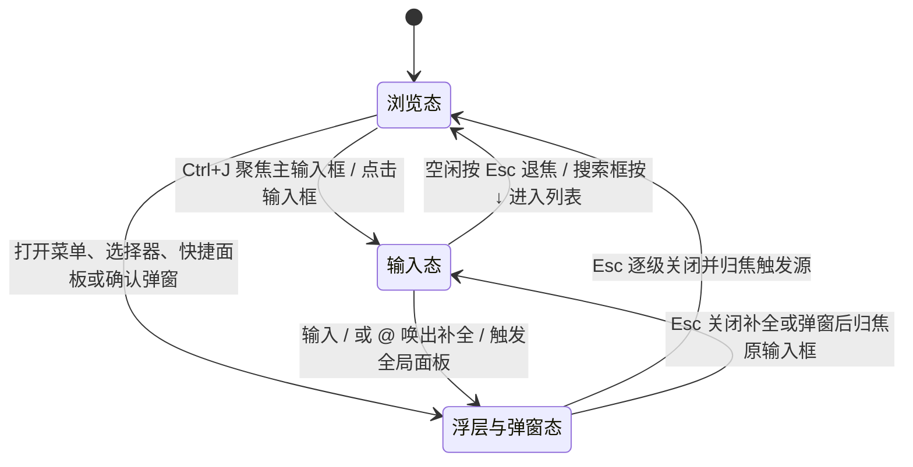

# 阶段 9.4：全应用键盘友好交互设计与实施路线

本专题把键盘友好交互确立为桌面端（GPUI）与本机 Web 端的正式跨端产品特性。现场维修常在无鼠标、触控板受限或远程桌面条件下进行。界面需支持通过方向键、`Enter` / `Space`、`Esc` 与少量高频快捷键完成日常操作。

选中态样式与滑移动效以 [storybook.html](../../../design/storybook.html)「方向键选中态」为交互标准。设置页布局对齐 [cst-pilot-desktop.pen](../../../design/cst-pilot-desktop.pen) 与 [cst-pilot-web.pen](../../../design/cst-pilot-web.pen)「03 · 设置」，跨模块决策见 [ADR-016](../../ADR.md#adr-016双端方向键选中态采用无底色滑移指示器支持四角与游标切换) 与 [ADR-020](../../ADR.md#adr-020设置页改用无框通栏细线流并确立-altm-键位与单键全选切换)。

## 核心交互原则

1. **方向键为主、零模式负担**：常规导航统一使用 `↑↓←→` 与 `Home` / `End`，配合 `Enter` / `Space` 确认和 `Esc` 返回。不引入单字母导航模式（如 `h/j/k/l`）或自定义改键系统，保证多人共用工具包时零学习成本。
2. **默认四角，支持切换游标，不改控件底色**：
   - **四角（默认）**：外扩 `3px` 的同心圆角短折线，臂长 `8px`，线宽 `1.5px`（`$kbd-bracket-color` / `$kbd-bracket-accent` / `$kbd-bracket-danger`），保持控件原底色不变。
   - **游标（可选）**：纵向列表与复选行显示左侧 `3px` 圆头短竖条，横向分段与独立图标按钮变形为底沿短横条（`$kbd-rail-color`）。
   - **配置落盘**：入口位于「设置 → 常规 → 方向键选中样式」。桌面端写入 `data/config/desktop.json`，Web 端写入 `data/config/web.json`。
3. **连续滑移与减少动态回退**：方向键切换焦点时，指示器沿位置、宽高与圆角执行 `180ms ease-out` 连续滑移，高频连按支持中途折返。系统开启减少动态时回退 `0ms` 瞬切。
4. **键鼠互斥与输入法保护**：按下方向键显示指示器，鼠标累计位移 `>= 4px` 自动淡出并交回悬停态。输入框处于中文 IME 组合态时，方向键与 `Enter` / `Tab` / `Esc` 全部交还输入法。

## 三态切换模型与 `Esc` 优先级链

全应用划分「输入态」「浏览态」「浮层与弹窗态」三种互斥交互态。三者之间通过 `Ctrl+J` 进入输入态、通过 `Esc` 按层退回浏览态，形成闭环。

### 状态定义

1. **输入态**：焦点位于各类文本输入框，包含主输入槽、搜索框、重命名框、行内编辑框以及 BitLocker 密码框。单行与多行输入框在首行按 `↑` 跳开头，在末行按 `↓` 跳末尾。
2. **浏览态**：无文本输入持焦且无顶层模态遮罩时，当前视图接管 `↑↓←→`、`Home` / `End` 与 `Enter` / `Space`。子页默认直接响应方向键。聊天工作台在主输入框退焦后进入对话浏览态。
3. **浮层与弹窗态**：菜单、选择器、快捷面板、确认弹窗与大图灯箱打开后锁定焦点与方向键（`FocusTrap`）。操作完成或按 `Esc` 关闭后，在 1 帧内将焦点归还触发控件。

### `Esc` 统一优先级链

每次按下 `Esc` 仅消费当前最高的一层状态，按以下顺序判定：

1. **IME 组合态**：仅取消拼音候选，不关闭任何浮层或移走焦点。
2. **最顶层浮层或弹窗**：关闭当前模态弹窗、快捷面板、大图灯箱、右键菜单或下拉浮层，并在 1 帧内归还触发控件焦点。
3. **输入补全浮层或消息行内编辑态**：收起 `/` 或 `@` 补全面板，或取消消息行内编辑。
4. **搜索框非空**：先清空搜索框内容。搜索框已空时再次按 `Esc`，退焦并交回所属列表浏览态。
5. **对话正在流式生成**：在对话工作台停止当前会话生成。
6. **主输入框空闲退焦**：在聊天页或主页的主输入框空闲时按 `Esc`，退出输入态并进入当前页面浏览态。
7. **独立子页返回**：分支树、导出会话或登录页处于浏览态且无浮层时按 `Esc`，返回上一级或原对话页。

## 快捷键策略与冲突防线

常规选择与切换由方向键完成，全局快捷键只保留跨区域直达入口。Web 端避开浏览器保留键（如 `Ctrl+N` / `W` / `T` / `Tab` / `L` / `M` / `Shift+I` 与 `F12`）。

| 类别 | 快捷键 | 行为 | 状态 |
|---|---|---|---|
| 全局面板 | `Ctrl + P` / `Ctrl + O` | 打开命令面板 / 快速打开会话与近期导出 | 双端已上线 |
| 新建与布局 | `Ctrl + N`（桌面）/ `Alt + N`（Web）、`Ctrl + B`、`Ctrl + ,` | 新建对话、折展侧栏、打开设置 | 双端已上线 |
| 输入闭环 | `Ctrl + J` | 聚焦当前页面或顶层弹窗的主输入框 | 双端已上线 |
| 列表排序 | `Alt + ↑ / ↓` | 调整已启用模型顺序与排队栏顺序 | 双端已上线 |
| 模型选择器 | `Alt + M` | 快速唤出模型与思考强度双级选择器 | 双端已上线 |
| 视图切换 | `Ctrl + \`` | 桌面端顶栏「图形 / 终端」视图切换 | 阶段 10 预留 |

明确不做范围：
- 不提供 Vim 模式、自定义快捷键映射表或全局单字母热键。
- 不将窗控按钮、纯展示指标或非交互静态文案塞入方向键序列。

## 全应用改造范围与分批路线

按「基础原语 → 高频阻断弹窗 → 输入与配置工作流 → 对话浏览与视觉统一」顺序分批推进：

| 批次 | 覆盖页面与组件 | 状态 | 目标交互与验收点 |
|---|---|---|---|
| **P0** | 设置 · 常规（`方向键选中样式`）、全部会话（`all_sessions.rs` / `sessions.tsx`）、分支树（`branch_tree.rs` / `tree.tsx`）、导出会话（`export_view.rs` / `export.tsx`）、全局 `Ctrl+J` 与输入边界 `↑↓` | 双端已上线 | 常规页切换四角/游标并按端持久化。全部会话、分支树与导出会话完成方向键导航、`180ms` 滑移、键鼠互斥与 IME 保护 |
| **P1-1** | 确认与提示类模态弹窗（退出确认、软件更新、缺少凭据、`WebActive` 锁定、切换网页确认、草稿覆盖确认、退出 CSTOA、会话删除确认、凭据移除确认、重命名会话按钮栏） | 双端已上线 | 桌面端 `kbd_focus.rs` 补齐 `KbdTone::Danger` 与 `DialogActionNav`。弹窗底部按钮对支持 `←→` 横切夹紧、`Home` / `End`、`Enter` / `Space` 触发与 `Esc` 关闭归焦。破坏性弹窗默认聚焦安全取消钮并挂接滑移指示器 |
| **P1-2** | 双级模型/思考选择器、输入槽 `/` 与 `@` 补全、排队栏与输入区底部操作栏 | 双端已上线 | `Alt + M` 唤出选择器，支持 `↑↓` 移项与 `←→` 进出双级菜单。补全浮层去掉铺底色，改用滑移指示器。排队栏支持 `↑↓` 选行、`←→` 切行内动作及 `Alt+↑↓` 排序 |
| **P1-3** | 设置页（顶栏四分类导航、常规轻块选项组与更新行、提供商目录与编辑页、模型偏好列表与下拉） | 双端已上线 | 四页重构为无框通栏细线流。顶栏分类支持 `←→` 切换。常规页支持 `↑↓` 纵移与 `←→` 切选项。模型偏好支持 `↑↓` 移项、`Space` 勾选、`Alt+↑↓` 排序与下拉滑移 |
| **P1-4** | 侧边栏、侧栏搜索结果、收起态最近抽屉、账号菜单与右键菜单 | 待开发 | 侧栏与收起抽屉支持 `↑↓` / `Enter`（批量模式 `Space` 勾选、`Shift+F10` 开菜单）。侧栏搜索非 IME 按 `↓` 落入首行。菜单改用滑移指示器 |
| **P2-1** | 对话工作台浏览态（消息流翻屏与回到底部、消息操作栏、过程与工具折叠行、Runbook 与 BitLocker 交互钮、Web 问答面板） | 待开发 | 空闲主输入框按 `Esc` 退焦进入对话浏览态。`PageUp` / `PageDown` 翻屏、`End` 到底。`↑↓` 在关键交互节点间游走，`←→` 折展折叠行或切行内操作钮 |
| **P2-2** | 登录方式栈与提供商下拉、账号页操作栏、大图灯箱、全部会话页头工具栏、`Ctrl+P` 与 `Ctrl+O` 面板视觉统一 | 待开发 | 登录与账号页接入方向键与滑移。大图灯箱支持同组图片 `←→` 切图。`Ctrl+P` 与 `Ctrl+O` 统一改为无底色滑移指示器并补键鼠互斥 |

## 推进记录

1. 已在 [cst-pilot-desktop.pen](../../../design/cst-pilot-desktop.pen) 与 [cst-pilot-web.pen](../../../design/cst-pilot-web.pen) 完成「设置 · 常规 · 方向键选中样式」画布定稿，并在 [storybook.html](../../../design/storybook.html) 确定「四角 / 游标」双形态与 `180ms` 滑移动效。
2. 已完成全部 P0（设置 · 常规、全部会话、分支树与导出会话）和 `Ctrl+J` 输入聚焦闭环的双端实现及自动化回归。
3. 已在 [SPEC.md](../../SPEC.md#键盘友好交互需求) 将键盘友好交互确立为正式产品特性，完成 P1-1（双端确认与提示类模态弹窗方向键横切夹紧、`KbdTone::Danger` 危险色滑移指示器与回归测试）。
4. 已完成 P1-2（`Alt + M` 双级模型/思考选择器、`/` 与 `@` 补全滑移指示器、排队栏与底栏方向键、7 级 `Esc` 链路）与 P1-3（全系设置页无框通栏细线流视觉重构与键盘导航），后续按 `P1-4 → P2` 顺序继续推进。
