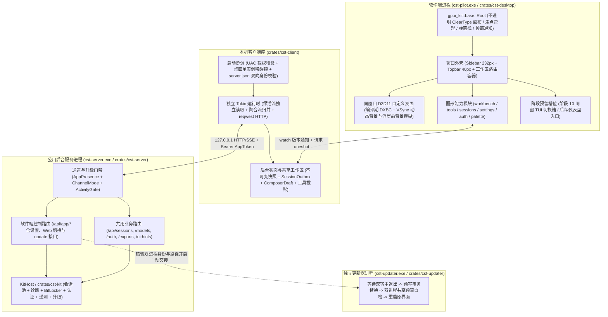
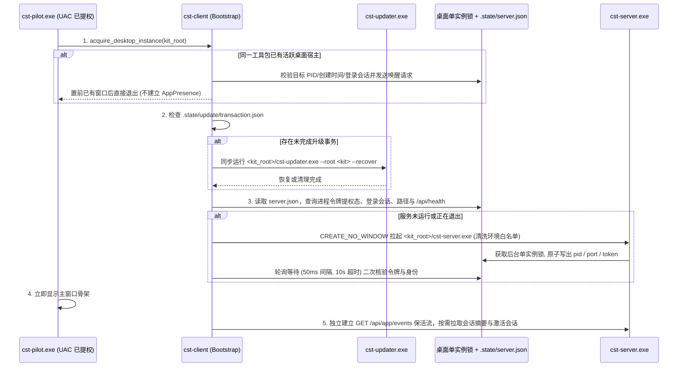

# 阶段 9：GPUI 桌面端（cst-client 与 cst-desktop）设计

阶段 9 基于 `gpui-kit`（`0.10.0`）实现默认启动的原生桌面图形端 `crates/cst-desktop`（编译产出统一软件端入口 `cst-pilot.exe`），以及与后台服务成对通信的本机客户端库 `crates/cst-client`。本阶段直接承接阶段 8.5 产出的 `crates/cst-os`、`crates/cst-updater` 与 `crates/cst-kit`，补齐编译期更新源占位与软件端更新控制接口，并落地桌面单实例互斥、管理员提权核验与桌面配置保护。

本文是 [Rust 重写开发计划](0.PLAN.md) 第九阶段的设计文档。静态设计、Shader 与整体设计以 [桌面端视觉画布](../../../design/cst-pilot-desktop.pen) 为最高规范，动效、令牌与交互行为以 [storybook.html](../../../design/storybook.html) 为最高规范，文本规范见 [DESIGN.md](../../../DESIGN.md)。前置依赖见 [6.cst-pilot.md](6.cst-pilot.md)、[7.server.md](7.server.md) 与 [8.web.md](8.web.md)，技术选型见 [prototype.md](../prototype.md)，产品功能与安全边界见 [SPEC.md](../../SPEC.md)、[web/SPEC.md](../../web/SPEC.md) 及 [auth/SPEC.md](../../auth/SPEC.md)、[release/SPEC.md](../../release/SPEC.md)。窗口内置 `Ratatui` 终端视图归入阶段 10，本地请求日志仪表盘归入后续迭代，本阶段仅在顶栏与侧栏保留入口占位。

---

## 整体架构与包边界

软件端与本机后台服务采用双进程结构，全包共发行 `cst-pilot.exe`、`cst-server.exe` 与 `cst-updater.exe` 三支可执行文件。界面渲染、客户端状态及业务执行拆入独立 Cargo 包，依赖方向单向向下。



### 工作区包划分与可执行文件规范

项目总称为 CST Pilot。阶段 8.5 已完成 `crates/cst-kit`、`crates/cst-updater` 与 `crates/cst-os` 分层，本阶段在此基础上新增客户端与桌面包：

| 包名 | 编译产物 | 阶段归属 | 职责边界 |
|---|---|---|---|
| `crates/cst-os` | 纯 Rust 库 | 阶段 8.5（本阶段客户端复用） | 提供根目录解析、`.state/server.json` 读写契约、`ProcessIdentity`、安全路径与跨进程内核锁 |
| `crates/cst-updater` | 库 + `cst-updater.exe` | 阶段 8.5（本阶段补齐升级白名单与双进程自检） | 负责 Ed25519 验签与归档验树、升级布局白名单、事务替换与中断恢复 |
| `crates/cst-kit` | 纯 Rust 库 | 阶段 6、8.5（本阶段补齐编译期更新源） | 实现 17 个诊断与交付工具，提供 CSTOA 认证与双端遥测，承载 BitLocker 受控执行与联网升级编排 |
| `crates/cst-server` | 库 + `cst-server.exe` | 阶段 7–8.5（本阶段补齐升级与门禁规则） | 无窗口后台进程，托管多会话池与持久化收件箱，负责会话导出和三端配置读写，提供本机 HTTP/SSE 接口与独立 Web 启动模式 |
| `crates/cst-client` | 纯 Rust 库（无 UI 与服务端运行时依赖） | **阶段 9 新增** | 复用 `cst-os` 完成桌面单实例锁、服务探测拉起与双路 SSE 后台状态归并，承载内存发件箱、跨视图工作区草稿与 17 个工具的无 UI 数据投影 |
| `crates/cst-desktop` | 库 + `cst-pilot.exe` | **阶段 9 新增** | 产出统一软件端主程序（支持 `--ui desktop/tui/web` 与 `--health-check`），构建原生窗口与设计令牌，承载单窗口 D3D11 着色器表面和全部图形界面 |
| `crates/cst-tui` | 库（阶段 10 挂载至 `cst-pilot.exe`） | 阶段 10 预留 | 基于 `Ratatui`、`ratatui-textarea` 与 `tui-markdown` 实现窗口内置终端界面，复用同一个 `cst-client` 与工作区状态实例 |

### 目录结构

遵循 `gpui-kit` 工程规范，`crates/cst-desktop` 按业务能力组织子模块。每个模块内聚自身的状态实体（`Entity<T>`）与无状态展示元素（`RenderOnce`），就近放置动作定义（`actions!`）、关联弹窗和集成测试，不设全局 `views/` 或 `modals/` 目录。

```text
vendor/
|-- gpui-pre/                       # [patch.crates-io] 跨平台 PaintSurface 表面载荷与窗口绘制入口扩展
`-- gpui-pre-windows/               # [patch.crates-io] Windows D3D11 draw_surfaces 与设备恢复接入

crates/
|-- cst-os/                         # 阶段 8.5 跨进程基础库（server.json、ProcessIdentity、内核锁）
|-- cst-updater/                    # 阶段 8.5 独立更新器包（产出 cst-updater.exe）
|-- cst-kit/                        # 阶段 8.5 业务核心库（依赖 cst-updater -> cst-os）
|
|-- cst-client/
|   |-- Cargo.toml
|   |-- src/
|   |   |-- lib.rs                  # 公开导出 CstClient、ClientHandle、WorkspaceState 与小型协议 DTO
|   |   |-- bootstrap.rs            # 桌面单实例唤醒锁、升级事务恢复、UAC 令牌与 server.json 身份核验
|   |   |-- runtime.rs              # 内部 Tokio 运行时、独立保活任务、watch 状态版本号通知与请求修订号
|   |   |-- http.rs                 # reqwest 客户端封装（固定 Host/Bearer 头、禁用代理与 Idempotency-Key）
|   |   |-- sse.rs                  # /api/app/events 独立保活流与 /api/events/stream 聚合流游标状态机
|   |   |-- state.rs                # 后台唯一状态缓存（不可变共享快照句柄、通道模式、会话摘要与更新状态）
|   |   |-- session_store.rs        # 按需会话快照缓存、局部修订更新、流式增量归并与工作耗时计算
|   |   |-- workspace.rs            # GUI/TUI 共享工作区状态（激活会话、ComposerDraft 草稿与全局图片预算）
|   |   |-- tool_presenter.rs       # 17 个诊断工具无 UI 数据投影（字段分组、排行表、风险分组与异常摘要）
|   |   |-- outbox.rs               # 进程内存发件箱状态机、创建与首条消息两阶段提交、断线只读回执核对
|   |   `-- error.rs                # 客户端错误分类（断线、权限不符、通道锁定、升级互斥、缺凭据与配置损坏）
|   `-- tests/
|       |-- bootstrap_and_lifecycle.rs  # 单实例唤醒、UAC 令牌校验、按需拉起、身份防伪与安全退出测试
|       |-- sse_and_outbox.rs           # UI 挂起防反压、global/session reset、游标对齐与内存发件箱测试
|       `-- workspace_and_tools.rs      # 共享草稿状态流转、图片内存预算与 17 工具 fixture 投影对齐测试
|
`-- cst-desktop/
    |-- Cargo.toml                  # 产出 [[bin]] name = "cst-pilot"
    |-- build.rs                    # GLSL -> HLSL -> DXBC 预编译、应用图标、PerMonitorV2 与管理员清单嵌入
    |-- src/
    |   |-- lib.rs                  # 桌面应用组装入口（供 main.rs 与 #[gpui_kit::test] 共用）
    |   |-- main.rs                 # cst-pilot.exe 入口：前置 --health-check、--ui 模式分发与窗口创建
    |   |-- theme/
    |   |   |-- mod.rs              # 桌面语义设计变量定义、浅深色表映射与系统主题跟随
    |   |   `-- typography.rs       # 桌面子集字体 CST UI Sans (.otf) 与 JetBrains Mono (.ttf) 加载及回退
    |   |-- background/
    |   |   |-- mod.rs              # 动态背景与浮层毛玻璃调度器、诊断采样停帧控制与静态渐变回退层
    |   |   |-- d3d11_surface.rs    # 同设备 D3D11 PaintSurface 管线、浮层前区域拷贝与 Rgba16Float 圆角 SDF
    |   |   `-- presets.rs          # 四款着色器 Uniform 常量块布局、256×1 调色板绑定与页面主题预设表
    |   |-- shell/
    |   |   |-- mod.rs              # 窗口根视图 AppShell、全局快捷键绑定与路由状态栈
    |   |   |-- sidebar.rs          # 232px 通顶侧栏、最近 20 条会话列表、右键菜单、批量选择与账号菜单
    |   |   |-- topbar.rs           # 40px 展开态与集成式顶栏、视图切换占位、打开网页按钮与会话消息菜单
    |   |   |-- overlays.rs         # WebActive 接管锁定遮罩、顶部通知与主区正中上方长方形报错提示条
    |   |   |-- window_bounds.rs    # 显示器提示恢复、工作区交集钳制、最小尺寸限制与 300ms 去抖上报
    |   |   `-- exit_dialog.rs      # 运行中任务、待处理收件箱、导出任务与内存待发草稿核对确认对话框
    |   |-- workbench/
    |   |   |-- mod.rs              # 主页欢迎视图与聊天工作台容器切换
    |   |   |-- turn_segments.rs    # 对话轮次分段（常驻正文与特殊组件 vs 可折叠过程与普通工具计数）
    |   |   |-- message_list.rs     # 基于稳定条目 ID 的消息流滚动区、自动贴底与“回到底部”控制
    |   |   |-- markdown_view.rs    # 基于稳定 TextViewState 的增量流式 Markdown、横向滚动表格与复制按钮
    |   |   |-- composer.rs         # Textarea 多行编辑器、InlineToken 胶囊、IME 保护与补全面板
    |   |   |-- queue_bar.rs        # 待发消息暂存列表（拖拽重排、转插话、行内编辑与删除）
    |   |   |-- model_picker.rs     # 224px 右下锚点双级模型与思考强度选择器、上下文与额度悬浮面板
    |   |   `-- image_viewer.rs     # 消息附图、工具图片与草稿缩略图的居中原比例预览层
    |   |-- tools/
    |   |   |-- mod.rs              # 17 个开放工具视图分发器与过程折叠组头（含 ShimmerText 运行态流光）
    |   |   |-- normal_card.rs      # 普通工具卡片（消费 tool_presenter 渲染概览组、排行组、原文块与原始 JSON）
    |   |   |-- sys_overview.rs     # 整机概览常驻卡（CPU/内存 6px 比例条、机型时长与次级详情折叠）
    |   |   |-- bitlocker_card.rs   # BitLocker 常驻卡、固定容量清零 SecretInput 控件、本地确认与中断复查
    |   |   |-- runbook_card.rs     # 命令方案与交付清单常驻卡（三风险档、单条复制与可信系统记事本打开）
    |   |   `-- web_search_bar.rs   # 联网检索状态条与关键词展开块
    |   |-- sessions/
    |   |   |-- mod.rs              # 会话管理模块入口
    |   |   |-- all_sessions.rs     # 全部会话页（四时间分组 VirtualList、批量选择、重命名与乐观删除回滚）
    |   |   |-- branch_tree.rs      # 五档过滤分支树几何绘制、键盘导航、分支总结三选项卡片与 /fork 选择器
    |   |   `-- export_view.rs      # 会话导出选项列、基于脱敏快照的原生只读预览区、任务轮询与打开目录
    |   |-- palette/
    |   |   `-- mod.rs              # Ctrl+K 快捷命令与历史会话跳转面板
    |   |-- settings/
    |   |   |-- mod.rs              # 四分类设置外壳（常规、模型服务、模型偏好与快捷键）
    |   |   |-- general.rs          # 外观主题切换与“软件版本与更新”卡片
    |   |   |-- services.rs         # 已配置服务列表、添加服务搜索、模型热更新与自定义兼容服务表单
    |   |   |-- preferences.rs      # 新会话默认模型选择器、启用模型范围勾选、服务筛选与排序保存
    |   |   |-- shortcuts.rs        # 桌面快捷键一览表
    |   |   `-- update_dialog.rs    # 480px 软件升级确认、下载验签取消与双进程重启交接弹窗
    |   `-- auth/
    |       |-- mod.rs              # 登录视图外壳（承载左侧动态着色器画幅与 cstoa / OAuth / APIKEY 表单）
    |       |-- cstoa_qr.rs         # 本地离线二维码图像生成、倒计时、刷新与手机授权完成跳转
    |       |-- missing_key.rs      # 440px 缺少模型密钥提示弹窗（与 Web 共享 24 小时冷却及发送拦截提示）
    |       `-- account_view.rs     # 专属账号页（学号、姓名、剩余额度点查询重试与退出登录）
    `-- tests/
        |-- shell_and_mode_ui.rs    # 窗口骨架、侧栏收展、WebActive 遮罩与退出确认无头窗口测试
        |-- workbench_and_ime_ui.rs # 乐观发送、补全面板、合成输入组合态隔离与模型选择器测试
        |-- tools_and_bitlocker.rs  # 四类特殊工具卡片、SecretInput 清零与 IME 恢复及 400 重试测试
        `-- settings_and_update.rs  # 主题切换、模型范围保存、缺密钥弹窗保留草稿与升级取消状态流测试
```

---

## 前置补齐（cst-updater、cst-kit、cst-server 与字体规格）

桌面端自身不直接访问模型网关、更新服务器或本地业务配置文件，全部后台操作统一经由 `cst-server` 完成。启动桌面端视图开发前，先完成以下前置补齐（包拆离与 `crates/cst-kit` 更名已在阶段 8.5 完成，客户端复用 `cst-os` 的 `ServerDiscoveryRecord` 与 `ProcessIdentity`，不反向依赖 `cst-server`）。

### 1. 发行产物归属与规格文档同步

| 变更范围 | 具体动作 |
|---|---|
| 三支发行可执行文件 | `crates/cst-desktop` 产出软件端统一入口 `cst-pilot.exe`（支持 `--ui desktop/tui/web`，默认 `desktop`），`crates/cst-server` 产出 `cst-server.exe`，`crates/cst-updater` 产出 `cst-updater.exe` |
| 现行规格同步 | 同步修订 [release/SPEC.md](../../release/SPEC.md)（更新源编译期变量与三支必需二进制，以及双程序自检、桌面字体白名单和 `desktop.json` 干净树红线）与 [web/SPEC.md](../../web/SPEC.md)（共享缺密钥 24 小时冷却接口） |

### 2. 编译期更新源占位、字体分发白名单与可信子进程边界

升级模块由编译期双环境变量驱动，收紧三支二进制完整性与桌面子集字体校验，并加固提权环境下的子进程路径解析：

| 修改位置 | 补齐与加固规则 |
|---|---|
| `crates/cst-kit/src/update/service.rs`（`compiled_client`） | 清单地址读取编译期环境变量 `option_env!("CST_UPDATE_MANIFEST_URL")` 并经 `cst_updater::manifest::validate_release_url` 校验为合法 HTTPS 地址。`CST_UPDATE_PUBLIC_KEY` 与 `CST_UPDATE_MANIFEST_URL` 任一缺失或为空字符串时，`UpdateService` 初始化为 `Phase::Unavailable`（提示 `"当前构建未启用在线更新。"`），启动不发后台检查请求。禁止读取机主运行期环境变量覆盖升级源或公钥，测试通过 `UpdateOptions::Trusted` 注入本机模拟源 |
| `crates/cst-updater/src/layout.rs`（`classify` 与 `validate_metadata`） | 在程序白名单加入 `"cst-server.exe"` 并移除未使用的 `"cst-pilot-desktop.exe"`。对 `assets/fonts/CSTUISans-{Regular,Medium,Bold}.otf` 三份约定桌面子集字体做精确路径白名单放行，其余路径的 `.otf` 文件继续拦截。`validate_metadata()` 强制要求同时包含 `cst-pilot.exe`、`cst-server.exe`、`cst-updater.exe` 与桌面字体清单，任一缺失在准备阶段即验签拒绝 |
| `crates/cst-updater/src/process.rs`（`NativeHost`） | 保持统一重启入口 `cst-pilot.exe --ui <desktop\|tui\|web>`（`web` 分支由 `cst-pilot.exe` 转发拉起 `cst-server.exe --standalone-web --open-browser`）。`health_check` 在共用单一 15 秒总截止时间的 Job Object 内依次执行 `cst-server.exe --health-check` 与 `cst-pilot.exe --health-check`。两支程序在初始化图形与字体前，同时在获取单实例锁与连接网络前完成内置版本、协议版本及必需静态资源核验，输出与根目录 `VERSION` 不符或超时均触发事务回滚 |
| `crates/cst-updater/src/manifest.rs` 与 `crates/cst-kit/src/update/service.rs` | 在 `UpdateStatus` 补充 `pub archive_bytes: Option<u64>`（取自已验签 `VerifiedRelease.info().archive.size`）与 `pub operation_id: Option<String>`，供升级弹窗展示包体积与绑定取消令牌 |
| 桌面字体子集管线（`prepare-fonts.mjs` / `subset-fonts.py`） | 复用 Web 端同一套 GB2312（6,763 字）加界面语料字表与 `CST UI Sans` 重命名规则（遵循 SIL OFL 1.1），额外产出桌面端 CFF 子集字体 `assets/fonts/CSTUISans-{Regular,Medium,Bold}.otf`，同步纳入固定版本与哈希锁定的 `assets/fonts/JetBrainsMono-{Regular,Medium}.ttf` 及两份字体许可证，并在打包检查中验证全部桌面字体可解析 |
| 可信系统程序解析与环境白名单 | `cst-client` 拉起 `cst-server.exe` / `cst-updater.exe` 固定校验位于规范化 `kit_root` 下且仅传递便携环境白名单（`SystemRoot` 取自可信系统 API，`TEMP/TMP` 指向 `.state/tmp`，剥离外部 `PATH` 注入项）。`cst-server` 打开 `explorer.exe` 与 `notepad.exe` 统一经 Win32 `GetSystemDirectoryW` / `GetWindowsDirectoryW` 解析绝对路径。正式构建忽略运行期 `CST_EXPORT_BROWSER` / `CHROME_PATH` 环境变量，仅从系统固定注册表与标准安装目录探测导出浏览器 |

### 3. 软件端更新控制路由、门禁边界与共享冷却接口（`crates/cst-server`）

区分升级协调端点与普通配置及通道写操作，保证升级交接关闭 `ActivityGate` 后无并发写盘或通道抢占：

1. **`ActivityGate` 门禁保护范围**：仅 `/api/app/update/{status,check,prepare,cancel,launch}` 五个更新控制端点豁免普通 `ActivityLease`。为 `PATCH /api/app/settings` 与通道切换 `POST /api/app/web/{open,close}` 补齐 `ActivityLease`，与现有已通过 `state.write_once` 持有租约的 `PATCH /api/settings`（Web 主题）及 `POST /api/models/{default,scoped}`（三端共享模型配置）对齐。`UpdateService::launch` 关闭门禁后，上述变更统一返回 `409 update_in_progress`。
2. **软件端更新控制接口**（挂载于 [`crates/cst-server/src/routes/app.rs`](../../../crates/cst-server/src/routes/app.rs)，要求有效 `Authorization: Bearer <app_token>` 与 `X-CST-Client: app`）：

| 方法 | 路径 | 请求体 | 返回结构与执行逻辑 |
|---|---|---|---|
| `GET` | `/api/app/update/status` | 无 | 返回 `200 { currentVersion, status: UpdateStatus, lastReport: Option<UpdateReport> }`，合并内存状态与上次 `.state/update/result.json` |
| `POST` | `/api/app/update/check` | `{}` | 调用 `UpdateService::check`，广播 `update_changed` 并返回 `200 UpdateStatus`。`Phase::Unavailable` 原样返回 `200`，下载或交接进行中返回 `409 update_busy` |
| `POST` | `/api/app/update/prepare` | `{}` | 生成 `operationId` 与服务端 `CancellationToken` 保存于 `ServerState`，流式下载归档并执行 Ed25519 双签名与全树 SHA-256 核验解压至 `.state/update/staging/`。无可用新版返回 `409 update_not_available`，重复准备返回 `409 update_busy` |
| `POST` | `/api/app/update/cancel` | `{ operationId?: String }` | 触发当前 `prepare` 的 `CancellationToken::cancel()`，等待流式下载退出并清理本次暂存目录，状态回退至 `Phase::Available` 并广播 `update_changed`，返回 `200 UpdateStatus` |
| `POST` | `/api/app/update/launch` | `{ appPid: u32, appCreated: u64, ui?: "desktop" \| "tui" }` | 核验请求方持有活跃 `/api/app/events` 连接，经 Win32 `ProcessIdentity::capture(appPid)` 与 `QueryFullProcessImageNameW` 校验进程存活、创建时间一致且规范化路径等于 `<kit_root>\cst-pilot.exe`（不符返回 `400 invalid_parent_process`）。未就绪返回 `409 update_not_ready`，存在运行中会话、未决收件箱或活动导出返回 `409 session_busy_for_update`。通过后以 `[app_proc, server_proc]` 调用 `UpdateService::launch` 拉起 `cst-updater.exe` 并完成共享 5 秒遥测定稿。先将 `200 { receipt: LaunchReceipt }` 完整刷新至客户端连接，再异步执行交接关停，取消 OAuth 与导出任务并调用 `pool.shutdown()` 删除 `.state/server.json` 退出服务 |

3. **状态广播补齐**：全局 SSE 流（`GET /api/app/events` 与 `GET /api/events/stream`）的 `event: state` 新增 `{"type": "update_changed", "status": UpdateStatus}`，并在 `PATCH /api/app/settings`（`scope: "desktop"`）、`PATCH /api/settings`（`scope: "web"`）及 `POST /api/models/{default,scoped}`（`scope: "shared"`）落盘后广播带 `scope` 的 `settings_changed`。
4. **`WebActive` 只读白名单与共享缺密钥冷却接口**：
   - 扩充 [`crates/cst-server/src/auth_guard.rs`](../../../crates/cst-server/src/auth_guard.rs) 的 `is_app_readonly_allowed_in_web_mode`，新增放行携带 `X-CST-Client: app` 的 `GET /api/sessions`（只读会话摘要列表），供桌面端在 `WebActive` 待机遮罩下实时刷新侧栏列表。业务写请求继续返回 `409 web_mode_active`。
   - 新增三端共享运行态提示接口 `GET /api/ui-hints` 与原子占用接口 `POST /api/ui-hints/missing-key-prompt/claim`（读写 `.state/ui-hints.json` 的 `{ missingKeyPromptedAtMs?: u64 }`，按本机毫秒时间戳判定 24 小时窗口，并发首次进入仅首个客户端返回 `{ claimed: true }`）。同步迁移 Web 前端 [`model-key-prompt.ts`](../../../src/web/frontend/app/auth/model-key-prompt.ts) 接入该接口（首次读取若 `localStorage` 存有更近时间戳则单向合并上报后清理本地键），与软件端共用同一冷却时钟。

### 4. 桌面配置文件设计与保护规则（`desktop.json`）

[`crates/cst-server/src/settings.rs`](../../../crates/cst-server/src/settings.rs) 管理的桌面个人配置路径定为 `agent/home/desktop.json`，磁盘层按松耦合顶层 JSON 对象合并以支持后续版本扩展新字段与新枚举项。首版字段定义如下：

```json
{
  "theme": "light",
  "defaultView": "gui",
  "sidebarCollapsed": false,
  "displayHint": "a1b2c3d4e5f60718",
  "windowWidth": 1280,
  "windowHeight": 800,
  "windowX": 160,
  "windowY": 100,
  "windowMaximized": false
}
```

| 字段 / 文件 | 类型与默认值 | 归属与演进说明 |
|---|---|---|
| `theme` | `"light" \| "dark" \| "system"`（默认 `"light"`） | 桌面端独立外观主题，与 `web-settings.json` 及 `settings.json` 互不覆盖 |
| `defaultView` | `"gui" \| "tui"`（默认 `"gui"`） | 启动默认进入图形工作台或阶段 10 同窗终端视图 |
| `sidebarCollapsed` | `bool`（默认 `false`） | 跨重启记忆左侧 `232px` 侧栏的展开或收起状态 |
| `displayHint` | `Option<String>`（默认省略） | 记录上次所在显示器的设备名哈希提示（禁止持久化运行期 `HMONITOR` 句柄），供双屏异构缩放恢复时优先匹配目标屏幕 |
| `windowWidth` / `windowHeight` / `windowX` / `windowY` | `Option<u32>` / `Option<i32>`（缺省 `1280×800` 居中） | 记录目标屏幕坐标系下非最大化且非最小化状态的常规窗口逻辑像素矩形。窗口处于最大化或最小化期间保持该常规恢复矩形不被覆盖 |
| `windowMaximized` | `bool`（默认 `false`） | 记录退出前是否处于最大化状态，启动时据此还原最大化窗口 |
| `terminal`（阶段 10 预留） | `Option<Object>`（默认省略） | 预留阶段 10 窗口内置终端的字号与配色子对象，使 `settings.json` 专注保存三端共享业务配置 |
| `.state/ui-hints.json` | `{ missingKeyPromptedAtMs?: u64 }` | 首次缺密钥引导的 24 小时冷却时间戳属运行态消噪标记，独立存于 `.state/` 并与 Web 端共享 |

六个环节的读写与隔离保护规则固定如下：

| 保护环节 | 风险场景 | 强制规则与补齐实现 |
|---|---|---|
| 1. 三端存储隔离与通道放行 | 切换桌面主题覆盖网页或终端主题。网页模式期间调整桌面窗口报错 `409` | `desktop.json` 与 `web-settings.json`、`settings.json` 分文件独立存储。`/api/app/settings` 在 `ChannelMode::WebActive` 期间继续放行软件端的 `GET` 与 `PATCH`（每次 `PATCH` 持有 `ActivityLease` 并在落盘后广播 `settings_changed`） |
| 2. 未知键与新枚举向前兼容及损坏保留 | 新版写入新字段或新枚举值后回到旧版被抹除或报 `503`。U 盘异常掉电造成 JSON 截断被默认值覆盖 | `DesktopSettingsStore` 读取时解析为顶层 `serde_json::Map<String, Value>`，缺失键补默认值，未知键原样保留。已知枚举字段（`theme`、`defaultView`）遇到未识别字符串时，内存展示回退为默认值（`"light"` / `"gui"`），在未对该字段发起显式 `PATCH` 前原样保留磁盘 Map 中的原始枚举字符串。`patch` 仅覆写传入字段后经同目录临时文件 `sync_all()` 与最多 5 次指数退避（累计 `<= 375ms`）原子替换。文件不存在时返回默认值且首次修改前不落空盘。JSON 语法损坏或顶层非对象时返回 `503 configuration_unavailable`，桌面端回退内存默认外观继续运行且禁止覆盖现场原文件 |
| 3. 异构 DPI 显示器恢复与小屏钳制 | 双屏不同缩放比例下窗口恢复偏位，或插到低分辨率笔记本时标题栏超出工作区无法拖动 | 启动枚举当前各显示器的工作区（扣除任务栏）与每屏 `scale_factor`：先用 `displayHint` 匹配目标 `PlatformDisplay`（未命中则回退主屏），在该屏坐标系下将宽高钳制于 `[min(1024×640, work_area), work_area * 0.90]`，并检查顶部 `40px` 拖拽区与工作区的可见交集矩形（交集宽 `< 120px` 或高 `< 24px` 时移回该屏工作区正中），同时将解析出的 `display_id` 与逻辑矩形传入建窗参数。跨机修正仅作用于内存窗口，直至用户手动移动或缩放后再经 `300ms` 去抖合并提交单次 `PATCH` |
| 4. 在线升级与失败回滚隔离 | 升级包误带默认桌面配置覆盖用户习惯，或升级回滚误删用户文件 | 在 `crates/cst-kit/src/update/layout.rs` 的 `classify()` 黑名单中加入 `"desktop.json"`（兼容拦截 `"desktop-settings.json"`），含该路径的升级包在准备阶段即验签拒绝。`applier.rs` 替换与回滚只操作程序白名单与四份 `MERGE_FILES`，保持本地 `desktop.json` 不变 |
| 5. 干净发行包出厂红线拦截 | 本地运行桌面端后打包脚本把生成的 `desktop.json` 带入正式发行 ZIP | 在 [`pack/release-checks.mjs`](../../../pack/release-checks.mjs) 的运行态路径检查及阶段 11 Rust 打包检查器中同步拦截 `agent/home/desktop.json` 与 `desktop-settings.json` |
| 6. 单一串行写口与零敏感数据 | 桌面端直接写盘与后台冲突，或配置文件泄露机主路径与通信凭据 | `cst-desktop` 与 `cst-client` 禁止直接读写 `agent/home/desktop.json`，唯一读写入口为 `cst-server` 的 `DesktopSettingsStore` 异步互斥锁。文件仅存外观、显示器哈希提示与窗口几何，禁止写入 `app_token` 与账号资料，也不记录工作目录路径或硬件序列号 |

---

## 本机客户端层详细设计（`crates/cst-client`）

`crates/cst-client` 封装桌面单实例锁与服务核验拉起，统一管理后台状态归并和跨视图工作区状态，不引入图形库或 `cst-server` 运行时依赖，供 `cst-desktop` 与阶段 10 的 `cst-tui` 共同持有。

### 1. 提权边界、单实例锁与退出协调（`bootstrap.rs`）



1. **统一管理员提权与工具包级桌面单实例锁**：
   - 普通启动在入口边界先完成管理员提权（UAC），再执行单实例互斥与后台连接（`--health-check` 例外，直接只读自检退出）。
   - 客户端在启动网络与后台连接前，按规范化 `kit_root` 路径哈希获取桌面单实例命名管道锁并持有至进程退出。若同一工具包已有桌面宿主运行，新启动实例核验目标进程的工具包路径、PID／创建时间及同一用户登录会话后发送置前唤醒指令（由已开窗口执行 `window.activate()`），随即直接退出，不注册 `AppPresence` 也不触发 `/api/app/exit`。遇到跨用户或跨登录会话实例时直接提示已有实例正在运行，不擅自终止对方。
2. **升级事务前置自检**：建立业务连接前检查 `.state/update/transaction.json`。检测到上次升级中断遗留的未完成事务且存在匹配的 `cst-updater.exe` 与编译期公钥时，先同步调用独立更新器执行 `--recover` 完成回滚或收尾。无法恢复时弹出中文错误框并退出，不在残缺程序树上加载会话。
3. **后台进程令牌提权核验与无黑框拉起**：
   - 读取 `.state/server.json` 获取 `{ pid, port, token }` 后，客户端通过 Win32 API 直接查询该 `pid` 的进程句柄与访问令牌：核验进程存活且可执行文件规范化路径等于 `<kit_root>\cst-server.exe`，确认与当前桌面进程同属一个用户登录会话，并校验桌面与后台两个进程的访问令牌均处于已提权管理员状态（`TokenElevation`）。随后携带 `Authorization: Bearer <app_token>` 请求 `GET /api/health`（超时 `800ms`）。服务端保留现行 `{ connected: true, stopping }` 基础字段供网页端探活，仅对已通过 `CallerIdentity::App` 鉴权的软件端额外附加 `{ pid, processCreated, kitRoot, version, elevated }`，客户端交叉比对全部一致且 `stopping == false` 后复用连接。
   - 若检测到残留的非提权后台进程持有后台锁，客户端明确提示权限不一致原因并引导用户安全关闭旧进程后重开，禁止死循环拉起新服务或静默强杀可能仍有任务的旧后台。服务未运行或 `stopping == true` 时，以 `CREATE_NO_WINDOW | CREATE_NEW_PROCESS_GROUP` 与清洗后的便携环境白名单拉起 `<kit_root>\cst-server.exe`。
4. **关闭窗口检查、收件箱感知与关停回滚保护**：
   - 扩充服务端 `GET /api/lifecycle` 返回结构：每会话除 `{ id, title, running }` 外新增 `pendingInboxCount`（汇总 `pending / delivering / failed / uncertain` 条数，不含正文）及全局 `activeExports: usize`。修复 [`crates/cst-server/src/state.rs`](../../../crates/cst-server/src/state.rs) 的 `execute_shutdown()`：若 `pool.shutdown()` 因竞态新任务返回忙碌冲突，同步复位 `ModeController` 的 `stopping` 标志，恢复正常准入状态。
   - 用户点击右上角 `X` 或账号菜单“退出 CST Pilot”时，桌面端综合检查本地内存发件箱待处理／失败项、`workspace` 未发草稿及 `GET /api/lifecycle` 返回的运行中会话、未决收件箱与进行中导出。全部空闲时冲刷窗口几何防抖（上限 `200ms`）并调用 `POST /api/app/exit` 等待遥测定稿（上限 `5.5s`）后退出。存在未完事项时弹出「退出确认对话框」（默认焦点位于“继续使用”），确认“停止任务并退出”后再执行关停。
   - 桌面进程异常强杀时，服务端 `ModeController` 在最后一条 `/api/app/events` 断开满 6 秒宽限期后自动收尾退出。

### 2. 后台状态归并、独立保活与 `watch` 通知（`runtime.rs`、`state.rs`）

客户端在内部双工作线程 `Tokio` 运行时中完成全部网络消费与状态归并，消除 UI 主线程卡顿对网络保活的反压：

1. **后台唯一状态归并器**：`CstClient` 在后台任务中顺序消费业务 SSE 增量，自行处理断线重连与 `reset` 快照重拉，并将结果写入唯一的客户端状态缓存。缓存采用 `Arc` 共享不可变快照句柄与每会话局部修订号（`revision: u64`），避免流式生成逐 token 深拷贝全部会话。HTTP 客户端固定关闭环境代理（`no_proxy()`）与自动重定向，统一附加 `Host: 127.0.0.1:<port>` 与 `X-CST-Client: app`。
2. **保活流与业务流隔离**：`/api/app/events` 保活连接在独立后台任务中读取心跳与全局状态事件并负责自动重连，不等待 GUI 帧渲染、Markdown 排版或业务流消费。即便前台窗口被系统原生模态框挂起数十秒，保活连接仍持续清空内核接收缓冲，不会触发服务端 `8 MiB` 慢消费断流或 `AppPresence` 宽限期误退出。
3. **`watch` 版本号合并通知与请求级回执分离**：后台每次完成状态更新后递增全局状态版本号写入 `tokio::sync::watch`。GPUI 根视图仅挂载一条常驻监听协程接收最新版本号，唤醒后立即克隆变更的共享快照句柄并释放 `watch` 借用守卫（禁止跨弹窗或异步等待持有读锁），在单帧内合并调用一次 `cx.notify()`。写操作 HTTP 响应、升级交接回执及带单调递增 `op_revision: u64` 的异步查询各自通过独立 `oneshot` 返回，不走可合并的状态通知通道。

### 3. 双路 SSE 游标对齐与首屏按需加载（`sse.rs`、`session_store.rs`）

客户端维护两条职责分离的 SSE 长连接，并对两条流同时下发的全局 `state` 事件按类型与载荷修订号去重：

| 连接通道 | 服务端端点 | 承载内容、游标对齐与恢复规则 |
|---|---|---|
| 软件端保活与全局流 | `GET /api/app/events` | 维持服务端 `AppPresence::Connected` 存活计数。携带单流 `Last-Event-ID`（`<epoch>:<seq>`），接收 `sessions_changed`、`models_changed`、`auth_changed`、`settings_changed`、`quota_changed`、`channel_mode_changed`、`oauth_*` 与 `update_changed` 事件。收到 `event: reset` 时在后台并行重拉会话摘要与通道模式，以及模型目录、认证状态和桌面／更新状态 |
| 多会话聚合流 | `GET /api/events/stream?clientId=<uuid>`<br>`PUT /api/events/stream/<clientId>/subscriptions` | 仅在 `ChannelMode::AppActive` 期间开启（切入 `WebActive` 时主动断开暂停，回到 `AppActive` 后重建）。`40ms` 去抖合并订阅集合（上限 32 个会话），包含当前激活会话与仍在后台运行的会话。首次纳入尚无本地快照的会话时，先提交 `PUT` 建立订阅基线并暂存在途增量，再拉取 `GET /api/sessions/<id>` 按条目序号幂等合并，防止快照与订阅间隙漏帧。区分 `{"scope": "session", "sessionId": "<id>"}` 单会话重拉与 `{"scope": "global"}` 全局重拉 |

冷启动遵循首屏骨架先行与会话按需加载原则：主窗口外壳在启动时立即呈现，不等待模型、认证与更新请求全部返回后再创建首帧。客户端初始仅拉取轻量会话摘要列表（`GET /api/sessions`）与当前激活会话快照（默认进入主页时无需拉取历史会话完整正文），用户点击打开其他历史会话时即时加载并缓存。

会话完整快照缓存按字节与条数上限做 LRU 回收，豁免当前激活会话、含未确认发件箱项的会话及含有非空未发草稿的会话。单场长会话在视图层按完整“用户提问轮”边界采用尾部滑窗挂载（默认展示最近 30 轮，顶部提供“显示更早的消息”按批展开并锚定阅读位置）。

### 4. 跨视图共享工作区、工具投影与发件箱（`workspace.rs`、`tool_presenter.rs`、`outbox.rs`）

为支撑阶段 10 在同一窗口内无缝切换 GUI 与内置 `Ratatui` TUI，纯业务工作区状态与工具展示转换统一置于 `cst-client`：

1. **GUI / TUI 共享工作区状态（`workspace.rs`）**：
   - 集中维护当前激活会话 ID，以及新会话与各已有会话的未发草稿 `ComposerDraft`（含正文文本、技能／文件语义标记、图片共享句柄、发送模式 `direct / queue / steer` 及逻辑光标偏移）。`FocusHandle`、输入法组合态、像素／单元格布局与滚动位置留在各自界面层。阶段 10 切换视图时先结算或取消当前输入法组合，将已提交文本同步至 `ComposerDraft`，再将焦点移交目标视图输入框。
   - **全局图片内存与像素预算**：待发草稿、内存发件箱与大图预览共用底层图片缓冲句柄。除校验单次提交压缩文件体积 `<= 12 MiB`（PNG/JPEG/GIF/WebP）外，同步限制单图解码后像素尺寸与全客户端图片总内存预算（上限 `48 MiB`），防止高压缩比巨幅位图耗尽老旧客户机内存。BitLocker 恢复密码与 API Key 禁止进入 `ComposerDraft` 或发件箱。
2. **17 个诊断工具无 UI 数据投影（`tool_presenter.rs`）**：
   - 将 17 个开放工具返回的原始 JSON 解码为纯 Rust 展示模型（涵盖概览键值、排行表列与单位、修复命令三档风险分组，以及耗时与结构化错误和降级提示），按 `(tool_call_id, result_revision)` 缓存，不包含颜色、图标或像素宽度。`cst-desktop` 与阶段 10 `cst-tui` 共用该投影输出，并通过同一套工具结果测试夹具（fixtures）与 Web 前端保持字段语义一致。
3. **内存乐观发件箱与双通道锁定（`outbox.rs`）**：
   - **乐观入列与两阶段新建会话**：对话内点击发送生成满足 `^[a-zA-Z0-9_-]{1,128}$` 的 `client_message_id`，将草稿转入会话内存发件箱并立即渲染乐观气泡，同会话内串行调用 `POST /api/sessions/<id>/messages`。主页发送按“1. `POST /api/sessions`（带创建去重键）→ 2. 提交首条消息”执行，创建断线先调 `GET /api/sessions/creation/<requestKey>` 只读核对。
   - **三类提交结果**：
     - 收到 `202 Accepted` 或在 SSE 观测到对应 `clientMessageId` 后转入服务端持久化收件箱管辖，并释放本地待发图片引用。
     - 遇到所选服务缺少密钥（`409 credentials_required`）时唤起缺密钥提示框并保留草稿。主页发送遇到本机落盘失败时保留输入框原草稿，并在工作区正中上方弹出长方形报错提示条。对话内仅在本机存储写满或只读（`507 storage_full`）导致服务未接受请求时暂停后续本地待发项，在对应用户气泡旁展示警示图标与纯图标操作栏。
     - 遇到断线或进程重启恢复的在途条目则标为 `Uncertain`，重连后调只读 `GET /api/sessions/<id>/messages/<messageId>` 核对回执。
   - **`WebActive` 通道切换**：点击顶栏“打开网页”前若含未发草稿或未确认发件箱项，先提示发送或清空。确认后调用 `POST /api/app/web/open` 打开带单次 `ticket` 的系统默认浏览器，挂起聚合流并覆盖「网页端使用中」半透明锁定遮罩（期间保持会话列表与凭据同步，并实时同步更新状态和桌面自身设置）。点击“退出网页端”调用 `POST /api/app/web/close` 作废浏览器 Cookie 并恢复聚合流与当前会话快照。

---

## GPUI 桌面界面详细设计（`crates/cst-desktop`）

### 1. 窗口骨架、设计令牌与字体加载（`shell/`、`theme/`）

`cst-pilot.exe` 启动后按固定顺序初始化：前置拦截 `--health-check` → 核验管理员提权与桌面单实例锁 → 加载桌面字体资源 → 调用 `gpui_kit::init(cx)`（读取系统 `SPI_GETCLIENTAREAANIMATION` 写入 `cx.reduce_motion()`）→ 注册全局 `actions!` 与键位 → 通过 `gpui_kit::open_window` 创建不透明主窗口（`WindowBackgroundAppearance::Opaque`，保留全窗口原生 ClearType 亚像素文字锐度，动态背景激活时设 `inactive_frame_interval: None`）并挂载唯一 `Root` 实例，统一承载主界面、弹窗栈与下拉菜单及顶部通知。

静态组件、整体布局与基础变量定义以 [cst-pilot-desktop.pen](../../../design/cst-pilot-desktop.pen)「设计规范」板为更高优先级，[storybook.html](../../../design/storybook.html) 严格对应画布组件与变量（不得新增未定义项）并规范动效与交互行为。桌面端核心配置固定如下：

| 维度 | 令牌 / 部位 | 规格取值与布局规则 |
|---|---|---|
| 窗口尺寸 | 默认外框 / 最小外框 | 默认 `1280 × 800` 逻辑像素，常规最小限制 `1024 × 640`（显示器工作区窄于下限时按可用工作区尺寸自适应降级） |
| 侧栏展开态 | `Sidebar` + `Topbar` + `Workspace` | 左侧通顶侧栏固定宽 `232px`（实心 `$bg-shell`：浅 `#F4F4F4` / 深 `#141416`）。右侧上方顶栏高 `40px`（实心 `$bg-shell`），下方右侧与底侧各由 `8px` `$bg-shell` 边框条围合工作区容器（常规页铺 `$bg-workspace`：浅 `#FFFFFF` / 深 `#0D0D0F`，圆角 `$radius-row = 8px`，细描边 `$border-subtle`） |
| 侧栏收起态 | `Integrated Topbar` + `Workspace` | 顶栏铺满全宽，左侧集成侧栏展开按钮与新建对话快捷按钮，高 `40px`。下方工作区左右及底侧由 `8px` `$bg-shell` 边框条围合 |
| 内容居中列 | 对话区与设置列 | 对话流、输入框和设置列在工作区内部水平居中，最大宽度 `816px`，左右两侧最小留白 `24px` |
| 表面与语义色 | 浅 / 深两套独立令牌 | 悬浮层 `$bg-elevated`（`#FFFFFF / #242429`），浮层着色 `$bg-glass`（`#FFFFFF / #18181C`），遮罩底色 `$bg-scrim`（`#111114 / #040406`），弹窗实体 `$bg-modal`（`#FFFFFFF2 / #18181CF2`），次级面 `$bg-surface`（`#F4F4F5 / #1C1C20`），特殊工具基板 `$bg-special`（`#FCFCFC / #121215`），选中项 `$bg-item-active`（`#EAEAEB / #242429`）。正文 `$text-primary`（`#111111 / #F2F2F4`），次要 `$text-secondary`（`#6B6B6B / #85858B`），弱化 `$text-muted`（`#8A8A8E / #636369`）。主色 `$accent-solid`（`#1A4BE0 / #3B6BF5`），状态语义色用于图标与浅底徽标（成功 `#16A34A / #4CC38A`、警告 `#8C5A00 / #E4A247`、危险 `#DC2626 / #E5484D`） |
| 浮层透明度分层 | 两档玻璃 + 多层合成 | 无模糊遮罩的悬浮面板、补全、菜单与通知使用 `frosted-glass.glsl` 档 2（`$bg-glass` `u_tintOpacity: 0.92`、`u_blur: 10`、`u_refract: 0`、`u_specular: 0.16`）。带全窗模糊遮罩的模态弹窗与快捷面板使用档 3（本体 `$bg-glass` `u_tintOpacity: 0.95`、`u_blur: 10`、`u_refract: 0`、`u_specular: 0.12`，遮罩底层 `$bg-scrim` `u_tintOpacity: 0.18`、`u_blur: 14`）。普通按钮与 `$bg-special` 卡片只用实底多层合成（顶沿内高光 + 描边 + 投影），不使用背景模糊 Shader |
| 字号与行高 | 五档固定阶梯 | `$font-hero` `40/48`（主页欢迎标语 Bold 700），`$font-title` `20/28`（会话与子页标题 Bold 700），`$font-body` `16/24`（对话正文 Regular 400 与分区标题 Bold 700），`$font-ui` `14/20`（用于侧栏行与表格，以及按钮、菜单和工具状态行 Regular 400 / Medium 500），`$font-caption` `12/16`（快捷键角标与耗时，以及工具原文块） |
| 间距与圆角 | 七档间距 / 三档圆角 | 间距依次为 `2 / 4 / 6 / 8 / 12 / 16 / 24px`（`$space-micro` 至 `$space-group`）。圆角分为控件 `$radius-control = 4px`、容器与列表行 `$radius-row = 8px`、胶囊与圆标 `$radius-full = 9999px` |
| 固定盒高 | 五档控件高度 | `inline = 24px`（分段滑块与行内标签），`compact = 28px`（紧凑按钮与快捷键标及状态行），`control = 32px`（标准按钮与侧栏行，以及搜索框和菜单项），`field = 40px`（顶栏与文本输入，以及登录主按钮和顶部通知），`header = 44px`（会话标题栏与子页头及全部会话行） |
| 字体与回退 | 桌面子集字体与系统回退 | 启动通过 GPUI `TextSystem::add_fonts` 加载 `assets/fonts/` 下的 `CSTUISans-{Regular,Medium,Bold}.otf`（`400/500/700`）与 `JetBrainsMono-{Regular,Medium}.ttf`（`400/500`）。GB2312 外生僻字与繁体字，以及日韩字符和彩色 Emoji 交由 DirectWrite 系统回退链渲染，并完整保留原始可复制文本。字体文件缺失或损坏时回退系统默认字体并弹出非阻塞提示。与图标同行居中的中文按钮及导航文字施加底部 `2px` 对齐偏移 |

横向多列全高布局在 GPUI `h_flex()` 上显式声明 `.items_stretch().size_full()`。可伸缩滚动子容器显式声明 `.min_h_0().min_w_0()`，滚动条直接挂在面板边缘所有权容器上。

### 2. 动态背景 Shader 渲染与运行期优化（`background/`）

桌面端完整支持 [`design/asset/`](../../../design/asset/) 下的四款着色器及调色板资源（[`blue-sky.glsl`](../../../design/asset/blue-sky.glsl)、[`night-sky.glsl`](../../../design/asset/night-sky.glsl)、[`blue-hour.glsl`](../../../design/asset/blue-hour.glsl) 配 [`blue-hour-palette.png`](../../../design/asset/blue-hour-palette.png) / [`blue-hour-dark-palette.png`](../../../design/asset/blue-hour-dark-palette.png)，以及浮层 [`frosted-glass.glsl`](../../../design/asset/frosted-glass.glsl)），页面与浅深主题预设以 [cst-pilot-desktop.pen](../../../design/cst-pilot-desktop.pen) 定稿帧绑定为准。渲染层采用**编译期预编译 DXBC + 单窗口同设备 D3D11 表面扩展**设计：

1. **零源文件改动与编译期 DXBC 生成（`build.rs`、`presets.rs`）**：
   - `design/asset/` 下的着色器原文件保持不变。`crates/cst-desktop/build.rs` 引入固定版本的纯构建依赖 `naga`，按上文列出的四款固定文件名白名单（不使用 `*.glsl` 通配）读取源码，先将 WebGL ES `#version 100` 头部与散列 `uniform` 确定性封装为 `std140` 常量缓冲块（翻转 WebGL 左下角 `gl_FragCoord.y` 为 `u_resolution.y - gl_FragCoord.y`），转换为 HLSL（显式指定 Shader Model `5_0`），再调用系统 `D3DCompile` 产出预编译 DXBC 字节码嵌入可执行文件。运行期不引入 `wgpu` 或 `naga`，且不设置强制唤醒独立显卡的高功耗适配器偏好。
2. **单窗口同设备 D3D11 表面扩展与浮层前背景模糊（`vendor/`、`d3d11_surface.rs`）**：
   - 通过工作区 `[patch.crates-io]` 在 `vendor/gpui-pre` 与 `vendor/gpui-pre-windows` 中补齐跨平台通用自定义表面接口（扩展 Windows 侧 `PaintSurface` 绘制描述符、`window.paint_surface` 公开入口及 `DirectXRenderer::draw_surfaces` 批次执行，产品着色器与业务参数全部留在 `crates/cst-desktop`），复用 GPUI 主窗口私有的 `ID3D11Device`、`ID3D11DeviceContext`、裁剪掩码及设备丢失（Device Lost）恢复流程。实施时先完成单窗口背景、浮层前快照与设备恢复的独立能力验证，再接入业务视图。
   - 背景表面按 `bounds * window.scale_factor()` 以 `1:1` 物理像素直接绘制到主窗口渲染目标，位于前景文字与控件批次之下，单窗口截图、跨屏拖动与 ClearType 亚像素文字天然一致。
   - 绘制需要 `frosted-glass.glsl` 衬底的浮层前，先在当前帧已绘制的场景目标上按浮层包围盒外扩模糊半径裁切，经 `CopySubresourceRegion` 复制到独立背景纹理（避免同一纹理同时作为渲染目标与采样输入引起自采样残影），连同 `Rgba16Float` 解析圆角 SDF 纹理（`r` 存像素内距，`gb` 存内向法线，`a` 存覆盖率）绑定至像素着色器，通过 `13×13` 像素重叠高斯核（`stepPx <= 1.35px`，`u_refract: 0`）完成平滑模糊采样与按底色明度缩放的顶沿高光，随后再绘制浮层前景内容。
3. **垂直同步刷新率跟随、诊断静默与静态降级**：
   - **原生刷新率同步（60–240 Hz）**：直接复用 GPUI 主窗口的 DWM 垂直同步节奏（60 Hz 屏 60 FPS，高刷屏匹配原生刷新率）。
   - **切页、失焦与硬件诊断期间零帧冻结**：仅在主页欢迎视图或登录画幅可见、无 `WebActive` 锁定遮罩、窗口非最小化且拥有前台焦点，同时无活跃的硬件传感器或 GPU 诊断工具调用（`sys(gpu)`、`sys(sensor)`）时推进 `u_time` 请求下一帧。切入聊天工作台、会话管理或设置页，以及窗口失焦或进入硬件诊断采样期间立即停止动画帧推进（`0 FPS`），并在诊断报告中记录采样时的界面状态。
   - **无障碍、远程桌面与低特性级回退**：检测到系统关闭动画（`cx.reduce_motion()`）、远程桌面会话（`SM_REMOTESESSION`）或软光栅驱动（`Microsoft Basic Render Driver`）时，仅在初始化与尺寸变化时绘制单帧 `START_T` 静态画面。遇到低于 D3D Feature Level `11_0`（不支持 `ps_5_0`）的老旧显卡驱动时，自动回退为 GPUI 原生同色系多层线性渐变与半透明实心浮层，不阻塞业务使用。

### 3. 聊天工作台、流式对话与多模态输入（`workbench/`）

1. **对话轮次分段与过程折叠（`turn_segments.rs`）**：
   - 以每条用户消息及其后连续的助手／工具消息为一轮（Turn）。每轮末尾的最终助手正文，以及四类特殊工具内嵌组件（`sys(overview)`、`bitlocker(unlock/decrypt)`、`command_plan / runbook_deliver / runbook`、`web_search`）与助手附图常驻外层展示，不计入普通工具调用次数。
   - 中间思考内容、过渡说明与普通工具调用归入可折叠过程区。首段运行中展示“工作中 N 秒”并使用 `gpui_kit::component::shimmer::ShimmerText` 渲染扫光反馈，完成后冻结为“已工作 N 秒”。特殊组件之后若继续产生中间过程，按实际内容显示“思考过程”或“处理过程”（空段省略）。思考块折叠态仅显示“已思考”与右侧 `8px` 展开箭头，展开后挂载 `12px/16px` 灰底文本块，不设内部嵌套滚动条。
2. **流式增量 Markdown 与滚动跟随（`message_list.rs`、`markdown_view.rs`）**：
   - 消息列表以会话条目的稳定业务 ID（或乐观气泡的 `client_message_id`）构造 `ElementId`。每条助手正文持有一个稳定的 `Entity<TextViewState>`，直接复用 `gpui-base` 内置的后台合并解析与末尾块增量重解析机制：流式追加阶段调用 `push_str`，快照替换与 `message_end` 定稿核对调用 `set_text`，不重建视图也不打断用户跨段文本选区。
   - 定制排版间距（段落净距 `16px` 与标题分级行高，宽表格在容器内独立横向滚动并带圆角单层描边）。每条已提交的用户消息气泡右下方常驻 `24×24px` 纯图标操作栏（`copy` 复制、`pencil` 修改回填并重写、`rotate-ccw` 重试）。每条已结束的助手回复（含手动停止与程序报错输出）左下方常驻 `24×24px` 左对齐纯图标操作栏（`copy` 复制、`pencil` 修改、`git-fork` 从此处分支新会话、`rotate-ccw` 重试）。围栏代码块与思考原文，以及分支总结和工具原始输出的右上角常驻 `32×32px` 复制按钮（右侧预留内边距防遮挡），点击复制纯正文并在原位切换 2 秒对勾图标。
   - 生成期间默认自动贴底跟随。检测到用户向上滚轮或拖动滚动条时立即解除跟随并浮现 `40px` 高的「回到底部」按钮，点击或滚回底端时恢复跟随。大图原比例预览采用覆盖全窗口的毛玻璃模糊背景遮罩，与独立弹窗遮罩行为一致。
3. **多行输入框、中文输入法隔离与快捷补全（`composer.rs`、`model_picker.rs`）**：
   - **组件选型与中文输入法（IME）保护**：基于 `gpui_kit::component::input::{Textarea, TextareaState}` 构建多行编辑器并与 `workspace::ComposerDraft` 同步，复用其 `EntityInputHandler` 光标包围盒上报使系统输入法候选窗紧贴光标下方跟随。处于 IME 组合输入态（marked text 非空）期间，按下 `Enter` 或 `Escape` 仅交由输入法完成选词或取消拼音，禁止触发发送、补全确认或中断生成。
   - **`/` 与 `@` 悬浮补全及 `InlineToken` 胶囊**：输入行首 `/` 或按 `Tab` 在输入框上方 `8px` 弹出等宽圆角补全面板（行高 `32px`），列出 `/compact`、`/fork`、`/tree`、`/export` 与 8 个 `/skill:<name>` 诊断技能。输入 `@` 异步调用 `GET /api/files?sessionId=<id>&query=<q>` 展示会话 `cwd` 下的匹配文件。选中诊断技能或 `/compact` 后通过 `TextareaState` 的 `.token(...)`（`InlineToken`）渲染为可整体退格删除的行内胶囊，选择 `/tree` 或 `/export` 直接切入对应子视图。
   - **多模态图片草稿与待发暂存**：通过 `.paste_handler(...)` 拦截 `Ctrl+V` 图片粘贴，支持按钮添加与文件拖放（后台线程校验格式与单次 `<= 12 MiB` 上限，核验解码尺寸与全局 `48 MiB` 图片预算，生成 `80×64px` 缩略图并提供大图预览与移除）。会话忙碌时支持切换 `queue` 与 `steer`。上方 `QueueBar` 仅作为待发消息的临时存储列表，携带队列 `version` 支持拖拽重排与转为立即插话，同时提供行内编辑与删除。
   - **模型与上下文双悬浮面板**：输入框右侧点击弹出紧凑双级级联菜单（`12px` 字号）切换启用模型与思考档位（最高档显示 `Max`），支持方向键、`Home/End` 与逐级 `Esc` 返回。左侧图标打开 `360px` 上下文面板展示窗口占用比例，并按需请求 `GET /api/quota` 展示剩余额度与失败重试。
4. **报错与异常状态呈现边界（`overlays.rs`、`turn_segments.rs`、`message_list.rs`）**：

| 场景分类 | 承载形式与位置 | 文案句式与交互规则 |
|---|---|---|
| 服务商凭据独立 | 按当前会话所选模型的所属服务商判定 | `cstoa` 与 `deepseek`、`openai` 及自定义网关同属平级模型服务商，未登录 `cstoa` 时其余已就绪服务商正常可用。异常提示固定带出当前服务商名称，互不牵连其他服务商状态 |
| 对话工作台外的报错 | `顶部报错提示`（右侧主工作区正中上方，高 `40px`） | 主页新建对话失败、设置保存失败或后台操作异常统一弹出单行长方形毛玻璃提示条（左侧警示图标 + 单行简短原因），不设任何操作或关闭按钮，定时自动收起且无全屏遮罩。主页发送失败时原草稿与附图留在输入框内 |
| 对话内的模型与网关报错 | Assistant 普通回复正文 + 可选 `详情` 折叠块 | 消息进入对话或从排队区出队后遇到的模型与网关异常，直接由 Assistant 以标准 `16px/24px` 回复正文承载，不设独立卡片边框或内嵌跳转按钮。正文统一采用「`{服务名} {故障现象}，{处理指引}。`」句式（如凭据失效：`{服务名} 凭据无效或已过期，请在「设置 · 模型服务」更新后重试。`，限流：`{服务名} 请求过于频繁，请稍后重试或切换其他模型。`，网络或网关中断：`{服务名} 服务响应异常，请检查网络后重新发送。`）。正文下方最多附带单个默认收起的 `详情` 入口，点击展开脱敏错误原文块与复制按钮 |
| 对话内的本地提交失败与中断 | 右侧用户气泡极简状态 / 轮次末尾标记 | 仅在本机存储写满或只读（`507 storage_full`）导致服务未接受请求时标记右侧用户气泡：气泡左侧显示红色警示图标，气泡下方仅排布重试与编辑及移除三个纯图标按钮，省略文字标签与解释段落。手动停止生成仅在已输出正文下方显示 `已停止生成`。排队区仅负责暂存待发消息，出队后的报错统一交由对话流中的 Assistant 报错正文呈现 |

### 4. 普通工具与四类特殊诊断组件（`tools/`）

全部 17 个开放工具消费 `cst-client::tool_presenter` 的结构化投影，按 [cst-pilot-desktop.pen](../../../design/cst-pilot-desktop.pen)「07 · 工具与特殊工具」画布规范渲染：

| 组件类别 | 匹配工具与条件 | 桌面端布局与安全交互细节 |
|---|---|---|
| 普通工具卡片与折叠组 | `disk`、`driver`、`eventlog`、`ls`、`startup`、`sys(proc/gpu/io/sensor)`、`bitlocker(status)`、`read`、`fffind`、`ffgrep`、`source_check`、`fetch_content`、`get_search_content` | 连续普通工具归入“正在调用多个工具… / 已完成检查 · N 次工具调用”折叠行。展开后每张卡片显示冻结耗时，内部缩进 `24px` 延伸垂直引导线，字段数值列按卡内最长标签对齐，底部提供“原始数据”折叠入口（`read` 图片先渲染缩略图点击放大，再展示绝对路径） |
| 整机概览常驻卡 | `sys` 且 `scope == "overview"` | 独立 `$bg-special` 纯色圆角基板配顶沿微高光与投影。常驻展示机型、开机时长及 CPU／内存 `6px` 比例进度条（等宽数字对齐）。主板与 BIOS，以及页面文件、内核池和局部采集降级说明收拢在单一“详情”折叠区内 |
| BitLocker 受控交互常驻卡 | `bitlocker` 且 `action == "unlock" \| "decrypt"` | 绑定 `snapshot.bitlocker.requests` 与 `bitlocker_requests_changed` 事件（显示 180 秒有效倒计时）：<br>1. **恢复密码专用受控输入（`unlock`）**：不使用 `Rope` 驱动的通用 `InputState`。单独实现固定容量（55 字节）并支持逐字节清零的 `SecretInput` 控件：仅向文字排版系统提交掩码字符，不写入 `SharedString`、`Rope` 或撤销历史，在退格删除与取消，以及超时、提交完成和销毁时立即清零对应字节。控件遵循 GPUI `EntityInputHandler` 的 `query_accepts_text_input` 生命周期在聚焦期间解绑 IME（保证切回聊天框后中文输入正常恢复），保留密码无障碍角色、标签与错误说明并设置 `InputAccessibility::with_value_exposed(false)`，禁止复制与剪切导出并在粘贴前校验字符和长度。提交时直接构造短生命周期可清零请求体调 `POST /api/sessions/<id>/bitlocker/<requestId>`（跳过发件箱且禁止断线自动重放，服务端同步清理原始请求缓冲），返回 `400 invalid_bitlocker_input` 时原地标红并保留 `requestId` 供修正重提。若由 AI 填参则切换为本地确认态。<br>2. **全盘解密（`decrypt`）**：展示目标盘符、文件系统与加密百分比清单及风险说明，点击“确认解密”后逐卷展示接受、进度与 `FullyDecrypted` 完成态。<br>3. **异常中断复查态**：识别 `operation.status == "unknown"`（对空卷列表禁用成功推断），复用同一结果模板卡片：卡片头右侧状态展示警示图标与「结果未确认」，正中实时展示各卷最新锁定与转换状态及中断原因，底部保留第一条错误说明与「详情」折叠入口 |
| 命令方案与交付清单常驻卡 | `command_plan`、`runbook_deliver`、`runbook` | 按 `safe`、`low`、`confirm` 三档分组展示命令正文（`JetBrains Mono`）与 `cmd / powershell` 标签，附带管理员要求、影响说明和单条复制按钮。`command_plan` 标明方案版本号与“待核对，尚未导出文本”。`runbook_deliver` 与 `runbook` 写入成功后展示文件名按钮，点击调 `POST /api/sessions/<id>/runbook/open` 由后台校验 `artifacts/` 路径后经 `GetSystemDirectoryW` 启动可信 `notepad.exe`，写入失败则隐藏入口并展示错误 |
| 联网检索常驻条 | `web_search` | 单行轻量基板展示 `14×14px`（与 `16px` 标题光学对齐）检索图标与进度圆弧或完成状态，点击展开完整检索关键词列表与命中来源概览。部分查询失败时保留原关键词列表，悬停警示图标弹出悬浮提示框说明未完成项与原因 |

### 5. 会话管理与快捷面板（`sessions/`、`palette/`）

1. **侧栏最近会话与全部会话页（`sidebar.rs`、`all_sessions.rs`）**：
   - 侧栏“最近”区按更新时间倒序展示前 20 条会话（`32px` 行高），支持右键菜单与键盘菜单键唤出“重命名 / 管理 / 删除”。点击“管理”原位切入侧栏多选模式：“最近”标题行右侧浮现“全选 / 删除”文字操作（再次点击“管理”或按 `Esc` 退出多选），各会话行左侧让出 `16×16px` 主色勾选框（选中行铺 `$bg-item-active` 底色，右键菜单收敛为单条“删除”）。
   - 「全部会话」视图按本机自然日分为“今天、最近一周、最近一个月、更早”四组（空组省略），通过 `gpui_kit::v_virtual_list` 按可视区域渲染长列表。批量管理栏仅保留“全选 / 删除”，批量删除立即乐观移除目标项（含当前会话则先切回主页），后台对运行中或占用会话返回 `409` 时自动恢复对应行并弹出通知。
2. **分支树与分支总结（`branch_tree.rs`）**：
   - 实现五档过滤（默认 / 无工具 / 仅用户 / 仅标记 / 全部，`Ctrl+O / Shift+Ctrl+O` 切换）与对齐 Pi TUI / Web 的几何连线及段首折叠开关。分支引导竖线与工具卡片一致，直接接在分支圆点（`10×10px`）正下方与下端圆点正上方，不留竖向断点。
   - 支持方向键导航，选中非当前叶节点按 `Enter` 或点击弹出分支总结三模式卡片：**不总结**（直接切换叶节点，目标为用户消息则回填输入框）、**总结**（跳回聊天页展示生成中状态并支持取消，取消后保持原叶节点不变）、**用自定义提示词总结**（带回输入框附加指令后执行）。同时支持 `/fork` 从所选用户消息节点之前派生新会话。
3. **会话导出预览与目录打开（`export_view.rs`）**：
   - 左栏 `288px` 选项区（格式 `PNG / HTML` 与浅／深文档主题，配“包含思考过程”与“包含工具调用结果”开关）搭配右侧独立主题只读预览区。
   - 右侧预览区调用 `POST /api/sessions/<id>/exports/preview` 获取服务端脱敏快照（含 BitLocker 中断复查条目），使用 GPUI 原生消息与工具只读组件实时渲染预览（切换选项保留旧预览直至新快照就绪）。点击“生成并保存”调用 `POST /api/sessions/<id>/exports` 提交后台 `Chromiumoxide` 任务并轮询 `GET /api/exports/<exportId>`，完成后通过 `POST /api/exports/<exportId>/open` 由服务端启动可信 `explorer.exe` 定位至 `artifacts/<日期>/sessions/`。
4. **`Ctrl+K` 快捷面板（`palette/mod.rs`）**：
   - 全局按下 `Ctrl+K` 唤出模态快捷面板（基于 `gpui_kit::component::command::Command`），实时过滤**当前会话命令**（覆盖 `/export`、`/tree`、`/compact`、`/fork` 四项斜杠操作，以及新建对话、打开设置与打开网页端）与**匹配的历史会话标题**，按 `Esc` 收起并归还焦点。

### 6. 设置、登录与软件更新（`settings/`、`auth/`）

1. **四分类设置视图（`settings/`）**：
   - 顶部提供“常规 / 模型服务 / 模型偏好 / 快捷键”四标签切换（内容列宽 `816px`，圆角 `8px/12px` 描边分组容器）：
   - **常规**：桌面端独立外观主题切换（跟随系统 / 浅色 / 深色，经 `/api/app/settings` 保存并广播），下方展示「软件版本与更新」卡片（画布「08 · 设置 · 常规」区域「软件更新卡片」，Node ID `C9or7K`，单卡承载检查更新、确认更新与下载全过程。点击更新开始下载后，卡片背景整体转换为自左向右推进的浅透明灰色进度条 `$bg-track-recess`，右侧显示取消按钮。未配置编译期更新源时按钮置灰提示未启用）。
   - **模型服务**：置顶展示 CSTOA 服务（登录方式、状态及学号姓名），下方列出已配置或凭据失效服务。服务管理页与自定义模型服务页统一在模型列表组头右侧提供三个纯图标操作钮（`search` 搜索模型、`refresh-cw` 获取并刷新模型、`plus` 添加模型，不放文字按钮）。自定义服务页点击 `+` 后在无外框细线表末尾自动延续一行行内可编辑表单。内置服务管理页点击 `+` 后，模型开关列表原地切换为与自定义服务同款的无外框细线编辑表单（含行内新增行与取消／保存提交栏），支持新建或编辑 `models.json` 兼容服务（覆盖四种协议与能力开关，提供掩码 API Key 输入与 `revision` 并发冲突保护）。
   - **模型偏好**：顶部设置三端共用的“新会话默认模型”，下方支持按服务筛选、勾选启用模型范围及拖拽或 `Alt+↑/↓` 排序自动保存（失败自动回滚并通知）。
   - **快捷键**：按聊天输入与补全面板，以及会话与分支树导航分组展示键位表。
2. **登录视图、本地二维码与缺密钥引导（`auth/`）**：
   - 登录页对照 [cst-pilot-desktop.pen](../../../design/cst-pilot-desktop.pen)「04 · 账号与登录」承载左侧动态着色器画幅与右侧 `cstoa / OAuth / APIKEY` 登录视口。
   - **CSTOA 扫码登录（`cstoa_qr.rs`）**：调用 `POST /api/auth/cstoa/oauth/start`，使用纯 Rust `qrcode` 库在内存将 `verification_uri_complete` 离线栅格化为二维码交由 `gpui_kit::img` 显示（禁止向外部接口发送授权链接，隐藏设备授权码文本），展示有效倒计时与过期刷新按钮，收到 `oauth_result` 成功后跳转至专属账号页（展示学号与姓名，支持剩余额度点查询重试及仅清除 CSTOA 凭据的退出登录）。
   - **缺少密钥提示弹窗（`missing_key.rs`）**：全部模型服务未配置凭据时，启动进入主页调 `POST /api/ui-hints/missing-key-prompt/claim` 原子申请提示权，与 Web 端共享 24 小时冷却。主动发送遇到所选模型缺凭据时弹出 `440px` 配置提示框，保留草稿与附图，配置完成后返回原会话且不自动替用户重发。
3. **软件升级确认、下载取消与重启交接弹窗（`update_dialog.rs`）**：
   - 发现新版后打开 `480px` 升级确认弹窗，展示目标版本号、包体积（MB）与 `releaseNotes`。
   - 点击“立即更新并重启”调用 `POST /api/app/update/prepare`，下载验签期间支持点击“取消”调用 `POST /api/app/update/cancel` 终止下载并清理暂存目录回退至 `Phase::Available`。进入 `Phase::Ready` 后采集当前 `cst-pilot.exe` 的 `ProcessIdentity::current()` 调用 `POST /api/app/update/launch`（遇 `409 session_busy_for_update` 提示先结束运行中任务）。收到 `200 { receipt: LaunchReceipt }` 后锁定界面显示“正在重启完成更新…”并立即关闭窗口退出，服务端同步刷新回执并执行关停，交由 `cst-updater.exe` 完成原子替换、15 秒双二进制自检与 `cst-pilot.exe --ui desktop` 重启。

---

## 开发步骤与验收方案

### 开发步骤

| 步骤 | 模块与工作内容 | 完成判据 |
|---|---|---|
| 1 | **字体管线、更新规则与服务端前置补齐**：承接阶段 8.5 产出的 `cst-os`、`cst-updater` 与 `cst-kit`，同步修订 `doc/release/SPEC.md` 与 `doc/web/SPEC.md`。扩展 `prepare-fonts.mjs` / `subset-fonts.py` 产出桌面子集 `CSTUISans-*.otf` 并纳入固定版本 `JetBrainsMono-*.ttf` 与许可证。在 `cst-kit` 补齐 `CST_UPDATE_MANIFEST_URL` 编译期占位与 `UpdateStatus.{archive_bytes,operation_id}`；在 `cst-updater` 加入三支必需二进制（`cst-pilot.exe`、`cst-server.exe`、`cst-updater.exe`）与桌面字体定向白名单校验，落地共用 15 秒截止时间的双程序 `--health-check` 及 `desktop.json` 升级黑名单。在 `cst-server` 补齐 `/api/app/update/*` 路由与设置及通道变更的 `ActivityLease` 门禁，放行 `WebActive` 的 `GET /api/sessions`，补齐 `/api/health` 提权字段与 `/api/lifecycle` 收件箱／导出计数及关停回滚，实现 `/api/ui-hints` 共享冷却（迁移 Web `model-key-prompt.ts`）、可信系统程序路径解析及 `DesktopSettingsStore`（`desktop.json` 未知键与新枚举保留），更新 `pack/release-checks.mjs` | `cargo test -p cst-updater -p cst-kit -p cst-server --locked`、`npm test --prefix src/web/frontend` 与 `node --test pack/test/*.test.mjs src/test/*.test.mjs` 全部通过。缺失任一必需二进制／字体或混装不一致版本的升级包被拒绝回滚，并发 `PATCH /api/app/settings` 在交接期返回 `409 update_in_progress`，未知字段与新枚举在局部更新后原样保留 |
| 2 | **`crates/cst-client` 状态归并与共享工作区实现**：实现工具包级桌面单实例唤醒锁与升级事务恢复，完成 UAC 进程令牌与 `server.json` 双向身份核验及无黑框拉起。落地后台状态归并器、独立 `/api/app/events` 保活任务与 `watch` 版本号通知，接入按需会话加载与首次订阅零漏帧合并。实现 `workspace::ComposerDraft`（含全局 `48 MiB` 图片文件与解码像素预算）、`tool_presenter` 17 工具数据投影、内存发件箱三类结果处理及安全退出协调 | `cargo test -p cst-client --locked` 通过：连点启动正确唤醒单实例，跨权限残留实例准确拦截。挂起 UI 消费端 30 秒以上持续流式输出不触发后台断连或误退出，且 17 个工具投影输出与共享夹具对齐 |
| 3 | **单窗口 D3D11 表面扩展与 `cst-desktop` 外壳实现**：在 `vendor/gpui-pre` 与 `vendor/gpui-pre-windows` 补齐 Windows D3D11 `PaintSurface` 绘制与设备恢复，并在 `crates/cst-desktop/build.rs` 实现白名单 `.glsl -> HLSL -> DXBC` 编译期管线，单独完成单窗口背景与浮层前背景拷贝模糊验证，核验跨屏拖动、单窗截图和低特性级回退。随后搭建 `cst-pilot.exe` 前置 `--health-check` 入口、浅深语义令牌、桌面子集字体与系统回退、显示器提示恢复与 `300ms` 去抖保存，落地侧栏与顶栏，以及 `WebActive` 遮罩和退出确认弹窗 | 单窗口截图完整包含着色器背景与毛玻璃浮层，全窗保持原生 ClearType 亚像素锐度。高刷 VSync 平滑，切页、失焦与硬件诊断期间冻结为 `0 FPS`。低速盘加杀软环境下双程序 `--health-check` 在预算内稳定通过 |
| 4 | **聊天工作台、增量流式渲染与多模态输入实现**：实现主页与聊天工作台切换、轮次过程折叠与 `ShimmerText` 流光，基于稳定 `TextViewState`（`push_str` / `set_text`）完成流式 Markdown，验证长单段与未闭合代码块基准，支持宽表横滚、代码复制和尾部滑窗贴底跟随。基于 `Textarea` 对接共享 `ComposerDraft`、`InlineToken` 胶囊与 IME 组合态隔离，实现 `/` 与 `@` 补全面板、图片粘贴拖放、排队插话栏及右下锚点模型／额度面板 | 真实中文输入法选词回车不误发消息，长回复流式追加不丢选区无卡顿，GUI／TUI 共享工作区草稿切换状态一致，乐观气泡、排队重排与模型思考档位切换符合规格 |
| 5 | **17 个工具卡片与 BitLocker 专用安全输入实现**：消费 `tool_presenter` 落地普通工具折叠组与三类模板，以及整机概览、命令清单（可信记事本打开）与联网检索常驻组件。实现 BitLocker 常驻卡（含固定容量逐字节清零的 `SecretInput`、遵循 `EntityInputHandler` 的 IME 解绑与恢复、`InputAccessibility::with_value_exposed(false)`、`400` 原位重提、AI 填参确认、解密确认及强杀未知状态复查，同步清理请求与服务端临时缓冲） | 17 个工具浅深排版对齐画布。`SecretInput` 在退格、取消、提交与销毁后内存清零，切回聊天框后中文输入正常恢复，无明文落入 `Rope`、撤销历史、发件箱或日志 |
| 6 | **会话管理、设置登录与全量验收**：实现侧栏与全部会话 `VirtualList` 批量管理、五档过滤分支树与总结派生，接入会话导出原生只读预览与可信 Explorer 打开。完成 `Ctrl+K` 快捷面板与四分类设置，落地登录页着色器画幅与 CSTOA 离线二维码／OAuth／APIKEY 登录，以及共享缺密钥引导与可取消的升级重启弹窗 | 全套 `#[gpui_kit::test]` 无头窗口测试、跨端共享矩阵（S01–S21 桌面对应项）及 Windows 10/11 实机异构 DPI、高刷、生僻字与 Emoji 回退、远程桌面和签名升级回滚验收通过 |

### 验证矩阵

| 验证层级 | 执行命令 / 方式 | 覆盖范围 |
|---|---|---|
| 服务端、字体与升级回归 | `cargo test -p cst-kit -p cst-server --locked`<br>`npm test --prefix src/web/frontend`<br>`node --test pack/test/*.test.mjs src/test/*.test.mjs` | 验证 `cst-kit` 更名与桌面子集字体可解析校验，核对 `CST_UPDATE_MANIFEST_URL` 占位、三支二进制完整性与共用 15 秒预算自检，覆盖 `ActivityLease` 升级互斥、伪造 `SystemRoot` / `CHROME_PATH` 隔离、共享 24 小时冷却，以及 `desktop.json` 未知键／新枚举保留、损坏不覆盖与干净树拦截 |
| 客户端无界面集成测试 | `cargo test -p cst-client --locked` | 验证桌面单实例唤醒、管理员令牌与登录会话核验，测试 UI 挂起 30 秒以上持续流式输出无反压断连，覆盖按需快照加载、首次订阅零漏帧、共享工作区草稿与全局图片预算，以及 17 个工具投影夹具对齐 |
| GPUI 无头窗口集成测试 | `cargo test -p cst-desktop --features test-support --locked` | 基于 `#[gpui_kit::test]` 渲染生产视图：验证 `Esc` 逐层关闭浮层归还焦点、`EntityInputHandler` 合成组合态隔离、`SecretInput` 清零与焦点切换 IME 恢复，覆盖 `Ctrl+K` 面板跳转、缺密钥弹窗保留草稿、`400` 重试及升级取消状态流 |
| Windows 实机专项验收 | 在 Windows 10/11 实机与真实 U 盘运行 `cst-pilot.exe` | 实机核验管理员提权与连点单实例置前，测试主流中文输入法候选窗跟随与密码框切回恢复，验证生僻字与彩色 Emoji 系统回退、`100%–200%` 异构多屏恢复钳制与单窗口截图完整性，检查高刷 VSync 与硬件诊断期间停帧、远程桌面与低特性级显卡静态降级，以及低速盘杀软环境下的签名升级与异常回滚 |
