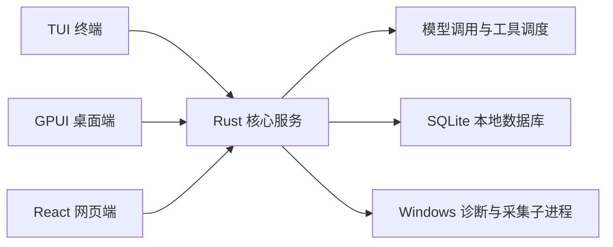

# Rust 重写推荐技术栈

整体方案是先用 Rust 编写通用的 Pi 核心，再接入 CST Pilot 的诊断、认证和遥测业务。运行后启动一个本机后台服务，同时供终端（TUI）、GPUI 桌面端和网页端（Web）连接使用。

本文介绍各模块的推荐技术选型、库的作用与采用条件。所列方案尚待原型验证。开发阶段安排见 [plan/0.PLAN.md](plan/0.PLAN.md)，产品功能与安全要求见[产品规格](../SPEC.md)。

## 整体运行结构

单个 Rust 核心服务统一管理会话执行、数据存储和后台任务，三端只负责界面展示与操作输入。关闭或刷新任意界面，后台正在运行的诊断和对话任务都会继续执行。

核心服务与 GPUI 桌面端分为两个独立进程运行。即使机主电脑缺少图形环境或桌面端意外退出，核心服务、TUI 和网页端依然正常工作。三端通过本机 HTTP 接口发送操作指令，通过 SSE（服务端事件推送）实时接收流式输出，断线重连后直接拉取最新会话快照恢复画面。

## 核心服务技术栈

| 用途 | 推荐选型 | 库说明与选型理由 |
|---|---|---|
| 开发语言与原生编译 | Rust | 直接编译为单机原生程序，无需在机主电脑携带庞大的脚本运行时。支持直接调用 Windows 系统接口和管理子进程，编译期的类型与内存检查也能减少跨模块传参出错和资源泄漏。 |
| 异步与并发运行 | Tokio + tokio-util | `Tokio` 是 Rust 常用的异步运行时，负责并发处理模型流式输出、网络请求、定时器和后台工具任务。配合 `tokio-util` 的取消令牌（CancellationToken），用户点击停止时能统一中断正在执行的请求与子任务。 |
| 本机通信服务 | Axum + Tower + tower-http | `Axum` 是 Tokio 团队维护的 Web 服务端框架，`Tower` 提供通用中间件能力。用来承载三端共用的本机 HTTP 接口、SSE 实时事件流、请求鉴权以及 Web 前端的静态文件服务。 |
| 大模型协议接入 | Rust Pi 模型接口 + reqwest + SSE 增量解析 | 核心统一定义消息、模型服务商（Provider）和流事件接口，通过 `reqwest` 发送请求并逐步解析服务端事件。协议层保留思考签名、工具调用 ID、Token 用量与响应头。 |
| 本地数据存储 | SQLite + [SQLx](https://github.com/launchbadge/sqlx) | 会话历史、输入回执和任务状态需要放在同一个数据库事务中保存，防止进程强杀或断电导致数据只写了一半。`SQLite` 单文件易于随 U 盘携带，`SQLx` 是异步 SQL 访问库，自带后台数据库线程，读写磁盘时不会阻塞网络请求。 |
| 数据序列化与前后端类型 | serde + schemars + ts-rs | `serde` 负责 Rust 数据结构与 JSON 互转；`schemars` 根据代码结构自动生成工具参数的 JSON Schema；`ts-rs` 直接从 Rust 类型导出前端的 TypeScript 类型定义，保证三端接口字段一致。 |
| 外部 HTTP 请求 | reqwest | Rust 常用的 HTTP 客户端库。用于发送 CSTOA 登录认证、联网检索和遥测上报请求，方便集中配置代理规则、TLS 证书、超时时间和重定向限制。 |
| 工具编排沙箱与检索 | rquickjs + unicode-segmentation | `rquickjs` 提供轻量 QuickJS 虚拟机，复用官方 `PRELUDE_SOURCE` 引导脚本运行 `codemode` 异步工具编排，支持内存上限与中断轮询预算，确定性模式通过本地 `rquickjs-sys` 线程级时区补丁固定为 UTC；`unicode-segmentation` 提供 Unicode 词边界切分，支撑 `tool_search` 与 `searchTools()` 的 BM25 排序，中文分词粒度与上游 `Intl.Segmenter` 有差异。 |
| 图片缩放与多模态剪贴板 | image + 原生剪贴板接口 | 使用 `image` 在后台线程完成 EXIF 方向修正、非标格式转 PNG 及 2000×2000 / 4.5 MiB 自适应压缩；配合系统剪贴板接口支持截图粘贴、文件路径读取与远程 `OSC 52` 复制。 |
| 日志与错误处理 | tracing + thiserror + anyhow | `tracing` 记录带任务上下文的结构化日志，方便排查跨模块问题；`thiserror` 定义需要程序分支处理的业务错误码；`anyhow` 包装和向上传递意外的系统错误。敏感凭据在日志层统一过滤。 |

模型接入层支持 OpenAI Chat Completions、OpenAI Responses、Anthropic Messages 和 Gemini 四种对话协议，以及 `typesafe-system-one` 分类器协议，具体设计见 [plan/1.model-core.md](plan/1.model-core.md)。Rust Pi 核心自身保持通用，提供会话、模型调用、工具调度和 SDK；CST Pilot 通过公开扩展接口接入诊断、认证和遥测业务。

## 三端界面选型

TUI、GPUI 桌面端和 Web 端共用同一套业务接口与视觉规范（颜色、间距、字体、动效参数），各自采用适合当前环境的界面库渲染。会话数据与任务状态统一从核心服务获取。

| 界面端 | 推荐选型 | 库说明与选型理由 |
|---|---|---|
| TUI 终端 | Ratatui + Crossterm + ratatui-textarea + tui-markdown | `Crossterm` 处理跨平台键鼠输入与终端控制，`Ratatui` 负责终端界面布局与组件绘制。配合现成的多行输入框（`ratatui-textarea`）和 Markdown 渲染库（`tui-markdown`），只需组合会话界面、工具结果和确认弹窗。 |
| GPUI 桌面端 | [GPUI Kit](https://github.com/longbridge/gpui-kit) | `GPUI` 是 Zed 编辑器开源的 GPU 加速桌面界面框架，`GPUI Kit` 是基于它的现成组件库。可直接复用输入框、列表、主题、流式 Markdown 和动画过渡接口，专用诊断卡片则用基础组件拼装。 |
| Web 网页端 | 现有 React 前端与设计系统 | 现有的页面、组件、样式和浏览器端到端测试已经成型。后端换成 Rust 核心服务后，前端代码直接保留，仅对接由 Rust 自动生成的 TypeScript 接口类型。 |

## Windows 诊断与会话导出

常规系统信息由 Rust 直接调用系统接口获取，需要硬件厂商适配或文件系统底层加速的任务则调用随包工具。

| 诊断与导出需求 | 推荐选型 | 库说明与选型理由 |
|---|---|---|
| 常规系统指标 | sysinfo | Rust 的系统信息采集库，自带 CPU、内存、进程列表和磁盘读写的采样与差值计算。采集后按项目统一口径转换单位并处理报错。 |
| Windows 专属查询 | 微软 windows 官方库 + [wmi](https://github.com/ohadravid/wmi-rs) | `windows` 库由微软官方维护，可直接调用 Win32 API、注册表、事件日志和 PDH 性能计数器（如读取 GPU 引擎负载）。`wmi` 库简化了 WMI 查询结果的解析，省去繁琐的底层类型转换。 |
| 磁盘空间扫描 | WizTree + csv，降级用 walkdir | 继续调用随包的 WizTree 高速扫描磁盘，由 Rust 的 `csv` 库解析导出文件并维护目录缓存。若 WizTree 在特殊环境下不可用，改用 `walkdir` 在时间预算内遍历目录。 |
| 硬件传感器 | LibreHardwareMonitor + 独立 .NET 采集程序 | 主板、风扇、温度和电压传感器依赖大量硬件厂商适配，继续复用现有的 .NET 采集程序。放在独立子进程中运行，也能把采集异常与主服务隔离开。 |
| 会话导出（PNG / HTML） | [Chromiumoxide](https://github.com/mattsse/chromiumoxide) + 本机 Edge/Chrome | `Chromiumoxide` 是 Rust 的浏览器自动化库（类似 Node.js 的 Puppeteer）。直接驱动机主电脑已有的 Edge 或 Chrome 渲染只读网页并截图，无需另写排版渲染引擎。 |

Windows 底层的部分 COM/WMI 调用一旦卡死，无法靠 Rust 异步超时直接中断。这类需要严格限时返回的采集会放在受控子进程中执行，超时可直接终止子进程。BitLocker 操作通过加密的 WMI 通道执行，解锁和解密前必须在本地界面完成确认；若执行中途中断导致结果未知，先重新查询卷状态再决定后续提示。

## 采用条件

以下原型验证全部通过后，正式采用上述技术栈：

1. **模型协议**：四种模型协议均通过工具调用续答、图片输入、思考签名保留、Token 用量统计、请求 ID 读取，以及断流重连测试。
2. **数据库可靠性**：SQLite 在进程强杀、磁盘写满和 U 盘拔插测试中能正常恢复数据；用户输入的接收回执在数据库事务提交后才返回，执行结果未知的操作不自动重复执行。
3. **GPUI 桌面端**：固定 `GPUI Kit` 与配套 `GPUI` 的版本并成组升级；在 Windows 实机上验证中文输入法、文本选区、长会话滚动、多显示器缩放（DPI）、远程桌面，以及缺少显卡驱动时的降级表现。
4. **外部组件与导出**：核对随包工具的开源许可、硬件传感器覆盖范围和最终安装包体积；会话导出使用独立隔离的浏览器临时目录，确保不改动机主浏览器数据，且导出的离线文件包含完整字体与图片。
