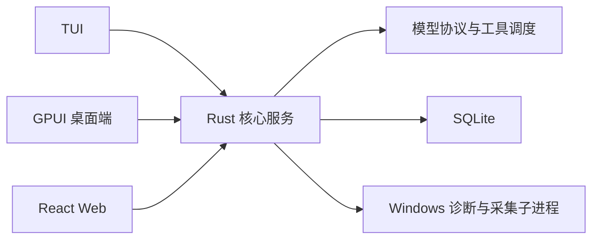

# Rust 重写推荐技术栈

推荐以 Rust 重写 Pi 核心，由 CST Pilot 装配为 TUI、GPUI 桌面端和 Web 共用的本机服务。选型优先保证核心的扩展能力和独立复用，并复用协议、存储及界面组件。

本文记录推荐技术栈与采用条件，选型尚待原型验证。开发顺序见 [PLAN.md](PLAN.md)，产品行为与安全边界沿用[项目规格](../SPEC.md)。

## 一、核心结构

会话执行、持久化和后台任务需要独立于界面存活，因此由单个核心服务统一管理。三端只提交命令、读取快照和订阅事件，同一会话保持一个执行者。

核心与 GPUI 分进程，图形依赖加载失败或界面崩溃时，TUI、Web 和后台任务仍可运行。通信使用 HTTP 命令与 SSE（服务端事件推送），重连时通过快照恢复界面。

## 二、核心技术栈

| 需求 | 推荐 | 选择理由 |
|---|---|---|
| 本机系统操作与便携交付 | Rust | 可直接调用 Windows 接口、管理子进程并编译为原生程序；类型与所有权检查约束跨模块数据和资源生命周期 |
| 网络请求、后台任务与停止 | Tokio + tokio-util | 模型输出、遥测和工具任务需要并发，停止请求需要及时处理；统一网络、定时器和取消信号，减少执行环境适配 |
| 三端共用服务 | Axum + Tower + tower-http | 三端需要同一套命令与事件接口；复用 HTTP 路由、SSE、访问检查和静态资源服务 |
| 模型接入 | Rust Pi 模型接口 + [Rig](https://github.com/0xPlaygrounds/rig) 协议适配（待验证） | 由核心定义消息、Provider 和事件接口，评估复用请求编码与流解析；验证思考签名、用量及响应头读取能力 |
| 便携状态与一致性 | SQLite + [SQLx](https://github.com/launchbadge/sqlx) | 会话、输入回执和任务状态需要一起提交；SQLite 提供嵌入式存储与事务，SQLx 内置数据库后台线程，避免阻塞网络任务 |
| 三端数据与工具参数 | serde + schemars + ts-rs | 请求、事件、工具参数和前端类型需要保持一致；复用序列化、JSON Schema 与 TypeScript 类型生成，服务端继续校验实际输入 |
| 认证、检索与遥测请求 | reqwest | 这些请求独立于模型协议；共用 HTTP 客户端能力，集中设置代理、证书、超时和重定向规则 |
| 故障定位 | tracing + thiserror + anyhow | 需要区分业务失败与系统错误，并关联跨模块任务；复用结构化日志和错误传递，敏感值排除记录 |

模型层覆盖 OpenAI Chat Completions、OpenAI Responses、Anthropic Messages 和 Gemini，Rig 的采用范围由协议测试确定。Rust Pi 核心提供通用执行、会话、扩展和 SDK；CST Pilot 通过公开接口注册诊断、认证等业务扩展。

## 三、三端界面

三端共用业务与设计令牌，各自使用适合的渲染方式。字体、颜色、间距和动效参数统一定义，会话与任务状态由核心服务提供。

| 需求 | 推荐 | 选择理由 |
|---|---|---|
| 终端操作 | Ratatui + Crossterm + ratatui-textarea + tui-markdown | 终端需要布局、键鼠输入、多行编辑与文本排版；复用成品库，项目只组合会话、工具结果和确认界面 |
| 原生桌面与定制动效 | [GPUI Kit](https://github.com/longbridge/gpui-kit) | 聊天工作台需要输入、焦点、选区、列表与流式 Markdown；复用控件、主题、弹簧和过渡接口，实现现有设计，专用诊断卡片由基础组件组合 |
| 浏览器操作 | 现有 React 前端与设计系统 | 页面、组件、样式和浏览器测试已有积累；更换核心服务时继续复用，接口类型由 Rust 生成 |

## 四、Windows 诊断与导出

系统信息来自 Windows 接口，硬件覆盖来自采集实现。简单查询直接调用系统接口，复杂采样与厂商适配复用已有库。

| 需求 | 推荐 | 选择理由 |
|---|---|---|
| 常规系统指标 | sysinfo | CPU、内存、进程和 I/O 需要采样与差值计算；复用现成采集，按项目口径处理单位与错误 |
| Windows 特有能力 | Microsoft windows 绑定 + [wmi](https://github.com/ohadravid/wmi-rs) | 直接访问 Win32、COM/WMI、注册表与事件日志；wmi 减少查询结果转换，GPU 负载通过 PDH 性能计数器取最繁忙引擎 |
| 全盘空间扫描 | WizTree + csv，walkdir 作为预算内降级 | 大目录扫描需要文件系统专用优化；复用 WizTree 的扫描能力，Rust 负责解析与缓存，无法使用时进行有上限的目录遍历 |
| 硬件传感器 | LibreHardwareMonitor + 独立 .NET 采集程序 | 温度、风扇和电压依赖厂商适配；复用硬件覆盖，并将运行时和采集故障隔离到子进程 |
| PNG 与离线 HTML 导出 | [Chromiumoxide](https://github.com/mattsse/chromiumoxide) + 已安装的 Edge/Chrome | 导出需要字体、图片和网页布局；复用只读 Web 文档与浏览器渲染，避免另写文档排版引擎 |

需要硬超时的系统采集放入受控子进程，异步超时无法强制结束底层 COM 调用。BitLocker 使用 WMI 通信加密与本地确认，执行结果未知时先查询卷状态。

## 五、采用条件

1. 模型层通过四协议的工具续答、图片、思考签名、用量、请求 ID、断流与恢复测试。
2. SQLite 通过强杀、写满与移动介质恢复测试；输入回执在事务提交后返回，未知操作不自动重放。
3. GPUI Kit 与配套 GPUI 快照固定版本、成组升级；实机验证中文输入、选区、长会话滚动、多 DPI、远程桌面和图形降级。
4. 外部组件核对分发授权、传感器覆盖和发行体积；导出使用隔离的浏览器配置，验证隐私与离线资源完整性。
