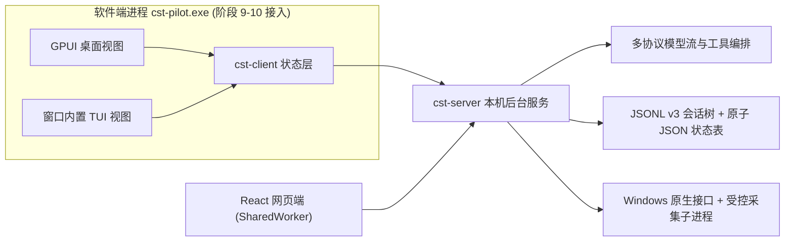

# Rust 技术栈选型

CST Pilot 基于自研通用 Rust Pi 核心构建，在其上通过公开扩展接口挂载现场诊断、认证、遥测与在线升级业务，并由单一本机后台服务统一支撑软件端（GPUI 桌面端及窗口内置 TUI）与 Web 网页端。

阶段路线见 [plan/0.PLAN.md](plan/0.PLAN.md)，产品需求与安全边界见 [../SPEC.md](../SPEC.md)。

## 整体运行结构

目标架构将软件端与公用后台服务分为两个独立进程运行（软件端 `cst-pilot.exe` 属阶段 9–10 待实施项）。关闭或刷新浏览器标签页不会中断后台正在运行的会话与诊断任务。关闭桌面窗口时联动后台服务有序收尾退出。

各端通过回环 HTTP 接口提交控制与写入请求，通过 SSE（含 32 会话向量游标聚合流）实时同步状态，断线恢复后按游标增量回放或重拉完整快照。

## 核心与服务技术栈

| 用途 | 采用选型 | 选型依据 |
|---|---|---|
| 原生编译语言 | Rust（Edition 2024） | 直接编译为无脚本运行时的原生单机程序，利用强类型与所有权机制约束并发写权、流事件序列与敏感凭据生命周期 |
| 异步与取消传递 | `tokio` + `tokio-util` | 并发驱动模型流式读取、阻塞系统采集与后台定时任务，通过 `CancellationToken` 将取消信号贯通至网络请求与子进程 |
| 本机 HTTP 与 SSE 服务 | `hyper` + `http` + 自定义路由 | 直接控制底层 TCP 连接生命周期，配独立连接取消句柄实现 `8 MiB` 慢连接背压主动切断，零多余框架抽象层 |
| 大模型协议与外部请求 | `reqwest`（`rustls`）+ 轻量增量 SSE 解析 | 统一对接四大对话协议、分类器协议与 Exa 检索。同步承载 CSTOA 认证、双端遥测（含专用 CA 校验）与签名升级包流式下载 |
| 会话与状态存储 | `JsonlSessionStore`（JSONL v3）+ 同目录临时文件原子替换 JSON | 直接兼容既有会话记录与便携 U 盘文件系统（FAT32 / exFAT / NTFS），通过追加同步与原子重命名保障崩溃恢复，免除外部数据库引擎开销 |
| 序列化与参数校验 | `serde` + `serde_json`（`float_roundtrip`）+ `schemars` + `pi-agent::validation` | 编译期生成工具 JSON Schema，运行期执行三阶段宽松类型转换与预编译快路径校验。Web 共享类型集中维护于 `src/web/frontend/app/data/types.ts` |
| 代码编排沙箱与检索 | `rquickjs` + `unicode-segmentation` + `regress` | 隔离运行 `codemode` 异步工具编排脚本（256 MiB 内存上限、超时取消与可选步数中断预算），提供中英文分词 BM25 工具检索与带回溯预算的 ECMAScript 正则校验 |
| 密码学与内存安全 | `ed25519-dalek` + `hmac` + `sha2` + `subtle` + `zeroize` | 支撑遥测安装签名、升级清单双重验签、常量时间令牌比对，以及 BitLocker 恢复密码离开作用域自动清零 |
| 图片归一化与错误定义 | `image` + `thiserror` | 在后台线程执行 EXIF 方向修正与自适应压缩。通过强类型枚举定义各层可分支处理的业务错误码 |

## 三端界面选型

三端共享同一套后端业务契约与设计语义，按各自运行环境采用原生渲染方案：

| 界面端 | 采用选型 | 选型依据 |
|---|---|---|
| GPUI 桌面端（阶段 9 接入） | `gpui-kit`（`0.10.0`）+ 同窗口 D3D11 自定义着色器表面 | 基于 GPU 加速渲染桌面工作台。构建期通过 `naga` 与 `D3DCompile` 将 GLSL 预编译为 DXBC 字节码，原生输出动态背景与两档毛玻璃浮层 |
| 窗口内置 TUI（阶段 10 接入） | `Ratatui` + `ratatui-textarea` + `tui-markdown` | 集成在 `cst-pilot.exe` 同一窗口内，与图形视图共享同一个 `cst-client` 实例、激活会话与未发送草稿 |
| Web 网页端 | React 19 + Tailwind v4 + HeroUI v3 + `SharedWorker` | 复用网页交互组件，与桌面端共用可变字体，支持多标签页聚合事件流 |

## Windows 诊断与会话导出

常规系统指标直接通过原生系统接口读取，硬件传感器与高速文件表扫描在隔离的 Job Object 子进程中执行：

| 场景 | 采用选型 | 选型依据 |
|---|---|---|
| 原生系统与加密卷查询 | 微软官方 `windows`（`0.62.2`）+ `wmi`（`0.18.4`） | 直接调用 Win32、注册表、PDH 性能计数器、Event Log（`EvtQuery`）与 `PacketPrivacy` 加密 WMI（`Win32_EncryptableVolume`），消除外部脚本拼接开销与注入风险 |
| 磁盘空间与文件检索 | `ntfs-ng`（`0.1.2`）+ Win32 并行 `FileIdBothDirectoryInfo` + `ignore` | 管理员本地 NTFS 根目录默认直读 `$MFT` 并维护 120 秒进程内卷缓存；子目录与非 NTFS 卷走无条目上限并行 Win32 遍历；文件模糊查找与正则搜索由 `ignore` 驱动 |
| 硬件传感器隔离采集 | `LibreHardwareMonitorLib` + `.NET 10` 自包含 `cst-lhm-host.exe` | 将依赖硬件厂商适配的传感器探针隔离在受 Job Object 管控的辅助子进程内，保护主服务稳定性 |
| 会话导出（PNG / HTML） | `chromiumoxide`（`0.9.1`）+ 本机 Edge / Chrome | 通过 CDP 复用机主已有浏览器与独立 `BrowserContext` 渲染 `/_export` 只读页面，完成高清分图截图与离线资源内嵌 |
