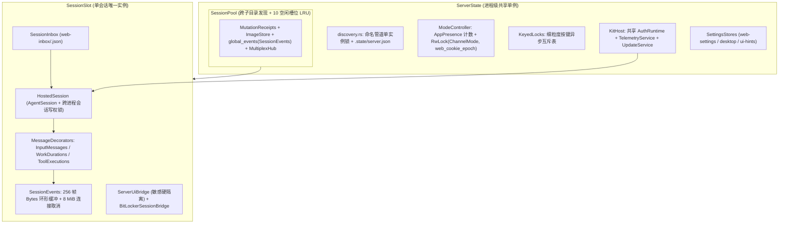

# 后台服务与运行协调架构

本页说明 `crates/cst-server` 的双层状态结构与正交门禁锁，并介绍会话池调度、慢连接保护及敏感交互桥接机制。行为要求见 [SPEC.md](SPEC.md)，接口契约见 [API.md](API.md)。

## 进程拓扑与状态分层

`cst-server` 基于 `tokio` 与 `hyper` 构建，内部划分为进程级全局单例 `ServerState`、会话池 `SessionPool` 与按会话懒加载的槽位 `SessionSlot`：

## 核心并发与隔离机制

### 1. 共享宿主装配（`KitHost`）

`KitHost` 在服务启动时一次性初始化共享 `AuthRuntime`、`TelemetryService` 与 `UpdateService`，仅派生唯一一条 30 秒 CSTOA 模型目录维护任务（任意会话开始对话时统一唤醒）。单个 `HostedSession` 关闭或被 LRU 淘汰时只释放自身会话资源，不中断全局后台服务。

### 2. 双重门禁与升级租约（`auth_guard.rs`、`mode.rs`）

1. **准入读写锁与 Cookie 世代复核**：所有业务写操作在取得 `KeyedLocks`（如 `session:{id}`、`model-default`、`auth:{provider}`）后、执行持久化接受写入（落盘收件箱 `Pending` 或幂等回执 `started`）期间，持有 `ModeController` 的 `RwLock::read` 守卫并核对当前 `ChannelMode` 与 `web_cookie_epoch`。`started` 落盘后立即释放读守卫，后续耗时的模型流或远端请求不阻塞通道切换。开关 Web 获取排他写守卫并递增 `web_cookie_epoch`，确定性拦截临界区外的旧世代请求。
2. **升级活动门禁（`ActivityGate`）**：业务写操作持有 `ActivityLease` 直至结算。只读查询、SSE 长连接以及升级协调接口本身豁免持有普通租约，避免升级交接自锁。

### 3. 会话池、装饰器与持久化收件箱（`session/`）

| 子模块 | 关键实现规则 |
|---|---|
| `mod.rs` / `slot.rs` | 同一 `sessionId` 冷加载串行化，`SessionLease` 存活期间固定槽位不被淘汰。删除空闲会话时先排他创建 `deleted/<id>` 删除标记文件，再定稿遥测并关闭槽位，最后清理 `.jsonl`、`unflushed/`、收件箱与附件目录 |
| `decorators.rs` | 订阅会话事件写入 `cst-web-input-message`、`cst-web-work-duration` 与 `cst-web-tool-execution` 自定义条目，并把重启后的 `cst.bitlocker-state-verification` 复查记录挂载至未闭合 BitLocker 调用的 `execution.result`。输出快照与 SSE 时过滤内部 `system` 消息 |
| `inbox.rs` / `attachments.rs` | 附件按原始字节魔数校验（限 PNG/JPEG/GIF/WebP，单次上限 `12 MiB`）并以 SHA-256 存入 `attachments/<id>/`。首条消息异步读取图片并调用 `prompt()` 期间置 `prompting = true`，阻塞并发 `steer` 插话以保证投递顺序 |
| `receipts.rs` | 写操作按 `Idempotency-Key` 落盘 `started -> done` 回执并核对方法、路径与正文签名。相同键并发请求共享结果，取消或崩溃遗留 `started` 时返回 `409 conflict` |
| `search_index.rs` | 维护跨会话标题与全树正文内存索引，按修改时间与大小增量校验并缓存至 `data/inbox/search-index.v1.json`。收录用户与助手文本、工具输出、总结以及非活动历史分支，排除思考过程、系统消息与 BitLocker 输出。查询支持拼音与受限模糊、置顶当前会话，并通过 `snapshotToken` 稳定分页 |

### 4. 零拷贝 SSE 广播与慢连接主动切断（`server.rs`、`events.rs`）

1. **`Bytes` 环形缓冲与脱敏**：所有发往客户端的快照与 SSE 事件统一经过 `browser_json` 剥离流式参数增量副本并遮蔽 48 位恢复密码，转为不可变 `Bytes` 存入容量 256 的环形队列。多端广播与 `Last-Event-ID` 回放仅递增引用计数。
2. **`8 MiB` 队列预算与外层连接取消**：`server.rs` 使用 `hyper` 驱动每条 TCP 连接并绑定独立 `conn_cancel: CancellationToken`。每个订阅者统计尚未移交 HTTP 层的应用层积压字节。积压超出 `8 MiB` 时在入队侧立即清空积压队列、停止心跳并触发 `conn_cancel.cancel()`，无需等待受写背压阻塞的响应流被轮询即可强制关闭慢连接。
3. **多会话聚合流（`MultiplexHub`）**：按 `SlotOwnerKey`（绑定 `CallerIdentity` 与 `clientId`）维护最多 32 个会话的订阅槽位，每帧输出字典序完整向量游标以兼容原生 `EventSource` 自动重连。断线后槽位保留 60 秒供重连继承，未连接槽位到期自动回收并释放会话固定计数。

### 5. 敏感交互隔离与先校验后消费（`interactions.rs`）

- **通用提问敏感硬隔离**：`ServerUiBridge` 拒绝任何 `secret == true` 的输入请求进入普通 `ui: Question[]` 快照，防止敏感口令落入带持久化回执的通用响应接口。
- **BitLocker 原子唤醒**：`BitLockerSessionBridge` 在会话内存中维护 180 秒有效期的挂起请求与 `oneshot::Sender`。客户端提交 `/api/sessions/:id/bitlocker/:requestId` 时绕过持久化幂等表，在互斥锁内**先完成动作匹配与 48 位密码格式校验**（格式错误返回 `400` 并保留原 `requestId` 供修正重试），校验通过后再原子移除条目并唤醒工具协程。
