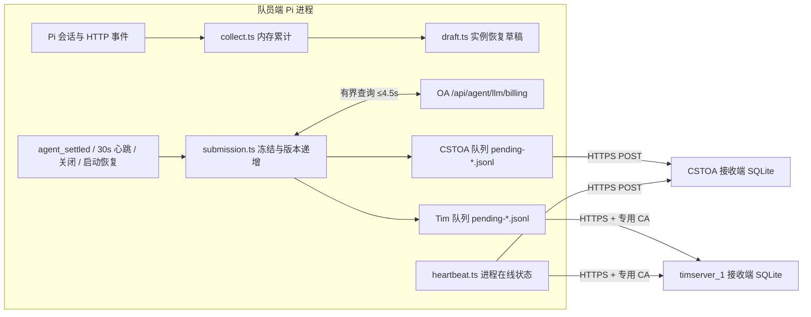

# 遥测系统架构

本页说明遥测发送端扩展与双端 Go 接收端的内部组成、生命周期状态流转、跨进程锁与数据库存储结构。行为规则见 [SPEC.md](SPEC.md)，协议格式见 [API.md](API.md)。

## 数据流与组成

## 发送端模块划分

发送端位于 `agent/home/extensions/telemetry/`，零外部 npm 依赖，跨会话共享状态挂载于 `globalThis`：

| 模块 | 职责 |
|---|---|
| `index.ts` / `shared.ts` | 订阅 Pi 事件，管理进程级 `runId`、单组定时调度器、文件操作串行队列与 Web 显式定稿入口 |
| `collect.ts` / `record.ts` | 内存指标累加与 `0.1` / `0.2` 会话记录序列化 |
| `draft.ts` / `draft-owner.ts` | `drafts/<recordId>.json` 原子写入、本机内核资源（命名管道／回环端口）所有者存活证明与崩溃草稿恢复封存 |
| `submission.ts` / `close-budget.ts` | 串行冻结快照、递增 `revision`、协调后台账单回填，以及进程退出时 5 秒统一截止预算控制 |
| `billing.ts` | 读取本地有效 CSTOA 凭据，批量查询网关请求 ID 对应的真实消费额度点 |
| `environment.ts` / `installation.ts` | 系统环境独立探测、`identity.json` 初始化、`MachineGuid` HMAC 摘要与 Ed25519 上传签名 |
| `outbox.ts` / `delivery.ts` / `transport.ts` | 按端点 URL 哈希维护独立 JSONL 队列（上限 200 条，按 `recordId` 保留最新 `revision`）、能力协商、每端单飞发送与专用 CA 证书校验 |
| `heartbeat.ts` / `diagnostics.ts` | 进程级在线状态单飞发送（慢端合并最新状态，不写持久队列）与 `telemetry/status.json` 有界诊断记录 |
| `file-lock.ts` | 兼容 FAT/exFAT 的跨进程目录锁（附本机所有者存活证明，防止复制 U 盘或 PID 碰撞导致死锁） |

## 关键并发与恢复机制

1. **草稿所有者证明**：每个活跃草稿绑定当前进程的命名管道（Windows）或回环端口。启动恢复扫描 `drafts/` 时通过尝试连接该内核资源判断原进程是否仍在本机存活，彻底避免跨机换盘或系统重启后的 PID 碰撞误判。
2. **版本化队列确认**：`outbox.ts` 在同一 `recordId` 产生新 `revision` 时原地替换为更高版本快照；收到服务端 `202` 确认删除队列项时，严格比对确认的 `revision`（或实际发送字节），确保网络在途的旧版本确认绝不会删除发送期间新生成的快照版本。
3. **Web 会话销毁定稿**：Pi SDK 的 `AgentSession.dispose()` 不触发 `session_shutdown` 事件；Web 会话池在删除会话或退出服务时显式调用遥测公开定稿入口，等待最终快照落盘入队后再销毁实例。

## 接收端存储架构

两个接收端运行独立仓库 `cst-pilot-server` 的同款纯 Go + SQLite（WAL 模式）程序，在同一事务中写入原始 JSON 与派生列：

| 数据表 | 主键与存储内容 |
|---|---|
| `sessions` | `record_id` 主键；保存原始 `payload`、上传者 `mid`/`device_id`、首次 `received_at`、`updated_at`、`snapshot_revision`、`snapshot_final`、`owner_installation`，以及身份、系统环境、模型费用、`cstoa_*` 扣点与 `incomplete_usage_turns` 派生列 |
| `installations` | `installation_id` 主键；绑定首次验签通过的 Ed25519 公钥与注册时间 |
| `process_runs` | `run_id` 主键；绑定安装与环境，保存最新心跳序号、状态（`idle/busy/closed/offline`）、服务端接收时间与最近快照引用 |
| `devices` / `members` | OA 设备最近接入时间表 / 队员学号与姓名展示映射表（无强外键约束） |
| `daily_rollup` | 按首次接收时间的 `+08:00` 日期、`mid`、`installation_id`、`environment_id` 聚合统计；按实例最新有效快照计算，不累加中间版本 |
| `uploads` | 上传批次审计日志（条数、接受／拒收原因、状态码与耗时，不含正文或凭据） |
