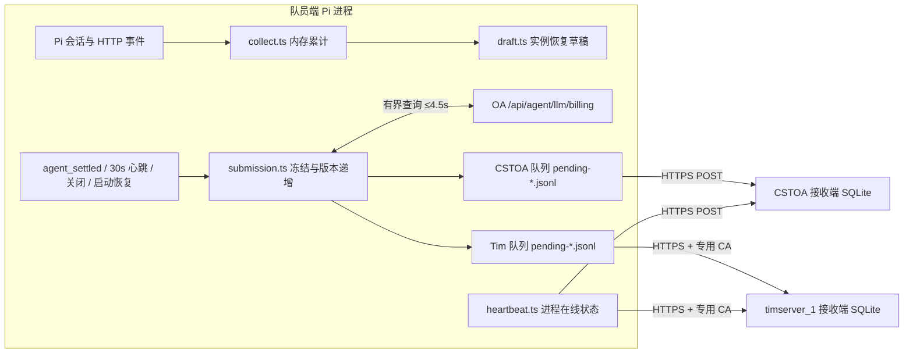

# 遥测系统架构

本页说明遥测发送端扩展与双端 Go 接收端的内部组成、生命周期状态流转、跨进程锁与数据库存储结构。行为规则见 [SPEC.md](SPEC.md)，协议格式见 [API.md](API.md)。

## 数据流与组成

## 发送端模块划分

发送端位于 `agent/home/extensions/telemetry/`，零外部 npm 依赖，跨会话共享状态挂载于 `globalThis`：

| 模块 | 职责 |
|---|---|
| `index.ts` / `shared.ts` | 订阅 Pi 事件，管理进程级 `runId`、单组定时调度器、文件操作串行队列与 Web 显式定稿入口 |
| `collect.ts` / `record.ts` | 内存指标累加与 `0.1` / `0.2` 会话记录序列化 |
| `draft.ts` / `draft-owner.ts` | `drafts/<recordId>.json` 原子写入、本机内核资源（命名管道／回环端口）所有者存活证明与崩溃草稿恢复封存 |
| `submission.ts` / `close-budget.ts` | 串行冻结快照、递增 `revision`、协调后台账单回填，以及进程退出时 5 秒统一截止预算控制 |
| `billing.ts` | 读取本地有效 CSTOA 凭据，批量查询网关请求 ID 对应的真实消费额度点 |
| `environment.ts` / `installation.ts` | 系统环境独立探测、`identity.json` 初始化、`MachineGuid` HMAC 摘要与 Ed25519 上传签名 |
| `outbox.ts` / `delivery.ts` / `transport.ts` | 按端点 URL 哈希维护独立 JSONL 队列（上限 200 条，按 `recordId` 保留最新 `revision`）、能力协商、每端单飞发送与专用 CA 证书校验 |
| `heartbeat.ts` / `diagnostics.ts` | 进程级在线状态单飞发送（慢端合并最新状态，不写持久队列）与 `telemetry/status.json` 有界诊断记录 |
| `file-lock.ts` | 兼容 FAT/exFAT 的跨进程目录锁（附本机所有者存活证明，防止复制 U 盘或 PID 碰撞导致死锁） |

## Rust 发送端

`crates/cst-pilot/src/telemetry/` 通过 `Kit::create_session` 接入公开 Pi 事件，提供统计、身份、查账、本地持久化、网络发送与进程心跳。实现进度见 [阶段 6 进度](../rust/plan/6.cst-pilot.md#实施进度)。

| 模块 | 职责 |
|---|---|
| `sdk.rs`、`service.rs` | 可重载的事件绑定、每个规范化 home 共享的服务与 30 秒调度；后台初始化环境、恢复与发送，禁用时不注册观察器、不探测环境或写入身份 |
| `submission.rs` | 事件到达时冻结累计统计，串行保存草稿与双端队列，账单回填使用新版本；失败重试沿用已封存版本 |
| `config.rs`、`identity.rs`、`environment.rs` | 静默开关、端点与专用 CA 配置、持久安装密钥、Ed25519 签名及原生环境快照 |
| `collect.rs`、`record.rs`、`billing.rs` | 指标累加、版本化快照与 4.5 秒内的扣点汇总；请求 ID 仅保存于本地草稿 |
| `owner.rs`、`file_lock.rs` | 双命名管道存活证明、进程内串行与跨进程目录锁，兼容 TypeScript 锁格式 |
| `storage.rs`、`draft.rs` | 有界安全读取、同目录同步与原子替换、草稿封存和并发恢复 |
| `outbox.rs` | 端点 URL 哈希队列、最新版本替换、精确内容确认删除与损坏行隔离 |
| `transport.rs`、`delivery.rs` | 每次上传前协商能力，GET 与 POST 共用 5 秒预算；独立 CA、签名与 Bearer 失败回退，逐项确认后精确删队列，每端单飞 |
| `heartbeat.rs`、`diagnostics.rs` | 进程在线状态与最新待发心跳合并、90 秒过期；仅保存端点摘要和有界本地确认状态 |

Windows 同时监听 `cst-pilot-telemetry-draft-<token>` 与 `cst-pilot-telemetry-<token>`。草稿和锁中保存后者，供现有 TypeScript 进程核验；两条管道均返回同一 token。核验超时或权限错误按仍存活处理，失活证明不受本机 PID 碰撞影响。

文件事务逐级校验目录并保持句柄，拒绝 junction、重解析点与文件硬链接。失活锁清理仅删除已知所有者文件与空目录，未知内容保留；Windows 释放锁时重试短暂的探测句柄占用。

恢复先在锁内读取候选草稿，再在锁外查账，封存前重新比较源文件字节。已封存版本在入队失败后保留，重试沿用同一版本和原机器环境；全部目标入队完成后才删除草稿。队列重写前将损坏行保存至本地 `.corrupt-<UUID>` 文件，不上传这些内容。超过 900 KiB 的队首记录先保存为 `.oversize-<UUID>`，再在同一事务内移出队列，后续记录继续发送。

同一个 `Sender` 的快照与心跳共享端点停发状态。收到 `404/410` 后该进程不再请求对应端点，磁盘队列保持不变；其余端点继续独立发送。专用 CA 仅用于对应请求的证书链校验，不修改全局信任，并保留主机名验证。

SDK 重载保留当前统计实例，独立的公开会话事件订阅记录压缩原因与用量，不随扩展重载重复注册。新建、派生与恢复会话分别定稿旧实例，历史消息不重新计数。主动删除先调用 `KitSession::finalize_telemetry`；直接释放宿主对象时启动后台 crash 定稿，进程强杀仍通过草稿恢复。

真实进程退出先调用 `TelemetryService::begin_close`，同一 home 的全部实例共用首次创建的 5 秒截止时刻。等待超时后本地持久化继续执行，已保存草稿保留恢复路径；退出不等待网络队列排空。页面离开、重新可见和联网提示仅触发有节流的提交与补发，不关闭会话。

JSON 读写启用精确浮点往返解析，确保费用数值在落盘读回后保持一致，版本比较和精确确认不会因解析舍入产生冲突。

## 关键并发与恢复机制

1. **草稿所有者证明**：每个活跃草稿绑定当前进程的命名管道（Windows）或回环端口。启动恢复扫描 `drafts/` 时通过尝试连接该内核资源判断原进程是否仍在本机存活，彻底避免跨机换盘或系统重启后的 PID 碰撞误判。
2. **版本化队列确认**：`outbox.ts` 在同一 `recordId` 产生新 `revision` 时原地替换为更高版本快照；收到服务端 `202` 确认删除队列项时，严格比对确认的 `revision`（或实际发送字节），确保网络在途的旧版本确认绝不会删除发送期间新生成的快照版本。
3. **Windows 锁目录竞争**：`file-lock.ts` 在锁目录创建遇到短暂 `EPERM` 时按既有退避间隔重试，最多 100 次；持续失败保留原错误，其他权限错误立即返回。只有取得目录锁并登记所有者后才执行事务。
4. **Web 会话销毁定稿**：Pi SDK 的 `AgentSession.dispose()` 不触发 `session_shutdown` 事件；Web 会话池在删除会话或退出服务时显式调用遥测公开定稿入口，等待最终快照落盘入队后再销毁实例。

## 接收端存储架构

两个接收端运行独立仓库 `cst-pilot-server` 的同款纯 Go + SQLite（WAL 模式）程序，在同一事务中写入原始 JSON 与派生列：

| 数据表 | 主键与存储内容 |
|---|---|
| `sessions` | `record_id` 主键；保存原始 `payload`、上传者 `mid`/`device_id`、首次 `received_at`、`updated_at`、`snapshot_revision`、`snapshot_final`、`owner_installation`，以及身份、系统环境、模型费用、`cstoa_*` 扣点与 `incomplete_usage_turns` 派生列 |
| `installations` | `installation_id` 主键；绑定首次验签通过的 Ed25519 公钥与注册时间 |
| `process_runs` | `run_id` 主键；绑定安装与环境，保存最新心跳序号、状态（`idle/busy/closed/offline`）、服务端接收时间与最近快照引用 |
| `devices` / `members` | OA 设备最近接入时间表 / 队员学号与姓名展示映射表（无强外键约束） |
| `daily_rollup` | 按首次接收时间的 `+08:00` 日期、`mid`、`installation_id`、`environment_id` 聚合统计；按实例最新有效快照计算，不累加中间版本 |
| `uploads` | 上传批次审计日志（条数、接受／拒收原因、状态码与耗时，不含正文或凭据） |
