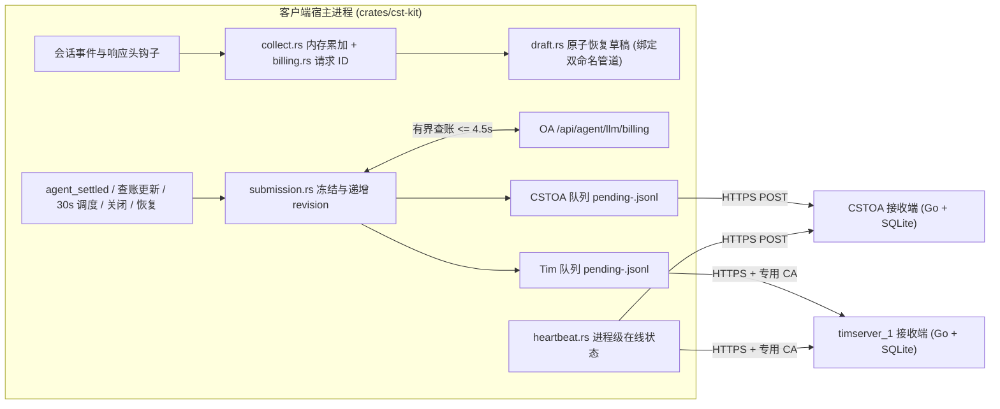

# 遥测系统架构

本页说明 `crates/cst-kit/src/telemetry/` 发送端与双端 Go 接收端（`cst-pilot-server`）的内部组成，涵盖目录锁并发、草稿存活核验、队列确认与数据库存储结构。行为规则见 [SPEC.md](SPEC.md)，协议格式见 [API.md](API.md)。

## 数据流与组成

## 发送端模块划分

`TelemetryService` 在同一工具包 `agent/home` 下共享后台 30 秒调度、恢复扫描与退出截止预算：

| 模块 | 职责 |
|---|---|
| `sdk.rs`、`service.rs` | 订阅公开会话事件（跨扩展重载保留当前统计实例），按规范化 home 共享调度器、后台恢复与 5 秒关闭预算 |
| `submission.rs` | 事件到达时冻结累计快照，串行写入恢复草稿与双端队列。账单回填生成新 `revision`，失败重试沿用已封存版本 |
| `config.rs`、`identity.rs`、`environment.rs` | 解析静默开关、专用 CA 与币种配置，管理持久安装密钥与 Ed25519 签名，采集原生系统环境快照 |
| `collect.rs`、`record.rs`、`billing.rs` | 内存指标累加、启用精确浮点往返的快照序列化，以及 4.5 秒总预算内的请求扣点汇总 |
| `owner.rs`、`file_lock.rs` | 双命名管道进程存活监听与核验，维护带失活回收与 Win32 短暂冲突退避的跨进程目录锁 |
| `storage.rs`、`draft.rs` | 逐级持有目录句柄拒绝重解析点与硬链接，执行同目录临时文件同步替换与草稿 `sealed` 状态恢复 |
| `outbox.rs` | 按端点 URL 哈希维护独立 JSONL 队列，原地替换同 `recordId` 旧版本，执行精确字节与版本确认删除，隔离损坏行与超限队首 |
| `transport.rs`、`delivery.rs` | 发送 `0.2` 快照或心跳前先 `GET` 协商服务端能力（单次尝试内 `GET` 与 `POST` 共用 5 秒预算），支持专用 CA 校验、Bearer 失败回退安装签名（独立 5 秒预算）及每端单通道串行发送 |
| `heartbeat.rs`、`diagnostics.rs` | 合并最新待发心跳并剔除超过 90 秒的陈旧状态，向 `telemetry/status.json` 写入有界端点状态摘要 |

## 关键并发与恢复机制

1. **目录锁退避与双命名管道存活证明**：`file_lock.rs` 在 Windows 下创建锁目录遇到 Win32 错误码 `5`（`ERROR_ACCESS_DENIED`）或 `32`（`ERROR_SHARING_VIOLATION`）时，每次间隔 20–50ms 退避重试最多 100 次，其余非 `AlreadyExists` 错误立即返回。活跃进程同时监听 `\\.\pipe\cst-pilot-telemetry-<token>` 与 `\\.\pipe\cst-pilot-telemetry-draft-<token>`，并在草稿与锁所有者记录中登记管道地址。恢复扫描连接该管道核对返回 token，连接超时或权限不足按仍存活保留，仅在确认管道不存在或 token 不匹配时接管封存。
2. **两阶段 `sealed` 草稿恢复**：恢复先在目录锁内读取候选草稿，释放锁后执行有界网络查账，封存前重新比对磁盘源文件字节未被并发修改。草稿顶层 `sealed` 字段区分关闭查账前（`false`）与查账完成（`true`）。恢复 `sealed = false` 的记录时补做一次查账并按需递增 `revision`，`sealed = true` 的记录直接复用原值，双端全部入队成功后才删除草稿。
3. **损坏与超限隔离**：重写队列时若发现语法损坏行，先保存为 `<队列文件>.corrupt-<UUID>` 备份并不上传。队首单条超过 900 KiB 时先保存为 `<队列文件>.oversize-<UUID>` 再移出队列，防止阻塞后续正常记录。
4. **端点停发与浮点保真**：收到 `404` 或 `410` 后当前进程停止向该端点发送请求并保留磁盘队列。JSON 序列化启用 `float_roundtrip`，确保费用浮点数落盘读回后逐位一致，不影响精确确认比对。

## 接收端存储架构

两个接收端运行独立仓库 `cst-pilot-server` 的同款纯 Go + SQLite（WAL 模式）程序，在同一数据库事务内写入原始 JSON 与派生列：

| 数据表 | 主键与存储内容 |
|---|---|
| `sessions` | `record_id` 主键。保存原始 `payload`、上传者 `mid`/`device_id`、首次 `received_at`、`updated_at`、`snapshot_revision`、`snapshot_final`、`owner_installation` 及环境、费用、扣点派生列 |
| `installations` | `installation_id` 主键。绑定首次验签通过的 Ed25519 公钥与注册时间 |
| `process_runs` | `run_id` 主键。绑定安装与环境，保存最新心跳序号、状态（`idle/busy/closed/offline`）、接收时间与最近快照引用 |
| `devices` / `members` | OA 设备最近接入时间表 / 队员学号与姓名展示映射表 |
| `daily_rollup` | 按首次接收时间的 `+08:00` 日期、`mid`、`installation_id`、`environment_id` 聚合统计，仅按实例最新有效快照计算 |
| `uploads` | 上传批次审计日志（记录条数与状态码、接受／拒收原因及耗时，不含正文或凭据） |
