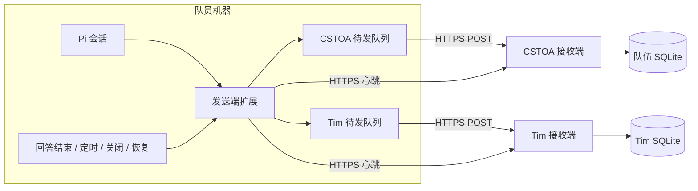

# 系统架构

发送端在 Pi 进程内采集会话统计，并将同一记录上传到 CSTOA 与 Tim 两个独立接收端。累计快照采用协议 `0.2`，保留 `0.1` 最终记录兼容。字段与隐私边界见[信息收集契约](../contract.md)，验证方法见[遥测测试](../test/telemetry.md)。

## 组成

| 组成 | 职责 |
|---|---|
| 发送端扩展 | 按会话实例累计、保存草稿，协调回答结束、心跳、关闭与恢复的提交，维护各端待发队列和确认状态 |
| CSTOA 账单接口 | 按请求 ID 读取网关消费日志，校验成员与 APIKEY 归属，返回扣点或未知 |
| CSTOA 接收端 | 校验安装签名或 OA 令牌，存入队伍服务器 SQLite，提供命令行导出 |
| Tim 接收端 | 使用同款 Go 程序，校验安装签名或 OA 令牌，独立存入 `timserver_1` SQLite |

遥测上传使用批量 HTTPS POST，无长连接或命令下发。发送端另向 OA 只读账单接口查询本实例的请求扣点；两个接收端不查账。两端收到同一版本的会话快照，各自补充接收时间与身份；各自确认、去重和保留数据。更新与确认规则见[版本化提交](schema.md#版本化提交)。

本地队列为 JSONL，每个端点一个 `pending-<URL的SHA256>.jsonl` 文件。会话草稿使用 `drafts/<recordId>.json`；接收端原始记录保存在 `sessions.payload`。

## 多触发提交与心跳

改造采用普通 HTTPS 心跳，无持续连接和服务端命令下发。回答结束、定时检查、关闭及恢复进入同一快照提交入口；统计先本地持久化，再分别发送到两个接收端，字段不按触发来源重复累计。

进程级运行身份与会话实例分别管理。一个进程、home 维护一组定时任务，并协调其中全部会话；接收端分别维护该进程的在线状态与会话最新统计，失联只改变在线状态。

心跳默认每 30 秒发送，90 秒未收到有效更新标记失联；过期心跳不积压，统计快照进入持久队列。纯心跳不推进使用时间，断网恢复时发送当前状态并补发历史统计。

累计快照采用版本化更新，客户端确认不能删除更新版本，服务端汇总只使用一个实例的最新有效快照。协议见[版本化提交](schema.md#版本化提交)；接收端先发布能力，再启用客户端新协议，顺序见[改造计划](trigger-upgrade-plan.md)。

Pi 事件与字段见[发送端事件定义](sender/SPEC.md#pi-事件与消息字段)。触发、心跳及在线判定分别见[发送端](sender/SPEC.md#提交触发)与[接收端](receiver/SPEC.md#在线状态)。

## 会话生命周期

| 时机 | 动作 |
|---|---|
| CSTOA HTTP 开始／响应 | 记录尝试及请求 ID，异步写草稿 |
| 轮次结束 `turn_end` | 累计统计并重写恢复草稿 |
| 回答结束 | 收到 `agent_settled` 后冻结累计统计、持久化，再写入全部端点队列并分别上传 |
| 定时心跳 | 检查所有活动实例，有变化则持久化并提交；同时发送当前在线状态 |
| 唤醒或网络恢复 | 合并错过的触发，检查持久快照与待发队列，立即尝试当前心跳及补发 |
| 会话实例结束 | 提交带结束原因的最终快照，全部端点入队成功后清理该实例草稿 |
| 进程启动 | 恢复已关闭进程的残留草稿，按 `crash` 补齐最终状态；补发各端点未确认快照 |
| 某端点确认 | 仅确认该端点实际发送的快照，保留发送期间产生的更新及其他端点状态 |

全部字段共用统一提交入口。回答结束保留实例，后续提问继续累计；TUI 的 `session_shutdown`、Web 删除会话与退出程序提交最终快照。页面刷新、标签页关闭与系统关闭通知仅尽力触发保存，强制重启依靠启动恢复；规则见[发送端](sender/SPEC.md#回答结束与关闭)。

正常退出等待草稿链、有限账单查询和最终快照落盘，不等待上传确认；等待上限见[发送端](sender/SPEC.md#cstoa-账单查询)。

TUI 与多个 Web 会话分别累计、各写草稿。队列更新经进程内串行队列和跨进程目录锁，同一端点的统计与心跳各自单飞，心跳不等待统计积压。一个端点超时、拒绝或停采不阻塞其他端点。

强杀时，已入队的回答快照可独立补发，下次启动恢复最后已写草稿；已记录的请求尝试可以补查账单，未完成轮次的 usage 可能缺失。磁盘写入失败、队列淘汰和进程强杀允许有限丢失。详细规则见[发送端](sender/SPEC.md)。

## 技术与部署

| 层 | 实现 |
|---|---|
| 发送端 | TypeScript Pi 扩展，无新增 npm 依赖 |
| 传输 | HTTPS POST + JSON；CSTOA 使用系统证书验证，Tim 使用随扩展发行的专用公开 CA |
| 身份 | 未登录时校验安装签名并各自绑定公钥；OA 凭据由两端分别内省，账号仅表示上传者 |
| CSTOA | systemd、nginx、Go、SQLite |
| Tim | 独立 Docker Compose、Caddy、同款 Go、SQLite；证书自动续签，每日一致性备份 |

数据同时落在队伍服务器与 Tim 的 `timserver_1`，不经过第三方数据接收服务。报错原文是可能包含敏感片段的例外，两端执行相同保留期。

发送端位于 `agent/home/extensions/telemetry/`，随本仓库发行；服务端代码位于独立仓库 `cst-pilot-server`，以本仓库契约为共享依据。部署入口、存储位置和运维边界见[遥测部署](deployment.md)。

## 发送端模块

| 模块 | 职责 |
|---|---|
| `index.ts` | 注册会话事件，连接采集、草稿、回答与关闭快照及发送 |
| `submission.ts` | 冻结统计、串行保存、变化提交、账单更新与可重试最终快照 |
| `collect.ts`、`record.ts` | 内存统计与记录序列化；版本从工具包读取 |
| `draft.ts`、`draft-owner.ts` | 实例草稿原子替换、本机所有者证明、恢复封存及失败重试 |
| `billing.ts`、`../oauth/request-observer.ts` | 按会话观察 CSTOA HTTP 尝试、只读账单查询与可空扣点汇总 |
| `environment.ts`、`installation.ts` | 会话环境快照、安装身份初始化、环境摘要与上传签名 |
| `file-lock.ts` | FAT/exFAT 可用的跨进程目录锁，用于身份、队列与草稿事务 |
| `config.ts`、`credential.ts` | 读取配置、币种及有效 OA 上传凭据 |
| `outbox.ts` | 各端点队列的追加、去重、淘汰和确认删除 |
| `delivery.ts` | 队列迁移、批次大小限制与各端点发送 |
| `transport.ts` | HTTPS、超时、状态分类与专用 CA 校验 |
| `shared.ts` | 进程级文件队列、各端点发送状态、草稿恢复标记、运行身份及快照提交入口 |
| `heartbeat.ts` | 当前运行状态、递增序号、逐端单飞、待发心跳合并与过期丢弃 |
| `close-budget.ts` | 统一截止时刻内等待任务，超时后保留后台本地保存 |
| `diagnostics.ts` | 有界保存、入队、逐端确认、心跳与失败状态，不记录正文或凭据 |

页面辅助提示复用本机 Web API，不改变运行层生命周期。本地诊断规则见[发送端](sender/SPEC.md#诊断状态)，实施与发布状态见[改造计划](trigger-upgrade-plan.md#涉及模块)。

Pi 扩展加载时不共享模块缓存，因此跨会话状态挂在 `globalThis`。正常销毁在统一预算内等待本地保存、有限查账和队列写入，再释放会话；上传独立执行。

`AgentSession.dispose()` 不派发会话结束事件，Web 运行层通过公开定稿入口通知遥测。TUI 使用 `session_shutdown`，两端的统计口径相同。
