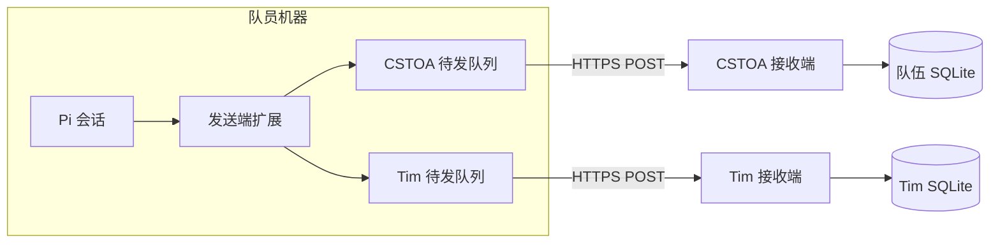

# 系统架构

发送端在 Pi 进程内采集会话统计，并将同一记录上传到 CSTOA 与 Tim 两个独立接收端。契约版本 0.1。字段与隐私边界见[信息收集契约](../contract.md)，运行验证见[验证报告](../test/telemetry-report.md)。

## 组成

| 组成 | 职责 |
|---|---|
| 发送端扩展 | 按会话实例累计、保存草稿、定稿，并维护每个端点的待发队列 |
| CSTOA 接收端 | 校验安装签名或 OA 令牌，存入队伍服务器 SQLite，提供命令行导出 |
| Tim 接收端 | 使用同款 Go 程序，校验安装签名或 OA 令牌，独立存入 `timserver_1` SQLite |

线上传输只有批量 HTTPS POST，无长连接、拉取或命令下发。两端收到相同的 `recordId` 和会话统计，各自补充接收时间与身份；各自确认、去重和保留数据。

本地队列为 JSONL，每个端点一个 `pending-<URL的SHA256>.jsonl` 文件。会话草稿使用 `drafts/<sessionId>.json`；接收端原始记录保存在 `sessions.payload`。

## 会话生命周期

| 时机 | 动作 |
|---|---|
| 轮次结束 `turn_end` | 累计统计，重写当前会话草稿 |
| 会话实例结束 | 定稿写入全部端点队列，删草稿，分别触发异步上传 |
| 进程启动 | 恢复残留草稿，标记 `crash`；将单端点待发文件迁移到当前各端点队列 |
| 某端点确认 | 只从该端点队列删除对应记录，其他端点状态保持不变 |

TUI 定稿由 `session_shutdown` 触发；Web 在删除会话、关闭运行层时定稿。切换 Web 页面不会结束会话实例。正常退出等待定稿落盘，不等待网络响应。

TUI 与多个 Web 会话分别累计、各写草稿。队列更新经进程内串行队列和跨进程目录锁，同一端点同时只运行一个发送任务。一个端点超时、拒绝或停采不阻塞其他端点。

强杀时，下次启动用最后已完成轮次恢复；没有完成轮次的会话无草稿可恢复。磁盘写入失败、队列淘汰和进程强杀允许有限丢失。详细规则见[发送端](sender/SPEC.md)。

## 技术与部署

| 层 | 实现 |
|---|---|
| 发送端 | TypeScript Pi 扩展，无新增 npm 依赖 |
| 传输 | HTTPS POST + JSON；CSTOA 使用系统证书验证，Tim 使用随扩展发行的专用公开 CA |
| 身份 | 未登录时校验安装签名并各自绑定公钥；OA 凭据由两端分别内省，账号仅表示上传者 |
| CSTOA | systemd、nginx、Go、SQLite |
| Tim | 独立 Docker Compose、Caddy、同款 Go、SQLite；证书自动续签，每日一致性备份 |

数据同时落在队伍服务器与 Tim 的 `timserver_1`，不经过第三方数据接收服务。报错原文是可能包含敏感片段的例外，两端执行相同保留期。

发送端位于 `agent/home/extensions/telemetry/`，随本仓库发行；服务端代码位于独立仓库 `cst-pilot-server`，以本仓库契约为共享依据。部署入口、存储位置和运维边界见[遥测部署](deployment.md)。

## 发送端模块

| 模块 | 职责 |
|---|---|
| `index.ts` | 注册会话事件，连接采集、草稿、定稿与发送 |
| `collect.ts`、`record.ts` | 内存统计与记录序列化；版本从工具包读取 |
| `draft.ts` | 轮次草稿的原子替换、删除与启动恢复 |
| `environment.ts`、`installation.ts` | 会话环境快照、安装身份初始化、环境摘要与上传签名 |
| `file-lock.ts` | FAT/exFAT 可用的跨进程目录锁，用于身份初始化及队列更新 |
| `config.ts`、`credential.ts` | 读取配置、币种及有效 OA 上传凭据 |
| `outbox.ts` | 各端点队列的追加、去重、淘汰和确认删除 |
| `delivery.ts` | 队列迁移、批次大小限制与各端点发送 |
| `transport.ts` | HTTPS、超时、状态分类与专用 CA 校验 |
| `shared.ts` | 进程级文件队列、各端点发送状态、草稿恢复标记及会话定稿入口 |

Pi 扩展加载时不共享模块缓存，因此跨会话状态挂在 `globalThis`。正常销毁先等待队列写入，再释放会话；网络请求独立执行。

`AgentSession.dispose()` 不派发会话结束事件，Web 运行层通过公开定稿入口通知遥测。TUI 使用 `session_shutdown`，两端的统计口径相同。
