# Rust Web 浏览器端到端测试设计（bsk）

本文定义基于 `bsk`（Browser Skill）与 `cst-server --standalone-web` 的 Web 端到端测试方案。测试覆盖 [`routes.ts`](../../src/web/frontend/app/routes.ts) 的 14 个路由节点与 28 个页内状态分支，验证阶段 8 Rust Web 后端的接口契约和界面交互。产品规格见 [web/SPEC.md](../web/SPEC.md)，接口定义见 [web/API.md](../web/API.md)，阶段设计见 [8.web.md](../rust/plan/8.web.md)。

## 页面路由与状态分支树

测试按深度优先顺序遍历以下路由节点与页内交互分支：

```mermaid
flowchart TD
    Root["Web 根入口"] --> Layout["工作台外壳 (routes/layout.tsx)"]
    Root --> Login["/login 独立登录页"]
    Root --> ExportDoc["/_export 只读导出渲染页"]

    Layout --> Sidebar["全局侧栏与顶部通知"]
    Sidebar --> SB_Recent["最近会话 (折叠 / 右键菜单 / 重命名 / 多选删除)"]
    Sidebar --> SB_Account["左下账号菜单 (账号页 / 设置 / 安全退出确认)"]
    Sidebar --> SB_Standby["AppActive 通道待机锁定界面"]

    Layout --> Home["/ 首页 (欢迎语 + 输入框 + 首次缺凭据弹窗)"]
    Layout --> Sessions["/sessions 全部会话 (四时间分组 / 全选 / 批量删除)"]
    Layout --> Chat["/s/:sessionId 聊天工作台"]
    Layout --> Tree["/s/:sessionId/tree 分支树"]
    Layout --> Export["/s/:sessionId/export 会话导出"]
    Layout --> Account["/account 专属账号页 (未登录 / 已登录 / 额度 / 登出)"]
    Layout --> Settings["/settings 设置中心"]

    Chat --> C_Composer["输入框 (/ 斜杠补全 / @ 文件补全 / 附图 / 模型与思考菜单 / 上下文额度面板)"]
    Chat --> C_Outbox["发送与队列 (乐观气泡 / 排队重排 / 编辑 / 转插话 / 停止 / 失败重试)"]
    Chat --> C_Cards["过程折叠与特殊工具卡 (sys overview / runbook / bitlocker / web_search / 代码复制 / 图片预览)"]
    Chat --> C_Actions["消息操作 (/fork 派生面板 / 消息菜单转分支树与导出)"]

    Tree --> T_Filter["五档视图过滤 / 关键词搜索 / 节点折叠"]
    Tree --> T_Navigate["分支选择弹窗 (直接跳转 / 自动总结 / 自定义提示词总结 / 取消)"]

    Export --> E_Options["格式 (PNG / HTML) × 主题 (浅 / 深) × 包含项 (思考 / 工具)"]
    Export --> E_Generate["预览 iframe 淡入 / 生成保存 / 打开本机目录"]

    Settings --> S_Services["/settings 模型服务 (已配置列表 / 空状态)"]
    Settings --> S_General["/settings/general 常规 (跟随系统 / 浅色 / 深色)"]
    Settings --> S_Models["/settings/models 模型偏好 (默认模型 / 搜索筛选 / 勾选排序)"]
    Settings --> S_Shortcuts["/settings/shortcuts 快捷键一览"]
    Settings --> S_Add["/settings/add 添加服务 (更新模型 / 搜索 / 展开全部)"]
    Settings --> S_Custom["/settings/custom 自定义服务 (4 种协议 / 新建 / 编辑 / 删除)"]
    Settings --> S_Provider["/settings/provider (OAuth 扫码 / APIKey / 删除凭据)"]
```

## 测试环境与运行流程

1. 在 `E:\tmp\<YYYY-MM-DD>\` 下创建独立 `kitRoot` 目录，拷贝 `APPEND_SYSTEM.md` 与 `skills/`，并挂载 `agent/home/extensions/web/static/`。
2. 启动本机模拟模型服务（Mock LLM）与模拟认证服务（Mock OA），固定监听回环地址 `127.0.0.1`。
3. 启动 `cst-server.exe --standalone-web --port <port> --kit-root <kitRoot> --cwd <workspace>`，等待 `GET /api/health` 返回 `200 OK`。
4. 执行 `bsk session start --json` 创建受控浏览器会话，记录 `session_id`。
5. 每次页面跳转或节点变更后，先执行 `bsk cooperate sync --session <id>` 获取最新 `context_id` 与 `observation_id`，再执行点击或输入操作。
6. 套件执行完毕后调用 `bsk session stop <session_id>` 回收标签页，并调用 `POST /api/lifecycle/exit` 关闭后端进程。

## 测试套件清单

### 套件 S1：全局外壳与会话列表（`/` 与 `/sessions`）

本套件验证首页入场与模型菜单，并检查侧栏会话管理和响应式窄屏布局。

| 编号 | 路由与分支 | `bsk` 操作序列 | 预期结果与后端核验 |
|---|---|---|---|
| S1-1 | `/` 首次缺凭据自动弹窗 | 清空 `auth.json` 与 `models.json` 启动服务，导航至 `/`，关闭自动弹出的缺凭据提示框后刷新页面，再点击输入框发送按钮 | 首次进入自动弹窗一次，24 小时内刷新不重复弹窗。主动点击发送仍弹出配置引导并保留输入框草稿 |
| S1-2 | `/` 模型与思考强度三级菜单 | 点击输入框模型选择器，进入启用模型列表，按 `Escape` 返回主菜单，进入思考强度列表选择 `high`，点击面板外部关闭 | 菜单宽 224px 并双向左右滑动。首页选择仅随本次新建会话提交，不改动 `settings.json` 默认值 |
| S1-3 | `/` 侧栏最近列表与重命名 | 预置 25 个跨月会话，打开 `/`，右键首条会话点击“重命名”，输入新标题并按 `Enter`，点击侧栏“最近”折叠后再展开 | 侧栏按更新时间倒序最多展示 20 项。`PATCH /api/sessions/:id` 更新 JSONL，侧栏与 `/sessions` 标题同步变更 |
| S1-4 | `/sessions` 分组与批量删除 | 点击侧栏“查看全部”进入 `/sessions`，核对四个时间分组，点击“管理”，勾选多条会话并切换全选，点击“删除”确认 | 页面立即隐藏已删会话，删除当前会话时自动跳回 `/`。运行中或被占用的会话返回 `409` 并恢复原位置 |
| S1-5 | 窄屏侧栏浮层（`≤960px`） | 将视口宽度设为 `390px`，点击左上角侧栏按钮打开浮层，点击右侧遮罩收起 | 右侧内容区独立滚动，外层窗口不产生横向或双纵向滚动条 |

### 套件 S2：登录与设置中心（`/login`、`/settings/*` 与 `/account`）

本套件遍历设置中心全部 7 个子路由、独立登录页与 CSTOA 账号页。

| 编号 | 路由与分支 | `bsk` 操作序列 | 预期结果与后端核验 |
|---|---|---|---|
| S2-1 | `/settings/general` 主题切换 | 进入 `/settings/general`，依次点击“深色”“浅色”与“跟随系统”，刷新页面 | `<html data-theme>` 立即更新。`PATCH /api/settings` 写入 `web-settings.json`，不影响 `settings.json` 中的 TUI 主题 |
| S2-2 | `/settings/shortcuts` 快捷键 | 点击设置顶部导航进入 `/settings/shortcuts`，读取页面快照 | 分类下划线与面板平滑过渡，完整展示 7 项聊天快捷键 |
| S2-3 | `/settings/add` 目录刷新与搜索 | 进入 `/settings/add`，点击“更新模型”按钮，在搜索框输入 `deepseek`，清空后点击“查看全部服务”再收起 | `POST /api/models/refresh` 合并并发请求，按钮展示“更新中…”并禁用连点，完成后弹出成功提示 |
| S2-4 | `/settings/custom` 自定义服务 | 从 `/settings/add` 进入 `/settings/custom`，遍历 4 种接口协议，填写服务信息与 2 个模型后保存，返回编辑页修改后删除该服务 | `PUT` 与 `DELETE /api/auth/custom/:id` 校验 `revision` 并原子更新 `models.json`，接口响应不回显明文密钥 |
| S2-5 | `/settings/provider` APIKey 配置 | 进入 `/settings/provider?provider=deepseek&method=api`，填入密钥保存，返回 `/settings` 核对已配置列表，再次进入并移除凭据 | `POST` 与 `DELETE /api/auth/providers/deepseek` 更新 `auth.json`，并通过全局 SSE 广播 `models_changed` |
| S2-6 | `/login` CSTOA 扫码登录 | 导航至 `/login`，选择 CSTOA 登录，核对二维码与倒计时显示，由 Mock OA 批准设备授权，观察自动跳转 `/account` | 登录页不显示纯文本设备授权码。授权成功后写入 `device.json` 与 `auth.json`，并拉取动态模型目录 |
| S2-7 | `/account` 资料展示与退出 | 在 `/account` 核对学号和姓名，查看剩余额度后点击“退出登录” | `DELETE /api/auth/providers/cstoa` 清除凭据，同时清理该账号关联的动态模型缓存 |
| S2-8 | `/settings/models` 默认模型与范围 | 进入 `/settings/models`，修改新会话默认模型，按服务筛选并搜索模型，取消勾选部分模型后拖拽调整顺序 | 至少保留 1 个启用模型不可清空。`POST /api/models/scoped` 落盘并同步更新 `SessionPool` 中已加载会话的内存列表 |

### 套件 S3：聊天工作台与输入队列（`/s/:sessionId`）

本套件验证乐观发送和命令文件补全，并检查图片草稿与运行中队列调度。

| 编号 | 路由与分支 | `bsk` 操作序列 | 预期结果与后端核验 |
|---|---|---|---|
| S3-1 | 首页乐观发送与新会话接管 | 在 `/` 输入问题并按 `Enter`，观察跳转 `/s/:id` 后的乐观气泡及流式回复 | 创建会话与发送消息分阶段落盘至 `web-inbox/`，SSE 事件按 `clientMessageId` 承接乐观气泡且不闪烁 |
| S3-2 | `/` 斜杠补全与 `@` 文件补全 | 输入 `/` 打开补全面板，按 `Tab` 选中 `/skill:disk` 生成行内标记。继续输入 `@` 检索并选中工作区文件 | 后端在投递前展开技能正文。`@` 补全仅返回当前会话 `cwd` 下受 `PathGuard` 允许的文件 |
| S3-3 | 图片附件草稿与大图预览 | 在输入框粘贴 PNG 图片，刷新页面核对草稿恢复，发送后点击消息图片打开大图预览，按 `Escape` 关闭 | 未发送图片保存在标签页 `IndexedDB`。发送后通过 `/attachments/:aid` 读取，关闭预览后焦点回到原图片按钮 |
| S3-4 | 运行中队列编辑、重排与停止 | 保持 Mock LLM 流式挂起，连续提交 3 条消息，在队列面板拖拽重排，点击“编辑”回填输入框，点击“插话”，最后点击“停止” | 队列操作携带 `version` 校验（过期返回 `409`）。插话在下一模型边界优先投递，停止操作终止当前轮次并暂停队列 |
| S3-5 | 发送失败重试与 `uncertain` 恢复 | 模拟 `500` 错误触发发送失败，测试气泡“重试”与“编辑”。模拟强杀遗留 `delivering` 记录并重启 `cst-server`，刷新聊天页 | 失败气泡支持原 ID 重试。重启后遗留的 `delivering` 条目显示“上次投递结果待核对”，不自动重放模型调用 |
| S3-6 | 上下文窗口与按需额度查询 | 点击输入框右侧三横线图标展开上下文面板，查看 Token 占用比例与服务额度 | 展开面板时按需调用 `GET /api/quota/:provider`，60 秒缓存期内重复展开不重复请求远端 |

### 套件 S4：17 个开放工具卡片与特殊组件（`/s/:sessionId`）

本套件验证普通工具折叠分组与 4 类常驻特殊组件的交互边界。

| 编号 | 路由与分支 | `bsk` 操作序列 | 预期结果与后端核验 |
|---|---|---|---|
| S4-1 | 普通工具折叠行与三类模板 | 依次触发 6 个只读诊断工具及 `fffind`、`ffgrep` 与 `read`，展开工具汇总行与单卡“原始数据”，点击复制按钮 | 连续调用合并显示调用次数与耗时。概览组、排行组与原文块三类模板渲染准确，代码块与原始输出可复制 |
| S4-2 | 常驻组件 `sys(overview)` 与 `web_search` | 触发 `sys(overview)` 与 `web_search`，展开 `sys(overview)` 次级详情与 `web_search` 搜索词列表 | 常驻组件位于过程折叠外，组件后续的思考或正文段落不显示“0 次工具调用” |
| S4-3 | 常驻组件 `command_plan` 与 `runbook` | 触发两轮 `command_plan` 修订与 `runbook_deliver` 交付，点击卡片复制按钮与 TXT 文件名链接 | 卡片显示方案版本。交付文件为 UTF-8 BOM + CRLF 编码，点击链接调用 `POST /api/sessions/:id/runbook/open` |
| S4-4 | BitLocker 密码隐藏输入与解密确认 | 触发 `bitlocker(unlock)`，在卡片密码框输入 48 位恢复密码提交。触发 `bitlocker(decrypt)`，点击确认固定目标卷清单 | 请求经 `/api/sessions/:id/bitlocker/:reqId` 单次消费。恢复密码原文不写入会话 JSONL 或收件箱，也不进入日志与遥测 |
| S4-5 | BitLocker 强杀复查未知状态卡片 | 在会话历史写入未闭合 `bitlocker` 调用与 `cst.bitlocker-state-verification`（`status: "unknown"` 且 `volumes: []`），打开该会话 | `MessageDecorators` 将最新复查结果挂载至调用记录，前端卡片展示“结果未确认”与中断原因，空卷不误判为成功 |

### 套件 S5：派生会话与分支树（`/fork` 与 `/s/:sessionId/tree`）

本套件验证会话分支派生、分支树五档过滤和三种分支总结导航。

| 编号 | 路由与分支 | `bsk` 操作序列 | 预期结果与后端核验 |
|---|---|---|---|
| S5-1 | 消息末尾与 `/fork` 派生面板 | 点击回复末尾“从此处分支新会话”（或输入 `/fork`），在弹窗中选择历史用户消息并确认 | `POST /api/sessions/:id/fork` 在所选用户消息之前创建新会话分支，跳转新会话并将该条用户消息回填至输入框 |
| S5-2 | `/s/:id/tree` 五档过滤与搜索折叠 | 进入 `/s/:id/tree`，通过下拉菜单与 `Ctrl+O` 切换五档视图过滤，输入关键词搜索，点击节点折叠按钮 | 分支方框与竖线连接关系准确。下拉框打开时按 `Escape` 仅关闭下拉框，再次按 `Escape` 返回聊天页 |
| S5-3 | 分支导航三选项与取消总结 | 点击非当前叶节点打开确认弹窗，依次测试“不总结”“总结”“用自定义提示词总结”，并在总结生成中途点击取消 | 三种导航模式与后端 `/tree/navigate` 状态一致。中途调用 `/tree/abort` 取消后保持原叶节点不变，不残留半成品总结条目 |

### 套件 S6：会话导出与只读页面（`/s/:sessionId/export` 与 `/_export`）

本套件验证导出预览切换、Chromiumoxide 后台渲染与产物校验。

| 编号 | 路由与分支 | `bsk` 操作序列 | 预期结果与后端核验 |
|---|---|---|---|
| S6-1 | 导出选项切换与预览更新 | 从聊天页右上菜单进入 `/s/:id/export`，切换 PNG / HTML、浅色 / 深色主题，勾选“包含思考过程”与“包含工具调用结果” | `POST /exports/preview` 返回脱敏快照与 BitLocker 复查投影。切换选项期间保留旧预览，新预览就绪后 250ms 淡入 |
| S6-2 | PNG 分页与离线 HTML 生成校验 | 分别点击生成 PNG 与 HTML，等待完成，点击目录路径打开，直接访问 `/_export` 检查只读隔离，修改磁盘导出文件后请求读取 | 产物写入 `artifacts/<日期>/sessions/`。`/_export` 拦截 `/api/*` 与外网请求。文件被篡改后 `GET /api/exports/:id/files/:idx` 返回 `409` |

### 套件 S7：聚合事件流分片、通道锁定与安全退出

本套件验证多标签 `SharedWorker` 分片、软件端通道互斥与进程安全退出。

| 编号 | 路由与分支 | `bsk` 操作序列 | 预期结果与后端核验 |
|---|---|---|---|
| S7-1 | 多标签同步与 33 会话自动分片 | 打开两个标签页订阅同一会话核对流同步，随后并发订阅 33 个不同会话并删除其中 1 个会话 | 前 32 个会话复用 1 条 `/api/events/stream` 连接，第 33 个会话自动创建第 2 个 `clientId` 分片。`404` 会话单独剔除且不回退单流 |
| S7-2 | `AppActive` 通道待机锁定与恢复 | 在输入框填写文字并添加图片草稿，将 `cst-server` 切入 `AppActive` 模式，核对待机界面后再切回 `WebActive` | 前端收到 `channel_mode_changed` 或 `403 web_mode_inactive` 后立即断开 SSE 并展示待机页，标签页草稿与图片完整保留 |
| S7-3 | 断线提示恢复与安全退出 | 模拟连接中断触发顶部断线提示条，恢复连接后点击左下角账号菜单“退出 CST Pilot”，核对运行任务数提示并确认 | 断线恢复后提示条自动消失。确认退出后调用 `POST /api/lifecycle/exit`，暂停收件箱并回收导出浏览器，完成遥测定稿后退出 |

## 4. 实机执行结果

2026-11-10 在 Windows 11 本机环境使用 `bsk 0.4.2`（Chrome `157.0.0.0`）与 `target\debug\cst-server.exe --standalone-web` 执行全部 7 个测试套件，29 组用例全部通过。

| 套件 | 通过数 | 实机核验结果摘要 |
|---|---|---|
| S1 全局外壳与会话列表 | 5 / 5 | 首次未配置凭据弹出“尚未配置模型”提示，拦截发送并保留输入框草稿。模型与思考强度切换正常，侧栏限制最近 20 条并支持右键重命名。`/sessions` 四时间分组与多选批量删除正常，`390x844` 移动端抽屉无横向溢出 |
| S2 登录与设置中心 | 8 / 8 | 主题切换同步更新 `data-theme` 与 `web-settings.json`。7 项快捷键静态展示完整。27 个服务商支持搜索，自定义服务商 4 类协议增删改不回显密钥。DeepSeek 失焦保存与移除凭据正常，CSTOA 扫码页倒计时与 `/account` 退出登录生效，`/settings/models` 启用范围正常落盘 |
| S3 聊天工作台与输入队列 | 6 / 6 | 首页发送消息创建会话并流式返回工具与正文。`/skill:disk` 与 `@src/diag-report.md` 行内标签补全正常。PNG 草稿跨刷新从 `IndexedDB` 恢复，大图预览关闭后焦点归位。运行中队列支持“立即”插话和行内编辑，停止生成与 `uncertain` 恢复提示符合预期 |
| S4 工具卡片与特殊组件 | 5 / 5 | 13 个普通工具折叠进“已完成检查 · 13 次工具调用”，支持展开详情与原始数据。`整机概览`、`已联网检索` 与 `清理缓存清单` 常驻展示，后续过程不显示“0 次工具调用”。交付文件具备 UTF-8 BOM 与 CRLF。BitLocker 48 位恢复密码校验与强杀后“结果未确认”复查卡片全部通过，恢复密码未写入磁盘 |
| S5 派生会话与分支树 | 3 / 3 | `/fork` 弹窗与消息末尾“从此处分支新会话”均创建新会话并回填草稿。`/s/:id/tree` 支持五档视图过滤，关键词搜索与全部折叠展开正常。分支切换支持“不总结”直接切换与“总结”生成分支摘要条目 |
| S6 会话导出与只读页面 | 2 / 2 | `/s/:id/export` 支持切换格式、主题及思考与工具复选框并实时刷新预览。PNG 导出产物为合法 PNG 字节流（`650,350` 字节），HTML 导出产物为内联样式与 Base64 图片的自包含离线网页。未知路由回退 404 页，缺失附件返回 `404` |
| S7 事件流分片、锁定与退出 | 3 / 3 | 单流订阅 33 个会话返回 `400`，分片为 `32 + 1` 双流后均返回 `200`。命名管道占用会话单写锁时返回 `409 session_owned`，释放后恢复 `200`。点击账号菜单“退出 CST Pilot”并确认后展示“CST Pilot 已退出”弹窗，`cst-server` 进程退出且 `.state/server.json` 自动清理 |

