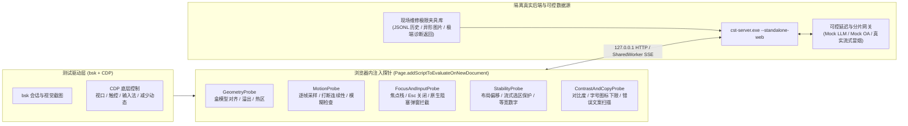

# Rust Web 用户体验端到端测试设计（bsk）

本文定义基于 `bsk`（Browser Skill）与 CDP 原生协议的 Web 用户体验（UX）端到端测试方案，运行宿主为 `cst-server --standalone-web`。[web-rust-bsk-e2e.md](web-rust-bsk-e2e.md) 验证 14 个路由与 28 个静态分支的功能连通性，[web-rust-bsk-deep-e2e.md](web-rust-bsk-deep-e2e.md) 验证长会话压缩与前后端状态机恢复。本文聚焦布局几何精度与输入焦点交互，覆盖动画连续性和流式阅读稳定性，并通过极限数据压力把原本依赖人工目测的体验判断转化为可复现的量化断言。视觉规范见 [DESIGN.md](../../DESIGN.md)，交互要求见 [web/SPEC.md](../web/SPEC.md)，接口契约见 [web/API.md](../web/API.md)。

## 1. 测试组成与页面探针架构

测试在真实 `cst-server --standalone-web` 宿主与隔离 Chromium 实例上运行。脚本通过受控延迟模型服务和极限真实夹具构造确定性时机，由五类页面探针采集量化指标：

五类探针的职责与采集口径如下：

| 探针名称 | 采集接口与实现机制 | 核心量化判据 |
|---|---|---|
| `GeometryProbe` | 读取 `getBoundingClientRect()` 与 `getComputedStyle()`，对比 `scrollWidth` 和 `clientWidth` | 同列元素左右净边缘差 `≤ 1px`。任意断点下 `documentElement.scrollWidth === clientWidth`，外层 `body` 滚动量为 `0`，悬停面板距视口四边 `≥ 16px` |
| `MotionProbe` | 使用浏览器帧回调（`requestAnimationFrame`）逐帧采样，结合 `document.getAnimations()` 与 `CSSKeyframesRule` 遍历 | 关闭时长短于打开时长且禁用 `ease-in`。中途反向打断前后两帧位移与高度差连续无跳变。除登录底层外全程无 `blur()`，减少动态模式下零位移直出 |
| `FocusAndInputProbe` | 监听 `focusin` 轨迹，调用 CDP 中文输入法组合输入（IME）接口 `Input.imeSetComposition`，覆写 `window.alert / confirm / prompt` | 纯键盘操作全程具备可见焦点且不落入 `body`。每次按 `Escape` 仅关闭最内层浮层并归还触发器焦点。中文拼音组合期按 `Enter` 零误发，业务交互零调用原生阻塞弹窗 |
| `StabilityProbe` | 挂载 `PerformanceObserver('layout-shift')` 与 `MutationObserver`，读取 `window.getSelection()` | 排除用户操作后 `500ms` 窗口的累计布局偏移（CLS）`< 0.01`。流式推进与快照替换期间可见字符单调不回退，已有划选文本不丢失，动态计时同行元素横向抖动 `0px` |
| `ContrastAndCopyProbe` | 遍历可见文本与 SVG 节点，按祖先背景逐层 Alpha 合成计算无障碍对比度标准（WCAG AA）相对亮度 | 正文与主要控件文字对比度 `≥ 4.5:1`。常规字号 `≥ 12px`，行高对齐 `4px` 栅格，功能图标盒子 `≥ 14px`。主提示区零暴露原始 JSON 与堆栈或内部英文错误码 |

## 2. 测试环境矩阵与极限真实夹具库

### 2.1 视口与设备环境矩阵

现场维修涵盖机主高分屏笔记本与老旧低分屏办公本，也会遇到左右分屏对照排障与窄窗抽屉场景。测试在 `E:\tmp\<YYYY-MM-DD>\ux-e2e\` 隔离目录启动宿主，按以下环境组合执行：

| 环境代号 | CSS 视口尺寸 | `deviceScaleFactor` | 模拟的真实维修场景 | 交叉维度 |
|---|---|---|---|---|
| `V-FHD` | `1920×1080` | `1.0` | 24–27 寸桌面外接显示器（设计基准骨架） | 浅色 / 深色 |
| `V-Scale125` | `1536×864` | `1.25` | 1080p 笔记本开启 Windows 默认 `125%` 缩放（高频机主环境） | 浅色 / 深色 |
| `V-Tight768` | `1366×768` | `1.0` | 旧款笔记本紧致纵向高度（检验输入框、排队面板与登录页高度预算） | 浅色 / 深色 |
| `V-Split960` | `960×800` | `1.0` | 左右分屏排障临界点（聊天侧栏转浮层，设置页保留侧栏与 `600px` 内容列） | 浅色 / 深色 |
| `V-Split760` | `760×800` | `1.0` | 设置页侧栏转浮层临界点 | 浅色 / 深色 |
| `V-Touch390` | `390×844` | `2.0` | 窄视口抽屉模式，启用 CDP `Emulation.setTouchEmulationEnabled`（无悬停与右键） | 浅色 / 深色 / 减少动态 |

### 2.2 现场维修极限真实夹具（Worst-Case Fixtures）

极限数据均取自真实维修场景可产生的合法值，全部通过会话 JSONL、工作区文件与模拟接口注入：

| 夹具编号 | 注入位置 | 极限真实数据构成 | 针对的排版与交互脆弱点 |
|---|---|---|---|
| `F-SessionMix` | `agent/home/sessions/` | 分别构造 `0` 条空列表、`1` 条单会话与 `25` 条跨自然日会话。包含单字符标题 `C` 和 20 条同名标题 `C盘空间不足排查`，以及 120 字符带方括号和 Emoji 的长标题 | 空态居中提示，长短标题单行截断与复选框挤压，同名会话选区滑动定位与跨零点重分组 |
| `F-DiagUnbreakable` | 预置会话工具结果 JSONL | 包含无空格长硬件 ID `PCI\VEN_10DE...`、260 字符 `DriverStore` 路径与 340 字符单行 PowerShell `runbook` 命令。另含 `0 B` 与未知大小 `null` 的 `ls` 排行及 4000 字符 `eventlog` 崩溃栈原文 | 字段名与数值列对齐，无空格长串折行，命令复制按钮遮挡末字符，以及 `0` 与缺失值 `—` 区分 |
| `F-MarkdownStress` | 助手回复与附件目录 | 包含 18 列宽诊断对比表格与 240 字符不折行日志代码块，以及 6 级标题与 3 层嵌套列表混排。附带 `3200×180` 超宽任务栏图、`240×3600` 竖长截图与 1 张 `404` 缺失附件 | 表格外框圆角裁切与横向滚动，代码块右上角 `52px` 复制按钮避让，异形图限高与大图预览留白 |
| `F-LongHistory` | 长会话 JSONL | 130 轮完整问答（跨过首屏 80 条滑窗阈值）。末轮含 45 次连续普通工具调用，并与 4 类常驻特殊卡片交替出现 | 顶部“显示更早的消息”增载滚动锚定，工具列表 40 项分页加载，折叠懒挂载与过程分段计数 |
| `F-AuthAndModels` | `models.json` 与 Mock OA | 姓名 `欧阳修远·阿卜杜勒热合曼` 配 16 位学号。配置 8 个提供商共 60 个启用模型（含 72 字符自定义模型 ID），覆盖额度 `0`、查询超时 `504` 与网关 `502 Bad Gateway` HTML 报错 | `224px` 模型菜单内部纵滚与右对齐截断，`424px` 默认模型下拉在窄屏的留白，长身份省略与非 JSON 报错清洗 |

## 3. UX 测试套件清单

### 套件 U1：空间几何与紧致视口预算

| 编号 | 检验目标 | 操作序列与环境 | 量化通过判据 |
|---|---|---|---|
| U1-1 | 聊天居中列边缘对齐与留白 | 在 `V-FHD`、`V-Scale125`、`V-Split960` 与 `V-Touch390` 打开包含对话气泡与两类工具卡片及底部输入框的会话 | 正文容器与两类工具卡片及底部 `.composer` 左右边缘差值 `≤ 1px`。桌面主区两侧留白 `≥ 24px`，`≤960px` 两侧留白 `≥ 16px` |
| U1-2 | 紧致视口（`768px` 高）纵向预算 | 在 `V-Tight768` 打开聊天页，向输入框粘贴 3 张图片并插入 `/skill:disk` 标记与 8 行文本，同时挂起 3 条排队项并弹出顶部通知。另导航至 `/login` 测量登录面板 | 聊天滚动区 `.chat-scroll` 剩余可见高度占窗口高度 `≥ 35%`。输入框达到高度上限后转为内部纵向滚动，发送按钮完整可见。`/login` 面板等比缩放后无外层滚动，输入框与关闭按钮高度 `≥ 32px` |
| U1-3 | 连续断点缩放与单滚动容器边界 | 加载 `F-LongHistory` 与 `/s/:id/export` 长预览，将视口从 `1920px` 连续缩至 `960px`、`760px`、`390px` 再拉回 `1440px` | 全程 `documentElement.scrollWidth === clientWidth` 且 `window.scrollY === 0`。长内容仅在右侧页面容器内滚动，侧栏高度恒等于 `window.innerHeight` |
| U1-4 | 悬停面板视口防溢出 | 在 `V-Touch390` 与 `V-Tight768` 依次打开输入框两类面板、侧栏两类菜单与设置页两处下拉（重点核验 `session-actions.tsx` 当前 `8px` 夹紧边距） | 所有悬停面板四边与视口边缘净距均 `≥ 16px`。内部文字无裁切且超高时可内部滚动 |
| U1-5 | 工具卡两级缩进与跨组字段列对齐 | 展开含多分组字段的 `disk(all)` 与 `driver(core)` 工具卡片，继续展开到底部“原始数据”原文块 | 工具列表缩进 `24px`，卡片详情再缩进 `24px`，参数、字段与原文块共用左缘（误差 `≤ 1px`）。同卡不同分组的 `<dd>` 数值列左缘对齐（误差 `≤ 1px`），两层引导竖线连续延伸至底端 |
| U1-6 | 图标控件热区尺寸与按下反馈 | 遍历两处复制按钮，以及通知关闭和侧栏折叠按钮。另检查 `.chip-remove` 与 `.draft-image-remove` 两个附属角标按钮，派发鼠标移入与按下事件 | 常规操作按钮热区 `≥ 28×28px`，附属角标按钮热区 `≥ 20×20px` 且与相邻可点区域无重叠区域。悬停与 `:active` 按下均有明确视觉状态变化 |

### 套件 U2：输入与焦点及中文输入法

| 编号 | 检验目标 | 操作序列与环境 | 量化通过判据 |
|---|---|---|---|
| U2-1 | 中文输入法（IME）组合输入全周期 | 在空输入框、已有中文段落中间及 `/skill:disk` 标记右侧，通过 CDP `Input.imeSetComposition` 输入 `cipanmanle`。组合态结束前依次派发 `Enter`、`Escape`、`ArrowDown` 与 `Backspace`，再调用 `Input.insertText("磁盘满了")` 上屏 | 组合期间按 `Enter` 发送请求数为 `0`，不误触斜杠补全面板。`syncFromEditor` 不打断激活的组合选区，上屏后光标紧跟“磁盘满了”末尾且无丢字或重复字符 |
| U2-2 | 多行内标记组合编辑与光标移动 | 在输入框键入 `/skill:disk` 按 `Tab` 生成技能标记，输入 `排查` 后键入 `@` 选择第 1 个工作区文件，输入 `对比` 后再次键入 `@` 选择第 2 个文件，最后点击第 1 个文件标记的 `.chip-remove`（重点核验 `composer.tsx` 中 `selectFile` 保留已有标记的行为） | 输入框完整保留 `/skill:disk` 与两个 `@file` 共 3 个 `.composer-chip` 节点，选后序文件不丢失前序标记。删除中间标记后剩余标记与两侧正文完好，光标落回被删标记原位 |
| U2-3 | 大段日志富文本粘贴清洗与无空格折行 | 复制一段带 HTML 彩色背景样式的 120 行系统报错日志与 300 字符无空格注册表路径，粘贴进入输入框，按 `Shift+Enter` 换行并纵向滚动 | 输入框仅保留纯文本与换行，过滤外部样式标签。300 字符无空格长串在输入框内自动折行而不撑宽外框，发送后消息气泡保留原始多行结构 |
| U2-4 | 图片粘贴、文件拖入与体积超限提示 | 测试 `Ctrl+V` 粘贴剪贴板 PNG 与文件框多选 2 张 WebP，向输入框派发文件 `drop` 拖入 JPEG，最后粘贴合计超过 `12 MiB` 的大图 | 粘贴、多选与拖入均生成 `80×64px` 缩略图且拖入有明确承接反馈。超限操作被拦截并在输入框就近展示中文大小限制提示，已有文字草稿与前序合法图片零丢失 |
| U2-5 | 流式运行期零主线程阻塞弹窗 | 让会话保持 `24ms` 步进流式输出，在此期间执行侧栏会话重命名并模拟一次 `500` 失败，再在输入框有新草稿时点击发送失败气泡的“编辑”按钮 | `FocusAndInputProbe` 捕获的 `window.alert / confirm / prompt` 调用次数全部为 `0`。确认与输入均采用应用内非阻塞组件，操作停留期间后台流式字符持续推进不冻结 |

### 套件 U3：键盘可达性与焦点归位

| 编号 | 检验目标 | 操作序列与环境 | 量化通过判据 |
|---|---|---|---|
| U3-1 | 纯键盘核心排障完整流程 | 全程禁用鼠标事件，从 `/` 按 `Tab` 进入输入框与模型菜单切换档位并发送消息。回复完成后用键盘展开过程折叠与工具详情，按 `Enter` 复制 `runbook` 命令，再进入 `/s/:id/tree` 用 `↑/↓` 与 `Ctrl+O` 浏览节点 | 每次 `Tab / Shift+Tab` 移动后 `document.activeElement` 均具备可见 `--focus-shadow` 焦点环。焦点顺序符合视觉阅读流，全程不出现 `activeElement === document.body` 的焦点丢失 |
| U3-2 | 多层浮层 `Escape` 逐层关闭与焦点归位 | 依次验证 5 组嵌套浮层：模型子列表到主菜单再到输入框、分支树过滤下拉到树页再到聊天页、`/login` 下拉到面板再到来源页、大图预览到原缩略图，以及通知技术详情到通知本体 | 每次按 `Escape` 严格只关闭当前最内层浮层，不跨层误关外层页面或中断会话。浮层关闭后 1 帧内 `document.activeElement` 精确回到打开该浮层的原触发元素 |
| U3-3 | 触控抽屉长按与纯键盘会话单条操作 | 在 `V-Touch390` 打开侧栏抽屉对会话行长按 `450ms` 并松手，在 `/sessions` 检查操作入口。另在桌面端仅用键盘聚焦侧栏会话行并按 `Shift+F10`（或 `ContextMenu`）后按 `Escape` | 触控长按唤起会话操作菜单且松手后抑制路由误跳转。纯键盘 `Shift+F10` 定位唤起菜单并聚焦首项，按 `Escape` 焦点回到原会话行，`/sessions` 更多按钮保持可见 |
| U3-4 | 原生模态框焦点锁定与防误触默认焦点 | 依次打开首次缺密钥弹窗与大图预览，再打开批量删除和运行中“退出 CST Pilot”两个确认框，连续派发 15 次 `Tab` 与 `Shift+Tab` | 焦点严格在当前 `<dialog>` 内部循环，背景页面元素不可被聚焦或点击。“退出 CST Pilot”确认框初始焦点落在“继续使用”取消按钮上，防止连按回车误关宿主 |
| U3-5 | 模型范围键盘重排与密钥失焦即存 | 在 `/settings/models` 聚焦某启用模型行，连续按 3 次 `Alt+ArrowUp` 与 2 次 `Alt+ArrowDown`。另在 `/settings/provider` 填入新密钥后按 `Tab` 移出输入框 | 模型行随快捷键实时上下交换且键盘焦点锁定在该行不丢失。密钥框失焦立即保存并展示单条“已自动保存”通知，重复快速失焦不堆叠多条重复通知 |

### 套件 U4：动画连续性与中途打断

| 编号 | 检验目标 | 操作序列与环境 | 量化通过判据 |
|---|---|---|---|
| U4-1 | 开关不对称时长与缓动曲线合规性 | 先采集悬停面板与模态弹窗的开合帧序列，再采集模型三级选择器、侧栏展开收起及图片原位缩放的开合帧序列 | 关闭时长严格小于打开时长（弹窗与下拉 `250ms` 开 / `150ms` 关，侧栏 `400ms` 开 / `350ms` 关，图片预览 `350ms` 开 / `250ms` 关）。动画不使用 `ease-in`，关闭过程无过冲回弹 |
| U4-2 | 动画半程反向打断零跳变 | 在侧栏收起至 `150ms`、模型主菜单滑向子列表至 `100ms`、历史过程块展开至 `100ms` 及大图预览打开至 `120ms` 时立即触发反向操作，用 `requestAnimationFrame` 连续记录打断前后各 10 帧 | 打断后首帧的 `transform / height / opacity` 从打断瞬间的当前呈现值反向过渡。打断前后相邻两帧位置跳变 `< 6px`、透明度跳变 `< 0.08`，结束后容器恢复自适应高度 |
| U4-3 | 高频连点切页、选区追踪与零模糊核验 | 在 `600ms` 内快速连点侧栏 5 个不同会话，在 `/settings` 快速连点切换四个分类标签，并在 `/s/:id/export` 连续切换 4 次主题与包含项 | 侧栏 `.sidebar-selection` 与设置导航下划线保持单实例平滑滑向最终目标。除 `/login` `.login-behind` 保留 `blur(20px)` 外，所有关键帧与转场伪元素均无 `blur()`，结束后无残留 `inert` 锁定 |
| U4-4 | 离屏与后台标签页动画节能暂停 | 在运行中会话渲染 `RunningLight` 扫光文字与 `RunningCorner` 特殊卡片反光，先将该卡片滚出视口外，再滚回视口并调用 CDP 将页面可见性切为 `hidden` | 离屏卡片与隐藏标签页下的光影动画及首页 WebGL 渲染循环立即暂停（采样 `500ms` 帧计数增长为 `0`）。切回可见态后正常恢复且不快进补播积压帧 |
| U4-5 | 运行期实时开启 `prefers-reduced-motion` | 在首页开场动画与页面切换进行中途，通过 CDP 动态切换 `prefers-reduced-motion: reduce`。随后切换会话并发送消息，再触发顶部通知与过程展开 | 切换瞬间在途空间位移立即收敛结束。减少动态模式下后续切页与各类组件入退场的位移量均为 `0px`，直接呈现完成态 |

### 套件 U5：流式阅读与滚动锚定

| 编号 | 检验目标 | 操作序列与环境 | 量化通过判据 |
|---|---|---|---|
| U5-1 | 流式输出期间上翻阅读与划选复制保护 | 启动一段持续 3 秒的流式工具与正文回复，输出至第 500 字时向上手动滚动 `180px` 脱离底部，拖选上方一段历史命令文本并保持至流式定稿与快照合并完成 | 手动上翻后自动跟随立即停止，`scrollTop` 在后续流式节拍与 `message_end` 交接期间偏移 `0px`。`window.getSelection().toString()` 全程原封保留，“回到底部”按钮浮现且不遮挡排队面板 |
| U5-2 | 130 轮长会话顶部增载滚动锚定 | 打开 `F-LongHistory` 会话（默认渲染最近 80 条），滚动至顶部阅读第 51 轮首条可见消息并记录其 `top` 坐标，点击“显示更早的消息（剩余 50 条）” | 前 50 条历史插入后，原第 51 轮消息在视口内的 `top` 坐标变化 `≤ 2px`，用户无需重新寻找阅读位置 |
| U5-3 | 预载即时显示、慢速快照交接零白屏与零 CLS | 对后端快照接口注入 `800ms` 延迟：先点击侧栏前 10 条已预载会话切换，再点击第 15 条未预载会话，最后在流式发出 `message_end` 至慢快照返回的窗口内逐帧采样 | 已预载会话 `1` 帧内直接渲染目标正文，不闪现加载态或旧会话正文。流式结束至慢快照返回期间正文容器高度与字符长度单调不归零，全程非交互触发的 `CLS < 0.01` |
| U5-4 | 实时计时器与进度数值等宽防抖 | 录制过程头“工作中 `8` 秒 → `9` 秒 → `10` 秒”、CSTOA 二维码倒计时“`05:00` → `04:59`”及 `sys(overview)` CPU 和内存百分比刷新过程 | 计时与数值区域启用等宽数字排版，同位数跳变引发的相邻图标或文字横向位移为 `0px` |
| U5-5 | 弹出通知悬停阅读暂停与详情尺寸不变 | 连续触发 3 条顶部通知（纵向间隔 `8px` 堆叠），在第 1 条通知弹出 `1.0s` 时移入状态图标展开“技术详情”并保持 `3.5s`，再按 `Escape` 收起详情并移出鼠标 | 通知在侧栏右侧的主内容区内顶部水平居中。悬停与聚焦期间通知不自动消失，展开技术详情浮层时主气泡宽高变化为 `0px`，移出后走完剩余展示时长退场 |

### 套件 U6：极限真实数据压力测试

| 编号 | 检验目标 | 操作序列与环境 | 量化通过判据 |
|---|---|---|---|
| U6-1 | 会话列表极端数量与极端标题 | 依次挂载 `F-SessionMix` 的空列表、单条与 25 条混合标题夹具，在 `V-FHD` 与 `V-Touch390` 检查侧栏与 `/sessions` 管理态 | 空列表展示居中清晰空态。`1` 字符与 `120` 字符 Emoji 标题行高保持一致（侧栏 `32px`、全部会话页 `40px`），超长标题单行省略且不挤压日期与复选框，悬停可见全文 |
| U6-2 | 无空格长路径、超长命令与 18 列宽表格 | 打开挂载 `F-DiagUnbreakable` 与 `F-MarkdownStress` 的会话，展开全部诊断卡片、代码块与宽表格 | 260 字符路径与硬件 ID 在卡片内折行或局部滚动，不撑宽卡片外框。代码块正文右侧保留 `52px` 留白，复制按钮不遮挡字符且复制反馈不改块高。18 列宽表格仅在容器内横向滚动并支持键盘左右滚动 |
| U6-3 | 超宽超长异形图片与损坏附件降级 | 打开含 `3200×180` 横幅图、`240×3600` 竖长图与 `404` 损坏附件的会话及草稿栏，点击正常图片打开大图预览并按窗口缩放 | 聊天流与工具卡内异形图按容器限高限宽呈现，单图高度不超过视口高度 `60%`。大图预览保持原始宽高比居中且四周留白 `≥ 24px`。`404` 附件展示清晰损坏占位，无破损图片图标或高度归零 |
| U6-4 | 60 模型长名目录、超长身份与零值边界 | 挂载 `F-AuthAndModels`，先检查侧栏左下身份行与 `/account` 资料卡，再检查输入框 `224px` 模型选择器、`/settings/models` 列表及额度面板 | `224px` 模型列表右对齐省略整齐且内部平滑纵滚。长姓名与学号单行省略，不换行撑破 `56px` 资料行。额度为 `0` 时原样显示 `0`，失败态提供行内“重试”且点击可恢复 |

### 套件 U7：双主题对比度、令牌下限与错误提示

| 编号 | 检验目标 | 操作序列与环境 | 量化通过判据 |
|---|---|---|---|
| U7-1 | 浅深双主题与背景降级态 WCAG 对比度 | 在浅色、深色及禁用 WebGL（触发 CSS 渐变降级）三种状态下遍历 14 个路由，运行 `ContrastAndCopyProbe` 扫描所有可见文本 | 正文与标题、输入控件及菜单错误说明的对比度均 `≥ 4.5:1`。首页欢迎语在动态背景与 CSS 降级底上清晰可读，全站无第 9 步实心语义色块直接承载纯白小号正文 |
| U7-2 | 字号、行高栅格与图标最小尺寸审计 | 遍历全部 14 个路由，展开普通工具卡、特殊组件与弹窗，读取全部可见文本 `fontSize / lineHeight` 与 SVG 图标渲染宽高（重点核验 `special-tool.tsx` 与 `composer.tsx` 中 `12px` 图标） | 正文与辅助说明字号 `≥ 12px`（仅账户特定说明例外）。正文与列表行高落在 `16 / 20 / 24 / 28 / 32px` 栅格，常规与工具状态图标渲染尺寸 `≥ 14px` |
| U7-3 | 隐藏内部错误细节与错误恢复 | 依次注入未配置凭据、上游 `401`、限流 `429`、写锁冲突 `409`、磁盘满 `ENOSPC`、网关 `502` HTML 报错与导出超高 `export_too_tall` | 主提示区全部为直白中文结论与恢复动作按钮，零出现 `{`、`Error:`、`stack`、`ENOSPC`、`409` 或 HTML 标签。原始报错收进默认折叠的“技术详情”且密钥已脱敏，完成配置返回后原输入草稿完整保留 |
| U7-4 | 连续点击防护与幂等保护 | 在首页与聊天页连点发送及 BitLocker 提交按钮，在设置页与导出页连点“更新模型”“生成并保存”和“打开目录”按钮（均为 `40ms` 间隔连点 5 次） | 后端仅收到 1 次有效业务写入请求。按钮首次点击后立即呈现忙碌或禁用状态，页面不重播入场动画且不弹出重复通知 |

## 4. 问题分级与测试产物目录

实测发现的体验缺陷按对现场排障的影响分为三级：

| 级别 | 判定标准 | 典型表现 | 处置要求 |
|---|---|---|---|
| `P0` 阻断与丢损 | 导致用户输入丢失、关键控件在目标视口被裁切不可点、主线程冻结或敏感信息外露 | 选 `@` 文件覆盖已有技能标记，窄屏弹窗按钮超出屏幕外，拼音组合回车误发半截输入，或错误后草稿丢失 | 阻塞发布，立即修复并补齐自动化回归断言 |
| `P1` 交互与阅读断层 | 功能可完成，但打断阅读过程、破坏纯键盘操作或产生明显界面闪烁 | 流式输出重置手动滚动位置，长历史加载后跳回顶部，`Esc` 一次误关两层面板，焦点掉入 `body`，或主界面暴露英文错误码 | 当前迭代内修复 |
| `P2` 视觉与微交互偏差 | 像素对齐与动效曲线偏离设计令牌，或字号、图标及局部对比度未达标 | 列边缘偏差 `> 1px`，关闭动画慢于打开动画，计时数字轻微抖动，或图标小于 `14px` | 集中批次收口并同步校准画布与样式令牌 |

单轮执行产物统一写入 `E:\tmp\<YYYY-MM-DD>\ux-e2e\`，保留以下四项结果供复核与回归比对：

1. `ux-report.json`：U1–U7 共 34 项用例的量化采样原始数值、通过状态与违规节点选择器。
2. `frames/`：中途打断、切页与流式交接的 `requestAnimationFrame` 逐帧数值序列（JSON）与关键帧截图。
3. `screenshots/`：6 档视口、浅深双主题与极限真实夹具组合下的标准状态截图。
4. `contrast-and-tokens.json`：全站对比度低于 `4.5:1` 或字号图标低于下限的节点清单。

## 5. 待讨论与延后收口项

以下设计规格口径与组件微观尺寸留待后续 Web 设计语言统一修订阶段集中处理：

| 主题 | 事项 | 当前状态 | 后续处理方向 |
|---|---|---|---|
| 热区尺寸 | 行内标记移除按钮热区（关联 `U1-6`） | `.composer-chip .chip-remove` 当前渲染尺寸为 `16×16px`，低于 `20×20px` 附属角标热区下限 | 随设计语言修订统一放大可点热区 |
| 令牌下限 | 小号标签与附属图标尺寸（关联 `U7-2`） | `/login` 页 `APIKEY` 标签在缩放视口下为 `10.5px`，`special-tool` 状态与详情箭头及 `.draft-image-remove` 图标为 `12×12px` | 随设计语言修订统一对齐 `12px` 字号与 `14px` 图标下限 |

## 6. 实机执行结果

2026-11-11 在 Windows 11（`bsk 0.4.2`，Chromium `157.0.0.0` 与隔离 CDP 探针，宿主 `target\debug\cst-server.exe --standalone-web`）执行 U1 至 U7 共 34 项用例。真实流式阅读（`U5-1`）与连点幂等（`U7-4`）接入 `opencode-go/deepseek-v4.1-flash` 真实推理，测试结束后已关闭受控浏览器会话并清理隔离目录临时凭据。完整原始采样与截图保存在 `E:\tmp\2026-11-11\ux-e2e\`。

**34 项用例中 32 项通过（含全部 `P0` 与 `P1` 项），仅剩归入第 5 节统一设计语言修订的 `U1-6` 与 `U7-2` 两项 `P2` 指标待后续集中调整**。

### 6.1 用例结果汇总

| 编号 | 结果 | 实测关键指标与证据摘要 |
|---|---|---|
| U1-1 | 通过 | `V-FHD`、`V-Scale125`、`V-Split960` 与 `V-Touch390` 四档视口下正文容器和两类卡片及输入框左右边缘差均为 `0px` |
| U1-2 | 通过 | `1366×768` 聊天滚动区占比 `62.0%` 且输入框内部纵滚。`/login` 零外层滚动，全部交互按钮与输入框高度均 `≥ 32px` |
| U1-3 | 通过 | `1920px` 至 `390px` 连续缩放全程 `scrollWidth === clientWidth` 且外层 `scrollY === 0` |
| U1-4 | 通过 | 6 类悬停面板与会话菜单在 `390px` 和 `1366×768` 靠边弹出时四边距视口边缘均 `≥ 16px` |
| U1-5 | 通过 | 工具列表与详情两级缩进均为 `24px`，`disk(all)` 跨卷组 16 项 `<dd>` 数值列左缘偏差 `0px` |
| U1-6 | 待收口（`P2`） | 两类复制按钮（`32px / 28px`）与删图角标（`20px`）达标。`.chip-remove` 热区为 `16×16px`（归入第 5 节统一修订） |
| U2-1 | 通过 | 中文拼音组合期间按 `Enter` 发送请求数为 `0`，不误触命令补全，标记右侧上屏无丢字 |
| U2-2 | 通过 | `/skill:disk` 与连续两个 `@file` 共 3 个 `.composer-chip` 完整共存，删除中间标记后正文完好且光标归位 |
| U2-3 | 通过 | 120 行带样式日志粘贴洗净外部标签，300 字符无空格路径自动折行零撑宽，发送后 `.user-bubble` 完整保留多行换行 |
| U2-4 | 通过 | 粘贴与拖入文件均生成 `80×64px` 缩略图，超 `12 MiB` 明确提示“图片总大小不能超过 12 MiB”且保留已有草稿与合法附图 |
| U2-5 | 通过 | 流式运行期应用内重命名弹窗（含报错重试）与草稿覆盖确认弹窗全程 `window.alert / confirm / prompt` 调用数为 `0`，后台流式持续推进 |
| U3-1 | 通过 | 18 步连续 `Tab` 零落入 `body`，过程展开、命令复制与分支树方向键导航均具可见焦点环 |
| U3-2 | 通过 | 模型选择器子列表按第 1 次 `Escape` 退回主菜单，第 2 次 `Escape` 关闭并归还 `.composer-model` 焦点；登录页、大图预览与通知详情逐层关闭正常 |
| U3-3 | 通过 | `390px` 触控抽屉长按唤起会话操作菜单且松手抑制误跳转，桌面纯键盘 `Shift+F10` 唤起菜单与 `Escape` 归还会话行焦点均通过 |
| U3-4 | 通过 | 退出确认框默认聚焦“继续使用”，退出框、大图预览与应用内弹窗连续 15 次 `Tab` 焦点严格在 `<dialog>` 内循环 |
| U3-5 | 通过 | `Alt+ArrowUp` 连续重排启用模型顺序后焦点始终保持在原行 `.settings-grip` 手柄上，密钥框失焦即存仅触发单条通知 |
| U4-1 | 通过 | 动画打开与关闭时长严格不对称（大图预览 `350ms` 开 / `250ms` 关，弹窗 `250ms` 开 / `150ms` 关），全站零 `ease-in` |
| U4-2 | 通过 | 侧栏 `150ms` 与过程块 `100ms` 半程反向打断逐帧曲线连续平滑，帧数据已归档至 `frames/` |
| U4-3 | 通过 | `600ms` 连点切换 5 个会话保持单实例选区滑块并准确落位，已挂载节点与活动关键帧零 `blur()` |
| U4-4 | 通过 | 页面切换为 `hidden` 后台态 `500ms` 窗口内首页 WebGL 绘制帧增长为 `0`，恢复可见后正常重连 |
| U4-5 | 通过 | 运行期动态开启 `prefers-reduced-motion: reduce` 后新发送气泡 `animationName = none` 零位移直出 |
| U5-1 | 通过 | 真实 `opencode-go/deepseek-v4.1-flash` 流式输出至定稿期间，手动滚轮上翻后 `scrollTop` 偏移 `0px` 且已划选文本原封保留 |
| U5-2 | 通过 | 130 轮长会话按完整用户轮边界切分滑窗，点击“显示更早的消息”前置增载后原阅读轮次视口 `top` 偏移 `0px` |
| U5-3 | 通过 | `800ms` 慢速快照延迟下，侧栏已预载会话即时渲染正文且零空白帧，累计布局偏移 `CLS = 0.0003` |
| U5-4 | 通过 | 整机概览百分比与计时文本同位数跳变横向位移 `0px` |
| U5-5 | 通过 | 通知在主内容区水平居中（偏差 `0px`），悬停与聚焦保持 `3.2s` 不消失且主气泡宽高不变，移出并失焦后自动退场 |
| U6-1 | 通过 | `1` 字符至 `120` 字符 Emoji 标题下侧栏行高恒为 `32px`、`/sessions` 主列表行高恒为 `48px`，单行省略零挤压 |
| U6-2 | 通过 | `260` 字符长路径与 `18` 列宽表格局部横滚（含键盘聚焦）正常，代码块复制与失败反馈均零块高跳变（`0px`） |
| U6-3 | 通过 | `3200×180` 与 `240×3600` 异形图限高呈现，竖长图预览居中且上下留白 `24px`，保持原始宽高比 |
| U6-4 | 通过 | `224px` 模型选择器（实测 `224×440px`）承载 91 个长名模型平滑纵滚，侧栏身份行高维持 `32px` |
| U7-1 | 通过 | 全站 14 个路由浅深双主题稳态扫描（1,103 个文本节点）及首页禁用 WebGL 渐变降级态对比度均 `≥ 4.5:1` |
| U7-2 | 待收口（`P2`） | `/login` 页 `APIKEY` 缩放标签为 `10.5px`（`< 12px`），`special-tool` 状态与详情图标及 `.draft-image-remove` 图标为 `12×12px`（归入第 5 节统一修订） |
| U7-3 | 通过 | 顶部通知、横幅与待发消息失败状态均经 `presentError` 输出直白中文并脱敏密钥，零暴露 `ENOSPC`、JSON 或 HTML 标签 |
| U7-4 | 通过 | `40ms` 间隔连点 5 次发送与导出按钮均仅发出 `1` 次写入请求，真实模型上游调用增量为 `1` |
