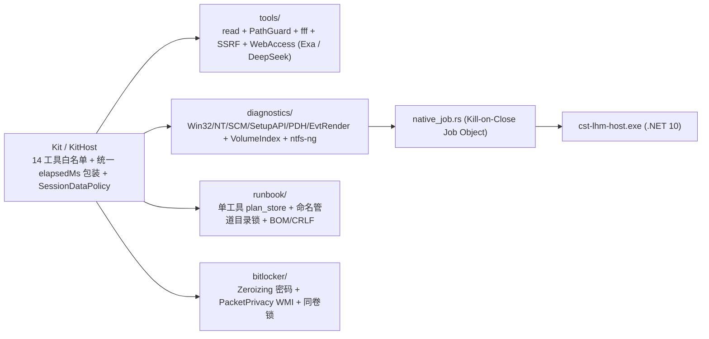

# 开放工具架构

本页说明 `crates/cst-kit` 中全部 14 个开放工具的装配管线、安全守卫、Windows 原生采集层、联网检索与命令方案存储机制。行为约束见 [SPEC.md](SPEC.md)，接口定义见 [API.md](API.md)，模块目录映射见 [6.cst-pilot.md](../rust/plan/6.cst-pilot.md)。

## 模块组成与挂载管线

`CstPilotExtension` 通过 `pi-runtime` 公开静态扩展接口挂载全部业务工具、统一计时包装、技能与数据策略：

| 子目录 | 核心文件与职责 |
|---|---|
| `src/kit.rs`、`src/tools/` | 锁定 14 工具白名单，经 `wrap_tool_timing` 为全部工具注入顶层整数 `elapsedMs` 并将错误转为结构化 JSON。`read.rs` 基于 `PathGuard` 与图片处理器输出文本 JSON 或 `[Text(JSON), Image]` 双块。`path_guard.rs` 提供调用级 `PathGuardSession`、单句柄身份核验与搜索专用守卫。`fff` 模块实现独立 `FffindInput`/`FfgrepInput`、多盘并行 Win32 `FileIdBothDirectoryInfo` 双梯队遍历、提权 NTFS `$MFT + USN V2` 不可变内存索引 `VolumeFileIndex`（与 `VolumeIndex` 共享 `384 MiB` 进程预算并按 `180 s` 定时回收）及持久化流式多编码 `ffgrep`，注册 `output_schema` 并按整条 `matches` 原子裁剪 `50 KiB` 同步填充 `structured_content`。`ssrf.rs` 与 `web_access.rs` 实现 DNS 私网拦截、GB18030 解码、Exa/DeepSeek 并发调度与会话有界缓存 |
| `src/diagnostics/` | `win_native.rs` 与 `win_native/windows/{process,system,storage,events}.rs` 封装 `NtQuerySystemInformation(5)`、Win32 内存／内核池／开机时长、SCM、SetupAPI、存储 IOCTL 与 `EvtRenderEventValues`，并在阻塞线程池内绑定分工具预算（常规 30 秒，`ls` 与 `disk usage` 215 秒，全局 4 个并发槽位）。`walk.rs` 实现无条目上限并行 `FileIdBothDirectoryInfo` 遍历与 `CancelSynchronousIo` 取消，`mft.rs` 与 `volume_index.rs` 管理纯 Rust `ntfs-ng` `$MFT` 扫描与卷级缓存，`hardware/pdh.rs` 缓存本地化计数器路径并双采样，`result.rs` 执行 `50 KiB` 受保护键结构化裁剪 |
| `src/runbook/` | `model.rs`、`plan_store.rs`、`mod.rs` 统一管理单工具 `runbook` 的方案持久化（`data/plans/<ID>/v*.json`）、当天序号分配（`01–999`）、版本乐观锁与 `.txt` 导出。`storage.rs` 持有各级目录句柄拒绝重解析点与硬链接，导出 `DirectoryLock` 供认证与方案写入共用 |
| `src/bitlocker/` | `credentials.rs` 实现 `SessionDataPolicy` 与瞬态 `Zeroizing<String>` 凭据表（释放 `BSTR` 前逐单元清零）。`wmi_encryptable.rs` 建立 `PacketPrivacy` 加密 DCOM 连接调用 `UnlockWithNumericalPassword` 与 `Decrypt`。`lock.rs` 维护跨进程卷锁，`core.rs` 执行状态复查 |

## 统一计时与 `50 KiB` 受保护键裁剪

1. **外层计时包装（`kit.rs::wrap_tool_timing`）**：工具执行完毕后按 `Instant::now().elapsed().as_millis()` 计算整数 `elapsedMs`。成功、降级与裁剪结果通过 `inject_elapsed_ms` 写入顶层 `details` 与首个 `Text` JSON 块，保持后续 `Image` 块原样不动；`Err(msg)` 转为 `Ok(error_result(msg, elapsed_ms))`（`is_error: true`），向模型与界面输出合法 JSON `{"error": "...", "elapsedMs": N}`。
2. **单入口受控裁剪（`diagnostics/result.rs`）**：全部 JSON 工具（含 `tools/mod.rs::json_result`）统一复用 `diagnostic_result`。超过 `51,200` 字节时优先缩短非受保护长数组与字符串，保护列表键（`elapsedMs`、`degraded`、`degradedFrom`、`error`、`notice`、`file`、`dir`、`name`、`runbookId`、`version`、`sequence`、`action`、`level`、`levelLabel`、`items`）不被抹除。`details` 始终保留完整对象。

## Windows 原生采集与隔离边界

1. **分层原生采集与 WMI 后备**：
   - `sys(proc)` 与 `sys(io)` 共享 `NtQuerySystemInformation(5)` 全量进程快照，编译期以 `offset_of!` 校验 x64 结构偏移；`sys(proc)` 仅对最终 Top-N 进程复用 32 KiB 缓冲查路径；`sys(io)` 物理盘吞吐走 PDH `PhysicalDisk`，与进程双采样重叠于同一 `1.2 s` 窗口。
   - `sys(overview)` 使用 `GetSystemTimes` 200 ms 双采样、`GlobalMemoryStatusEx`、`GetPerformanceInfo`、`GetTickCount64`、`K32EnumPageFilesW`、`GetLogicalProcessorInformationEx` 与注册表读取机型／BIOS。
   - `sys(gpu)` 先读适配器列表，存在非 NVIDIA 物理显卡时在 PDH `1.2 s` 窗口内并行执行 `lhm(Gpu)` 与 `nvidia-smi`；进程名走 `CreateToolhelp32Snapshot`；PDH 本地化路径在进程内缓存复用。
   - `startup` 与 `driver(core)` 的服务列表走 SCM，签名驱动走 SetupAPI；`eventlog` 走 `EvtNext(64)` + `EvtRenderEventValues` 并复用渲染与消息缓冲。
   - 任意原生接口返回不支持或失败时按子项回退 WMI 并记录错误，不影响其余成功字段。
2. **有界阻塞与无泄漏槽位**：COM/WMI、Win32 与 Event Log 运行在隔离阻塞线程中，逐批检查取消令牌与时间预算。超时返回后未退出的底层调用继续持有槽位直至自然返回，防止线程堆积。SMART 单次最多查询 256 块物理盘；事件日志单通道扫描上限 100,000 条。
3. **Job Object 受控子进程（`native_job.rs`）**：调用 `app/tools/lhm/host/cst-lhm-host.exe`（上限 20 秒）时以挂起方式无 Shell 创建进程，绑定 `JOB_OBJECT_LIMIT_KILL_ON_JOB_CLOSE` 后恢复运行。取消、超时或主进程崩溃时由内核立即终止整个子进程树。

## 共享目录大小缓存（`VolumeIndex`）

`volume_index.rs` 与 `mft.rs` 提供进程内按盘符缓存纯 Rust `ntfs-ng` 紧凑索引的能力。管理员权限下的本地 NTFS 根目录默认启用，`CST_DISABLE_MFT=1` 强制关闭扫描与缓存读取：

| 内部字段 | 存储内容 |
|---|---|
| `identities` | `盘符 -> (单调探针序号, Win32 卷序列号 + 文件系统 + 根目录创建时间 + 卷 GUID)`（探测在互斥锁外执行，拒绝乱序旧探测覆盖新代际） |
| `snapshots` | `盘符 -> Arc<ScanSnapshot>`，复用 `ntfs_ng::index::DirectoryIndex`、按 `DirId` 索引的合计数组与重解析剪枝位图，附采集时间（120 秒有效期，上限 4 卷且总驻留 ≤ 128 MiB）及预聚合排行 |
| `failed` / `pending` | 30 秒短冷却失败记录 / 按 `(盘符, 卷身份)` 键控的订阅引用计数单飞句柄（全员取消时才中止物理扫描） |

缓存不变量：

1. **换盘、过期与字节驱逐**：每次读写前在锁外核对卷身份，并清理全部盘符的过期快照与失败项。换盘时立即不可命中并移除对应快照；内存驻留由卷数（4 卷）与字节预算（128 MiB）共同驱逐释放。
2. **完整性与口径一致**：`$MFT` 扫描遇不可读、未映射、损坏记录或超内存上限时拒绝发布缓存。`ls` 仅在全部直接子目录均通过 `FileReference` 与 `PathPolicy::LIVE` 路径核验时返回 `native-index`；任一项未命中则整次统一走 `walk`，不缓存目录遍历结果。

## 联网检索与服务端接口桥接

1. **热加载配置与并发控制（`web_access.rs`）**：`WebAccess` 每次调用从 `data/config/web-search.json` 读取最新配置（兼容迁移 v1），通过 `tokio::sync::Semaphore` 限制多词与多链接并发度，`join_all` 汇总结果保持输入顺序并隔离单条错误。
2. **服务端设置与导出接口（`cst-server`）**：
   - `GET/PATCH /api/settings/web-search` 与 `POST /api/settings/web-search/test` 托管在 `crates/cst-server/src/routes/settings.rs`，落盘原子替换且返回脱敏视图（`hasApiKey` / `apiKeyTail`），不回显明文密钥。
   - `POST /api/sessions/:id/runbook/export` 托管在 `crates/cst-server/src/routes/sessions.rs` 与 `runbook.rs`，从会话历史解析 `runbookId` 与 `version`，调用 `RunbookStore::export_version` 生成 `.txt` 并按 `open: true` 触发系统记事本打开。

## BitLocker 隐私策略与中断复查

1. **三处脱敏拦截点**：`SessionDataPolicy` 在写入 `ExecutionStateStore` 前、`message_end` 写入 `SessionStore` 前及向同步／异步订阅者分发事件前统一脱敏恢复密码。流式增量置空未完成的数字尾部，界面直接读取脱敏后的完整 `partial` 快照。AI 填参原文仅在当前轮次请求上下文与 3 分钟过期的 `Zeroizing` 瞬态表中一次性绑定 `tool_call_id` 领取。
2. **跨进程锁与实时复查**：同卷命名管道锁 `\\.\pipe\cst-pilot-bitlocker-<sha256>` 全程覆盖本地确认、WMI 调用与最终复查。调用超时、取消或启动检测到 `requires_state_verification` 时，独立查询 `Win32_EncryptableVolume` 当前锁定与转换状态，写入 `cst.bitlocker-state-verification` 条目并保持 `operation.status = "unknown"`。
